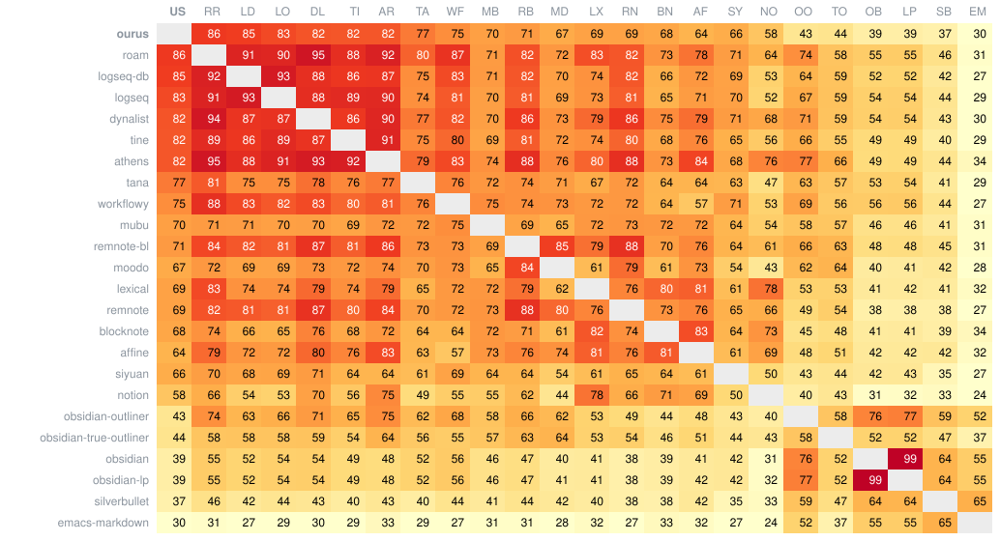

# SxS: the spec side by side

The [behavior spec](../spec/README.md) is written editor-neutral: drawn buffers and the keys between
them. The SxS plays each case in other outliners and Markdown editors, live, with their own keys, and
compares where each app ends up with where ourus does. A difference is evidence of what users expect,
not a failure.

- **Block outliners**: Logseq (file-based and DB), Tine, Roam, Athens, WorkFlowy, Dynalist, Tana,
  RemNote with bullets.
- **Free-form block editors**, with paragraphs and headings outside lists: SiYuan, BlockNote, RemNote
  without bullets.
- **Markdown text editors**: Obsidian (Source mode, Live Preview, Outliner, true-outliner),
  SilverBullet, Emacs with markdown-mode.

A block app has no paragraphs, blank lines or quotes, so it plays a case drawn onto its blocks: a
verdict in brackets, `(✗)`, is such an adapted case, and cases tagged `free-form` don't run in pure
block apps. Each app's report, linked from its column, draws every disagreement side by side, and its
skips with their reasons.

Running it, adding an app, and how it works: [`run.md`](run.md).

## Summary

|  | id | model | agree | caret | whitespace | disagree | error | skipped | not run | total |
| --- | --- | --- | --- | --- | --- | --- | --- | --- | --- | --- |
| [Roam](roam.md) | RR | block | 757 (82%) | 31 | 42 | 96 (10%) | 1 | 774 |  | **1701** |
| [Logseq (DB)](logseq-db.md) | LD | block | 779 (81%) | 18 | 47 | 112 (12%) | 2 | 743 |  | **1701** |
| [Logseq (OG)](logseq.md) | LO | block | 764 (80%) | 22 | 48 | 125 (13%) | 1 | 741 |  | **1701** |
| [Dynalist](dynalist.md) | DL | block | 787 (79%) | 23 | 31 | 152 (15%) |  | 708 |  | **1701** |
| [Tine](tine.md) | TI | block | 734 (77%) | 39 | 50 | 130 (14%) | 1 | 747 |  | **1701** |
| [Athens](athens.md) | AR | block | 653 (77%) | 41 | 41 | 114 (13%) | 1 | 851 |  | **1701** |
| [Tana](tana.md) | TA | block | 531 (74%) | 39 | 9 | 139 (19%) | 1 | 982 |  | **1701** |
| [WorkFlowy](workflowy.md) | WF | block | 572 (71%) | 35 | 24 | 174 (22%) |  | 896 |  | **1701** |
| [Mubu](mubu.md) | MB | block | 386 (67%) | 16 | 12 | 159 (28%) |  | 1128 |  | **1701** |
| [RemNote (bl)](remnote-bl.md) | RB | block | 485 (66%) | 45 | 29 | 172 (24%) |  | 970 |  | **1701** |
| [Moo.do](moodo.md) | MD | block | 322 (65%) | 11 | 4 | 155 (32%) |  | 1209 |  | **1701** |
| [Lexical](lexical.md) | LX | block | 414 (64%) | 6 | 57 | 166 (26%) |  | 1058 |  | **1701** |
| [RemNote (nbl)](remnote.md) | RN | block | 509 (64%) | 36 | 51 | 201 (25%) |  | 904 |  | **1701** |
| [BlockNote](blocknote.md) | BN | block | 559 (63%) | 24 | 54 | 244 (28%) | 2 | 818 |  | **1701** |
| [AFFiNE](affine.md) | AF | block | 483 (61%) | 5 | 49 | 257 (32%) |  | 905 | 2 | **1701** |
| [SiYuan](siyuan.md) | SY | block | 498 (60%) | 41 | 58 | 227 (28%) | 1 | 876 |  | **1701** |
| [Notion](notion.md) | NO | block | 391 (52%) | 46 | 45 | 276 (36%) | 1 | 942 |  | **1701** |
| [Obsidian (Outliner)](obsidian-outliner.md) | OO | text | 520 (40%) | 62 | 32 | 692 (53%) | 2 | 393 |  | **1701** |
| [Obsidian (true-outliner)](obsidian-true-outliner.md) | TO | text | 504 (39%) | 92 | 37 | 648 (51%) |  | 420 |  | **1701** |
| [Obsidian](obsidian.md) | OB | text | 458 (35%) | 52 | 34 | 749 (58%) |  | 408 |  | **1701** |
| [Obsidian (Live Preview)](obsidian-lp.md) | LP | text | 449 (35%) | 53 | 34 | 734 (58%) |  | 431 |  | **1701** |
| [SilverBullet](silverbullet.md) | SB | text | 429 (33%) | 70 | 52 | 756 (58%) |  | 394 |  | **1701** |
| [Emacs (markdown-mode)](emacs-markdown.md) | EM | text | 331 (26%) | 56 | 35 | 838 (67%) |  | 441 |  | **1701** |

By spec file:

| spec file | cases | disagree | block apps | [RR](roam.md "Roam") | [LD](logseq-db.md "Logseq (DB)") | [LO](logseq.md "Logseq (OG)") | [DL](dynalist.md "Dynalist") | [TI](tine.md "Tine") | [AR](athens.md "Athens") | [TA](tana.md "Tana") | [WF](workflowy.md "WorkFlowy") | [MB](mubu.md "Mubu") | [RB](remnote-bl.md "RemNote (bl)") | [MD](moodo.md "Moo.do") | [LX](lexical.md "Lexical") | [RN](remnote.md "RemNote (nbl)") | [BN](blocknote.md "BlockNote") | [AF](affine.md "AFFiNE") | [SY](siyuan.md "SiYuan") | [NO](notion.md "Notion") | [OO](obsidian-outliner.md "Obsidian (Outliner)") | [TO](obsidian-true-outliner.md "Obsidian (true-outliner)") | [OB](obsidian.md "Obsidian") | [LP](obsidian-lp.md "Obsidian (Live Preview)") | [SB](silverbullet.md "SilverBullet") | [EM](emacs-markdown.md "Emacs (markdown-mode)") |
| --- | ---: | ---: | ---: | ---: | ---: | ---: | ---: | ---: | ---: | ---: | ---: | ---: | ---: | ---: | ---: | ---: | ---: | ---: | ---: | ---: | ---: | ---: | ---: | ---: | ---: | ---: |
| [regressions.md](#regressions.md) | 385 | 1796/4045 (44%) | 765/2435 (31%) | 49 | 43 | 53 | 58 | 57 | 50 | 32 | 42 | 35 | 42 | 31 | 32 | 38 | 55 | 48 | 41 | 59 | 161 | 163 | 178 | 172 | 168 | 189 |
| [enter.md](#enter.md) | 98 | 470/1505 (31%) | 141/1059 (13%) | 3 | 1 | 1 | 5 | 4 | 6 | 6 | 8 | 18 | 2 | 14 | 18 | 5 | 11 | 23 | 10 | 6 | 52 | 39 | 53 | 49 | 70 | 66 |
| [backspace.md](#backspace.md) | 88 | 467/1298 (36%) | 130/860 (15%) | 2 | 1 | 2 | 4 | 5 | 3 | 10 | 11 | 15 | 3 | 11 | 12 | 5 | 9 | 16 | 11 | 10 | 50 | 37 | 63 | 63 | 59 | 65 |
| [quotes.md](#quotes.md) | 143 | 335/1412 (24%) | 79/708 (11%) | 5 | 5 | 6 | 8 | 5 | 5 |  | 11 |  |  |  | 5 |  | 7 | 6 | 11 | 5 | 31 | 37 | 40 | 40 | 54 | 54 |
| [obsidian-true-outliner.md](#obsidian-true-outliner.md) | 67 | 334/1150 (29%) | 114/783 (15%) | 2 | 5 | 4 | 5 | 4 | 4 | 4 | 4 | 8 | 5 | 8 | 15 | 7 | 11 | 13 | 7 | 8 | 32 | 23 | 41 | 41 | 37 | 46 |
| [paste-list.md](#paste-list.md) | 30 | 285/511 (56%) | 171/378 (45%) | 4 | 2 | 3 | 10 | 5 | 9 | 9 | 16 | 4 | 19 | 8 | 6 | 20 | 15 | 16 | 10 | 15 | 19 | 15 | 19 | 19 | 21 | 21 |
| [fences.md](#fences.md) | 70 | 282/519 (54%) | 21/126 (17%) | 0 | 2 | 3 | 1 | 2 | 1 | 5 | 2 |  | 1 |  | 0 | 0 | 1 | 0 | 0 | 3 | 36 | 43 | 45 | 45 | 46 | 46 |
| [paste-html.md](#paste-html.md) | 19 | 259/409 (63%) | 183/295 (62%) | 6 | 15 | 14 | 17 | 14 | 15 | 11 | 9 | 9 | 12 | 9 | 6 | 16 | 5 | 11 | 7 | 7 | 11 | 12 | 11 | 11 | 14 | 17 |
| [delete.md](#delete.md) | 56 | 254/733 (35%) | 96/495 (19%) | 0 | 0 | 1 | 2 | 5 | 1 | 9 | 9 | 12 | 3 | 5 | 5 | 4 | 9 | 8 | 17 | 6 | 18 | 19 | 30 | 30 | 30 | 31 |
| [move-subtree-down.md](#move-subtree-down.md) | 45 | 250/733 (34%) | 87/465 (19%) | 0 | 0 | 0 | 1 | 1 |  | 0 | 2 | 6 | 7 | 6 |  | 7 | 11 | 12 | 7 | 27 | 32 | 24 | 27 | 27 | 22 | 31 |
| [move-subtree-up.md](#move-subtree-up.md) | 47 | 242/718 (34%) | 94/452 (21%) | 0 | 0 | 0 | 1 | 2 |  | 0 | 1 | 9 | 9 | 8 |  | 9 | 11 | 11 | 8 | 25 | 27 | 21 | 22 | 22 | 25 | 31 |
| [paste.md](#paste.md) | 36 | 228/514 (44%) | 118/378 (31%) | 5 | 8 | 8 | 10 | 5 | 4 | 4 | 10 | 1 | 16 | 3 | 4 | 18 | 7 | 7 | 5 | 3 | 18 | 20 | 18 | 18 | 18 | 18 |
| [indent.md](#indent.md) | 55 | 214/795 (27%) | 94/537 (18%) | 2 | 1 | 2 | 2 | 1 | 1 | 2 | 1 | 1 | 2 | 0 | 16 | 6 | 19 | 11 | 11 | 16 | 20 | 16 | 22 | 21 | 18 | 23 |
| [outdent.md](#outdent.md) | 42 | 203/514 (39%) | 73/324 (23%) | 2 | 1 | 1 | 0 | 0 | 0 | 2 | 2 | 0 | 1 | 0 | 13 | 7 | 15 | 11 | 4 | 14 | 27 | 19 | 19 | 19 | 21 | 25 |
| [scenarios.md](#scenarios.md) | 34 | 203/577 (35%) | 103/409 (25%) | 2 | 1 | 2 | 3 | 4 | 2 | 6 | 3 | 7 | 7 | 5 | 6 | 9 | 14 | 10 | 12 | 10 | 14 | 10 | 17 | 17 | 20 | 22 |
| [paste-plain.md](#paste-plain.md) | 36 | 189/611 (31%) | 177/437 (41%) | 0 | 1 | 0 | 7 | 0 | 2 | 4 | 15 | 10 | 22 | 20 | 4 | 19 | 15 | 18 | 18 | 22 | 0 | 8 | 0 | 0 | 0 | 4 |
| [subtree-selection.md](#subtree-selection.md) | 19 | 136/304 (45%) | 64/208 (31%) | 0 | 1 | 1 | 4 | 1 | 0 | 7 | 2 | 7 | 2 | 7 | 9 | 2 | 4 | 9 | 6 | 2 | 11 | 14 | 11 | 11 | 11 | 14 |
| [shift-enter.md](#shift-enter.md) | 38 | 135/576 (23%) | 22/385 (6%) | 0 | 2 | 0 | 0 | 0 | 0 |  |  |  | 0 |  | 2 | 3 | 3 | 3 | 4 | 5 | 15 | 21 | 19 | 18 | 19 | 21 |
| [backtick.md](#backtick.md) | 33 | 119/242 (49%) | 22/77 (29%) | 1 | 1 | 1 | 0 | 0 | 0 | 5 | 8 | 0 | 2 | 0 | 0 | 2 | 0 | 0 | 2 | 0 | 16 | 21 | 19 | 16 | 13 | 12 |
| [placeholders.md](#placeholders.md) | 30 | 116/522 (22%) | 14/368 (4%) | 1 | 2 | 3 | 0 | 0 | 0 | 0 | 1 | 2 | 1 | 1 | 0 | 0 | 1 | 1 | 1 | 0 | 16 | 17 | 16 | 16 | 17 | 20 |
| [auto.md](#auto.md) | 39 | 114/626 (18%) | 56/392 (14%) | 4 | 6 | 5 | 0 | 0 | 1 | 2 | 3 | 3 | 2 | 3 | 4 | 5 | 2 | 4 | 6 | 6 | 10 | 12 | 10 | 10 | 9 | 7 |
| [gaps.md](#gaps.md) | 21 | 106/348 (30%) | 28/225 (12%) | 1 | 1 | 1 | 1 | 1 | 1 | 0 | 0 | 3 | 2 | 1 | 0 | 3 | 3 | 2 | 2 | 6 | 17 | 7 | 16 | 16 | 9 | 13 |
| [block-ids.md](#block-ids.md) | 21 | 92/139 (66%) | 0/19 (0%) | 0 | 0 | 0 | 0 | 0 |  | 0 | 0 |  | 0 |  |  | 0 | 0 | 0 |  | 0 | 17 | 7 | 17 | 17 | 16 | 18 |
| [tasks.md](#tasks.md) | 30 | 91/276 (33%) | 49/167 (29%) | 0 | 1 | 1 | 4 | 1 | 1 | 5 | 6 | 5 | 0 | 5 | 3 | 0 | 3 | 5 | 7 | 2 | 4 | 8 | 4 | 4 | 11 | 11 |
| [fold.md](#fold.md) | 22 | 81/255 (32%) | 21/167 (13%) | 2 | 2 | 2 | 1 | 1 | 0 | 1 | 2 |  | 2 |  |  | 1 |  |  | 7 |  | 13 | 11 | 12 | 12 | 12 |  |
| [paste-list-form.md](#paste-list-form.md) | 6 | 65/119 (55%) | 38/88 (43%) | 2 | 2 | 2 | 1 | 2 | 2 | 1 | 2 | 2 | 4 | 3 | 1 | 6 | 3 | 3 | 0 | 2 | 5 | 2 | 5 | 5 | 5 | 5 |
| [paste-conv.md](#paste-conv.md) | 6 | 56/134 (42%) | 30/98 (31%) | 1 | 1 | 1 | 3 | 2 | 1 | 3 | 0 | 0 | 3 | 3 | 2 | 4 | 1 | 2 | 1 | 2 | 5 | 2 | 5 | 5 | 4 | 5 |
| [move-subtree.md](#move-subtree.md) | 24 | 45/180 (25%) | 34/155 (22%) | 0 | 3 | 5 | 1 | 5 | 4 | 2 | 1 |  | 3 |  |  | 1 | 3 |  | 6 |  | 4 | 7 |  |  |  |  |
| [copy.md](#copy.md) | 14 | 39/130 (30%) | 22/88 (25%) | 1 | 1 | 1 | 0 | 3 | 1 | 4 | 0 | 0 | 0 | 3 | 0 | 0 | 1 | 3 | 3 | 1 | 3 | 4 | 3 | 3 | 1 | 3 |
| [lists.md](#lists.md) | 16 | 32/131 (24%) | 12/106 (11%) | 0 | 1 | 0 | 0 | 0 | 0 | 0 | 0 | 1 | 0 | 0 |  | 0 | 1 | 0 | 0 | 9 | 2 | 3 | 4 | 4 | 4 | 3 |
| [delete-subtree.md](#delete-subtree.md) | 17 | 22/137 (16%) | 8/121 (7%) | 0 | 0 | 0 | 1 | 0 | 0 | 2 | 2 | 1 | 0 | 0 |  | 0 |  | 1 |  | 1 |  |  |  |  |  | 14 |
| [undo.md](#undo.md) | 5 | 19/97 (20%) | 3/67 (4%) | 0 | 0 | 0 | 0 | 0 | 0 | 0 | 0 | 0 | 0 | 1 | 0 | 0 | 1 | 0 | 0 | 1 | 3 | 3 | 3 | 3 | 1 | 3 |
| [typing.md](#typing.md) | 3 | 16/35 (46%) | 16/17 (94%) |  |  |  |  |  |  |  |  |  |  |  | 3 | 3 | 3 | 3 | 1 | 3 | 0 | 0 | 0 | 0 | 0 | 0 |
| [zoom.md](#zoom.md) | 14 | 16/69 (23%) | 10/52 (19%) | 1 | 1 | 2 | 2 |  | 0 | 3 | 1 |  | 0 |  |  | 0 |  |  |  |  | 3 | 3 |  |  |  |  |
| [duplicate-subtree.md](#duplicate-subtree.md) | 13 | 2/22 (9%) | 2/22 (9%) |  |  |  |  |  |  | 0 | 0 | 0 |  |  |  |  |  |  | 2 |  |  |  |  |  |  |  |
| [quirks.md](#quirks.md) | 7 | 2/18 (11%) | 2/18 (11%) | 0 | 1 | 0 | 0 | 0 | 0 |  | 0 |  | 0 |  | 0 | 1 |  |  |  |  |  |  |  |  |  |  |
| [select.md](#select.md) | 23 | 1/294 (0%) | 0/202 (0%) | 0 | 0 | 0 | 0 | 0 | 0 | 0 | 0 |  | 0 |  |  | 0 | 0 |  | 0 |  | 0 | 0 | 0 | 0 | 1 |  |
| [cursor.md](#cursor.md) | 36 | 0/684 (0%) | 0/480 (0%) | 0 | 0 | 0 | 0 | 0 | 0 | 0 | 0 | 0 | 0 | 0 | 0 | 0 | 0 | 0 | 0 | 0 | 0 | 0 | 0 | 0 | 0 | 0 |
| [drag.md](#drag.md) | 8 |  |  |  |  |  |  |  |  |  |  |  |  |  |  |  |  |  |  |  |  |  |  |  |  |  |
| [paste-at.md](#paste-at.md) | 5 |  |  |  |  |  |  |  |  |  |  |  |  |  |  |  |  |  |  |  |  |  |  |  |  |  |
| **total** | **1701** | **7316/21382 (34%)** | **2899/13663 (21%)** | **96** | **112** | **125** | **152** | **130** | **114** | **139** | **174** | **159** | **172** | **155** | **166** | **201** | **244** | **257** | **227** | **276** | **692** | **648** | **749** | **734** | **756** | **838** |

By tag:

| tag | cases | disagree | block apps | [RR](roam.md "Roam") | [LD](logseq-db.md "Logseq (DB)") | [LO](logseq.md "Logseq (OG)") | [DL](dynalist.md "Dynalist") | [TI](tine.md "Tine") | [AR](athens.md "Athens") | [TA](tana.md "Tana") | [WF](workflowy.md "WorkFlowy") | [MB](mubu.md "Mubu") | [RB](remnote-bl.md "RemNote (bl)") | [MD](moodo.md "Moo.do") | [LX](lexical.md "Lexical") | [RN](remnote.md "RemNote (nbl)") | [BN](blocknote.md "BlockNote") | [AF](affine.md "AFFiNE") | [SY](siyuan.md "SiYuan") | [NO](notion.md "Notion") | [OO](obsidian-outliner.md "Obsidian (Outliner)") | [TO](obsidian-true-outliner.md "Obsidian (true-outliner)") | [OB](obsidian.md "Obsidian") | [LP](obsidian-lp.md "Obsidian (Live Preview)") | [SB](silverbullet.md "SilverBullet") | [EM](emacs-markdown.md "Emacs (markdown-mode)") |
| --- | ---: | ---: | ---: | ---: | ---: | ---: | ---: | ---: | ---: | ---: | ---: | ---: | ---: | ---: | ---: | ---: | ---: | ---: | ---: | ---: | ---: | ---: | ---: | ---: | ---: | ---: |
| `core` | 91 | 344/1687 (20%) | 150/1224 (12%) | 1 | 0 | 1 | 3 | 4 | 0 | 9 | 5 | 14 | 8 | 9 | 11 | 13 | 20 | 16 | 16 | 20 | 24 | 15 | 32 | 32 | 39 | 52 |
| `common` | 569 | 2851/9299 (31%) | 1265/6223 (20%) | 35 | 46 | 44 | 67 | 48 | 42 | 65 | 70 | 66 | 82 | 81 | 78 | 94 | 102 | 121 | 97 | 127 | 244 | 235 | 265 | 262 | 266 | 314 |
| `rare` | 1041 | 4121/10396 (40%) | 1484/6216 (24%) | 60 | 66 | 80 | 82 | 78 | 72 | 65 | 99 | 79 | 82 | 65 | 77 | 94 | 122 | 120 | 114 | 129 | 424 | 398 | 452 | 440 | 451 | 472 |
| `free-form` | 118 | 518/878 (59%) | 164/352 (47%) |  |  |  |  |  |  |  |  |  |  |  | 23 | 21 | 35 | 34 | 22 | 29 | 60 | 50 | 64 | 61 | 56 | 63 |
| `markup-fence` | 132 | 485/734 (66%) | 29/67 (43%) |  |  |  |  |  |  | 10 | 14 | 0 |  | 0 |  |  |  |  | 5 |  | 71 | 80 | 83 | 81 | 71 | 70 |
| `markup-heading` | 59 | 332/524 (63%) | 109/242 (45%) |  |  |  | 11 |  |  | 1 | 10 | 10 |  | 14 | 9 |  | 14 | 21 | 9 | 10 | 40 | 36 | 38 | 38 | 36 | 35 |
| `markup-task` | 58 | 198/462 (43%) | 97/245 (40%) |  |  |  | 8 |  |  | 7 | 10 | 9 |  | 8 | 8 |  | 11 | 12 | 16 | 8 | 13 | 13 | 14 | 10 | 25 | 26 |
| `enter-in-fence` | 11 | 39/119 (33%) | 18/59 (31%) |  | 2 | 3 |  | 1 |  | 5 | 1 |  | 2 |  | 0 | 0 | 1 | 0 | 1 | 2 | 3 | 5 | 3 | 3 | 4 | 3 |

## Heatmap

Each cell is how alike two apps did, in percent of the examples both ran alike: both as written, or
both adapted the same way (block apps), an example one ran adapted and the other as written left
out. One where they end the same counts 1, the same but for the caret or for spaces ½, otherwise 0,
their results compared from the same start, or, from different
starts, as each compares with ourus (both apart from ourus, it is left out). ourus is there too, as
its own runs of the examples have it: its cell with an app is how that app compares with it.
The apps are in the table's order, by how many examples they disagree on, the fewest first, ourus first.

## Legend

| cell | the app, compared with ourus |
| --- | --- |
| ✓ | agrees: the same result, caret included |
| ✗ | disagrees: other text, or (a block app) other blocks, nesting or count |
| C | caret: the same result, the caret elsewhere |
| S | spaces: the same but for spaces next to line breaks, or (a text app) spaces that leave the document as ourus reads it the same |
| E | error: the run failed, or the app didn't hold the starting state |
| blank | skipped: the app can't run the example as written (its report says why) |
| ? | not run: the app's last run didn't play the example as the spec has it now |
| (✗) | in brackets, a difference in an example adapted for the app: its buffers projected onto blocks, so it compares those |

An example's **rank** is how often users meet it (`core`, `common` or `rare`: [the spec's README](../spec/README.md)); a file's **disagree** column counts the apps that disagree on the example; its **total** row, the examples each app disagrees on, and all of them. An app is its id in the tables, as the [summary](#summary) has it.

By spec file and by tag, under the summary: each one's cases; the apps' runs of them that disagree, of all the runs (and their share); the block apps' alike; and each app's disagreements (blank: it ran none there). A case counts under its rank and under each of its other tags ([the spec's README](../spec/README.md)), so the tags' rows overlap.

## Test cases

<table>
<tr><td><b>auto.md</b><td><b><a href="roam.md" title="roam">RR</a></b><td><b><a href="logseq-db.md" title="logseq-db">LD</a></b><td><b><a href="logseq.md" title="logseq">LO</a></b><td><b><a href="dynalist.md" title="dynalist">DL</a></b><td><b><a href="tine.md" title="tine">TI</a></b><td><b><a href="athens.md" title="athens">AR</a></b><td><b><a href="tana.md" title="tana">TA</a></b><td><b><a href="workflowy.md" title="workflowy">WF</a></b><td><b><a href="mubu.md" title="mubu">MB</a></b><td><b><a href="remnote-bl.md" title="remnote-bl">RB</a></b><td><b><a href="moodo.md" title="moodo">MD</a></b><td><b><a href="lexical.md" title="lexical">LX</a></b><td><b><a href="remnote.md" title="remnote">RN</a></b><td><b><a href="blocknote.md" title="blocknote">BN</a></b><td><b><a href="affine.md" title="affine">AF</a></b><td><b><a href="siyuan.md" title="siyuan">SY</a></b><td><b><a href="notion.md" title="notion">NO</a></b><td><b><a href="obsidian-outliner.md" title="obsidian-outliner">OO</a></b><td><b><a href="obsidian-true-outliner.md" title="obsidian-true-outliner">TO</a></b><td><b><a href="obsidian.md" title="obsidian">OB</a></b><td><b><a href="obsidian-lp.md" title="obsidian-lp">LP</a></b><td><b><a href="silverbullet.md" title="silverbullet">SB</a></b><td><b><a href="emacs-markdown.md" title="emacs-markdown">EM</a></b><td><b>disagree</b><td><b>rank</b></tr>
<tr><td><a href="../spec/auto.md#auto1">Auto1</a><td>✓<td>✓<td>✓<td>✓<td>✓<td>✓<td>✓<td>✓<td>(✗)<td>✓<td>(✗)<td>✓<td>✓<td>✓<td>✓<td>✗<td>✓<td>✗<td>✗<td>✗<td>✗<td>✗<td>✗<td align="right">9<td>rare</tr>
<tr><td><a href="../spec/auto.md#auto2">Auto2</a><td>✓<td>✓<td>✓<td>✓<td>✓<td>✓<td>✓<td>✓<td>(✗)<td>✓<td>✓<td>✓<td>✓<td>✓<td>✓<td>✗<td><td>✗<td>✓<td>✗<td>✗<td>✗<td>✗<td align="right">7<td>rare</tr>
<tr><td><a href="../spec/auto.md#auto3">Auto3</a><td><td><td><td><td><td><td>(✗)<td>(✗)<td><td><td><td><td><td><td><td>(✗)<td><td>✗<td>✗<td>✗<td>✗<td>(✗)<td>✓<td align="right">8<td>common</tr>
<tr><td><a href="../spec/auto.md#auto4">Auto4</a><td><td>(S)<td>(✗)<td>✓<td>(S)<td>✓<td>✓<td>(S)<td><td>(S)<td><td>✓<td>(✗)<td>✓<td>✓<td>✓<td>(✗)<td>✓<td>✗<td>✓<td>✓<td>✓<td>✓<td align="right">4<td>common</tr>
<tr><td><a href="../spec/auto.md#auto5">Auto5</a><td><td>(✗)<td>(✗)<td>✓<td>✓<td>✓<td>✓<td>✓<td><td>✓<td><td>✓<td>✓<td>✓<td>✓<td>✓<td>✓<td>✗<td>✗<td>✗<td>✗<td>✓<td>✓<td align="right">6<td>rare</tr>
<tr><td><a href="../spec/auto.md#auto6">Auto6</a><td><td><td><td><td><td><td><td><td><td><td><td><td><td><td><td><td><td>✗<td>✗<td>✗<td>✗<td>✗<td>✗<td align="right">6<td>rare</tr>
<tr><td><a href="../spec/auto.md#auto7">Auto7</a><td><td><td><td><td><td><td>✓<td>(✗)<td><td><td><td><td><td><td><td>(✗)<td><td>✗<td>✗<td>✗<td>✗<td>✓<td>✓<td align="right">6<td>rare</tr>
<tr><td><a href="../spec/auto.md#auto8">Auto8</a><td>✓<td>✓<td>✓<td>✓<td>✓<td>✓<td>(✗)<td>(C)<td><td>✓<td><td><td>✓<td>✓<td><td>✓<td><td>✓<td>✓<td>✓<td>✓<td>✓<td>✓<td align="right">1<td>common</tr>
<tr><td><a href="../spec/auto.md#auto9">Auto9</a><td>✓<td>✓<td>✓<td>✓<td>✓<td>✓<td>✓<td>✓<td><td>✓<td><td><td>✓<td>✓<td><td>✓<td><td>✓<td>✓<td>✓<td>✓<td>✓<td>✓<td align="right">0<td>common</tr>
<tr><td><a href="../spec/auto.md#auto10">Auto10</a><td>(✗)<td>✓<td>✓<td>✓<td>✓<td>✓<td>✓<td>✓<td><td>✓<td><td><td>✓<td>✓<td><td>✓<td><td>✓<td>✓<td>✓<td>✓<td>✓<td>✓<td align="right">1<td>common</tr>
<tr><td><a href="../spec/auto.md#auto11">Auto11</a><td><td><td><td><td><td><td>✓<td>(✗)<td>✓<td><td>✓<td><td><td><td><td>✓<td><td>✗<td>✗<td>✗<td>✗<td>✓<td>✓<td align="right">5<td>common</tr>
<tr><td><a href="../spec/auto.md#auto12">Auto12</a><td>✓<td>✓<td>✓<td>✓<td>✓<td>✓<td>✓<td>✓<td><td>✓<td><td><td>✓<td>✓<td><td>✓<td><td>✓<td>✓<td>✓<td>✓<td>✓<td>✓<td align="right">0<td>common</tr>
<tr><td><a href="../spec/auto.md#auto13">Auto13</a><td>(✗)<td>(✗)<td>(✗)<td>✓<td>✓<td>(✗)<td>✓<td>✓<td><td>✓<td><td><td>✓<td>✓<td><td>✓<td><td>✓<td>✓<td>✓<td>✓<td>✓<td>✓<td align="right">4<td>common</tr>
<tr><td><a href="../spec/auto.md#auto14">Auto14</a><td>✓<td>✓<td>✓<td>✓<td>✓<td>✓<td>✓<td>✓<td><td>✓<td><td><td>✓<td>✓<td><td>✓<td><td>✓<td>✓<td>✓<td>✓<td>✓<td>✓<td align="right">0<td>common</tr>
<tr><td><a href="../spec/auto.md#auto15">Auto15</a><td>✓<td>✓<td>✓<td>✓<td>✓<td>✓<td>✓<td>✓<td><td><td><td><td><td>✓<td><td>✓<td><td>✓<td>✓<td>✓<td>✓<td>✓<td>✓<td align="right">0<td>common</tr>
<tr><td><a href="../spec/auto.md#auto16">Auto16</a><td>✓<td>✓<td>✓<td>✓<td>✓<td>✓<td>✓<td>✓<td><td>✓<td><td><td>✓<td>✓<td><td>✓<td><td>✓<td>✓<td>✓<td>✓<td>✓<td>✓<td align="right">0<td>common</tr>
<tr><td><a href="../spec/auto.md#auto17">Auto17</a><td>✓<td>✓<td>✓<td>✓<td>✓<td>✓<td>✓<td>✓<td><td><td><td><td><td>✓<td><td>✓<td><td>✓<td>✓<td>✓<td>✓<td>✗<td>✓<td align="right">1<td>common</tr>
<tr><td><a href="../spec/auto.md#auto18">Auto18</a><td>✓<td>✓<td>✓<td>✓<td>✓<td>✓<td>✓<td>✓<td><td>✓<td><td><td>✓<td>✓<td><td>✓<td><td>✓<td>✓<td>✓<td>✓<td>✗<td>✓<td align="right">1<td>common</tr>
<tr><td><a href="../spec/auto.md#auto19">Auto19</a><td>✓<td>✓<td>✓<td>✓<td>✓<td>✓<td>✓<td>✓<td><td>(✗)<td><td><td>(✗)<td>✓<td><td>✓<td><td>✓<td>✓<td>✓<td>✓<td>✓<td>(✗)<td align="right">3<td>common</tr>
<tr><td><a href="../spec/auto.md#auto20">Auto20</a><td>✓<td>✓<td>✓<td>✓<td>✓<td>✓<td>✓<td>✓<td><td>✓<td><td><td>✓<td>✓<td><td>✓<td><td>✓<td>✓<td>✓<td>✓<td>✓<td>✓<td align="right">0<td>rare</tr>
<tr><td><a href="../spec/auto.md#auto20b">Auto20b</a><td>✓<td>✓<td>✓<td>✓<td>✓<td>✓<td>✓<td>✓<td><td>✓<td><td><td>✓<td>✓<td><td>✓<td><td>✓<td>✓<td>✓<td>✓<td>✓<td>✓<td align="right">0<td>rare</tr>
<tr><td><a href="../spec/auto.md#auto21">Auto21</a><td>✓<td>✓<td>✓<td>✓<td>✓<td>✓<td>✓<td>✓<td><td>(✗)<td><td><td>(✗)<td>✓<td><td>✓<td><td>✓<td>✓<td>✓<td>✓<td>✓<td>✓<td align="right">2<td>rare</tr>
<tr><td><a href="../spec/auto.md#auto22">Auto22</a><td>✓<td>✓<td>✓<td>✓<td>✓<td>✓<td>✓<td>✓<td>✓<td>✓<td>✓<td>✓<td>✓<td>✓<td>✓<td>✓<td>✓<td>✓<td>✓<td>✓<td>✓<td>✓<td>✓<td align="right">0<td>common</tr>
<tr><td><a href="../spec/auto.md#auto23">Auto23</a><td><td><td><td><td><td><td><td><td><td><td><td>✗<td>✗<td>✗<td>✗<td><td>✗<td>✗<td>✗<td>✗<td>✗<td>✗<td>✗<td align="right">11<td>rare</tr>
<tr><td><a href="../spec/auto.md#auto24">Auto24</a><td><td><td><td><td><td><td><td><td><td><td><td>✗<td>✗<td>✗<td>✗<td>✗<td>✗<td>✗<td>✗<td>✗<td>✗<td>✗<td>✗<td align="right">12<td>rare</tr>
<tr><td><a href="../spec/auto.md#auto25">Auto25</a><td>✓<td>✓<td>✓<td>✓<td>✓<td>✓<td><td><td><td>✓<td><td>✓<td>✓<td>✓<td>✓<td>C<td>✓<td>C<td>✓<td>✓<td>✓<td>✓<td>✓<td align="right">0<td>rare</tr>
<tr><td><a href="../spec/auto.md#auto26">Auto26</a><td>✓<td>(✗)<td>(✗)<td>✓<td>✓<td>✓<td>✓<td>✓<td><td>✓<td><td><td>✓<td>✓<td><td><td><td>✓<td>✓<td>✓<td>✓<td>✓<td>✓<td align="right">2<td>rare</tr>
<tr><td><a href="../spec/auto.md#auto27">Auto27</a><td>✓<td>✓<td>✓<td>✓<td>✓<td>✓<td><td><td><td>✓<td><td><td>✓<td>✓<td><td><td><td>✓<td>✓<td>✓<td>✓<td>✓<td>✓<td align="right">0<td>rare</tr>
<tr><td><a href="../spec/auto.md#auto28">Auto28</a><td>✓<td>✓<td>✓<td>✓<td>✓<td>✓<td>✓<td>✓<td>(✗)<td><td>(✗)<td>✗<td><td>✓<td>✗<td>✓<td>✗<td>✓<td>✓<td>✓<td>✓<td>✓<td>✓<td align="right">5<td>common</tr>
<tr><td><a href="../spec/auto.md#auto29">Auto29</a><td><td><td><td><td><td><td><td><td><td><td><td><td><td><td><td>(✗)<td><td>✓<td>(✗)<td>✓<td>✓<td>✓<td>✓<td align="right">2<td>common</tr>
<tr><td><a href="../spec/auto.md#auto30">Auto30</a><td>✓<td>✓<td>✓<td>✓<td>✓<td>✓<td>✓<td>✓<td><td><td>(✗)<td>✗<td><td>✓<td>✗<td><td>✗<td>✓<td>✓<td>✓<td>✓<td>✓<td>✓<td align="right">4<td>common</tr>
<tr><td><a href="../spec/auto.md#auto31">Auto31</a><td>(✗)<td>(✗)<td>✓<td>✓<td>✓<td>✓<td>✓<td>✓<td><td><td>✓<td>✓<td><td>✓<td>✓<td><td>✗<td>✓<td>✓<td>✓<td>✓<td>✓<td>✓<td align="right">3<td>common</tr>
<tr><td><a href="../spec/auto.md#auto32">Auto32</a><td><td><td><td><td><td><td><td><td><td><td><td><td><td><td><td>(S)<td><td>✓<td>(✗)<td>✓<td>✓<td>✓<td>✓<td align="right">1<td>rare</tr>
<tr><td><a href="../spec/auto.md#auto33">Auto33</a><td><td><td><td><td><td><td><td><td><td><td><td><td><td><td><td>(S)<td><td>✓<td>✓<td>✓<td>✓<td>✓<td>✓<td align="right">0<td>rare</tr>
<tr><td><a href="../spec/auto.md#auto34">Auto34</a><td>✓<td>✓<td>✓<td>✓<td>✓<td>✓<td>✓<td>✓<td><td><td>✓<td>✓<td><td>✓<td>✓<td><td>✓<td>✓<td>✓<td>✓<td>✓<td>✓<td>✓<td align="right">0<td>rare</tr>
<tr><td><a href="../spec/auto.md#auto35">Auto35</a><td><td><td><td><td><td><td>✓<td>✓<td>✓<td><td>✓<td><td><td><td><td><td><td>✗<td>✗<td>✗<td>✗<td>✗<td>✗<td align="right">6<td>rare</tr>
<tr><td><a href="../spec/auto.md#auto36">Auto36</a><td>(✗)<td>(✗)<td>(✗)<td>✓<td>✓<td>✓<td>✓<td>✓<td><td>✓<td><td><td>✓<td>✓<td><td>✓<td><td>✓<td>✓<td>✓<td>✓<td>✓<td>✓<td align="right">3<td>rare</tr>
<tr><td><a href="../spec/auto.md#auto37">Auto37</a><td>✓<td>✓<td>✓<td>✓<td>✓<td>✓<td>✓<td>✓<td><td><td><td><td><td>✓<td><td>✓<td><td>✓<td>✓<td>✓<td>✓<td>✓<td>✓<td align="right">0<td>rare</tr>
<tr><td><a href="../spec/auto.md#auto38">Auto38</a><td>✓<td>(✗)<td>✓<td>✓<td>✓<td>✓<td>✓<td>✓<td><td>✓<td><td><td>✓<td>✓<td><td>✓<td><td>✓<td>✓<td>✓<td>✓<td>✓<td>✓<td align="right">1<td>rare</tr>
<tr><td><b>total</b><td><b>4</b><td><b>6</b><td><b>5</b><td><b>0</b><td><b>0</b><td><b>1</b><td><b>2</b><td><b>3</b><td><b>3</b><td><b>2</b><td><b>3</b><td><b>4</b><td><b>5</b><td><b>2</b><td><b>4</b><td><b>6</b><td><b>6</b><td><b>10</b><td><b>12</b><td><b>10</b><td><b>10</b><td><b>9</b><td><b>7</b><td align="right"><b>114</b><td></tr>
<tr><td colspan="26"></tr>
<tr><td colspan="26"></tr>
<tr><td><b>backspace.md</b><td><b><a href="roam.md" title="roam">RR</a></b><td><b><a href="logseq-db.md" title="logseq-db">LD</a></b><td><b><a href="logseq.md" title="logseq">LO</a></b><td><b><a href="dynalist.md" title="dynalist">DL</a></b><td><b><a href="tine.md" title="tine">TI</a></b><td><b><a href="athens.md" title="athens">AR</a></b><td><b><a href="tana.md" title="tana">TA</a></b><td><b><a href="workflowy.md" title="workflowy">WF</a></b><td><b><a href="mubu.md" title="mubu">MB</a></b><td><b><a href="remnote-bl.md" title="remnote-bl">RB</a></b><td><b><a href="moodo.md" title="moodo">MD</a></b><td><b><a href="lexical.md" title="lexical">LX</a></b><td><b><a href="remnote.md" title="remnote">RN</a></b><td><b><a href="blocknote.md" title="blocknote">BN</a></b><td><b><a href="affine.md" title="affine">AF</a></b><td><b><a href="siyuan.md" title="siyuan">SY</a></b><td><b><a href="notion.md" title="notion">NO</a></b><td><b><a href="obsidian-outliner.md" title="obsidian-outliner">OO</a></b><td><b><a href="obsidian-true-outliner.md" title="obsidian-true-outliner">TO</a></b><td><b><a href="obsidian.md" title="obsidian">OB</a></b><td><b><a href="obsidian-lp.md" title="obsidian-lp">LP</a></b><td><b><a href="silverbullet.md" title="silverbullet">SB</a></b><td><b><a href="emacs-markdown.md" title="emacs-markdown">EM</a></b><td><b>disagree</b><td><b>rank</b></tr>
<tr><td><a href="../spec/backspace.md#backspace1">Backspace1</a><td>✓<td>✓<td>✓<td>✓<td>✓<td>✓<td>✓<td>✓<td>✓<td>✓<td>✓<td>✓<td>✓<td>✓<td>✓<td>✓<td>✓<td>✓<td>✓<td>✗<td>✗<td>✗<td>✗<td align="right">4<td>core</tr>
<tr><td><a href="../spec/backspace.md#backspace2">Backspace2</a><td><td><td><td><td><td><td><td><td><td><td><td><td><td><td><td><td><td><td><td>✗<td>✗<td>✗<td>✗<td align="right">4<td>rare</tr>
<tr><td><a href="../spec/backspace.md#backspace3">Backspace3</a><td>✓<td>✓<td>✓<td>✓<td>✓<td>✓<td>✓<td>✗<td>✗<td>✓<td>✓<td>(✗)<td>✓<td>(✗)<td>(✗)<td>(✗)<td>✓<td>✓<td>✓<td>✗<td>✗<td>✗<td>✗<td align="right">10<td>core</tr>
<tr><td><a href="../spec/backspace.md#backspace4">Backspace4</a><td><td><td><td><td><td><td><td><td><td><td><td><td><td><td><td><td><td>✗<td>✗<td>✗<td>✗<td>✗<td>✗<td align="right">6<td>rare</tr>
<tr><td><a href="../spec/backspace.md#backspace5">Backspace5</a><td>✓<td>✓<td>✓<td>✓<td>✓<td>✓<td>✓<td>✓<td>✓<td>✓<td>✓<td>✓<td>✓<td>✓<td>✓<td>✗<td>✓<td>✓<td>✓<td>✗<td>✗<td>✗<td>✗<td align="right">5<td>common</tr>
<tr><td><a href="../spec/backspace.md#backspace7">Backspace7</a><td>✓<td>✓<td>✓<td>✓<td>✓<td>✓<td>✓<td>✓<td>✓<td>✓<td>✓<td>S<td>✓<td>S<td>S<td>S<td>S<td>✓<td>✓<td>✗<td>✗<td>✗<td>✗<td align="right">4<td>core</tr>
<tr><td><a href="../spec/backspace.md#backspace8">Backspace8</a><td>✓<td>✓<td>✓<td>✓<td>✓<td>✓<td>✗<td>✓<td>✗<td>✓<td>✓<td>(✗)<td>✓<td>✓<td>✓<td>✓<td>✓<td>✓<td>✓<td>✗<td>✗<td>✗<td>✗<td align="right">7<td>common</tr>
<tr><td><a href="../spec/backspace.md#backspace9">Backspace9</a><td>✓<td>✓<td>✓<td>✓<td>✓<td>✓<td>✗<td>✗<td>✗<td>✓<td><td>✓<td>✓<td>✓<td>✓<td>✓<td>✓<td>✓<td>✗<td>✗<td>✗<td>✗<td>✗<td align="right">8<td>common</tr>
<tr><td><a href="../spec/backspace.md#backspace10">Backspace10</a><td>✓<td>✓<td>✓<td>✓<td>✓<td>✓<td>✓<td>✓<td>✓<td>✓<td>✓<td>✓<td>✓<td>✓<td>✓<td>✓<td>✓<td>✗<td>✗<td>✗<td>✗<td>✗<td>✗<td align="right">6<td>common</tr>
<tr><td><a href="../spec/backspace.md#backspace11">Backspace11</a><td>✓<td>✓<td>✓<td>✓<td>✓<td>✓<td>✓<td>✓<td>✓<td>✓<td>✓<td>✓<td>✓<td>✓<td>✓<td>✓<td>✓<td>✗<td>✓<td>✗<td>✗<td>✗<td>✗<td align="right">5<td>common</tr>
<tr><td><a href="../spec/backspace.md#backspace12">Backspace12</a><td>✓<td>✓<td>✓<td>✓<td>✓<td>✓<td>✓<td>✓<td>✓<td>✓<td>✓<td>✓<td>✓<td>✓<td>✓<td>✓<td>✓<td>✗<td>✓<td>✗<td>✗<td>✗<td>✗<td align="right">5<td>common</tr>
<tr><td><a href="../spec/backspace.md#backspace12b">Backspace12b</a><td>✓<td>✓<td>✓<td>✓<td>✓<td>✓<td>✓<td>✓<td>✓<td>✓<td>✓<td>✓<td>✓<td>✓<td>✓<td>✓<td>✓<td>✗<td>✓<td>✗<td>✗<td>✗<td>✗<td align="right">5<td>common</tr>
<tr><td><a href="../spec/backspace.md#backspace12c">Backspace12c</a><td>✓<td>✓<td>✓<td>✓<td>✓<td>✓<td>✓<td>✓<td>✓<td>✓<td>✓<td><td><td><td><td>✓<td><td>✓<td>✓<td>✓<td>✓<td>✓<td>✗<td align="right">1<td>common</tr>
<tr><td><a href="../spec/backspace.md#backspace12d">Backspace12d</a><td>✓<td>✓<td>✓<td>✓<td>✓<td>✓<td>(✗)<td>✓<td>(✗)<td>✓<td>✓<td>✓<td>✓<td>✓<td>✓<td>✓<td>✓<td>(✗)<td>✗<td>✗<td>✗<td>✗<td>✗<td align="right">8<td>rare</tr>
<tr><td><a href="../spec/backspace.md#backspace12e">Backspace12e</a><td><td><td><td><td><td><td><td><td><td><td><td><td><td><td><td><td><td>✗<td><td>✗<td>✗<td>✗<td><td align="right">4<td>rare</tr>
<tr><td><a href="../spec/backspace.md#backspace13">Backspace13</a><td>✓<td>✓<td>✓<td>✓<td>✓<td>✓<td>✓<td>✓<td>✓<td>✓<td>✓<td>✓<td>✓<td>✓<td>✓<td>✓<td>✓<td>✓<td>✓<td>✓<td>✓<td>✓<td>✓<td align="right">0<td>core</tr>
<tr><td><a href="../spec/backspace.md#backspace14">Backspace14</a><td><td><td><td><td><td><td><td><td><td><td><td>S<td>S<td>S<td>S<td>S<td><td>✗<td>✗<td>✗<td>✗<td>✗<td>✗<td align="right">6<td>common</tr>
<tr><td><a href="../spec/backspace.md#backspace15">Backspace15</a><td>✓<td>✓<td>✓<td>✓<td>✓<td>✓<td>✓<td>(✗)<td>(✗)<td>✓<td>✓<td>✓<td>✓<td>✓<td>✓<td>✓<td>✓<td>✗<td>✓<td>✗<td>✗<td>✗<td>✗<td align="right">7<td>common</tr>
<tr><td><a href="../spec/backspace.md#backspace16">Backspace16</a><td><td><td><td><td><td><td><td><td><td><td><td><td><td><td><td><td><td>✗<td>✓<td>✗<td>✗<td>✗<td>✗<td align="right">5<td>rare</tr>
<tr><td><a href="../spec/backspace.md#backspace17">Backspace17</a><td>✗<td>C<td>C<td>C<td>✓<td>C<td>✓<td>C<td>C<td>C<td>✗<td>S<td>C<td>S<td>S<td>S<td>S<td>✗<td>✗<td>✗<td>✗<td>✗<td>✗<td align="right">8<td>common</tr>
<tr><td><a href="../spec/backspace.md#backspace17b">Backspace17b</a><td>✓<td>✓<td>✓<td>✓<td>✗<td>✓<td>✓<td>✓<td>✓<td>C<td>✓<td>✗<td>C<td>S<td>S<td>S<td>S<td>✓<td>✗<td>✗<td>✗<td>✗<td>✗<td align="right">7<td>rare</tr>
<tr><td><a href="../spec/backspace.md#backspace17c">Backspace17c</a><td>✓<td>✓<td>✓<td>✓<td>✗<td>✓<td>✓<td>✓<td>✓<td>✓<td>(✗)<td>✗<td>✓<td>S<td>S<td>S<td>S<td>✓<td>✓<td>✗<td>✗<td>✗<td>✗<td align="right">7<td>common</tr>
<tr><td><a href="../spec/backspace.md#backspace17d">Backspace17d</a><td>✓<td>✓<td>✓<td>✓<td>✓<td>✓<td>✗<td>✓<td>✗<td>✗<td>✓<td>✗<td>✗<td>✗<td>✗<td>S<td>✗<td>✓<td>S<td>✗<td>✗<td>✗<td>✗<td align="right">12<td>common</tr>
<tr><td><a href="../spec/backspace.md#backspace17e">Backspace17e</a><td><td><td><td><td><td><td><td><td><td><td><td>✓<td>(S)<td>✓<td>✓<td>✓<td>✓<td>✗<td>✗<td>✗<td>✗<td>✓<td>✗<td align="right">5<td>common</tr>
<tr><td><a href="../spec/backspace.md#backspace17f">Backspace17f</a><td>✓<td>✓<td>✓<td>✓<td><td>✓<td>✓<td>✓<td>✓<td><td>✓<td><td><td><td><td><td><td>✓<td><td><td><td><td><td align="right">0<td>rare</tr>
<tr><td><a href="../spec/backspace.md#backspace17g">Backspace17g</a><td>✓<td>✓<td>✓<td>✓<td><td>✓<td>✓<td>✓<td>✓<td><td>✗<td><td><td><td><td><td><td>✓<td><td><td><td><td><td align="right">1<td>rare</tr>
<tr><td><a href="../spec/backspace.md#backspace17h">Backspace17h</a><td>✓<td>✓<td>✓<td>✓<td><td>✓<td>✗<td>✓<td>✗<td><td>✓<td><td><td><td><td><td><td>✓<td><td><td><td><td><td align="right">2<td>rare</tr>
<tr><td><a href="../spec/backspace.md#backspace18">Backspace18</a><td><td><td><td><td><td><td><td><td><td><td><td>✓<td><td>✓<td>(✗)<td>✓<td>✓<td>✗<td>✗<td>✗<td>✗<td>✗<td>✗<td align="right">7<td>common</tr>
<tr><td><a href="../spec/backspace.md#backspace18b">Backspace18b</a><td><td><td><td><td><td><td><td><td><td><td><td>✓<td><td><td>(✗)<td><td>✓<td><td><td><td><td><td><td align="right">1<td>rare</tr>
<tr><td><a href="../spec/backspace.md#backspace18c">Backspace18c</a><td><td><td><td><td><td><td><td><td><td><td><td>✓<td><td>✓<td>(✗)<td>✓<td>(✗)<td>✗<td>✗<td>✗<td>✗<td>✗<td>✗<td align="right">8<td>rare</tr>
<tr><td><a href="../spec/backspace.md#backspace18d">Backspace18d</a><td><td><td><td><td><td><td><td><td><td><td><td>✓<td><td>✓<td>(✗)<td>✓<td>✓<td>✗<td>✗<td>✗<td>✗<td>✗<td>✗<td align="right">7<td>rare</tr>
<tr><td><a href="../spec/backspace.md#backspace18e">Backspace18e</a><td><td><td><td>(✗)<td><td><td>✓<td>(✗)<td>✓<td><td>(✗)<td><td><td><td><td>✓<td><td>✗<td>✗<td>✗<td>✗<td>✗<td>✗<td align="right">9<td>rare</tr>
<tr><td><a href="../spec/backspace.md#backspace18f">Backspace18f</a><td><td><td><td><td><td><td>✓<td><td>✓<td><td>(✗)<td>✓<td><td><td>(✗)<td><td>✓<td><td><td><td><td><td><td align="right">2<td>rare</tr>
<tr><td><a href="../spec/backspace.md#backspace18g">Backspace18g</a><td><td><td><td>(✗)<td><td><td>(✗)<td>(✗)<td>(✗)<td><td>(✗)<td><td><td><td><td>✓<td><td>✗<td>✗<td>✗<td>✗<td>✗<td>✗<td align="right">11<td>rare</tr>
<tr><td><a href="../spec/backspace.md#backspace19">Backspace19</a><td>✓<td>✓<td>✓<td>✓<td>✓<td>✓<td>✓<td>(✗)<td>(✗)<td>✓<td>✓<td>✓<td>✓<td>✓<td>✓<td>✗<td>✗<td>✗<td>✗<td>✗<td>✗<td>✗<td>✗<td align="right">10<td>rare</tr>
<tr><td><a href="../spec/backspace.md#backspace19b">Backspace19b</a><td><td><td><td><td><td><td><td><td><td><td><td>✗<td>✗<td>✗<td>✗<td>✓<td>✗<td>✗<td>✗<td>✗<td>✗<td>✗<td>✗<td align="right">11<td>rare</tr>
<tr><td><a href="../spec/backspace.md#backspace20">Backspace20</a><td>✓<td>✓<td>✓<td>✓<td>✓<td>✓<td>(✗)<td>✓<td>(✗)<td>(✗)<td>✓<td>✓<td>✓<td>✓<td>✓<td>✓<td>✓<td>✗<td>✗<td>✗<td>✗<td>✗<td>✗<td align="right">9<td>rare</tr>
<tr><td><a href="../spec/backspace.md#backspace21">Backspace21</a><td>✓<td>✓<td>✓<td>✓<td>✓<td>✓<td>✓<td>✓<td>✓<td>✓<td>✓<td>✓<td>✓<td>✓<td>✓<td>✓<td>✓<td>✗<td>✓<td>✗<td>✗<td>✗<td>✗<td align="right">5<td>common</tr>
<tr><td><a href="../spec/backspace.md#backspace22">Backspace22</a><td>✓<td>✓<td>✓<td>✓<td>✓<td>✓<td>✓<td>(✗)<td>(✗)<td>✓<td>✓<td>✓<td>✓<td>✓<td>✓<td>✓<td>✓<td>✗<td>✓<td>✗<td>✗<td>✗<td>✗<td align="right">7<td>common</tr>
<tr><td><a href="../spec/backspace.md#backspace23">Backspace23</a><td><td><td><td><td><td><td><td><td><td><td><td>✗<td>✗<td>✗<td>✗<td>✗<td>✗<td>✗<td>✓<td>✗<td>✗<td>✗<td>✗<td align="right">11<td>rare</tr>
<tr><td><a href="../spec/backspace.md#backspace24">Backspace24</a><td><td><td><td><td><td><td><td><td><td><td><td><td><td><td><td><td><td>✗<td>✓<td>✗<td>✗<td>✗<td>✗<td align="right">5<td>common</tr>
<tr><td><a href="../spec/backspace.md#backspace25">Backspace25</a><td>✓<td>✓<td>✓<td>✓<td>✓<td>✓<td>✓<td>✓<td>✓<td>✓<td>✓<td>✓<td>✓<td>✓<td>✓<td>✓<td>✓<td>✗<td>✓<td>✗<td>✗<td>✗<td>✗<td align="right">5<td>rare</tr>
<tr><td><a href="../spec/backspace.md#backspace26">Backspace26</a><td><td><td><td>(✗)<td><td>(✗)<td>(✗)<td><td><td><td><td>✓<td>✓<td>✓<td>✗<td>✓<td>✗<td>✓<td>✓<td>✓<td>✓<td>✓<td>✓<td align="right">5<td>common</tr>
<tr><td><a href="../spec/backspace.md#backspace27">Backspace27</a><td><td><td><td><td><td><td><td><td><td><td><td>✓<td><td>✓<td>✓<td>✓<td>✓<td>✗<td>✗<td>✗<td>✗<td>✗<td>✗<td align="right">6<td>common</tr>
<tr><td><a href="../spec/backspace.md#backspace28">Backspace28</a><td><td><td><td><td><td><td>✓<td>✓<td><td><td><td><td><td><td><td><td><td>✗<td>✗<td>✗<td>✗<td>✗<td>✗<td align="right">6<td>rare</tr>
<tr><td><a href="../spec/backspace.md#backspace29">Backspace29</a><td>✓<td>(✗)<td>(✗)<td>✓<td>(✗)<td>✓<td>✓<td>✓<td>✓<td>✓<td>✗<td>✗<td>✗<td>✗<td>✗<td><td>✗<td>✓<td>✓<td>✗<td>✗<td>(✗)<td>✗<td align="right">13<td>common</tr>
<tr><td><a href="../spec/backspace.md#backspace30">Backspace30</a><td>✓<td>✓<td>✓<td>✓<td>✓<td>✓<td>✓<td>✓<td>✓<td>✓<td>✓<td>✗<td>✓<td>S<td>S<td>✗<td>S<td>✓<td>✓<td>✗<td>✗<td>✗<td>✗<td align="right">6<td>core</tr>
<tr><td><a href="../spec/backspace.md#backspace31">Backspace31</a><td><td><td><td><td><td><td><td><td><td><td><td><td><td><td><td><td><td>✓<td>✗<td>✓<td>✓<td>✓<td>✓<td align="right">1<td>common</tr>
<tr><td><a href="../spec/backspace.md#backspace32">Backspace32</a><td>✓<td>✓<td>✓<td>✓<td>✓<td>✓<td>✓<td>✓<td>✓<td>✓<td>✓<td>✓<td>✓<td>✓<td>✓<td>✓<td>✓<td>✓<td>✓<td>✓<td>✓<td>✓<td>✓<td align="right">0<td>common</tr>
<tr><td><a href="../spec/backspace.md#backspace33">Backspace33</a><td><td><td><td><td><td><td><td><td><td><td><td>✓<td>✓<td>✓<td>✓<td>✓<td>✓<td>✗<td>✗<td>✗<td>✗<td>✓<td>✗<td align="right">5<td>common</tr>
<tr><td><a href="../spec/backspace.md#backspace34">Backspace34</a><td>✓<td>✓<td>✓<td><td>✓<td><td><td>✓<td>✓<td>✓<td>✓<td><td>✓<td><td><td><td><td><td><td><td><td><td><td align="right">0<td>rare</tr>
<tr><td><a href="../spec/backspace.md#backspace35">Backspace35</a><td><td><td><td><td><td><td><td><td><td><td><td>✓<td><td>✓<td>(✗)<td>✓<td>✓<td>✗<td>✗<td>✗<td>✗<td>✗<td>✗<td align="right">7<td>common</tr>
<tr><td><a href="../spec/backspace.md#backspace36">Backspace36</a><td>✓<td>✓<td>✓<td>✓<td>✓<td>✓<td>✓<td>(✗)<td>(✗)<td>✓<td>✓<td>✓<td>✓<td>✓<td>✓<td>✓<td>✓<td>✗<td>✓<td>✗<td>✗<td>✗<td>✗<td align="right">7<td>rare</tr>
<tr><td><a href="../spec/backspace.md#backspace37">Backspace37</a><td>✓<td>✓<td>✓<td>✓<td>✓<td>✓<td>(✗)<td>(✗)<td>(✗)<td>✓<td><td>✓<td>✓<td>✓<td>✓<td>(✗)<td>✓<td>✗<td>✗<td>✗<td>✗<td>✗<td>✗<td align="right">10<td>rare</tr>
<tr><td><a href="../spec/backspace.md#backspace38">Backspace38</a><td>✓<td>✓<td>✓<td>✓<td>✓<td>✓<td>✓<td>✓<td>✓<td>✓<td>✓<td>✓<td>✓<td>✓<td>✓<td>✓<td>✓<td>✗<td>✗<td>✗<td>✗<td>✗<td>✗<td align="right">6<td>rare</tr>
<tr><td><a href="../spec/backspace.md#backspace39">Backspace39</a><td>✓<td>✓<td>✓<td>✓<td>✓<td>✓<td>✓<td>✓<td>✓<td>✓<td>✓<td>S<td>✓<td>S<td>S<td>S<td>S<td>✗<td>✓<td>✗<td>✗<td>S<td>✗<td align="right">4<td>rare</tr>
<tr><td><a href="../spec/backspace.md#backspace40">Backspace40</a><td><td><td><td><td><td>✓<td><td>(✗)<td>(✗)<td><td><td>✓<td><td>✓<td>✓<td>✓<td>✓<td>✗<td>✓<td>✗<td>✗<td>✗<td>✗<td align="right">7<td>rare</tr>
<tr><td><a href="../spec/backspace.md#backspace40b">Backspace40b</a><td><td><td><td><td><td>(✗)<td><td>✓<td><td><td><td>✓<td><td>✓<td>✓<td>✓<td>✓<td>✗<td>✗<td>✗<td>✗<td>✗<td>✗<td align="right">7<td>rare</tr>
<tr><td><a href="../spec/backspace.md#backspace41">Backspace41</a><td>✓<td>✓<td>✓<td>✓<td>✓<td>✓<td>(✗)<td>(✗)<td>(✗)<td>✓<td>✓<td>(✗)<td>✓<td>(✗)<td>(✗)<td>(✗)<td>(✗)<td>✗<td>✗<td>✗<td>✗<td>✓<td>✗<td align="right">13<td>rare</tr>
<tr><td><a href="../spec/backspace.md#softbackspace1">SoftBackspace1</a><td><td><td><td>(✗)<td><td><td>✓<td>✓<td>✓<td><td>✓<td>✓<td><td>✓<td>✓<td>✓<td>✓<td>✗<td>✓<td>✗<td>✗<td>✗<td>✗<td align="right">6<td>common</tr>
<tr><td><a href="../spec/backspace.md#softbackspace2">SoftBackspace2</a><td>✓<td>✓<td>✓<td>✓<td>✓<td>✓<td>✓<td>✓<td>✓<td>✓<td>✓<td>✓<td>✓<td>✓<td>✓<td>✓<td>✓<td>✗<td>✗<td>✗<td>✗<td>✗<td>✗<td align="right">6<td>rare</tr>
<tr><td><a href="../spec/backspace.md#softbackspace3">SoftBackspace3</a><td><td><td><td>✓<td><td><td>✓<td>✓<td>✓<td><td>(✗)<td>✓<td><td>✓<td>✓<td>✓<td>✓<td>✗<td>✗<td>✗<td>✗<td>✗<td>✗<td align="right">7<td>rare</tr>
<tr><td><a href="../spec/backspace.md#softbackspace4">SoftBackspace4</a><td><td><td><td><td><td><td><td><td><td><td><td><td><td><td><td><td><td>✗<td>✗<td>✗<td>✗<td>✗<td>✗<td align="right">6<td>rare</tr>
<tr><td><a href="../spec/backspace.md#softbackspace5">SoftBackspace5</a><td>✓<td>✓<td>✓<td>✓<td>✓<td>✓<td>✓<td>✓<td>✓<td>✓<td><td>✓<td>✓<td>✓<td>✓<td><td>✓<td>✗<td>✗<td>✗<td>✗<td>✗<td>✗<td align="right">6<td>rare</tr>
<tr><td><a href="../spec/backspace.md#softbackspace6">SoftBackspace6</a><td><td><td><td><td><td><td><td><td><td><td><td><td><td><td><td><td><td>✗<td>✗<td>✗<td>✗<td>✗<td>✗<td align="right">6<td>rare</tr>
<tr><td><a href="../spec/backspace.md#softbackspace7">SoftBackspace7</a><td><td><td><td><td><td><td><td><td><td><td><td><td><td><td><td><td><td><td><td><td><td><td><td align="right">0<td>rare</tr>
<tr><td><a href="../spec/backspace.md#softbackspace8">SoftBackspace8</a><td><td><td><td><td><td><td><td><td><td><td><td>(✗)<td><td>(✗)<td>(✗)<td>(✗)<td>(✗)<td>C<td>C<td>✓<td>C<td>✗<td>✗<td align="right">7<td>rare</tr>
<tr><td><a href="../spec/backspace.md#softbackspace9">SoftBackspace9</a><td><td><td><td><td><td><td><td><td><td><td><td><td><td><td><td><td><td>✗<td>✗<td>✗<td>✗<td>✗<td>✗<td align="right">6<td>rare</tr>
<tr><td><a href="../spec/backspace.md#softbackspace10">SoftBackspace10</a><td><td><td><td><td><td><td><td><td><td><td><td><td><td><td><td><td><td>✗<td><td>✗<td>✗<td><td>✗<td align="right">4<td>rare</tr>
<tr><td><a href="../spec/backspace.md#softbackspace11">SoftBackspace11</a><td><td><td><td><td><td><td><td><td><td><td><td>✓<td>✓<td>✓<td>✓<td>✓<td>✓<td>✗<td>✗<td>✗<td>✗<td>✗<td>✗<td align="right">6<td>rare</tr>
<tr><td><a href="../spec/backspace.md#softbackspace11b">SoftBackspace11b</a><td><td><td><td><td><td><td><td><td><td><td><td><td>✓<td><td><td><td><td><td><td><td><td><td><td align="right">0<td>rare</tr>
<tr><td><a href="../spec/backspace.md#backspace42">Backspace42</a><td><td><td><td><td><td><td><td><td><td><td><td><td><td><td><td><td><td><td><td>✓<td>✓<td>✓<td>✓<td align="right">0<td>rare</tr>
<tr><td><a href="../spec/backspace.md#backspace42b">Backspace42b</a><td><td><td><td><td><td><td><td><td><td><td><td><td><td><td><td><td><td><td><td><td><td><td><td align="right">0<td>rare</tr>
<tr><td><a href="../spec/backspace.md#backspace43">Backspace43</a><td>(✗)<td>(C)<td>(C)<td>(C)<td>✓<td>(C)<td>✓<td>(C)<td>(C)<td>✓<td>(✗)<td><td><td><td><td>C<td><td>✓<td>✗<td>✓<td>✓<td>✓<td>✗<td align="right">4<td>common</tr>
<tr><td><a href="../spec/backspace.md#backspace43b">Backspace43b</a><td><td><td><td>(C)<td><td><td>✓<td>(C)<td>(C)<td><td>(✗)<td>✓<td><td>✗<td>✗<td>✗<td>✗<td>✓<td>✓<td>✓<td>✓<td>✓<td>✓<td align="right">5<td>common</tr>
<tr><td><a href="../spec/backspace.md#backspace43c">Backspace43c</a><td><td><td><td><td><td><td><td><td><td><td><td><td><td><td><td><td><td>✓<td><td>✓<td>✓<td>✓<td><td align="right">0<td>rare</tr>
<tr><td><a href="../spec/backspace.md#backspace44">Backspace44</a><td>✓<td>✓<td>✓<td>✓<td>✓<td>✓<td>✓<td>✓<td>✓<td>✓<td>✓<td>(S)<td>✓<td>(S)<td>(S)<td>(S)<td>(S)<td>✗<td>✓<td>✗<td>✗<td>✗<td>✗<td align="right">5<td>common</tr>
<tr><td><a href="../spec/backspace.md#backspace44b">Backspace44b</a><td>✓<td>✓<td>✓<td>✓<td>✓<td>✓<td>✓<td>✓<td>✓<td>✓<td>✓<td>(S)<td>✓<td>(S)<td>(S)<td>(S)<td>(S)<td>✗<td>✗<td>✗<td>✗<td>✗<td>✗<td align="right">6<td>common</tr>
<tr><td><a href="../spec/backspace.md#backspace45">Backspace45</a><td>✓<td>✓<td>✓<td>✓<td>✗<td>✓<td>✓<td>✓<td>✓<td>✗<td>✓<td>(✗)<td>✗<td>(✗)<td>(✗)<td>✓<td>✓<td>✓<td>✓<td>✗<td>✗<td>✗<td>✗<td align="right">10<td>common</tr>
<tr><td><a href="../spec/backspace.md#backspace45b">Backspace45b</a><td>✓<td>✓<td>✓<td>✓<td><td>✓<td>✓<td>✓<td>✓<td><td><td><td><td><td><td><td><td>✓<td><td><td><td><td><td align="right">0<td>rare</tr>
<tr><td><a href="../spec/backspace.md#backspace45c">Backspace45c</a><td>✓<td>✓<td>✓<td>✓<td><td>✓<td>✓<td>✓<td>✓<td><td><td><td><td><td><td><td><td>✓<td><td><td><td><td><td align="right">0<td>rare</tr>
<tr><td><a href="../spec/backspace.md#backspace46">Backspace46</a><td>✓<td>✓<td>✓<td>✓<td>✓<td>✓<td><td>✓<td>✓<td>✓<td>✓<td>✓<td>✓<td>✓<td>✓<td>✓<td><td>✓<td>✓<td>✓<td>✓<td>✓<td><td align="right">0<td>common</tr>
<tr><td><a href="../spec/backspace.md#backspace47">Backspace47</a><td><td><td><td><td><td><td><td><td><td><td><td>✓<td>✓<td>✓<td>✓<td>✓<td>✓<td>✗<td>✗<td>✗<td>✗<td>✗<td>✗<td align="right">6<td>rare</tr>
<tr><td><a href="../spec/backspace.md#backspace47b">Backspace47b</a><td><td><td><td><td><td><td><td><td><td><td><td><td>✓<td><td><td><td><td><td><td><td><td><td><td align="right">0<td>rare</tr>
<tr><td><a href="../spec/backspace.md#backspace48">Backspace48</a><td>✓<td>✓<td>✗<td>✓<td>✗<td>✗<td>✓<td>✓<td>✓<td>✓<td>✗<td>✓<td>✓<td>✓<td>✓<td>✗<td>✓<td>✗<td>✗<td>✗<td>✗<td>✗<td>✗<td align="right">11<td>rare</tr>
<tr><td><a href="../spec/backspace.md#backspace49">Backspace49</a><td><td><td><td><td>✓<td><td><td><td><td>✓<td><td>✓<td>✓<td>✓<td>✓<td><td>✓<td>✗<td>✗<td>✗<td>✗<td>✗<td>✗<td align="right">6<td>rare</tr>
<tr><td><a href="../spec/backspace.md#backspace50">Backspace50</a><td><td><td><td><td><td><td><td><td><td><td><td><td><td><td><td>✗<td><td><td><td><td><td><td><td align="right">1<td>rare</tr>
<tr><td><a href="../spec/backspace.md#backspace50b">Backspace50b</a><td><td><td><td><td><td><td><td><td><td><td><td>✓<td><td>✓<td>✓<td><td>✓<td><td><td><td><td><td><td align="right">0<td>rare</tr>
<tr><td><b>total</b><td><b>2</b><td><b>1</b><td><b>2</b><td><b>4</b><td><b>5</b><td><b>3</b><td><b>10</b><td><b>11</b><td><b>15</b><td><b>3</b><td><b>11</b><td><b>12</b><td><b>5</b><td><b>9</b><td><b>16</b><td><b>11</b><td><b>10</b><td><b>50</b><td><b>37</b><td><b>63</b><td><b>63</b><td><b>59</b><td><b>65</b><td align="right"><b>467</b><td></tr>
<tr><td colspan="26"></tr>
<tr><td colspan="26"></tr>
<tr><td><b>backtick.md</b><td><b><a href="roam.md" title="roam">RR</a></b><td><b><a href="logseq-db.md" title="logseq-db">LD</a></b><td><b><a href="logseq.md" title="logseq">LO</a></b><td><b><a href="dynalist.md" title="dynalist">DL</a></b><td><b><a href="tine.md" title="tine">TI</a></b><td><b><a href="athens.md" title="athens">AR</a></b><td><b><a href="tana.md" title="tana">TA</a></b><td><b><a href="workflowy.md" title="workflowy">WF</a></b><td><b><a href="mubu.md" title="mubu">MB</a></b><td><b><a href="remnote-bl.md" title="remnote-bl">RB</a></b><td><b><a href="moodo.md" title="moodo">MD</a></b><td><b><a href="lexical.md" title="lexical">LX</a></b><td><b><a href="remnote.md" title="remnote">RN</a></b><td><b><a href="blocknote.md" title="blocknote">BN</a></b><td><b><a href="affine.md" title="affine">AF</a></b><td><b><a href="siyuan.md" title="siyuan">SY</a></b><td><b><a href="notion.md" title="notion">NO</a></b><td><b><a href="obsidian-outliner.md" title="obsidian-outliner">OO</a></b><td><b><a href="obsidian-true-outliner.md" title="obsidian-true-outliner">TO</a></b><td><b><a href="obsidian.md" title="obsidian">OB</a></b><td><b><a href="obsidian-lp.md" title="obsidian-lp">LP</a></b><td><b><a href="silverbullet.md" title="silverbullet">SB</a></b><td><b><a href="emacs-markdown.md" title="emacs-markdown">EM</a></b><td><b>disagree</b><td><b>rank</b></tr>
<tr><td><a href="../spec/backtick.md#backtick1">Backtick1</a><td><td><td><td><td><td><td><td>(✗)<td><td><td><td><td><td><td><td><td><td>✓<td>✗<td>✓<td>✓<td>(✗)<td>✓<td align="right">3<td>common</tr>
<tr><td><a href="../spec/backtick.md#backtick2">Backtick2</a><td><td><td><td><td><td><td>✓<td>(S)<td><td><td><td><td><td><td><td>✓<td><td>✓<td>✗<td>✓<td>✓<td>✓<td>✓<td align="right">1<td>common</tr>
<tr><td><a href="../spec/backtick.md#backtick2b">Backtick2b</a><td><td><td><td><td><td><td>✓<td>(S)<td><td><td><td><td><td><td><td>✓<td><td>✓<td>✗<td>✓<td>✓<td>✓<td>✓<td align="right">1<td>common</tr>
<tr><td><a href="../spec/backtick.md#backtick3">Backtick3</a><td><td><td><td><td><td><td><td><td><td><td><td><td><td><td><td><td><td>(✗)<td>(✗)<td>(✗)<td>(✗)<td>✓<td>✓<td align="right">4<td>rare</tr>
<tr><td><a href="../spec/backtick.md#backtick4">Backtick4</a><td><td><td><td><td><td><td>✓<td>(✗)<td><td><td><td><td><td><td><td>(✗)<td><td>✗<td>✗<td>✗<td>✗<td>✓<td>✓<td align="right">6<td>rare</tr>
<tr><td><a href="../spec/backtick.md#backtick5">Backtick5</a><td><td><td><td><td><td><td><td><td><td><td><td><td><td><td><td><td><td>✗<td>✗<td>✗<td>✗<td>✗<td>✗<td align="right">6<td>rare</tr>
<tr><td><a href="../spec/backtick.md#backtick6">Backtick6</a><td><td><td><td><td><td><td><td><td><td><td><td><td><td><td><td><td><td>✗<td>✗<td>✗<td>✗<td>✗<td>✗<td align="right">6<td>rare</tr>
<tr><td><a href="../spec/backtick.md#backtick7">Backtick7</a><td><td><td><td><td><td><td><td><td><td><td><td><td><td><td><td><td><td><td><td><td><td><td><td align="right">0<td>rare</tr>
<tr><td><a href="../spec/backtick.md#backtick8">Backtick8</a><td><td><td><td><td><td><td><td><td><td><td><td><td><td><td><td><td><td>✓<td>(✗)<td>✓<td>✓<td>✓<td>✓<td align="right">1<td>rare</tr>
<tr><td><a href="../spec/backtick.md#backtick9">Backtick9</a><td><td><td><td><td><td><td>(✗)<td>(✗)<td><td><td><td><td><td><td><td><td><td>✗<td>✗<td>✗<td>✗<td>✗<td>✗<td align="right">8<td>common</tr>
<tr><td><a href="../spec/backtick.md#backtick10">Backtick10</a><td><td><td><td><td><td><td>✓<td><td><td><td><td><td><td><td><td><td><td>✗<td>✗<td>✗<td>✗<td>✗<td>✗<td align="right">6<td>rare</tr>
<tr><td><a href="../spec/backtick.md#backtick11">Backtick11</a><td><td><td><td><td><td><td><td><td><td><td><td><td><td><td><td><td><td>✗<td>✗<td>✗<td>✗<td>✓<td>✓<td align="right">4<td>rare</tr>
<tr><td><a href="../spec/backtick.md#backtick12">Backtick12</a><td><td><td><td><td><td><td>(✗)<td>(✗)<td><td><td><td><td><td><td><td>✓<td><td>✗<td>✗<td>✗<td>✗<td>(✗)<td>✓<td align="right">7<td>rare</tr>
<tr><td><a href="../spec/backtick.md#backtick13">Backtick13</a><td><td><td><td><td><td><td><td><td><td><td><td><td><td><td><td><td><td><td><td><td><td><td><td align="right">0<td>rare</tr>
<tr><td><a href="../spec/backtick.md#backtick14">Backtick14</a><td><td><td><td><td><td><td><td><td><td><td><td><td><td><td><td><td><td>✗<td>✗<td>✗<td>✗<td>✗<td>✗<td align="right">6<td>rare</tr>
<tr><td><a href="../spec/backtick.md#backtick15">Backtick15</a><td><td><td><td><td><td><td>✓<td>(✗)<td><td><td><td><td><td><td><td>✓<td><td><td><td>✗<td><td>✓<td>✓<td align="right">2<td>common</tr>
<tr><td><a href="../spec/backtick.md#backtick16">Backtick16</a><td><td><td><td><td><td><td><td><td><td><td><td><td><td><td><td><td><td><td><td><td><td><td><td align="right">0<td>rare</tr>
<tr><td><a href="../spec/backtick.md#backtick17">Backtick17</a><td><td><td><td><td><td><td><td><td><td><td><td><td><td><td><td>(✗)<td><td><td><td>✗<td><td>✓<td>✓<td align="right">2<td>rare</tr>
<tr><td><a href="../spec/backtick.md#backtick18">Backtick18</a><td>✓<td>✓<td>✓<td>✓<td>✓<td>✓<td>✓<td>✓<td>✓<td>✓<td>✓<td>✓<td>✓<td>✓<td>✓<td>✓<td>✓<td>✓<td>✓<td>✓<td>✓<td>✓<td>✓<td align="right">0<td>common</tr>
<tr><td><a href="../spec/backtick.md#backtick19">Backtick19</a><td>✓<td>✓<td>✓<td>✓<td>✓<td>✓<td>(✗)<td>(C)<td><td>✓<td><td><td>✓<td>✓<td><td>✓<td><td>✓<td>✓<td>✓<td>✓<td>✓<td>✓<td align="right">1<td>common</tr>
<tr><td><a href="../spec/backtick.md#backtick20">Backtick20</a><td><td><td><td><td><td><td><td><td><td><td><td><td>✓<td>✓<td><td>✓<td><td>✓<td>✓<td>✓<td>✓<td>✓<td>✓<td align="right">0<td>common</tr>
<tr><td><a href="../spec/backtick.md#backtick21">Backtick21</a><td>(✗)<td>✓<td>✓<td>✓<td>✓<td>✓<td>(✗)<td>✓<td><td>(✗)<td><td><td>(✗)<td>✓<td><td>✓<td><td>✓<td>✓<td>✓<td>✓<td>✓<td>(✗)<td align="right">5<td>common</tr>
<tr><td><a href="../spec/backtick.md#backtick22">Backtick22</a><td><td><td><td><td><td><td><td>(✗)<td><td><td><td><td><td><td><td><td><td>✓<td>✗<td>✓<td>✓<td>✓<td>✓<td align="right">2<td>common</tr>
<tr><td><a href="../spec/backtick.md#backtick23">Backtick23</a><td><td><td><td><td><td><td><td><td><td><td><td><td><td><td><td><td><td>✗<td>✗<td>✗<td>✗<td>✗<td>✗<td align="right">6<td>rare</tr>
<tr><td><a href="../spec/backtick.md#backtick24">Backtick24</a><td><td><td><td><td><td><td><td><td><td><td><td><td><td><td><td><td><td>✗<td>✗<td>✗<td>✗<td>✗<td>✗<td align="right">6<td>rare</tr>
<tr><td><a href="../spec/backtick.md#backtick25">Backtick25</a><td><td><td><td><td><td><td><td><td><td><td><td><td><td><td><td><td><td>✗<td>✗<td>✗<td>✗<td>✗<td>✗<td align="right">6<td>common</tr>
<tr><td><a href="../spec/backtick.md#backtick26">Backtick26</a><td><td><td><td><td><td><td><td><td><td><td><td><td><td><td><td><td><td>✗<td>✗<td>✗<td>✗<td>✗<td>✗<td align="right">6<td>rare</tr>
<tr><td><a href="../spec/backtick.md#backtick27">Backtick27</a><td><td><td><td><td><td><td><td><td><td><td><td><td><td><td><td><td><td>✗<td>✗<td>✗<td>✗<td>✗<td>✗<td align="right">6<td>rare</tr>
<tr><td><a href="../spec/backtick.md#backtick28">Backtick28</a><td><td><td><td><td><td><td><td><td><td><td><td><td><td><td><td><td><td>✓<td>✓<td>✓<td>✓<td>✓<td>✓<td align="right">0<td>common</tr>
<tr><td><a href="../spec/backtick.md#backtick29">Backtick29</a><td><td><td><td><td><td><td><td><td><td><td><td><td><td><td><td><td><td>✗<td>✗<td>✗<td>✗<td>✗<td>✗<td align="right">6<td>rare</tr>
<tr><td><a href="../spec/backtick.md#backtick30">Backtick30</a><td><td><td><td><td><td><td><td>(✗)<td><td><td><td><td><td><td><td><td><td>✗<td>✗<td>✗<td>✗<td>✓<td>✓<td align="right">5<td>rare</tr>
<tr><td><a href="../spec/backtick.md#backtick31">Backtick31</a><td><td><td><td><td><td><td><td><td><td><td><td><td><td><td><td><td><td><td><td><td><td><td><td align="right">0<td>rare</tr>
<tr><td><a href="../spec/backtick.md#backtick32">Backtick32</a><td>✓<td>(✗)<td>(✗)<td>✓<td>✓<td>✓<td>(✗)<td>(✗)<td><td>(✗)<td><td><td>(✗)<td>✓<td><td><td><td><td><td>✗<td><td>✓<td>✓<td align="right">7<td>rare</tr>
<tr><td><b>total</b><td><b>1</b><td><b>1</b><td><b>1</b><td><b>0</b><td><b>0</b><td><b>0</b><td><b>5</b><td><b>8</b><td><b>0</b><td><b>2</b><td><b>0</b><td><b>0</b><td><b>2</b><td><b>0</b><td><b>0</b><td><b>2</b><td><b>0</b><td><b>16</b><td><b>21</b><td><b>19</b><td><b>16</b><td><b>13</b><td><b>12</b><td align="right"><b>119</b><td></tr>
<tr><td colspan="26"></tr>
<tr><td><b>block-ids.md</b><td><b><a href="roam.md" title="roam">RR</a></b><td><b><a href="logseq-db.md" title="logseq-db">LD</a></b><td><b><a href="logseq.md" title="logseq">LO</a></b><td><b><a href="dynalist.md" title="dynalist">DL</a></b><td><b><a href="tine.md" title="tine">TI</a></b><td><b><a href="athens.md" title="athens">AR</a></b><td><b><a href="tana.md" title="tana">TA</a></b><td><b><a href="workflowy.md" title="workflowy">WF</a></b><td><b><a href="mubu.md" title="mubu">MB</a></b><td><b><a href="remnote-bl.md" title="remnote-bl">RB</a></b><td><b><a href="moodo.md" title="moodo">MD</a></b><td><b><a href="lexical.md" title="lexical">LX</a></b><td><b><a href="remnote.md" title="remnote">RN</a></b><td><b><a href="blocknote.md" title="blocknote">BN</a></b><td><b><a href="affine.md" title="affine">AF</a></b><td><b><a href="siyuan.md" title="siyuan">SY</a></b><td><b><a href="notion.md" title="notion">NO</a></b><td><b><a href="obsidian-outliner.md" title="obsidian-outliner">OO</a></b><td><b><a href="obsidian-true-outliner.md" title="obsidian-true-outliner">TO</a></b><td><b><a href="obsidian.md" title="obsidian">OB</a></b><td><b><a href="obsidian-lp.md" title="obsidian-lp">LP</a></b><td><b><a href="silverbullet.md" title="silverbullet">SB</a></b><td><b><a href="emacs-markdown.md" title="emacs-markdown">EM</a></b><td><b>disagree</b><td><b>rank</b></tr>
<tr><td><a href="../spec/block-ids.md#blockids1">BlockIds1</a><td>✓<td>✓<td>✓<td>✓<td>✓<td><td><td><td><td>✓<td><td><td>✓<td>✓<td><td><td><td>✗<td>C<td>✗<td>✗<td>✗<td>✗<td align="right">5<td>rare</tr>
<tr><td><a href="../spec/block-ids.md#blockids2">BlockIds2</a><td><td>✓<td>✓<td>✓<td>✓<td><td>✓<td>✓<td><td>✓<td><td><td>✓<td>✓<td>✓<td><td>✓<td>✗<td>✓<td>✗<td>✗<td>✗<td>✗<td align="right">5<td>rare</tr>
<tr><td><a href="../spec/block-ids.md#blockids3">BlockIds3</a><td><td><td><td><td><td><td><td><td><td><td><td><td><td><td><td><td><td>✗<td>✓<td>✓<td>✓<td>✓<td>✓<td align="right">1<td>rare</tr>
<tr><td><a href="../spec/block-ids.md#blockids4">BlockIds4</a><td><td><td><td><td><td><td><td><td><td><td><td><td><td><td><td><td><td>✗<td>C<td>✗<td>✗<td>✓<td>✗<td align="right">4<td>rare</tr>
<tr><td><a href="../spec/block-ids.md#blockids5">BlockIds5</a><td><td><td><td><td><td><td><td><td><td><td><td><td><td><td><td><td><td>✗<td>C<td>✗<td>✗<td>✗<td>✗<td align="right">5<td>rare</tr>
<tr><td><a href="../spec/block-ids.md#blockids6">BlockIds6</a><td><td><td><td><td><td><td><td><td><td><td><td><td><td><td><td><td><td>✗<td>✓<td>✗<td>✗<td>✗<td>✗<td align="right">5<td>rare</tr>
<tr><td><a href="../spec/block-ids.md#blockids7">BlockIds7</a><td><td><td><td><td><td><td><td><td><td><td><td><td><td><td><td><td><td>✗<td>✗<td>✗<td>✗<td>✗<td>✗<td align="right">6<td>common</tr>
<tr><td><a href="../spec/block-ids.md#blockids8">BlockIds8</a><td><td><td><td><td><td><td><td><td><td><td><td><td><td><td><td><td><td>✗<td>✓<td>✗<td>✗<td>✗<td>✗<td align="right">5<td>rare</tr>
<tr><td><a href="../spec/block-ids.md#blockids9">BlockIds9</a><td><td><td><td><td><td><td><td><td><td><td><td><td><td><td><td><td><td>✗<td>✓<td>✗<td>✗<td>✗<td>✗<td align="right">5<td>rare</tr>
<tr><td><a href="../spec/block-ids.md#blockids10">BlockIds10</a><td><td><td><td><td><td><td><td><td><td><td><td><td><td><td><td><td><td>✗<td>✓<td>✗<td>✗<td>✗<td>✗<td align="right">5<td>rare</tr>
<tr><td><a href="../spec/block-ids.md#blockids11">BlockIds11</a><td><td><td><td><td><td><td><td><td><td><td><td><td><td><td><td><td><td>✓<td>✓<td>✗<td>✗<td>✗<td>✗<td align="right">4<td>common</tr>
<tr><td><a href="../spec/block-ids.md#blockids12">BlockIds12</a><td><td><td><td><td><td><td><td><td><td><td><td><td><td><td><td><td><td>✗<td>✗<td>✗<td>✗<td>✗<td>✗<td align="right">6<td>common</tr>
<tr><td><a href="../spec/block-ids.md#blockids13">BlockIds13</a><td><td><td><td><td><td><td><td><td><td><td><td><td><td><td><td><td><td>✗<td>✓<td>✗<td>✗<td>✗<td>✗<td align="right">5<td>rare</tr>
<tr><td><a href="../spec/block-ids.md#blockids14">BlockIds14</a><td><td><td><td><td><td><td><td><td><td><td><td><td><td><td><td><td><td>✗<td>✗<td>✗<td>✗<td>✗<td>✗<td align="right">6<td>rare</tr>
<tr><td><a href="../spec/block-ids.md#blockids15">BlockIds15</a><td><td><td><td><td><td><td><td><td><td><td><td><td><td><td><td><td><td>✗<td>✗<td>✗<td>✗<td>✗<td>✗<td align="right">6<td>rare</tr>
<tr><td><a href="../spec/block-ids.md#blockids16">BlockIds16</a><td><td><td><td><td><td><td><td><td><td><td><td><td><td><td><td><td><td>✓<td>✓<td>✓<td>✓<td>✓<td>✗<td align="right">1<td>rare</tr>
<tr><td><a href="../spec/block-ids.md#blockids17">BlockIds17</a><td><td><td><td><td><td><td><td><td><td><td><td><td><td><td><td><td><td>✗<td>✗<td>✗<td>✗<td>✗<td>✗<td align="right">6<td>common</tr>
<tr><td><a href="../spec/block-ids.md#blockids18">BlockIds18</a><td><td><td><td><td><td><td><td><td><td><td><td><td><td><td><td><td><td>✗<td>✗<td>✗<td>✗<td>✗<td>✗<td align="right">6<td>common</tr>
<tr><td><a href="../spec/block-ids.md#blockids19">BlockIds19</a><td><td><td><td><td><td><td><td><td><td><td><td><td><td><td><td><td><td>✗<td>✗<td>✗<td>✗<td>✗<td>✗<td align="right">6<td>rare</tr>
<tr><td><a href="../spec/block-ids.md#blockids20">BlockIds20</a><td><td><td><td><td><td><td><td><td><td><td><td><td><td><td><td><td><td><td><td><td><td><td><td align="right">0<td>common</tr>
<tr><td><a href="../spec/block-ids.md#blockids21">BlockIds21</a><td><td><td><td><td><td><td><td><td><td><td><td><td><td><td><td><td><td>✓<td>✓<td>✓<td>✓<td>✓<td>✓<td align="right">0<td>common</tr>
<tr><td><b>total</b><td><b>0</b><td><b>0</b><td><b>0</b><td><b>0</b><td><b>0</b><td><td><b>0</b><td><b>0</b><td><td><b>0</b><td><td><td><b>0</b><td><b>0</b><td><b>0</b><td><td><b>0</b><td><b>17</b><td><b>7</b><td><b>17</b><td><b>17</b><td><b>16</b><td><b>18</b><td align="right"><b>92</b><td></tr>
<tr><td colspan="26"></tr>
<tr><td><b>copy.md</b><td><b><a href="roam.md" title="roam">RR</a></b><td><b><a href="logseq-db.md" title="logseq-db">LD</a></b><td><b><a href="logseq.md" title="logseq">LO</a></b><td><b><a href="dynalist.md" title="dynalist">DL</a></b><td><b><a href="tine.md" title="tine">TI</a></b><td><b><a href="athens.md" title="athens">AR</a></b><td><b><a href="tana.md" title="tana">TA</a></b><td><b><a href="workflowy.md" title="workflowy">WF</a></b><td><b><a href="mubu.md" title="mubu">MB</a></b><td><b><a href="remnote-bl.md" title="remnote-bl">RB</a></b><td><b><a href="moodo.md" title="moodo">MD</a></b><td><b><a href="lexical.md" title="lexical">LX</a></b><td><b><a href="remnote.md" title="remnote">RN</a></b><td><b><a href="blocknote.md" title="blocknote">BN</a></b><td><b><a href="affine.md" title="affine">AF</a></b><td><b><a href="siyuan.md" title="siyuan">SY</a></b><td><b><a href="notion.md" title="notion">NO</a></b><td><b><a href="obsidian-outliner.md" title="obsidian-outliner">OO</a></b><td><b><a href="obsidian-true-outliner.md" title="obsidian-true-outliner">TO</a></b><td><b><a href="obsidian.md" title="obsidian">OB</a></b><td><b><a href="obsidian-lp.md" title="obsidian-lp">LP</a></b><td><b><a href="silverbullet.md" title="silverbullet">SB</a></b><td><b><a href="emacs-markdown.md" title="emacs-markdown">EM</a></b><td><b>disagree</b><td><b>rank</b></tr>
<tr><td><a href="../spec/copy.md#copy1">Copy1</a><td>✓<td>✓<td>✓<td>✓<td>✓<td>✓<td>✓<td>✓<td>✓<td>✓<td>✓<td>✓<td>✓<td>✓<td>✓<td><td>(✗)<td>✓<td>✓<td>✓<td>✓<td>✓<td>(C)<td align="right">1<td>core</tr>
<tr><td><a href="../spec/copy.md#copy2">Copy2</a><td><td><td><td><td><td><td><td><td><td><td><td><td><td><td><td><td><td>✗<td>✗<td>✗<td>✗<td>✓<td>✗<td align="right">5<td>common</tr>
<tr><td><a href="../spec/copy.md#copy3">Copy3</a><td>✓<td>✓<td>✓<td>✓<td>✓<td>✓<td><td><td><td><td><td>✓<td><td>(✗)<td>✓<td>✓<td>✓<td>✓<td>✓<td>✓<td>✓<td>✓<td>(✗)<td align="right">2<td>common</tr>
<tr><td><a href="../spec/copy.md#copy4">Copy4</a><td>✓<td>✓<td>✓<td><td>(✗)<td>✓<td>✗<td><td><td><td>✗<td><td><td><td>✗<td>✗<td>✓<td><td><td><td><td><td><td align="right">5<td>common</tr>
<tr><td><a href="../spec/copy.md#copy5">Copy5</a><td><td><td><td><td><td><td><td><td><td><td><td><td><td><td><td><td><td><td><td><td><td><td><td align="right">0<td>rare</tr>
<tr><td><a href="../spec/copy.md#copy6">Copy6</a><td><td><td><td><td><td><td><td><td><td><td><td><td><td><td><td><td><td><td><td><td><td><td><td align="right">0<td>rare</tr>
<tr><td><a href="../spec/copy.md#copy7">Copy7</a><td><td><td><td><td><td><td><td><td><td><td><td><td><td><td><td><td><td><td><td><td><td><td><td align="right">0<td>rare</tr>
<tr><td><a href="../spec/copy.md#copy8">Copy8</a><td>(✗)<td>(✗)<td>(✗)<td><td>(✗)<td>(✗)<td><td><td><td><td><td><td><td><td><td><td><td><td><td><td><td><td><td align="right">5<td>rare</tr>
<tr><td><a href="../spec/copy.md#copy9">Copy9</a><td>✓<td>✓<td>✓<td><td>(✗)<td>✓<td>✗<td><td><td><td>✗<td><td><td><td>✗<td>✗<td>✓<td><td><td><td><td><td><td align="right">5<td>common</tr>
<tr><td><a href="../spec/copy.md#cut1">Cut1</a><td>✓<td>✓<td>✓<td>✓<td>✓<td>✓<td>✓<td>✓<td>✓<td>✓<td>✓<td>✓<td>✓<td>✓<td>✓<td>✓<td>✓<td>✓<td>✓<td>✓<td>✓<td>✓<td>✓<td align="right">0<td>core</tr>
<tr><td><a href="../spec/copy.md#cut2">Cut2</a><td><td><td><td><td><td><td><td><td><td><td><td><td><td><td><td><td><td>✗<td>✗<td>✗<td>✗<td>✓<td>✗<td align="right">5<td>common</tr>
<tr><td><a href="../spec/copy.md#cut3">Cut3</a><td><td><td><td><td><td><td><td><td><td><td><td><td><td><td><td><td><td><td><td><td><td><td><td align="right">0<td>rare</tr>
<tr><td><a href="../spec/copy.md#cut4">Cut4</a><td>✓<td>✓<td>✓<td>✓<td>✓<td>✓<td>✗<td>✓<td>✓<td>✓<td>✗<td>✓<td>✓<td>✓<td>✗<td>✗<td>C<td>(✗)<td>(✗)<td>(✗)<td>(✗)<td>(✗)<td>✓<td align="right">9<td>common</tr>
<tr><td><a href="../spec/copy.md#cut5">Cut5</a><td><td><td><td><td><td><td>(✗)<td>✓<td><td><td><td><td><td><td><td><td><td>(C)<td>(✗)<td>(C)<td>(C)<td>(C)<td>✓<td align="right">2<td>common</tr>
<tr><td><b>total</b><td><b>1</b><td><b>1</b><td><b>1</b><td><b>0</b><td><b>3</b><td><b>1</b><td><b>4</b><td><b>0</b><td><b>0</b><td><b>0</b><td><b>3</b><td><b>0</b><td><b>0</b><td><b>1</b><td><b>3</b><td><b>3</b><td><b>1</b><td><b>3</b><td><b>4</b><td><b>3</b><td><b>3</b><td><b>1</b><td><b>3</b><td align="right"><b>39</b><td></tr>
<tr><td colspan="26"></tr>
<tr><td colspan="26"></tr>
<tr><td><b>cursor.md</b><td><b><a href="roam.md" title="roam">RR</a></b><td><b><a href="logseq-db.md" title="logseq-db">LD</a></b><td><b><a href="logseq.md" title="logseq">LO</a></b><td><b><a href="dynalist.md" title="dynalist">DL</a></b><td><b><a href="tine.md" title="tine">TI</a></b><td><b><a href="athens.md" title="athens">AR</a></b><td><b><a href="tana.md" title="tana">TA</a></b><td><b><a href="workflowy.md" title="workflowy">WF</a></b><td><b><a href="mubu.md" title="mubu">MB</a></b><td><b><a href="remnote-bl.md" title="remnote-bl">RB</a></b><td><b><a href="moodo.md" title="moodo">MD</a></b><td><b><a href="lexical.md" title="lexical">LX</a></b><td><b><a href="remnote.md" title="remnote">RN</a></b><td><b><a href="blocknote.md" title="blocknote">BN</a></b><td><b><a href="affine.md" title="affine">AF</a></b><td><b><a href="siyuan.md" title="siyuan">SY</a></b><td><b><a href="notion.md" title="notion">NO</a></b><td><b><a href="obsidian-outliner.md" title="obsidian-outliner">OO</a></b><td><b><a href="obsidian-true-outliner.md" title="obsidian-true-outliner">TO</a></b><td><b><a href="obsidian.md" title="obsidian">OB</a></b><td><b><a href="obsidian-lp.md" title="obsidian-lp">LP</a></b><td><b><a href="silverbullet.md" title="silverbullet">SB</a></b><td><b><a href="emacs-markdown.md" title="emacs-markdown">EM</a></b><td><b>disagree</b><td><b>rank</b></tr>
<tr><td><a href="../spec/cursor.md#cursorleft1">CursorLeft1</a><td>✓<td>✓<td>✓<td>✓<td>✓<td>✓<td>✓<td>✓<td>✓<td>✓<td><td>✓<td>✓<td>✓<td>✓<td>✓<td>✓<td>✓<td>✓<td>✓<td>✓<td>✓<td>✓<td align="right">0<td>common</tr>
<tr><td><a href="../spec/cursor.md#cursorleft2">CursorLeft2</a><td>✓<td>✓<td>✓<td>✓<td>✓<td>✓<td>✓<td>✓<td>✓<td>✓<td><td>✓<td>✓<td>✓<td>✓<td>✓<td>✓<td><td><td><td><td><td><td align="right">0<td>rare</tr>
<tr><td><a href="../spec/cursor.md#cursorleft3">CursorLeft3</a><td>✓<td>✓<td>✓<td>✓<td>✓<td>✓<td>✓<td>✓<td>✓<td>✓<td>✓<td>✓<td>✓<td>✓<td>✓<td>✓<td>✓<td>✓<td>✓<td>✓<td>✓<td>✓<td>C<td align="right">0<td>common</tr>
<tr><td><a href="../spec/cursor.md#cursorright1">CursorRight1</a><td>✓<td>✓<td>✓<td>✓<td>✓<td>✓<td>✓<td>✓<td>✓<td>✓<td><td>✓<td>✓<td>✓<td>✓<td>✓<td>✓<td>✓<td>✓<td>✓<td>✓<td>✓<td>✓<td align="right">0<td>common</tr>
<tr><td><a href="../spec/cursor.md#cursorright2">CursorRight2</a><td>✓<td>✓<td>✓<td>✓<td>✓<td>✓<td>✓<td>✓<td>✓<td>✓<td><td>✓<td>✓<td>✓<td>✓<td>✓<td>✓<td>✓<td>✓<td>✓<td>✓<td>✓<td>C<td align="right">0<td>common</tr>
<tr><td><a href="../spec/cursor.md#cursorup1">CursorUp1</a><td>✓<td>✓<td>✓<td>✓<td>✓<td>✓<td>✓<td>✓<td>✓<td>✓<td>✓<td>✓<td>C<td>✓<td>✓<td>C<td>C<td>C<td>✓<td>C<td>C<td>✓<td>C<td align="right">0<td>common</tr>
<tr><td><a href="../spec/cursor.md#cursorup2">CursorUp2</a><td>✓<td>✓<td>(C)<td>✓<td>(C)<td>(C)<td><td>✓<td>✓<td>(C)<td>(C)<td>C<td>C<td>C<td>C<td>C<td>C<td>C<td>C<td>C<td>C<td>C<td>C<td align="right">0<td>common</tr>
<tr><td><a href="../spec/cursor.md#cursorup3">CursorUp3</a><td>C<td>C<td>C<td>✓<td>C<td>C<td>✓<td>✓<td>C<td>✓<td>✓<td>✓<td>✓<td>✓<td>✓<td>✓<td>✓<td>C<td>✓<td>C<td>C<td>C<td>C<td align="right">0<td>common</tr>
<tr><td><a href="../spec/cursor.md#cursordown1">CursorDown1</a><td>✓<td>✓<td>✓<td>✓<td>✓<td>✓<td>✓<td>✓<td>✓<td>✓<td>✓<td>C<td>C<td>C<td>C<td>C<td>C<td>✓<td>C<td>✓<td>✓<td>✓<td>✓<td align="right">0<td>common</tr>
<tr><td><a href="../spec/cursor.md#cursordown2">CursorDown2</a><td><td><td><td><td><td><td><td><td><td><td><td><td><td><td><td><td><td>✓<td>C<td>✓<td>✓<td>✓<td>✓<td align="right">0<td>common</tr>
<tr><td><a href="../spec/cursor.md#cursordown3">CursorDown3</a><td>✓<td>✓<td>✓<td>✓<td>✓<td>✓<td>✓<td>✓<td>C<td>✓<td>✓<td>✓<td>✓<td>✓<td>✓<td>✓<td>✓<td>✓<td>✓<td>C<td>✓<td>C<td>C<td align="right">0<td>common</tr>
<tr><td><a href="../spec/cursor.md#cursordown4">CursorDown4</a><td>C<td>✓<td>✓<td>✓<td>✓<td>C<td>C<td>C<td>✓<td>✓<td>✓<td>✓<td>✓<td>✓<td>✓<td>✓<td>✓<td>✓<td>✓<td>✓<td>✓<td>✓<td>✓<td align="right">0<td>common</tr>
<tr><td><a href="../spec/cursor.md#cursordown5">CursorDown5</a><td>(C)<td>(C)<td>(C)<td>✓<td>(C)<td>(C)<td>(C)<td>✓<td>(C)<td>✓<td>(C)<td>(C)<td>✓<td>(C)<td>(C)<td>(C)<td>(C)<td>C<td>C<td>C<td>C<td>C<td>C<td align="right">0<td>common</tr>
<tr><td><a href="../spec/cursor.md#cursorhome1">CursorHome1</a><td>✓<td>✓<td>✓<td>✓<td>✓<td>✓<td>✓<td>✓<td>✓<td>✓<td>✓<td>✓<td>✓<td>✓<td>✓<td>✓<td>✓<td>✓<td>✓<td>✓<td>✓<td>C<td>C<td align="right">0<td>core</tr>
<tr><td><a href="../spec/cursor.md#cursorhome2">CursorHome2</a><td>✓<td>✓<td>✓<td>✓<td>✓<td>✓<td>✓<td>✓<td>✓<td>✓<td>✓<td>✓<td>✓<td>✓<td>✓<td>✓<td>✓<td>C<td>C<td>✓<td>✓<td>✓<td>✓<td align="right">0<td>common</tr>
<tr><td><a href="../spec/cursor.md#cursorhome3">CursorHome3</a><td><td><td><td><td><td><td><td><td><td><td><td><td><td><td><td><td><td><td><td>C<td>C<td>C<td>C<td align="right">0<td>common</tr>
<tr><td><a href="../spec/cursor.md#cursorhome4">CursorHome4</a><td><td><td><td><td><td><td><td><td><td><td><td><td><td><td><td><td><td><td><td>C<td>C<td>C<td>C<td align="right">0<td>rare</tr>
<tr><td><a href="../spec/cursor.md#cursorhome5">CursorHome5</a><td>✓<td>✓<td>✓<td>✓<td>✓<td>✓<td>✓<td>✓<td>✓<td>✓<td>✓<td>✓<td>✓<td>✓<td>✓<td>✓<td>✓<td>✓<td>✓<td>✓<td>✓<td>C<td>C<td align="right">0<td>common</tr>
<tr><td><a href="../spec/cursor.md#cursorhome6">CursorHome6</a><td>✓<td>✓<td>✓<td>✓<td>✓<td>✓<td>✓<td>✓<td>✓<td>✓<td>✓<td>✓<td>✓<td>✓<td>✓<td>✓<td>✓<td>✓<td>✓<td>✓<td>✓<td>C<td>C<td align="right">0<td>common</tr>
<tr><td><a href="../spec/cursor.md#cursorhome7">CursorHome7</a><td><td><td><td><td><td>✓<td><td>✓<td>✓<td><td><td>✓<td><td>✓<td>✓<td>✓<td>✓<td>✓<td>✓<td>✓<td>✓<td>C<td>C<td align="right">0<td>common</tr>
<tr><td><a href="../spec/cursor.md#cursorhome8">CursorHome8</a><td>(C)<td>✓<td>(C)<td>✓<td>(C)<td>(C)<td>✓<td>✓<td>✓<td>✓<td>✓<td>✓<td>✓<td>✓<td>✓<td>✓<td>✓<td>✓<td>✓<td>✓<td>✓<td>C<td>C<td align="right">0<td>common</tr>
<tr><td><a href="../spec/cursor.md#cursorhome9">CursorHome9</a><td>(C)<td>✓<td>(C)<td>✓<td>(C)<td>(C)<td>✓<td>✓<td>✓<td>✓<td><td>✓<td>✓<td>✓<td>✓<td>✓<td>✓<td>✓<td>✓<td>✓<td>✓<td>C<td>C<td align="right">0<td>common</tr>
<tr><td><a href="../spec/cursor.md#cursorhome10">CursorHome10</a><td>✓<td>✓<td>(C)<td>✓<td>(C)<td>(C)<td><td>✓<td>✓<td>✓<td>✓<td>✓<td>✓<td>✓<td>✓<td>✓<td>✓<td>C<td>C<td>C<td>C<td>C<td>C<td align="right">0<td>common</tr>
<tr><td><a href="../spec/cursor.md#cursorhome11">CursorHome11</a><td>✓<td>✓<td>✓<td>✓<td>✓<td>✓<td><td>✓<td><td><td><td>✓<td><td>✓<td>✓<td>✓<td>✓<td>(C)<td>✓<td>(C)<td>(C)<td>✓<td>✓<td align="right">0<td>common</tr>
<tr><td><a href="../spec/cursor.md#cursorhome12">CursorHome12</a><td>✓<td>✓<td>✓<td>✓<td>✓<td>✓<td>✓<td>✓<td>✓<td>✓<td><td>✓<td>✓<td>✓<td>✓<td>✓<td>✓<td>✓<td>✓<td>✓<td>✓<td>C<td>C<td align="right">0<td>common</tr>
<tr><td><a href="../spec/cursor.md#cursorhome13">CursorHome13</a><td>✓<td>✓<td>✓<td>✓<td>✓<td>✓<td>✓<td>✓<td>✓<td>✓<td><td>✓<td>✓<td>✓<td>✓<td>✓<td>✓<td>C<td>C<td>✓<td>✓<td>✓<td>✓<td align="right">0<td>common</tr>
<tr><td><a href="../spec/cursor.md#cursorhome14">CursorHome14</a><td>✓<td>✓<td>✓<td>✓<td>✓<td>✓<td>✓<td>✓<td>✓<td>✓<td><td>✓<td>✓<td>✓<td>✓<td>✓<td>✓<td>✓<td>✓<td>✓<td>✓<td>✓<td>✓<td align="right">0<td>common</tr>
<tr><td><a href="../spec/cursor.md#cursorhome15">CursorHome15</a><td><td><td><td><td><td><td><td><td><td><td><td><td><td><td><td><td><td><td><td>C<td>C<td>C<td>C<td align="right">0<td>rare</tr>
<tr><td><a href="../spec/cursor.md#cursorhome16">CursorHome16</a><td>✓<td>✓<td>✓<td>✓<td>✓<td>✓<td><td><td><td><td><td><td><td><td><td><td><td>(C)<td>✓<td>(C)<td>(C)<td>✓<td>✓<td align="right">0<td>rare</tr>
<tr><td><a href="../spec/cursor.md#cursorhome17">CursorHome17</a><td>✓<td>✓<td>✓<td>✓<td>✓<td>✓<td><td><td><td><td><td><td><td><td><td><td><td>(C)<td>✓<td>(C)<td>(C)<td>✓<td>✓<td align="right">0<td>common</tr>
<tr><td><a href="../spec/cursor.md#cursorend1">CursorEnd1</a><td>✓<td>✓<td>✓<td>✓<td>✓<td>✓<td>✓<td>✓<td>✓<td>✓<td>✓<td>✓<td>✓<td>✓<td>✓<td>✓<td>✓<td>✓<td>✓<td>✓<td>✓<td>✓<td>✓<td align="right">0<td>common</tr>
<tr><td><a href="../spec/cursor.md#cursordocstart1">CursorDocStart1</a><td>✓<td>✓<td>✓<td>✓<td>✓<td>✓<td>✓<td>✓<td>✓<td>✓<td>✓<td>✓<td>✓<td>✓<td>✓<td>✓<td><td>C<td>C<td>✓<td>✓<td>✓<td>✓<td align="right">0<td>common</tr>
<tr><td><a href="../spec/cursor.md#cursordocendleft1">CursorDocEndLeft1</a><td><td><td><td><td><td><td><td><td><td><td><td><td><td><td><td><td><td>✓<td>C<td>✓<td>✓<td>✓<td>✓<td align="right">0<td>common</tr>
<tr><td><a href="../spec/cursor.md#selectleft1">SelectLeft1</a><td>✓<td>✓<td>✓<td>✓<td>✓<td>✓<td>✓<td>✓<td>✓<td>✓<td>(C)<td>✓<td>✓<td>✓<td>✓<td>✓<td>C<td>✓<td>✓<td>✓<td>✓<td>✓<td>✓<td align="right">0<td>common</tr>
<tr><td><a href="../spec/cursor.md#selectrightend1">SelectRightEnd1</a><td>✓<td>✓<td>✓<td>✓<td>✓<td>✓<td>✓<td>✓<td>✓<td>✓<td>✓<td>✓<td>✓<td>✓<td>✓<td>✓<td>✓<td>✓<td>✓<td>✓<td>✓<td>✓<td>✓<td align="right">0<td>common</tr>
<tr><td><a href="../spec/cursor.md#selecthome1">SelectHome1</a><td>✓<td>✓<td>✓<td>✓<td>✓<td>✓<td>✓<td>✓<td>✓<td>✓<td>C<td>✓<td>✓<td>✓<td>✓<td>✓<td>✓<td>✓<td>✓<td>✓<td>✓<td>C<td>C<td align="right">0<td>common</tr>
<tr><td><b>total</b><td><b>0</b><td><b>0</b><td><b>0</b><td><b>0</b><td><b>0</b><td><b>0</b><td><b>0</b><td><b>0</b><td><b>0</b><td><b>0</b><td><b>0</b><td><b>0</b><td><b>0</b><td><b>0</b><td><b>0</b><td><b>0</b><td><b>0</b><td><b>0</b><td><b>0</b><td><b>0</b><td><b>0</b><td><b>0</b><td><b>0</b><td align="right"><b>0</b><td></tr>
<tr><td colspan="26"></tr>
<tr><td colspan="26"></tr>
<tr><td><b>delete-subtree.md</b><td><b><a href="roam.md" title="roam">RR</a></b><td><b><a href="logseq-db.md" title="logseq-db">LD</a></b><td><b><a href="logseq.md" title="logseq">LO</a></b><td><b><a href="dynalist.md" title="dynalist">DL</a></b><td><b><a href="tine.md" title="tine">TI</a></b><td><b><a href="athens.md" title="athens">AR</a></b><td><b><a href="tana.md" title="tana">TA</a></b><td><b><a href="workflowy.md" title="workflowy">WF</a></b><td><b><a href="mubu.md" title="mubu">MB</a></b><td><b><a href="remnote-bl.md" title="remnote-bl">RB</a></b><td><b><a href="moodo.md" title="moodo">MD</a></b><td><b><a href="lexical.md" title="lexical">LX</a></b><td><b><a href="remnote.md" title="remnote">RN</a></b><td><b><a href="blocknote.md" title="blocknote">BN</a></b><td><b><a href="affine.md" title="affine">AF</a></b><td><b><a href="siyuan.md" title="siyuan">SY</a></b><td><b><a href="notion.md" title="notion">NO</a></b><td><b><a href="obsidian-outliner.md" title="obsidian-outliner">OO</a></b><td><b><a href="obsidian-true-outliner.md" title="obsidian-true-outliner">TO</a></b><td><b><a href="obsidian.md" title="obsidian">OB</a></b><td><b><a href="obsidian-lp.md" title="obsidian-lp">LP</a></b><td><b><a href="silverbullet.md" title="silverbullet">SB</a></b><td><b><a href="emacs-markdown.md" title="emacs-markdown">EM</a></b><td><b>disagree</b><td><b>rank</b></tr>
<tr><td><a href="../spec/delete-subtree.md#deletesubtree1">DeleteSubtree1</a><td>✓<td>✓<td>✓<td>✓<td>✓<td>✓<td>✓<td>✓<td>✓<td>✓<td>✓<td><td>✓<td><td>✓<td><td>✓<td><td><td><td><td><td>✗<td align="right">1<td>core</tr>
<tr><td><a href="../spec/delete-subtree.md#deletesubtree2">DeleteSubtree2</a><td>✓<td>✓<td>✓<td>✓<td>C<td>✓<td>✓<td>✓<td>✓<td>✓<td>✓<td><td>✓<td><td>✗<td><td>✓<td><td><td><td><td><td>✗<td align="right">2<td>common</tr>
<tr><td><a href="../spec/delete-subtree.md#deletesubtree3">DeleteSubtree3</a><td>✓<td>✓<td>✓<td>✓<td>✓<td>✓<td>✓<td>✓<td>(C)<td>✓<td>(C)<td><td>✓<td><td>✓<td><td>✓<td><td><td><td><td><td>✗<td align="right">1<td>common</tr>
<tr><td><a href="../spec/delete-subtree.md#deletesubtree4">DeleteSubtree4</a><td>(C)<td>✓<td>✓<td>✓<td>✓<td>✓<td>(C)<td>✓<td>(C)<td>✓<td>(C)<td><td>✓<td><td>✓<td><td>✓<td><td><td><td><td><td>✗<td align="right">1<td>common</tr>
<tr><td><a href="../spec/delete-subtree.md#deletesubtree5">DeleteSubtree5</a><td>✓<td>✓<td>✓<td>✓<td>C<td>✓<td>C<td>✓<td><td>✓<td><td><td>✓<td><td><td><td>✗<td><td><td><td><td><td>✗<td align="right">2<td>common</tr>
<tr><td><a href="../spec/delete-subtree.md#deletesubtree6">DeleteSubtree6</a><td><td><td><td>(✗)<td><td><td>✓<td><td>(✗)<td><td>✓<td><td><td><td><td><td><td><td><td><td><td><td>✓<td align="right">2<td>common</tr>
<tr><td><a href="../spec/delete-subtree.md#deletesubtree7">DeleteSubtree7</a><td>✓<td>✓<td>✓<td>✓<td>(C)<td>✓<td><td><td><td><td><td><td><td><td><td><td><td><td><td><td><td><td>✗<td align="right">1<td>rare</tr>
<tr><td><a href="../spec/delete-subtree.md#deletesubtree8">DeleteSubtree8</a><td><td><td><td><td><td><td><td><td><td><td><td><td><td><td><td><td><td><td><td><td><td><td>✗<td align="right">1<td>rare</tr>
<tr><td><a href="../spec/delete-subtree.md#deletesubtree9">DeleteSubtree9</a><td>(C)<td>✓<td>✓<td>(C)<td>(C)<td>✓<td><td><td><td>✓<td><td><td>✓<td><td><td><td><td><td><td><td><td><td>✗<td align="right">1<td>rare</tr>
<tr><td><a href="../spec/delete-subtree.md#deletesubtree10">DeleteSubtree10</a><td>(C)<td>✓<td>✓<td>(C)<td>(C)<td>✓<td><td><td><td>✓<td><td><td>✓<td><td><td><td><td><td><td><td><td><td>✗<td align="right">1<td>rare</tr>
<tr><td><a href="../spec/delete-subtree.md#deletesubtree11">DeleteSubtree11</a><td>✓<td>✓<td>✓<td>✓<td>(C)<td>✓<td><td>✓<td><td><td><td><td><td><td><td><td><td><td><td><td><td><td>✗<td align="right">1<td>rare</tr>
<tr><td><a href="../spec/delete-subtree.md#deletesubtree12">DeleteSubtree12</a><td><td><td><td><td><td><td><td><td><td><td><td><td><td><td><td><td><td><td><td><td><td><td><td align="right">0<td>rare</tr>
<tr><td><a href="../spec/delete-subtree.md#deletesubtree13">DeleteSubtree13</a><td><td>✓<td>✓<td><td>(C)<td>✓<td><td>✓<td>✓<td>✓<td>✓<td><td>✓<td><td>✓<td><td>✓<td><td><td><td><td><td>✗<td align="right">1<td>rare</tr>
<tr><td><a href="../spec/delete-subtree.md#deletesubtree14">DeleteSubtree14</a><td><td><td><td><td><td><td><td><td><td><td><td><td><td><td><td><td><td><td><td><td><td><td>✗<td align="right">1<td>rare</tr>
<tr><td><a href="../spec/delete-subtree.md#deletesubtree15">DeleteSubtree15</a><td><td><td><td><td><td><td>(✗)<td>(✗)<td><td><td><td><td><td><td><td><td><td><td><td><td><td><td>✓<td align="right">2<td>common</tr>
<tr><td><a href="../spec/delete-subtree.md#deletesubtree16">DeleteSubtree16</a><td><td><td><td><td><td><td>(✗)<td>(✗)<td><td><td><td><td><td><td><td><td><td><td><td><td><td><td>✗<td align="right">3<td>common</tr>
<tr><td><a href="../spec/delete-subtree.md#deletesubtree17">DeleteSubtree17</a><td>✓<td>✓<td>✓<td>✓<td>(C)<td>✓<td><td><td><td><td><td><td><td><td><td><td><td><td><td><td><td><td>(✗)<td align="right">1<td>rare</tr>
<tr><td><b>total</b><td><b>0</b><td><b>0</b><td><b>0</b><td><b>1</b><td><b>0</b><td><b>0</b><td><b>2</b><td><b>2</b><td><b>1</b><td><b>0</b><td><b>0</b><td><td><b>0</b><td><td><b>1</b><td><td><b>1</b><td><td><td><td><td><td><b>14</b><td align="right"><b>22</b><td></tr>
<tr><td colspan="26"></tr>
<tr><td><b>delete.md</b><td><b><a href="roam.md" title="roam">RR</a></b><td><b><a href="logseq-db.md" title="logseq-db">LD</a></b><td><b><a href="logseq.md" title="logseq">LO</a></b><td><b><a href="dynalist.md" title="dynalist">DL</a></b><td><b><a href="tine.md" title="tine">TI</a></b><td><b><a href="athens.md" title="athens">AR</a></b><td><b><a href="tana.md" title="tana">TA</a></b><td><b><a href="workflowy.md" title="workflowy">WF</a></b><td><b><a href="mubu.md" title="mubu">MB</a></b><td><b><a href="remnote-bl.md" title="remnote-bl">RB</a></b><td><b><a href="moodo.md" title="moodo">MD</a></b><td><b><a href="lexical.md" title="lexical">LX</a></b><td><b><a href="remnote.md" title="remnote">RN</a></b><td><b><a href="blocknote.md" title="blocknote">BN</a></b><td><b><a href="affine.md" title="affine">AF</a></b><td><b><a href="siyuan.md" title="siyuan">SY</a></b><td><b><a href="notion.md" title="notion">NO</a></b><td><b><a href="obsidian-outliner.md" title="obsidian-outliner">OO</a></b><td><b><a href="obsidian-true-outliner.md" title="obsidian-true-outliner">TO</a></b><td><b><a href="obsidian.md" title="obsidian">OB</a></b><td><b><a href="obsidian-lp.md" title="obsidian-lp">LP</a></b><td><b><a href="silverbullet.md" title="silverbullet">SB</a></b><td><b><a href="emacs-markdown.md" title="emacs-markdown">EM</a></b><td><b>disagree</b><td><b>rank</b></tr>
<tr><td><a href="../spec/delete.md#delete1">Delete1</a><td>✓<td>✓<td>✓<td>✓<td>✓<td>✓<td>✓<td>✗<td>✗<td>✓<td>✓<td>✓<td>✓<td>✓<td>✓<td>✗<td>✓<td>✓<td>✓<td>✗<td>✗<td>✗<td>✗<td align="right">7<td>core</tr>
<tr><td><a href="../spec/delete.md#delete2">Delete2</a><td>✓<td>✓<td>✓<td>✓<td>✓<td>✓<td>✓<td>✓<td>✓<td>✓<td>✓<td>✓<td>✓<td>✓<td>✓<td>✗<td>✓<td>✓<td>✓<td>✗<td>✗<td>✗<td>✗<td align="right">5<td>core</tr>
<tr><td><a href="../spec/delete.md#delete3">Delete3</a><td>✓<td>✓<td>✓<td>✓<td>✓<td>✓<td>✗<td>✗<td>✗<td>✓<td><td>✓<td>✓<td>✓<td>✓<td>✓<td>✓<td>✓<td>✗<td>✗<td>✗<td>✗<td>✗<td align="right">8<td>common</tr>
<tr><td><a href="../spec/delete.md#delete4">Delete4</a><td><td><td><td><td><td><td><td><td><td><td><td><td><td><td><td><td><td>✗<td>✗<td>✗<td>✗<td>✗<td>✗<td align="right">6<td>rare</tr>
<tr><td><a href="../spec/delete.md#delete4b">Delete4b</a><td><td><td><td><td><td><td><td><td><td><td><td><td><td><td><td><td><td>✗<td>✗<td>✗<td>✗<td>✗<td>✗<td align="right">6<td>rare</tr>
<tr><td><a href="../spec/delete.md#delete5">Delete5</a><td>✓<td>✓<td>✓<td>✓<td>✗<td>✓<td>(✗)<td>✓<td>(✗)<td>✗<td>(✗)<td>✗<td>✗<td>✓<td>✗<td>✗<td>✓<td>✓<td>✓<td>✗<td>✗<td>✗<td>✗<td align="right">13<td>rare</tr>
<tr><td><a href="../spec/delete.md#delete5b">Delete5b</a><td>✓<td>✓<td>✓<td>✓<td>✗<td>✓<td>(✗)<td>✓<td>(✗)<td>✗<td>(✗)<td>✗<td>✗<td>✓<td>✗<td>✗<td>✓<td>✓<td>✓<td>✗<td>✗<td>✗<td>✗<td align="right">13<td>rare</tr>
<tr><td><a href="../spec/delete.md#delete5c">Delete5c</a><td>✓<td>✓<td>✓<td>✓<td>✓<td>✓<td>(✗)<td>✓<td>✓<td>✓<td>(✗)<td>✗<td>✓<td>✓<td>✓<td>✗<td>✓<td>✓<td>✓<td>✗<td>✗<td>✗<td>✗<td align="right">8<td>rare</tr>
<tr><td><a href="../spec/delete.md#delete5d">Delete5d</a><td>✓<td>✓<td>✓<td>✓<td>✗<td>✓<td>✓<td>✓<td>(S)<td>C<td>✓<td>✗<td>C<td>✗<td>✗<td><td>✗<td>✓<td><td>✗<td>✗<td>✗<td>✗<td align="right">9<td>rare</tr>
<tr><td><a href="../spec/delete.md#delete5e">Delete5e</a><td>✓<td>✓<td>✓<td>✓<td><td>✓<td>(✗)<td>✓<td>(✗)<td><td>(✗)<td><td><td><td><td><td><td>✓<td><td><td><td><td><td align="right">3<td>rare</tr>
<tr><td><a href="../spec/delete.md#delete5f">Delete5f</a><td>✓<td>✓<td>✓<td>✓<td><td>✓<td>✓<td>✓<td>(S)<td><td>✓<td><td><td><td><td><td><td>✓<td><td><td><td><td><td align="right">0<td>rare</tr>
<tr><td><a href="../spec/delete.md#delete6">Delete6</a><td>✓<td>✓<td>✓<td>✓<td>✓<td>✓<td>✓<td>✓<td>✓<td>✓<td>✓<td>✓<td>✓<td>✓<td>✓<td>✗<td>✓<td>✓<td>✓<td>✗<td>✗<td>✗<td>✗<td align="right">5<td>common</tr>
<tr><td><a href="../spec/delete.md#delete7">Delete7</a><td>✓<td>✓<td>✓<td>✓<td>✓<td>✓<td>✗<td>✓<td>✗<td>✓<td>✓<td>✓<td>✓<td>✗<td>✗<td>✗<td>✗<td>✓<td>✓<td>✗<td>✗<td>✗<td>✗<td align="right">10<td>common</tr>
<tr><td><a href="../spec/delete.md#delete8">Delete8</a><td>✓<td>✓<td>✓<td>✓<td>✓<td>✓<td>✓<td>✓<td>✓<td>✓<td>✓<td>✓<td>✓<td>✓<td>✓<td>✓<td>✓<td>✓<td>✓<td>✓<td>✓<td>✓<td>✓<td align="right">0<td>core</tr>
<tr><td><a href="../spec/delete.md#delete9">Delete9</a><td><td><td><td><td><td><td><td><td><td><td><td>S<td>S<td>S<td>S<td>S<td><td>✗<td>✗<td>✗<td>✗<td>✗<td>✗<td align="right">6<td>common</tr>
<tr><td><a href="../spec/delete.md#delete10">Delete10</a><td><td><td><td><td><td><td><td><td><td><td><td><td><td><td><td><td><td><td><td><td><td><td><td align="right">0<td>rare</tr>
<tr><td><a href="../spec/delete.md#delete11">Delete11</a><td><td><td><td><td><td><td><td><td><td><td><td><td><td><td><td><td><td>✗<td>✗<td>✗<td>✗<td>✗<td>✗<td align="right">6<td>rare</tr>
<tr><td><a href="../spec/delete.md#delete12">Delete12</a><td>✓<td>✓<td>✓<td>✓<td>✓<td>✓<td>✗<td>✓<td>✗<td>✓<td>✓<td>✓<td>✓<td>✗<td>✗<td>✗<td>✗<td>✓<td>S<td>✗<td>✗<td>✗<td>✗<td align="right">10<td>rare</tr>
<tr><td><a href="../spec/delete.md#delete13">Delete13</a><td><td><td><td>(✗)<td><td><td>✓<td>(✗)<td>✓<td><td>✓<td>✓<td><td>✗<td>✓<td>✓<td>✓<td>✗<td>✗<td>✗<td>✗<td>✗<td>✗<td align="right">9<td>rare</tr>
<tr><td><a href="../spec/delete.md#delete13b">Delete13b</a><td><td><td><td><td><td><td>✓<td><td>✓<td><td>✓<td>✓<td><td><td>✓<td><td>✓<td><td><td><td><td><td><td align="right">0<td>rare</tr>
<tr><td><a href="../spec/delete.md#delete13c">Delete13c</a><td><td><td><td><td><td><td><td><td><td><td><td>✓<td><td>✗<td>✓<td>✓<td>✓<td>✗<td>✗<td>✗<td>✗<td>✗<td>✗<td align="right">7<td>rare</tr>
<tr><td><a href="../spec/delete.md#delete13d">Delete13d</a><td><td><td><td><td><td><td><td><td><td><td><td>✓<td><td><td>✓<td><td>✓<td><td><td><td><td><td><td align="right">0<td>rare</tr>
<tr><td><a href="../spec/delete.md#delete13e">Delete13e</a><td><td><td><td><td><td><td><td><td><td><td><td>✓<td><td>(✗)<td>✓<td>✓<td>✓<td>✗<td>✗<td>✗<td>✗<td>✗<td>✗<td align="right">7<td>rare</tr>
<tr><td><a href="../spec/delete.md#delete13f">Delete13f</a><td><td><td><td><td><td><td>✓<td><td>✓<td><td>✓<td>✓<td><td><td>✓<td><td>✓<td><td><td><td><td><td><td align="right">0<td>rare</tr>
<tr><td><a href="../spec/delete.md#delete13g">Delete13g</a><td><td><td><td>(✗)<td><td><td>✓<td>(✗)<td>✓<td><td>✓<td><td><td><td><td>(✗)<td><td>✗<td>✗<td>✗<td>✗<td>✗<td>✗<td align="right">9<td>rare</tr>
<tr><td><a href="../spec/delete.md#delete14">Delete14</a><td><td><td><td><td><td><td><td><td><td><td><td>✓<td><td>✗<td>✓<td>✓<td>✓<td>✗<td>✗<td>✗<td>✗<td>✗<td>✗<td align="right">7<td>rare</tr>
<tr><td><a href="../spec/delete.md#delete15">Delete15</a><td><td><td><td><td><td><td><td><td><td><td><td><td><td><td><td><td><td>✗<td>✗<td>✗<td>✗<td>✗<td>✗<td align="right">6<td>rare</tr>
<tr><td><a href="../spec/delete.md#delete16">Delete16</a><td><td><td><td><td><td><td><td><td><td><td><td><td><td><td><td><td><td><td><td><td><td><td><td align="right">0<td>rare</tr>
<tr><td><a href="../spec/delete.md#delete16b">Delete16b</a><td><td><td><td><td><td><td><td><td><td><td><td><td><td><td><td><td><td><td><td><td><td><td><td align="right">0<td>rare</tr>
<tr><td><a href="../spec/delete.md#delete16c">Delete16c</a><td><td><td><td><td><td><td><td><td><td><td><td><td><td><td><td><td><td><td><td><td><td><td><td align="right">0<td>rare</tr>
<tr><td><a href="../spec/delete.md#delete16d">Delete16d</a><td><td><td><td><td><td><td><td><td><td><td><td><td><td><td><td><td><td><td><td><td><td><td><td align="right">0<td>rare</tr>
<tr><td><a href="../spec/delete.md#delete16e">Delete16e</a><td><td><td><td><td><td><td><td><td><td><td><td><td><td><td><td><td><td><td><td><td><td><td><td align="right">0<td>rare</tr>
<tr><td><a href="../spec/delete.md#delete16f">Delete16f</a><td><td><td><td><td><td><td><td><td><td><td><td><td><td><td><td><td><td><td><td><td><td><td><td align="right">0<td>rare</tr>
<tr><td><a href="../spec/delete.md#delete17">Delete17</a><td>✓<td>✓<td>✓<td>✓<td>✓<td>✓<td>✓<td>(✗)<td>(✗)<td>✓<td>✓<td>✓<td>✓<td>✓<td>✓<td>✗<td>✓<td>✗<td>✗<td>✗<td>✗<td>✗<td>✗<td align="right">9<td>common</tr>
<tr><td><a href="../spec/delete.md#delete18">Delete18</a><td>✓<td>✓<td>✓<td>✓<td>✓<td>✓<td>✓<td>✓<td>✓<td>✓<td>✓<td>✓<td>✓<td>✓<td>✓<td>✓<td>✓<td>✗<td>✓<td>✗<td>✗<td>✗<td>✗<td align="right">5<td>common</tr>
<tr><td><a href="../spec/delete.md#delete18b">Delete18b</a><td>✓<td>✓<td>✓<td>✓<td>✓<td>✓<td>✓<td>(✗)<td>(✗)<td>✓<td>✓<td>✓<td>✓<td>✓<td>✓<td>✗<td>✗<td>✓<td>✗<td>✓<td>✓<td>✓<td>✓<td align="right">5<td>rare</tr>
<tr><td><a href="../spec/delete.md#delete18c">Delete18c</a><td>✓<td>✓<td>✓<td>✓<td>✓<td>✓<td>✓<td>✓<td>✓<td>✓<td>✓<td><td><td><td><td>✓<td><td>✓<td>✓<td>✓<td>✓<td>✓<td>✗<td align="right">1<td>common</tr>
<tr><td><a href="../spec/delete.md#delete18d">Delete18d</a><td><td><td><td><td><td><td><td><td><td><td><td><td><td><td><td><td><td>✓<td><td>✓<td>✓<td>✓<td><td align="right">0<td>rare</tr>
<tr><td><a href="../spec/delete.md#delete19">Delete19</a><td><td><td><td><td><td><td><td><td><td><td><td><td><td><td><td><td><td><td><td><td><td><td><td align="right">0<td>rare</tr>
<tr><td><a href="../spec/delete.md#delete20">Delete20</a><td>✓<td>✓<td>✓<td>✓<td>✓<td>✓<td>✓<td>✓<td>✓<td>✓<td>✓<td>✓<td>✓<td>✓<td>✓<td>S<td>✓<td>✓<td>✓<td>✗<td>✗<td>✗<td>✗<td align="right">4<td>common</tr>
<tr><td><a href="../spec/delete.md#delete21">Delete21</a><td><td><td><td><td><td><td><td><td><td><td><td><td><td><td><td><td><td>✓<td>✗<td>✓<td>✓<td>✓<td>✓<td align="right">1<td>common</tr>
<tr><td><a href="../spec/delete.md#delete22">Delete22</a><td>✓<td>✓<td>✓<td>✓<td>✓<td>✓<td>✓<td>✓<td>✓<td>✓<td>✓<td>✓<td>✓<td>✓<td>✓<td>✓<td>✓<td>✓<td>✓<td>✓<td>✓<td>✓<td>✓<td align="right">0<td>common</tr>
<tr><td><a href="../spec/delete.md#delete23">Delete23</a><td><td><td><td><td><td><td><td><td><td><td><td><td><td><td><td><td><td><td><td>✓<td>✓<td>✓<td>✓<td align="right">0<td>rare</tr>
<tr><td><a href="../spec/delete.md#delete24">Delete24</a><td><td><td><td><td><td><td><td><td><td><td><td><td><td><td><td><td><td><td><td>✓<td>✓<td>✓<td>✓<td align="right">0<td>rare</tr>
<tr><td><a href="../spec/delete.md#delete25">Delete25</a><td><td><td><td><td><td><td><td><td><td><td><td><td><td><td><td><td><td><td><td>✓<td>✓<td>✓<td>✓<td align="right">0<td>rare</tr>
<tr><td><a href="../spec/delete.md#delete26">Delete26</a><td>✓<td>✓<td>✓<td>✓<td>✓<td>✓<td>✓<td>(✗)<td>(✗)<td>✓<td>✓<td>✓<td>✓<td>✓<td>✓<td>✓<td>✓<td>✗<td>✗<td>✗<td>✗<td>✗<td>✗<td align="right">8<td>rare</tr>
<tr><td><a href="../spec/delete.md#delete27">Delete27</a><td>✓<td>✓<td>✓<td>✓<td>✓<td>✓<td>✓<td>✓<td>✓<td>✓<td>✓<td>✓<td>✓<td>✓<td>✓<td>✗<td>✓<td>✗<td>✗<td>✗<td>✗<td>✗<td>✗<td align="right">7<td>rare</tr>
<tr><td><a href="../spec/delete.md#delete28">Delete28</a><td>✓<td>✓<td>✓<td>✓<td>✓<td>✓<td>✓<td>✓<td>✓<td>✓<td>✓<td>✓<td>✗<td>✓<td>✓<td>✓<td>✓<td>✓<td>✓<td>✓<td>✓<td>✓<td>✓<td align="right">1<td>rare</tr>
<tr><td><a href="../spec/delete.md#delete29">Delete29</a><td><td><td><td><td><td><td><td><td><td><td><td><td><td><td><td><td><td><td><td>✓<td>✓<td>✓<td>✓<td align="right">0<td>rare</tr>
<tr><td><a href="../spec/delete.md#delete30">Delete30</a><td>✓<td>✓<td>✓<td>✓<td>✓<td>✓<td>✓<td>✓<td>✓<td>✓<td>✓<td>✓<td>✓<td>✓<td>✓<td>✗<td>✓<td>✗<td>✓<td>✗<td>✗<td>✗<td>✗<td align="right">6<td>common</tr>
<tr><td><a href="../spec/delete.md#delete31">Delete31</a><td>✓<td>✓<td>✓<td>✓<td>✗<td>✓<td>✓<td>✓<td>✓<td>✗<td>✓<td>✗<td>✗<td>✓<td>✗<td>✗<td>✓<td>✓<td>✓<td>✗<td>✗<td>✗<td>✗<td align="right">10<td>common</tr>
<tr><td><a href="../spec/delete.md#delete31b">Delete31b</a><td>✓<td>✓<td>✓<td>✓<td><td>✓<td>✓<td>✓<td>✓<td><td><td><td><td><td><td><td><td>✓<td><td><td><td><td><td align="right">0<td>rare</tr>
<tr><td><a href="../spec/delete.md#delete32">Delete32</a><td>✓<td>✓<td>✗<td>✓<td>✗<td>✗<td>✓<td>✓<td>✓<td>✓<td>✗<td>✓<td>✓<td>✓<td>✓<td>✗<td>✓<td>✗<td>✗<td>✗<td>✗<td>✗<td>✗<td align="right">11<td>rare</tr>
<tr><td><a href="../spec/delete.md#delete33">Delete33</a><td>✓<td>✓<td>✓<td>✓<td>✓<td>✓<td>(✗)<td>(✗)<td>(✗)<td>✓<td>✓<td>✓<td>✓<td>(✗)<td>(✗)<td>(✗)<td>(✗)<td>✗<td>✗<td>✗<td>✗<td>✗<td>✗<td align="right">13<td>rare</tr>
<tr><td><a href="../spec/delete.md#delete33b">Delete33b</a><td>✓<td>✓<td>✓<td>✓<td>✓<td>✓<td>(✗)<td>(✗)<td>(✗)<td>✓<td>✓<td>✓<td>✓<td>(✗)<td>(✗)<td>(✗)<td>(✗)<td>✗<td>✗<td>✗<td>✗<td>✗<td>✗<td align="right">13<td>rare</tr>
<tr><td><a href="../spec/delete.md#delete34">Delete34</a><td><td><td><td><td><td><td><td><td><td><td><td><td><td><td><td><td><td><td><td><td><td><td><td align="right">0<td>rare</tr>
<tr><td><b>total</b><td><b>0</b><td><b>0</b><td><b>1</b><td><b>2</b><td><b>5</b><td><b>1</b><td><b>9</b><td><b>9</b><td><b>12</b><td><b>3</b><td><b>5</b><td><b>5</b><td><b>4</b><td><b>9</b><td><b>8</b><td><b>17</b><td><b>6</b><td><b>18</b><td><b>19</b><td><b>30</b><td><b>30</b><td><b>30</b><td><b>31</b><td align="right"><b>254</b><td></tr>
<tr><td colspan="26"></tr>
<tr><td colspan="26"></tr>
<tr><td><b>drag.md</b><td><b><a href="roam.md" title="roam">RR</a></b><td><b><a href="logseq-db.md" title="logseq-db">LD</a></b><td><b><a href="logseq.md" title="logseq">LO</a></b><td><b><a href="dynalist.md" title="dynalist">DL</a></b><td><b><a href="tine.md" title="tine">TI</a></b><td><b><a href="athens.md" title="athens">AR</a></b><td><b><a href="tana.md" title="tana">TA</a></b><td><b><a href="workflowy.md" title="workflowy">WF</a></b><td><b><a href="mubu.md" title="mubu">MB</a></b><td><b><a href="remnote-bl.md" title="remnote-bl">RB</a></b><td><b><a href="moodo.md" title="moodo">MD</a></b><td><b><a href="lexical.md" title="lexical">LX</a></b><td><b><a href="remnote.md" title="remnote">RN</a></b><td><b><a href="blocknote.md" title="blocknote">BN</a></b><td><b><a href="affine.md" title="affine">AF</a></b><td><b><a href="siyuan.md" title="siyuan">SY</a></b><td><b><a href="notion.md" title="notion">NO</a></b><td><b><a href="obsidian-outliner.md" title="obsidian-outliner">OO</a></b><td><b><a href="obsidian-true-outliner.md" title="obsidian-true-outliner">TO</a></b><td><b><a href="obsidian.md" title="obsidian">OB</a></b><td><b><a href="obsidian-lp.md" title="obsidian-lp">LP</a></b><td><b><a href="silverbullet.md" title="silverbullet">SB</a></b><td><b><a href="emacs-markdown.md" title="emacs-markdown">EM</a></b><td><b>disagree</b><td><b>rank</b></tr>
<tr><td><a href="../spec/drag.md#drag1">Drag1</a><td><td><td><td><td><td><td><td><td><td><td><td><td><td><td><td><td><td><td><td><td><td><td><td align="right">0<td>core</tr>
<tr><td><a href="../spec/drag.md#drag2">Drag2</a><td><td><td><td><td><td><td><td><td><td><td><td><td><td><td><td><td><td><td><td><td><td><td><td align="right">0<td>rare</tr>
<tr><td><a href="../spec/drag.md#drag3">Drag3</a><td><td><td><td><td><td><td><td><td><td><td><td><td><td><td><td><td><td><td><td><td><td><td><td align="right">0<td>common</tr>
<tr><td><a href="../spec/drag.md#drag4">Drag4</a><td><td><td><td><td><td><td><td><td><td><td><td><td><td><td><td><td><td><td><td><td><td><td><td align="right">0<td>rare</tr>
<tr><td><a href="../spec/drag.md#drag5">Drag5</a><td><td><td><td><td><td><td><td><td><td><td><td><td><td><td><td><td><td><td><td><td><td><td><td align="right">0<td>common</tr>
<tr><td><a href="../spec/drag.md#drag6">Drag6</a><td><td><td><td><td><td><td><td><td><td><td><td><td><td><td><td><td><td><td><td><td><td><td><td align="right">0<td>common</tr>
<tr><td><a href="../spec/drag.md#drag7">Drag7</a><td><td><td><td><td><td><td><td><td><td><td><td><td><td><td><td><td><td><td><td><td><td><td><td align="right">0<td>common</tr>
<tr><td><a href="../spec/drag.md#drag8">Drag8</a><td><td><td><td><td><td><td><td><td><td><td><td><td><td><td><td><td><td><td><td><td><td><td><td align="right">0<td>common</tr>
<tr><td><b>total</b><td><td><td><td><td><td><td><td><td><td><td><td><td><td><td><td><td><td><td><td><td><td><td><td align="right"><b>0</b><td></tr>
<tr><td colspan="26"></tr>
<tr><td colspan="26"></tr>
<tr><td><b>duplicate-subtree.md</b><td><b><a href="roam.md" title="roam">RR</a></b><td><b><a href="logseq-db.md" title="logseq-db">LD</a></b><td><b><a href="logseq.md" title="logseq">LO</a></b><td><b><a href="dynalist.md" title="dynalist">DL</a></b><td><b><a href="tine.md" title="tine">TI</a></b><td><b><a href="athens.md" title="athens">AR</a></b><td><b><a href="tana.md" title="tana">TA</a></b><td><b><a href="workflowy.md" title="workflowy">WF</a></b><td><b><a href="mubu.md" title="mubu">MB</a></b><td><b><a href="remnote-bl.md" title="remnote-bl">RB</a></b><td><b><a href="moodo.md" title="moodo">MD</a></b><td><b><a href="lexical.md" title="lexical">LX</a></b><td><b><a href="remnote.md" title="remnote">RN</a></b><td><b><a href="blocknote.md" title="blocknote">BN</a></b><td><b><a href="affine.md" title="affine">AF</a></b><td><b><a href="siyuan.md" title="siyuan">SY</a></b><td><b><a href="notion.md" title="notion">NO</a></b><td><b><a href="obsidian-outliner.md" title="obsidian-outliner">OO</a></b><td><b><a href="obsidian-true-outliner.md" title="obsidian-true-outliner">TO</a></b><td><b><a href="obsidian.md" title="obsidian">OB</a></b><td><b><a href="obsidian-lp.md" title="obsidian-lp">LP</a></b><td><b><a href="silverbullet.md" title="silverbullet">SB</a></b><td><b><a href="emacs-markdown.md" title="emacs-markdown">EM</a></b><td><b>disagree</b><td><b>rank</b></tr>
<tr><td><a href="../spec/duplicate-subtree.md#duplicatesubtree1">DuplicateSubtree1</a><td><td><td><td><td><td><td>✓<td>C<td>✓<td><td><td><td><td><td><td>✗<td><td><td><td><td><td><td><td align="right">1<td>common</tr>
<tr><td><a href="../spec/duplicate-subtree.md#duplicatesubtree2">DuplicateSubtree2</a><td><td><td><td><td><td><td>✓<td>C<td>✓<td><td><td><td><td><td><td><td><td><td><td><td><td><td><td align="right">0<td>common</tr>
<tr><td><a href="../spec/duplicate-subtree.md#duplicatesubtree3">DuplicateSubtree3</a><td><td><td><td><td><td><td>C<td>C<td><td><td><td><td><td><td><td>✓<td><td><td><td><td><td><td><td align="right">0<td>common</tr>
<tr><td><a href="../spec/duplicate-subtree.md#duplicatesubtree4">DuplicateSubtree4</a><td><td><td><td><td><td><td><td><td><td><td><td><td><td><td><td><td><td><td><td><td><td><td><td align="right">0<td>rare</tr>
<tr><td><a href="../spec/duplicate-subtree.md#duplicatesubtree5">DuplicateSubtree5</a><td><td><td><td><td><td><td><td><td><td><td><td><td><td><td><td><td><td><td><td><td><td><td><td align="right">0<td>rare</tr>
<tr><td><a href="../spec/duplicate-subtree.md#duplicatesubtree6">DuplicateSubtree6</a><td><td><td><td><td><td><td><td><td><td><td><td><td><td><td><td><td><td><td><td><td><td><td><td align="right">0<td>rare</tr>
<tr><td><a href="../spec/duplicate-subtree.md#duplicatesubtree7">DuplicateSubtree7</a><td><td><td><td><td><td><td><td><td><td><td><td><td><td><td><td><td><td><td><td><td><td><td><td align="right">0<td>rare</tr>
<tr><td><a href="../spec/duplicate-subtree.md#duplicatesubtree8">DuplicateSubtree8</a><td><td><td><td><td><td><td><td><td><td><td><td><td><td><td><td><td><td><td><td><td><td><td><td align="right">0<td>rare</tr>
<tr><td><a href="../spec/duplicate-subtree.md#duplicatesubtree9">DuplicateSubtree9</a><td><td><td><td><td><td><td><td><td><td><td><td><td><td><td><td><td><td><td><td><td><td><td><td align="right">0<td>rare</tr>
<tr><td><a href="../spec/duplicate-subtree.md#duplicatesubtree10">DuplicateSubtree10</a><td><td><td><td><td><td><td>✓<td>C<td>✓<td><td><td><td><td><td><td>✗<td><td><td><td><td><td><td><td align="right">1<td>rare</tr>
<tr><td><a href="../spec/duplicate-subtree.md#duplicatesubtree11">DuplicateSubtree11</a><td><td><td><td><td><td><td>C<td>C<td>✓<td><td><td><td><td><td><td>✓<td><td><td><td><td><td><td><td align="right">0<td>common</tr>
<tr><td><a href="../spec/duplicate-subtree.md#duplicatesubtree12">DuplicateSubtree12</a><td><td><td><td><td><td><td><td><td><td><td><td><td><td><td><td><td><td><td><td><td><td><td><td align="right">0<td>common</tr>
<tr><td><a href="../spec/duplicate-subtree.md#duplicatesubtree13">DuplicateSubtree13</a><td><td><td><td><td><td><td>✓<td>(C)<td>✓<td><td><td><td><td><td><td>S<td><td><td><td><td><td><td><td align="right">0<td>rare</tr>
<tr><td><b>total</b><td><td><td><td><td><td><td><b>0</b><td><b>0</b><td><b>0</b><td><td><td><td><td><td><td><b>2</b><td><td><td><td><td><td><td><td align="right"><b>2</b><td></tr>
<tr><td colspan="26"></tr>
<tr><td><b>enter.md</b><td><b><a href="roam.md" title="roam">RR</a></b><td><b><a href="logseq-db.md" title="logseq-db">LD</a></b><td><b><a href="logseq.md" title="logseq">LO</a></b><td><b><a href="dynalist.md" title="dynalist">DL</a></b><td><b><a href="tine.md" title="tine">TI</a></b><td><b><a href="athens.md" title="athens">AR</a></b><td><b><a href="tana.md" title="tana">TA</a></b><td><b><a href="workflowy.md" title="workflowy">WF</a></b><td><b><a href="mubu.md" title="mubu">MB</a></b><td><b><a href="remnote-bl.md" title="remnote-bl">RB</a></b><td><b><a href="moodo.md" title="moodo">MD</a></b><td><b><a href="lexical.md" title="lexical">LX</a></b><td><b><a href="remnote.md" title="remnote">RN</a></b><td><b><a href="blocknote.md" title="blocknote">BN</a></b><td><b><a href="affine.md" title="affine">AF</a></b><td><b><a href="siyuan.md" title="siyuan">SY</a></b><td><b><a href="notion.md" title="notion">NO</a></b><td><b><a href="obsidian-outliner.md" title="obsidian-outliner">OO</a></b><td><b><a href="obsidian-true-outliner.md" title="obsidian-true-outliner">TO</a></b><td><b><a href="obsidian.md" title="obsidian">OB</a></b><td><b><a href="obsidian-lp.md" title="obsidian-lp">LP</a></b><td><b><a href="silverbullet.md" title="silverbullet">SB</a></b><td><b><a href="emacs-markdown.md" title="emacs-markdown">EM</a></b><td><b>disagree</b><td><b>rank</b></tr>
<tr><td><a href="../spec/enter.md#enter1">Enter1</a><td>✓<td>✓<td>✓<td>✓<td>✓<td>✓<td>✓<td>✓<td>✓<td>✓<td>✓<td>✓<td>✓<td>✓<td>✓<td>✓<td>✓<td>✓<td>✓<td>✓<td>✓<td>✓<td>✗<td align="right">1<td>core</tr>
<tr><td><a href="../spec/enter.md#enter2">Enter2</a><td>✓<td>✓<td>✓<td>✓<td>✓<td>✓<td>✓<td>✓<td>✓<td>✓<td>✓<td>✓<td>✓<td>✓<td>✓<td>✓<td>✓<td>✓<td>✓<td>✓<td>✓<td>✓<td>✗<td align="right">1<td>core</tr>
<tr><td><a href="../spec/enter.md#enter3">Enter3</a><td>✓<td>✓<td>✓<td>✓<td>✓<td>✓<td>✓<td>✓<td>✓<td>✓<td>✓<td>✓<td>✓<td>✓<td>(✗)<td>✓<td>✓<td>(✗)<td>✓<td>✓<td>✓<td>(✗)<td>✗<td align="right">4<td>common</tr>
<tr><td><a href="../spec/enter.md#enter3b">Enter3b</a><td><td>✓<td>✓<td><td>✓<td><td>✓<td><td><td>✓<td>✓<td><td>✓<td><td><td><td><td><td>✓<td><td><td><td><td align="right">0<td>rare</tr>
<tr><td><a href="../spec/enter.md#enter3c">Enter3c</a><td><td><td><td><td><td>✓<td><td>(✗)<td>✓<td><td><td>✓<td><td>✓<td>(✗)<td>✓<td>✓<td>(✗)<td>✓<td>✗<td>✗<td>(✗)<td>✗<td align="right">7<td>rare</tr>
<tr><td><a href="../spec/enter.md#enter3d">Enter3d</a><td>✓<td>✓<td>✓<td>✓<td>✓<td>✓<td>✓<td>✓<td>✗<td>✓<td>✓<td>(✗)<td>✓<td>✓<td>(✗)<td>✓<td>✓<td>✓<td>✓<td>✗<td>✗<td>✗<td>✗<td align="right">7<td>common</tr>
<tr><td><a href="../spec/enter.md#enter4">Enter4</a><td>✓<td>✓<td>✓<td>✓<td>✓<td>✓<td>✓<td>✓<td>✓<td>✓<td>✓<td>✗<td>✓<td>✗<td>✓<td>✓<td>✗<td>✓<td>✓<td>✓<td>✓<td>✗<td>✗<td align="right">5<td>core</tr>
<tr><td><a href="../spec/enter.md#enter5">Enter5</a><td>✓<td>✓<td>✓<td>✓<td>✗<td>✓<td>✗<td>✓<td>✓<td>✓<td>✗<td>✓<td>✓<td>✗<td>✓<td>✓<td>✓<td>✓<td>✓<td>✓<td>✓<td>✓<td>✗<td align="right">5<td>core</tr>
<tr><td><a href="../spec/enter.md#enter6">Enter6</a><td><td><td><td><td><td><td><td><td><td><td><td>✓<td>✓<td>✓<td>✓<td>✓<td>✓<td>✗<td>✗<td>✗<td>✗<td>✗<td>✗<td align="right">6<td>core</tr>
<tr><td><a href="../spec/enter.md#enter7">Enter7</a><td>(✗)<td>✓<td>✓<td>✓<td>✓<td>(✗)<td>✓<td>✓<td>✓<td>✓<td>✓<td>✓<td>✓<td>✓<td>✓<td>✓<td>✓<td>(✗)<td>✗<td>(✗)<td>(✗)<td>✗<td>✗<td align="right">8<td>common</tr>
<tr><td><a href="../spec/enter.md#enter7b">Enter7b</a><td><td><td><td><td><td><td><td><td><td><td><td>✓<td><td><td><td><td><td>(✗)<td><td>(✗)<td>(✗)<td><td><td align="right">3<td>rare</tr>
<tr><td><a href="../spec/enter.md#enter7c">Enter7c</a><td><td><td><td><td><td><td><td><td><td><td><td><td><td>✓<td>✓<td>✓<td>✓<td><td><td><td><td><td><td align="right">0<td>rare</tr>
<tr><td><a href="../spec/enter.md#enter8">Enter8</a><td>✓<td>✓<td>✓<td>✓<td>✓<td>✓<td>✓<td>✓<td>✓<td>✓<td>(✗)<td>✓<td>✓<td>✓<td>✓<td>(S)<td>✓<td>✗<td>✗<td>✗<td>✗<td>✗<td>✗<td align="right">7<td>common</tr>
<tr><td><a href="../spec/enter.md#enter9">Enter9</a><td>✓<td>(✗)<td>(✗)<td>✓<td>✗<td>✗<td>✓<td>✓<td>✓<td>✓<td>✗<td>✓<td>✓<td>✓<td>✓<td>✗<td>✓<td>✗<td>✗<td>✗<td>✗<td>✗<td>✗<td align="right">12<td>rare</tr>
<tr><td><a href="../spec/enter.md#enter10">Enter10</a><td>✓<td>✓<td>✓<td>✓<td>✓<td>✓<td>✓<td>✓<td>✓<td>✓<td>✓<td>✓<td>✓<td>✓<td>✓<td>(S)<td>✓<td>✗<td>✗<td>✗<td>✗<td>✗<td>✗<td align="right">6<td>rare</tr>
<tr><td><a href="../spec/enter.md#enter11">Enter11</a><td>✓<td>✓<td>✓<td>✓<td>✓<td>✓<td>✓<td>✓<td>✓<td>✓<td>✓<td>✓<td>✓<td>✓<td>✓<td>S<td>✓<td>✗<td>✗<td>✗<td>✗<td>✗<td>✗<td align="right">6<td>rare</tr>
<tr><td><a href="../spec/enter.md#enter12">Enter12</a><td>✓<td>✓<td>✓<td>✓<td>✓<td>✓<td>✓<td>✓<td>✓<td>✓<td>✓<td>✓<td>✓<td>✓<td>✓<td>✓<td>✓<td>(✗)<td>✓<td>✗<td>✗<td>(✗)<td>✗<td align="right">5<td>core</tr>
<tr><td><a href="../spec/enter.md#enter14">Enter14</a><td><td><td><td><td><td><td><td><td><td><td><td>✓<td>✓<td>✓<td>✓<td>✓<td>✓<td>✗<td>✗<td>✗<td>✗<td>✗<td>✗<td align="right">6<td>core</tr>
<tr><td><a href="../spec/enter.md#enter15">Enter15</a><td>(✗)<td>✓<td>✓<td>✓<td>✓<td>(✗)<td>✓<td>✓<td>✓<td>✓<td>✓<td>✓<td>✓<td>✓<td>✓<td>✓<td>✓<td>✓<td>✗<td>✓<td>✓<td>✗<td>✗<td align="right">5<td>common</tr>
<tr><td><a href="../spec/enter.md#enter15b">Enter15b</a><td><td><td><td><td><td><td><td><td><td><td><td>✓<td><td><td><td><td><td>✓<td><td>✓<td>✓<td><td><td align="right">0<td>rare</tr>
<tr><td><a href="../spec/enter.md#enter16">Enter16</a><td>S<td>✓<td>✓<td>S<td>✓<td>S<td>✗<td>✗<td>✗<td>✓<td><td>S<td>✓<td>S<td>S<td>✓<td>S<td>✗<td>✗<td>✗<td>✗<td>✗<td>✗<td align="right">9<td>rare</tr>
<tr><td><a href="../spec/enter.md#enter17">Enter17</a><td>✓<td>✓<td>✓<td>✓<td>✓<td>✓<td>✓<td>✓<td>✓<td>✓<td>✓<td>✓<td>✓<td>✓<td>✓<td>✓<td>✓<td><td><td><td><td><td><td align="right">0<td>rare</tr>
<tr><td><a href="../spec/enter.md#enter18">Enter18</a><td>✓<td>✓<td>✓<td>✓<td>✓<td>✓<td>✓<td>✓<td>✓<td>✓<td>✓<td>✓<td>✓<td>✓<td>✓<td>✓<td>✓<td><td><td><td><td><td><td align="right">0<td>rare</tr>
<tr><td><a href="../spec/enter.md#enter21">Enter21</a><td>✓<td>✓<td>✓<td>✓<td>✓<td>✓<td>✓<td>✓<td>✓<td>✓<td>✓<td>✗<td>✓<td>✓<td>✓<td>✓<td>✓<td>✗<td>✗<td>✗<td>✗<td>✗<td>✗<td align="right">7<td>common</tr>
<tr><td><a href="../spec/enter.md#enter21b">Enter21b</a><td><td><td><td><td><td><td><td><td><td><td><td><td><td>✓<td>✓<td>✓<td>✓<td><td><td><td><td><td><td align="right">0<td>rare</tr>
<tr><td><a href="../spec/enter.md#enter22">Enter22</a><td>✓<td>✓<td>✓<td>✓<td>✓<td>✓<td>✓<td>✓<td>✓<td>✓<td>(✗)<td>✓<td>✓<td>✓<td>✓<td>(S)<td>✓<td>✗<td>✗<td>✗<td>✗<td>✗<td>✗<td align="right">7<td>rare</tr>
<tr><td><a href="../spec/enter.md#enter23">Enter23</a><td><td><td><td><td><td><td><td><td><td><td><td><td><td><td><td><td><td>✗<td>✗<td>✗<td>✗<td>✗<td>✗<td align="right">6<td>rare</tr>
<tr><td><a href="../spec/enter.md#enter25">Enter25</a><td><td><td><td><td><td>✓<td><td>✓<td>✓<td><td><td>✓<td><td>✓<td>✓<td>✓<td>✓<td>✗<td>S<td>✓<td>✓<td>✗<td>✗<td align="right">3<td>rare</tr>
<tr><td><a href="../spec/enter.md#enter26">Enter26</a><td>✓<td>✓<td>✓<td>✓<td>✓<td>✓<td>✓<td>✓<td>✓<td>✓<td>✓<td>✓<td>✓<td>✓<td>✓<td>✓<td>✓<td>(✗)<td>✓<td>(✗)<td>(✗)<td>(✗)<td>✗<td align="right">5<td>common</tr>
<tr><td><a href="../spec/enter.md#enter26b">Enter26b</a><td><td><td><td><td><td><td><td><td><td>✓<td><td>✓<td>✓<td>✓<td>✓<td><td>✓<td>(✗)<td><td>(✗)<td>(✗)<td>(✗)<td><td align="right">4<td>rare</tr>
<tr><td><a href="../spec/enter.md#enter27">Enter27</a><td>✓<td>✓<td>✓<td>✓<td>✓<td>✓<td>✓<td>✓<td>✓<td>✓<td>✓<td>✓<td>✓<td>✓<td>(✗)<td>✓<td>✓<td>✓<td>✗<td>✓<td>✓<td>✗<td>✗<td align="right">4<td>common</tr>
<tr><td><a href="../spec/enter.md#enter27b">Enter27b</a><td><td><td><td><td><td><td><td><td><td><td><td><td><td>✓<td>(✗)<td>✓<td>✓<td><td><td><td><td><td><td align="right">1<td>rare</tr>
<tr><td><a href="../spec/enter.md#enter28">Enter28</a><td>✓<td>✓<td>✓<td>✓<td>✓<td>✓<td>✓<td>✓<td>✓<td>✓<td>✓<td>(✗)<td>✓<td>(✗)<td>(✗)<td>(S)<td>(S)<td>(✗)<td>✗<td>(✗)<td>(✗)<td>✗<td>✗<td align="right">9<td>common</tr>
<tr><td><a href="../spec/enter.md#enter29">Enter29</a><td>✓<td>✓<td>✓<td>✓<td>✓<td>✓<td>✓<td>✓<td>✓<td>✓<td>✓<td>✓<td>✓<td>✓<td>✓<td>✓<td>✓<td>✓<td>✓<td>✓<td>✓<td>(S)<td>✗<td align="right">1<td>core</tr>
<tr><td><a href="../spec/enter.md#enter29b">Enter29b</a><td><td><td><td><td><td><td><td><td><td>✓<td><td>✓<td>✓<td>✓<td>✓<td><td>✓<td>✓<td><td>✓<td>✓<td>(S)<td><td align="right">0<td>rare</tr>
<tr><td><a href="../spec/enter.md#enter30">Enter30</a><td>✓<td><td><td><td><td>✓<td><td><td><td><td><td><td><td><td><td><td><td>✓<td><td><td><td><td><td align="right">0<td>rare</tr>
<tr><td><a href="../spec/enter.md#enter31">Enter31</a><td>✓<td>✓<td>✓<td>✓<td>✓<td>✓<td>✓<td>✓<td>✓<td>✓<td>✓<td>✓<td>✓<td>✓<td>✓<td>✓<td>✓<td>✓<td>✓<td>✓<td>✓<td>(S)<td>✗<td align="right">1<td>common</tr>
<tr><td><a href="../spec/enter.md#enter32">Enter32</a><td><td><td><td>✓<td><td><td>✓<td>✓<td>(✗)<td><td>✓<td>(✗)<td><td>(✗)<td>(✗)<td>C<td>(✗)<td>(✗)<td>✗<td>(✗)<td>(✗)<td>(✗)<td>✗<td align="right">11<td>common</tr>
<tr><td><a href="../spec/enter.md#enter32b">Enter32b</a><td><td><td><td><td><td><td><td><td><td><td><td>✗<td><td>✗<td>✗<td><td>✗<td>✗<td><td>✗<td>✗<td>✗<td><td align="right">8<td>rare</tr>
<tr><td><a href="../spec/enter.md#enter33">Enter33</a><td>✓<td>✓<td>✓<td>✓<td>✓<td>✓<td>✓<td>✓<td>✓<td>✓<td>✓<td><td><td><td><td>✗<td><td>✓<td>✓<td>✓<td>✓<td>✓<td>✗<td align="right">2<td>common</tr>
<tr><td><a href="../spec/enter.md#enter33b">Enter33b</a><td><td><td><td><td><td><td><td><td><td>✓<td><td><td><td><td><td><td><td>✓<td><td>✓<td>✓<td>✓<td><td align="right">0<td>rare</tr>
<tr><td><a href="../spec/enter.md#enter34">Enter34</a><td><td><td><td><td><td><td><td><td><td><td><td><td><td><td><td><td><td><td><td>(✗)<td>(✗)<td>(S)<td>✗<td align="right">3<td>rare</tr>
<tr><td><a href="../spec/enter.md#enter35">Enter35</a><td>✓<td>✓<td>(S)<td>✓<td>✓<td>✓<td>✓<td>✓<td>✓<td>✓<td>✓<td>✓<td>✓<td>✓<td>✓<td>✗<td>✓<td>✗<td>✗<td>✗<td>✗<td>✗<td>✗<td align="right">7<td>rare</tr>
<tr><td><a href="../spec/enter.md#enter36">Enter36</a><td>✓<td>✓<td>✓<td>✓<td>✓<td>✓<td>✓<td>✓<td>✓<td>✓<td>✓<td>✓<td>✓<td>✓<td>✓<td>✓<td>✓<td>✗<td>✗<td>✗<td>✗<td>✗<td>✗<td align="right">6<td>common</tr>
<tr><td><a href="../spec/enter.md#enter36b">Enter36b</a><td>✓<td>✓<td>✓<td>✓<td>✓<td>✓<td><td><td><td><td><td><td><td><td><td><td><td>✓<td>✓<td>✓<td>✓<td>(✗)<td>(✗)<td align="right">2<td>rare</tr>
<tr><td><a href="../spec/enter.md#enter37">Enter37</a><td>S<td>✓<td>✓<td>S<td>✓<td>(S)<td><td>✗<td><td>S<td><td>S<td>S<td>S<td>S<td><td>S<td>✗<td>✗<td>✗<td>✗<td>✗<td>✗<td align="right">7<td>rare</tr>
<tr><td><a href="../spec/enter.md#enter38">Enter38</a><td>✓<td>✓<td>✓<td>✓<td>✓<td>✓<td>✓<td>✓<td>✓<td>✓<td>✓<td>✓<td>✓<td>✓<td>✓<td>✓<td>✓<td>✓<td>✓<td>✗<td>✗<td>✗<td>✗<td align="right">4<td>core</tr>
<tr><td><a href="../spec/enter.md#enter39">Enter39</a><td>✓<td>✓<td>✓<td>✓<td>✓<td>✓<td>✓<td>✓<td>✓<td>✓<td>✓<td>S<td>✓<td>S<td>S<td>S<td>S<td>✓<td>✓<td>✗<td>✗<td>✗<td>✗<td align="right">4<td>common</tr>
<tr><td><a href="../spec/enter.md#enter40">Enter40</a><td><td><td><td><td><td><td><td><td><td><td><td>S<td>S<td>S<td>S<td>S<td>S<td>✗<td>✗<td>✗<td>✗<td>✗<td>✗<td align="right">6<td>common</tr>
<tr><td><a href="../spec/enter.md#enter41">Enter41</a><td><td><td><td><td><td><td><td><td><td><td><td>(✗)<td>✓<td>✓<td>(✗)<td>(S)<td>✓<td>✗<td>✗<td>✗<td>✗<td>✗<td>✗<td align="right">8<td>rare</tr>
<tr><td><a href="../spec/enter.md#enter42">Enter42</a><td>✓<td>✓<td>✓<td>✓<td>✓<td>✓<td>✓<td>✓<td>(✗)<td>✓<td>(✗)<td>(✗)<td>✓<td>✓<td>(✗)<td>(S)<td>✓<td>✗<td>✗<td>✗<td>✗<td>✗<td>✗<td align="right">10<td>rare</tr>
<tr><td><a href="../spec/enter.md#enter43">Enter43</a><td>✓<td>✓<td>✓<td>✓<td>✓<td>✓<td>✓<td>✓<td>✓<td>✓<td>(✗)<td>✓<td>✓<td>✓<td>✓<td>✓<td>✓<td>✗<td>✗<td>✗<td>✗<td>✗<td>✗<td align="right">7<td>rare</tr>
<tr><td><a href="../spec/enter.md#enter44">Enter44</a><td>✓<td>✓<td>✓<td>✓<td>✓<td>✓<td>✓<td>✓<td>✓<td>✓<td>✓<td>✓<td>✓<td>✓<td>✓<td>✓<td>✓<td>✓<td>✓<td>✗<td>✗<td>(✗)<td>✗<td align="right">4<td>common</tr>
<tr><td><a href="../spec/enter.md#enter64">Enter64</a><td>✓<td>✓<td>✓<td>✓<td>✓<td>✓<td>✓<td>✓<td>(✗)<td>✓<td>✓<td>✓<td>✓<td>✓<td>✓<td>(S)<td>✓<td>✓<td>✓<td>✗<td>✗<td>(✗)<td>✗<td align="right">5<td>rare</tr>
<tr><td><a href="../spec/enter.md#enter65">Enter65</a><td>✓<td><td><td>✓<td>✓<td>✓<td>✓<td>✓<td>✓<td><td>✓<td>✓<td><td>✓<td>✓<td>✓<td>✓<td>✓<td><td><td><td>✗<td><td align="right">1<td>rare</tr>
<tr><td><a href="../spec/enter.md#enter65b">Enter65b</a><td>✓<td><td><td>✓<td>✓<td>✓<td>✓<td>✓<td>✓<td><td>✓<td>✓<td><td>✓<td>✓<td>✓<td>✓<td>✓<td><td><td><td>✗<td><td align="right">1<td>rare</tr>
<tr><td><a href="../spec/enter.md#enter65c">Enter65c</a><td>✓<td><td><td>✓<td>✓<td>✓<td>✓<td>✓<td>✓<td><td>✓<td>✓<td><td>✓<td>✓<td>✓<td>✓<td>✓<td><td><td><td>✓<td><td align="right">0<td>rare</tr>
<tr><td><a href="../spec/enter.md#enter65d">Enter65d</a><td>✓<td><td><td>✓<td>✓<td>✓<td>✓<td>✓<td>✓<td><td>✓<td>✓<td><td>✓<td>✓<td>✓<td>✓<td>✓<td><td><td><td>✓<td><td align="right">0<td>rare</tr>
<tr><td><a href="../spec/enter.md#enter65e">Enter65e</a><td>✓<td><td><td>✓<td>✓<td>✓<td>✓<td>✓<td>✗<td><td>✓<td>(✗)<td><td>✓<td>(✗)<td>✓<td>✓<td>✗<td><td><td><td>✗<td><td align="right">5<td>rare</tr>
<tr><td><a href="../spec/enter.md#enter65f">Enter65f</a><td>✓<td><td><td>✓<td>✓<td>✓<td>✓<td>✓<td>C<td><td>✓<td>✓<td><td>✓<td>✗<td>✓<td>✓<td>✗<td><td><td><td>✗<td><td align="right">3<td>rare</tr>
<tr><td><a href="../spec/enter.md#enter65g">Enter65g</a><td><td><td><td>✓<td><td><td>✓<td>✓<td>(✗)<td><td>(✗)<td>(✗)<td><td>(✗)<td>(✗)<td>(✗)<td>(✗)<td>✗<td><td><td><td>✗<td><td align="right">9<td>rare</tr>
<tr><td><a href="../spec/enter.md#enter65h">Enter65h</a><td>✓<td><td><td>✓<td>✓<td>✓<td>✓<td>✗<td>✗<td><td>✓<td>(✗)<td><td>(✗)<td>(✗)<td>(✗)<td>✓<td>✓<td><td><td><td>✗<td><td align="right">7<td>rare</tr>
<tr><td><a href="../spec/enter.md#enter65i">Enter65i</a><td>✓<td><td><td>✓<td>✓<td>✓<td>✓<td>✓<td>✓<td><td>✓<td>✓<td><td>✓<td>✓<td>✓<td>✓<td>✗<td><td><td><td>✗<td><td align="right">2<td>rare</tr>
<tr><td><a href="../spec/enter.md#enter65j">Enter65j</a><td>✓<td><td><td>✓<td>✓<td>✓<td>✓<td>✓<td>✓<td><td>✓<td>✓<td><td>✓<td>✓<td><td>✓<td>✓<td><td><td><td>✗<td><td align="right">1<td>rare</tr>
<tr><td><a href="../spec/enter.md#enter65k">Enter65k</a><td>✓<td><td><td>✓<td>✓<td>✓<td><td><td><td><td><td>✓<td><td>✓<td>✓<td>✗<td>✓<td>✗<td><td><td><td>✗<td><td align="right">3<td>rare</tr>
<tr><td><a href="../spec/enter.md#enter65l">Enter65l</a><td><td><td><td>(✗)<td><td><td>✓<td>(S)<td>(✗)<td><td>(✗)<td>✗<td><td>✓<td>✗<td>✓<td>✓<td>✗<td><td><td><td>✗<td><td align="right">7<td>rare</tr>
<tr><td><a href="../spec/enter.md#enter65m">Enter65m</a><td><td><td><td>(✗)<td><td><td>✓<td>(S)<td>(✗)<td><td>(✗)<td>(✗)<td><td>✓<td>(✗)<td>✓<td>✓<td>✗<td><td><td><td>✗<td><td align="right">7<td>rare</tr>
<tr><td><a href="../spec/enter.md#enter45">Enter45</a><td><td><td><td>✓<td><td><td>✓<td>✓<td>(✗)<td><td>✓<td>(✗)<td><td>(✗)<td>(✗)<td>C<td>(✗)<td>(✗)<td>✗<td>(✗)<td>(✗)<td>(✗)<td>✗<td align="right">11<td>common</tr>
<tr><td><a href="../spec/enter.md#enter46">Enter46</a><td><td><td><td><td><td><td><td><td><td><td><td><td><td><td><td><td><td><td><td><td><td><td><td align="right">0<td>rare</tr>
<tr><td><a href="../spec/enter.md#enter47">Enter47</a><td>✓<td>✓<td>✓<td>✓<td>✓<td>✓<td>✓<td>✓<td>(✗)<td>✓<td>✓<td>✓<td>✓<td>✓<td>✓<td>✗<td>✓<td>✗<td>✗<td>✗<td>✗<td>✗<td>✗<td align="right">8<td>rare</tr>
<tr><td><a href="../spec/enter.md#enter48">Enter48</a><td>✓<td>✓<td>✓<td>✓<td>✓<td>✓<td>✓<td>✓<td>✗<td>✓<td>✓<td>✓<td>✓<td>✓<td>✓<td>(S)<td>✓<td>✗<td>✗<td>✗<td>✗<td>✗<td>✗<td align="right">7<td>rare</tr>
<tr><td><a href="../spec/enter.md#enter49">Enter49</a><td>✓<td>✓<td>✓<td>✓<td>✓<td>✓<td><td><td><td>✓<td><td><td>✓<td>✓<td><td><td><td><td><td>✗<td><td>✗<td>✗<td align="right">3<td>common</tr>
<tr><td><a href="../spec/enter.md#enter50">Enter50</a><td><td><td><td><td><td><td><td><td><td><td><td><td>(✗)<td>(✗)<td><td><td><td><td><td>✗<td><td>✗<td>✗<td align="right">5<td>common</tr>
<tr><td><a href="../spec/enter.md#enter51">Enter51</a><td>(✗)<td>✓<td>✓<td>(✗)<td>✓<td>(✗)<td><td>(✗)<td>(✗)<td><td><td>(✗)<td>(✗)<td>(✗)<td>(✗)<td><td>(✗)<td>✗<td>✗<td>✗<td>✗<td>✗<td>✗<td align="right">16<td>rare</tr>
<tr><td><a href="../spec/enter.md#enter52">Enter52</a><td>(S)<td>✓<td>✓<td>(S)<td>✓<td>(S)<td><td>(✗)<td>(✗)<td><td><td>(✗)<td>(S)<td>(S)<td>(✗)<td><td>(S)<td>✗<td>✗<td>✗<td>✗<td>✗<td>✗<td align="right">10<td>rare</tr>
<tr><td><a href="../spec/enter.md#enter53">Enter53</a><td>✓<td>✓<td>✓<td>✓<td>✓<td>✓<td>✓<td>✓<td>✓<td>✓<td>✓<td>✓<td>✓<td>(✗)<td>(✗)<td>(✗)<td>✓<td>✗<td>✗<td>✗<td>✗<td>✗<td>✗<td align="right">9<td>rare</tr>
<tr><td><a href="../spec/enter.md#enter54">Enter54</a><td><td><td><td><td><td><td><td><td><td><td><td><td><td><td><td><td><td><td>✓<td>(✗)<td><td>(✗)<td>✗<td align="right">3<td>rare</tr>
<tr><td><a href="../spec/enter.md#enter54b">Enter54b</a><td><td><td><td><td><td><td><td><td><td><td><td><td><td><td><td><td><td><td>✓<td>(✗)<td><td>(✗)<td>✗<td align="right">3<td>rare</tr>
<tr><td><a href="../spec/enter.md#enter55">Enter55</a><td><td><td><td><td><td><td><td><td><td><td><td><td><td><td><td><td><td>(✗)<td>✗<td>(✗)<td>(✗)<td>(✗)<td>✗<td align="right">6<td>rare</tr>
<tr><td><a href="../spec/enter.md#enter55b">Enter55b</a><td><td><td><td><td><td><td><td><td><td><td><td><td><td><td><td><td><td>(C)<td>✗<td>(C)<td>(C)<td>(C)<td>✗<td align="right">2<td>common</tr>
<tr><td><a href="../spec/enter.md#enter55c">Enter55c</a><td><td><td><td><td><td><td><td><td><td><td><td><td><td><td><td><td><td>(C)<td><td>(C)<td>(C)<td>(C)<td><td align="right">0<td>rare</tr>
<tr><td><a href="../spec/enter.md#enter56">Enter56</a><td><td><td><td><td><td><td><td><td><td><td><td><td><td><td><td><td><td>✗<td>(✗)<td>✗<td>✗<td>✗<td>✗<td align="right">6<td>rare</tr>
<tr><td><a href="../spec/enter.md#enter56b">Enter56b</a><td>✓<td>✓<td>✓<td>✓<td>(✗)<td>(✗)<td><td><td><td>(✗)<td><td>✓<td>✗<td>✓<td>✓<td>✓<td>✓<td>✗<td>✓<td>✗<td>✗<td>✗<td>✗<td align="right">9<td>rare</tr>
<tr><td><a href="../spec/enter.md#enter57">Enter57</a><td>✓<td>✓<td>✓<td>✓<td>✓<td>✓<td>(✗)<td>(✗)<td>(✗)<td>✓<td><td>✓<td>✓<td>✓<td>(✗)<td>(✗)<td>✓<td>✗<td>✗<td>✗<td>✗<td>✗<td>✗<td align="right">11<td>rare</tr>
<tr><td><a href="../spec/enter.md#enter58">Enter58</a><td>✓<td>✓<td>✓<td>✓<td>✓<td>✓<td><td>✓<td><td>S<td>✓<td>✗<td>✗<td>✓<td>✓<td><td>✓<td>✓<td>✗<td>✗<td>✗<td>✗<td><td align="right">6<td>rare</tr>
<tr><td><a href="../spec/enter.md#enter59">Enter59</a><td>(C)<td>✓<td>✓<td>✓<td>(✗)<td>(✗)<td>(✗)<td>(C)<td>(C)<td>(✗)<td>(✗)<td>(S)<td>(✗)<td>(S)<td>(S)<td>C<td>(S)<td>✓<td>✓<td>✓<td>✓<td>✓<td>✗<td align="right">7<td>rare</tr>
<tr><td><a href="../spec/enter.md#enter60">Enter60</a><td><td><td><td>(✗)<td><td><td>✓<td>(✗)<td>(✗)<td><td>(✗)<td>(✗)<td><td>✓<td>(✗)<td>✓<td>✓<td>(✗)<td>✗<td>✗<td>✗<td>(✗)<td>✗<td align="right">12<td>rare</tr>
<tr><td><a href="../spec/enter.md#enter60b">Enter60b</a><td><td><td><td>(✗)<td><td><td>✓<td>(S)<td>✓<td><td>(✗)<td>✓<td><td>✓<td>(✗)<td>✓<td>✓<td>(✗)<td>✗<td>✓<td>✓<td>(✗)<td>✓<td align="right">6<td>rare</tr>
<tr><td><a href="../spec/enter.md#enter61">Enter61</a><td><td><td><td><td><td><td><td><td><td><td><td><td><td><td><td><td><td>✗<td>✗<td>✗<td>✗<td>✗<td>✗<td align="right">6<td>rare</tr>
<tr><td><a href="../spec/enter.md#enter62">Enter62</a><td>✓<td>✓<td>✓<td>✓<td>✓<td>✓<td>✓<td>✓<td>✓<td>✓<td>✗<td>✓<td>✓<td>✓<td>✓<td>✗<td>✓<td>✗<td>✗<td>✗<td>✗<td>✗<td>✗<td align="right">8<td>rare</tr>
<tr><td><a href="../spec/enter.md#enter63">Enter63</a><td><td><td><td><td><td><td><td><td><td><td><td><td>✓<td><td><td><td><td><td><td><td><td><td><td align="right">0<td>rare</tr>
<tr><td><a href="../spec/enter.md#enter63b">Enter63b</a><td><td><td><td><td><td><td><td><td><td><td><td><td>✓<td><td><td><td><td><td><td><td><td><td><td align="right">0<td>rare</tr>
<tr><td><a href="../spec/enter.md#enter66">Enter66</a><td>✓<td>✓<td>✓<td>✓<td>✓<td>✓<td><td><td><td>✓<td><td><td>✓<td>✓<td><td>✓<td><td>✗<td>✓<td>✗<td>✗<td>✗<td>✗<td align="right">5<td>rare</tr>
<tr><td><a href="../spec/enter.md#enter67">Enter67</a><td>✓<td>✓<td>✓<td>✓<td>✓<td>✓<td><td><td><td>✓<td><td><td>✓<td>✓<td><td><td><td>✗<td>✗<td>✗<td>✗<td>✗<td>✗<td align="right">6<td>common</tr>
<tr><td><a href="../spec/enter.md#enter68">Enter68</a><td>✓<td>✓<td>✓<td>✓<td>✓<td>✓<td><td><td><td><td><td><td><td><td><td><td><td>(✗)<td>(✗)<td>(✗)<td>(✗)<td>(✗)<td>(✗)<td align="right">6<td>rare</tr>
<tr><td><a href="../spec/enter.md#enter69">Enter69</a><td>✓<td>✓<td>✓<td>✓<td>✓<td>✓<td>(✗)<td>✓<td>(✗)<td>✓<td>(✗)<td><td>✓<td><td><td>✓<td><td>✓<td>✓<td>✓<td>✓<td>✓<td>✗<td align="right">4<td>common</tr>
<tr><td><a href="../spec/enter.md#enter69d">Enter69d</a><td>✓<td>✓<td>✓<td>✓<td>✓<td>✓<td>(✗)<td>✓<td>✓<td>✓<td>✓<td><td>✓<td><td><td>✓<td><td>✓<td>✓<td>✓<td>✓<td>✓<td>✗<td align="right">2<td>common</tr>
<tr><td><a href="../spec/enter.md#enter70">Enter70</a><td>✓<td>✓<td>✓<td>✓<td>✓<td>✓<td><td><td><td>✓<td><td><td>✓<td>✓<td><td><td><td><td><td>✓<td><td>✗<td>✗<td align="right">2<td>rare</tr>
<tr><td><b>total</b><td><b>3</b><td><b>1</b><td><b>1</b><td><b>5</b><td><b>4</b><td><b>6</b><td><b>6</b><td><b>8</b><td><b>18</b><td><b>2</b><td><b>14</b><td><b>18</b><td><b>5</b><td><b>11</b><td><b>23</b><td><b>10</b><td><b>6</b><td><b>52</b><td><b>39</b><td><b>53</b><td><b>49</b><td><b>70</b><td><b>66</b><td align="right"><b>470</b><td></tr>
<tr><td colspan="26"></tr>
<tr><td colspan="26"></tr>
<tr><td><b>fences.md</b><td><b><a href="roam.md" title="roam">RR</a></b><td><b><a href="logseq-db.md" title="logseq-db">LD</a></b><td><b><a href="logseq.md" title="logseq">LO</a></b><td><b><a href="dynalist.md" title="dynalist">DL</a></b><td><b><a href="tine.md" title="tine">TI</a></b><td><b><a href="athens.md" title="athens">AR</a></b><td><b><a href="tana.md" title="tana">TA</a></b><td><b><a href="workflowy.md" title="workflowy">WF</a></b><td><b><a href="mubu.md" title="mubu">MB</a></b><td><b><a href="remnote-bl.md" title="remnote-bl">RB</a></b><td><b><a href="moodo.md" title="moodo">MD</a></b><td><b><a href="lexical.md" title="lexical">LX</a></b><td><b><a href="remnote.md" title="remnote">RN</a></b><td><b><a href="blocknote.md" title="blocknote">BN</a></b><td><b><a href="affine.md" title="affine">AF</a></b><td><b><a href="siyuan.md" title="siyuan">SY</a></b><td><b><a href="notion.md" title="notion">NO</a></b><td><b><a href="obsidian-outliner.md" title="obsidian-outliner">OO</a></b><td><b><a href="obsidian-true-outliner.md" title="obsidian-true-outliner">TO</a></b><td><b><a href="obsidian.md" title="obsidian">OB</a></b><td><b><a href="obsidian-lp.md" title="obsidian-lp">LP</a></b><td><b><a href="silverbullet.md" title="silverbullet">SB</a></b><td><b><a href="emacs-markdown.md" title="emacs-markdown">EM</a></b><td><b>disagree</b><td><b>rank</b></tr>
<tr><td><a href="../spec/fences.md#fence1">Fence1</a><td><td>✓<td>✓<td><td>✓<td><td>(✗)<td>(S)<td><td>(S)<td><td><td><td>✓<td>✓<td><td>(✗)<td>✓<td>✓<td>✓<td>✓<td>✓<td>✓<td align="right">2<td>common</tr>
<tr><td><a href="../spec/fences.md#fence2">Fence2</a><td><td>✓<td>✓<td><td>✓<td><td>✓<td>✓<td><td>✓<td><td>✓<td>✓<td>✓<td>✓<td><td>(✗)<td>✓<td>✓<td>✓<td>✓<td>✓<td>✓<td align="right">1<td>common</tr>
<tr><td><a href="../spec/fences.md#fence3">Fence3</a><td><td><td>(S)<td><td>(S)<td><td>(✗)<td>(S)<td><td>✓<td><td><td><td>(S)<td>(S)<td><td>(S)<td>✓<td>✓<td>✓<td>✓<td>✓<td>✓<td align="right">1<td>common</tr>
<tr><td><a href="../spec/fences.md#fence4">Fence4</a><td><td>(S)<td>(✗)<td><td>(✗)<td><td><td><td><td><td><td><td><td><td><td><td><td>✓<td>✓<td>✓<td>✓<td>✗<td>✗<td align="right">4<td>rare</tr>
<tr><td><a href="../spec/fences.md#fence5">Fence5</a><td><td>✓<td>✓<td><td>✓<td><td>(✗)<td>(S)<td><td>(S)<td><td><td>(S)<td><td><td><td><td>✓<td>✗<td>✓<td>✓<td>✓<td>✓<td align="right">2<td>common</tr>
<tr><td><a href="../spec/fences.md#fence6">Fence6</a><td><td><td><td><td><td><td><td><td><td><td><td><td><td><td><td><td><td>✓<td>✓<td>✓<td>✓<td>✓<td>✓<td align="right">0<td>common</tr>
<tr><td><a href="../spec/fences.md#fence7">Fence7</a><td><td><td><td><td><td><td><td><td><td><td><td><td><td><td><td><td><td>✓<td>✗<td>✗<td>✗<td>✗<td>✗<td align="right">5<td>common</tr>
<tr><td><a href="../spec/fences.md#fence7b">Fence7b</a><td><td><td><td><td><td><td><td><td><td><td><td><td><td><td><td><td><td>✓<td>✓<td>✓<td>✓<td>✗<td>✓<td align="right">1<td>common</tr>
<tr><td><a href="../spec/fences.md#fence7c">Fence7c</a><td><td><td><td><td><td><td><td><td><td><td><td><td><td><td><td><td><td>✓<td>✗<td>✗<td>✗<td>✗<td>✗<td align="right">5<td>common</tr>
<tr><td><a href="../spec/fences.md#fence7d">Fence7d</a><td><td><td><td><td><td><td><td><td><td><td><td><td><td><td><td><td><td>✗<td>✓<td>✓<td>✓<td>✓<td>✓<td align="right">1<td>rare</tr>
<tr><td><a href="../spec/fences.md#fence8">Fence8</a><td><td>(✗)<td>✓<td>✓<td>✓<td>✓<td><td><td><td>(S)<td><td><td><td>(S)<td>✓<td><td>(S)<td>✓<td>✓<td>✓<td>✓<td>S<td>✓<td align="right">1<td>common</tr>
<tr><td><a href="../spec/fences.md#fence9">Fence9</a><td><td><td><td><td><td><td><td><td><td><td><td><td><td><td><td><td><td>✗<td>✗<td>✗<td>✗<td>✗<td>✗<td align="right">6<td>rare</tr>
<tr><td><a href="../spec/fences.md#fence10">Fence10</a><td><td><td><td><td><td><td><td><td><td><td><td><td><td><td><td><td><td><td><td><td><td><td><td align="right">0<td>rare</tr>
<tr><td><a href="../spec/fences.md#fence11">Fence11</a><td><td><td><td><td><td><td><td><td><td><td><td><td><td><td><td><td><td><td><td><td><td><td><td align="right">0<td>rare</tr>
<tr><td><a href="../spec/fences.md#fence12">Fence12</a><td><td><td><td><td><td><td><td><td><td><td><td><td><td><td><td><td><td>✗<td>(✗)<td>✗<td>✗<td>✗<td>✗<td align="right">6<td>rare</tr>
<tr><td><a href="../spec/fences.md#fence13">Fence13</a><td><td><td><td><td><td><td><td><td><td><td><td><td><td><td><td><td><td>C<td>C<td>C<td>C<td>C<td>C<td align="right">0<td>common</tr>
<tr><td><a href="../spec/fences.md#fence14">Fence14</a><td><td><td><td><td><td><td><td><td><td><td><td><td><td><td><td><td><td>✗<td>✗<td>✗<td>✗<td>✗<td>✗<td align="right">6<td>rare</tr>
<tr><td><a href="../spec/fences.md#fence15">Fence15</a><td><td><td><td><td><td><td><td><td><td><td><td><td><td><td><td><td><td>C<td>✓<td>✗<td>✗<td>S<td>✗<td align="right">3<td>rare</tr>
<tr><td><a href="../spec/fences.md#fence16">Fence16</a><td><td>✓<td>✓<td>✓<td>✓<td>✓<td>✓<td>✓<td><td>✓<td><td><td><td>✓<td>✓<td><td>✓<td>✓<td>✗<td>✗<td>✗<td>✗<td>✗<td align="right">5<td>common</tr>
<tr><td><a href="../spec/fences.md#fence17">Fence17</a><td><td><td><td><td><td><td>✓<td>✓<td><td><td><td><td><td><td><td><td><td>✗<td>✗<td>✗<td>✗<td>✗<td>✗<td align="right">6<td>common</tr>
<tr><td><a href="../spec/fences.md#fence18">Fence18</a><td><td>✓<td>✓<td>✓<td>✓<td>✓<td>✓<td>✓<td><td>✓<td><td><td><td>✓<td>✓<td><td>✓<td>✓<td>✗<td>✗<td>✗<td>✗<td>✗<td align="right">5<td>common</tr>
<tr><td><a href="../spec/fences.md#fence19">Fence19</a><td><td><td><td><td><td><td><td><td><td><td><td><td><td><td><td><td><td>✗<td>✗<td>✗<td>✗<td>✗<td>✗<td align="right">6<td>rare</tr>
<tr><td><a href="../spec/fences.md#fence20">Fence20</a><td>✓<td>✓<td>✓<td>✓<td>✓<td>✓<td><td><td><td><td><td><td><td><td><td><td><td>✓<td>✓<td>✓<td>✓<td>✓<td>✓<td align="right">0<td>rare</tr>
<tr><td><a href="../spec/fences.md#fence21">Fence21</a><td><td><td><td><td><td><td><td><td><td><td><td><td><td><td><td><td><td><td><td><td><td><td><td align="right">0<td>common</tr>
<tr><td><a href="../spec/fences.md#fence22">Fence22</a><td><td><td><td><td><td><td><td><td><td><td><td><td><td><td><td><td><td>✗<td>✗<td>✗<td>✗<td>✗<td>✗<td align="right">6<td>rare</tr>
<tr><td><a href="../spec/fences.md#fence23">Fence23</a><td><td><td><td><td><td><td><td><td><td><td><td><td><td><td><td><td><td>✗<td>✗<td>✗<td>✗<td>✗<td>✗<td align="right">6<td>common</tr>
<tr><td><a href="../spec/fences.md#fence24">Fence24</a><td><td><td><td><td><td><td><td><td><td><td><td><td><td><td><td><td><td>✗<td>✗<td>✗<td>✗<td>✗<td>✗<td align="right">6<td>rare</tr>
<tr><td><a href="../spec/fences.md#fence25">Fence25</a><td><td><td><td><td><td><td><td><td><td><td><td><td><td><td><td><td><td>✗<td>✗<td>✗<td>✗<td>✗<td>✗<td align="right">6<td>rare</tr>
<tr><td><a href="../spec/fences.md#fence26">Fence26</a><td><td><td><td><td><td><td><td><td><td><td><td><td><td><td><td><td><td>✗<td>✗<td>✗<td>✗<td>C<td>✗<td align="right">5<td>rare</tr>
<tr><td><a href="../spec/fences.md#fence27">Fence27</a><td><td><td><td><td><td><td><td><td><td><td><td><td><td><td><td><td><td>✓<td>✗<td>✗<td>✗<td>✗<td>✗<td align="right">5<td>common</tr>
<tr><td><a href="../spec/fences.md#fence28">Fence28</a><td><td><td><td><td><td><td><td><td><td><td><td><td><td><td><td><td><td>✓<td>✓<td>✓<td>✓<td>✓<td>✓<td align="right">0<td>rare</tr>
<tr><td><a href="../spec/fences.md#fence29">Fence29</a><td><td><td><td><td><td><td><td><td><td><td><td><td><td><td><td><td><td>C<td>✗<td>✗<td>✗<td>✗<td>✗<td align="right">5<td>common</tr>
<tr><td><a href="../spec/fences.md#fence30">Fence30</a><td><td><td><td><td><td><td>(S)<td>(S)<td><td><td><td><td><td><td><td><td><td>C<td>✗<td>✗<td>✗<td>✗<td>✗<td align="right">5<td>rare</tr>
<tr><td><a href="../spec/fences.md#fence31">Fence31</a><td><td><td><td><td><td><td><td><td><td><td><td><td><td><td><td><td><td>✗<td>(✗)<td>✗<td>✗<td>✗<td>✗<td align="right">6<td>rare</tr>
<tr><td><a href="../spec/fences.md#fence31b">Fence31b</a><td><td><td><td><td><td><td><td><td><td><td><td><td><td><td><td><td><td>✗<td>(✗)<td>✗<td>✗<td>✗<td>✗<td align="right">6<td>rare</tr>
<tr><td><a href="../spec/fences.md#fence32">Fence32</a><td><td><td><td><td><td><td><td><td><td><td><td><td><td><td><td><td><td>✓<td>✗<td>✗<td>✗<td>S<td>✗<td align="right">4<td>common</tr>
<tr><td><a href="../spec/fences.md#fence32b">Fence32b</a><td><td><td><td><td><td><td><td><td><td><td><td><td><td><td><td><td><td><td><td><td><td><td><td align="right">0<td>rare</tr>
<tr><td><a href="../spec/fences.md#fence33">Fence33</a><td><td><td><td><td><td><td><td><td><td><td><td><td><td><td><td><td><td>✗<td>✓<td>✗<td>✗<td>✗<td>✗<td align="right">5<td>common</tr>
<tr><td><a href="../spec/fences.md#fence34">Fence34</a><td><td><td><td><td><td><td>(✗)<td>(✗)<td><td><td><td><td><td><td><td><td><td>✗<td>✗<td>✗<td>✗<td>✗<td>✗<td align="right">8<td>rare</tr>
<tr><td><a href="../spec/fences.md#fence35">Fence35</a><td><td><td><td><td><td><td><td><td><td><td><td><td><td><td><td><td><td>✗<td>✓<td>✗<td>✗<td>✗<td>✗<td align="right">5<td>rare</tr>
<tr><td><a href="../spec/fences.md#fence36">Fence36</a><td><td><td><td><td><td><td>✓<td>✓<td><td><td><td><td><td><td><td>✓<td><td>✗<td>✗<td>✗<td>✗<td>✗<td>✗<td align="right">6<td>rare</tr>
<tr><td><a href="../spec/fences.md#fence37">Fence37</a><td><td><td><td><td><td><td>✓<td>✓<td><td><td><td><td><td><td><td>✓<td><td>✗<td>✗<td>✗<td>✗<td>✗<td>✗<td align="right">6<td>rare</tr>
<tr><td><a href="../spec/fences.md#fence38">Fence38</a><td><td><td><td><td><td><td><td><td><td><td><td><td><td><td><td><td><td>✗<td>✗<td>✗<td>✗<td>✗<td>✗<td align="right">6<td>rare</tr>
<tr><td><a href="../spec/fences.md#fence39">Fence39</a><td><td><td><td><td><td><td><td><td><td><td><td><td><td><td><td><td><td>✗<td>✗<td>✗<td>✗<td>✗<td>✗<td align="right">6<td>rare</tr>
<tr><td><a href="../spec/fences.md#fence40">Fence40</a><td><td><td><td><td><td><td><td><td><td><td><td><td><td><td><td><td><td>✓<td>✓<td>✓<td>✓<td>✓<td>✓<td align="right">0<td>rare</tr>
<tr><td><a href="../spec/fences.md#fence41">Fence41</a><td><td><td><td><td><td><td><td><td><td><td><td><td><td><td><td><td><td>C<td>C<td>C<td>C<td>✗<td>C<td align="right">1<td>rare</tr>
<tr><td><a href="../spec/fences.md#fence48">Fence48</a><td><td>✓<td>✓<td>✓<td>✓<td>✓<td>✓<td>✓<td><td>✓<td><td><td><td>✓<td>✓<td><td>(✗)<td>S<td>S<td>S<td>S<td>S<td>✓<td align="right">1<td>common</tr>
<tr><td><a href="../spec/fences.md#fence49">Fence49</a><td><td><td><td><td><td><td><td><td><td><td><td><td><td><td><td><td><td>✗<td>✗<td>✗<td>✗<td>C<td>✗<td align="right">5<td>rare</tr>
<tr><td><a href="../spec/fences.md#fence50">Fence50</a><td><td><td><td><td><td><td><td><td><td><td><td><td><td><td><td><td><td>✗<td>(✗)<td>✗<td>✗<td>✗<td>✗<td align="right">6<td>rare</tr>
<tr><td><a href="../spec/fences.md#fence51">Fence51</a><td><td><td><td><td><td><td><td><td><td><td><td><td><td><td><td><td><td>C<td>C<td>✗<td>✗<td>✗<td>✗<td align="right">4<td>rare</tr>
<tr><td><a href="../spec/fences.md#fence58">Fence58</a><td><td><td><td><td><td><td><td><td><td><td><td><td><td><td><td><td><td>✗<td>✗<td>✗<td>✗<td>✗<td><td align="right">5<td>rare</tr>
<tr><td><a href="../spec/fences.md#fence59">Fence59</a><td><td><td><td><td><td><td><td><td><td><td><td><td><td><td><td><td><td>✗<td>✗<td>✗<td>✗<td>✗<td>✗<td align="right">6<td>common</tr>
<tr><td><a href="../spec/fences.md#fence59b">Fence59b</a><td><td><td><td><td><td><td><td><td><td><td><td><td><td><td><td><td><td>✗<td>✗<td>✗<td>✗<td>✗<td>✗<td align="right">6<td>rare</tr>
<tr><td><a href="../spec/fences.md#fence60">Fence60</a><td><td><td><td><td><td><td><td><td><td><td><td><td><td><td><td><td><td>✓<td>✓<td>✓<td>✓<td>✓<td>✓<td align="right">0<td>rare</tr>
<tr><td><a href="../spec/fences.md#fence42">Fence42</a><td><td>(✗)<td>(✗)<td><td>✓<td><td><td><td><td>(✗)<td><td><td><td>(✗)<td><td><td><td>✗<td>✗<td>✗<td>✗<td>✗<td>✗<td align="right">10<td>rare</tr>
<tr><td><a href="../spec/fences.md#fence43">Fence43</a><td>✓<td>✓<td>✓<td>✓<td>✓<td>✓<td><td><td><td><td><td><td><td><td><td><td><td>✗<td>✗<td>✗<td>✗<td>✗<td>✗<td align="right">6<td>rare</tr>
<tr><td><a href="../spec/fences.md#fence44">Fence44</a><td><td><td><td><td><td><td><td><td><td><td><td><td><td><td><td><td><td>✓<td>✗<td>✓<td>✓<td>✗<td>✓<td align="right">2<td>rare</tr>
<tr><td><a href="../spec/fences.md#fence45">Fence45</a><td><td><td><td><td><td><td><td><td><td><td><td><td><td><td><td><td><td>✗<td>✗<td>✗<td>✗<td>✗<td>✗<td align="right">6<td>rare</tr>
<tr><td><a href="../spec/fences.md#fence46">Fence46</a><td>✓<td>✓<td>✓<td>✓<td>✓<td>✓<td><td><td><td><td><td><td><td><td><td><td><td>✓<td>✓<td>✓<td>✓<td>✓<td>✓<td align="right">0<td>rare</tr>
<tr><td><a href="../spec/fences.md#fence47">Fence47</a><td><td><td><td><td><td><td><td><td><td><td><td><td><td><td><td><td><td>✗<td>✗<td>✗<td>✗<td>✗<td>✗<td align="right">6<td>rare</tr>
<tr><td><a href="../spec/fences.md#fence52">Fence52</a><td><td><td><td><td><td><td><td><td><td><td><td><td><td><td><td><td><td>✗<td>✗<td>✗<td>✗<td>✗<td>✗<td align="right">6<td>rare</tr>
<tr><td><a href="../spec/fences.md#fence53">Fence53</a><td><td><td><td><td><td><td><td><td><td><td><td><td><td><td><td><td><td>✗<td>✗<td>✗<td>✗<td>✗<td>✗<td align="right">6<td>rare</tr>
<tr><td><a href="../spec/fences.md#fence54">Fence54</a><td><td><td><td><td><td><td><td><td><td><td><td><td><td><td><td><td><td>✗<td>✗<td>✗<td>✗<td>✗<td>✗<td align="right">6<td>rare</tr>
<tr><td><a href="../spec/fences.md#fence55">Fence55</a><td><td><td><td><td><td><td><td><td><td><td><td><td><td><td><td><td><td>✗<td>(✗)<td>✗<td>✗<td>✗<td>✗<td align="right">6<td>rare</tr>
<tr><td><a href="../spec/fences.md#fence56">Fence56</a><td><td><td><td><td><td><td><td><td><td><td><td><td><td><td><td><td><td>✗<td>✗<td>✗<td>✗<td>C<td>✗<td align="right">5<td>rare</tr>
<tr><td><a href="../spec/fences.md#fence57">Fence57</a><td><td><td><td><td><td><td><td><td><td><td><td><td><td><td><td><td><td>✓<td>✓<td>✓<td>✓<td>(✗)<td>(✗)<td align="right">2<td>rare</tr>
<tr><td><a href="../spec/fences.md#fence61">Fence61</a><td><td><td><td><td><td><td><td><td><td><td><td><td><td><td><td><td><td><td><td>✓<td>✓<td>✓<td>✓<td align="right">0<td>rare</tr>
<tr><td><a href="../spec/fences.md#fence62">Fence62</a><td><td>✓<td>(✗)<td>(✗)<td>(✗)<td>(✗)<td><td><td><td><td><td>✓<td><td>✓<td>✓<td><td>✓<td>✗<td>✗<td>✗<td>✗<td>✗<td>✗<td align="right">10<td>rare</tr>
<tr><td><a href="../spec/fences.md#fence63">Fence63</a><td><td><td><td><td><td><td>(✗)<td>(✗)<td><td><td><td><td><td><td><td><td><td>✗<td>(✗)<td>✗<td>✗<td>✗<td>✗<td align="right">8<td>rare</tr>
<tr><td><a href="../spec/fences.md#fence64">Fence64</a><td><td><td><td><td><td><td><td><td><td><td><td><td><td><td><td><td><td>✓<td>✓<td>✓<td>✓<td>✗<td>S<td align="right">1<td>rare</tr>
<tr><td><b>total</b><td><b>0</b><td><b>2</b><td><b>3</b><td><b>1</b><td><b>2</b><td><b>1</b><td><b>5</b><td><b>2</b><td><td><b>1</b><td><td><b>0</b><td><b>0</b><td><b>1</b><td><b>0</b><td><b>0</b><td><b>3</b><td><b>36</b><td><b>43</b><td><b>45</b><td><b>45</b><td><b>46</b><td><b>46</b><td align="right"><b>282</b><td></tr>
<tr><td colspan="26"></tr>
<tr><td colspan="26"></tr>
<tr><td><b>fold.md</b><td><b><a href="roam.md" title="roam">RR</a></b><td><b><a href="logseq-db.md" title="logseq-db">LD</a></b><td><b><a href="logseq.md" title="logseq">LO</a></b><td><b><a href="dynalist.md" title="dynalist">DL</a></b><td><b><a href="tine.md" title="tine">TI</a></b><td><b><a href="athens.md" title="athens">AR</a></b><td><b><a href="tana.md" title="tana">TA</a></b><td><b><a href="workflowy.md" title="workflowy">WF</a></b><td><b><a href="mubu.md" title="mubu">MB</a></b><td><b><a href="remnote-bl.md" title="remnote-bl">RB</a></b><td><b><a href="moodo.md" title="moodo">MD</a></b><td><b><a href="lexical.md" title="lexical">LX</a></b><td><b><a href="remnote.md" title="remnote">RN</a></b><td><b><a href="blocknote.md" title="blocknote">BN</a></b><td><b><a href="affine.md" title="affine">AF</a></b><td><b><a href="siyuan.md" title="siyuan">SY</a></b><td><b><a href="notion.md" title="notion">NO</a></b><td><b><a href="obsidian-outliner.md" title="obsidian-outliner">OO</a></b><td><b><a href="obsidian-true-outliner.md" title="obsidian-true-outliner">TO</a></b><td><b><a href="obsidian.md" title="obsidian">OB</a></b><td><b><a href="obsidian-lp.md" title="obsidian-lp">LP</a></b><td><b><a href="silverbullet.md" title="silverbullet">SB</a></b><td><b><a href="emacs-markdown.md" title="emacs-markdown">EM</a></b><td><b>disagree</b><td><b>rank</b></tr>
<tr><td><a href="../spec/fold.md#fold1">Fold1</a><td>✓<td>✓<td>✓<td>✓<td>✓<td>✓<td>✓<td>✓<td><td>✓<td><td><td>✓<td><td><td>✓<td><td>✓<td>✓<td>✓<td>✓<td>✗<td><td align="right">1<td>core</tr>
<tr><td><a href="../spec/fold.md#fold2">Fold2</a><td>✓<td>✓<td>✓<td>✓<td>✓<td>✓<td>✓<td>✓<td><td>✓<td><td><td>✓<td><td><td>✗<td><td>✗<td>(✗)<td>✓<td>✓<td>✓<td><td align="right">3<td>common</tr>
<tr><td><a href="../spec/fold.md#fold2b">Fold2b</a><td><td>✓<td>✓<td><td>✓<td><td>✓<td><td><td>✓<td><td><td>✓<td><td><td><td><td><td>(✗)<td><td><td><td><td align="right">1<td>rare</tr>
<tr><td><a href="../spec/fold.md#fold3">Fold3</a><td>✓<td>✓<td>✓<td>✓<td>✓<td>✓<td>✓<td>✓<td><td>✓<td><td><td>✓<td><td><td>✓<td><td>✓<td>C<td>✗<td>✗<td>✗<td><td align="right">3<td>common</tr>
<tr><td><a href="../spec/fold.md#fold4">Fold4</a><td>✓<td>✓<td>✓<td>✓<td>✓<td><td>✓<td>✓<td><td>✓<td><td><td>✓<td><td><td>✓<td><td>✓<td>C<td>✓<td>✓<td>✓<td><td align="right">0<td>core</tr>
<tr><td><a href="../spec/fold.md#fold5">Fold5</a><td>✓<td>✓<td>✓<td>✓<td>✓<td>✓<td>✓<td>✓<td><td>✓<td><td><td>✓<td><td><td>✗<td><td>✗<td>✗<td>✗<td>✗<td>✗<td><td align="right">6<td>rare</tr>
<tr><td><a href="../spec/fold.md#fold6">Fold6</a><td>✓<td>✓<td>✓<td>✓<td>✓<td>✓<td>✓<td>✓<td><td>✓<td><td><td>✓<td><td><td>✗<td><td>✗<td>✗<td>✗<td>✗<td>✗<td><td align="right">6<td>common</tr>
<tr><td><a href="../spec/fold.md#fold7">Fold7</a><td>✓<td>✓<td>✓<td>✓<td>✓<td>✓<td>✓<td>✓<td><td>✓<td><td><td>✓<td><td><td>✗<td><td>✗<td>✗<td>✗<td>✗<td>✗<td><td align="right">6<td>rare</tr>
<tr><td><a href="../spec/fold.md#fold8">Fold8</a><td><td><td><td><td><td><td>✓<td>C<td><td><td><td><td><td><td><td>✗<td><td><td><td><td><td><td><td align="right">1<td>common</tr>
<tr><td><a href="../spec/fold.md#fold9">Fold9</a><td><td><td><td><td><td><td><td><td><td><td><td><td><td><td><td><td><td><td><td><td><td><td><td align="right">0<td>core</tr>
<tr><td><a href="../spec/fold.md#fold10">Fold10</a><td><td><td><td><td><td><td><td><td><td><td><td><td><td><td><td><td><td><td><td><td><td><td><td align="right">0<td>common</tr>
<tr><td><a href="../spec/fold.md#fold11">Fold11</a><td>✗<td>✗<td>✗<td>✗<td><td><td><td>✗<td><td><td><td><td><td><td><td><td><td>✗<td>✓<td>✗<td>✗<td>C<td><td align="right">8<td>common</tr>
<tr><td><a href="../spec/fold.md#fold12">Fold12</a><td>✓<td>✓<td>✓<td><td>✓<td>✓<td>✓<td>✓<td><td>✓<td><td><td>✓<td><td><td>✓<td><td>✓<td>✓<td><td><td><td><td align="right">0<td>core</tr>
<tr><td><a href="../spec/fold.md#fold13">Fold13</a><td><td><td><td><td><td><td><td><td><td><td><td><td><td><td><td><td><td>✗<td>✓<td>✗<td>✗<td>✗<td><td align="right">4<td>common</tr>
<tr><td><a href="../spec/fold.md#fold14">Fold14</a><td>✗<td>✗<td>✗<td>✓<td>✓<td>✓<td>✗<td>✓<td><td>(✗)<td><td><td>(S)<td><td><td>✓<td><td>✗<td>✗<td>✗<td>✗<td>✗<td><td align="right">10<td>common</tr>
<tr><td><a href="../spec/fold.md#fold15">Fold15</a><td>✓<td>✓<td>✓<td>✓<td>✓<td>✓<td>✓<td>✗<td><td>✓<td><td><td>✓<td><td><td>(✗)<td><td>✗<td>✗<td>✗<td>✗<td>✗<td><td align="right">7<td>common</tr>
<tr><td><a href="../spec/fold.md#fold15b">Fold15b</a><td><td><td><td><td>✗<td><td><td><td><td>✗<td><td><td>✗<td><td><td>(✗)<td><td>✓<td>✗<td>✗<td>✗<td>✗<td><td align="right">8<td>rare</tr>
<tr><td><a href="../spec/fold.md#fold16">Fold16</a><td>✓<td>✓<td>✓<td>✓<td>✓<td><td>C<td>✓<td><td>C<td><td><td>C<td><td><td>✓<td><td>✗<td>C<td>✗<td>✗<td>✓<td><td align="right">3<td>common</tr>
<tr><td><a href="../spec/fold.md#fold17">Fold17</a><td>✓<td>✓<td>✓<td>✓<td>✓<td>C<td>C<td>✓<td><td>C<td><td><td>C<td><td><td>✓<td><td>✗<td>✓<td>✗<td>✗<td>✓<td><td align="right">3<td>common</tr>
<tr><td><a href="../spec/fold.md#fold18">Fold18</a><td>✓<td>✓<td>✓<td>✓<td>✓<td><td>✓<td>✓<td><td>✓<td><td><td>✓<td><td><td>✓<td><td>✗<td>✗<td>✓<td>✓<td>✗<td><td align="right">3<td>rare</tr>
<tr><td><a href="../spec/fold.md#fold19">Fold19</a><td>✓<td>✓<td>✓<td>✓<td>✓<td><td>✓<td>✓<td><td>✓<td><td><td>✓<td><td><td>✓<td><td>✗<td>✗<td>✓<td>✓<td>✗<td><td align="right">3<td>rare</tr>
<tr><td><a href="../spec/fold.md#fold20">Fold20</a><td><td><td><td><td><td><td><td><td><td><td><td><td><td><td><td><td><td>(✗)<td>(✗)<td>(✗)<td>(✗)<td>(✗)<td><td align="right">5<td>rare</tr>
<tr><td><b>total</b><td><b>2</b><td><b>2</b><td><b>2</b><td><b>1</b><td><b>1</b><td><b>0</b><td><b>1</b><td><b>2</b><td><td><b>2</b><td><td><td><b>1</b><td><td><td><b>7</b><td><td><b>13</b><td><b>11</b><td><b>12</b><td><b>12</b><td><b>12</b><td><td align="right"><b>81</b><td></tr>
<tr><td colspan="26"></tr>
<tr><td colspan="26"></tr>
<tr><td><b>gaps.md</b><td><b><a href="roam.md" title="roam">RR</a></b><td><b><a href="logseq-db.md" title="logseq-db">LD</a></b><td><b><a href="logseq.md" title="logseq">LO</a></b><td><b><a href="dynalist.md" title="dynalist">DL</a></b><td><b><a href="tine.md" title="tine">TI</a></b><td><b><a href="athens.md" title="athens">AR</a></b><td><b><a href="tana.md" title="tana">TA</a></b><td><b><a href="workflowy.md" title="workflowy">WF</a></b><td><b><a href="mubu.md" title="mubu">MB</a></b><td><b><a href="remnote-bl.md" title="remnote-bl">RB</a></b><td><b><a href="moodo.md" title="moodo">MD</a></b><td><b><a href="lexical.md" title="lexical">LX</a></b><td><b><a href="remnote.md" title="remnote">RN</a></b><td><b><a href="blocknote.md" title="blocknote">BN</a></b><td><b><a href="affine.md" title="affine">AF</a></b><td><b><a href="siyuan.md" title="siyuan">SY</a></b><td><b><a href="notion.md" title="notion">NO</a></b><td><b><a href="obsidian-outliner.md" title="obsidian-outliner">OO</a></b><td><b><a href="obsidian-true-outliner.md" title="obsidian-true-outliner">TO</a></b><td><b><a href="obsidian.md" title="obsidian">OB</a></b><td><b><a href="obsidian-lp.md" title="obsidian-lp">LP</a></b><td><b><a href="silverbullet.md" title="silverbullet">SB</a></b><td><b><a href="emacs-markdown.md" title="emacs-markdown">EM</a></b><td><b>disagree</b><td><b>rank</b></tr>
<tr><td><a href="../spec/gaps.md#gap1">Gap1</a><td>✓<td>✓<td>✓<td>✓<td>✓<td><td>✓<td>✓<td>✓<td>✓<td>✓<td><td>✓<td>✓<td>✓<td>✓<td>✓<td>✗<td>C<td>✗<td>✗<td>✓<td>✗<td align="right">4<td>core</tr>
<tr><td><a href="../spec/gaps.md#gap2">Gap2</a><td>✓<td>✓<td>✓<td>✓<td>✓<td><td>✓<td>✓<td>✓<td>✓<td>✓<td><td>✓<td>✓<td>✓<td>✓<td>✓<td>✗<td>C<td>✗<td>✗<td>✓<td>✗<td align="right">4<td>core</tr>
<tr><td><a href="../spec/gaps.md#gap3">Gap3</a><td>✓<td>✓<td>✓<td>✓<td>✓<td><td>✓<td>✓<td>(✗)<td>✓<td>✓<td><td>✗<td>✗<td>✗<td>✗<td>✗<td>✗<td>C<td>✗<td>✗<td>✓<td>C<td align="right">9<td>common</tr>
<tr><td><a href="../spec/gaps.md#gap4">Gap4</a><td>✓<td>✓<td>✓<td>✓<td>✓<td><td>✓<td>✓<td>✓<td>✓<td>✓<td><td>✓<td>✓<td>✓<td>✓<td>(✗)<td>✗<td>✗<td>✗<td>✗<td>✗<td>✗<td align="right">7<td>common</tr>
<tr><td><a href="../spec/gaps.md#gap5">Gap5</a><td>✓<td>✓<td>✓<td>✓<td>✓<td><td>✓<td>✓<td>(✗)<td>✓<td>✓<td><td>✓<td>(✗)<td>✓<td>✓<td>(✗)<td>✗<td>✗<td>✗<td>✗<td>✗<td>✗<td align="right">9<td>common</tr>
<tr><td><a href="../spec/gaps.md#gap6">Gap6</a><td>✓<td>✓<td>✓<td>✓<td>✓<td><td><td>✓<td>(✗)<td>✓<td>✓<td><td>✗<td>✗<td>✗<td>✗<td>✗<td>✗<td>✗<td>✗<td>✗<td>✓<td>C<td align="right">10<td>common</tr>
<tr><td><a href="../spec/gaps.md#gap7">Gap7</a><td><td>✓<td>✓<td>✓<td>✓<td><td>✓<td>✓<td><td>✓<td><td><td>✓<td>✓<td>✓<td><td>✓<td>✗<td>C<td>✗<td>✗<td>✗<td>✗<td align="right">5<td>common</tr>
<tr><td><a href="../spec/gaps.md#gap8">Gap8</a><td>✓<td>✓<td>✓<td>✓<td>✓<td><td>✓<td>✓<td>✓<td>✓<td>✓<td><td>✓<td>✓<td>✓<td>✓<td>✗<td>✓<td>C<td>✓<td>✓<td>✓<td>✓<td align="right">1<td>common</tr>
<tr><td><a href="../spec/gaps.md#gap9">Gap9</a><td>✓<td>✓<td>✓<td>✓<td>✓<td><td>✓<td>✓<td>✓<td>✓<td>✓<td><td>✓<td>✓<td>✓<td>✓<td>(✗)<td>✗<td>C<td>✓<td>✓<td>✓<td>✓<td align="right">2<td>common</tr>
<tr><td><a href="../spec/gaps.md#gap10">Gap10</a><td>✓<td>✓<td>✓<td>✓<td>✓<td><td>✓<td>✓<td>✓<td>✓<td>✓<td><td>✓<td>✓<td>✓<td>✓<td>✓<td>✗<td>C<td>✗<td>✗<td>✓<td>✗<td align="right">4<td>common</tr>
<tr><td><a href="../spec/gaps.md#gap11">Gap11</a><td>✓<td>✓<td>✓<td>✓<td>✓<td><td>✓<td>✓<td>✓<td>✓<td>✓<td><td>✓<td>✓<td>✓<td>✓<td>✓<td>✗<td>C<td>✗<td>✗<td>✓<td>✗<td align="right">4<td>rare</tr>
<tr><td><a href="../spec/gaps.md#gap12">Gap12</a><td>✓<td>✓<td>✓<td>✓<td>✓<td>✓<td><td>✓<td>✓<td>✓<td>✓<td>✓<td>✓<td>✓<td>✓<td>✓<td>✓<td>✗<td>✓<td>✗<td>✗<td>✗<td>✗<td align="right">5<td>core</tr>
<tr><td><a href="../spec/gaps.md#gap13">Gap13</a><td>✓<td>✓<td>✓<td>✓<td>✓<td>✓<td>✓<td>✓<td>✓<td>(✗)<td>(✗)<td>✓<td>(✗)<td>✓<td>✓<td>✓<td>C<td>✗<td>✗<td>✗<td>✗<td>✗<td>✗<td align="right">9<td>common</tr>
<tr><td><a href="../spec/gaps.md#gap14">Gap14</a><td>✓<td>✓<td>✓<td>✓<td>✓<td><td><td>✓<td><td>✓<td><td><td>✓<td>✓<td>✓<td><td>✓<td>✗<td>✗<td>✗<td>✗<td>✗<td>✗<td align="right">6<td>common</tr>
<tr><td><a href="../spec/gaps.md#gap15">Gap15</a><td><td><td><td><td><td><td><td><td><td><td><td><td><td><td><td><td><td>✗<td>C<td>✗<td>✗<td>✗<td>✗<td align="right">5<td>common</tr>
<tr><td><a href="../spec/gaps.md#gap16">Gap16</a><td><td><td><td><td><td><td><td><td><td><td><td><td><td><td><td><td><td>✗<td>C<td>✗<td>✗<td>✗<td>✗<td align="right">5<td>common</tr>
<tr><td><a href="../spec/gaps.md#gap17">Gap17</a><td>✓<td>✓<td>✓<td>✓<td>✓<td><td><td><td><td>✓<td><td><td>✓<td>✓<td>✓<td><td><td>✗<td>C<td>✗<td>✗<td>✓<td>✓<td align="right">3<td>rare</tr>
<tr><td><a href="../spec/gaps.md#gap18">Gap18</a><td><td><td><td><td><td><td><td><td><td><td><td><td><td><td><td><td><td>S<td>S<td>S<td>S<td>C<td>✓<td align="right">0<td>rare</tr>
<tr><td><a href="../spec/gaps.md#gap19">Gap19</a><td><td><td><td><td><td><td><td><td><td><td><td><td><td><td><td><td><td><td><td>✓<td><td>✓<td>✓<td align="right">0<td>rare</tr>
<tr><td><a href="../spec/gaps.md#gap20">Gap20</a><td>(✗)<td>(✗)<td>(✗)<td>(✗)<td>(✗)<td>(✗)<td><td><td><td>(✗)<td><td>S<td>S<td>S<td>?<td>✓<td>S<td>✗<td>✗<td>✗<td>✗<td>✗<td>✗<td align="right">13<td>common</tr>
<tr><td><a href="../spec/gaps.md#gap21">Gap21</a><td><td><td><td><td><td><td><td><td><td><td><td><td><td><td><td><td><td>✓<td>✗<td>✓<td>✓<td>✓<td>✓<td align="right">1<td>common</tr>
<tr><td><b>total</b><td><b>1</b><td><b>1</b><td><b>1</b><td><b>1</b><td><b>1</b><td><b>1</b><td><b>0</b><td><b>0</b><td><b>3</b><td><b>2</b><td><b>1</b><td><b>0</b><td><b>3</b><td><b>3</b><td><b>2</b><td><b>2</b><td><b>6</b><td><b>17</b><td><b>7</b><td><b>16</b><td><b>16</b><td><b>9</b><td><b>13</b><td align="right"><b>106</b><td></tr>
<tr><td colspan="26"></tr>
<tr><td><b>indent.md</b><td><b><a href="roam.md" title="roam">RR</a></b><td><b><a href="logseq-db.md" title="logseq-db">LD</a></b><td><b><a href="logseq.md" title="logseq">LO</a></b><td><b><a href="dynalist.md" title="dynalist">DL</a></b><td><b><a href="tine.md" title="tine">TI</a></b><td><b><a href="athens.md" title="athens">AR</a></b><td><b><a href="tana.md" title="tana">TA</a></b><td><b><a href="workflowy.md" title="workflowy">WF</a></b><td><b><a href="mubu.md" title="mubu">MB</a></b><td><b><a href="remnote-bl.md" title="remnote-bl">RB</a></b><td><b><a href="moodo.md" title="moodo">MD</a></b><td><b><a href="lexical.md" title="lexical">LX</a></b><td><b><a href="remnote.md" title="remnote">RN</a></b><td><b><a href="blocknote.md" title="blocknote">BN</a></b><td><b><a href="affine.md" title="affine">AF</a></b><td><b><a href="siyuan.md" title="siyuan">SY</a></b><td><b><a href="notion.md" title="notion">NO</a></b><td><b><a href="obsidian-outliner.md" title="obsidian-outliner">OO</a></b><td><b><a href="obsidian-true-outliner.md" title="obsidian-true-outliner">TO</a></b><td><b><a href="obsidian.md" title="obsidian">OB</a></b><td><b><a href="obsidian-lp.md" title="obsidian-lp">LP</a></b><td><b><a href="silverbullet.md" title="silverbullet">SB</a></b><td><b><a href="emacs-markdown.md" title="emacs-markdown">EM</a></b><td><b>disagree</b><td><b>rank</b></tr>
<tr><td><a href="../spec/indent.md#indent1">Indent1</a><td>✓<td>✓<td>✓<td>✓<td>✓<td>✓<td>✓<td>✓<td>✓<td>✓<td>✓<td>✓<td>✓<td>✓<td>✓<td>✓<td>✓<td>✓<td>✓<td>✓<td>✓<td>✓<td>✓<td align="right">0<td>core</tr>
<tr><td><a href="../spec/indent.md#indent2">Indent2</a><td>✓<td>✓<td>✓<td>✓<td>✓<td>✓<td>✓<td>✓<td>✓<td>✓<td><td>✗<td>✓<td>✓<td>✓<td>✓<td>✗<td>✓<td>✓<td>✓<td>✓<td>✓<td>✓<td align="right">2<td>core</tr>
<tr><td><a href="../spec/indent.md#indent3">Indent3</a><td>✓<td>✓<td>✓<td>✓<td>✓<td>✓<td>✓<td>✓<td>✓<td>✓<td>✓<td>✓<td>✓<td>✓<td>✓<td>✓<td>✓<td>✗<td>✗<td>✗<td>✗<td>✗<td>✗<td align="right">6<td>common</tr>
<tr><td><a href="../spec/indent.md#indent4">Indent4</a><td>✗<td>✓<td>✓<td>✗<td>✓<td>✓<td>✗<td>✓<td>✓<td>✓<td>✓<td>✓<td>✓<td>✓<td>✓<td>✓<td>✓<td>✓<td>✓<td>✓<td>✓<td>(✗)<td>✗<td align="right">5<td>common</tr>
<tr><td><a href="../spec/indent.md#indent5">Indent5</a><td>✓<td>✓<td>✓<td>✓<td>✓<td>✓<td>✓<td>✓<td>✓<td>✓<td>✓<td>✓<td>✓<td>✓<td>✓<td>✓<td>✓<td>✓<td>✓<td>✓<td>✓<td>✓<td>✗<td align="right">1<td>common</tr>
<tr><td><a href="../spec/indent.md#indent6">Indent6</a><td>✓<td>✓<td>✓<td>✓<td>✓<td>✓<td>✓<td>✓<td>✓<td>✓<td>✓<td>✓<td>✓<td>✓<td>✓<td>✓<td>✓<td>✓<td>✓<td>✓<td>✓<td>S<td>S<td align="right">0<td>common</tr>
<tr><td><a href="../spec/indent.md#indent7">Indent7</a><td>✓<td>✓<td>✓<td>✓<td>✓<td>✓<td>✓<td>✓<td>✓<td>✓<td>✓<td>✓<td>✓<td>✓<td>✓<td>✓<td>✓<td>✓<td>✓<td>✓<td>✓<td>S<td>S<td align="right">0<td>common</tr>
<tr><td><a href="../spec/indent.md#indent8">Indent8</a><td>✓<td>✓<td>✓<td>✓<td>✓<td>✓<td>✓<td>✓<td>✓<td>✓<td>✓<td>✓<td>✓<td>✓<td>✓<td>✓<td>✓<td>✓<td>✓<td>✓<td>✓<td>✓<td>✓<td align="right">0<td>core</tr>
<tr><td><a href="../spec/indent.md#indent9">Indent9</a><td>✓<td>✓<td>✓<td>✓<td>✓<td>✓<td>✓<td>✓<td><td>✓<td><td><td>✓<td>✗<td><td>✓<td>✓<td>C<td>✗<td>C<td>C<td>✗<td>✗<td align="right">4<td>core</tr>
<tr><td><a href="../spec/indent.md#indent10">Indent10</a><td>✓<td>✓<td>✓<td>✓<td>✓<td>✓<td>✓<td>✓<td>✓<td>✓<td>✓<td>✗<td>✓<td>C<td>✓<td>✓<td>✓<td>✓<td>✓<td>✓<td>✓<td>✓<td>S<td align="right">1<td>common</tr>
<tr><td><a href="../spec/indent.md#indent11">Indent11</a><td><td><td><td><td><td><td><td><td><td><td><td>✗<td>✓<td>✓<td>✓<td>✓<td>✓<td>✓<td>✓<td>✓<td>✓<td>✓<td>S<td align="right">1<td>common</tr>
<tr><td><a href="../spec/indent.md#indent12">Indent12</a><td><td><td><td><td><td><td><td><td><td><td><td>✗<td>✗<td>✗<td>✗<td>✗<td>✗<td>✗<td>✓<td>✗<td>✗<td>✓<td>✗<td align="right">10<td>common</tr>
<tr><td><a href="../spec/indent.md#indent13">Indent13</a><td><td>✓<td>✓<td>✓<td>✓<td>✓<td>✓<td>✓<td><td>✓<td><td><td><td>✓<td>✓<td><td>(✗)<td>✗<td>✓<td>✗<td>✗<td>✓<td>✓<td align="right">4<td>common</tr>
<tr><td><a href="../spec/indent.md#indent14">Indent14</a><td>✓<td>✓<td>✓<td>✓<td>✓<td>✓<td>✓<td>✓<td>✓<td>✓<td>✓<td>✓<td>✓<td>✓<td>✓<td>✓<td>✓<td>✓<td>S<td>✓<td>✓<td>✓<td>✓<td align="right">0<td>rare</tr>
<tr><td><a href="../spec/indent.md#indent15">Indent15</a><td>✓<td>✓<td>✓<td>✓<td>✓<td>✓<td>✓<td>✓<td>✓<td>✓<td>✓<td>✓<td>✓<td>✓<td>✓<td>✓<td>✓<td>✗<td>✓<td>✗<td>✗<td>✓<td>✓<td align="right">3<td>rare</tr>
<tr><td><a href="../spec/indent.md#indent16">Indent16</a><td><td><td><td><td><td><td><td><td><td><td><td>(✗)<td>(✗)<td>(✗)<td>(✗)<td>(✗)<td>(✗)<td>✗<td>✗<td>✗<td>✗<td>✗<td>✗<td align="right">12<td>rare</tr>
<tr><td><a href="../spec/indent.md#indent17">Indent17</a><td>✓<td>✓<td>✓<td>✓<td>✓<td>✓<td>✓<td>✓<td>✓<td>✓<td>✓<td>✓<td>✓<td>✓<td>✓<td>✓<td>✓<td><td><td><td><td><td><td align="right">0<td>rare</tr>
<tr><td><a href="../spec/indent.md#indent18">Indent18</a><td>✓<td>✓<td>✓<td>✓<td>✓<td>✓<td>✓<td>✓<td>✓<td>✓<td>✓<td>(✗)<td>✓<td>(✗)<td>(✗)<td>(✗)<td>(✗)<td><td><td><td><td><td><td align="right">5<td>rare</tr>
<tr><td><a href="../spec/indent.md#indent19">Indent19</a><td>✓<td>✓<td>✓<td>✓<td>✓<td>✓<td>✗<td>✗<td>✗<td>✓<td><td>✓<td>✓<td>✓<td>✓<td><td>✓<td>✓<td>✓<td>✗<td>✗<td>✓<td>✓<td align="right">5<td>rare</tr>
<tr><td><a href="../spec/indent.md#indent20">Indent20</a><td><td><td>✓<td>✓<td>✓<td>✓<td>✓<td>✓<td><td>✓<td><td><td><td>✓<td>✓<td><td>(✗)<td>✓<td>✓<td>✓<td>✓<td>✓<td>✓<td align="right">1<td>common</tr>
<tr><td><a href="../spec/indent.md#indent21">Indent21</a><td>✓<td>✓<td>✓<td>✓<td>✓<td>✓<td>✓<td>✓<td>✓<td>✓<td>✓<td>✗<td>✓<td>✗<td>✗<td>✗<td>✗<td>✗<td>✓<td>✗<td>✗<td>✗<td>✗<td align="right">10<td>common</tr>
<tr><td><a href="../spec/indent.md#indent22">Indent22</a><td><td><td><td><td><td><td><td><td><td><td><td>✗<td>✓<td>✗<td>✗<td>✗<td>✗<td>✗<td>✗<td>✗<td>✗<td>✗<td>✗<td align="right">11<td>common</tr>
<tr><td><a href="../spec/indent.md#indent23">Indent23</a><td><td><td><td><td><td><td><td><td><td><td><td>✗<td>✗<td>✗<td>✗<td>✗<td>✗<td>✗<td>✗<td>✗<td>✗<td>✓<td>✗<td align="right">11<td>common</tr>
<tr><td><a href="../spec/indent.md#indent24">Indent24</a><td><td>✓<td>✓<td><td>✓<td>✓<td><td><td><td>✓<td>✓<td>✓<td>✓<td>✓<td>✓<td>S<td><td>S<td>✓<td>S<td>S<td>✓<td>✓<td align="right">0<td>rare</tr>
<tr><td><a href="../spec/indent.md#indent25">Indent25</a><td><td><td><td><td><td><td><td><td><td><td><td>(✗)<td>(✗)<td>(✗)<td>(✗)<td>(✗)<td>(✗)<td>✗<td>✓<td>✗<td>✗<td>✗<td>✗<td align="right">11<td>rare</tr>
<tr><td><a href="../spec/indent.md#indent26">Indent26</a><td>✓<td>✓<td>✓<td>✓<td>✓<td>✓<td>✓<td>✓<td>✓<td>✓<td>✓<td>✗<td>✓<td>✓<td>✓<td>✓<td>✗<td>✓<td>✓<td>✓<td>✓<td>✓<td>✓<td align="right">2<td>common</tr>
<tr><td><a href="../spec/indent.md#indent27">Indent27</a><td>✓<td>✓<td>✓<td>✓<td>✓<td>✓<td>✓<td>✓<td><td>✓<td><td><td>✓<td>✗<td><td>✓<td>✓<td>C<td>✗<td>C<td>C<td>✗<td>✗<td align="right">4<td>common</tr>
<tr><td><a href="../spec/indent.md#indent28">Indent28</a><td><td><td><td><td><td><td><td><td><td><td><td><td><td><td><td><td><td><td><td>C<td>C<td>C<td>C<td align="right">0<td>rare</tr>
<tr><td><a href="../spec/indent.md#indent29">Indent29</a><td>✓<td>✓<td>✓<td>✓<td>✓<td>✓<td>✓<td>✓<td>✓<td>✓<td>✓<td>✗<td>✓<td>✗<td>✗<td>✗<td>✗<td>✗<td>✗<td>✗<td>✗<td>✗<td>✗<td align="right">11<td>common</tr>
<tr><td><a href="../spec/indent.md#indent29b">Indent29b</a><td><td>✓<td>✓<td><td>✓<td>✓<td><td>✓<td>✓<td>(✗)<td>✓<td>✗<td>✗<td>✗<td>✗<td>✗<td>✗<td>✗<td>✗<td>✗<td>✗<td>✗<td>✗<td align="right">13<td>rare</tr>
<tr><td><a href="../spec/indent.md#indent29c">Indent29c</a><td>✓<td>✓<td>✓<td>✓<td>✓<td>✓<td>✓<td>✓<td>✓<td>✓<td>✓<td>✗<td>✓<td>✗<td>✗<td>✗<td>✗<td>✗<td>✗<td>✗<td>✗<td>✗<td>✗<td align="right">11<td>rare</tr>
<tr><td><a href="../spec/indent.md#indent30">Indent30</a><td><td><td><td><td><td><td><td><td><td><td><td><td><td><td><td><td><td><td><td>✗<td>✗<td>✗<td>✗<td align="right">4<td>rare</tr>
<tr><td><a href="../spec/indent.md#indent31">Indent31</a><td><td><td><td><td><td><td><td><td><td><td><td><td><td><td><td><td><td>✓<td>✓<td>✗<td>✗<td>✓<td>✓<td align="right">2<td>rare</tr>
<tr><td><a href="../spec/indent.md#indent31b">Indent31b</a><td><td><td><td><td><td><td><td><td><td><td><td><td><td><td><td><td><td><td><td><td><td><td><td align="right">0<td>rare</tr>
<tr><td><a href="../spec/indent.md#indent32">Indent32</a><td><td><td><td><td><td><td><td><td><td><td><td>(✗)<td>✓<td>(✗)<td>(✗)<td>(✗)<td>(✗)<td><td><td><td><td><td><td align="right">5<td>rare</tr>
<tr><td><a href="../spec/indent.md#indent33">Indent33</a><td>✓<td>✓<td>✓<td>✓<td>✓<td>✓<td>✓<td>✓<td>✓<td>✓<td><td>✓<td>✓<td>✓<td>✓<td><td>✓<td>✓<td>✓<td>✓<td>✓<td>✓<td>✓<td align="right">0<td>rare</tr>
<tr><td><a href="../spec/indent.md#indent34">Indent34</a><td><td><td><td><td><td><td><td><td><td><td><td><td><td><td><td><td><td>✗<td>✗<td>✗<td>✗<td>✗<td>✗<td align="right">6<td>rare</tr>
<tr><td><a href="../spec/indent.md#indent35">Indent35</a><td>✓<td>✓<td>✓<td>✓<td>✓<td>✓<td><td><td><td>✓<td><td><td>✓<td>(✗)<td><td><td><td>✗<td>✓<td>✗<td>✗<td>✗<td>✗<td align="right">6<td>rare</tr>
<tr><td><a href="../spec/indent.md#indent36">Indent36</a><td>✓<td>✓<td>✓<td>✓<td>✓<td>✓<td><td><td><td>✓<td><td><td>✓<td>(✗)<td><td><td><td><td><td>✗<td><td>✗<td>✗<td align="right">4<td>rare</tr>
<tr><td><a href="../spec/indent.md#indent37">Indent37</a><td>(✗)<td>(✗)<td>(✗)<td>(✗)<td>(✗)<td>(✗)<td><td><td><td>(✗)<td><td><td>(✗)<td>(✗)<td><td><td><td>✗<td>✗<td>✗<td>✗<td>✓<td>✗<td align="right">14<td>rare</tr>
<tr><td><a href="../spec/indent.md#indent37b">Indent37b</a><td><td><td><td><td><td><td><td><td><td><td><td><td>✓<td>(✗)<td><td><td><td>✗<td>✗<td>✗<td>✗<td>✗<td>✗<td align="right">7<td>rare</tr>
<tr><td><a href="../spec/indent.md#indent38">Indent38</a><td><td><td><td><td><td><td><td><td><td><td><td><td><td><td><td><td><td>✗<td>✗<td>✗<td>✗<td>✓<td>✓<td align="right">4<td>rare</tr>
<tr><td><a href="../spec/indent.md#indent39">Indent39</a><td><td><td><td><td><td><td><td><td><td><td><td><td><td><td><td><td><td><td><td><td><td><td><td align="right">0<td>common</tr>
<tr><td><a href="../spec/indent.md#indent40">Indent40</a><td><td><td><td><td><td><td><td><td><td><td><td><td><td><td><td><td><td><td><td><td><td><td><td align="right">0<td>rare</tr>
<tr><td><a href="../spec/indent.md#indent41">Indent41</a><td><td><td><td><td><td><td><td><td><td><td><td><td><td><td><td><td><td><td><td><td><td><td><td align="right">0<td>rare</tr>
<tr><td><a href="../spec/indent.md#indent42">Indent42</a><td><td><td><td><td><td><td><td><td><td><td><td><td><td><td><td><td><td><td><td><td><td><td><td align="right">0<td>rare</tr>
<tr><td><a href="../spec/indent.md#indent43">Indent43</a><td>✓<td>✓<td>✓<td>✓<td>✓<td>✓<td>✓<td>✓<td>✓<td>✓<td>✓<td>✓<td>✓<td>✓<td>✓<td>✓<td>✓<td>S<td>S<td>S<td>S<td>S<td>S<td align="right">0<td>common</tr>
<tr><td><a href="../spec/indent.md#indent44">Indent44</a><td><td><td>✓<td>✓<td>✓<td>✓<td>✓<td>✓<td><td>✓<td><td>✓<td>✓<td>✓<td>✓<td><td>✓<td>S<td>S<td>S<td>S<td>✓<td>✓<td align="right">0<td>common</tr>
<tr><td><a href="../spec/indent.md#indent45">Indent45</a><td>✓<td>✓<td>✓<td>✓<td>✓<td>✓<td>✓<td>✓<td>✓<td>✓<td>✓<td>✓<td>✓<td>✓<td>✓<td>✓<td>✗<td>✗<td>✓<td>S<td>S<td>S<td>S<td align="right">2<td>common</tr>
<tr><td><a href="../spec/indent.md#indent45b">Indent45b</a><td><td><td><td><td><td><td><td><td><td><td><td><td><td><td><td><td><td>✗<td>✓<td>S<td>S<td>✗<td>✗<td align="right">3<td>rare</tr>
<tr><td><a href="../spec/indent.md#indent46">Indent46</a><td>✓<td>✓<td>✓<td>✓<td>✓<td>✓<td>✓<td>✓<td>✓<td>✓<td>✓<td>✗<td>✓<td>✗<td>✓<td>✓<td>✓<td>C<td>✗<td>C<td>C<td>C<td>✗<td align="right">4<td>common</tr>
<tr><td><a href="../spec/indent.md#indent47">Indent47</a><td>✓<td><td><td><td><td><td>✓<td>✓<td><td><td><td><td><td><td><td><td><td><td>✗<td><td><td><td><td align="right">1<td>rare</tr>
<tr><td><a href="../spec/indent.md#indent48">Indent48</a><td><td><td><td><td><td><td><td><td><td><td><td><td><td><td><td><td><td><td><td><td><td><td><td align="right">0<td>rare</tr>
<tr><td><a href="../spec/indent.md#indent49">Indent49</a><td>✓<td>✓<td>✗<td><td>✓<td>✓<td>✓<td>✓<td><td><td><td><td><td>✗<td><td>✓<td>✓<td>✗<td>✗<td>✗<td>✗<td>✗<td>✗<td align="right">8<td>rare</tr>
<tr><td><a href="../spec/indent.md#indent50">Indent50</a><td><td><td><td><td><td><td><td><td><td><td><td><td><td><td><td><td><td><td><td><td><td><td><td align="right">0<td>rare</tr>
<tr><td><b>total</b><td><b>2</b><td><b>1</b><td><b>2</b><td><b>2</b><td><b>1</b><td><b>1</b><td><b>2</b><td><b>1</b><td><b>1</b><td><b>2</b><td><b>0</b><td><b>16</b><td><b>6</b><td><b>19</b><td><b>11</b><td><b>11</b><td><b>16</b><td><b>20</b><td><b>16</b><td><b>22</b><td><b>21</b><td><b>18</b><td><b>23</b><td align="right"><b>214</b><td></tr>
<tr><td colspan="26"></tr>
<tr><td><b>lists.md</b><td><b><a href="roam.md" title="roam">RR</a></b><td><b><a href="logseq-db.md" title="logseq-db">LD</a></b><td><b><a href="logseq.md" title="logseq">LO</a></b><td><b><a href="dynalist.md" title="dynalist">DL</a></b><td><b><a href="tine.md" title="tine">TI</a></b><td><b><a href="athens.md" title="athens">AR</a></b><td><b><a href="tana.md" title="tana">TA</a></b><td><b><a href="workflowy.md" title="workflowy">WF</a></b><td><b><a href="mubu.md" title="mubu">MB</a></b><td><b><a href="remnote-bl.md" title="remnote-bl">RB</a></b><td><b><a href="moodo.md" title="moodo">MD</a></b><td><b><a href="lexical.md" title="lexical">LX</a></b><td><b><a href="remnote.md" title="remnote">RN</a></b><td><b><a href="blocknote.md" title="blocknote">BN</a></b><td><b><a href="affine.md" title="affine">AF</a></b><td><b><a href="siyuan.md" title="siyuan">SY</a></b><td><b><a href="notion.md" title="notion">NO</a></b><td><b><a href="obsidian-outliner.md" title="obsidian-outliner">OO</a></b><td><b><a href="obsidian-true-outliner.md" title="obsidian-true-outliner">TO</a></b><td><b><a href="obsidian.md" title="obsidian">OB</a></b><td><b><a href="obsidian-lp.md" title="obsidian-lp">LP</a></b><td><b><a href="silverbullet.md" title="silverbullet">SB</a></b><td><b><a href="emacs-markdown.md" title="emacs-markdown">EM</a></b><td><b>disagree</b><td><b>rank</b></tr>
<tr><td><a href="../spec/lists.md#lists1">Lists1</a><td>✓<td>✓<td>✓<td>✓<td>✓<td><td>✓<td>✓<td>✓<td>✓<td>✓<td><td>✓<td>✓<td>✓<td>✓<td>(✗)<td>✗<td>C<td>✗<td>✗<td>✗<td>✗<td align="right">6<td>common</tr>
<tr><td><a href="../spec/lists.md#lists2">Lists2</a><td><td><td><td><td><td><td><td><td><td><td><td><td>✓<td>✓<td>✓<td>✓<td>(✗)<td><td><td><td><td><td><td align="right">1<td>rare</tr>
<tr><td><a href="../spec/lists.md#lists3">Lists3</a><td><td><td><td><td><td><td><td><td><td><td><td><td>✓<td>✓<td>✓<td>✓<td>✗<td><td><td><td><td><td><td align="right">1<td>rare</tr>
<tr><td><a href="../spec/lists.md#lists4">Lists4</a><td><td><td><td><td><td><td><td><td><td><td><td><td><td><td><td><td><td><td><td><td><td><td><td align="right">0<td>rare</tr>
<tr><td><a href="../spec/lists.md#lists5">Lists5</a><td><td>(✗)<td>✓<td>✓<td>✓<td><td>✓<td>✓<td><td>✓<td><td><td>✓<td>✓<td>✓<td><td>(✗)<td>✓<td>✗<td>✗<td>✗<td>✗<td>C<td align="right">6<td>common</tr>
<tr><td><a href="../spec/lists.md#lists6">Lists6</a><td><td><td><td><td><td><td><td><td><td><td><td><td>✓<td>✓<td>✓<td>✓<td>✗<td><td><td><td><td><td><td align="right">1<td>rare</tr>
<tr><td><a href="../spec/lists.md#lists7">Lists7</a><td>✓<td>✓<td>✓<td>✓<td>✓<td><td>✓<td>✓<td>(✗)<td>✓<td>✓<td><td>✓<td>✓<td>✓<td>✓<td>(✗)<td>✗<td>✗<td>✗<td>✗<td>✗<td>✗<td align="right">8<td>common</tr>
<tr><td><a href="../spec/lists.md#lists8">Lists8</a><td><td><td><td><td><td><td><td><td><td><td><td><td>✓<td>✓<td>✓<td>✓<td>(✗)<td><td><td><td><td><td><td align="right">1<td>rare</tr>
<tr><td><a href="../spec/lists.md#lists8b">Lists8b</a><td><td><td><td><td><td><td><td><td><td><td><td><td>✓<td>✓<td>✓<td>✓<td>✓<td><td><td><td><td><td><td align="right">0<td>rare</tr>
<tr><td><a href="../spec/lists.md#lists9">Lists9</a><td>✓<td>✓<td>✓<td>✓<td>✓<td>✓<td>✓<td>✓<td>(C)<td>✓<td>(C)<td><td>✓<td><td>✓<td><td>✓<td><td><td><td><td><td>✗<td align="right">1<td>common</tr>
<tr><td><a href="../spec/lists.md#lists10">Lists10</a><td><td><td><td><td><td><td><td><td><td><td><td><td>✓<td><td>✓<td><td>✓<td><td><td><td><td><td><td align="right">0<td>rare</tr>
<tr><td><a href="../spec/lists.md#lists11">Lists11</a><td>✓<td>✓<td>✓<td>✓<td>✓<td><td><td>✓<td><td><td><td><td><td>✓<td>✓<td>✓<td>(✗)<td>✓<td>(✗)<td>(✗)<td>(✗)<td>(✗)<td>(C)<td align="right">5<td>rare</tr>
<tr><td><a href="../spec/lists.md#lists12">Lists12</a><td><td><td><td><td><td><td><td><td><td><td><td><td><td>✓<td>✓<td>✓<td>(✗)<td><td><td><td><td><td><td align="right">1<td>rare</tr>
<tr><td><a href="../spec/lists.md#lists13">Lists13</a><td><td><td><td><td><td><td><td><td><td><td><td><td>✓<td>✓<td>✓<td><td><td><td><td><td><td><td><td align="right">0<td>rare</tr>
<tr><td><a href="../spec/lists.md#lists14">Lists14</a><td><td><td><td><td><td><td><td><td><td><td><td><td>✓<td>✗<td>✓<td><td><td><td><td><td><td><td><td align="right">1<td>rare</tr>
<tr><td><a href="../spec/lists.md#lists15">Lists15</a><td><td><td><td><td><td><td><td><td><td><td><td><td>✓<td>✓<td>✓<td><td><td><td><td><td><td><td><td align="right">0<td>rare</tr>
<tr><td><b>total</b><td><b>0</b><td><b>1</b><td><b>0</b><td><b>0</b><td><b>0</b><td><b>0</b><td><b>0</b><td><b>0</b><td><b>1</b><td><b>0</b><td><b>0</b><td><td><b>0</b><td><b>1</b><td><b>0</b><td><b>0</b><td><b>9</b><td><b>2</b><td><b>3</b><td><b>4</b><td><b>4</b><td><b>4</b><td><b>3</b><td align="right"><b>32</b><td></tr>
<tr><td colspan="26"></tr>
<tr><td colspan="26"></tr>
<tr><td><b>move-subtree-down.md</b><td><b><a href="roam.md" title="roam">RR</a></b><td><b><a href="logseq-db.md" title="logseq-db">LD</a></b><td><b><a href="logseq.md" title="logseq">LO</a></b><td><b><a href="dynalist.md" title="dynalist">DL</a></b><td><b><a href="tine.md" title="tine">TI</a></b><td><b><a href="athens.md" title="athens">AR</a></b><td><b><a href="tana.md" title="tana">TA</a></b><td><b><a href="workflowy.md" title="workflowy">WF</a></b><td><b><a href="mubu.md" title="mubu">MB</a></b><td><b><a href="remnote-bl.md" title="remnote-bl">RB</a></b><td><b><a href="moodo.md" title="moodo">MD</a></b><td><b><a href="lexical.md" title="lexical">LX</a></b><td><b><a href="remnote.md" title="remnote">RN</a></b><td><b><a href="blocknote.md" title="blocknote">BN</a></b><td><b><a href="affine.md" title="affine">AF</a></b><td><b><a href="siyuan.md" title="siyuan">SY</a></b><td><b><a href="notion.md" title="notion">NO</a></b><td><b><a href="obsidian-outliner.md" title="obsidian-outliner">OO</a></b><td><b><a href="obsidian-true-outliner.md" title="obsidian-true-outliner">TO</a></b><td><b><a href="obsidian.md" title="obsidian">OB</a></b><td><b><a href="obsidian-lp.md" title="obsidian-lp">LP</a></b><td><b><a href="silverbullet.md" title="silverbullet">SB</a></b><td><b><a href="emacs-markdown.md" title="emacs-markdown">EM</a></b><td><b>disagree</b><td><b>rank</b></tr>
<tr><td><a href="../spec/move-subtree-down.md#movedown1">MoveDown1</a><td>✓<td>✓<td>✓<td>✓<td>✓<td><td>✓<td>✓<td>✓<td>✓<td>✓<td><td>✓<td>✓<td>✓<td>✓<td>(✗)<td>✗<td>C<td>✓<td>✓<td>✓<td>✓<td align="right">2<td>core</tr>
<tr><td><a href="../spec/move-subtree-down.md#movedown2">MoveDown2</a><td><td><td><td><td><td><td><td><td><td><td><td><td>✓<td>✓<td>✓<td>✓<td>✓<td>✗<td>✗<td>✗<td>✗<td>✗<td>✗<td align="right">6<td>common</tr>
<tr><td><a href="../spec/move-subtree-down.md#movedown3">MoveDown3</a><td>✓<td>✓<td>✓<td>✓<td>✓<td><td>✓<td>✓<td>✓<td>✓<td>✓<td><td>✓<td>✓<td>✓<td>✓<td>✓<td>✓<td>✓<td>✗<td>✗<td>✓<td>✓<td align="right">2<td>common</tr>
<tr><td><a href="../spec/move-subtree-down.md#movedown4">MoveDown4</a><td>✓<td>✓<td>✓<td>✓<td>✓<td><td>✓<td>✓<td>(✗)<td>✓<td>✓<td><td>✗<td>✗<td>✗<td>✗<td>✗<td>✗<td>C<td>✗<td>✗<td>✓<td>✗<td align="right">10<td>core</tr>
<tr><td><a href="../spec/move-subtree-down.md#movedown5">MoveDown5</a><td>✓<td>✓<td>✓<td>✓<td>✓<td><td>✓<td>✓<td>✓<td>✓<td>✓<td><td>✓<td>✓<td>✓<td>✓<td>✓<td>✗<td>C<td>✗<td>✗<td>✓<td>✗<td align="right">4<td>common</tr>
<tr><td><a href="../spec/move-subtree-down.md#movedown6">MoveDown6</a><td>✓<td>✓<td>✓<td>✗<td>✓<td><td>✓<td>✓<td>✓<td>✓<td>✓<td><td>✓<td>✓<td>✓<td>✓<td>✗<td>✓<td>✓<td>✗<td>✗<td>✓<td>✓<td align="right">4<td>common</tr>
<tr><td><a href="../spec/move-subtree-down.md#movedown7">MoveDown7</a><td>✓<td>✓<td>✓<td>✓<td>✓<td><td>✓<td>✓<td>✓<td>✗<td>✗<td><td>✗<td>✗<td>✗<td>✓<td>✗<td>✓<td>✗<td>✓<td>✓<td>✗<td>✗<td align="right">9<td>core</tr>
<tr><td><a href="../spec/move-subtree-down.md#movedown8">MoveDown8</a><td>✓<td>✓<td>✓<td>✓<td>✓<td><td>✓<td>✓<td>(✗)<td>✓<td>✓<td><td>✓<td>✓<td>✓<td>✓<td>(✗)<td>✗<td>✗<td>✗<td>✗<td>✗<td>✗<td align="right">8<td>common</tr>
<tr><td><a href="../spec/move-subtree-down.md#movedown9">MoveDown9</a><td>✓<td>✓<td>✓<td>✓<td>✓<td><td>✓<td>✓<td>✗<td>✗<td>✗<td><td>✗<td>✗<td>✗<td>✓<td>✗<td>✓<td>✗<td>✓<td>✓<td>✗<td>✗<td align="right">10<td>common</tr>
<tr><td><a href="../spec/move-subtree-down.md#movedown10">MoveDown10</a><td>✓<td>✓<td>✓<td>✓<td>✓<td><td>✓<td>✓<td>✗<td>✗<td>✗<td><td>✗<td>✗<td>✗<td>✓<td>✗<td>✓<td>✗<td>✓<td>✓<td>✗<td>✗<td align="right">10<td>common</tr>
<tr><td><a href="../spec/move-subtree-down.md#movedown11">MoveDown11</a><td>✓<td>✓<td>✓<td>✓<td>✓<td><td>✓<td>✓<td><td>✓<td><td><td>✓<td>✓<td><td>✓<td>✗<td>✗<td>✗<td>✓<td>✓<td>✗<td>✗<td align="right">5<td>common</tr>
<tr><td><a href="../spec/move-subtree-down.md#movedown12">MoveDown12</a><td>✓<td>✓<td>✓<td>✓<td>✗<td><td>✓<td>✓<td><td>✗<td><td><td>✗<td>✗<td><td>✓<td>✗<td>✗<td>✗<td>✓<td>✓<td>✗<td>✗<td align="right">9<td>rare</tr>
<tr><td><a href="../spec/move-subtree-down.md#movedown13">MoveDown13</a><td>✓<td>✓<td>✓<td>✓<td>✓<td><td>✓<td>✓<td>✓<td>✓<td>✓<td><td>✓<td>✓<td>✓<td>✓<td>✓<td>✗<td>✗<td>✗<td>✗<td>✗<td>✗<td align="right">6<td>common</tr>
<tr><td><a href="../spec/move-subtree-down.md#movedown14">MoveDown14</a><td>✓<td>✓<td>✓<td>✓<td>✓<td><td>✓<td>✓<td><td>✓<td><td><td>✓<td>✓<td><td>✓<td>✗<td>✗<td>C<td>✓<td>✓<td>C<td>✗<td align="right">3<td>common</tr>
<tr><td><a href="../spec/move-subtree-down.md#movedown15">MoveDown15</a><td>✓<td>✓<td>✓<td>✓<td>✓<td><td>✓<td>✓<td>✓<td>✓<td>✓<td><td>✓<td>✓<td>✓<td>✓<td>✗<td>✓<td>✓<td>✓<td>✓<td>✓<td>✓<td align="right">1<td>common</tr>
<tr><td><a href="../spec/move-subtree-down.md#movedown16">MoveDown16</a><td>✓<td>✓<td>✓<td>✓<td>✓<td><td>✓<td>✓<td>(✗)<td>✓<td>✓<td><td>✗<td>✗<td>✗<td>✗<td>✗<td>✗<td>✗<td>✗<td>✗<td>✓<td>C<td align="right">10<td>common</tr>
<tr><td><a href="../spec/move-subtree-down.md#movedown17">MoveDown17</a><td><td><td><td><td><td><td><td><td><td><td><td><td><td>✗<td>✗<td>✗<td>✗<td>✓<td>✓<td>✗<td>✗<td>✓<td>C<td align="right">6<td>common</tr>
<tr><td><a href="../spec/move-subtree-down.md#movedown18">MoveDown18</a><td>✓<td>✓<td>✓<td>✓<td>✓<td><td>✓<td>✓<td>✓<td>(✗)<td>(✗)<td><td>✓<td>✓<td>✓<td>✗<td>✓<td>✗<td>✗<td>✗<td>✗<td>✗<td>✗<td align="right">9<td>common</tr>
<tr><td><a href="../spec/move-subtree-down.md#movedown19">MoveDown19</a><td><td><td><td><td><td><td><td><td><td><td><td><td>✗<td>✗<td>✗<td>✗<td>✗<td>✓<td>✓<td>✗<td>✗<td>✓<td>C<td align="right">7<td>common</tr>
<tr><td><a href="../spec/move-subtree-down.md#movedown20">MoveDown20</a><td><td><td><td><td><td><td><td><td><td><td><td><td>✓<td>✓<td>✓<td>✗<td>✓<td>✗<td>✗<td>✗<td>✗<td>✗<td>✗<td align="right">7<td>common</tr>
<tr><td><a href="../spec/move-subtree-down.md#movedown21">MoveDown21</a><td><td>✓<td>✓<td>✓<td>✓<td><td>✓<td>✓<td><td>✓<td><td><td><td>✓<td>✓<td><td>(✗)<td>✗<td>C<td>✓<td>✓<td>✓<td>✓<td align="right">2<td>common</tr>
<tr><td><a href="../spec/move-subtree-down.md#movedown22">MoveDown22</a><td>✓<td>✓<td>✓<td>✓<td>✓<td><td>✓<td>✓<td>✓<td>✓<td>✓<td><td>✓<td>✓<td>✗<td>✓<td>✗<td>✓<td>C<td>✓<td>✓<td>(✗)<td>✗<td align="right">4<td>core</tr>
<tr><td><a href="../spec/move-subtree-down.md#movedown23">MoveDown23</a><td><td><td><td><td><td><td><td>✗<td>✓<td><td><td><td><td>✗<td>✗<td>✓<td>✗<td>✗<td>S<td>✓<td>✓<td>(✗)<td>✗<td align="right">7<td>rare</tr>
<tr><td><a href="../spec/move-subtree-down.md#movedown24">MoveDown24</a><td>✓<td>✓<td>✓<td>✓<td>✓<td><td>✓<td>✓<td>✓<td>✓<td>✓<td><td>✓<td>✓<td>✓<td>✓<td>(✗)<td>✗<td>C<td>✗<td>✗<td>✗<td>✗<td align="right">6<td>common</tr>
<tr><td><a href="../spec/move-subtree-down.md#movedown25">MoveDown25</a><td><td><td><td><td><td><td><td><td><td><td><td><td>✓<td>✓<td>✓<td>✓<td>✓<td>✗<td>✗<td>✗<td>✗<td>✗<td>✗<td align="right">6<td>common</tr>
<tr><td><a href="../spec/move-subtree-down.md#movedown26">MoveDown26</a><td>✓<td>✓<td>✓<td>✓<td>✓<td><td>✓<td>✓<td>✓<td>(✗)<td>(✗)<td><td>✓<td>✓<td>✓<td>✓<td>✓<td>✗<td>✗<td>✗<td>✗<td>✗<td>✗<td align="right">8<td>common</tr>
<tr><td><a href="../spec/move-subtree-down.md#movedown27">MoveDown27</a><td>✓<td>✓<td>✓<td>✓<td>✓<td><td><td>✓<td>✓<td>(✗)<td>(✗)<td><td>✓<td>✓<td>✓<td>✓<td>✓<td>✗<td>✗<td>✗<td>✗<td>✗<td>✗<td align="right">8<td>common</tr>
<tr><td><a href="../spec/move-subtree-down.md#movedown28">MoveDown28</a><td><td><td><td><td><td><td><td><td><td><td><td><td>✓<td>✓<td>✓<td>✓<td>✓<td>✗<td>✗<td>✗<td>✗<td>✓<td>✗<td align="right">5<td>common</tr>
<tr><td><a href="../spec/move-subtree-down.md#movedown29">MoveDown29</a><td><td>✓<td>✓<td><td>✓<td><td><td>✓<td>✓<td>✓<td>✓<td><td>✓<td>✓<td>✓<td>✓<td>✗<td>✗<td>C<td>✗<td>✗<td>✗<td>✗<td align="right">6<td>rare</tr>
<tr><td><a href="../spec/move-subtree-down.md#movedown30">MoveDown30</a><td><td><td><td><td><td><td><td>✗<td>(✗)<td><td><td><td><td>✗<td>✗<td>✓<td>✗<td>✗<td>C<td>✓<td>✓<td>(✗)<td>✗<td align="right">8<td>rare</tr>
<tr><td><a href="../spec/move-subtree-down.md#movedown31">MoveDown31</a><td>✓<td>✓<td>✓<td>✓<td>✓<td><td><td><td><td>✓<td><td><td>✓<td>✓<td><td>✓<td><td>✗<td>C<td>✗<td>✗<td>✓<td>✗<td align="right">4<td>common</tr>
<tr><td><a href="../spec/move-subtree-down.md#movedown32">MoveDown32</a><td><td><td><td><td><td><td><td><td><td><td><td><td><td><td><td><td><td><td><td>C<td>C<td>C<td>C<td align="right">0<td>rare</tr>
<tr><td><a href="../spec/move-subtree-down.md#movedown33">MoveDown33</a><td>✓<td>✓<td>✓<td>✓<td>✓<td><td>✓<td>✓<td>✓<td>✓<td>✓<td><td>✓<td>✓<td>✓<td>✓<td>(✗)<td>✗<td>✗<td>✗<td>✗<td>✓<td>✗<td align="right">6<td>rare</tr>
<tr><td><a href="../spec/move-subtree-down.md#movedown34">MoveDown34</a><td><td><td><td><td><td><td><td><td><td><td><td><td><td><td><td><td><td>✗<td>✗<td>✗<td>✗<td>✗<td>✗<td align="right">6<td>rare</tr>
<tr><td><a href="../spec/move-subtree-down.md#movedown35">MoveDown35</a><td>✓<td>✓<td>✓<td>✓<td>✓<td><td>✓<td>✓<td>✓<td>✓<td>✓<td><td>✓<td>✓<td>✗<td>✓<td>✗<td>✓<td>✓<td>✓<td>✓<td>✓<td>✗<td align="right">3<td>common</tr>
<tr><td><a href="../spec/move-subtree-down.md#movedown36">MoveDown36</a><td>✓<td>✓<td>✓<td>✓<td>✓<td><td>✓<td>✓<td>✓<td>✓<td>✓<td><td><td>✗<td>✗<td>✗<td>✗<td>✓<td>✗<td>✗<td>✗<td>✓<td>✓<td align="right">7<td>rare</tr>
<tr><td><a href="../spec/move-subtree-down.md#movedown37">MoveDown37</a><td><td><td><td><td><td><td><td><td><td><td><td><td><td><td><td><td><td>✗<td>✗<td>✗<td>✗<td>C<td>C<td align="right">4<td>rare</tr>
<tr><td><a href="../spec/move-subtree-down.md#movedown38">MoveDown38</a><td><td><td><td><td><td><td><td><td><td><td><td><td><td><td><td><td><td>✗<td>✗<td>✗<td>✗<td>✗<td>✗<td align="right">6<td>rare</tr>
<tr><td><a href="../spec/move-subtree-down.md#movedown39">MoveDown39</a><td>✓<td>✓<td>✓<td>✓<td>✓<td><td>✓<td>✓<td>✓<td>✓<td>✓<td><td>✓<td>✓<td>✓<td>✓<td>(✗)<td>✗<td>✗<td>✗<td>✗<td>✗<td>✗<td align="right">7<td>rare</tr>
<tr><td><a href="../spec/move-subtree-down.md#movedown40">MoveDown40</a><td><td><td><td><td><td><td><td><td><td><td><td><td><td><td><td><td><td>✗<td>✗<td>✗<td>✗<td>(✗)<td>✗<td align="right">6<td>rare</tr>
<tr><td><a href="../spec/move-subtree-down.md#movedown41">MoveDown41</a><td>✓<td>✓<td>✓<td>✓<td>✓<td><td>✓<td>✓<td>✓<td>✓<td>✓<td><td>✓<td>✓<td>✓<td>✓<td>✗<td>✗<td>✗<td>✓<td>✓<td>C<td>✗<td align="right">4<td>common</tr>
<tr><td><a href="../spec/move-subtree-down.md#movedown42">MoveDown42</a><td>✓<td>✓<td>✓<td>✓<td>✓<td><td>✓<td>✓<td>✓<td>✓<td><td><td>✓<td>✓<td>C<td>✓<td>✗<td>✗<td>✗<td>✓<td>✓<td>C<td>C<td align="right">3<td>common</tr>
<tr><td><a href="../spec/move-subtree-down.md#movedown43">MoveDown43</a><td><td><td><td><td><td><td><td><td><td><td><td><td><td><td><td><td><td>✗<td>✓<td>✓<td>✓<td>C<td>✗<td align="right">2<td>common</tr>
<tr><td><a href="../spec/move-subtree-down.md#movedown44">MoveDown44</a><td><td><td><td><td><td><td><td><td><td><td><td><td><td><td><td><td><td>✗<td>C<td>✗<td>✗<td>C<td>C<td align="right">3<td>rare</tr>
<tr><td><a href="../spec/move-subtree-down.md#movedown45">MoveDown45</a><td>✓<td>✓<td>✓<td>✓<td>✓<td><td>✓<td>✓<td>✓<td>✓<td>✓<td><td>✓<td>✓<td>✓<td>✓<td>✗<td>✓<td>C<td>✓<td>✓<td>✓<td>✓<td align="right">1<td>common</tr>
<tr><td><b>total</b><td><b>0</b><td><b>0</b><td><b>0</b><td><b>1</b><td><b>1</b><td><td><b>0</b><td><b>2</b><td><b>6</b><td><b>7</b><td><b>6</b><td><td><b>7</b><td><b>11</b><td><b>12</b><td><b>7</b><td><b>27</b><td><b>32</b><td><b>24</b><td><b>27</b><td><b>27</b><td><b>22</b><td><b>31</b><td align="right"><b>250</b><td></tr>
<tr><td colspan="26"></tr>
<tr><td><b>move-subtree-up.md</b><td><b><a href="roam.md" title="roam">RR</a></b><td><b><a href="logseq-db.md" title="logseq-db">LD</a></b><td><b><a href="logseq.md" title="logseq">LO</a></b><td><b><a href="dynalist.md" title="dynalist">DL</a></b><td><b><a href="tine.md" title="tine">TI</a></b><td><b><a href="athens.md" title="athens">AR</a></b><td><b><a href="tana.md" title="tana">TA</a></b><td><b><a href="workflowy.md" title="workflowy">WF</a></b><td><b><a href="mubu.md" title="mubu">MB</a></b><td><b><a href="remnote-bl.md" title="remnote-bl">RB</a></b><td><b><a href="moodo.md" title="moodo">MD</a></b><td><b><a href="lexical.md" title="lexical">LX</a></b><td><b><a href="remnote.md" title="remnote">RN</a></b><td><b><a href="blocknote.md" title="blocknote">BN</a></b><td><b><a href="affine.md" title="affine">AF</a></b><td><b><a href="siyuan.md" title="siyuan">SY</a></b><td><b><a href="notion.md" title="notion">NO</a></b><td><b><a href="obsidian-outliner.md" title="obsidian-outliner">OO</a></b><td><b><a href="obsidian-true-outliner.md" title="obsidian-true-outliner">TO</a></b><td><b><a href="obsidian.md" title="obsidian">OB</a></b><td><b><a href="obsidian-lp.md" title="obsidian-lp">LP</a></b><td><b><a href="silverbullet.md" title="silverbullet">SB</a></b><td><b><a href="emacs-markdown.md" title="emacs-markdown">EM</a></b><td><b>disagree</b><td><b>rank</b></tr>
<tr><td><a href="../spec/move-subtree-up.md#moveup1">MoveUp1</a><td>✓<td>✓<td>✓<td>✓<td>✓<td><td>✓<td>✓<td>✓<td>✓<td>✓<td><td>✓<td>✓<td>✓<td>✓<td>✗<td>✓<td>C<td>✓<td>✓<td>✓<td>✓<td align="right">1<td>core</tr>
<tr><td><a href="../spec/move-subtree-up.md#moveup2">MoveUp2</a><td>✓<td>✓<td>✓<td>✓<td>✓<td><td>✓<td>✓<td>✓<td>✓<td>✓<td><td>✓<td>✓<td>✓<td>✓<td>✓<td>✓<td>✓<td>✓<td>✓<td>✓<td>✓<td align="right">0<td>common</tr>
<tr><td><a href="../spec/move-subtree-up.md#moveup3">MoveUp3</a><td>✓<td>✓<td>✓<td>✓<td>✓<td><td>✓<td>✓<td>(✗)<td>✓<td>✓<td><td>✗<td>✗<td>✗<td>✗<td>✗<td>✗<td>C<td>✗<td>✗<td>✓<td>✗<td align="right">10<td>core</tr>
<tr><td><a href="../spec/move-subtree-up.md#moveup4">MoveUp4</a><td>✓<td>✓<td>✓<td>✓<td>✓<td><td>✓<td>✓<td>✓<td>✓<td>✓<td><td>✓<td>✓<td>✓<td>✓<td>✓<td>✗<td>C<td>✗<td>✗<td>✓<td>✗<td align="right">4<td>core</tr>
<tr><td><a href="../spec/move-subtree-up.md#moveup5">MoveUp5</a><td>✓<td>✓<td>✓<td>✗<td>✓<td><td>✓<td>✓<td>✗<td>✓<td>✓<td><td>✓<td>✗<td>✓<td>✓<td>✗<td>✓<td>✓<td>✓<td>✓<td>✓<td>✓<td align="right">4<td>common</tr>
<tr><td><a href="../spec/move-subtree-up.md#moveup6">MoveUp6</a><td>✓<td>✓<td>✓<td>✓<td>✓<td><td>✓<td>✓<td>✗<td>✗<td>✗<td><td>✗<td>✗<td>✗<td>✓<td>✗<td>✓<td>✗<td>✓<td>✓<td>✗<td>✗<td align="right">10<td>core</tr>
<tr><td><a href="../spec/move-subtree-up.md#moveup7">MoveUp7</a><td>✓<td>✓<td>✓<td>✓<td>✓<td><td>✓<td>✓<td>(✗)<td>(✗)<td>(✗)<td><td>✓<td>✓<td>✓<td>✓<td>(✗)<td>✗<td>✗<td>✗<td>✗<td>✗<td>✗<td align="right">10<td>common</tr>
<tr><td><a href="../spec/move-subtree-up.md#moveup8">MoveUp8</a><td>✓<td>✓<td>✓<td>✓<td>✓<td><td>✓<td>✓<td>✗<td>✗<td>✗<td><td>✗<td>✗<td>✗<td>✓<td>✗<td>✓<td>✗<td>✓<td>✓<td>✗<td>✗<td align="right">10<td>common</tr>
<tr><td><a href="../spec/move-subtree-up.md#moveup9">MoveUp9</a><td>✓<td>✓<td>✓<td>✓<td>✓<td><td>✓<td>✓<td>✗<td>✗<td>✗<td><td>✗<td>✗<td>✗<td>✓<td>✗<td>✓<td>✗<td>✓<td>✓<td>✗<td>✗<td align="right">10<td>common</tr>
<tr><td><a href="../spec/move-subtree-up.md#moveup10">MoveUp10</a><td>✓<td>✓<td>✓<td>✓<td>✓<td><td>✓<td>✓<td><td>✓<td><td><td>✓<td>✓<td><td>✓<td>✗<td>✗<td>✗<td>✓<td>✓<td>✗<td>✗<td align="right">5<td>core</tr>
<tr><td><a href="../spec/move-subtree-up.md#moveup11">MoveUp11</a><td>✓<td>✓<td>✓<td>✓<td>✗<td><td>✓<td>✓<td><td>✗<td><td><td>✗<td>✗<td><td>✓<td>✗<td>✗<td>✗<td>✓<td>✓<td>✗<td>✗<td align="right">9<td>rare</tr>
<tr><td><a href="../spec/move-subtree-up.md#moveup12">MoveUp12</a><td><td><td><td><td><td><td><td><td><td><td><td><td>✓<td>✓<td>✓<td>✓<td>✓<td>✗<td>✗<td>✗<td>✗<td>✗<td>✗<td align="right">6<td>common</tr>
<tr><td><a href="../spec/move-subtree-up.md#moveup13">MoveUp13</a><td><td>✓<td>✓<td>✓<td>✓<td><td>✓<td>✓<td><td>✓<td><td><td><td>✓<td>✓<td><td>(✗)<td>✗<td>C<td>✓<td>✓<td>✓<td>✓<td align="right">2<td>common</tr>
<tr><td><a href="../spec/move-subtree-up.md#moveup14">MoveUp14</a><td>✓<td>✓<td>✓<td>✓<td>✓<td><td>✓<td>✓<td>✓<td>✓<td>✓<td><td>✓<td>✓<td>✗<td>✓<td>✗<td>✓<td>C<td>✓<td>✓<td>(✗)<td>✗<td align="right">4<td>core</tr>
<tr><td><a href="../spec/move-subtree-up.md#moveup15">MoveUp15</a><td><td><td><td><td><td><td><td>✗<td>(✗)<td><td><td><td><td>✗<td>✗<td>✓<td>✗<td>✗<td>S<td>✓<td>✓<td>(✗)<td>✗<td align="right">8<td>rare</tr>
<tr><td><a href="../spec/move-subtree-up.md#moveup16">MoveUp16</a><td>✓<td>✓<td>✓<td>✓<td>✓<td><td><td>✓<td>(✗)<td>✓<td>✓<td><td>✗<td>✗<td>✗<td>✗<td>✗<td>✗<td>✗<td>✗<td>✗<td>✓<td>C<td align="right">10<td>common</tr>
<tr><td><a href="../spec/move-subtree-up.md#moveup17">MoveUp17</a><td>✓<td>✓<td>✓<td>✓<td>✓<td><td>✓<td>✓<td>✓<td>✓<td>✓<td><td>✓<td>✓<td>✓<td>✓<td>✓<td>✗<td>C<td>✗<td>✗<td>✗<td>✗<td align="right">5<td>common</tr>
<tr><td><a href="../spec/move-subtree-up.md#moveup18">MoveUp18</a><td><td><td><td><td><td><td><td><td><td><td><td><td><td><td><td><td><td>✗<td>✗<td>✗<td>✗<td>✗<td>✗<td align="right">6<td>rare</tr>
<tr><td><a href="../spec/move-subtree-up.md#moveup19">MoveUp19</a><td>✓<td>✓<td>✓<td>✓<td>✓<td><td><td><td><td>✓<td><td><td>✓<td>✓<td><td>✓<td><td>✗<td>C<td>✗<td>✗<td>✗<td>✗<td align="right">5<td>common</tr>
<tr><td><a href="../spec/move-subtree-up.md#moveup20">MoveUp20</a><td>✓<td>✓<td>✓<td>✓<td>✓<td><td><td><td><td>✓<td><td><td>✓<td>✓<td><td>✓<td><td>✗<td>✗<td>✗<td>✗<td>✗<td>✗<td align="right">6<td>rare</tr>
<tr><td><a href="../spec/move-subtree-up.md#moveup21">MoveUp21</a><td>✓<td>✓<td>✓<td><td>✓<td><td>✓<td>✓<td><td>✓<td>✓<td><td>✓<td>✓<td>✓<td>✓<td>(✗)<td>✗<td>✗<td>✗<td>✗<td>✗<td>✗<td align="right">7<td>common</tr>
<tr><td><a href="../spec/move-subtree-up.md#moveup22">MoveUp22</a><td>✓<td>✓<td>✓<td>✓<td>✓<td><td>✓<td>✓<td>✓<td>(✗)<td>(✗)<td><td>✓<td>✓<td>✓<td>✗<td>✓<td>✗<td>✗<td>✗<td>✗<td>✗<td>✗<td align="right">9<td>common</tr>
<tr><td><a href="../spec/move-subtree-up.md#moveup23">MoveUp23</a><td>✓<td>✓<td>(C)<td>✓<td>✓<td><td><td>✓<td>✓<td>(✗)<td>(✗)<td><td>✓<td>✓<td>✓<td>✓<td>✓<td>✗<td>✗<td>✗<td>✗<td>✗<td>✗<td align="right">8<td>common</tr>
<tr><td><a href="../spec/move-subtree-up.md#moveup24">MoveUp24</a><td><td><td><td><td><td><td><td><td><td><td><td><td>✓<td>✓<td>✓<td>✗<td>✓<td>✗<td>✗<td>✗<td>✗<td>✗<td>✗<td align="right">7<td>common</tr>
<tr><td><a href="../spec/move-subtree-up.md#moveup25">MoveUp25</a><td>✓<td>✓<td>✓<td>✓<td>✓<td><td>✓<td>✓<td>✓<td>✓<td>✓<td><td>✓<td>✓<td>✓<td>✓<td>(✗)<td>✗<td>C<td>✓<td>✓<td>✓<td>✓<td align="right">2<td>common</tr>
<tr><td><a href="../spec/move-subtree-up.md#moveup26">MoveUp26</a><td>✓<td>✓<td>✓<td>✓<td>✓<td><td><td>✓<td>✓<td>(✗)<td>(✗)<td><td>✗<td>✗<td>✗<td>✗<td>✗<td>✗<td>✗<td>✗<td>✗<td>✗<td>✗<td align="right">13<td>common</tr>
<tr><td><a href="../spec/move-subtree-up.md#moveup27">MoveUp27</a><td><td><td><td><td><td><td><td><td><td><td><td><td>✓<td>✓<td>✓<td>✓<td>✓<td>✗<td>✗<td>✗<td>✗<td>✗<td>✗<td align="right">6<td>common</tr>
<tr><td><a href="../spec/move-subtree-up.md#moveup28">MoveUp28</a><td><td><td><td><td><td><td><td><td><td><td><td><td>✗<td>✗<td>✗<td>✗<td>✗<td>✓<td>✓<td>✗<td>✗<td>✓<td>✗<td align="right">8<td>common</tr>
<tr><td><a href="../spec/move-subtree-up.md#moveup29">MoveUp29</a><td><td><td><td><td><td><td><td><td><td><td><td><td>✓<td>✓<td>✓<td>✗<td>✓<td>✗<td>✗<td>✓<td>✓<td>✗<td>✗<td align="right">5<td>common</tr>
<tr><td><a href="../spec/move-subtree-up.md#moveup30">MoveUp30</a><td>✓<td>✓<td>✓<td>✓<td>✓<td><td><td><td><td>✓<td><td><td>✓<td>✓<td><td>✓<td><td>✗<td>✗<td>✗<td>✗<td>✗<td>✗<td align="right">6<td>rare</tr>
<tr><td><a href="../spec/move-subtree-up.md#moveup31">MoveUp31</a><td>✓<td>✓<td>✓<td>✓<td>✓<td><td>✓<td>✓<td><td>✓<td><td><td>✓<td>✓<td><td>✓<td>✗<td>✗<td>C<td>✓<td>✓<td>C<td>✗<td align="right">3<td>common</tr>
<tr><td><a href="../spec/move-subtree-up.md#moveup32">MoveUp32</a><td>✓<td>✓<td>✓<td>✓<td>✓<td><td>✓<td>✓<td>✓<td>✓<td>✓<td><td>✓<td>✓<td>✓<td>✓<td>✗<td>✓<td>✓<td>✓<td>✓<td>✓<td>✗<td align="right">2<td>common</tr>
<tr><td><a href="../spec/move-subtree-up.md#moveup33">MoveUp33</a><td><td><td><td><td><td><td><td><td><td><td><td><td><td>✗<td>✗<td>✗<td>✗<td>✓<td>✓<td>✗<td>✗<td>✓<td>C<td align="right">6<td>common</tr>
<tr><td><a href="../spec/move-subtree-up.md#moveup34">MoveUp34</a><td><td><td><td><td><td><td><td><td><td><td><td><td><td><td><td><td><td><td><td>C<td>C<td>C<td>C<td align="right">0<td>rare</tr>
<tr><td><a href="../spec/move-subtree-up.md#moveup35">MoveUp35</a><td><td><td><td><td><td><td><td><td><td><td><td><td><td><td><td><td><td><td><td><td><td><td><td align="right">0<td>rare</tr>
<tr><td><a href="../spec/move-subtree-up.md#moveup36">MoveUp36</a><td><td><td><td><td><td><td><td><td><td><td><td><td><td><td><td><td><td><td><td>✗<td>✗<td>✗<td>✗<td align="right">4<td>rare</tr>
<tr><td><a href="../spec/move-subtree-up.md#moveup37">MoveUp37</a><td><td><td><td><td><td><td><td><td><td><td><td><td><td><td><td><td><td>C<td>C<td>C<td>C<td>C<td>C<td align="right">0<td>rare</tr>
<tr><td><a href="../spec/move-subtree-up.md#moveup38">MoveUp38</a><td><td><td><td><td><td><td><td><td><td><td><td><td><td><td><td><td><td>C<td>C<td>✗<td>✗<td>C<td>C<td align="right">2<td>rare</tr>
<tr><td><a href="../spec/move-subtree-up.md#moveup39">MoveUp39</a><td><td><td><td><td><td><td><td><td><td><td><td><td><td><td><td><td><td>✗<td>C<td>✗<td>✗<td>✗<td>✗<td align="right">5<td>rare</tr>
<tr><td><a href="../spec/move-subtree-up.md#moveup40">MoveUp40</a><td>✓<td>✓<td>✓<td>✓<td>✓<td><td>✓<td>✓<td>✓<td>✓<td><td><td>✓<td>✓<td>✓<td><td>✗<td>✓<td>C<td>✓<td>✓<td>✓<td>✓<td align="right">1<td>rare</tr>
<tr><td><a href="../spec/move-subtree-up.md#moveup41">MoveUp41</a><td><td><td><td><td><td><td><td><td><td><td><td><td><td><td><td><td><td>✓<td>✗<td>✗<td>✗<td>✗<td>C<td align="right">4<td>rare</tr>
<tr><td><a href="../spec/move-subtree-up.md#moveup42">MoveUp42</a><td>✓<td>✓<td>✓<td>✓<td>✓<td><td><td>✓<td><td><td><td><td><td><td><td>✓<td><td>✓<td>C<td>✓<td>✓<td>✓<td>✓<td align="right">0<td>rare</tr>
<tr><td><a href="../spec/move-subtree-up.md#moveup43">MoveUp43</a><td><td><td><td><td><td><td><td><td><td><td><td><td><td><td><td><td><td><td><td><td><td><td><td align="right">0<td>common</tr>
<tr><td><a href="../spec/move-subtree-up.md#moveup44">MoveUp44</a><td>✓<td>✓<td>✓<td>✓<td>✓<td><td>✓<td>✓<td>✓<td>✓<td>✓<td><td>✓<td>✓<td>✓<td>✓<td>✗<td>✗<td>✗<td>✓<td>✓<td>C<td>✗<td align="right">4<td>common</tr>
<tr><td><a href="../spec/move-subtree-up.md#moveup45">MoveUp45</a><td>✓<td>✓<td>✓<td>✓<td>✓<td><td>✓<td>✓<td>✓<td>✓<td>✓<td><td>✓<td>✓<td>✓<td>✓<td>✗<td>✗<td>✓<td>✓<td>✓<td>C<td>✗<td align="right">3<td>common</tr>
<tr><td><a href="../spec/move-subtree-up.md#moveup46">MoveUp46</a><td>✓<td>✓<td>✓<td>✓<td>✗<td><td>✓<td>✓<td>✗<td>✗<td>✗<td><td>✗<td><td>✗<td>✓<td>✗<td>✗<td>✗<td>✓<td>✓<td>✗<td>✗<td align="right">11<td>common</tr>
<tr><td><a href="../spec/move-subtree-up.md#moveup47">MoveUp47</a><td>✓<td>✓<td>✓<td>✓<td>✓<td><td>✓<td>✓<td>✓<td>✓<td>✓<td><td>✓<td>✓<td>✓<td>✓<td>✗<td>✓<td>C<td>✓<td>✓<td>✓<td>✓<td align="right">1<td>common</tr>
<tr><td><b>total</b><td><b>0</b><td><b>0</b><td><b>0</b><td><b>1</b><td><b>2</b><td><td><b>0</b><td><b>1</b><td><b>9</b><td><b>9</b><td><b>8</b><td><td><b>9</b><td><b>11</b><td><b>11</b><td><b>8</b><td><b>25</b><td><b>27</b><td><b>21</b><td><b>22</b><td><b>22</b><td><b>25</b><td><b>31</b><td align="right"><b>242</b><td></tr>
<tr><td colspan="26"></tr>
<tr><td><b>move-subtree.md</b><td><b><a href="roam.md" title="roam">RR</a></b><td><b><a href="logseq-db.md" title="logseq-db">LD</a></b><td><b><a href="logseq.md" title="logseq">LO</a></b><td><b><a href="dynalist.md" title="dynalist">DL</a></b><td><b><a href="tine.md" title="tine">TI</a></b><td><b><a href="athens.md" title="athens">AR</a></b><td><b><a href="tana.md" title="tana">TA</a></b><td><b><a href="workflowy.md" title="workflowy">WF</a></b><td><b><a href="mubu.md" title="mubu">MB</a></b><td><b><a href="remnote-bl.md" title="remnote-bl">RB</a></b><td><b><a href="moodo.md" title="moodo">MD</a></b><td><b><a href="lexical.md" title="lexical">LX</a></b><td><b><a href="remnote.md" title="remnote">RN</a></b><td><b><a href="blocknote.md" title="blocknote">BN</a></b><td><b><a href="affine.md" title="affine">AF</a></b><td><b><a href="siyuan.md" title="siyuan">SY</a></b><td><b><a href="notion.md" title="notion">NO</a></b><td><b><a href="obsidian-outliner.md" title="obsidian-outliner">OO</a></b><td><b><a href="obsidian-true-outliner.md" title="obsidian-true-outliner">TO</a></b><td><b><a href="obsidian.md" title="obsidian">OB</a></b><td><b><a href="obsidian-lp.md" title="obsidian-lp">LP</a></b><td><b><a href="silverbullet.md" title="silverbullet">SB</a></b><td><b><a href="emacs-markdown.md" title="emacs-markdown">EM</a></b><td><b>disagree</b><td><b>rank</b></tr>
<tr><td><a href="../spec/move-subtree.md#movesubtree1">MoveSubtree1</a><td>✓<td>✓<td>✓<td>C<td>✓<td>✓<td>✓<td>✓<td><td>C<td><td><td>C<td>✓<td><td>C<td><td>✓<td>C<td><td><td><td><td align="right">0<td>core</tr>
<tr><td><a href="../spec/move-subtree.md#movesubtree2">MoveSubtree2</a><td>✓<td>✓<td>✓<td>C<td>✓<td>✓<td>✓<td>✓<td><td>C<td><td><td>C<td>C<td><td>C<td><td>✓<td>C<td><td><td><td><td align="right">0<td>core</tr>
<tr><td><a href="../spec/move-subtree.md#movesubtree3">MoveSubtree3</a><td>✓<td>✓<td>✓<td>C<td>✓<td>✓<td><td>✓<td><td>C<td><td><td>C<td><td><td>C<td><td>✓<td>C<td><td><td><td><td align="right">0<td>core</tr>
<tr><td><a href="../spec/move-subtree.md#movesubtree4">MoveSubtree4</a><td>C<td>✓<td>✓<td>✓<td>✓<td>C<td>✓<td>✓<td><td>✓<td><td><td>✓<td>C<td><td>✗<td><td>✗<td><td><td><td><td><td align="right">2<td>common</tr>
<tr><td><a href="../spec/move-subtree.md#movesubtree5">MoveSubtree5</a><td>C<td>C<td>✗<td>C<td>✗<td>✗<td>✗<td>C<td><td>C<td><td><td>C<td>C<td><td>C<td><td>C<td><td><td><td><td><td align="right">4<td>common</tr>
<tr><td><a href="../spec/move-subtree.md#movesubtree6">MoveSubtree6</a><td>C<td>C<td>✗<td>C<td>✗<td>✗<td>✗<td>C<td><td>C<td><td><td>C<td>E<td><td>C<td><td>C<td>C<td><td><td><td><td align="right">4<td>rare</tr>
<tr><td><a href="../spec/move-subtree.md#movesubtree7">MoveSubtree7</a><td><td><td><td><td><td><td><td><td><td><td><td><td><td><td><td><td><td>✓<td><td><td><td><td><td align="right">0<td>rare</tr>
<tr><td><a href="../spec/move-subtree.md#movesubtree8">MoveSubtree8</a><td><td><td><td><td><td><td><td><td><td><td><td><td><td><td><td><td><td>✓<td>C<td><td><td><td><td align="right">0<td>core</tr>
<tr><td><a href="../spec/move-subtree.md#movesubtree9">MoveSubtree9</a><td>✓<td>✓<td>✓<td>(C)<td>✓<td>✓<td><td>✓<td><td>(C)<td><td><td><td><td><td>(✗)<td><td><td>✗<td><td><td><td><td align="right">2<td>common</tr>
<tr><td><a href="../spec/move-subtree.md#movesubtree10">MoveSubtree10</a><td><td><td><td><td><td><td><td><td><td><td><td><td><td><td><td><td><td><td><td><td><td><td><td align="right">0<td>common</tr>
<tr><td><a href="../spec/move-subtree.md#movesubtree11">MoveSubtree11</a><td><td><td><td><td><td><td><td><td><td><td><td><td><td><td><td><td><td><td><td><td><td><td><td align="right">0<td>common</tr>
<tr><td><a href="../spec/move-subtree.md#movesubtree12">MoveSubtree12</a><td>✓<td>✓<td>✓<td>(C)<td>✓<td>✓<td>✓<td>✓<td><td>(C)<td><td><td>(C)<td>(C)<td><td>(C)<td><td>✗<td>C<td><td><td><td><td align="right">1<td>common</tr>
<tr><td><a href="../spec/move-subtree.md#movesubtree13">MoveSubtree13</a><td><td><td><td><td><td><td><td><td><td><td><td><td><td><td><td><td><td><td><td><td><td><td><td align="right">0<td>common</tr>
<tr><td><a href="../spec/move-subtree.md#movesubtree14">MoveSubtree14</a><td><td>(✗)<td>(✗)<td><td>(✗)<td>(✗)<td><td><td><td>(✗)<td><td><td><td>✗<td><td>✗<td><td><td>✗<td><td><td><td><td align="right">8<td>common</tr>
<tr><td><a href="../spec/move-subtree.md#movesubtree15">MoveSubtree15</a><td><td>(✗)<td>(✗)<td><td>(✗)<td>(✗)<td><td><td><td>(✗)<td><td><td><td>✗<td><td>✗<td><td><td>✗<td><td><td><td><td align="right">8<td>common</tr>
<tr><td><a href="../spec/move-subtree.md#movesubtree16">MoveSubtree16</a><td><td><td><td><td><td><td><td><td><td><td><td><td><td><td><td><td><td><td><td><td><td><td><td align="right">0<td>rare</tr>
<tr><td><a href="../spec/move-subtree.md#movesubtree17">MoveSubtree17</a><td><td><td><td><td><td><td><td><td><td><td><td><td><td><td><td><td><td><td><td><td><td><td><td align="right">0<td>rare</tr>
<tr><td><a href="../spec/move-subtree.md#movesubtree18">MoveSubtree18</a><td><td><td><td><td><td><td><td><td><td><td><td><td><td><td><td><td><td><td><td><td><td><td><td align="right">0<td>common</tr>
<tr><td><a href="../spec/move-subtree.md#movesubtree19">MoveSubtree19</a><td>C<td>✓<td>✓<td>✓<td>✓<td>(C)<td>✓<td>✓<td><td><td><td><td><td>C<td><td>✗<td><td><td><td><td><td><td><td align="right">1<td>common</tr>
<tr><td><a href="../spec/move-subtree.md#movesubtree20">MoveSubtree20</a><td><td><td><td><td><td><td><td><td><td><td><td><td><td><td><td><td><td><td><td><td><td><td><td align="right">0<td>rare</tr>
<tr><td><a href="../spec/move-subtree.md#movesubtree21">MoveSubtree21</a><td><td>(✗)<td>(✗)<td><td>(✗)<td>✓<td><td>(✗)<td><td>(✗)<td><td><td>(✗)<td>(✗)<td><td>(✗)<td><td>✗<td>✗<td><td><td><td><td align="right">10<td>common</tr>
<tr><td><a href="../spec/move-subtree.md#movesubtree22">MoveSubtree22</a><td><td>✓<td>✓<td>(✗)<td>✓<td>✓<td>✓<td>✓<td><td>(C)<td><td><td><td>(C)<td><td><td><td><td>✗<td><td><td><td><td align="right">2<td>common</tr>
<tr><td><a href="../spec/move-subtree.md#movesubtree23">MoveSubtree23</a><td>✓<td>✓<td>✓<td>C<td>✓<td>✓<td><td>✓<td><td>C<td><td><td>C<td><td><td>C<td><td>✓<td>✗<td><td><td><td><td align="right">1<td>common</tr>
<tr><td><a href="../spec/move-subtree.md#movesubtree24">MoveSubtree24</a><td>✓<td>✓<td>✓<td>(C)<td>✓<td>✓<td>✓<td>✓<td><td>(C)<td><td><td>(C)<td>(C)<td><td>(C)<td><td>✗<td>✗<td><td><td><td><td align="right">2<td>common</tr>
<tr><td><b>total</b><td><b>0</b><td><b>3</b><td><b>5</b><td><b>1</b><td><b>5</b><td><b>4</b><td><b>2</b><td><b>1</b><td><td><b>3</b><td><td><td><b>1</b><td><b>3</b><td><td><b>6</b><td><td><b>4</b><td><b>7</b><td><td><td><td><td align="right"><b>45</b><td></tr>
<tr><td colspan="26"></tr>
<tr><td colspan="26"></tr>
<tr><td><b>obsidian-true-outliner.md</b><td><b><a href="roam.md" title="roam">RR</a></b><td><b><a href="logseq-db.md" title="logseq-db">LD</a></b><td><b><a href="logseq.md" title="logseq">LO</a></b><td><b><a href="dynalist.md" title="dynalist">DL</a></b><td><b><a href="tine.md" title="tine">TI</a></b><td><b><a href="athens.md" title="athens">AR</a></b><td><b><a href="tana.md" title="tana">TA</a></b><td><b><a href="workflowy.md" title="workflowy">WF</a></b><td><b><a href="mubu.md" title="mubu">MB</a></b><td><b><a href="remnote-bl.md" title="remnote-bl">RB</a></b><td><b><a href="moodo.md" title="moodo">MD</a></b><td><b><a href="lexical.md" title="lexical">LX</a></b><td><b><a href="remnote.md" title="remnote">RN</a></b><td><b><a href="blocknote.md" title="blocknote">BN</a></b><td><b><a href="affine.md" title="affine">AF</a></b><td><b><a href="siyuan.md" title="siyuan">SY</a></b><td><b><a href="notion.md" title="notion">NO</a></b><td><b><a href="obsidian-outliner.md" title="obsidian-outliner">OO</a></b><td><b><a href="obsidian-true-outliner.md" title="obsidian-true-outliner">TO</a></b><td><b><a href="obsidian.md" title="obsidian">OB</a></b><td><b><a href="obsidian-lp.md" title="obsidian-lp">LP</a></b><td><b><a href="silverbullet.md" title="silverbullet">SB</a></b><td><b><a href="emacs-markdown.md" title="emacs-markdown">EM</a></b><td><b>disagree</b><td><b>rank</b></tr>
<tr><td><a href="../spec/obsidian-true-outliner.md#to-bug228">TO-Bug228</a><td><td><td><td><td><td>✓<td><td><td>✓<td><td><td><td><td><td><td>✓<td><td>✗<td>✗<td>✗<td>✗<td>✓<td>✗<td align="right">5<td>rare</tr>
<tr><td><a href="../spec/obsidian-true-outliner.md#to-e4">TO-E4</a><td>✓<td>✓<td>✓<td>✓<td>✓<td>✓<td>(✗)<td>(✗)<td>(✗)<td>✓<td><td>✓<td>✓<td>✓<td>✓<td>✓<td>✓<td>✓<td>✓<td>✓<td>✓<td>(✗)<td>✗<td align="right">5<td>common</tr>
<tr><td><a href="../spec/obsidian-true-outliner.md#to-e7-e8">TO-E7-E8</a><td><td>✓<td>✓<td><td>✓<td><td>✓<td><td><td>✓<td>✓<td><td>✓<td><td><td><td><td><td>✓<td><td><td><td><td align="right">0<td>rare</tr>
<tr><td><a href="../spec/obsidian-true-outliner.md#to-e7-e8b">TO-E7-E8b</a><td>✓<td>✓<td>✓<td>✓<td>✓<td>✓<td>✓<td>✓<td>✓<td>✓<td>✓<td>✗<td>✓<td>✗<td>✓<td>✓<td>✗<td>✓<td>✓<td>✓<td>✓<td>✗<td>✗<td align="right">5<td>common</tr>
<tr><td><a href="../spec/obsidian-true-outliner.md#to-e9">TO-E9</a><td>✓<td>✓<td>✓<td>✓<td>✓<td>✓<td>✓<td>✓<td>✓<td>✓<td>✓<td>✓<td>✓<td>✓<td>✓<td>✓<td>✓<td>(✗)<td>✗<td>✗<td>✗<td>(✗)<td>✗<td align="right">6<td>common</tr>
<tr><td><a href="../spec/obsidian-true-outliner.md#to-e10">TO-E10</a><td>(✗)<td>(✗)<td>(✗)<td>(✗)<td>(✗)<td>(✗)<td>✓<td>✓<td>✓<td>(✗)<td>✓<td>✗<td>✗<td>✗<td>✗<td>✗<td>✗<td>✗<td>✗<td>✗<td>✗<td>✗<td>✗<td align="right">19<td>rare</tr>
<tr><td><a href="../spec/obsidian-true-outliner.md#to-e11">TO-E11</a><td><td><td><td><td>✓<td><td>✓<td><td><td>✓<td><td><td><td><td><td><td><td><td>✓<td><td><td><td><td align="right">0<td>rare</tr>
<tr><td><a href="../spec/obsidian-true-outliner.md#to-e15">TO-E15</a><td>✓<td><td><td>✓<td><td>✓<td><td>✓<td>(✗)<td><td><td>✗<td>✓<td>✓<td>✗<td>✓<td>✓<td>✗<td>✗<td>✗<td>✗<td>✗<td>✗<td align="right">9<td>common</tr>
<tr><td><a href="../spec/obsidian-true-outliner.md#to-e17">TO-E17</a><td>(S)<td>✓<td>✓<td>(S)<td>✓<td>✓<td>✓<td>(S)<td>(✗)<td>✓<td>(✗)<td>(✗)<td>✓<td>✓<td>(✗)<td>✓<td>✓<td>(✗)<td>✓<td>✗<td>✗<td>(✗)<td>✗<td align="right">9<td>rare</tr>
<tr><td><a href="../spec/obsidian-true-outliner.md#to-e18">TO-E18</a><td><td><td><td><td><td><td><td><td><td><td><td><td><td><td><td><td><td>✗<td>✗<td>✗<td>✗<td>✗<td>✗<td align="right">6<td>rare</tr>
<tr><td><a href="../spec/obsidian-true-outliner.md#to-e19-e21">TO-E19-E21</a><td>✓<td>✓<td>✓<td>✓<td>✓<td>✓<td>✓<td>✓<td>✓<td>✓<td>✓<td>✓<td>✓<td>✓<td>✓<td>✓<td>✓<td>✗<td>✓<td>✗<td>✗<td>✗<td>✗<td align="right">5<td>common</tr>
<tr><td><a href="../spec/obsidian-true-outliner.md#to-e19-e21b">TO-E19-E21b</a><td><td><td><td><td><td><td><td><td><td><td><td>✓<td>✓<td>✓<td>✓<td>✓<td>✓<td>✗<td>✗<td>✗<td>✗<td>✗<td>✗<td align="right">6<td>common</tr>
<tr><td><a href="../spec/obsidian-true-outliner.md#to-e32">TO-E32</a><td>✓<td>✓<td>✓<td>✓<td>✓<td>✓<td>✓<td>✓<td>✓<td>✓<td>✓<td>✓<td>✓<td>✓<td>✓<td>✓<td>✓<td>✓<td>✓<td>✓<td>✓<td>✓<td>✗<td align="right">1<td>common</tr>
<tr><td><a href="../spec/obsidian-true-outliner.md#to-e32b">TO-E32b</a><td>✓<td>✓<td>✓<td>✓<td>✓<td>✓<td>(✗)<td>✓<td>✓<td>✓<td><td>✓<td>✓<td>✓<td>✓<td>✓<td>✓<td>✓<td>✓<td>✓<td>✓<td>✓<td>✗<td align="right">2<td>common</tr>
<tr><td><a href="../spec/obsidian-true-outliner.md#to-e33">TO-E33</a><td>✓<td>✓<td>✓<td>✓<td>✗<td>✗<td>✓<td>✓<td>✓<td>✗<td>✗<td>✓<td>✗<td>✓<td>✗<td>✓<td>✓<td>✓<td>✓<td>✗<td>✗<td>✗<td>✗<td align="right">10<td>common</tr>
<tr><td><a href="../spec/obsidian-true-outliner.md#to-bug267-e5">TO-Bug267-E5</a><td>✓<td>✓<td>✓<td>✓<td>✓<td>✓<td><td>✓<td><td><td><td>✓<td><td>✓<td>✓<td>✓<td>✓<td>(✗)<td>✗<td>✗<td>✗<td>(✗)<td>✗<td align="right">6<td>rare</tr>
<tr><td><a href="../spec/obsidian-true-outliner.md#to-e13-e16">TO-E13-E16</a><td>✓<td>✓<td>✓<td>✓<td>✓<td>✓<td>✓<td>✓<td>(✗)<td>✓<td>(✗)<td>(✗)<td>✓<td>✓<td>(✗)<td>✓<td>✓<td>(✗)<td>✓<td>✗<td>✗<td>(✗)<td>✗<td align="right">9<td>common</tr>
<tr><td><a href="../spec/obsidian-true-outliner.md#to-e13-e16b">TO-E13-E16b</a><td>✓<td><td><td>✓<td><td>(✗)<td><td>✓<td>(✗)<td><td><td>✗<td>✓<td>✓<td>✗<td>✓<td>✓<td>✗<td>✗<td>✗<td>✗<td>✗<td>✗<td align="right">10<td>common</tr>
<tr><td><a href="../spec/obsidian-true-outliner.md#to-e14-e20">TO-E14-E20</a><td>✓<td><td><td>✓<td><td>(✗)<td><td>✓<td>(✗)<td><td><td>✗<td>✓<td>✓<td>✗<td>✓<td>✓<td>✗<td>✓<td>✗<td>✗<td>✗<td>✗<td align="right">9<td>common</tr>
<tr><td><a href="../spec/obsidian-true-outliner.md#to-e14-e20b">TO-E14-E20b</a><td>✓<td>✓<td>✓<td>✓<td>✓<td>✓<td>✓<td>✓<td>✓<td>✓<td>✓<td>✓<td>✓<td>✓<td>✓<td>✓<td>✓<td>✗<td>✗<td>✗<td>✗<td>✗<td>✗<td align="right">6<td>common</tr>
<tr><td><a href="../spec/obsidian-true-outliner.md#to-s4">TO-S4</a><td>✓<td>✓<td>✓<td>✓<td>✓<td>✓<td><td><td><td>✓<td><td>✓<td>✓<td>✓<td>✓<td>✓<td>✓<td>✓<td>S<td>✓<td>✓<td>✓<td>S<td align="right">0<td>common</tr>
<tr><td><a href="../spec/obsidian-true-outliner.md#to-s5">TO-S5</a><td><td><td><td><td><td><td><td><td><td><td><td><td><td><td><td><td><td><td><td>✓<td>✓<td>✓<td>S<td align="right">0<td>rare</tr>
<tr><td><a href="../spec/obsidian-true-outliner.md#to-s7-s8">TO-S7-S8</a><td><td><td><td><td><td><td><td><td><td><td><td>(S)<td><td>(S)<td>(S)<td>(✗)<td>(S)<td>✓<td>✗<td>✓<td>✓<td>✓<td>S<td align="right">2<td>rare</tr>
<tr><td><a href="../spec/obsidian-true-outliner.md#to-s7-s8b">TO-S7-S8b</a><td><td><td><td><td><td><td><td><td><td><td><td><td><td><td><td><td><td>✗<td>✗<td>✗<td>✗<td>✗<td>✗<td align="right">6<td>rare</tr>
<tr><td><a href="../spec/obsidian-true-outliner.md#to-s9">TO-S9</a><td>✓<td>✓<td>✓<td>✓<td>✓<td>✓<td><td><td><td>✓<td><td>✓<td>✓<td>✓<td>✓<td>✓<td>✓<td>✓<td>S<td>✓<td>✓<td>S<td>S<td align="right">0<td>rare</tr>
<tr><td><a href="../spec/obsidian-true-outliner.md#to-s11">TO-S11</a><td>✓<td>✓<td>✓<td>✓<td>✓<td>✓<td><td><td><td>✓<td><td>✓<td>✓<td>✓<td>✓<td>✗<td>✗<td>✓<td>✓<td>✓<td>✓<td>S<td>S<td align="right">2<td>common</tr>
<tr><td><a href="../spec/obsidian-true-outliner.md#to-s11b">TO-S11b</a><td>✓<td>✓<td>✓<td>✓<td>✓<td>✓<td><td><td><td>✓<td><td>✗<td>✗<td>✗<td>✗<td>C<td><td>✓<td>✗<td>✓<td>✓<td>✓<td>✓<td align="right">5<td>common</tr>
<tr><td><a href="../spec/obsidian-true-outliner.md#to-s13">TO-S13</a><td>✓<td>✓<td>✓<td>✓<td>✓<td>✓<td><td><td><td>✗<td><td>✓<td>✗<td>✗<td>✓<td>✓<td>✓<td>S<td>S<td>S<td>S<td>S<td>✗<td align="right">4<td>common</tr>
<tr><td><a href="../spec/obsidian-true-outliner.md#to-bug269">TO-Bug269</a><td>✓<td>(✗)<td>(✗)<td>✓<td>(✗)<td>✓<td>✓<td>✓<td>✓<td>✓<td>✗<td>✗<td>✗<td>✗<td>✗<td>S<td>✗<td>✓<td>✓<td>✗<td>✗<td>(✗)<td>✗<td align="right">13<td>common</tr>
<tr><td><a href="../spec/obsidian-true-outliner.md#to-bug153">TO-Bug153</a><td>✓<td>✓<td>✓<td>✓<td>✓<td>✓<td><td><td><td>✓<td><td>✓<td>✓<td>✓<td>✓<td>✓<td>✓<td>✓<td>✓<td>✗<td>✗<td>S<td>S<td align="right">2<td>common</tr>
<tr><td><a href="../spec/obsidian-true-outliner.md#to-delstart">TO-DelStart</a><td>✓<td>✓<td>✓<td>✓<td>✓<td>✓<td>✓<td>✓<td>✓<td>✓<td>✓<td>✗<td>✓<td>✓<td>✓<td>✓<td>✓<td>✓<td>✓<td>✓<td>✓<td>✗<td>✗<td align="right">3<td>common</tr>
<tr><td><a href="../spec/obsidian-true-outliner.md#to1">TO1</a><td><td><td><td><td><td><td><td><td><td><td><td><td><td><td><td><td><td><td><td><td><td><td><td align="right">0<td>rare</tr>
<tr><td><a href="../spec/obsidian-true-outliner.md#to2">TO2</a><td>✓<td>✓<td>✓<td>✓<td>✓<td>✓<td>✓<td>✓<td>✓<td>✓<td>✓<td>(✗)<td>✓<td>(✗)<td>(✗)<td>(✗)<td>✓<td>✓<td>✓<td>✗<td>✗<td>✗<td>✗<td align="right">8<td>common</tr>
<tr><td><a href="../spec/obsidian-true-outliner.md#to3">TO3</a><td>✓<td>✓<td>✓<td>✓<td>✓<td>✓<td>✓<td>✓<td>✓<td>✓<td>✓<td>✗<td>✓<td>✓<td>✓<td>✗<td>✓<td>✓<td>✓<td>✗<td>✗<td>✗<td>✗<td align="right">6<td>common</tr>
<tr><td><a href="../spec/obsidian-true-outliner.md#to4">TO4</a><td><td><td><td><td><td>✓<td><td>✗<td>✓<td><td><td>✓<td><td>✓<td>✓<td>✓<td>✓<td>✓<td>✓<td>✗<td>✗<td>✗<td>✗<td align="right">5<td>rare</tr>
<tr><td><a href="../spec/obsidian-true-outliner.md#to5">TO5</a><td>✓<td>✓<td>✓<td>✓<td>✓<td>✓<td>✓<td>✗<td>(✗)<td>✓<td>✗<td>(✗)<td>✓<td>(✗)<td>(✗)<td>✓<td>✓<td>✓<td>✓<td>✗<td>✗<td>✗<td>✗<td align="right">10<td>common</tr>
<tr><td><a href="../spec/obsidian-true-outliner.md#to6">TO6</a><td><td><td><td><td><td>✓<td><td>✗<td>✓<td><td><td>(✗)<td><td>✓<td>(✗)<td>✓<td>✓<td>✗<td>✓<td>✗<td>✗<td>(✗)<td>✗<td align="right">8<td>rare</tr>
<tr><td><a href="../spec/obsidian-true-outliner.md#to-bug255">TO-Bug255</a><td>✓<td>✓<td>✓<td>✓<td>✓<td>✓<td><td>✓<td><td><td><td>✓<td><td>✓<td>✓<td>✓<td>✓<td>✓<td>✗<td>✓<td>✓<td>✓<td>✓<td align="right">1<td>rare</tr>
<tr><td><a href="../spec/obsidian-true-outliner.md#to-markercol">TO-MarkerCol</a><td>✓<td>S<td><td>✓<td>✓<td>✓<td>✓<td>✓<td>✓<td>✓<td>✓<td>✓<td>✓<td>✓<td>✓<td><td>✓<td>✓<td>S<td>✓<td>✓<td>✗<td>✗<td align="right">2<td>rare</tr>
<tr><td><a href="../spec/obsidian-true-outliner.md#to-indentunit">TO-IndentUnit</a><td>✓<td>✓<td>✓<td>✓<td>✓<td>✓<td>✓<td>✓<td>✓<td>✓<td><td>✓<td>✓<td>✓<td>✓<td>✓<td>✓<td>✓<td>✓<td>✓<td>✓<td>S<td>S<td align="right">0<td>rare</tr>
<tr><td><a href="../spec/obsidian-true-outliner.md#to-seams">TO-Seams</a><td>✓<td>✓<td>✓<td>✓<td>✓<td>✓<td><td>✓<td><td><td><td>✓<td><td>✓<td>✓<td>✓<td>(✗)<td>✓<td>✗<td>✓<td>✓<td>✓<td>✓<td align="right">2<td>rare</tr>
<tr><td><a href="../spec/obsidian-true-outliner.md#to-seamsb">TO-Seamsb</a><td>✓<td>✓<td>✓<td>✓<td>✓<td>✓<td><td>✓<td><td><td><td>✓<td><td>✓<td>✓<td>✓<td>✓<td>✓<td>✗<td>✓<td>✓<td>✓<td>✓<td align="right">1<td>rare</tr>
<tr><td><a href="../spec/obsidian-true-outliner.md#to-seamsc">TO-Seamsc</a><td>✓<td>✓<td>✓<td>✓<td>✓<td>✓<td><td><td><td>✓<td><td><td><td>✓<td><td>✓<td><td>✗<td>✓<td>S<td>S<td>✓<td>✓<td align="right">1<td>rare</tr>
<tr><td><a href="../spec/obsidian-true-outliner.md#to-seamsd">TO-Seamsd</a><td><td><td><td><td><td><td><td><td><td><td><td><td><td><td><td><td><td>✗<td>✓<td>✗<td>✗<td>✓<td>✓<td align="right">3<td>rare</tr>
<tr><td><a href="../spec/obsidian-true-outliner.md#to-liststyle">TO-ListStyle</a><td>✓<td>✓<td>✓<td>✓<td>✓<td>✓<td>✓<td>✓<td>✓<td>✓<td>✓<td>✓<td>✓<td>✓<td>✓<td>✓<td>✓<td>✗<td>✗<td>✗<td>✗<td>✗<td>✗<td align="right">6<td>rare</tr>
<tr><td><a href="../spec/obsidian-true-outliner.md#to-blockid">TO-BlockId</a><td>✓<td>✓<td>✓<td>✓<td>✓<td><td>✓<td>✓<td>✓<td>✓<td><td><td>✓<td>✓<td>✓<td>✓<td>✗<td>✓<td>C<td>✓<td>✓<td>✓<td>✓<td align="right">1<td>rare</tr>
<tr><td><a href="../spec/obsidian-true-outliner.md#to-blockidb">TO-BlockIdb</a><td>✓<td>✓<td>✓<td>✓<td>✓<td><td>✓<td>✓<td>✓<td>✓<td><td><td>✓<td>✓<td>✓<td>✓<td>✓<td>✗<td>C<td>✗<td>✗<td>✓<td>✗<td align="right">4<td>rare</tr>
<tr><td><a href="../spec/obsidian-true-outliner.md#to-lazy">TO-Lazy</a><td>✓<td>✓<td>✓<td>✓<td>✓<td><td><td>✓<td><td><td><td><td><td>✓<td>✓<td>✓<td>✓<td>✗<td>C<td>✗<td>✗<td>✗<td>✗<td align="right">5<td>rare</tr>
<tr><td><a href="../spec/obsidian-true-outliner.md#to-lazyb">TO-Lazyb</a><td><td>✓<td>✓<td>✓<td>✓<td><td>✓<td>✓<td><td>✓<td><td><td>✓<td>✓<td>✓<td><td>✓<td>✗<td>✗<td>✗<td>✗<td>✓<td>✗<td align="right">5<td>rare</tr>
<tr><td><a href="../spec/obsidian-true-outliner.md#to-lazyc">TO-Lazyc</a><td><td>(✗)<td>✓<td>✓<td>✓<td><td>✓<td>✓<td><td>✓<td><td><td>✓<td>✓<td>✓<td><td>(✗)<td>✗<td>✗<td>✗<td>✗<td>✗<td>✗<td align="right">8<td>rare</tr>
<tr><td><a href="../spec/obsidian-true-outliner.md#to7">TO7</a><td>✓<td><td>✓<td>✓<td><td>✓<td>✓<td>✓<td>✓<td>✓<td>✓<td><td>✓<td><td><td><td><td>✓<td><td><td><td><td><td align="right">0<td>rare</tr>
<tr><td><a href="../spec/obsidian-true-outliner.md#to8">TO8</a><td>S<td>S<td>S<td>S<td>S<td>S<td><td><td><td>S<td><td>S<td>S<td>S<td>S<td>✓<td><td>✗<td>C<td>✗<td>✗<td>✗<td>✗<td align="right">5<td>common</tr>
<tr><td><a href="../spec/obsidian-true-outliner.md#to9">TO9</a><td>S<td>✓<td>✓<td>S<td>S<td>S<td><td><td><td>S<td><td>S<td>S<td>S<td>S<td>✓<td><td>✗<td>C<td>✗<td>✗<td>✗<td>✗<td align="right">5<td>common</tr>
<tr><td><a href="../spec/obsidian-true-outliner.md#to10">TO10</a><td>✓<td>✗<td>✗<td>✓<td>✓<td>✓<td><td><td><td>✓<td><td>✓<td>✓<td>✓<td>✓<td>✓<td>✓<td>✓<td>✓<td>✗<td>✗<td>✗<td>✗<td align="right">6<td>common</tr>
<tr><td><a href="../spec/obsidian-true-outliner.md#to11">TO11</a><td>✓<td>✗<td>✗<td>✓<td>✓<td>✓<td><td><td><td>✓<td><td>✓<td>✓<td>✓<td>✓<td>✓<td>✓<td>✓<td>✓<td>✗<td>✗<td>✗<td>✗<td align="right">6<td>common</tr>
<tr><td><a href="../spec/obsidian-true-outliner.md#to12">TO12</a><td>S<td>✓<td>✓<td>S<td>✓<td>S<td><td><td><td>S<td><td>S<td>S<td>S<td>S<td>✓<td>S<td>✗<td>✗<td>✗<td>✗<td>✗<td>✗<td align="right">6<td>common</tr>
<tr><td><a href="../spec/obsidian-true-outliner.md#to13">TO13</a><td>✓<td>✓<td>✓<td>✓<td>✓<td>✓<td><td><td><td>✓<td><td>✓<td>✓<td>✗<td>✓<td>✗<td>✓<td>✓<td>✓<td>✗<td>✗<td>✓<td>✗<td align="right">5<td>common</tr>
<tr><td><a href="../spec/obsidian-true-outliner.md#to14">TO14</a><td>(✗)<td>✓<td>✓<td>(✗)<td>✓<td>✓<td>(✗)<td>✓<td>✓<td>✓<td>✓<td>✓<td>✓<td>✓<td>✓<td>✓<td><td>✗<td>✗<td>✗<td>✗<td>(✗)<td>✗<td align="right">9<td>common</tr>
<tr><td><a href="../spec/obsidian-true-outliner.md#to15">TO15</a><td>✓<td>✓<td>✓<td>✓<td>✓<td>✓<td>✓<td>✓<td>✓<td>✓<td>✓<td>✓<td>✓<td>✓<td>✓<td>✓<td><td>✗<td>✗<td>✗<td>✗<td>✗<td>✗<td align="right">6<td>common</tr>
<tr><td><a href="../spec/obsidian-true-outliner.md#to16">TO16</a><td>✓<td>✓<td>✓<td>✓<td>✓<td>✓<td>✓<td>✓<td>✓<td>✓<td>✓<td>✓<td>✓<td>✓<td>✓<td>✓<td><td>C<td>✗<td>✓<td>✓<td>✓<td>✗<td align="right">2<td>common</tr>
<tr><td><a href="../spec/obsidian-true-outliner.md#to17">TO17</a><td>✓<td>✓<td>✓<td>✓<td>✗<td>✓<td>✗<td>✓<td>✓<td>✓<td>✗<td>✓<td>✓<td>✗<td>✓<td>✓<td><td>C<td>✗<td>✓<td>✓<td>✓<td>✗<td align="right">6<td>common</tr>
<tr><td><a href="../spec/obsidian-true-outliner.md#to18">TO18</a><td><td><td><td><td><td><td><td><td><td><td><td>S<td><td><td><td><td><td>✗<td><td>✗<td>✗<td><td><td align="right">3<td>rare</tr>
<tr><td><a href="../spec/obsidian-true-outliner.md#to19">TO19</a><td>✓<td><td><td><td><td>✓<td><td><td><td><td><td>S<td><td><td><td><td><td>✗<td><td>✗<td>✗<td><td><td align="right">3<td>rare</tr>
<tr><td><a href="../spec/obsidian-true-outliner.md#to-bug216">TO-Bug216</a><td>✓<td>✓<td>✓<td>(✗)<td>C<td>✓<td>✓<td>(C)<td>✗<td>(✗)<td>✗<td>(S)<td>(✗)<td>(✗)<td>✓<td>✓<td>C<td>✗<td>✓<td>✗<td>✗<td>✗<td>✗<td align="right">11<td>common</tr>
<tr><td><a href="../spec/obsidian-true-outliner.md#to-bug216b">TO-Bug216b</a><td>✓<td>✓<td>✓<td>(✗)<td>C<td>✓<td>✓<td>(C)<td>✓<td>(✗)<td>✗<td>(S)<td>(✗)<td>✓<td>✓<td>✓<td>C<td>✗<td>✓<td>✗<td>✗<td>✗<td>✗<td align="right">9<td>common</tr>
<tr><td><a href="../spec/obsidian-true-outliner.md#to-bug264">TO-Bug264</a><td>✓<td><td><td>(✗)<td>✓<td>✓<td><td>✓<td><td><td><td>(✗)<td><td>(✗)<td>(✗)<td>(✗)<td>(✗)<td>✗<td>✓<td>✗<td>✗<td>✗<td>✗<td align="right">11<td>common</tr>
<tr><td><a href="../spec/obsidian-true-outliner.md#to-bug197">TO-Bug197</a><td><td><td><td><td><td><td><td><td><td><td><td><td><td><td><td><td><td><td><td><td><td><td><td align="right">0<td>rare</tr>
<tr><td><b>total</b><td><b>2</b><td><b>5</b><td><b>4</b><td><b>5</b><td><b>4</b><td><b>4</b><td><b>4</b><td><b>4</b><td><b>8</b><td><b>5</b><td><b>8</b><td><b>15</b><td><b>7</b><td><b>11</b><td><b>13</b><td><b>7</b><td><b>8</b><td><b>32</b><td><b>23</b><td><b>41</b><td><b>41</b><td><b>37</b><td><b>46</b><td align="right"><b>334</b><td></tr>
<tr><td colspan="26"></tr>
<tr><td><b>outdent.md</b><td><b><a href="roam.md" title="roam">RR</a></b><td><b><a href="logseq-db.md" title="logseq-db">LD</a></b><td><b><a href="logseq.md" title="logseq">LO</a></b><td><b><a href="dynalist.md" title="dynalist">DL</a></b><td><b><a href="tine.md" title="tine">TI</a></b><td><b><a href="athens.md" title="athens">AR</a></b><td><b><a href="tana.md" title="tana">TA</a></b><td><b><a href="workflowy.md" title="workflowy">WF</a></b><td><b><a href="mubu.md" title="mubu">MB</a></b><td><b><a href="remnote-bl.md" title="remnote-bl">RB</a></b><td><b><a href="moodo.md" title="moodo">MD</a></b><td><b><a href="lexical.md" title="lexical">LX</a></b><td><b><a href="remnote.md" title="remnote">RN</a></b><td><b><a href="blocknote.md" title="blocknote">BN</a></b><td><b><a href="affine.md" title="affine">AF</a></b><td><b><a href="siyuan.md" title="siyuan">SY</a></b><td><b><a href="notion.md" title="notion">NO</a></b><td><b><a href="obsidian-outliner.md" title="obsidian-outliner">OO</a></b><td><b><a href="obsidian-true-outliner.md" title="obsidian-true-outliner">TO</a></b><td><b><a href="obsidian.md" title="obsidian">OB</a></b><td><b><a href="obsidian-lp.md" title="obsidian-lp">LP</a></b><td><b><a href="silverbullet.md" title="silverbullet">SB</a></b><td><b><a href="emacs-markdown.md" title="emacs-markdown">EM</a></b><td><b>disagree</b><td><b>rank</b></tr>
<tr><td><a href="../spec/outdent.md#outdent1">Outdent1</a><td>✓<td>✓<td>✓<td>✓<td>✓<td>✓<td>✓<td>✓<td>✓<td>✓<td>✓<td>✓<td>✓<td>✓<td>✓<td>✓<td>✓<td>✓<td>✓<td>✓<td>✓<td>✓<td>✓<td align="right">0<td>core</tr>
<tr><td><a href="../spec/outdent.md#outdent2">Outdent2</a><td><td><td><td><td><td><td><td><td><td><td><td>✗<td>✓<td>✗<td>✗<td>✗<td>✗<td>✗<td>✗<td>✗<td>✗<td>✗<td>✗<td align="right">11<td>common</tr>
<tr><td><a href="../spec/outdent.md#outdent3">Outdent3</a><td>✓<td>✓<td>✓<td>✓<td>✓<td>✓<td>✓<td>✓<td>✓<td>✓<td>✓<td>✓<td>✓<td>✓<td>✓<td>✓<td>✓<td>✓<td>✓<td>✓<td>✓<td>✗<td>✗<td align="right">2<td>common</tr>
<tr><td><a href="../spec/outdent.md#outdent4">Outdent4</a><td><td><td><td><td><td><td><td><td><td><td><td>✗<td>✗<td>✗<td>✗<td>✗<td>✗<td>✗<td>✓<td>✗<td>✗<td>✓<td>✗<td align="right">10<td>common</tr>
<tr><td><a href="../spec/outdent.md#outdent5">Outdent5</a><td>✓<td>✓<td>✓<td>✓<td>✓<td>✓<td>✓<td>✓<td>✓<td>✓<td>✓<td>✓<td>✓<td>C<td>✓<td>✓<td>✓<td>✓<td>✓<td>✓<td>✓<td>✓<td>✗<td align="right">1<td>common</tr>
<tr><td><a href="../spec/outdent.md#outdent6">Outdent6</a><td>✓<td>✓<td>✓<td>✓<td>✓<td>✓<td>✓<td>✓<td>✓<td>✓<td>✓<td>✓<td>✓<td>✓<td>✓<td>✓<td>✓<td>(✗)<td>✓<td>✓<td>✓<td>✓<td>✓<td align="right">1<td>common</tr>
<tr><td><a href="../spec/outdent.md#outdent7">Outdent7</a><td>✓<td>✓<td>✓<td>✓<td>✓<td>✓<td>✓<td>✓<td>✓<td>✓<td>✓<td>✓<td>✓<td>✓<td>✓<td>✓<td>✓<td>(✗)<td>✗<td>✗<td>✗<td>✗<td>✗<td align="right">6<td>rare</tr>
<tr><td><a href="../spec/outdent.md#outdent8">Outdent8</a><td>✓<td>✓<td>(C)<td>✓<td>✓<td>✓<td>✓<td>✓<td><td>✓<td><td><td>(✗)<td>(✗)<td><td>(C)<td>(✗)<td>✗<td>✗<td>✗<td>✗<td>✗<td>✗<td align="right">9<td>rare</tr>
<tr><td><a href="../spec/outdent.md#outdent9">Outdent9</a><td>✓<td>✓<td>✓<td>✓<td>✓<td>✓<td>✓<td>✓<td>✓<td>✓<td>✓<td>✓<td>✓<td>✓<td>✓<td>✓<td>✓<td>✓<td>✓<td>✓<td>✓<td>✓<td>✗<td align="right">1<td>common</tr>
<tr><td><a href="../spec/outdent.md#outdent10">Outdent10</a><td>✓<td>✓<td>✓<td>✓<td>✓<td>✓<td>✓<td>✓<td><td>✓<td><td><td>✓<td>✗<td><td>✓<td>✓<td>✓<td>✗<td>✓<td>✓<td>✗<td>✗<td align="right">4<td>common</tr>
<tr><td><a href="../spec/outdent.md#outdent11">Outdent11</a><td><td><td><td><td><td><td><td><td><td><td><td>✗<td>✗<td>✗<td>✗<td>✗<td>✗<td>✗<td>✗<td>✗<td>✗<td>✓<td>✗<td align="right">11<td>common</tr>
<tr><td><a href="../spec/outdent.md#outdent12">Outdent12</a><td><td><td><td><td><td><td><td><td><td><td><td><td>✓<td>✗<td><td>C<td>✗<td>✗<td>✗<td>✗<td>✗<td>✗<td>✗<td align="right">8<td>rare</tr>
<tr><td><a href="../spec/outdent.md#outdent13">Outdent13</a><td>✓<td>✓<td>✓<td>✓<td>✓<td>✓<td>✓<td>✓<td>✓<td>(✗)<td>✓<td>✗<td>(✗)<td>✓<td>✓<td>✓<td>✗<td>✓<td>✓<td>✓<td>✓<td>✓<td>✓<td align="right">4<td>common</tr>
<tr><td><a href="../spec/outdent.md#outdent14">Outdent14</a><td><td><td><td><td><td><td><td><td><td><td><td><td><td><td><td><td><td><td><td>C<td>C<td>C<td>C<td align="right">0<td>rare</tr>
<tr><td><a href="../spec/outdent.md#outdent15">Outdent15</a><td>✓<td>✓<td>✓<td>✓<td>✓<td>✓<td>✓<td>✓<td>✓<td>✓<td>✓<td>✗<td>✓<td>✗<td>✗<td>✗<td>✗<td>✗<td>✗<td>✗<td>✗<td>✗<td>✗<td align="right">11<td>common</tr>
<tr><td><a href="../spec/outdent.md#directoutdent1">DirectOutdent1</a><td>✓<td>✓<td>✓<td>✓<td>✓<td>✓<td>✓<td>✓<td>✓<td>✓<td>✓<td>✗<td>✓<td>✓<td>✓<td>✓<td>✓<td>✓<td>✓<td>✓<td>✓<td>✓<td>✓<td align="right">1<td>core</tr>
<tr><td><a href="../spec/outdent.md#directoutdent2">DirectOutdent2</a><td><td><td><td><td><td><td><td><td><td><td><td>✗<td>✓<td>✗<td>✗<td>✓<td>✗<td>✗<td>✗<td>✗<td>✗<td>✗<td>✗<td align="right">10<td>common</tr>
<tr><td><a href="../spec/outdent.md#directoutdent3">DirectOutdent3</a><td><td><td><td><td><td><td><td><td><td><td><td>✗<td>✗<td>✗<td>✗<td>✓<td>✗<td>✗<td>✗<td>✗<td>✗<td>✗<td>✗<td align="right">11<td>common</tr>
<tr><td><a href="../spec/outdent.md#directoutdent4">DirectOutdent4</a><td>✓<td>✓<td>✓<td>✓<td>✓<td>✓<td>✓<td>✓<td>✓<td>✓<td>✓<td>✗<td>✓<td>✗<td>✗<td>✓<td>✗<td>(✗)<td>✗<td>✗<td>✗<td>✗<td>✗<td align="right">10<td>common</tr>
<tr><td><a href="../spec/outdent.md#directoutdent5">DirectOutdent5</a><td><td><td><td><td><td><td><td><td><td><td><td>✗<td>✓<td>✗<td>✗<td>✓<td>✗<td>✗<td>✗<td>✗<td>✗<td>✗<td>✗<td align="right">10<td>common</tr>
<tr><td><a href="../spec/outdent.md#directoutdent6">DirectOutdent6</a><td><td><td><td><td><td><td><td><td><td><td><td>✗<td>✓<td>✗<td>✗<td>✓<td>✗<td>✗<td>✗<td>✗<td>✗<td>✗<td>✗<td align="right">10<td>rare</tr>
<tr><td><a href="../spec/outdent.md#logicaloutdent1">LogicalOutdent1</a><td>✓<td><td>✓<td>✓<td><td>✓<td>✓<td>✓<td>✓<td>✓<td>✓<td><td>✓<td><td><td><td><td>✓<td><td><td><td><td><td align="right">0<td>rare</tr>
<tr><td><a href="../spec/outdent.md#logicaloutdent2">LogicalOutdent2</a><td><td><td><td><td><td><td><td><td><td><td><td><td>✓<td><td><td><td><td>✗<td><td><td><td><td><td align="right">1<td>rare</tr>
<tr><td><a href="../spec/outdent.md#logicaloutdent3">LogicalOutdent3</a><td><td><td><td><td><td><td><td><td><td><td><td><td>✗<td><td><td><td><td>✗<td><td><td><td><td><td align="right">2<td>rare</tr>
<tr><td><a href="../spec/outdent.md#logicaloutdent4">LogicalOutdent4</a><td>✓<td><td>✓<td>✓<td><td>✓<td>✓<td>✓<td>✓<td>✓<td>✓<td><td>✓<td><td><td><td><td>(✗)<td><td><td><td><td><td align="right">1<td>rare</tr>
<tr><td><a href="../spec/outdent.md#logicaloutdent6">LogicalOutdent6</a><td><td><td><td><td><td><td><td><td><td><td><td><td>✓<td><td><td><td><td>✗<td><td><td><td><td><td align="right">1<td>rare</tr>
<tr><td><a href="../spec/outdent.md#logicaloutdent5">LogicalOutdent5</a><td><td><td><td><td><td><td><td><td><td><td><td><td>✗<td><td><td><td><td>✗<td><td><td><td><td><td align="right">2<td>rare</tr>
<tr><td><a href="../spec/outdent.md#outdent16">Outdent16</a><td><td><td><td><td><td><td><td><td><td><td><td><td><td><td><td><td><td><td><td>✗<td>✗<td>✗<td>✗<td align="right">4<td>rare</tr>
<tr><td><a href="../spec/outdent.md#outdent17">Outdent17</a><td><td><td><td><td><td><td><td><td><td><td><td><td><td><td><td><td><td>✗<td>✗<td>✗<td>✗<td>✗<td>✗<td align="right">6<td>rare</tr>
<tr><td><a href="../spec/outdent.md#outdent17b">Outdent17b</a><td><td><td><td><td><td><td><td><td><td><td><td><td><td><td><td><td><td>✗<td><td><td><td><td><td align="right">1<td>rare</tr>
<tr><td><a href="../spec/outdent.md#outdent18">Outdent18</a><td><td><td><td><td><td><td><td><td><td><td><td><td><td><td><td><td><td>✓<td>✓<td>✓<td>✓<td>✓<td>✓<td align="right">0<td>rare</tr>
<tr><td><a href="../spec/outdent.md#outdent19">Outdent19</a><td><td><td><td><td><td><td><td><td><td><td><td><td><td><td><td><td><td>✗<td>✗<td>✗<td>✗<td>✗<td>✗<td align="right">6<td>rare</tr>
<tr><td><a href="../spec/outdent.md#outdent19b">Outdent19b</a><td><td><td><td><td><td><td><td><td><td><td><td><td><td><td><td><td><td><td><td><td><td><td><td align="right">0<td>rare</tr>
<tr><td><a href="../spec/outdent.md#outdent20">Outdent20</a><td><td><td><td><td><td><td><td><td><td><td><td>✗<td>✓<td>✗<td>✗<td><td>✗<td>✗<td>✗<td>✗<td>✗<td>✗<td>✗<td align="right">10<td>rare</tr>
<tr><td><a href="../spec/outdent.md#outdent20b">Outdent20b</a><td><td><td><td><td><td><td><td><td><td><td><td>(✗)<td>✓<td>(✗)<td>(✗)<td>✓<td>(✗)<td>✗<td>✗<td>✗<td>✗<td>✗<td>✗<td align="right">10<td>rare</tr>
<tr><td><a href="../spec/outdent.md#outdent21">Outdent21</a><td>✓<td>✓<td>✓<td>✓<td>✓<td>✓<td>✓<td>✓<td>✓<td>✓<td>✓<td>✓<td>✓<td>✓<td>✓<td>✓<td>✓<td>✗<td>✗<td>✗<td>✗<td>✗<td>✗<td align="right">6<td>rare</tr>
<tr><td><a href="../spec/outdent.md#outdent22">Outdent22</a><td>✓<td>✓<td>✓<td>✓<td>✓<td>✓<td>✓<td>✓<td>✓<td>✓<td>✓<td>✓<td>✓<td>✓<td>✓<td>✓<td>✓<td>✗<td>✓<td>✓<td>✓<td>✗<td>✗<td align="right">3<td>common</tr>
<tr><td><a href="../spec/outdent.md#outdent22b">Outdent22b</a><td><td><td><td><td><td><td><td><td><td><td><td><td><td><td><td><td><td>✗<td>✓<td>✓<td>✓<td>✗<td>✗<td align="right">3<td>rare</tr>
<tr><td><a href="../spec/outdent.md#outdent23">Outdent23</a><td>(✗)<td><td><td><td><td><td>(✗)<td>(✗)<td><td><td><td><td><td><td><td><td><td><td>✗<td><td><td><td><td align="right">4<td>rare</tr>
<tr><td><a href="../spec/outdent.md#outdent24">Outdent24</a><td><td><td><td><td><td><td><td><td><td><td><td><td><td><td><td><td><td><td><td><td><td><td><td align="right">0<td>rare</tr>
<tr><td><a href="../spec/outdent.md#outdent25">Outdent25</a><td>(✗)<td>✗<td>✗<td><td>✓<td>✓<td>(✗)<td>(✗)<td><td><td><td><td><td>✗<td><td>✓<td>✓<td>✗<td>(✗)<td>✗<td>✗<td>✗<td>✗<td align="right">12<td>rare</tr>
<tr><td><a href="../spec/outdent.md#outdent26">Outdent26</a><td><td><td><td><td><td><td><td><td><td><td><td><td><td><td><td><td><td><td><td><td><td><td><td align="right">0<td>rare</tr>
<tr><td><b>total</b><td><b>2</b><td><b>1</b><td><b>1</b><td><b>0</b><td><b>0</b><td><b>0</b><td><b>2</b><td><b>2</b><td><b>0</b><td><b>1</b><td><b>0</b><td><b>13</b><td><b>7</b><td><b>15</b><td><b>11</b><td><b>4</b><td><b>14</b><td><b>27</b><td><b>19</b><td><b>19</b><td><b>19</b><td><b>21</b><td><b>25</b><td align="right"><b>203</b><td></tr>
<tr><td colspan="26"></tr>
<tr><td colspan="26"></tr>
<tr><td><b>paste-at.md</b><td><b><a href="roam.md" title="roam">RR</a></b><td><b><a href="logseq-db.md" title="logseq-db">LD</a></b><td><b><a href="logseq.md" title="logseq">LO</a></b><td><b><a href="dynalist.md" title="dynalist">DL</a></b><td><b><a href="tine.md" title="tine">TI</a></b><td><b><a href="athens.md" title="athens">AR</a></b><td><b><a href="tana.md" title="tana">TA</a></b><td><b><a href="workflowy.md" title="workflowy">WF</a></b><td><b><a href="mubu.md" title="mubu">MB</a></b><td><b><a href="remnote-bl.md" title="remnote-bl">RB</a></b><td><b><a href="moodo.md" title="moodo">MD</a></b><td><b><a href="lexical.md" title="lexical">LX</a></b><td><b><a href="remnote.md" title="remnote">RN</a></b><td><b><a href="blocknote.md" title="blocknote">BN</a></b><td><b><a href="affine.md" title="affine">AF</a></b><td><b><a href="siyuan.md" title="siyuan">SY</a></b><td><b><a href="notion.md" title="notion">NO</a></b><td><b><a href="obsidian-outliner.md" title="obsidian-outliner">OO</a></b><td><b><a href="obsidian-true-outliner.md" title="obsidian-true-outliner">TO</a></b><td><b><a href="obsidian.md" title="obsidian">OB</a></b><td><b><a href="obsidian-lp.md" title="obsidian-lp">LP</a></b><td><b><a href="silverbullet.md" title="silverbullet">SB</a></b><td><b><a href="emacs-markdown.md" title="emacs-markdown">EM</a></b><td><b>disagree</b><td><b>rank</b></tr>
<tr><td><a href="../spec/paste-at.md#pasteat1">PasteAt1</a><td><td><td><td><td><td><td><td><td><td><td><td><td><td><td><td><td><td><td><td><td><td><td><td align="right">0<td>common</tr>
<tr><td><a href="../spec/paste-at.md#pasteat2">PasteAt2</a><td><td><td><td><td><td><td><td><td><td><td><td><td><td><td><td><td><td><td><td><td><td><td><td align="right">0<td>rare</tr>
<tr><td><a href="../spec/paste-at.md#pasteat3">PasteAt3</a><td><td><td><td><td><td><td><td><td><td><td><td><td><td><td><td><td><td><td><td><td><td><td><td align="right">0<td>common</tr>
<tr><td><a href="../spec/paste-at.md#pasteat4">PasteAt4</a><td><td><td><td><td><td><td><td><td><td><td><td><td><td><td><td><td><td><td><td><td><td><td><td align="right">0<td>common</tr>
<tr><td><a href="../spec/paste-at.md#pasteat5">PasteAt5</a><td><td><td><td><td><td><td><td><td><td><td><td><td><td><td><td><td><td><td><td><td><td><td><td align="right">0<td>common</tr>
<tr><td><b>total</b><td><td><td><td><td><td><td><td><td><td><td><td><td><td><td><td><td><td><td><td><td><td><td><td align="right"><b>0</b><td></tr>
<tr><td colspan="26"></tr>
<tr><td><b>paste-conv.md</b><td><b><a href="roam.md" title="roam">RR</a></b><td><b><a href="logseq-db.md" title="logseq-db">LD</a></b><td><b><a href="logseq.md" title="logseq">LO</a></b><td><b><a href="dynalist.md" title="dynalist">DL</a></b><td><b><a href="tine.md" title="tine">TI</a></b><td><b><a href="athens.md" title="athens">AR</a></b><td><b><a href="tana.md" title="tana">TA</a></b><td><b><a href="workflowy.md" title="workflowy">WF</a></b><td><b><a href="mubu.md" title="mubu">MB</a></b><td><b><a href="remnote-bl.md" title="remnote-bl">RB</a></b><td><b><a href="moodo.md" title="moodo">MD</a></b><td><b><a href="lexical.md" title="lexical">LX</a></b><td><b><a href="remnote.md" title="remnote">RN</a></b><td><b><a href="blocknote.md" title="blocknote">BN</a></b><td><b><a href="affine.md" title="affine">AF</a></b><td><b><a href="siyuan.md" title="siyuan">SY</a></b><td><b><a href="notion.md" title="notion">NO</a></b><td><b><a href="obsidian-outliner.md" title="obsidian-outliner">OO</a></b><td><b><a href="obsidian-true-outliner.md" title="obsidian-true-outliner">TO</a></b><td><b><a href="obsidian.md" title="obsidian">OB</a></b><td><b><a href="obsidian-lp.md" title="obsidian-lp">LP</a></b><td><b><a href="silverbullet.md" title="silverbullet">SB</a></b><td><b><a href="emacs-markdown.md" title="emacs-markdown">EM</a></b><td><b>disagree</b><td><b>rank</b></tr>
<tr><td><a href="../spec/paste-conv.md#pasteconvmd">PasteConvMD</a><td>✓<td>✗<td>✗<td>✗<td>✗<td>✓<td>✓<td>✓<td>✓<td>(✗)<td>✗<td>✗<td>(✗)<td>✓<td>(✗)<td>✗<td>✗<td>✗<td>✓<td>✗<td>✗<td>✗<td>✗<td align="right">16<td>common</tr>
<tr><td><a href="../spec/paste-conv.md#pasteconvhtml">PasteConvHTML</a><td>✓<td>✓<td>✓<td>✓<td>✓<td>✓<td>✗<td>✓<td>✓<td>(C)<td>✓<td>✓<td>(✗)<td>✓<td>✓<td>✓<td>C<td>✗<td>✓<td>✗<td>✗<td>✗<td>✗<td align="right">7<td>common</tr>
<tr><td><a href="../spec/paste-conv.md#pasteconvvsc">PasteConvVSC</a><td>(✗)<td>✓<td>✓<td>✗<td>✗<td>✓<td>✗<td>✓<td>✓<td>(✗)<td>✓<td>✗<td>(✗)<td>(✗)<td>(✗)<td>✓<td>✗<td>✗<td>✗<td>✗<td>✗<td>✗<td>✗<td align="right">16<td>common</tr>
<tr><td><a href="../spec/paste-conv.md#pasteconvphrase">PasteConvPhrase</a><td>✓<td>✓<td>✓<td>✓<td>✓<td>✗<td>✓<td>✓<td>C<td>✓<td>✗<td>✓<td>✓<td>✓<td>✓<td>C<td>✓<td>✓<td>✓<td>✓<td>✓<td>✓<td>✗<td align="right">3<td>common</tr>
<tr><td><a href="../spec/paste-conv.md#pasteconvphraseincode">PasteConvPhraseInCod…</a><td><td>✓<td>✓<td>(✗)<td>✓<td>✓<td>✓<td>✓<td><td>✓<td><td>(C)<td>✓<td>✓<td>✓<td><td>✓<td>✗<td>✗<td>✗<td>✗<td>✓<td>✓<td align="right">5<td>common</tr>
<tr><td><a href="../spec/paste-conv.md#pasteconvus">PasteConvUS</a><td>✓<td>✓<td>✓<td>✓<td>✓<td>✓<td>✗<td>✓<td>✓<td>(✗)<td>✗<td>✓<td>(✗)<td>✓<td>✓<td>✓<td>C<td>✗<td>✓<td>✗<td>✗<td>✗<td>✗<td align="right">9<td>rare</tr>
<tr><td><b>total</b><td><b>1</b><td><b>1</b><td><b>1</b><td><b>3</b><td><b>2</b><td><b>1</b><td><b>3</b><td><b>0</b><td><b>0</b><td><b>3</b><td><b>3</b><td><b>2</b><td><b>4</b><td><b>1</b><td><b>2</b><td><b>1</b><td><b>2</b><td><b>5</b><td><b>2</b><td><b>5</b><td><b>5</b><td><b>4</b><td><b>5</b><td align="right"><b>56</b><td></tr>
<tr><td colspan="26"></tr>
<tr><td colspan="26"></tr>
<tr><td><b>paste-html.md</b><td><b><a href="roam.md" title="roam">RR</a></b><td><b><a href="logseq-db.md" title="logseq-db">LD</a></b><td><b><a href="logseq.md" title="logseq">LO</a></b><td><b><a href="dynalist.md" title="dynalist">DL</a></b><td><b><a href="tine.md" title="tine">TI</a></b><td><b><a href="athens.md" title="athens">AR</a></b><td><b><a href="tana.md" title="tana">TA</a></b><td><b><a href="workflowy.md" title="workflowy">WF</a></b><td><b><a href="mubu.md" title="mubu">MB</a></b><td><b><a href="remnote-bl.md" title="remnote-bl">RB</a></b><td><b><a href="moodo.md" title="moodo">MD</a></b><td><b><a href="lexical.md" title="lexical">LX</a></b><td><b><a href="remnote.md" title="remnote">RN</a></b><td><b><a href="blocknote.md" title="blocknote">BN</a></b><td><b><a href="affine.md" title="affine">AF</a></b><td><b><a href="siyuan.md" title="siyuan">SY</a></b><td><b><a href="notion.md" title="notion">NO</a></b><td><b><a href="obsidian-outliner.md" title="obsidian-outliner">OO</a></b><td><b><a href="obsidian-true-outliner.md" title="obsidian-true-outliner">TO</a></b><td><b><a href="obsidian.md" title="obsidian">OB</a></b><td><b><a href="obsidian-lp.md" title="obsidian-lp">LP</a></b><td><b><a href="silverbullet.md" title="silverbullet">SB</a></b><td><b><a href="emacs-markdown.md" title="emacs-markdown">EM</a></b><td><b>disagree</b><td><b>rank</b></tr>
<tr><td><a href="../spec/paste-html.md#pastehtml1">PasteHtml1</a><td>✓<td>✓<td>✓<td>(✗)<td>✓<td>(✗)<td>✓<td>✓<td>✓<td>✓<td>✓<td>✓<td>(✗)<td>✓<td>✓<td>✓<td>(C)<td>S<td>✓<td>S<td>S<td>✗<td>✗<td align="right">5<td>common</tr>
<tr><td><a href="../spec/paste-html.md#pastehtml2">PasteHtml2</a><td>✓<td>(✗)<td>✓<td>(✗)<td>✓<td>(✗)<td>✓<td>✓<td>✓<td>✓<td>(S)<td>✓<td>(✗)<td>✓<td>(S)<td>✓<td>(C)<td>S<td>✓<td>S<td>S<td>✗<td>✗<td align="right">6<td>common</tr>
<tr><td><a href="../spec/paste-html.md#pastehtml3">PasteHtml3</a><td>(✗)<td>(✗)<td>(✗)<td>(✗)<td>(✗)<td>✓<td>(✗)<td>(✗)<td>(✗)<td>(✗)<td>(✗)<td>(✗)<td>(✗)<td>✓<td>(✗)<td>(✗)<td>(✗)<td>✗<td>✗<td>✗<td>✗<td>✗<td>S<td align="right">20<td>rare</tr>
<tr><td><a href="../spec/paste-html.md#pastehtml4">PasteHtml4</a><td>✓<td>(✗)<td>(✗)<td>(✗)<td>(✗)<td>(✗)<td>(✗)<td>✓<td>(✗)<td>✓<td>✓<td>✓<td>✓<td>(✗)<td>(✗)<td>(✗)<td>(✗)<td>✗<td>✗<td>✗<td>✗<td>✗<td>✗<td align="right">17<td>rare</tr>
<tr><td><a href="../spec/paste-html.md#pastehtml5">PasteHtml5</a><td>✓<td>✓<td>(S)<td>(✗)<td>✓<td>(✗)<td>✓<td>✓<td>✓<td>✓<td>✓<td>(S)<td>(✗)<td>✓<td>✓<td>✓<td>(C)<td>✗<td>✗<td>✗<td>✗<td>✗<td>✗<td align="right">9<td>rare</tr>
<tr><td><a href="../spec/paste-html.md#pastehtml6">PasteHtml6</a><td>✓<td>(✗)<td>(✗)<td><td>(✗)<td>✓<td>✓<td>✓<td>(✗)<td>✓<td>✓<td>✓<td>(✗)<td>✓<td>✓<td>(C)<td>(C)<td>✗<td>✗<td>✗<td>✗<td>✗<td>✗<td align="right">11<td>rare</tr>
<tr><td><a href="../spec/paste-html.md#pastehtml7">PasteHtml7</a><td>(✗)<td>(✗)<td>(✗)<td>(✗)<td>(✗)<td>✓<td>(✗)<td>(✗)<td>✓<td>(✗)<td>(✗)<td>✓<td>(✗)<td>✓<td>✓<td>✓<td>(✗)<td>✓<td>✓<td>✓<td>✓<td>S<td>✗<td align="right">12<td>common</tr>
<tr><td><a href="../spec/paste-html.md#pastehtml8">PasteHtml8</a><td>(✗)<td>(✗)<td>(✗)<td>(✗)<td>(✗)<td>(✗)<td>(✗)<td>(✗)<td>(✗)<td>(✗)<td>(✗)<td>✓<td>(✗)<td>✓<td>(✗)<td>✓<td>(C)<td>S<td>S<td>S<td>S<td>✗<td>✗<td align="right">15<td>common</tr>
<tr><td><a href="../spec/paste-html.md#pastehtml9">PasteHtml9</a><td><td>(✗)<td>(✗)<td>(✗)<td>(✗)<td>(✗)<td>(✗)<td>(✗)<td><td>(✗)<td><td>(✗)<td>(✗)<td>(S)<td>(✗)<td>(✗)<td>(✗)<td>C<td>C<td>C<td>C<td>C<td>✗<td align="right">14<td>common</tr>
<tr><td><a href="../spec/paste-html.md#pastehtml10">PasteHtml10</a><td>✓<td>(✗)<td>(✗)<td>(✗)<td>✓<td>(✗)<td>(✗)<td>(✗)<td>(✗)<td>✓<td>(✗)<td>✓<td>✓<td>✓<td>(✗)<td>(C)<td>(C)<td>✓<td>✗<td>✓<td>✓<td>✓<td>✗<td align="right">11<td>common</tr>
<tr><td><a href="../spec/paste-html.md#pastehtml11">PasteHtml11</a><td>✓<td>✓<td>✓<td>✓<td>(✗)<td>✓<td>✓<td>✓<td>✓<td>(✗)<td>(✗)<td>✓<td>(✗)<td>✓<td>(✗)<td>(C)<td>(C)<td>S<td>S<td>S<td>S<td>S<td>✓<td align="right">5<td>common</tr>
<tr><td><a href="../spec/paste-html.md#pastehtml12">PasteHtml12</a><td>(✗)<td>(✗)<td>(✗)<td>(✗)<td>(✗)<td>(✗)<td><td><td><td><td><td><td><td><td><td><td><td>S<td>S<td>S<td>S<td>S<td>✗<td align="right">7<td>common</tr>
<tr><td><a href="../spec/paste-html.md#pastehtml13">PasteHtml13</a><td>(✗)<td>(✗)<td>(✗)<td>(✗)<td>(✗)<td>(✗)<td><td><td><td>(✗)<td><td><td>(✗)<td>(✗)<td><td>(✗)<td><td>✗<td>✗<td>✗<td>✗<td>✗<td>✗<td align="right">16<td>common</tr>
<tr><td><a href="../spec/paste-html.md#pastehtml14">PasteHtml14</a><td>✓<td>✓<td>✓<td>(✗)<td>✓<td>(✗)<td>(✗)<td>✓<td>(✗)<td>(✗)<td>(✗)<td>(✗)<td>(✗)<td>✓<td>(✗)<td>✓<td>(C)<td>✗<td>✗<td>✗<td>✗<td>✗<td>✗<td align="right">15<td>common</tr>
<tr><td><a href="../spec/paste-html.md#pastehtml15">PasteHtml15</a><td>(S)<td>(✗)<td>(✗)<td>(✗)<td>(✗)<td>(✗)<td>(S)<td>(✗)<td>(✗)<td>(✗)<td>(✗)<td>(S)<td>(✗)<td>(✗)<td>(S)<td>(✗)<td>(S)<td>✗<td>✗<td>✗<td>✗<td>✗<td>✗<td align="right">18<td>common</tr>
<tr><td><a href="../spec/paste-html.md#pastehtml16">PasteHtml16</a><td><td>(✗)<td>(✗)<td>(✗)<td>(✗)<td>(✗)<td>(✗)<td>(✗)<td><td>(✗)<td><td>(✗)<td>(✗)<td>(✗)<td>(✗)<td>(C)<td>(✗)<td>✗<td>✗<td>✗<td>✗<td>✗<td>✗<td align="right">19<td>common</tr>
<tr><td><a href="../spec/paste-html.md#pastehtml17">PasteHtml17</a><td>✓<td>(✗)<td>(✗)<td>(✗)<td>(✗)<td>(✗)<td>(✗)<td>✓<td>(✗)<td>(✗)<td>(✗)<td>✓<td>(✗)<td>✓<td>(✗)<td>(✗)<td>(C)<td>✗<td>✗<td>✗<td>✗<td>✗<td>✗<td align="right">18<td>common</tr>
<tr><td><a href="../spec/paste-html.md#pastehtml18">PasteHtml18</a><td>(✗)<td>(✗)<td>(✗)<td>(✗)<td>(✗)<td>(✗)<td>(✗)<td>(✗)<td>(✗)<td>(✗)<td>(✗)<td>(✗)<td>(✗)<td>✓<td>(✗)<td>✓<td>(✗)<td>✗<td>✗<td>✗<td>✗<td>✗<td>✗<td align="right">21<td>common</tr>
<tr><td><a href="../spec/paste-html.md#pastehtml19">PasteHtml19</a><td><td>(✗)<td>(✗)<td>(✗)<td>(✗)<td>(✗)<td>(✗)<td>(✗)<td><td>(✗)<td><td>(✗)<td>(✗)<td>(✗)<td>(✗)<td>(✗)<td>(✗)<td>✗<td>✗<td>✗<td>✗<td>✗<td>✗<td align="right">20<td>common</tr>
<tr><td><b>total</b><td><b>6</b><td><b>15</b><td><b>14</b><td><b>17</b><td><b>14</b><td><b>15</b><td><b>11</b><td><b>9</b><td><b>9</b><td><b>12</b><td><b>9</b><td><b>6</b><td><b>16</b><td><b>5</b><td><b>11</b><td><b>7</b><td><b>7</b><td><b>11</b><td><b>12</b><td><b>11</b><td><b>11</b><td><b>14</b><td><b>17</b><td align="right"><b>259</b><td></tr>
<tr><td colspan="26"></tr>
<tr><td><b>paste-list-form.md</b><td><b><a href="roam.md" title="roam">RR</a></b><td><b><a href="logseq-db.md" title="logseq-db">LD</a></b><td><b><a href="logseq.md" title="logseq">LO</a></b><td><b><a href="dynalist.md" title="dynalist">DL</a></b><td><b><a href="tine.md" title="tine">TI</a></b><td><b><a href="athens.md" title="athens">AR</a></b><td><b><a href="tana.md" title="tana">TA</a></b><td><b><a href="workflowy.md" title="workflowy">WF</a></b><td><b><a href="mubu.md" title="mubu">MB</a></b><td><b><a href="remnote-bl.md" title="remnote-bl">RB</a></b><td><b><a href="moodo.md" title="moodo">MD</a></b><td><b><a href="lexical.md" title="lexical">LX</a></b><td><b><a href="remnote.md" title="remnote">RN</a></b><td><b><a href="blocknote.md" title="blocknote">BN</a></b><td><b><a href="affine.md" title="affine">AF</a></b><td><b><a href="siyuan.md" title="siyuan">SY</a></b><td><b><a href="notion.md" title="notion">NO</a></b><td><b><a href="obsidian-outliner.md" title="obsidian-outliner">OO</a></b><td><b><a href="obsidian-true-outliner.md" title="obsidian-true-outliner">TO</a></b><td><b><a href="obsidian.md" title="obsidian">OB</a></b><td><b><a href="obsidian-lp.md" title="obsidian-lp">LP</a></b><td><b><a href="silverbullet.md" title="silverbullet">SB</a></b><td><b><a href="emacs-markdown.md" title="emacs-markdown">EM</a></b><td><b>disagree</b><td><b>rank</b></tr>
<tr><td><a href="../spec/paste-list-form.md#pastelistform1">PasteListForm1</a><td>(✗)<td>✗<td>✗<td>✓<td>✗<td>(✗)<td>✓<td>(✗)<td>✗<td>(✗)<td>✗<td>✓<td>(✗)<td>(✗)<td>(✗)<td>✓<td>✗<td>✗<td>✓<td>✗<td>✗<td>✗<td>✗<td align="right">18<td>common</tr>
<tr><td><a href="../spec/paste-list-form.md#pastelistform2">PasteListForm2</a><td>✓<td>✓<td>✓<td>✓<td>✓<td>✓<td>✓<td>(✗)<td>✓<td>(✗)<td>✗<td>✓<td>(✗)<td>(✗)<td>(✗)<td>✓<td>✗<td>✗<td>✓<td>✗<td>✗<td>✗<td>✗<td align="right">12<td>common</tr>
<tr><td><a href="../spec/paste-list-form.md#pastelistform3">PasteListForm3</a><td>(✗)<td>✗<td>✗<td>(✗)<td>✗<td>(✗)<td>✗<td>✓<td>(✗)<td>(C)<td>✓<td>(S)<td>(✗)<td>✓<td>(✗)<td>✓<td>C<td>✗<td>✓<td>✗<td>✗<td>✗<td>✗<td align="right">15<td>common</tr>
<tr><td><a href="../spec/paste-list-form.md#pastelistform4">PasteListForm4</a><td>✓<td>✓<td>✓<td>✓<td>✓<td>✓<td>✓<td>✓<td>✓<td>(✗)<td>✗<td>(✗)<td>(✗)<td>✓<td>✓<td>✓<td>C<td>✗<td>✗<td>✗<td>✗<td>✗<td>✗<td align="right">10<td>common</tr>
<tr><td><a href="../spec/paste-list-form.md#pastelistform5">PasteListForm5</a><td>✓<td>✓<td>✓<td>✓<td>✓<td>✓<td>✓<td>✓<td>✓<td>(C)<td>✓<td>✓<td>(✗)<td>✓<td>✓<td>✓<td>(C)<td>✗<td>✗<td>✗<td>✗<td>✗<td>✗<td align="right">7<td>common</tr>
<tr><td><a href="../spec/paste-list-form.md#pastelistform6">PasteListForm6</a><td><td><td><td><td><td><td><td><td><td>(✗)<td><td><td>(✗)<td>(✗)<td><td><td><td><td>✓<td><td><td><td><td align="right">3<td>rare</tr>
<tr><td><b>total</b><td><b>2</b><td><b>2</b><td><b>2</b><td><b>1</b><td><b>2</b><td><b>2</b><td><b>1</b><td><b>2</b><td><b>2</b><td><b>4</b><td><b>3</b><td><b>1</b><td><b>6</b><td><b>3</b><td><b>3</b><td><b>0</b><td><b>2</b><td><b>5</b><td><b>2</b><td><b>5</b><td><b>5</b><td><b>5</b><td><b>5</b><td align="right"><b>65</b><td></tr>
<tr><td colspan="26"></tr>
<tr><td colspan="26"></tr>
<tr><td><b>paste-list.md</b><td><b><a href="roam.md" title="roam">RR</a></b><td><b><a href="logseq-db.md" title="logseq-db">LD</a></b><td><b><a href="logseq.md" title="logseq">LO</a></b><td><b><a href="dynalist.md" title="dynalist">DL</a></b><td><b><a href="tine.md" title="tine">TI</a></b><td><b><a href="athens.md" title="athens">AR</a></b><td><b><a href="tana.md" title="tana">TA</a></b><td><b><a href="workflowy.md" title="workflowy">WF</a></b><td><b><a href="mubu.md" title="mubu">MB</a></b><td><b><a href="remnote-bl.md" title="remnote-bl">RB</a></b><td><b><a href="moodo.md" title="moodo">MD</a></b><td><b><a href="lexical.md" title="lexical">LX</a></b><td><b><a href="remnote.md" title="remnote">RN</a></b><td><b><a href="blocknote.md" title="blocknote">BN</a></b><td><b><a href="affine.md" title="affine">AF</a></b><td><b><a href="siyuan.md" title="siyuan">SY</a></b><td><b><a href="notion.md" title="notion">NO</a></b><td><b><a href="obsidian-outliner.md" title="obsidian-outliner">OO</a></b><td><b><a href="obsidian-true-outliner.md" title="obsidian-true-outliner">TO</a></b><td><b><a href="obsidian.md" title="obsidian">OB</a></b><td><b><a href="obsidian-lp.md" title="obsidian-lp">LP</a></b><td><b><a href="silverbullet.md" title="silverbullet">SB</a></b><td><b><a href="emacs-markdown.md" title="emacs-markdown">EM</a></b><td><b>disagree</b><td><b>rank</b></tr>
<tr><td><a href="../spec/paste-list.md#pastelist1">PasteList1</a><td>✓<td>✓<td>✓<td>✓<td>✓<td>✓<td>✓<td>✓<td>✓<td>(C)<td>✓<td>✓<td>(✗)<td>✓<td>✓<td>✓<td>(C)<td>✗<td>✓<td>✗<td>✗<td>✗<td>✗<td align="right">6<td>core</tr>
<tr><td><a href="../spec/paste-list.md#pastelist2">PasteList2</a><td>✓<td>✓<td>✓<td>✓<td>✓<td>✓<td>✓<td>(✗)<td>✓<td>(✗)<td>✓<td>✓<td>(✗)<td>✓<td>✓<td>✓<td>C<td>✗<td>✓<td>✗<td>✗<td>✗<td>✗<td align="right">8<td>common</tr>
<tr><td><a href="../spec/paste-list.md#pastelist3">PasteList3</a><td>✓<td>✓<td>✓<td>✓<td>✓<td>✓<td>✓<td>(✗)<td>✓<td>(✗)<td>✓<td>✓<td>(✗)<td>✓<td>✓<td>C<td>(C)<td>✗<td>✗<td>✗<td>✗<td>✗<td>✗<td align="right">9<td>common</tr>
<tr><td><a href="../spec/paste-list.md#pastelist4">PasteList4</a><td>✓<td>✓<td>✓<td>(✗)<td>✓<td>✓<td>✓<td>(✗)<td>✓<td>(✗)<td>✓<td>(✗)<td>(✗)<td>✓<td>✓<td>✓<td>✗<td>✗<td>✓<td>✗<td>✗<td>✗<td>✗<td align="right">11<td>common</tr>
<tr><td><a href="../spec/paste-list.md#pastelist5">PasteList5</a><td>✓<td>✓<td>✓<td>✓<td>✓<td>✓<td>✓<td>✓<td>✓<td>✓<td>✓<td>✓<td>(✗)<td>✓<td>✓<td>✓<td>✗<td>✓<td>✓<td>✓<td>✓<td>✗<td>✗<td align="right">4<td>core</tr>
<tr><td><a href="../spec/paste-list.md#pastelist6">PasteList6</a><td>(✗)<td>✓<td>✓<td>(✗)<td>✓<td>✓<td>✓<td>✓<td>✓<td>(✗)<td>(✗)<td>(✗)<td>(✗)<td>✗<td>✗<td>(✗)<td>✗<td>✗<td>✗<td>✗<td>✗<td>✗<td>✗<td align="right">16<td>rare</tr>
<tr><td><a href="../spec/paste-list.md#pastelist7">PasteList7</a><td><td><td><td>(✗)<td><td><td>✓<td>(✗)<td>(✗)<td><td>(✗)<td>✓<td><td>(✗)<td>(✗)<td>(✗)<td>(✗)<td>✓<td>✓<td>✓<td>✓<td>✗<td>✗<td align="right">10<td>common</tr>
<tr><td><a href="../spec/paste-list.md#pastelist7b">PasteList7b</a><td><td><td><td><td><td><td>✓<td><td><td><td><td><td><td><td><td><td><td><td><td><td><td><td><td align="right">0<td>rare</tr>
<tr><td><a href="../spec/paste-list.md#pastelist8">PasteList8</a><td>✗<td>✓<td>✓<td>✓<td>✓<td>✓<td>✗<td>✓<td>✗<td>(✗)<td>✗<td>✓<td>(S)<td>✓<td>✓<td>✓<td>✗<td>✗<td>✗<td>✗<td>✗<td>✗<td>✗<td align="right">12<td>common</tr>
<tr><td><a href="../spec/paste-list.md#pastelist9">PasteList9</a><td>✓<td>✓<td>✓<td>✓<td>✓<td>✓<td>✓<td>✗<td>✓<td>✗<td>✗<td>✓<td>✗<td>✗<td>✗<td>✗<td>✓<td>✓<td>✓<td>✓<td>✓<td>✓<td>✓<td align="right">7<td>common</tr>
<tr><td><a href="../spec/paste-list.md#pastelist10">PasteList10</a><td>✓<td>✓<td>✓<td>✓<td>✓<td>✓<td>✓<td>✓<td>✗<td>(C)<td>✓<td>✓<td>(✗)<td>✓<td>✓<td>✗<td>✗<td>✗<td>✓<td>✗<td>✗<td>✗<td>✗<td align="right">9<td>common</tr>
<tr><td><a href="../spec/paste-list.md#pastelist11">PasteList11</a><td>(✗)<td>✓<td>✓<td>(✗)<td>✗<td>(✗)<td>✗<td>(✗)<td>✗<td>(✗)<td>✗<td>(✗)<td>(✗)<td>✓<td>(✗)<td>✗<td>✗<td>✗<td>(✗)<td>✗<td>✗<td>✗<td>✗<td align="right">20<td>common</tr>
<tr><td><a href="../spec/paste-list.md#pastelist12">PasteList12</a><td><td>(✗)<td>(✗)<td>✓<td>(✗)<td>(✗)<td>(✗)<td>(✗)<td><td>(✗)<td><td>✓<td>(✗)<td>(✗)<td>(✗)<td>✓<td>(✗)<td>✗<td>✗<td>✗<td>✗<td>✗<td>✗<td align="right">17<td>common</tr>
<tr><td><a href="../spec/paste-list.md#pastelist13">PasteList13</a><td><td>(✗)<td>(✗)<td>✓<td>(✗)<td>(✗)<td>(✗)<td>(✗)<td><td>(✗)<td><td>(✗)<td>(✗)<td>(✗)<td>(✗)<td>(✗)<td>(✗)<td>✗<td>✗<td>✗<td>✗<td>✗<td>✗<td align="right">19<td>rare</tr>
<tr><td><a href="../spec/paste-list.md#pastelist14">PasteList14</a><td><td>(C)<td>(✗)<td>(✗)<td>(✗)<td>(✗)<td>(✗)<td>(✗)<td><td>(✗)<td><td>(✗)<td>(✗)<td>(✗)<td>(✗)<td>✓<td>(✗)<td>✗<td>✗<td>✗<td>✗<td>✗<td>✗<td align="right">18<td>rare</tr>
<tr><td><a href="../spec/paste-list.md#pastelist15">PasteList15</a><td><td>✓<td>(C)<td>✓<td>✓<td>(✗)<td>(✗)<td>(C)<td><td>(✗)<td><td>✓<td>(✗)<td>(✗)<td>(✗)<td>✓<td>(✗)<td>✗<td>✗<td>✗<td>✗<td>✗<td>✗<td align="right">13<td>common</tr>
<tr><td><a href="../spec/paste-list.md#pastelist16">PasteList16</a><td>(✗)<td>✓<td>✓<td>✓<td>(✗)<td>(✗)<td>(✗)<td>(✗)<td>✓<td>(✗)<td>(✗)<td>✓<td>(✗)<td>(✗)<td>(✗)<td>(✗)<td>(✗)<td>✗<td>✗<td>✗<td>✗<td>✗<td>✗<td align="right">18<td>common</tr>
<tr><td><a href="../spec/paste-list.md#pastelist17">PasteList17</a><td>(S)<td>(S)<td>(S)<td>✓<td>(S)<td>✓<td><td>✓<td><td><td><td>✓<td><td>(✗)<td>(✗)<td>✓<td>(S)<td>✗<td>✗<td>✗<td>✗<td>✗<td>✗<td align="right">8<td>common</tr>
<tr><td><a href="../spec/paste-list.md#pastelist17b">PasteList17b</a><td>(S)<td>(S)<td>(S)<td>(✗)<td>(S)<td>(✗)<td><td>✓<td><td><td><td>(✗)<td><td>(✗)<td>(✗)<td>✓<td>(S)<td>✗<td>✗<td>✗<td>✗<td>✗<td>✗<td align="right">11<td>rare</tr>
<tr><td><a href="../spec/paste-list.md#pastelist18">PasteList18</a><td><td><td><td>(✗)<td>✓<td><td>✓<td>(✗)<td><td><td>✓<td><td><td><td><td>✓<td><td><td><td><td><td><td><td align="right">2<td>rare</tr>
<tr><td><a href="../spec/paste-list.md#pastelist19">PasteList19</a><td><td><td><td>(✗)<td>✓<td><td>✓<td>(✗)<td><td><td>✓<td><td><td><td><td>✓<td><td><td><td><td><td><td><td align="right">2<td>rare</tr>
<tr><td><a href="../spec/paste-list.md#pastelist20">PasteList20</a><td>✓<td>✓<td>✓<td>✓<td>✓<td>✓<td>✓<td>(✗)<td>✓<td>(✗)<td>✗<td>✓<td>(✗)<td>(✗)<td>(✗)<td>✗<td>(✗)<td>✗<td>(✗)<td>✗<td>✗<td>(✗)<td>✗<td align="right">14<td>rare</tr>
<tr><td><a href="../spec/paste-list.md#pastelist21">PasteList21</a><td>✓<td><td><td>✓<td><td>✓<td><td><td><td><td><td><td><td><td><td>✗<td><td><td>✓<td><td><td><td><td align="right">1<td>rare</tr>
<tr><td><a href="../spec/paste-list.md#pastelist22">PasteList22</a><td><td><td><td><td><td><td><td>✗<td><td>✗<td><td><td>✗<td>✓<td>✓<td><td><td><td><td><td><td><td><td align="right">3<td>rare</tr>
<tr><td><a href="../spec/paste-list.md#pastelist23">PasteList23</a><td><td><td><td><td><td><td><td>✓<td><td>✗<td><td><td>S<td>✓<td>✓<td><td><td><td><td><td><td><td><td align="right">1<td>rare</tr>
<tr><td><a href="../spec/paste-list.md#pastelist24">PasteList24</a><td><td><td><td><td><td><td><td>(C)<td><td>(✗)<td><td><td>(✗)<td>(✗)<td>(✗)<td><td><td><td><td><td><td><td><td align="right">4<td>rare</tr>
<tr><td><a href="../spec/paste-list.md#pastelist25">PasteList25</a><td>✓<td>✓<td>✓<td>✓<td>✓<td>✓<td>✓<td>✓<td>✓<td>✗<td>✗<td>✓<td>✗<td>✗<td>✗<td>✗<td>✓<td>✗<td>✗<td>✗<td>✗<td>✗<td>✗<td align="right">12<td>rare</tr>
<tr><td><a href="../spec/paste-list.md#pastelist26">PasteList26</a><td><td>✓<td>(C)<td>(✗)<td>✓<td>(✗)<td>(✗)<td>(✗)<td><td>(✗)<td><td>(S)<td>(✗)<td>(✗)<td>(✗)<td>(S)<td>(✗)<td>✗<td>✗<td>✗<td>✗<td>✗<td>✗<td align="right">15<td>common</tr>
<tr><td><a href="../spec/paste-list.md#pastelist27">PasteList27</a><td><td>✓<td>✓<td>(✗)<td>✓<td>(✗)<td>(✗)<td>(✗)<td><td>(✗)<td><td>(S)<td>(✗)<td>(✗)<td>(✗)<td>(S)<td>(✗)<td>✗<td>✗<td>✗<td>✗<td>✗<td>✗<td align="right">15<td>rare</tr>
<tr><td><a href="../spec/paste-list.md#pastelist28">PasteList28</a><td><td>✓<td>✓<td><td>✓<td>✓<td>✓<td><td>✓<td><td><td><td><td><td><td><td>(C)<td><td><td><td><td><td><td align="right">0<td>rare</tr>
<tr><td><b>total</b><td><b>4</b><td><b>2</b><td><b>3</b><td><b>10</b><td><b>5</b><td><b>9</b><td><b>9</b><td><b>16</b><td><b>4</b><td><b>19</b><td><b>8</b><td><b>6</b><td><b>20</b><td><b>15</b><td><b>16</b><td><b>10</b><td><b>15</b><td><b>19</b><td><b>15</b><td><b>19</b><td><b>19</b><td><b>21</b><td><b>21</b><td align="right"><b>285</b><td></tr>
<tr><td colspan="26"></tr>
<tr><td colspan="26"></tr>
<tr><td><b>paste-plain.md</b><td><b><a href="roam.md" title="roam">RR</a></b><td><b><a href="logseq-db.md" title="logseq-db">LD</a></b><td><b><a href="logseq.md" title="logseq">LO</a></b><td><b><a href="dynalist.md" title="dynalist">DL</a></b><td><b><a href="tine.md" title="tine">TI</a></b><td><b><a href="athens.md" title="athens">AR</a></b><td><b><a href="tana.md" title="tana">TA</a></b><td><b><a href="workflowy.md" title="workflowy">WF</a></b><td><b><a href="mubu.md" title="mubu">MB</a></b><td><b><a href="remnote-bl.md" title="remnote-bl">RB</a></b><td><b><a href="moodo.md" title="moodo">MD</a></b><td><b><a href="lexical.md" title="lexical">LX</a></b><td><b><a href="remnote.md" title="remnote">RN</a></b><td><b><a href="blocknote.md" title="blocknote">BN</a></b><td><b><a href="affine.md" title="affine">AF</a></b><td><b><a href="siyuan.md" title="siyuan">SY</a></b><td><b><a href="notion.md" title="notion">NO</a></b><td><b><a href="obsidian-outliner.md" title="obsidian-outliner">OO</a></b><td><b><a href="obsidian-true-outliner.md" title="obsidian-true-outliner">TO</a></b><td><b><a href="obsidian.md" title="obsidian">OB</a></b><td><b><a href="obsidian-lp.md" title="obsidian-lp">LP</a></b><td><b><a href="silverbullet.md" title="silverbullet">SB</a></b><td><b><a href="emacs-markdown.md" title="emacs-markdown">EM</a></b><td><b>disagree</b><td><b>rank</b></tr>
<tr><td><a href="../spec/paste-plain.md#pasteplain1">PastePlain1</a><td>✓<td>✓<td>✓<td>✓<td>✓<td>✓<td>✓<td>(✗)<td>✓<td>(✗)<td>✗<td>✓<td>(✗)<td>✗<td>(✗)<td>✗<td>✗<td>✓<td>✓<td>✓<td>✓<td>✓<td>✓<td align="right">8<td>common</tr>
<tr><td><a href="../spec/paste-plain.md#pasteplain2">PastePlain2</a><td>✓<td>✓<td>✓<td>✓<td>✓<td>✓<td>✓<td>✓<td>✓<td>(✗)<td>✗<td>✓<td>(✗)<td>S<td>(✗)<td>S<td>✗<td>✓<td>✓<td>✓<td>✓<td>✓<td>✓<td align="right">5<td>common</tr>
<tr><td><a href="../spec/paste-plain.md#pasteplain3">PastePlain3</a><td>✓<td>✓<td>✓<td>(✗)<td>✓<td>✓<td>✓<td>(✗)<td>✓<td>(✗)<td>(✗)<td>✓<td>(✗)<td>✗<td>(✗)<td>✗<td>✗<td>✓<td>(✗)<td>✓<td>✓<td>✓<td>✓<td align="right">10<td>common</tr>
<tr><td><a href="../spec/paste-plain.md#pasteplain4">PastePlain4</a><td><td><td><td><td><td><td><td><td><td><td><td><td><td><td><td><td><td><td><td><td><td><td><td align="right">0<td>rare</tr>
<tr><td><a href="../spec/paste-plain.md#pasteplain5">PastePlain5</a><td>✓<td>✓<td>✓<td>✓<td>✓<td>✓<td>✓<td>(✗)<td>(✗)<td>(✗)<td>(✗)<td>✓<td>(✗)<td>(✗)<td>(✗)<td>(✗)<td>(✗)<td>✓<td>(✗)<td>✓<td>✓<td>✓<td>✓<td align="right">10<td>common</tr>
<tr><td><a href="../spec/paste-plain.md#pasteplain6">PastePlain6</a><td>✓<td>✓<td>✓<td>✓<td>✓<td>✓<td>✓<td>✓<td>(✗)<td>(✗)<td>✗<td>✓<td>(✗)<td>✗<td>(✗)<td>✓<td>✗<td>✓<td>(✗)<td>✓<td>✓<td>✓<td>✓<td align="right">8<td>common</tr>
<tr><td><a href="../spec/paste-plain.md#pasteplain7">PastePlain7</a><td>✓<td>✓<td>✓<td>✓<td>✓<td>✓<td>✓<td>(✗)<td>(✗)<td>(✗)<td>(✗)<td>✓<td>(✗)<td>(✗)<td>(✗)<td>(✗)<td>(✗)<td>✓<td>✓<td>✓<td>✓<td>✓<td>✓<td align="right">9<td>rare</tr>
<tr><td><a href="../spec/paste-plain.md#pasteplain8">PastePlain8</a><td>✓<td>✓<td>✓<td>✓<td>✓<td>✓<td>✓<td>(✗)<td>✓<td>(✗)<td>(✗)<td>✓<td>(✗)<td>(✗)<td>✓<td>(✗)<td>(✗)<td>✓<td>(✗)<td>✓<td>✓<td>✓<td>✓<td align="right">8<td>common</tr>
<tr><td><a href="../spec/paste-plain.md#pasteplain9">PastePlain9</a><td>✓<td>✓<td>✓<td>✓<td>✓<td>✓<td>✓<td>✓<td>✓<td>(✗)<td>(✗)<td>✓<td>(S)<td>S<td>✓<td>✗<td>✗<td>✓<td>✓<td>✓<td>✓<td>✓<td>✓<td align="right">4<td>rare</tr>
<tr><td><a href="../spec/paste-plain.md#pasteplain10">PastePlain10</a><td>✓<td>✓<td>✓<td>✓<td>✓<td>✓<td>✓<td>(✗)<td>(✗)<td>(✗)<td>(✗)<td>✓<td>(✗)<td>(✗)<td>(✗)<td>(✗)<td>(✗)<td>✓<td>(✗)<td>✓<td>✓<td>✓<td>✓<td align="right">10<td>rare</tr>
<tr><td><a href="../spec/paste-plain.md#pasteplain11">PastePlain11</a><td>✓<td>✓<td>✓<td>✓<td>✓<td>✓<td>✓<td>✓<td>(✗)<td>(✗)<td>(✗)<td>✓<td>(S)<td>✗<td>✓<td>✗<td>✓<td>✓<td>✓<td>✓<td>✓<td>✓<td>✓<td align="right">5<td>rare</tr>
<tr><td><a href="../spec/paste-plain.md#pasteplain12">PastePlain12</a><td>✓<td>✓<td>✓<td>(✗)<td>✓<td>✓<td>✓<td>✓<td>✓<td>(✗)<td>(✗)<td>(✗)<td>S<td>✓<td>✗<td>✗<td>✗<td>✓<td>(✗)<td>✓<td>✓<td>✓<td>✓<td align="right">8<td>rare</tr>
<tr><td><a href="../spec/paste-plain.md#pasteplain13">PastePlain13</a><td>✓<td>✓<td>✓<td>✓<td>✓<td>✓<td>✓<td>✓<td>(✗)<td>(✗)<td>(✗)<td>✓<td>(S)<td>(✗)<td>✓<td>(✗)<td>✓<td>✓<td>✓<td>✓<td>✓<td>✓<td>✓<td align="right">5<td>rare</tr>
<tr><td><a href="../spec/paste-plain.md#pasteplain14">PastePlain14</a><td>✓<td>✓<td>✓<td>✓<td>✓<td>✓<td>✓<td>(✗)<td>(S)<td>(C)<td>(✗)<td>✓<td>(C)<td>✓<td>(S)<td>✗<td>✗<td>✓<td>✓<td>✓<td>✓<td>✓<td>✗<td align="right">5<td>rare</tr>
<tr><td><a href="../spec/paste-plain.md#pasteplain15">PastePlain15</a><td>✓<td>✓<td>✓<td>✓<td>✓<td>✓<td>✓<td>✓<td>✓<td>(✗)<td>(✗)<td>✓<td>(S)<td>✗<td>(S)<td>✗<td>✗<td>✓<td>✗<td>✓<td>✓<td>✓<td>✗<td align="right">7<td>rare</tr>
<tr><td><a href="../spec/paste-plain.md#pasteplain16">PastePlain16</a><td>✓<td>✓<td>✓<td>(✗)<td>✓<td>✓<td>✓<td>(✗)<td>✓<td>(✗)<td>✗<td>(✗)<td>(✗)<td>✓<td>(✗)<td>✓<td>✗<td>✓<td>✓<td>✓<td>✓<td>✓<td>✓<td align="right">8<td>rare</tr>
<tr><td><a href="../spec/paste-plain.md#pasteplain17">PastePlain17</a><td>✓<td>✓<td>✓<td>✓<td>✓<td>(✗)<td><td><td><td>(✗)<td><td>✓<td>(✗)<td>(✗)<td>(✗)<td>(✗)<td>(✗)<td>✓<td>✓<td>✓<td>✓<td>✓<td>(✗)<td align="right">8<td>rare</tr>
<tr><td><a href="../spec/paste-plain.md#pasteplain18">PastePlain18</a><td>✓<td>✓<td>✓<td>✓<td>✓<td>(✗)<td><td><td><td><td><td>✓<td><td>(✗)<td>(✗)<td>(✗)<td>(✗)<td>✓<td>✓<td>✓<td>✓<td>✓<td>(✗)<td align="right">6<td>rare</tr>
<tr><td><a href="../spec/paste-plain.md#pasteplain19">PastePlain19</a><td>S<td>S<td>S<td>✓<td>S<td>S<td>✓<td>(✗)<td>(S)<td>(✗)<td>✗<td>(S)<td>(✗)<td>✗<td>(✗)<td>✗<td>✗<td>✓<td>✓<td>✓<td>✓<td>✓<td>✓<td align="right">8<td>rare</tr>
<tr><td><a href="../spec/paste-plain.md#pasteplain20">PastePlain20</a><td>✓<td>✓<td>✓<td>✓<td>✓<td>C<td>✓<td>✓<td>(S)<td>✓<td>✗<td>✓<td>(✗)<td>S<td>(✗)<td>S<td>✗<td>✓<td>✓<td>✓<td>✓<td>✓<td>✓<td align="right">4<td>rare</tr>
<tr><td><a href="../spec/paste-plain.md#pasteplain21">PastePlain21</a><td><td><td><td><td><td><td><td><td><td><td><td>✓<td>(✗)<td>✗<td>(✗)<td>✗<td>✗<td>✓<td>✓<td>✓<td>✓<td>✓<td>✓<td align="right">5<td>common</tr>
<tr><td><a href="../spec/paste-plain.md#pasteplain22">PastePlain22</a><td><td><td><td><td><td><td><td><td><td><td><td><td><td><td><td><td><td>✓<td>✓<td>✓<td>✓<td>✓<td>✓<td align="right">0<td>rare</tr>
<tr><td><a href="../spec/paste-plain.md#pasteplain23">PastePlain23</a><td>✓<td>✓<td>✓<td>✓<td>✓<td>✓<td><td>(✗)<td>✓<td>(✗)<td>(✗)<td>(✗)<td>(✗)<td>✓<td>(✗)<td>(✗)<td>(✗)<td>✓<td>✓<td>✓<td>✓<td>✓<td>✓<td align="right">8<td>rare</tr>
<tr><td><a href="../spec/paste-plain.md#pasteplain24">PastePlain24</a><td>✓<td>✓<td>✓<td>(S)<td>✓<td>✓<td>(✗)<td>(✗)<td>(✗)<td>✓<td><td>(S)<td>✓<td>✗<td>✓<td>✗<td>✗<td>✓<td>✓<td>✓<td>✓<td>✓<td>✓<td align="right">6<td>rare</tr>
<tr><td><a href="../spec/paste-plain.md#pasteplain25">PastePlain25</a><td>(S)<td>(S)<td>(S)<td>(✗)<td>(S)<td>(S)<td>✓<td>✓<td>(✗)<td>✓<td>(✗)<td>(S)<td>✓<td>✓<td>✓<td>✓<td>✗<td>✓<td>✓<td>✓<td>✓<td>✓<td>✓<td align="right">4<td>rare</tr>
<tr><td><a href="../spec/paste-plain.md#pasteplain26">PastePlain26</a><td>(S)<td>(S)<td>(S)<td>(✗)<td>(S)<td>(S)<td>✓<td>✓<td>(✗)<td>(✗)<td>(✗)<td>(S)<td>✗<td>✓<td>✓<td>✓<td>✗<td>✓<td>✓<td>✓<td>✓<td>✓<td>✓<td align="right">6<td>rare</tr>
<tr><td><a href="../spec/paste-plain.md#pasteplain27">PastePlain27</a><td><td><td><td><td><td><td><td><td><td><td><td>S<td>✓<td>✓<td>✓<td>✓<td>✓<td>✓<td>✓<td>✓<td>✓<td>✓<td>✓<td align="right">0<td>rare</tr>
<tr><td><a href="../spec/paste-plain.md#pasteplain28">PastePlain28</a><td><td>(✗)<td>✓<td>(✗)<td>✓<td>✓<td>(✗)<td>✓<td><td>✓<td><td><td><td>✓<td>✓<td><td>✓<td>✓<td>✓<td>✓<td>✓<td>✓<td>✓<td align="right">3<td>common</tr>
<tr><td><a href="../spec/paste-plain.md#pasteplain29">PastePlain29</a><td><td><td><td><td><td><td>(✗)<td>✓<td><td><td><td><td><td><td><td><td><td>✓<td>(✗)<td>✓<td>✓<td>✓<td>✓<td align="right">2<td>rare</tr>
<tr><td><a href="../spec/paste-plain.md#pasteplain30">PastePlain30</a><td><td><td>(S)<td>(✗)<td>(S)<td>(S)<td>(✗)<td>(✗)<td><td>(✗)<td><td>(✗)<td>(✗)<td>(S)<td>(✗)<td><td><td>✓<td>✓<td>✓<td>✓<td>✓<td>✓<td align="right">7<td>rare</tr>
<tr><td><a href="../spec/paste-plain.md#pasteplain31">PastePlain31</a><td><td><td><td>✓<td><td><td><td><td><td><td><td>✓<td><td><td><td><td><td><td><td><td><td><td><td align="right">0<td>rare</tr>
<tr><td><a href="../spec/paste-plain.md#pasteplain32">PastePlain32</a><td><td><td><td><td><td><td>✓<td>(✗)<td>(✗)<td>(✗)<td><td><td>(✗)<td><td>(✗)<td><td><td><td><td><td><td><td><td align="right">5<td>rare</tr>
<tr><td><a href="../spec/paste-plain.md#pasteplain33">PastePlain33</a><td><td><td><td><td><td><td>✓<td>(✗)<td>✓<td>(✗)<td><td><td>(✗)<td><td>✓<td><td><td><td><td><td><td><td><td align="right">3<td>rare</tr>
<tr><td><a href="../spec/paste-plain.md#pasteplain33b">PastePlain33b</a><td><td><td><td><td><td><td>✓<td>(✗)<td>✓<td>(✗)<td><td><td>(✗)<td><td>(✗)<td><td><td><td><td><td><td><td><td align="right">4<td>rare</tr>
<tr><td><a href="../spec/paste-plain.md#pasteplain33c">PastePlain33c</a><td><td><td><td><td><td><td>✓<td><td>✓<td><td><td><td><td><td><td><td><td><td><td><td><td><td><td align="right">0<td>rare</tr>
<tr><td><a href="../spec/paste-plain.md#pasteplain34">PastePlain34</a><td><td><td><td><td><td><td><td><td><td><td><td><td><td><td><td><td><td><td><td><td><td><td><td align="right">0<td>rare</tr>
<tr><td><b>total</b><td><b>0</b><td><b>1</b><td><b>0</b><td><b>7</b><td><b>0</b><td><b>2</b><td><b>4</b><td><b>15</b><td><b>10</b><td><b>22</b><td><b>20</b><td><b>4</b><td><b>19</b><td><b>15</b><td><b>18</b><td><b>18</b><td><b>22</b><td><b>0</b><td><b>8</b><td><b>0</b><td><b>0</b><td><b>0</b><td><b>4</b><td align="right"><b>189</b><td></tr>
<tr><td colspan="26"></tr>
<tr><td colspan="26"></tr>
<tr><td><b>paste.md</b><td><b><a href="roam.md" title="roam">RR</a></b><td><b><a href="logseq-db.md" title="logseq-db">LD</a></b><td><b><a href="logseq.md" title="logseq">LO</a></b><td><b><a href="dynalist.md" title="dynalist">DL</a></b><td><b><a href="tine.md" title="tine">TI</a></b><td><b><a href="athens.md" title="athens">AR</a></b><td><b><a href="tana.md" title="tana">TA</a></b><td><b><a href="workflowy.md" title="workflowy">WF</a></b><td><b><a href="mubu.md" title="mubu">MB</a></b><td><b><a href="remnote-bl.md" title="remnote-bl">RB</a></b><td><b><a href="moodo.md" title="moodo">MD</a></b><td><b><a href="lexical.md" title="lexical">LX</a></b><td><b><a href="remnote.md" title="remnote">RN</a></b><td><b><a href="blocknote.md" title="blocknote">BN</a></b><td><b><a href="affine.md" title="affine">AF</a></b><td><b><a href="siyuan.md" title="siyuan">SY</a></b><td><b><a href="notion.md" title="notion">NO</a></b><td><b><a href="obsidian-outliner.md" title="obsidian-outliner">OO</a></b><td><b><a href="obsidian-true-outliner.md" title="obsidian-true-outliner">TO</a></b><td><b><a href="obsidian.md" title="obsidian">OB</a></b><td><b><a href="obsidian-lp.md" title="obsidian-lp">LP</a></b><td><b><a href="silverbullet.md" title="silverbullet">SB</a></b><td><b><a href="emacs-markdown.md" title="emacs-markdown">EM</a></b><td><b>disagree</b><td><b>rank</b></tr>
<tr><td><a href="../spec/paste.md#paste1">Paste1</a><td>✓<td>✓<td>✓<td>✓<td>✓<td>✓<td>✓<td>(✗)<td>✓<td>✗<td>(✗)<td>✓<td>✗<td>✗<td>✗<td>✗<td>✗<td>S<td>S<td>S<td>S<td>S<td>S<td align="right">8<td>common</tr>
<tr><td><a href="../spec/paste.md#paste2">Paste2</a><td>✓<td>(✗)<td>(✗)<td>(✗)<td>(✗)<td>✓<td>✓<td>✓<td>✓<td>(✗)<td>✓<td>✓<td>✗<td>✗<td>✗<td>(✗)<td>C<td>✗<td>✗<td>✗<td>✗<td>✗<td>✗<td align="right">15<td>common</tr>
<tr><td><a href="../spec/paste.md#paste3">Paste3</a><td>✓<td>✓<td>✓<td>✓<td>✓<td>✓<td>✓<td>✓<td>✓<td>(C)<td>✓<td>✓<td>(✗)<td>✓<td>✓<td>✓<td>C<td>✗<td>✗<td>✗<td>✗<td>✗<td>✗<td align="right">7<td>common</tr>
<tr><td><a href="../spec/paste.md#paste4">Paste4</a><td>✓<td>✓<td>✓<td>(✗)<td>✓<td>✓<td>✓<td>(✗)<td>✓<td>(✗)<td>✓<td>✓<td>(✗)<td>✓<td>✓<td>✓<td>(C)<td>✗<td>✗<td>✗<td>✗<td>✗<td>✗<td align="right">10<td>common</tr>
<tr><td><a href="../spec/paste.md#paste4b">Paste4b</a><td><td><td><td><td><td><td><td>(✗)<td><td>(✗)<td><td><td>(✗)<td>✓<td>✓<td><td><td><td><td><td><td><td><td align="right">3<td>rare</tr>
<tr><td><a href="../spec/paste.md#paste5">Paste5</a><td>✓<td>✓<td>✓<td>✓<td>✓<td>✓<td>✓<td>(✗)<td>✓<td>(✗)<td>✓<td>✓<td>(✗)<td>✓<td>✓<td>✓<td>C<td>✗<td>✗<td>✗<td>✗<td>✗<td>✗<td align="right">9<td>common</tr>
<tr><td><a href="../spec/paste.md#paste6">Paste6</a><td>✓<td>✓<td>✓<td>(✗)<td>✓<td>✓<td>✓<td>✓<td>✓<td>(✗)<td>✓<td>✓<td>(✗)<td>✗<td>✗<td>(✗)<td>C<td>✗<td>✗<td>✗<td>✗<td>✗<td>✗<td align="right">12<td>common</tr>
<tr><td><a href="../spec/paste.md#paste7">Paste7</a><td><td>(✗)<td>(✗)<td>✓<td>(✗)<td>(✗)<td>(✗)<td>(✗)<td><td>(✗)<td><td>✓<td>(✗)<td>(✗)<td>(✗)<td>✓<td>(C)<td>✗<td>✗<td>✗<td>✗<td>✗<td>✗<td align="right">16<td>common</tr>
<tr><td><a href="../spec/paste.md#paste8">Paste8</a><td>(✗)<td>(✗)<td>(✗)<td>(✗)<td>(✗)<td>(✗)<td>✓<td>✓<td>✓<td>(✗)<td>✓<td>(✗)<td>(✗)<td>(✗)<td>(✗)<td>✓<td>(C)<td>✗<td>✗<td>✗<td>✗<td>✗<td>✗<td align="right">17<td>rare</tr>
<tr><td><a href="../spec/paste.md#paste9">Paste9</a><td><td><td><td><td><td><td><td><td><td><td><td><td><td><td><td><td><td><td><td><td><td><td><td align="right">0<td>rare</tr>
<tr><td><a href="../spec/paste.md#paste10">Paste10</a><td>✓<td>(✗)<td>(✗)<td>✓<td>✓<td>(C)<td><td>(✗)<td>✓<td>(✗)<td>✓<td>✓<td>(✗)<td>✓<td>✓<td>✓<td>C<td>✗<td>✗<td>✗<td>✗<td>✗<td>✗<td align="right">11<td>common</tr>
<tr><td><a href="../spec/paste.md#paste11">Paste11</a><td>✓<td>(✗)<td>(✗)<td>(✗)<td>✓<td>(C)<td><td>✓<td>✓<td>(✗)<td>✓<td>✓<td>(✗)<td>✗<td>✗<td>(✗)<td>C<td>✗<td>✗<td>✗<td>✗<td>✗<td>✗<td align="right">14<td>common</tr>
<tr><td><a href="../spec/paste.md#paste12">Paste12</a><td>✓<td>(✗)<td>(✗)<td>(✗)<td>✓<td>(C)<td><td>✓<td>✓<td>(✗)<td>✓<td>✓<td>(✗)<td>✗<td>✗<td>(✗)<td>C<td>✗<td>✗<td>✗<td>✗<td>✗<td>✗<td align="right">14<td>common</tr>
<tr><td><a href="../spec/paste.md#paste13">Paste13</a><td>(✗)<td>(S)<td>(S)<td>(✗)<td>(S)<td>(S)<td><td>(✗)<td><td>(✗)<td><td>(✗)<td>(S)<td>✓<td>✓<td><td>✗<td>✗<td>✗<td>✗<td>✗<td>✗<td>✗<td align="right">12<td>common</tr>
<tr><td><a href="../spec/paste.md#paste14">Paste14</a><td><td>✓<td>✓<td>(✗)<td>✓<td>(✗)<td>(✗)<td>(S)<td><td>✓<td><td>✓<td>✓<td>✓<td>✓<td><td>✓<td>✓<td>✗<td>✓<td>✓<td>✓<td>✓<td align="right">4<td>common</tr>
<tr><td><a href="../spec/paste.md#paste15">Paste15</a><td><td><td><td><td><td><td><td><td><td><td><td><td><td><td><td><td><td>✗<td>✓<td>✗<td>✗<td>✗<td>✗<td align="right">5<td>common</tr>
<tr><td><a href="../spec/paste.md#paste16">Paste16</a><td><td><td><td><td><td><td><td><td><td><td><td><td><td><td><td><td><td><td><td>✓<td>✓<td>✓<td>✓<td align="right">0<td>rare</tr>
<tr><td><a href="../spec/paste.md#paste17">Paste17</a><td>✓<td>✓<td>✓<td>✓<td>✓<td>✓<td>✓<td>(✗)<td>✓<td>(✗)<td>✗<td>✓<td>(✗)<td>✓<td>✓<td>✓<td>✗<td>✗<td>✗<td>✗<td>✗<td>✗<td>✗<td align="right">11<td>common</tr>
<tr><td><a href="../spec/paste.md#paste17b">Paste17b</a><td>✓<td>✓<td>✓<td><td>✓<td>✓<td>✓<td><td>✓<td><td><td><td><td><td><td><td><td><td><td><td><td><td><td align="right">0<td>rare</tr>
<tr><td><a href="../spec/paste.md#paste17c">Paste17c</a><td>✓<td>✓<td>✓<td><td>✓<td>✓<td>✓<td><td>✓<td><td><td><td><td><td><td><td><td><td><td><td><td><td><td align="right">0<td>rare</tr>
<tr><td><a href="../spec/paste.md#paste17d">Paste17d</a><td>✓<td>✓<td>✓<td><td>✓<td>✓<td>✓<td><td>✓<td><td><td><td><td><td><td><td><td><td><td><td><td><td><td align="right">0<td>rare</tr>
<tr><td><a href="../spec/paste.md#paste17e">Paste17e</a><td>✗<td>✓<td>✓<td><td>✓<td>✓<td>✗<td><td>✗<td><td><td><td><td><td><td><td><td><td><td><td><td><td><td align="right">3<td>rare</tr>
<tr><td><a href="../spec/paste.md#paste17f">Paste17f</a><td>✓<td>✓<td>✓<td><td>✓<td>✓<td>✓<td><td>✓<td><td><td><td><td><td><td><td><td><td><td><td><td><td><td align="right">0<td>rare</tr>
<tr><td><a href="../spec/paste.md#paste17g">Paste17g</a><td>✓<td><td><td><td><td>✓<td>✓<td><td>✓<td><td><td><td><td><td><td><td><td><td><td><td><td><td><td align="right">0<td>rare</tr>
<tr><td><a href="../spec/paste.md#paste18">Paste18</a><td>✓<td><td><td>✓<td><td>✓<td>✓<td>✓<td>✓<td><td>✓<td><td><td><td><td><td><td><td><td><td><td><td><td align="right">0<td>rare</tr>
<tr><td><a href="../spec/paste.md#paste19">Paste19</a><td>✓<td><td><td>✓<td><td>✓<td>✓<td>✓<td>✓<td><td>✓<td><td><td><td><td><td><td><td><td><td><td><td><td align="right">0<td>rare</tr>
<tr><td><a href="../spec/paste.md#paste20">Paste20</a><td>✓<td>(✗)<td>(✗)<td>✓<td>✓<td>(C)<td>(✗)<td>(✗)<td>✓<td>(✗)<td>✓<td>✓<td>(✗)<td>✓<td>✓<td>C<td>(C)<td>✗<td>✗<td>✗<td>✗<td>✗<td>✗<td align="right">12<td>rare</tr>
<tr><td><a href="../spec/paste.md#paste21">Paste21</a><td><td><td><td><td><td><td><td>(✗)<td><td>(✗)<td><td><td>✗<td>✓<td>✓<td><td><td><td><td><td><td><td><td align="right">3<td>rare</tr>
<tr><td><a href="../spec/paste.md#paste22">Paste22</a><td>✓<td>✓<td>✓<td>(✗)<td>✓<td>✓<td><td>✓<td>✓<td>(✗)<td>(✗)<td>(✗)<td>(✗)<td>✓<td>✓<td>✓<td>C<td>✗<td>✗<td>✗<td>✗<td>✗<td>✗<td align="right">11<td>common</tr>
<tr><td><a href="../spec/paste.md#paste23">Paste23</a><td>(✗)<td>✓<td>✓<td>✓<td>(✗)<td>(✗)<td><td><td><td><td><td><td><td><td><td><td><td>(✗)<td>(✗)<td>(✗)<td>(✗)<td>(✗)<td>(✗)<td align="right">9<td>rare</tr>
<tr><td><a href="../spec/paste.md#paste24">Paste24</a><td>✓<td>✓<td>✓<td>(✗)<td>(C)<td>✓<td>✓<td>✓<td>✓<td>✓<td>✓<td>(S)<td>✓<td>✓<td>✓<td>✓<td>C<td>✓<td>✗<td>✓<td>✓<td>✓<td>✓<td align="right">2<td>common</tr>
<tr><td><a href="../spec/paste.md#paste24b">Paste24b</a><td><td><td><td><td><td><td><td>✓<td><td>✓<td><td><td>✓<td>✓<td>✓<td><td><td><td><td><td><td><td><td align="right">0<td>rare</tr>
<tr><td><a href="../spec/paste.md#paste25">Paste25</a><td>✓<td>✓<td>✓<td>✓<td>✓<td>✓<td><td><td><td><td><td><td><td><td><td><td><td>(✗)<td>(✗)<td>(✗)<td>(✗)<td>(✗)<td>(✗)<td align="right">6<td>rare</tr>
<tr><td><a href="../spec/paste.md#paste26">Paste26</a><td>(S)<td>(S)<td>(S)<td>✓<td>(S)<td>(S)<td><td><td><td>(C)<td><td>✗<td>(✗)<td>✓<td>✓<td>✓<td>S<td>✓<td>✗<td>✓<td>✓<td>✓<td>✓<td align="right">3<td>common</tr>
<tr><td><a href="../spec/paste.md#paste26b">Paste26b</a><td><td><td><td><td><td><td><td><td><td>(C)<td><td><td>(✗)<td>✓<td>✓<td><td><td><td><td><td><td><td><td align="right">1<td>rare</tr>
<tr><td><a href="../spec/paste.md#paste27">Paste27</a><td>(✗)<td>(✗)<td>(✗)<td>✓<td>(✗)<td>✓<td><td><td><td><td><td>✓<td><td><td><td><td><td>✗<td>✗<td>✗<td>✗<td>✗<td>✗<td align="right">10<td>rare</tr>
<tr><td><b>total</b><td><b>5</b><td><b>8</b><td><b>8</b><td><b>10</b><td><b>5</b><td><b>4</b><td><b>4</b><td><b>10</b><td><b>1</b><td><b>16</b><td><b>3</b><td><b>4</b><td><b>18</b><td><b>7</b><td><b>7</b><td><b>5</b><td><b>3</b><td><b>18</b><td><b>20</b><td><b>18</b><td><b>18</b><td><b>18</b><td><b>18</b><td align="right"><b>228</b><td></tr>
<tr><td colspan="26"></tr>
<tr><td colspan="26"></tr>
<tr><td><b>placeholders.md</b><td><b><a href="roam.md" title="roam">RR</a></b><td><b><a href="logseq-db.md" title="logseq-db">LD</a></b><td><b><a href="logseq.md" title="logseq">LO</a></b><td><b><a href="dynalist.md" title="dynalist">DL</a></b><td><b><a href="tine.md" title="tine">TI</a></b><td><b><a href="athens.md" title="athens">AR</a></b><td><b><a href="tana.md" title="tana">TA</a></b><td><b><a href="workflowy.md" title="workflowy">WF</a></b><td><b><a href="mubu.md" title="mubu">MB</a></b><td><b><a href="remnote-bl.md" title="remnote-bl">RB</a></b><td><b><a href="moodo.md" title="moodo">MD</a></b><td><b><a href="lexical.md" title="lexical">LX</a></b><td><b><a href="remnote.md" title="remnote">RN</a></b><td><b><a href="blocknote.md" title="blocknote">BN</a></b><td><b><a href="affine.md" title="affine">AF</a></b><td><b><a href="siyuan.md" title="siyuan">SY</a></b><td><b><a href="notion.md" title="notion">NO</a></b><td><b><a href="obsidian-outliner.md" title="obsidian-outliner">OO</a></b><td><b><a href="obsidian-true-outliner.md" title="obsidian-true-outliner">TO</a></b><td><b><a href="obsidian.md" title="obsidian">OB</a></b><td><b><a href="obsidian-lp.md" title="obsidian-lp">LP</a></b><td><b><a href="silverbullet.md" title="silverbullet">SB</a></b><td><b><a href="emacs-markdown.md" title="emacs-markdown">EM</a></b><td><b>disagree</b><td><b>rank</b></tr>
<tr><td><a href="../spec/placeholders.md#placeholder1">Placeholder1</a><td>✓<td>✓<td>✓<td>✓<td>✓<td>✓<td>✓<td>✓<td>✓<td>✓<td>✓<td>✓<td>✓<td>✓<td>✓<td>✓<td><td>✗<td>✗<td>✗<td>✗<td>✗<td>✗<td align="right">6<td>core</tr>
<tr><td><a href="../spec/placeholders.md#placeholder2">Placeholder2</a><td><td><td><td><td><td><td><td><td><td><td><td>S<td>S<td>S<td>S<td>S<td><td>✗<td>✗<td>✗<td>✗<td>✗<td>✗<td align="right">6<td>common</tr>
<tr><td><a href="../spec/placeholders.md#placeholder3">Placeholder3</a><td>✓<td>✓<td>✓<td>✓<td>✓<td>✓<td>✓<td>✓<td>✓<td>✓<td>✓<td>S<td>S<td>S<td>S<td>S<td><td>✗<td>✓<td>✗<td>✗<td>✗<td>✗<td align="right">5<td>core</tr>
<tr><td><a href="../spec/placeholders.md#placeholder4">Placeholder4</a><td>(S)<td>✓<td>(S)<td>(S)<td>(S)<td>(S)<td><td><td><td>(S)<td><td>S<td>S<td>S<td>S<td>✓<td><td>✓<td>✗<td>✓<td>✓<td>✓<td>✓<td align="right">1<td>common</tr>
<tr><td><a href="../spec/placeholders.md#placeholder4b">Placeholder4b</a><td>S<td>✓<td>S<td>S<td>S<td>S<td><td><td><td>S<td><td>S<td>S<td>S<td>S<td>✓<td><td>✗<td>C<td>✗<td>✗<td>✗<td>✗<td align="right">5<td>common</tr>
<tr><td><a href="../spec/placeholders.md#placeholder4c">Placeholder4c</a><td>✓<td>✓<td>✓<td>✓<td>✓<td>✓<td><td><td><td>✓<td><td>✓<td>✓<td>✓<td>✓<td>✓<td><td>C<td>C<td>✓<td>✓<td>S<td>S<td align="right">0<td>common</tr>
<tr><td><a href="../spec/placeholders.md#placeholder4d">Placeholder4d</a><td>(✗)<td>✓<td>S<td>✓<td>S<td>✓<td>✓<td>✓<td>(✗)<td>✗<td>(✗)<td>✓<td>S<td>S<td>S<td>S<td><td>✗<td>✗<td>✗<td>✗<td>✗<td>✗<td align="right">10<td>common</tr>
<tr><td><a href="../spec/placeholders.md#placeholder4e">Placeholder4e</a><td>✓<td>✓<td>✓<td>✓<td><td><td><td><td><td><td><td><td><td><td><td><td><td>✓<td>✓<td><td><td><td><td align="right">0<td>rare</tr>
<tr><td><a href="../spec/placeholders.md#placeholder5">Placeholder5</a><td>✓<td>✓<td>✓<td>✓<td>✓<td>✓<td>✓<td>✓<td>✓<td>✓<td>✓<td>✓<td>✓<td>✓<td>✓<td>✓<td><td>✗<td>✗<td>✗<td>✗<td>✗<td>✗<td align="right">6<td>common</tr>
<tr><td><a href="../spec/placeholders.md#placeholder6">Placeholder6</a><td>✓<td>✓<td>✓<td>✓<td>✓<td>✓<td>✓<td>✓<td>✓<td>✓<td>✓<td>✓<td>✓<td>✓<td>✓<td>✓<td><td>✓<td>✓<td>✓<td>✓<td>✓<td>✗<td align="right">1<td>common</tr>
<tr><td><a href="../spec/placeholders.md#placeholder7">Placeholder7</a><td>✓<td>✓<td>✓<td>✓<td>✓<td>✓<td>✓<td>✓<td>✓<td>✓<td>✓<td>✓<td>✓<td>✓<td>✓<td>✓<td><td>✗<td>✗<td>✗<td>✗<td>✗<td>✗<td align="right">6<td>common</tr>
<tr><td><a href="../spec/placeholders.md#placeholder8">Placeholder8</a><td>✓<td>✓<td>✓<td>✓<td>✓<td>✓<td>✓<td>✓<td>✓<td>✓<td>✓<td>✓<td>✓<td>✓<td>✓<td>✓<td>✓<td>✓<td>✓<td>✓<td>✓<td>✓<td>✓<td align="right">0<td>common</tr>
<tr><td><a href="../spec/placeholders.md#placeholder9">Placeholder9</a><td>✓<td>✓<td>✓<td>✓<td>✓<td>✓<td>✓<td>✓<td>✓<td>✓<td>✓<td>✓<td>✓<td>✓<td>✓<td>✓<td>✓<td>✓<td>✓<td>✓<td>✓<td>✗<td>✗<td align="right">2<td>common</tr>
<tr><td><a href="../spec/placeholders.md#placeholder9b">Placeholder9b</a><td><td>✓<td>✓<td><td><td><td><td><td><td>✓<td><td><td>✓<td><td><td><td><td><td><td><td><td><td><td align="right">0<td>rare</tr>
<tr><td><a href="../spec/placeholders.md#placeholder17">Placeholder17</a><td>✓<td>✓<td>✓<td>✓<td>✓<td>✓<td>✓<td>✓<td>✓<td>✓<td><td>✓<td>✓<td>✓<td>✓<td>✓<td>✓<td>✗<td>✗<td>✗<td>✗<td>✗<td>✗<td align="right">6<td>rare</tr>
<tr><td><a href="../spec/placeholders.md#placeholder17b">Placeholder17b</a><td><td>✓<td>✓<td><td><td><td><td><td><td>✓<td><td><td>✓<td><td><td><td><td><td><td><td><td><td><td align="right">0<td>rare</tr>
<tr><td><a href="../spec/placeholders.md#placeholder10">Placeholder10</a><td><td><td><td><td><td><td><td><td><td><td><td><td><td><td><td><td><td>✓<td>✓<td>✓<td>✓<td>✓<td>✓<td align="right">0<td>common</tr>
<tr><td><a href="../spec/placeholders.md#placeholder11">Placeholder11</a><td>✓<td>✓<td>✓<td>✓<td>✓<td>✓<td>✓<td>✓<td>✓<td>✓<td>✓<td>✓<td>✓<td>✓<td>✓<td>✓<td>✓<td>✓<td>✗<td>✓<td>✓<td>✓<td>✗<td align="right">2<td>common</tr>
<tr><td><a href="../spec/placeholders.md#placeholder12">Placeholder12</a><td><td><td><td><td><td><td><td><td><td><td><td><td><td><td><td><td><td>✓<td>✓<td>✓<td>✓<td>✓<td>✓<td align="right">0<td>common</tr>
<tr><td><a href="../spec/placeholders.md#placeholder13">Placeholder13</a><td><td><td><td>✓<td><td><td><td>(✗)<td>(✗)<td><td>✓<td>C<td><td>✗<td>✗<td>✗<td>✓<td>✗<td>✗<td>✗<td>✗<td>✗<td>✗<td align="right">11<td>common</tr>
<tr><td><a href="../spec/placeholders.md#placeholder14">Placeholder14</a><td>✓<td>✓<td>✓<td>✓<td>✓<td>✓<td>✓<td>✓<td>✓<td>✓<td>✓<td>C<td>✓<td>✓<td>✓<td>✓<td>✓<td>✗<td>✗<td>✗<td>✗<td>✗<td>✗<td align="right">6<td>common</tr>
<tr><td><a href="../spec/placeholders.md#placeholder15">Placeholder15</a><td>✓<td>✓<td>✓<td>✓<td>✓<td>✓<td>✓<td>✓<td>✓<td>✓<td>✓<td>✓<td>✓<td>✓<td>✓<td>✓<td>✓<td>(✗)<td>✗<td>(✗)<td>(✗)<td>(✗)<td>✗<td align="right">6<td>common</tr>
<tr><td><a href="../spec/placeholders.md#placeholder16">Placeholder16</a><td>✓<td>✓<td>✓<td><td>✓<td>✓<td>(C)<td><td>✓<td>✓<td>✓<td>✓<td>✓<td>✓<td>✓<td>✓<td><td>✗<td>✗<td>✗<td>✗<td>✗<td>✗<td align="right">6<td>rare</tr>
<tr><td><a href="../spec/placeholders.md#placeholder18">Placeholder18</a><td>✓<td>(✗)<td>(✗)<td>✓<td>✓<td>✓<td>✓<td>✓<td>✓<td>✓<td>✓<td>✓<td>✓<td>✓<td>✓<td>✓<td>✓<td>✗<td>✗<td>✗<td>✗<td>✗<td>✗<td align="right">8<td>rare</tr>
<tr><td><a href="../spec/placeholders.md#placeholder18b">Placeholder18b</a><td><td>(✗)<td>(✗)<td><td><td><td><td><td><td>✓<td><td><td>✓<td><td><td><td><td><td><td><td><td><td><td align="right">2<td>rare</tr>
<tr><td><a href="../spec/placeholders.md#placeholder19">Placeholder19</a><td>(S)<td>(S)<td>(S)<td>(S)<td>(S)<td>(S)<td>(S)<td>(S)<td>(S)<td>(S)<td><td>(S)<td>(S)<td>(S)<td>(S)<td>(S)<td>(S)<td>✗<td>✗<td>✗<td>✗<td>✗<td>✗<td align="right">6<td>rare</tr>
<tr><td><a href="../spec/placeholders.md#placeholder20">Placeholder20</a><td>✓<td><td><td>✓<td>✓<td>✓<td>✓<td>✓<td>✓<td><td>✓<td>✓<td><td>✓<td>✓<td>✓<td><td>C<td><td><td><td>✓<td><td align="right">0<td>rare</tr>
<tr><td><a href="../spec/placeholders.md#placeholder21">Placeholder21</a><td>✓<td>✓<td>✓<td>✓<td>✓<td>✓<td>✓<td>✓<td>✓<td>✓<td>✓<td>S<td>S<td>S<td>S<td>S<td><td>✗<td>✗<td>✗<td>✗<td>✗<td>✗<td align="right">6<td>common</tr>
<tr><td><a href="../spec/placeholders.md#placeholder22">Placeholder22</a><td>(C)<td>(S)<td>(✗)<td>(C)<td>(C)<td>(C)<td>(C)<td>(C)<td>(C)<td>(S)<td><td>✓<td>(S)<td>✓<td>✓<td>✓<td>✓<td>✗<td>✗<td>✗<td>✗<td>✗<td>✗<td align="right">7<td>rare</tr>
<tr><td><a href="../spec/placeholders.md#placeholder23">Placeholder23</a><td>✓<td>C<td>✓<td><td>C<td>C<td>C<td><td>C<td>C<td>C<td>✓<td>C<td>✓<td>✓<td>✓<td><td>✓<td>✗<td>✓<td>✓<td>✓<td>✗<td align="right">2<td>rare</tr>
<tr><td><b>total</b><td><b>1</b><td><b>2</b><td><b>3</b><td><b>0</b><td><b>0</b><td><b>0</b><td><b>0</b><td><b>1</b><td><b>2</b><td><b>1</b><td><b>1</b><td><b>0</b><td><b>0</b><td><b>1</b><td><b>1</b><td><b>1</b><td><b>0</b><td><b>16</b><td><b>17</b><td><b>16</b><td><b>16</b><td><b>17</b><td><b>20</b><td align="right"><b>116</b><td></tr>
<tr><td colspan="26"></tr>
<tr><td colspan="26"></tr>
<tr><td><b>quirks.md</b><td><b><a href="roam.md" title="roam">RR</a></b><td><b><a href="logseq-db.md" title="logseq-db">LD</a></b><td><b><a href="logseq.md" title="logseq">LO</a></b><td><b><a href="dynalist.md" title="dynalist">DL</a></b><td><b><a href="tine.md" title="tine">TI</a></b><td><b><a href="athens.md" title="athens">AR</a></b><td><b><a href="tana.md" title="tana">TA</a></b><td><b><a href="workflowy.md" title="workflowy">WF</a></b><td><b><a href="mubu.md" title="mubu">MB</a></b><td><b><a href="remnote-bl.md" title="remnote-bl">RB</a></b><td><b><a href="moodo.md" title="moodo">MD</a></b><td><b><a href="lexical.md" title="lexical">LX</a></b><td><b><a href="remnote.md" title="remnote">RN</a></b><td><b><a href="blocknote.md" title="blocknote">BN</a></b><td><b><a href="affine.md" title="affine">AF</a></b><td><b><a href="siyuan.md" title="siyuan">SY</a></b><td><b><a href="notion.md" title="notion">NO</a></b><td><b><a href="obsidian-outliner.md" title="obsidian-outliner">OO</a></b><td><b><a href="obsidian-true-outliner.md" title="obsidian-true-outliner">TO</a></b><td><b><a href="obsidian.md" title="obsidian">OB</a></b><td><b><a href="obsidian-lp.md" title="obsidian-lp">LP</a></b><td><b><a href="silverbullet.md" title="silverbullet">SB</a></b><td><b><a href="emacs-markdown.md" title="emacs-markdown">EM</a></b><td><b>disagree</b><td><b>rank</b></tr>
<tr><td><a href="../spec/quirks.md#quirk1">Quirk1</a><td>✓<td><td><td>✓<td><td><td><td>✓<td><td><td><td><td><td><td><td><td><td><td><td><td><td><td><td align="right">0<td>rare</tr>
<tr><td><a href="../spec/quirks.md#quirk1b">Quirk1b</a><td>✓<td><td><td>✓<td><td><td><td>✓<td><td><td><td><td><td><td><td><td><td><td><td><td><td><td><td align="right">0<td>rare</tr>
<tr><td><a href="../spec/quirks.md#quirk1c">Quirk1c</a><td>✓<td><td><td>✓<td><td><td><td>✓<td><td><td><td><td><td><td><td><td><td><td><td><td><td><td><td align="right">0<td>rare</tr>
<tr><td><a href="../spec/quirks.md#quirk2">Quirk2</a><td>✓<td><td><td><td><td><td><td><td><td>(C)<td><td><td>(✗)<td><td><td><td><td><td><td><td><td><td><td align="right">1<td>rare</tr>
<tr><td><a href="../spec/quirks.md#quirk2b">Quirk2b</a><td><td><td><td><td><td>✓<td><td><td><td><td><td><td><td><td><td><td><td><td><td><td><td><td><td align="right">0<td>rare</tr>
<tr><td><a href="../spec/quirks.md#quirk3">Quirk3</a><td><td>✗<td>✓<td><td>✓<td><td><td><td><td><td><td><td><td><td><td><td><td><td><td><td><td><td><td align="right">1<td>rare</tr>
<tr><td><a href="../spec/quirks.md#quirk4">Quirk4</a><td><td><td><td>✓<td><td><td><td><td><td><td><td>✓<td><td><td><td><td><td><td><td><td><td><td><td align="right">0<td>rare</tr>
<tr><td><b>total</b><td><b>0</b><td><b>1</b><td><b>0</b><td><b>0</b><td><b>0</b><td><b>0</b><td><td><b>0</b><td><td><b>0</b><td><td><b>0</b><td><b>1</b><td><td><td><td><td><td><td><td><td><td><td align="right"><b>2</b><td></tr>
<tr><td colspan="26"></tr>
<tr><td><b>quotes.md</b><td><b><a href="roam.md" title="roam">RR</a></b><td><b><a href="logseq-db.md" title="logseq-db">LD</a></b><td><b><a href="logseq.md" title="logseq">LO</a></b><td><b><a href="dynalist.md" title="dynalist">DL</a></b><td><b><a href="tine.md" title="tine">TI</a></b><td><b><a href="athens.md" title="athens">AR</a></b><td><b><a href="tana.md" title="tana">TA</a></b><td><b><a href="workflowy.md" title="workflowy">WF</a></b><td><b><a href="mubu.md" title="mubu">MB</a></b><td><b><a href="remnote-bl.md" title="remnote-bl">RB</a></b><td><b><a href="moodo.md" title="moodo">MD</a></b><td><b><a href="lexical.md" title="lexical">LX</a></b><td><b><a href="remnote.md" title="remnote">RN</a></b><td><b><a href="blocknote.md" title="blocknote">BN</a></b><td><b><a href="affine.md" title="affine">AF</a></b><td><b><a href="siyuan.md" title="siyuan">SY</a></b><td><b><a href="notion.md" title="notion">NO</a></b><td><b><a href="obsidian-outliner.md" title="obsidian-outliner">OO</a></b><td><b><a href="obsidian-true-outliner.md" title="obsidian-true-outliner">TO</a></b><td><b><a href="obsidian.md" title="obsidian">OB</a></b><td><b><a href="obsidian-lp.md" title="obsidian-lp">LP</a></b><td><b><a href="silverbullet.md" title="silverbullet">SB</a></b><td><b><a href="emacs-markdown.md" title="emacs-markdown">EM</a></b><td><b>disagree</b><td><b>rank</b></tr>
<tr><td><a href="../spec/quotes.md#quote1">Quote1</a><td>✓<td>✓<td>✓<td>✓<td>✓<td>✓<td><td><td><td><td><td><td><td><td><td><td><td>✓<td>✓<td>✓<td>✓<td>(S)<td>(S)<td align="right">0<td>rare</tr>
<tr><td><a href="../spec/quotes.md#quote2">Quote2</a><td><td><td><td><td><td><td><td><td><td><td><td><td><td><td><td><td><td>(✗)<td>(✗)<td>(✗)<td>(✗)<td>(✗)<td>(✗)<td align="right">6<td>common</tr>
<tr><td><a href="../spec/quotes.md#quote3">Quote3</a><td><td><td><td><td><td><td><td><td><td><td><td><td><td><td><td><td><td>(✗)<td>(✗)<td>(✗)<td>(✗)<td>(✗)<td>(✗)<td align="right">6<td>rare</tr>
<tr><td><a href="../spec/quotes.md#quote4">Quote4</a><td><td><td><td><td><td><td><td><td><td><td><td><td><td><td><td><td><td>(✗)<td>(✗)<td>(✗)<td>(✗)<td>(✗)<td>(✗)<td align="right">6<td>rare</tr>
<tr><td><a href="../spec/quotes.md#quote5">Quote5</a><td>✓<td>✓<td>✓<td>✓<td>✓<td>✓<td><td><td><td><td><td><td><td><td><td><td><td>✓<td>(✗)<td>(✗)<td>(✗)<td>(S)<td>(S)<td align="right">3<td>rare</tr>
<tr><td><a href="../spec/quotes.md#quote6">Quote6</a><td><td><td><td><td><td><td><td><td><td><td><td><td><td><td><td><td><td>(✗)<td>(✗)<td>(✗)<td>(✗)<td>(✗)<td>(✗)<td align="right">6<td>rare</tr>
<tr><td><a href="../spec/quotes.md#quote7">Quote7</a><td><td><td><td><td><td><td><td><td><td><td><td><td><td><td><td><td><td>(✗)<td>(✗)<td>(✗)<td>(✗)<td>(✗)<td>(✗)<td align="right">6<td>common</tr>
<tr><td><a href="../spec/quotes.md#quote8">Quote8</a><td><td><td><td><td><td><td><td><td><td><td><td><td><td><td><td><td><td>(✗)<td>(✗)<td>(✗)<td>(✗)<td>(✗)<td>(✗)<td align="right">6<td>rare</tr>
<tr><td><a href="../spec/quotes.md#quote9">Quote9</a><td><td><td><td><td><td><td><td><td><td><td><td><td><td><td><td><td><td>(✗)<td>(✗)<td>(✗)<td>(✗)<td>(✗)<td>(✗)<td align="right">6<td>rare</tr>
<tr><td><a href="../spec/quotes.md#quote10">Quote10</a><td>✓<td>✓<td>✓<td>✓<td>✓<td>✓<td><td><td><td><td><td><td><td><td><td><td><td>(✗)<td>(✗)<td>(✗)<td>(✗)<td>✓<td>✓<td align="right">4<td>common</tr>
<tr><td><a href="../spec/quotes.md#quote11">Quote11</a><td>✓<td>✓<td>✓<td>✓<td>✓<td>✓<td><td><td><td><td><td><td><td><td><td><td><td>✓<td>✓<td>✓<td>✓<td>✓<td>✓<td align="right">0<td>common</tr>
<tr><td><a href="../spec/quotes.md#quote12">Quote12</a><td>✓<td>✓<td>✓<td>✓<td>✓<td>✓<td><td><td><td><td><td><td><td><td><td><td><td>✓<td>✓<td>✓<td>✓<td>✓<td>✓<td align="right">0<td>common</tr>
<tr><td><a href="../spec/quotes.md#quote12b">Quote12b</a><td>✓<td><td>✓<td>✓<td><td>✓<td><td><td><td><td><td><td><td><td><td><td><td>✓<td><td><td><td><td><td align="right">0<td>rare</tr>
<tr><td><a href="../spec/quotes.md#quote13">Quote13</a><td>✓<td>✓<td>✓<td>✓<td>✓<td>✓<td><td><td><td><td><td><td><td><td><td><td><td>✓<td>✓<td>✓<td>✓<td>✓<td>✓<td align="right">0<td>common</tr>
<tr><td><a href="../spec/quotes.md#quote14">Quote14</a><td>✓<td>✓<td>✓<td>✓<td>✓<td>✓<td><td><td><td><td><td><td><td><td><td><td><td>✓<td>✓<td>✓<td>✓<td>✓<td>✓<td align="right">0<td>rare</tr>
<tr><td><a href="../spec/quotes.md#quote15">Quote15</a><td>✓<td>✓<td>✓<td>✓<td>✓<td>✓<td><td><td><td><td><td><td><td><td><td><td><td>✓<td>✓<td>✓<td>✓<td>(✗)<td>✓<td align="right">1<td>rare</tr>
<tr><td><a href="../spec/quotes.md#quote16">Quote16</a><td>✓<td>✓<td>✓<td>✓<td>✓<td>✓<td><td><td><td><td><td><td><td><td><td><td><td>✓<td>✓<td>✓<td>✓<td>✓<td>✓<td align="right">0<td>rare</tr>
<tr><td><a href="../spec/quotes.md#quote17">Quote17</a><td>✓<td>✓<td>✓<td>✓<td>✓<td>✓<td><td><td><td><td><td><td><td><td><td><td><td>✓<td>✓<td>✓<td>✓<td>✓<td>(S)<td align="right">0<td>rare</tr>
<tr><td><a href="../spec/quotes.md#quote18">Quote18</a><td>✓<td>✓<td>✓<td>✓<td>✓<td>✓<td><td><td><td><td><td><td><td><td><td><td><td>✓<td>✓<td>✓<td>✓<td>✓<td>(S)<td align="right">0<td>rare</tr>
<tr><td><a href="../spec/quotes.md#quote19">Quote19</a><td>✓<td>✓<td>✓<td>✓<td>✓<td>✓<td><td><td><td><td><td><td><td><td><td><td><td>(✗)<td>(✗)<td>(✗)<td>(✗)<td>(✗)<td>(✗)<td align="right">6<td>rare</tr>
<tr><td><a href="../spec/quotes.md#quote20">Quote20</a><td>(✗)<td><td>(✗)<td>(✗)<td><td><td><td><td><td><td><td><td><td><td><td><td><td>(✗)<td><td><td><td><td><td align="right">4<td>rare</tr>
<tr><td><a href="../spec/quotes.md#quote21">Quote21</a><td>✓<td>✓<td>✓<td>✓<td>✓<td><td><td><td><td><td><td><td><td><td><td><td><td>✓<td>(✗)<td>✓<td>✓<td>✓<td>✓<td align="right">1<td>rare</tr>
<tr><td><a href="../spec/quotes.md#quote22">Quote22</a><td>✓<td>✓<td>✓<td>✓<td>✓<td><td><td><td><td><td><td><td><td><td><td><td><td>✓<td>(✗)<td>(✗)<td>(✗)<td>(✗)<td>(C)<td align="right">4<td>rare</tr>
<tr><td><a href="../spec/quotes.md#quote23">Quote23</a><td>✓<td>✓<td>✓<td>✓<td>✓<td><td><td><td><td><td><td><td><td><td><td><td><td>✓<td>(✗)<td>(✗)<td>(✗)<td>(✗)<td>✓<td align="right">4<td>rare</tr>
<tr><td><a href="../spec/quotes.md#quote24">Quote24</a><td><td><td><td><td><td><td><td><td><td><td><td><td><td><td><td><td><td>✓<td>✓<td>(✗)<td>(✗)<td>(✗)<td>(C)<td align="right">3<td>common</tr>
<tr><td><a href="../spec/quotes.md#quote25">Quote25</a><td><td><td><td><td><td><td><td><td><td><td><td><td><td><td><td><td><td>✓<td>✓<td>(✗)<td>(✗)<td>(✗)<td>(C)<td align="right">3<td>rare</tr>
<tr><td><a href="../spec/quotes.md#quote26">Quote26</a><td><td><td><td><td><td><td><td><td><td><td><td><td><td><td><td><td><td><td><td><td><td><td><td align="right">0<td>rare</tr>
<tr><td><a href="../spec/quotes.md#quote27">Quote27</a><td><td><td><td><td><td><td><td><td><td><td><td><td><td>(✗)<td>(✗)<td>(✗)<td>✓<td>✓<td>✓<td>✗<td>✗<td>✓<td>C<td align="right">5<td>common</tr>
<tr><td><a href="../spec/quotes.md#quote28">Quote28</a><td><td><td><td><td><td><td><td><td><td><td><td><td><td>✓<td>✓<td>✓<td>✓<td>✗<td>✗<td>✓<td>✓<td>✓<td>✗<td align="right">3<td>common</tr>
<tr><td><a href="../spec/quotes.md#quote29">Quote29</a><td>✓<td>✓<td>✓<td>✓<td>✓<td>✓<td><td><td><td><td><td><td><td><td><td><td><td>✓<td>✓<td>✓<td>✓<td>✓<td>✗<td align="right">1<td>common</tr>
<tr><td><a href="../spec/quotes.md#quote30">Quote30</a><td>(✗)<td>(✗)<td>(✗)<td>(✗)<td>(✗)<td>(✗)<td><td><td><td><td><td><td><td><td><td><td><td>✗<td>✓<td>✓<td>✓<td>✓<td>✗<td align="right">8<td>rare</tr>
<tr><td><a href="../spec/quotes.md#quote31">Quote31</a><td>✓<td>✓<td>✓<td>✓<td>✓<td>✓<td><td><td><td><td><td><td><td><td><td><td><td>✗<td>✗<td>✗<td>✗<td>✗<td>✗<td align="right">6<td>rare</tr>
<tr><td><a href="../spec/quotes.md#quote32">Quote32</a><td><td><td><td><td><td><td><td><td><td><td><td><td><td><td><td><td><td>✓<td>✓<td>✓<td>✓<td>(✗)<td>(✗)<td align="right">2<td>common</tr>
<tr><td><a href="../spec/quotes.md#quote33">Quote33</a><td><td><td><td><td><td><td><td><td><td><td><td><td><td><td><td><td><td>(✗)<td>(S)<td>(S)<td>(S)<td>(✗)<td>(✗)<td align="right">3<td>rare</tr>
<tr><td><a href="../spec/quotes.md#quote34">Quote34</a><td><td><td><td><td><td><td><td><td><td><td><td><td><td><td><td><td><td>(✗)<td>(✗)<td>(✗)<td>(✗)<td>(✗)<td>(✗)<td align="right">6<td>common</tr>
<tr><td><a href="../spec/quotes.md#quote35">Quote35</a><td><td><td><td><td><td><td><td><td><td><td><td><td><td><td><td><td><td><td><td><td><td><td><td align="right">0<td>rare</tr>
<tr><td><a href="../spec/quotes.md#quote36">Quote36</a><td><td><td><td><td><td><td><td><td><td><td><td><td><td><td><td><td><td><td><td><td><td><td><td align="right">0<td>rare</tr>
<tr><td><a href="../spec/quotes.md#quote37">Quote37</a><td>✓<td>✓<td>✓<td>✓<td>✓<td>✓<td><td><td><td><td><td><td><td><td><td><td><td>✓<td>✓<td>✓<td>✓<td>(S)<td>(✗)<td align="right">1<td>common</tr>
<tr><td><a href="../spec/quotes.md#quote38">Quote38</a><td>✓<td>✓<td>✓<td>✓<td>✓<td>✓<td><td><td><td><td><td><td><td><td><td><td><td>✓<td>✓<td>✓<td>✓<td>✓<td>(✗)<td align="right">1<td>common</tr>
<tr><td><a href="../spec/quotes.md#quote39">Quote39</a><td>✓<td>✓<td>✓<td>✓<td>✓<td>✓<td><td><td><td><td><td><td><td><td><td><td><td>✓<td>✓<td>✓<td>✓<td>✓<td>(✗)<td align="right">1<td>common</tr>
<tr><td><a href="../spec/quotes.md#quote40">Quote40</a><td>✓<td>(✗)<td>(✗)<td>✓<td>(✗)<td>✓<td><td><td><td><td><td><td><td><td><td><td><td>✓<td>✓<td>✓<td>✓<td>✓<td>(✗)<td align="right">4<td>common</tr>
<tr><td><a href="../spec/quotes.md#quote41">Quote41</a><td>✓<td>✓<td>✓<td>✓<td>✓<td>✓<td><td><td><td><td><td><td><td><td><td><td><td>✓<td>✓<td>✓<td>✓<td>✓<td>(✗)<td align="right">1<td>rare</tr>
<tr><td><a href="../spec/quotes.md#quote42">Quote42</a><td>✓<td>✓<td>✓<td>✓<td>✓<td>✓<td><td><td><td><td><td><td><td><td><td><td><td>✓<td>✓<td>✓<td>✓<td>(S)<td>(✗)<td align="right">1<td>rare</tr>
<tr><td><a href="../spec/quotes.md#quote43">Quote43</a><td>✓<td>✓<td>✓<td>✓<td>✓<td>✓<td><td><td><td><td><td><td><td><td><td><td><td>✓<td>✓<td>✓<td>✓<td>✓<td>(✗)<td align="right">1<td>rare</tr>
<tr><td><a href="../spec/quotes.md#quote43b">Quote43b</a><td><td><td><td><td><td><td><td><td><td><td><td><td><td><td><td><td><td><td><td><td><td><td><td align="right">0<td>rare</tr>
<tr><td><a href="../spec/quotes.md#quote44">Quote44</a><td>✓<td>✓<td>✓<td>✓<td>✓<td>✓<td><td><td><td><td><td>✓<td><td>✓<td>✓<td>✓<td>✓<td>(✗)<td>(✗)<td>(✗)<td>(✗)<td>✓<td>✓<td align="right">4<td>common</tr>
<tr><td><a href="../spec/quotes.md#quote45">Quote45</a><td>✓<td>✓<td>✓<td>✓<td>✓<td>✓<td><td><td><td><td><td>✓<td><td>✓<td>✓<td>✓<td>✓<td>✓<td>✓<td>✓<td>✓<td>(✗)<td>(✗)<td align="right">2<td>common</tr>
<tr><td><a href="../spec/quotes.md#quote46">Quote46</a><td>✓<td>✓<td>✓<td>✓<td>✓<td>✓<td><td><td><td><td><td><td><td><td><td><td><td>(✗)<td>(✗)<td>(✗)<td>(✗)<td>✓<td>✓<td align="right">4<td>common</tr>
<tr><td><a href="../spec/quotes.md#quote47">Quote47</a><td><td><td><td><td><td><td><td><td><td><td><td><td><td><td><td><td><td>✓<td>✓<td>✓<td>✓<td>(✗)<td>(✗)<td align="right">2<td>rare</tr>
<tr><td><a href="../spec/quotes.md#quote48">Quote48</a><td>✓<td>✓<td>✓<td>✓<td>✓<td>✓<td><td><td><td><td><td><td><td><td><td><td><td>✓<td>✓<td>✓<td>✓<td>(✗)<td>✓<td align="right">1<td>common</tr>
<tr><td><a href="../spec/quotes.md#quote49">Quote49</a><td>✓<td>✓<td>✓<td>✓<td>✓<td>✓<td><td><td><td><td><td><td><td><td><td><td><td>✓<td>✓<td>✓<td>✓<td>(✗)<td>✓<td align="right">1<td>common</tr>
<tr><td><a href="../spec/quotes.md#quote50">Quote50</a><td>✓<td>✓<td>✓<td>✓<td>✓<td>✓<td><td><td><td><td><td><td><td><td><td><td><td>✓<td>✓<td>✓<td>✓<td>✓<td>✓<td align="right">0<td>common</tr>
<tr><td><a href="../spec/quotes.md#quote51">Quote51</a><td><td><td><td><td><td><td><td><td><td><td><td><td><td><td><td><td><td>✓<td>✓<td>✓<td>✓<td>✓<td>✓<td align="right">0<td>common</tr>
<tr><td><a href="../spec/quotes.md#quote52">Quote52</a><td>✓<td>✓<td>✓<td>✓<td>✓<td>✓<td><td><td><td><td><td><td><td><td><td><td><td>✓<td>(✗)<td>(✗)<td>(✗)<td>(✗)<td>(✗)<td align="right">5<td>rare</tr>
<tr><td><a href="../spec/quotes.md#quote53">Quote53</a><td>✓<td>✓<td>✓<td>✓<td>✓<td>✓<td><td>(✗)<td><td><td><td>(✗)<td><td>✓<td>✓<td>✓<td>✓<td>✓<td>✓<td>✓<td>✓<td>(✗)<td>✓<td align="right">3<td>common</tr>
<tr><td><a href="../spec/quotes.md#quote54">Quote54</a><td><td><td><td><td><td><td><td><td><td><td><td><td><td><td><td><td><td>✓<td>✓<td>✓<td>✓<td>(✗)<td>✓<td align="right">1<td>common</tr>
<tr><td><a href="../spec/quotes.md#quote55">Quote55</a><td>✓<td>✓<td>✓<td><td>✓<td><td><td><td><td><td><td><td><td><td><td><td><td><td><td><td><td><td><td align="right">0<td>rare</tr>
<tr><td><a href="../spec/quotes.md#quote56">Quote56</a><td>✓<td>✓<td>✓<td>✓<td>✓<td>✓<td><td><td><td><td><td><td><td><td><td><td><td>✓<td>✓<td>✓<td>✓<td>(✗)<td>✓<td align="right">1<td>rare</tr>
<tr><td><a href="../spec/quotes.md#quote57">Quote57</a><td>✓<td>✓<td>✓<td>✓<td>✓<td>✓<td><td><td><td><td><td><td><td><td><td><td><td>✓<td>✓<td>✓<td>✓<td>✓<td>✓<td align="right">0<td>common</tr>
<tr><td><a href="../spec/quotes.md#quote58">Quote58</a><td>✓<td>✓<td>✓<td>✓<td>✓<td>✓<td><td><td><td><td><td><td><td><td><td><td><td>✓<td>✓<td>✓<td>✓<td>✓<td>✓<td align="right">0<td>rare</tr>
<tr><td><a href="../spec/quotes.md#quote59">Quote59</a><td><td><td><td><td><td><td><td><td><td><td><td><td><td><td><td><td><td>✓<td>✓<td>✓<td>✓<td>(✗)<td>✓<td align="right">1<td>common</tr>
<tr><td><a href="../spec/quotes.md#quote89">Quote89</a><td><td><td><td><td><td><td><td><td><td><td><td><td><td><td><td><td><td><td><td><td><td><td><td align="right">0<td>rare</tr>
<tr><td><a href="../spec/quotes.md#quote90">Quote90</a><td><td><td><td><td><td><td><td><td><td><td><td><td><td><td><td><td><td>✓<td>✓<td>✓<td>✓<td>(✗)<td>(✗)<td align="right">2<td>rare</tr>
<tr><td><a href="../spec/quotes.md#quote60">Quote60</a><td>✓<td>✓<td>✓<td>✓<td>✓<td>✓<td><td><td><td><td><td><td><td><td><td><td><td>✓<td>✓<td>✓<td>✓<td>(✗)<td>✓<td align="right">1<td>common</tr>
<tr><td><a href="../spec/quotes.md#quote61">Quote61</a><td>✓<td>✓<td>✓<td>✓<td>✓<td>✓<td><td><td><td><td><td><td><td><td><td><td><td>✓<td>✓<td>✓<td>✓<td>✓<td>✓<td align="right">0<td>common</tr>
<tr><td><a href="../spec/quotes.md#quote62">Quote62</a><td>✓<td>✓<td>✓<td>✓<td>✓<td>✓<td><td><td><td><td><td><td><td><td><td><td><td>✓<td>✓<td>✓<td>✓<td>(✗)<td>✓<td align="right">1<td>common</tr>
<tr><td><a href="../spec/quotes.md#quote63">Quote63</a><td>✓<td>✓<td>✓<td>(✗)<td>(C)<td>✓<td><td><td><td><td><td><td><td><td><td><td><td>(✗)<td>✓<td>(✗)<td>(✗)<td>(✗)<td>(✗)<td align="right">6<td>common</tr>
<tr><td><a href="../spec/quotes.md#quote64">Quote64</a><td><td><td><td><td><td><td><td><td><td><td><td><td><td><td><td><td><td>(✗)<td>(✗)<td>(✗)<td>(✗)<td>(✗)<td>(✗)<td align="right">6<td>rare</tr>
<tr><td><a href="../spec/quotes.md#quote65">Quote65</a><td><td><td><td><td><td><td><td><td><td><td><td><td><td><td><td><td><td><td><td><td><td><td><td align="right">0<td>rare</tr>
<tr><td><a href="../spec/quotes.md#quote66">Quote66</a><td>✓<td>✓<td>✓<td>✓<td>✓<td>✓<td><td><td><td><td><td><td><td><td><td><td><td>✓<td>✓<td>✓<td>✓<td>✓<td>✓<td align="right">0<td>rare</tr>
<tr><td><a href="../spec/quotes.md#quote67">Quote67</a><td><td><td><td><td><td><td><td><td><td><td><td><td><td><td><td><td><td>✓<td>✓<td>(✗)<td>(✗)<td>(✗)<td>(C)<td align="right">3<td>rare</tr>
<tr><td><a href="../spec/quotes.md#quote68">Quote68</a><td>✓<td>✓<td>✓<td>✓<td>✓<td><td><td><td><td><td><td><td><td><td><td><td><td>✗<td>C<td>✗<td>✗<td>✗<td>✗<td align="right">5<td>rare</tr>
<tr><td><a href="../spec/quotes.md#quote71">Quote71</a><td>✓<td>✓<td>✓<td>✓<td>✓<td><td><td><td><td><td><td><td><td><td><td><td><td>✓<td>(✗)<td>✓<td>✓<td>✓<td>(C)<td align="right">1<td>rare</tr>
<tr><td><a href="../spec/quotes.md#quote72">Quote72</a><td>✓<td>✓<td>✓<td>✓<td>✓<td>✓<td><td><td><td><td><td><td><td><td><td><td><td>✓<td>✓<td>✓<td>✓<td>✓<td>✓<td align="right">0<td>rare</tr>
<tr><td><a href="../spec/quotes.md#quote73">Quote73</a><td><td><td><td><td><td><td><td><td><td><td><td><td><td><td><td><td><td><td><td><td><td><td><td align="right">0<td>rare</tr>
<tr><td><a href="../spec/quotes.md#quote74">Quote74</a><td>✓<td>✓<td>✓<td>✓<td>✓<td>✓<td><td><td><td><td><td><td><td><td><td>✓<td><td>✓<td>(✗)<td>(✗)<td>(✗)<td>(S)<td>(S)<td align="right">3<td>rare</tr>
<tr><td><a href="../spec/quotes.md#quote75">Quote75</a><td>✓<td>✓<td>✓<td>✓<td>✓<td>✓<td><td><td><td><td><td><td><td><td><td><td><td>✓<td>✓<td>✓<td>✓<td>✓<td>✓<td align="right">0<td>rare</tr>
<tr><td><a href="../spec/quotes.md#quote76">Quote76</a><td>✓<td>✓<td>✓<td>✓<td>✓<td>✓<td><td>(✗)<td><td><td><td><td><td><td><td>(✗)<td><td>✓<td>✓<td>✓<td>✓<td>✓<td>✓<td align="right">2<td>rare</tr>
<tr><td><a href="../spec/quotes.md#quote77">Quote77</a><td><td><td><td><td><td><td><td><td><td><td><td><td><td><td><td><td><td><td><td><td><td><td><td align="right">0<td>rare</tr>
<tr><td><a href="../spec/quotes.md#quote78">Quote78</a><td><td><td><td><td><td><td><td><td><td><td><td><td><td><td><td><td><td><td><td><td><td><td><td align="right">0<td>rare</tr>
<tr><td><a href="../spec/quotes.md#quote79">Quote79</a><td>✓<td>✓<td>✓<td>✓<td>(✗)<td>(✗)<td><td><td><td><td><td><td><td><td><td><td><td>(✗)<td>(✗)<td>(✗)<td>(✗)<td>(✗)<td>(✗)<td align="right">8<td>rare</tr>
<tr><td><a href="../spec/quotes.md#quote80">Quote80</a><td><td><td><td><td><td><td><td><td><td><td><td><td><td><td><td><td><td><td><td><td><td><td><td align="right">0<td>rare</tr>
<tr><td><a href="../spec/quotes.md#quote81">Quote81</a><td>✓<td>✓<td>✓<td>✓<td>✓<td><td><td><td><td><td><td><td><td><td><td><td><td>✓<td>✓<td>(✗)<td>(✗)<td>✓<td>✓<td align="right">2<td>rare</tr>
<tr><td><a href="../spec/quotes.md#quote82">Quote82</a><td>(✗)<td>(✗)<td>(✗)<td>(✗)<td>✓<td>(✗)<td><td><td><td><td><td><td><td><td><td><td><td><td><td><td><td><td>✓<td align="right">5<td>rare</tr>
<tr><td><a href="../spec/quotes.md#quote88">Quote88</a><td>✓<td>✓<td>✓<td>✓<td>✓<td>✓<td><td><td><td><td><td><td><td><td><td><td><td>✓<td>(✗)<td>(S)<td>(S)<td>(S)<td>(S)<td align="right">1<td>rare</tr>
<tr><td><a href="../spec/quotes.md#quote83">Quote83</a><td><td><td><td><td><td><td><td><td><td><td><td><td><td><td><td><td><td><td><td><td><td><td><td align="right">0<td>rare</tr>
<tr><td><a href="../spec/quotes.md#quote84">Quote84</a><td>(✗)<td>(✗)<td>(✗)<td>(✗)<td>(✗)<td>(✗)<td><td><td><td><td><td><td><td><td><td><td><td>(C)<td>✓<td>(C)<td>(C)<td>(✗)<td>(✗)<td align="right">8<td>rare</tr>
<tr><td><a href="../spec/quotes.md#quote85">Quote85</a><td><td><td><td><td><td><td><td><td><td><td><td><td><td><td><td><td><td>(✗)<td>(✗)<td>(✗)<td>(✗)<td>(✗)<td>(✗)<td align="right">6<td>rare</tr>
<tr><td><a href="../spec/quotes.md#quote86">Quote86</a><td><td><td><td><td><td><td><td><td><td><td><td><td><td><td><td><td><td><td><td><td><td><td><td align="right">0<td>rare</tr>
<tr><td><a href="../spec/quotes.md#quote87">Quote87</a><td>✓<td>✓<td>✓<td>✓<td>✓<td>✓<td><td><td><td><td><td><td><td><td><td><td><td>✓<td>✓<td>✓<td>✓<td>✓<td>✓<td align="right">0<td>rare</tr>
<tr><td><a href="../spec/quotes.md#quote91">Quote91</a><td>✓<td>✓<td>✓<td>✓<td>✓<td>✓<td><td><td><td><td><td><td><td><td><td><td><td>(✗)<td>(✗)<td>(✗)<td>(✗)<td>✓<td>✓<td align="right">4<td>rare</tr>
<tr><td><a href="../spec/quotes.md#quote91b">Quote91b</a><td>✓<td>✓<td>✓<td>✓<td>✓<td>✓<td><td><td><td><td><td><td><td><td><td><td><td>(S)<td>(S)<td>(S)<td>(S)<td>(✗)<td>(✗)<td align="right">2<td>rare</tr>
<tr><td><a href="../spec/quotes.md#quote92">Quote92</a><td>✓<td>✓<td>✓<td>✓<td>✓<td>✓<td><td><td><td><td><td><td><td><td><td><td><td>✓<td>✗<td>✓<td>✓<td>✓<td>✓<td align="right">1<td>rare</tr>
<tr><td><a href="../spec/quotes.md#quote93">Quote93</a><td><td><td><td>✓<td><td><td><td><td><td><td><td><td><td><td><td><td><td>✓<td>✓<td>✓<td>✓<td>✓<td>✓<td align="right">0<td>rare</tr>
<tr><td><a href="../spec/quotes.md#quote69">Quote69</a><td><td><td><td><td><td><td><td><td><td><td><td><td><td><td><td><td><td><td><td><td><td><td><td align="right">0<td>rare</tr>
<tr><td><a href="../spec/quotes.md#quote70">Quote70</a><td><td><td><td><td><td><td><td><td><td><td><td><td><td><td><td><td><td><td><td><td><td><td><td align="right">0<td>rare</tr>
<tr><td><a href="../spec/quotes.md#quote94">Quote94</a><td><td><td><td>✓<td><td><td><td>(✗)<td><td><td><td>(✗)<td><td>(✗)<td>(✗)<td>(✗)<td>(✗)<td>✓<td>✓<td>✓<td>✓<td>(✗)<td>✓<td align="right">7<td>rare</tr>
<tr><td><a href="../spec/quotes.md#quote95">Quote95</a><td>✓<td>✓<td>✓<td>✓<td>✓<td>✓<td><td><td><td><td><td><td><td><td><td><td><td>(✗)<td>(✗)<td>(✗)<td>(✗)<td>✓<td>✓<td align="right">4<td>rare</tr>
<tr><td><a href="../spec/quotes.md#quote96">Quote96</a><td><td><td><td><td><td><td><td><td><td><td><td><td><td><td><td><td><td><td><td><td><td><td><td align="right">0<td>rare</tr>
<tr><td><a href="../spec/quotes.md#quote97">Quote97</a><td><td><td><td><td><td><td><td><td><td><td><td><td><td><td><td><td><td>✓<td>✓<td>✓<td>✓<td>✓<td>✓<td align="right">0<td>rare</tr>
<tr><td><a href="../spec/quotes.md#quotetext1">QuoteText1</a><td>✓<td>✓<td>✓<td>✓<td>✓<td>✓<td><td>(✗)<td><td><td><td><td><td><td><td>✓<td><td>✓<td>✓<td>✓<td>✓<td>✓<td>✓<td align="right">1<td>rare</tr>
<tr><td><a href="../spec/quotes.md#quotetext2">QuoteText2</a><td>✓<td>✓<td>✓<td>✓<td>✓<td>✓<td><td>✓<td><td><td><td><td><td><td><td>✓<td><td>✓<td>✓<td>✓<td>✓<td>(C)<td>(C)<td align="right">0<td>rare</tr>
<tr><td><a href="../spec/quotes.md#quotetext3">QuoteText3</a><td>✓<td>✓<td>✓<td>✓<td>✓<td>✓<td><td>✓<td><td><td><td><td><td><td><td>(✗)<td><td>✓<td>✓<td>✓<td>✓<td>✓<td>✓<td align="right">1<td>rare</tr>
<tr><td><a href="../spec/quotes.md#quotetext4">QuoteText4</a><td>✓<td>✓<td>✓<td>(✗)<td>✓<td><td><td>✓<td><td><td><td><td><td><td><td>✓<td><td>✓<td>✓<td>✓<td>✓<td>✓<td>✓<td align="right">1<td>rare</tr>
<tr><td><a href="../spec/quotes.md#quotetext5">QuoteText5</a><td>✓<td>✓<td>✓<td>✓<td>✓<td>✓<td><td>✓<td><td><td><td><td><td><td><td><td><td><td><td><td><td><td>✗<td align="right">1<td>rare</tr>
<tr><td><a href="../spec/quotes.md#quotetext6">QuoteText6</a><td>✓<td>✓<td>✓<td>✓<td>✓<td>✓<td><td>(✗)<td><td><td><td>(✗)<td><td>(✗)<td>(✗)<td>✓<td>(✗)<td>✓<td>(✗)<td>✓<td>✓<td>✓<td>✓<td align="right">6<td>common</tr>
<tr><td><a href="../spec/quotes.md#quotetext7">QuoteText7</a><td>✓<td>✓<td>✓<td>✓<td>✓<td>✓<td><td>✓<td><td><td><td>✓<td><td>✓<td>✓<td>(✗)<td>(✗)<td>✓<td>✓<td>✓<td>✓<td>✓<td>✗<td align="right">3<td>common</tr>
<tr><td><a href="../spec/quotes.md#quotetext8">QuoteText8</a><td>✓<td>✓<td>✓<td>✓<td>✓<td>✓<td><td>(S)<td><td><td><td>(S)<td><td>(S)<td>✓<td>(S)<td>(S)<td>✓<td>✓<td>✓<td>✓<td>(✗)<td>(✗)<td align="right">2<td>common</tr>
<tr><td><a href="../spec/quotes.md#quotetext9">QuoteText9</a><td>✓<td>✓<td>✓<td>✓<td>✓<td>✓<td><td>(S)<td><td><td><td><td><td><td><td>(✗)<td><td>(✗)<td>(✗)<td>(✗)<td>(✗)<td>(✗)<td>(✗)<td align="right">7<td>rare</tr>
<tr><td><a href="../spec/quotes.md#quotetext10">QuoteText10</a><td>(S)<td>✓<td>✓<td>(S)<td>(S)<td>(S)<td><td>(✗)<td><td><td><td><td><td><td><td>(✗)<td><td>✓<td>✓<td>✓<td>✓<td>(S)<td>(✗)<td align="right">3<td>common</tr>
<tr><td><a href="../spec/quotes.md#quotetext11">QuoteText11</a><td>✓<td>✓<td>✓<td>✓<td>✓<td>✓<td><td><td><td><td><td><td><td><td><td>✓<td><td>✓<td>✓<td>✓<td>✓<td>(S)<td>(S)<td align="right">0<td>rare</tr>
<tr><td><a href="../spec/quotes.md#quotetext12">QuoteText12</a><td>✓<td>✓<td>✓<td>✓<td>✓<td>✓<td><td>(✗)<td><td><td><td><td><td><td><td>(✗)<td><td>✓<td>✓<td>✓<td>✓<td>✓<td>✓<td align="right">2<td>rare</tr>
<tr><td><a href="../spec/quotes.md#quotetext13">QuoteText13</a><td>✓<td>✓<td>✓<td>(✗)<td>✓<td>✓<td><td>(✗)<td><td><td><td>(S)<td><td>(✗)<td>✓<td>(✗)<td>(✗)<td>✓<td>(✗)<td>✓<td>✓<td>✓<td>✓<td align="right">6<td>common</tr>
<tr><td><a href="../spec/quotes.md#quotetext14">QuoteText14</a><td>(S)<td>(S)<td>(S)<td>✓<td>(S)<td>✓<td><td>✓<td><td><td><td>✓<td><td>(✗)<td>(✗)<td>✓<td>(S)<td>✗<td>✗<td>✗<td>✗<td>✗<td>✗<td align="right">8<td>common</tr>
<tr><td><a href="../spec/quotes.md#quotetext15">QuoteText15</a><td>✓<td>✓<td>✓<td>✓<td>✓<td><td><td>✓<td><td><td><td><td><td>✓<td>✓<td>✓<td>✓<td>(✗)<td>(✗)<td>(✗)<td>(✗)<td>(✗)<td>(✗)<td align="right">6<td>rare</tr>
<tr><td><a href="../spec/quotes.md#quotetext16">QuoteText16</a><td>✓<td>✓<td>✓<td>✓<td>✓<td>✓<td><td>(✗)<td><td><td><td>✓<td><td>✓<td>✓<td>(✗)<td>(C)<td>✗<td>✓<td>✗<td>✗<td>✗<td>✗<td align="right">7<td>common</tr>
<tr><td><a href="../spec/quotes.md#quotetext17">QuoteText17</a><td>✓<td>✓<td>✓<td>✓<td>✓<td>✓<td><td><td><td><td><td><td><td><td><td><td><td>✓<td>✓<td>✓<td>✓<td>✓<td>✓<td align="right">0<td>rare</tr>
<tr><td><a href="../spec/quotes.md#quotetext18">QuoteText18</a><td>✓<td>✓<td>✓<td>✓<td>✓<td>✓<td><td>✓<td><td><td><td>(✗)<td><td>(✗)<td>(✗)<td>(✗)<td>(✗)<td>✗<td>✗<td>✗<td>✗<td>✗<td>✗<td align="right">11<td>rare</tr>
<tr><td><a href="../spec/quotes.md#quotetext19">QuoteText19</a><td>(S)<td>(S)<td>(S)<td>(S)<td>(S)<td>(S)<td><td>(✗)<td><td><td><td>(✗)<td><td>(✗)<td>(✗)<td><td>✓<td>✗<td>✗<td>✗<td>✗<td>✗<td>✗<td align="right">10<td>common</tr>
<tr><td><a href="../spec/quotes.md#quotetext20">QuoteText20</a><td>✓<td>✓<td>✓<td>✓<td>✓<td>✓<td><td>(✗)<td><td><td><td>✓<td><td>✓<td>✓<td>✓<td>✓<td>✓<td>✓<td>✓<td>✓<td>(✗)<td>✓<td align="right">2<td>common</tr>
<tr><td><a href="../spec/quotes.md#quotetext21">QuoteText21</a><td>✓<td>✓<td>✓<td>✓<td>✓<td>✓<td><td><td><td><td><td>✓<td><td>✓<td><td><td><td><td><td><td><td><td><td align="right">0<td>rare</tr>
<tr><td><a href="../spec/quotes.md#quotetext22">QuoteText22</a><td>✓<td>✓<td>✓<td>✓<td>✓<td>✓<td><td><td><td><td><td><td><td><td><td><td><td><td><td><td><td><td><td align="right">0<td>rare</tr>
<tr><td><a href="../spec/quotes.md#quoteatom1">QuoteAtom1</a><td>✓<td>✓<td>✓<td>✓<td>✓<td>✓<td><td><td><td><td><td><td><td><td><td><td><td>✓<td>✓<td>✓<td>✓<td>(C)<td>(C)<td align="right">0<td>rare</tr>
<tr><td><a href="../spec/quotes.md#quoteatom2">QuoteAtom2</a><td>✓<td>✓<td>✓<td>✓<td>✓<td>✓<td><td><td><td><td><td><td><td><td><td><td><td>✓<td>✓<td>✗<td>✗<td>✗<td>✗<td align="right">4<td>rare</tr>
<tr><td><a href="../spec/quotes.md#quoteatom3">QuoteAtom3</a><td>✓<td>✓<td>✓<td>✓<td>✓<td>✓<td><td><td><td><td><td><td><td><td><td><td><td>✓<td>✓<td>✗<td>✗<td>✗<td>✗<td align="right">4<td>rare</tr>
<tr><td><a href="../spec/quotes.md#quoteatom4">QuoteAtom4</a><td>✓<td>✓<td>✓<td>✓<td>✓<td>✓<td><td><td><td><td><td><td><td><td><td><td><td><td><td><td><td><td><td align="right">0<td>rare</tr>
<tr><td><a href="../spec/quotes.md#quoteatom5">QuoteAtom5</a><td>✓<td>✓<td>✓<td>✓<td>✓<td>✓<td><td><td><td><td><td><td><td><td><td><td><td><td><td><td><td><td><td align="right">0<td>rare</tr>
<tr><td><a href="../spec/quotes.md#quoteatom6">QuoteAtom6</a><td>✓<td>✓<td>✓<td>✓<td>✓<td>✓<td><td><td><td><td><td><td><td><td><td><td><td><td><td><td><td><td><td align="right">0<td>rare</tr>
<tr><td><a href="../spec/quotes.md#quoteatom7">QuoteAtom7</a><td>✓<td>✓<td>✓<td>✓<td>✓<td>✓<td><td><td><td><td><td><td><td><td><td><td><td>✓<td>✓<td>✓<td>✓<td>(✗)<td>(✗)<td align="right">2<td>rare</tr>
<tr><td><a href="../spec/quotes.md#quoteatom8">QuoteAtom8</a><td>✓<td>✓<td>✓<td>✓<td>✓<td>✓<td><td><td><td><td><td><td><td><td><td><td><td>✓<td>✓<td>✓<td>✓<td>✓<td>✓<td align="right">0<td>rare</tr>
<tr><td><a href="../spec/quotes.md#quoteatom9">QuoteAtom9</a><td>✓<td>✓<td>✓<td>✓<td>✓<td>✓<td><td><td><td><td><td><td><td><td><td><td><td>✓<td>✗<td>✗<td>✗<td>✗<td>✓<td align="right">4<td>rare</tr>
<tr><td><a href="../spec/quotes.md#quoteatom10">QuoteAtom10</a><td>✓<td>✓<td>✓<td>✓<td>✓<td>✓<td><td><td><td><td><td><td><td><td><td><td><td>✓<td>✓<td>✓<td>✓<td>✓<td>✓<td align="right">0<td>rare</tr>
<tr><td><a href="../spec/quotes.md#quoteatom11">QuoteAtom11</a><td>✓<td>✓<td>✓<td>✓<td>✓<td>✓<td><td><td><td><td><td><td><td><td><td><td><td>✓<td>✓<td>✓<td>✓<td>✓<td>✗<td align="right">1<td>rare</tr>
<tr><td><a href="../spec/quotes.md#quoteatom12">QuoteAtom12</a><td>✓<td>✓<td>✓<td>✓<td>✓<td>✓<td><td><td><td><td><td><td><td><td><td><td><td>✓<td>✓<td>✓<td>✓<td>✗<td>✗<td align="right">2<td>rare</tr>
<tr><td><a href="../spec/quotes.md#quoteatom13">QuoteAtom13</a><td>✓<td>✓<td>✓<td>✓<td>✓<td>✓<td><td><td><td><td><td><td><td><td><td><td><td>✓<td>✓<td>✓<td>✓<td>✓<td>✗<td align="right">1<td>rare</tr>
<tr><td><a href="../spec/quotes.md#quoteatom14">QuoteAtom14</a><td>✓<td>✓<td>✓<td>✓<td>✓<td>✓<td><td><td><td><td><td><td><td><td><td><td><td>✓<td>✓<td>✓<td>✓<td>✓<td>✗<td align="right">1<td>rare</tr>
<tr><td><a href="../spec/quotes.md#quoteatom15">QuoteAtom15</a><td><td><td><td><td><td><td><td><td><td><td><td><td><td><td><td><td><td>✓<td><td>✓<td>✓<td>✓<td><td align="right">0<td>rare</tr>
<tr><td><a href="../spec/quotes.md#quoteatom16">QuoteAtom16</a><td>✓<td>(S)<td>(S)<td>✓<td>(S)<td>✓<td><td><td><td><td><td><td><td><td><td><td><td>✓<td>✓<td>✓<td>✓<td>✓<td>✗<td align="right">1<td>rare</tr>
<tr><td><a href="../spec/quotes.md#quoteatom17">QuoteAtom17</a><td>✓<td>✓<td>✓<td>✓<td>✓<td>✓<td><td><td><td><td><td><td><td><td><td><td><td>✓<td>✓<td>✓<td>✓<td>✓<td>✓<td align="right">0<td>rare</tr>
<tr><td><a href="../spec/quotes.md#quoteatom18">QuoteAtom18</a><td>(✗)<td>(✗)<td>(✗)<td>(✗)<td>(✗)<td>(✗)<td><td><td><td><td><td><td><td><td><td><td><td><td><td><td><td><td><td align="right">6<td>rare</tr>
<tr><td><a href="../spec/quotes.md#quoteatom19">QuoteAtom19</a><td>✓<td>✓<td>✓<td>✓<td>✓<td>✓<td><td><td><td><td><td><td><td><td><td><td><td>✓<td>✓<td>✓<td>✓<td>✗<td>✗<td align="right">2<td>rare</tr>
<tr><td><a href="../spec/quotes.md#quoteatom20">QuoteAtom20</a><td>✓<td>✓<td>✓<td>✓<td>✓<td>✓<td><td><td><td><td><td><td><td><td><td><td><td>✓<td>✓<td>✓<td>✓<td>✗<td>✗<td align="right">2<td>rare</tr>
<tr><td><a href="../spec/quotes.md#quoteatom21">QuoteAtom21</a><td>✓<td>✓<td>✓<td>✓<td>✓<td>✓<td><td><td><td><td><td><td><td><td><td><td><td>✗<td>✗<td>✗<td>✗<td>✗<td>✗<td align="right">6<td>rare</tr>
<tr><td><b>total</b><td><b>5</b><td><b>5</b><td><b>6</b><td><b>8</b><td><b>5</b><td><b>5</b><td><td><b>11</b><td><td><td><td><b>5</b><td><td><b>7</b><td><b>6</b><td><b>11</b><td><b>5</b><td><b>31</b><td><b>37</b><td><b>40</b><td><b>40</b><td><b>54</b><td><b>54</b><td align="right"><b>335</b><td></tr>
<tr><td colspan="26"></tr>
<tr><td><b>regressions.md</b><td><b><a href="roam.md" title="roam">RR</a></b><td><b><a href="logseq-db.md" title="logseq-db">LD</a></b><td><b><a href="logseq.md" title="logseq">LO</a></b><td><b><a href="dynalist.md" title="dynalist">DL</a></b><td><b><a href="tine.md" title="tine">TI</a></b><td><b><a href="athens.md" title="athens">AR</a></b><td><b><a href="tana.md" title="tana">TA</a></b><td><b><a href="workflowy.md" title="workflowy">WF</a></b><td><b><a href="mubu.md" title="mubu">MB</a></b><td><b><a href="remnote-bl.md" title="remnote-bl">RB</a></b><td><b><a href="moodo.md" title="moodo">MD</a></b><td><b><a href="lexical.md" title="lexical">LX</a></b><td><b><a href="remnote.md" title="remnote">RN</a></b><td><b><a href="blocknote.md" title="blocknote">BN</a></b><td><b><a href="affine.md" title="affine">AF</a></b><td><b><a href="siyuan.md" title="siyuan">SY</a></b><td><b><a href="notion.md" title="notion">NO</a></b><td><b><a href="obsidian-outliner.md" title="obsidian-outliner">OO</a></b><td><b><a href="obsidian-true-outliner.md" title="obsidian-true-outliner">TO</a></b><td><b><a href="obsidian.md" title="obsidian">OB</a></b><td><b><a href="obsidian-lp.md" title="obsidian-lp">LP</a></b><td><b><a href="silverbullet.md" title="silverbullet">SB</a></b><td><b><a href="emacs-markdown.md" title="emacs-markdown">EM</a></b><td><b>disagree</b><td><b>rank</b></tr>
<tr><td><a href="../spec/regressions.md#regression1">Regression1</a><td><td><td><td><td><td>✓<td><td>(✗)<td>(✗)<td><td><td><td><td>(✗)<td>(✗)<td>(✗)<td>(✗)<td>✗<td>✗<td>✗<td>✗<td>✗<td>✗<td align="right">12<td>rare</tr>
<tr><td><a href="../spec/regressions.md#regression2">Regression2</a><td>✓<td>✓<td><td>✓<td>✓<td>✓<td>(✗)<td>(✗)<td>(✗)<td>✓<td><td>✓<td>✓<td>✓<td>✓<td><td>✓<td>✗<td>✗<td>✗<td>✗<td>✗<td>✗<td align="right">9<td>rare</tr>
<tr><td><a href="../spec/regressions.md#regression3">Regression3</a><td>✓<td>✓<td>✓<td>✓<td>✓<td>✓<td><td>✓<td><td><td><td><td><td><td><td>✓<td><td>✓<td>✓<td>✓<td>✓<td>✓<td>✓<td align="right">0<td>rare</tr>
<tr><td><a href="../spec/regressions.md#regression4">Regression4</a><td>✓<td>✓<td>✓<td>✓<td>(✗)<td>✓<td>(C)<td>(✗)<td>(✗)<td>✓<td><td>✓<td>✓<td>✓<td>✓<td><td>✓<td>✗<td>✗<td>✗<td>✗<td>✗<td>✗<td align="right">9<td>rare</tr>
<tr><td><a href="../spec/regressions.md#regression5">Regression5</a><td>(✗)<td>(✗)<td>(✗)<td>(✗)<td>(✗)<td>(✗)<td><td><td><td>(✗)<td><td>✓<td>✓<td>✓<td>✓<td>(S)<td><td>✗<td>✓<td>✗<td>✗<td>✗<td>✗<td align="right">12<td>rare</tr>
<tr><td><a href="../spec/regressions.md#regression6">Regression6</a><td><td>✓<td>(✗)<td>(✗)<td>(✗)<td>(✗)<td><td><td><td><td><td>✓<td><td>✓<td>✓<td><td>✓<td>✗<td>✗<td>✗<td>✗<td>✗<td>✗<td align="right">10<td>rare</tr>
<tr><td><a href="../spec/regressions.md#regression7">Regression7</a><td><td><td><td><td><td><td><td><td><td><td><td><td><td><td><td><td><td>✗<td>✗<td>✗<td>✗<td>✓<td>✓<td align="right">4<td>rare</tr>
<tr><td><a href="../spec/regressions.md#regression8">Regression8</a><td><td><td><td><td><td><td><td>✗<td>✓<td><td><td><td><td>✗<td>✗<td>✗<td>✗<td>✗<td>✗<td>✗<td>✗<td>✗<td>✗<td align="right">11<td>rare</tr>
<tr><td><a href="../spec/regressions.md#regression9">Regression9</a><td><td><td><td><td><td><td><td><td><td><td><td>✗<td>✗<td>✗<td>✗<td><td>✗<td>✗<td>✗<td>✗<td>✗<td>✗<td>✗<td align="right">11<td>rare</tr>
<tr><td><a href="../spec/regressions.md#regression10">Regression10</a><td>✓<td>✓<td>✓<td>✓<td>✓<td>✓<td><td><td><td>✓<td><td>✓<td>✓<td>✓<td>✓<td>✓<td>✓<td>✗<td>✗<td>✗<td>✗<td>✗<td>✗<td align="right">6<td>rare</tr>
<tr><td><a href="../spec/regressions.md#regression11">Regression11</a><td>✓<td>✓<td>✓<td>✓<td>✓<td>✓<td><td><td><td>✓<td><td>✓<td>✓<td>✓<td>✓<td>✓<td>✓<td>✗<td>✗<td>✗<td>✗<td>✗<td>✗<td align="right">6<td>rare</tr>
<tr><td><a href="../spec/regressions.md#regression12">Regression12</a><td>✓<td>✓<td>✓<td>✓<td>✓<td>✓<td><td><td><td>✓<td><td>✓<td>✓<td>✓<td>✓<td><td>✓<td>S<td>S<td>✗<td>✗<td>✓<td>✓<td align="right">2<td>rare</tr>
<tr><td><a href="../spec/regressions.md#regression13">Regression13</a><td>(S)<td>(S)<td>(S)<td>(✗)<td>(S)<td>(✗)<td>✓<td>✓<td>(✗)<td>✓<td>(✗)<td>(S)<td>✓<td>✓<td>✓<td>✓<td>✗<td>✓<td>✓<td>✓<td>✓<td>✓<td>(✗)<td align="right">6<td>rare</tr>
<tr><td><a href="../spec/regressions.md#regression14">Regression14</a><td>✓<td>✓<td>✓<td>✓<td>✓<td>✓<td>✓<td>✓<td>✓<td>✓<td>✓<td>(✗)<td>(✗)<td>(✗)<td>(✗)<td>✓<td>(✗)<td>(✗)<td>✗<td>✗<td>✗<td>✗<td>✗<td align="right">11<td>rare</tr>
<tr><td><a href="../spec/regressions.md#regression15">Regression15</a><td><td><td><td>(S)<td><td><td><td>(✗)<td>(✗)<td><td><td>(✗)<td><td>(✗)<td>(✗)<td><td>(✗)<td>✓<td>✓<td>✓<td>✓<td>✓<td>✓<td align="right">6<td>rare</tr>
<tr><td><a href="../spec/regressions.md#regression16">Regression16</a><td><td>✓<td>✓<td><td>✓<td><td>✓<td><td><td>✓<td>✓<td><td>✓<td><td><td><td><td><td>✓<td><td><td><td><td align="right">0<td>rare</tr>
<tr><td><a href="../spec/regressions.md#regression17">Regression17</a><td><td><td><td>✓<td><td><td>✓<td>✓<td>✓<td><td>✓<td><td><td>✓<td>✓<td>(✗)<td>✓<td>✓<td>✓<td>✓<td>✓<td>✓<td>✓<td align="right">1<td>rare</tr>
<tr><td><a href="../spec/regressions.md#regression18">Regression18</a><td><td><td><td><td><td><td>✓<td><td>✓<td><td>(✗)<td><td><td><td><td><td><td><td><td><td><td><td><td align="right">1<td>rare</tr>
<tr><td><a href="../spec/regressions.md#regression19">Regression19</a><td><td><td><td><td><td><td>✓<td><td>✓<td><td>✓<td><td><td><td><td><td><td><td><td><td><td><td><td align="right">0<td>rare</tr>
<tr><td><a href="../spec/regressions.md#regression20">Regression20</a><td>✓<td>✓<td>✓<td>✓<td><td>✓<td>✗<td>✓<td>✓<td><td><td><td><td><td><td><td><td>✓<td><td><td><td><td><td align="right">1<td>rare</tr>
<tr><td><a href="../spec/regressions.md#regression21">Regression21</a><td>(✗)<td><td><td>✓<td><td>✓<td>✓<td>✓<td>(✗)<td><td>(✗)<td><td><td><td><td><td><td><td><td><td><td><td><td align="right">3<td>rare</tr>
<tr><td><a href="../spec/regressions.md#regression22">Regression22</a><td><td><td><td><td><td><td>✓<td>✓<td>(✗)<td>(✗)<td><td><td>(S)<td><td>✓<td><td><td><td><td><td><td><td><td align="right">2<td>rare</tr>
<tr><td><a href="../spec/regressions.md#regression23">Regression23</a><td><td><td><td><td><td><td>(✗)<td><td><td><td><td><td><td><td><td><td><td>✓<td>✓<td>✓<td>✓<td>✓<td>✓<td align="right">1<td>rare</tr>
<tr><td><a href="../spec/regressions.md#regression24">Regression24</a><td>✓<td>✓<td>✓<td>✓<td>✓<td>✓<td>✓<td>✓<td>(✗)<td>✓<td>✓<td>✓<td>✓<td>✓<td>✓<td>✗<td><td>✗<td>✓<td>✗<td>✗<td>✗<td>✗<td align="right">7<td>rare</tr>
<tr><td><a href="../spec/regressions.md#regression24b">Regression24b</a><td>✓<td>✓<td>✓<td>✓<td>✓<td>✓<td>✓<td>✓<td>(✗)<td>✓<td>(✗)<td>✓<td>✓<td>✓<td>✓<td>✗<td>✓<td>✗<td>✗<td>✗<td>✗<td>✗<td>✗<td align="right">9<td>rare</tr>
<tr><td><a href="../spec/regressions.md#regression24c">Regression24c</a><td><td><td><td><td><td><td><td><td><td><td><td><td><td><td><td><td><td>(✗)<td>✗<td>(✗)<td>(✗)<td>(✗)<td>✗<td align="right">6<td>rare</tr>
<tr><td><a href="../spec/regressions.md#regression24d">Regression24d</a><td><td><td><td><td><td><td>C<td>✗<td>✓<td><td><td><td><td><td><td>✗<td><td><td><td><td><td><td><td align="right">2<td>rare</tr>
<tr><td><a href="../spec/regressions.md#regression25">Regression25</a><td>✓<td>✓<td>✓<td>✓<td>✓<td>✓<td>✓<td>✓<td>(✗)<td>✓<td>✓<td>✓<td>✓<td>✓<td>✓<td>(S)<td><td>✓<td>✓<td>✗<td>✗<td>✗<td>✗<td align="right">5<td>rare</tr>
<tr><td><a href="../spec/regressions.md#regression26">Regression26</a><td>✓<td>✓<td>✓<td>✓<td>✓<td>✓<td><td><td><td>✓<td><td>✓<td>✓<td>✓<td>✓<td>(✗)<td><td>✓<td>✓<td>✓<td>✓<td>✓<td>✓<td align="right">1<td>rare</tr>
<tr><td><a href="../spec/regressions.md#regression27">Regression27</a><td>✓<td>✓<td>✓<td>✓<td>✓<td>✓<td>(✗)<td>✓<td>✓<td>✓<td><td>✓<td>✓<td>✓<td>✓<td><td><td>✗<td>✓<td>✗<td>✗<td>✗<td>✗<td align="right">6<td>rare</tr>
<tr><td><a href="../spec/regressions.md#regression28">Regression28</a><td>✓<td>✓<td>✓<td>✓<td>✓<td>✓<td><td><td><td><td><td><td><td><td><td><td><td>✓<td>✓<td>✓<td>✓<td>✓<td>(✗)<td align="right">1<td>rare</tr>
<tr><td><a href="../spec/regressions.md#regression29">Regression29</a><td><td><td><td><td><td><td><td><td><td><td><td><td><td><td><td><td><td><td><td><td><td><td><td align="right">0<td>rare</tr>
<tr><td><a href="../spec/regressions.md#regression30">Regression30</a><td><td><td><td><td><td><td><td><td><td><td><td>(✗)<td>✓<td>(✗)<td>(✗)<td><td>(✗)<td>✗<td>✗<td>✗<td>✗<td>✗<td>✗<td align="right">10<td>rare</tr>
<tr><td><a href="../spec/regressions.md#regression31">Regression31</a><td><td><td><td><td><td><td><td><td><td><td><td><td><td><td><td><td><td><td><td>✗<td>✗<td>✗<td>✗<td align="right">4<td>rare</tr>
<tr><td><a href="../spec/regressions.md#regression32">Regression32</a><td>✓<td>✓<td>✓<td>✓<td>✓<td>✓<td>(✗)<td>(✗)<td>(✗)<td>✓<td><td>✓<td>✓<td>✓<td>✓<td><td>✓<td>✗<td>✗<td>✗<td>✗<td>✗<td>✗<td align="right">9<td>rare</tr>
<tr><td><a href="../spec/regressions.md#regression33">Regression33</a><td>(✗)<td>(✗)<td>(✗)<td>(✗)<td>(✗)<td>(✗)<td><td>✓<td><td><td><td>✓<td><td>✓<td>✓<td>✓<td>✓<td>✓<td>✓<td>✓<td>✓<td>✓<td>✓<td align="right">6<td>rare</tr>
<tr><td><a href="../spec/regressions.md#regression34">Regression34</a><td>✓<td>✓<td>✓<td>✓<td>✓<td>✓<td><td><td><td><td><td><td><td>✓<td><td>✓<td><td>✓<td>✓<td>✓<td>✓<td>(✗)<td>✓<td align="right">1<td>rare</tr>
<tr><td><a href="../spec/regressions.md#regression35">Regression35</a><td>✓<td>✓<td>✓<td>(✗)<td>(✗)<td>✓<td><td><td><td>(✗)<td><td>(✗)<td>(✗)<td>(✗)<td><td>(✗)<td><td>✗<td>✗<td>✗<td>✗<td>✗<td>✗<td align="right">13<td>rare</tr>
<tr><td><a href="../spec/regressions.md#regression36">Regression36</a><td>(✗)<td>(✗)<td>(✗)<td>(✗)<td>(✗)<td>(✗)<td><td>(✗)<td><td><td><td>(✗)<td><td>(✗)<td>(✗)<td>(✗)<td>(✗)<td>✓<td>(✗)<td>✓<td>✓<td>✓<td>✓<td align="right">13<td>rare</tr>
<tr><td><a href="../spec/regressions.md#regression37">Regression37</a><td>✓<td>✓<td>✓<td>✓<td>✓<td>✓<td><td>✓<td><td><td><td>(✗)<td><td>(✗)<td>(✗)<td><td>(✗)<td>✗<td>✗<td>✗<td>✗<td>✗<td>✗<td align="right">10<td>rare</tr>
<tr><td><a href="../spec/regressions.md#regression38">Regression38</a><td><td><td><td><td><td><td><td><td><td><td><td><td><td><td><td><td><td><td><td><td><td><td><td align="right">0<td>rare</tr>
<tr><td><a href="../spec/regressions.md#regression39">Regression39</a><td>✓<td>✓<td>✓<td>✓<td>✓<td><td>✓<td>✓<td>✓<td>✓<td><td><td>✓<td>✓<td>✓<td><td>✗<td>✗<td>C<td>✓<td>✓<td>✓<td>✓<td align="right">2<td>rare</tr>
<tr><td><a href="../spec/regressions.md#regression40">Regression40</a><td><td><td><td><td><td><td><td><td><td><td><td><td><td><td><td><td><td><td><td>✗<td>✗<td>✗<td>✗<td align="right">4<td>rare</tr>
<tr><td><a href="../spec/regressions.md#regression41">Regression41</a><td><td><td><td><td><td><td><td><td><td><td><td><td><td><td><td><td><td><td><td><td><td><td><td align="right">0<td>rare</tr>
<tr><td><a href="../spec/regressions.md#regression42">Regression42</a><td><td><td><td><td><td><td><td><td><td><td><td><td><td><td><td><td><td>✗<td>✗<td>✗<td>✗<td>✗<td>✗<td align="right">6<td>rare</tr>
<tr><td><a href="../spec/regressions.md#regression43">Regression43</a><td><td><td><td><td><td><td><td><td><td><td><td><td><td><td><td><td><td><td><td><td><td>✗<td>✗<td align="right">2<td>rare</tr>
<tr><td><a href="../spec/regressions.md#regression44">Regression44</a><td><td><td><td>✓<td><td><td>✓<td>✓<td>✓<td><td><td>✓<td><td>✓<td>✓<td><td>✓<td>(✗)<td>(✗)<td>(✗)<td>(✗)<td>✗<td>✗<td align="right">6<td>rare</tr>
<tr><td><a href="../spec/regressions.md#regression45">Regression45</a><td><td><td><td><td><td><td><td><td><td><td><td><td><td><td><td><td><td><td>(✗)<td>(✗)<td><td>✗<td>✗<td align="right">4<td>rare</tr>
<tr><td><a href="../spec/regressions.md#regression46">Regression46</a><td><td><td><td><td><td><td>C<td><td><td><td><td><td><td><td><td><td><td><td>(C)<td>(✗)<td><td>C<td>C<td align="right">1<td>rare</tr>
<tr><td><a href="../spec/regressions.md#regression47">Regression47</a><td>✓<td>✓<td>✓<td>✓<td>✓<td>✓<td><td><td><td>✓<td><td><td>✓<td><td><td><td><td>S<td>S<td>S<td>S<td>S<td>S<td align="right">0<td>rare</tr>
<tr><td><a href="../spec/regressions.md#regression48">Regression48</a><td><td><td><td><td><td><td><td><td><td><td><td><td><td><td><td><td><td><td>C<td>✓<td><td>(✗)<td>✗<td align="right">2<td>rare</tr>
<tr><td><a href="../spec/regressions.md#regression49">Regression49</a><td><td><td><td><td><td><td><td><td><td><td><td><td>✓<td>(✗)<td>(✗)<td><td>(✗)<td><td><td>✗<td>✗<td>✗<td>✗<td align="right">7<td>rare</tr>
<tr><td><a href="../spec/regressions.md#regression50">Regression50</a><td><td><td><td><td><td><td><td><td><td><td><td><td><td><td><td><td><td><td><td><td><td><td><td align="right">0<td>rare</tr>
<tr><td><a href="../spec/regressions.md#regression51">Regression51</a><td><td><td><td><td><td><td><td><td><td><td><td><td><td><td><td><td><td><td><td><td><td><td><td align="right">0<td>rare</tr>
<tr><td><a href="../spec/regressions.md#regression52">Regression52</a><td><td><td><td><td><td><td><td><td><td><td><td><td><td><td><td><td><td><td><td><td><td><td><td align="right">0<td>rare</tr>
<tr><td><a href="../spec/regressions.md#regression53">Regression53</a><td><td><td><td><td><td><td><td>(✗)<td>(✗)<td><td><td><td><td><td><td><td><td>✗<td>✗<td>✗<td>✗<td>✗<td>✗<td align="right">8<td>rare</tr>
<tr><td><a href="../spec/regressions.md#regression54">Regression54</a><td><td><td><td><td><td><td><td><td><td><td><td><td><td><td><td><td><td><td><td>✗<td>✗<td>✗<td>✗<td align="right">4<td>rare</tr>
<tr><td><a href="../spec/regressions.md#regression55">Regression55</a><td><td><td><td>(✗)<td><td><td>(✗)<td>(✗)<td>(✗)<td><td><td>✓<td><td>(✗)<td>(✗)<td><td>(✗)<td>✓<td>(✗)<td>✓<td>✓<td>✓<td>✓<td align="right">8<td>rare</tr>
<tr><td><a href="../spec/regressions.md#regression56">Regression56</a><td><td><td><td>(✗)<td><td><td><td>(✗)<td><td><td><td><td><td><td><td>(✗)<td><td>(✗)<td>✓<td>✓<td>✓<td>(S)<td>(✗)<td align="right">5<td>rare</tr>
<tr><td><a href="../spec/regressions.md#regression57">Regression57</a><td><td><td><td>(✗)<td><td><td><td><td><td><td><td>(✗)<td><td>(✗)<td>(✗)<td>(✗)<td><td>(✗)<td>✓<td>✓<td>✓<td>(S)<td>(✗)<td align="right">7<td>rare</tr>
<tr><td><a href="../spec/regressions.md#regression58">Regression58</a><td><td><td><td><td><td><td><td><td><td><td><td><td><td><td><td><td><td><td><td>✗<td>✗<td>(✗)<td>✗<td align="right">4<td>rare</tr>
<tr><td><a href="../spec/regressions.md#regression59">Regression59</a><td><td><td><td><td><td><td><td><td><td><td><td><td><td><td><td><td><td><td><td>✗<td>✗<td>✗<td>✗<td align="right">4<td>rare</tr>
<tr><td><a href="../spec/regressions.md#regression60">Regression60</a><td><td><td><td><td><td><td><td><td><td><td><td><td><td><td><td><td><td><td><td><td><td><td><td align="right">0<td>rare</tr>
<tr><td><a href="../spec/regressions.md#regression61">Regression61</a><td><td><td><td><td><td><td><td><td><td><td><td><td><td><td><td><td><td><td><td><td><td><td><td align="right">0<td>rare</tr>
<tr><td><a href="../spec/regressions.md#regression62">Regression62</a><td><td><td><td>(C)<td><td><td><td><td><td><td><td><td><td><td><td><td><td><td><td><td><td><td><td align="right">0<td>rare</tr>
<tr><td><a href="../spec/regressions.md#regression63">Regression63</a><td><td>✓<td>✓<td><td>✓<td>✓<td><td>✗<td>(✗)<td>(✗)<td>✗<td>✓<td>(✗)<td>(✗)<td>✓<td>✓<td>✗<td>✗<td>(✗)<td>✗<td>✗<td>(✗)<td>✗<td align="right">13<td>rare</tr>
<tr><td><a href="../spec/regressions.md#regression64">Regression64</a><td>(✗)<td>(✗)<td>(✗)<td>(✗)<td>(✗)<td>(✗)<td><td><td><td><td><td><td><td><td><td><td><td>S<td>✗<td>S<td>S<td>✓<td>✓<td align="right">7<td>rare</tr>
<tr><td><a href="../spec/regressions.md#regression65">Regression65</a><td>✗<td>✓<td>✓<td>(✗)<td>✓<td>✓<td>(✗)<td>(✗)<td>✗<td>(✗)<td>(✗)<td>(✗)<td>(S)<td>✓<td>✓<td>✓<td>✗<td>✗<td>✗<td>✗<td>✗<td>✗<td>✗<td align="right">15<td>rare</tr>
<tr><td><a href="../spec/regressions.md#regression66">Regression66</a><td><td><td><td><td><td><td><td><td><td><td><td><td><td><td><td><td><td>✗<td>(✗)<td>✗<td>✗<td>✗<td>✗<td align="right">6<td>rare</tr>
<tr><td><a href="../spec/regressions.md#regression67">Regression67</a><td><td><td><td><td><td><td><td><td><td><td><td><td><td><td><td><td><td><td><td><td><td><td><td align="right">0<td>rare</tr>
<tr><td><a href="../spec/regressions.md#regression68">Regression68</a><td><td><td><td><td><td><td><td><td><td><td><td><td><td><td><td><td><td>C<td>✗<td>✓<td>C<td>✗<td><td align="right">2<td>rare</tr>
<tr><td><a href="../spec/regressions.md#regression69">Regression69</a><td><td><td><td><td><td><td><td><td><td><td><td><td><td><td><td><td><td>C<td>✓<td>C<td>C<td>✗<td><td align="right">1<td>rare</tr>
<tr><td><a href="../spec/regressions.md#regression70">Regression70</a><td><td><td><td><td><td><td><td><td><td><td><td><td><td><td><td><td><td><td><td><td><td><td>✗<td align="right">1<td>rare</tr>
<tr><td><a href="../spec/regressions.md#regression71">Regression71</a><td><td><td><td><td><td><td>(C)<td>(C)<td><td><td><td><td><td><td><td>(✗)<td><td><td><td><td><td><td><td align="right">1<td>rare</tr>
<tr><td><a href="../spec/regressions.md#regression72">Regression72</a><td>(C)<td><td><td>✓<td><td><td>(✗)<td><td><td><td><td><td>✓<td>✓<td><td>(✗)<td>(✗)<td>✗<td>✗<td>✗<td>✗<td>✗<td>✗<td align="right">9<td>rare</tr>
<tr><td><a href="../spec/regressions.md#regression73">Regression73</a><td>✓<td>✓<td>✓<td>✓<td>✓<td>✓<td><td>✓<td>✓<td>✓<td><td>✓<td>✓<td>✓<td>✓<td><td>✓<td>✓<td>✓<td>✓<td>✓<td>✓<td><td align="right">0<td>rare</tr>
<tr><td><a href="../spec/regressions.md#regression74">Regression74</a><td>✓<td>✓<td>✓<td>✓<td>✓<td>✓<td>✓<td>✓<td>✓<td>(C)<td><td>✓<td>(✗)<td>(✗)<td>✓<td>(✗)<td>(✗)<td>✓<td>(✗)<td>✓<td>✓<td>✓<td>✓<td align="right">5<td>rare</tr>
<tr><td><a href="../spec/regressions.md#regression75">Regression75</a><td>✓<td>✓<td>✓<td>✓<td>✓<td>C<td>✓<td>✓<td>✓<td>✓<td>✗<td>✓<td>✓<td>✓<td>(✗)<td>✓<td>✗<td>✓<td>✓<td>✓<td>✓<td>✓<td>✓<td align="right">3<td>rare</tr>
<tr><td><a href="../spec/regressions.md#regression76">Regression76</a><td>✓<td>S<td>S<td>✓<td>✓<td>✓<td>✓<td>✓<td>✓<td>✓<td>✓<td>✓<td>✓<td>✓<td>✓<td><td>✓<td>✗<td>✗<td>✗<td>✗<td>✗<td>✗<td align="right">6<td>rare</tr>
<tr><td><a href="../spec/regressions.md#regression77">Regression77</a><td>✓<td>✓<td>✓<td>✓<td>✓<td><td>✓<td>✓<td>✓<td>✓<td>✓<td><td>✓<td>✓<td>✓<td><td>✗<td>✗<td>✗<td>✗<td>✗<td>✗<td>✗<td align="right">7<td>rare</tr>
<tr><td><a href="../spec/regressions.md#regression78">Regression78</a><td><td><td><td><td><td><td><td><td><td><td><td><td><td><td><td><td><td><td><td><td><td><td><td align="right">0<td>rare</tr>
<tr><td><a href="../spec/regressions.md#regression79">Regression79</a><td><td><td><td><td><td><td><td><td><td><td><td><td><td><td><td>✓<td><td><td><td><td><td><td><td align="right">0<td>rare</tr>
<tr><td><a href="../spec/regressions.md#regression80">Regression80</a><td><td><td><td><td><td><td><td><td><td><td><td><td><td><td><td><td><td><td><td><td><td><td><td align="right">0<td>rare</tr>
<tr><td><a href="../spec/regressions.md#regression81">Regression81</a><td>S<td>S<td>S<td>S<td>S<td>S<td><td><td><td>S<td><td>S<td>S<td>S<td>S<td><td>S<td>✗<td>✗<td>✗<td>✗<td>✗<td>✗<td align="right">6<td>rare</tr>
<tr><td><a href="../spec/regressions.md#regression82">Regression82</a><td>✓<td>✓<td>✓<td>✓<td>✓<td>✓<td>✓<td>✓<td>✓<td>✓<td>✓<td>✓<td>✓<td>✓<td>✓<td><td>✓<td>✗<td>✗<td>✗<td>✗<td>✗<td>✗<td align="right">6<td>rare</tr>
<tr><td><a href="../spec/regressions.md#regression83">Regression83</a><td>(✗)<td>✗<td>✗<td>✗<td>✗<td>✓<td>✗<td>(✗)<td>✗<td>(✗)<td>✗<td>✗<td>(✗)<td>✓<td>(✗)<td>✗<td>✗<td>✗<td>✗<td>✗<td>✗<td>✗<td>✗<td align="right">21<td>common</tr>
<tr><td><a href="../spec/regressions.md#regression84">Regression84</a><td>(✗)<td>(✗)<td>(✗)<td>(✗)<td>(✗)<td>(✗)<td><td><td><td><td><td><td><td><td><td><td><td>(✗)<td>(✗)<td>(✗)<td>(✗)<td>(✗)<td>(✗)<td align="right">12<td>rare</tr>
<tr><td><a href="../spec/regressions.md#regression85">Regression85</a><td>(✗)<td>(S)<td>(S)<td>(✗)<td>(S)<td>(✗)<td>(✗)<td>(✗)<td>(✗)<td>(✗)<td><td>(✗)<td>(✗)<td>(✗)<td>(✗)<td><td>✗<td><td><td><td><td>✗<td>✗<td align="right">14<td>rare</tr>
<tr><td><a href="../spec/regressions.md#regression86">Regression86</a><td>(✗)<td>(✗)<td>(✗)<td>(✗)<td>(✗)<td>(✗)<td>(✗)<td>(✗)<td>(✗)<td>(✗)<td>(✗)<td>(✗)<td>(✗)<td>(✗)<td>(✗)<td>(✗)<td>(✗)<td>✗<td>✗<td>✗<td>✗<td>✗<td>✗<td align="right">23<td>rare</tr>
<tr><td><a href="../spec/regressions.md#regression87">Regression87</a><td>(✗)<td>(✗)<td>(✗)<td>(✗)<td>(✗)<td>(✗)<td>(✗)<td>(✗)<td>(✗)<td>(✗)<td>(✗)<td>(✗)<td>(✗)<td>(✗)<td>(✗)<td>(✗)<td>(✗)<td>✗<td>✗<td>✗<td>✗<td>✗<td>✗<td align="right">23<td>rare</tr>
<tr><td><a href="../spec/regressions.md#regression88">Regression88</a><td>✓<td>✓<td>✓<td>✓<td>✓<td>(✗)<td>(✗)<td>✓<td>(✗)<td>(✗)<td>(✗)<td>✓<td>(✗)<td>✓<td>(✗)<td>(✗)<td>(✗)<td>✓<td>✓<td>✓<td>✓<td>✗<td>✗<td align="right">11<td>rare</tr>
<tr><td><a href="../spec/regressions.md#regression89">Regression89</a><td>(S)<td>(S)<td>(S)<td>(✗)<td>(S)<td>(S)<td>(S)<td>(S)<td>(S)<td>(S)<td>(S)<td>(S)<td>(✗)<td>(✗)<td>(S)<td>✓<td>(✗)<td>✗<td>✗<td>✗<td>✗<td>✗<td>✗<td align="right">10<td>rare</tr>
<tr><td><a href="../spec/regressions.md#regression90">Regression90</a><td>(✗)<td>(✗)<td>(✗)<td>✓<td>(✗)<td>✓<td>(✗)<td>✓<td><td>(✗)<td><td><td>(✗)<td>✓<td><td>✓<td><td>✗<td>✗<td>✗<td>✗<td>✓<td>(✗)<td align="right">12<td>rare</tr>
<tr><td><a href="../spec/regressions.md#regression91">Regression91</a><td><td><td><td>✓<td><td><td><td><td><td><td><td>✓<td><td><td><td><td><td><td><td><td><td><td><td align="right">0<td>rare</tr>
<tr><td><a href="../spec/regressions.md#regression92">Regression92</a><td><td><td><td><td><td><td><td><td><td><td><td><td><td><td><td><td><td><td><td>✗<td>✗<td>✗<td>✗<td align="right">4<td>rare</tr>
<tr><td><a href="../spec/regressions.md#regression93">Regression93</a><td><td><td><td><td><td><td>(✗)<td>(C)<td>✓<td><td><td><td><td><td><td>(✗)<td><td><td><td><td><td><td><td align="right">2<td>rare</tr>
<tr><td><a href="../spec/regressions.md#regression94">Regression94</a><td>✓<td>✓<td>✓<td>✓<td><td><td>✓<td>✓<td><td>✓<td><td><td>✓<td><td><td><td><td>✓<td>✓<td><td><td><td><td align="right">0<td>rare</tr>
<tr><td><a href="../spec/regressions.md#regression95">Regression95</a><td>(✗)<td>✓<td>✓<td>(✗)<td>✓<td>(✗)<td>(✗)<td>(✗)<td>✓<td>(✗)<td>(✗)<td>✓<td>(✗)<td>✓<td>✓<td>(✗)<td>(✗)<td>✗<td>✗<td>✗<td>✗<td>✗<td>✗<td align="right">16<td>rare</tr>
<tr><td><a href="../spec/regressions.md#regression96">Regression96</a><td>(✗)<td>(✗)<td>(✗)<td><td>(✗)<td>(✗)<td><td><td><td>(✗)<td><td>(✗)<td>(S)<td>(✗)<td>(S)<td>(✗)<td>(✗)<td>✗<td>✗<td>✗<td>✗<td>✗<td>✗<td align="right">16<td>common</tr>
<tr><td><a href="../spec/regressions.md#regression97">Regression97</a><td>✓<td>✓<td>✓<td>✓<td><td><td>C<td>✓<td><td><td><td><td><td><td><td><td><td>✓<td>✗<td><td><td><td><td align="right">1<td>rare</tr>
<tr><td><a href="../spec/regressions.md#regression98">Regression98</a><td>(✗)<td>✓<td>✓<td>(✗)<td>✓<td>(✗)<td>(✗)<td>✓<td>✓<td>✓<td>(✗)<td>✗<td>✓<td>✓<td>✓<td>✗<td>✗<td>✗<td>✗<td>✗<td>✗<td>✗<td>✗<td align="right">14<td>common</tr>
<tr><td><a href="../spec/regressions.md#regression99">Regression99</a><td>✓<td>✓<td>✓<td>✓<td>✓<td>✓<td>✓<td>✓<td>✓<td>✓<td>✓<td>✓<td>✓<td>✓<td>✓<td>✓<td>✓<td>✓<td>✓<td>✓<td>✓<td>✓<td>✓<td align="right">0<td>rare</tr>
<tr><td><a href="../spec/regressions.md#regression100">Regression100</a><td><td><td><td><td><td><td><td><td><td><td><td><td><td><td><td><td><td>✓<td>✓<td>✓<td>✓<td>✓<td>✗<td align="right">1<td>rare</tr>
<tr><td><a href="../spec/regressions.md#regression101">Regression101</a><td>✓<td>✓<td>✓<td>✓<td>✓<td>✓<td><td><td><td><td><td><td><td><td><td><td><td>✓<td>✓<td>✓<td>✓<td>(✗)<td>✓<td align="right">1<td>rare</tr>
<tr><td><a href="../spec/regressions.md#regression102">Regression102</a><td>S<td>S<td>S<td>S<td>S<td>S<td><td><td><td>S<td><td>S<td>S<td>S<td>S<td><td>S<td>S<td>S<td>S<td>S<td>✗<td>✗<td align="right">2<td>rare</tr>
<tr><td><a href="../spec/regressions.md#regression103">Regression103</a><td><td>✓<td>✓<td><td>✓<td><td>(✗)<td>(S)<td><td>(S)<td><td><td>(S)<td><td><td><td><td>✓<td>✓<td>✓<td>✓<td>✓<td>✓<td align="right">1<td>rare</tr>
<tr><td><a href="../spec/regressions.md#regression104">Regression104</a><td><td>✓<td>(✗)<td>(✗)<td>(✗)<td>(✗)<td><td><td><td><td><td>✓<td><td>✓<td>✓<td><td><td>✗<td>✗<td>✗<td>✗<td>✗<td><td align="right">9<td>rare</tr>
<tr><td><a href="../spec/regressions.md#regression105">Regression105</a><td><td><td><td><td><td><td><td>(✗)<td><td>(✗)<td><td><td>✗<td>✓<td>✓<td><td><td><td><td><td><td><td><td align="right">3<td>rare</tr>
<tr><td><a href="../spec/regressions.md#regression106">Regression106</a><td><td><td><td><td><td><td><td><td><td><td><td><td><td><td><td><td><td>✗<td>✗<td>✗<td>✗<td>✗<td>✗<td align="right">6<td>rare</tr>
<tr><td><a href="../spec/regressions.md#regression107">Regression107</a><td><td><td><td><td><td><td><td><td><td><td><td><td><td><td><td><td><td>✗<td>✗<td>✗<td>✗<td>✗<td>✗<td align="right">6<td>rare</tr>
<tr><td><a href="../spec/regressions.md#regression108">Regression108</a><td><td><td><td><td><td><td><td><td><td><td><td><td><td><td><td><td><td><td><td><td><td><td><td align="right">0<td>rare</tr>
<tr><td><a href="../spec/regressions.md#regression109">Regression109</a><td><td><td><td><td><td><td><td><td><td><td><td><td><td><td><td><td><td><td><td><td><td><td><td align="right">0<td>rare</tr>
<tr><td><a href="../spec/regressions.md#regression110">Regression110</a><td>(S)<td>✓<td>✓<td>(S)<td>(S)<td>(S)<td><td><td><td>(S)<td><td><td>(S)<td>(✗)<td><td><td><td>✗<td>✗<td>✗<td>✗<td>✗<td>✗<td align="right">7<td>rare</tr>
<tr><td><a href="../spec/regressions.md#regression111">Regression111</a><td>(S)<td>(S)<td>(S)<td>✓<td>(S)<td>(S)<td><td><td><td><td><td><td><td><td><td><td><td>✓<td>✓<td>✓<td>✓<td>✓<td>✓<td align="right">0<td>rare</tr>
<tr><td><a href="../spec/regressions.md#regression112">Regression112</a><td><td><td><td><td><td><td><td><td><td><td><td><td><td><td><td><td><td><td><td><td><td><td><td align="right">0<td>rare</tr>
<tr><td><a href="../spec/regressions.md#regression113">Regression113</a><td>✓<td>✓<td>✓<td>✓<td>(C)<td>✓<td>✓<td>✓<td><td>✓<td><td><td>✓<td><td><td>✓<td>✓<td>✓<td>✓<td>✓<td>✓<td>✓<td>✓<td align="right">0<td>rare</tr>
<tr><td><a href="../spec/regressions.md#regression114">Regression114</a><td><td><td><td>✓<td><td><td><td><td><td><td><td>✓<td><td><td><td><td><td><td><td><td><td><td><td align="right">0<td>rare</tr>
<tr><td><a href="../spec/regressions.md#regression115">Regression115</a><td><td>✓<td>(✗)<td>(✗)<td>(✗)<td>(✗)<td><td><td><td><td><td>✓<td><td>✓<td>✓<td><td>✓<td>✗<td>✗<td>✗<td>✗<td>✗<td>✗<td align="right">10<td>rare</tr>
<tr><td><a href="../spec/regressions.md#regression116">Regression116</a><td><td><td><td><td><td><td><td><td><td><td><td><td><td><td><td><td><td>✗<td>✗<td>✗<td>✗<td>✗<td>✗<td align="right">6<td>rare</tr>
<tr><td><a href="../spec/regressions.md#regression117">Regression117</a><td>✓<td>✓<td>✓<td>✓<td>✓<td>✓<td><td><td><td><td><td><td><td><td><td><td><td>✓<td>✓<td>✓<td>✓<td>✓<td>✓<td align="right">0<td>rare</tr>
<tr><td><a href="../spec/regressions.md#regression118">Regression118</a><td><td>(✗)<td>(✗)<td>(✗)<td>(✗)<td>(✗)<td><td><td><td><td><td>✓<td><td>✓<td>✓<td><td>✓<td>✗<td>✗<td>✗<td>✗<td>✗<td>✗<td align="right">11<td>rare</tr>
<tr><td><a href="../spec/regressions.md#regression119">Regression119</a><td>(✗)<td>(✗)<td>(✗)<td>(✗)<td>(✗)<td>(✗)<td><td><td><td><td><td><td><td><td><td><td><td>(✗)<td>(✗)<td>(✗)<td>(✗)<td>✓<td>✓<td align="right">10<td>rare</tr>
<tr><td><a href="../spec/regressions.md#regression120">Regression120</a><td><td>✓<td>(✗)<td>(✗)<td>(✗)<td>(✗)<td>✓<td>✓<td><td>✓<td><td>✓<td>✓<td>✓<td>✓<td><td>✓<td>✗<td>✗<td>✗<td>✗<td>✗<td>✗<td align="right">10<td>rare</tr>
<tr><td><a href="../spec/regressions.md#regression121">Regression121</a><td><td>(✗)<td>(✗)<td>(✗)<td>(✗)<td>(✗)<td>(✗)<td>✓<td><td>✓<td><td>✓<td>✓<td>✓<td>✓<td><td>✓<td>✓<td>✓<td>✓<td>✓<td>✓<td>(✗)<td align="right">7<td>rare</tr>
<tr><td><a href="../spec/regressions.md#regression122">Regression122</a><td><td>✓<td>(✗)<td>(✗)<td>(✗)<td>(✗)<td><td><td><td><td><td>✓<td><td>✓<td>✓<td><td>✓<td>✗<td>✗<td>✗<td>✗<td>✗<td>✗<td align="right">10<td>rare</tr>
<tr><td><a href="../spec/regressions.md#regression123">Regression123</a><td><td><td><td><td><td><td><td><td><td><td><td><td><td><td><td><td><td><td><td><td><td><td><td align="right">0<td>rare</tr>
<tr><td><a href="../spec/regressions.md#regression124">Regression124</a><td><td><td><td><td><td><td><td><td><td><td><td><td><td><td><td><td><td>(✗)<td>(✗)<td>(✗)<td>(✗)<td>(✗)<td><td align="right">5<td>rare</tr>
<tr><td><a href="../spec/regressions.md#regression125">Regression125</a><td>✓<td>✓<td>✓<td>✓<td>✓<td>✓<td>✓<td>✓<td>✓<td>✓<td>✓<td>✓<td>✓<td>✓<td>✓<td><td>✓<td>✓<td>✓<td>✓<td>✓<td>✓<td>✓<td align="right">0<td>rare</tr>
<tr><td><a href="../spec/regressions.md#regression126">Regression126</a><td><td><td><td><td><td><td><td><td><td><td><td><td><td><td><td><td><td>✗<td>✗<td>✗<td>✗<td>✗<td>✗<td align="right">6<td>rare</tr>
<tr><td><a href="../spec/regressions.md#regression127">Regression127</a><td>✓<td>✓<td>✓<td>✓<td>✓<td>✓<td><td><td><td><td><td><td><td><td><td><td><td>(S)<td>(S)<td>(S)<td>(S)<td>(S)<td>(✗)<td align="right">1<td>rare</tr>
<tr><td><a href="../spec/regressions.md#regression128">Regression128</a><td><td><td><td><td><td><td><td><td><td><td><td><td><td><td><td><td><td><td><td><td><td><td><td align="right">0<td>rare</tr>
<tr><td><a href="../spec/regressions.md#regression129">Regression129</a><td>(✗)<td>(✗)<td>(✗)<td>(✗)<td>(✗)<td>(✗)<td><td><td><td><td><td><td><td><td><td><td><td><td><td><td><td>✓<td>✓<td align="right">6<td>rare</tr>
<tr><td><a href="../spec/regressions.md#regression130">Regression130</a><td><td><td><td><td><td><td><td><td><td><td><td><td><td><td><td><td><td>(✗)<td>✓<td>(✗)<td>(✗)<td>✓<td>✓<td align="right">3<td>rare</tr>
<tr><td><a href="../spec/regressions.md#regression131">Regression131</a><td><td><td><td><td><td><td><td><td><td><td><td><td><td><td><td><td><td>C<td>C<td>C<td>C<td>C<td><td align="right">0<td>rare</tr>
<tr><td><a href="../spec/regressions.md#regression132">Regression132</a><td><td><td><td><td><td><td><td><td><td><td><td><td><td><td><td><td><td><td><td><td><td><td><td align="right">0<td>rare</tr>
<tr><td><a href="../spec/regressions.md#regression133">Regression133</a><td>(✗)<td>(✗)<td>(✗)<td>✓<td>(✗)<td>✓<td>✓<td>(C)<td><td>✓<td><td><td>✓<td>✓<td><td><td><td>✗<td>✗<td>✗<td>✗<td>✓<td>✓<td align="right">8<td>rare</tr>
<tr><td><a href="../spec/regressions.md#regression134">Regression134</a><td>(✗)<td>(✗)<td>(✗)<td>✓<td>(✗)<td>✓<td>✓<td>✓<td><td>(✗)<td><td><td>✗<td>✓<td><td>✗<td><td>✗<td>✗<td>✗<td>✗<td>✓<td>✓<td align="right">11<td>rare</tr>
<tr><td><a href="../spec/regressions.md#regression135">Regression135</a><td>✓<td>✓<td>(✗)<td>✓<td>(✗)<td>(✗)<td><td>✓<td>✓<td>✓<td>✓<td>✓<td>✓<td>✓<td>✓<td>✓<td>✓<td>✗<td>✗<td>✗<td>✗<td>✗<td>✗<td align="right">9<td>rare</tr>
<tr><td><a href="../spec/regressions.md#regression136">Regression136</a><td>(S)<td>(S)<td>(S)<td>(S)<td>(S)<td>(S)<td>(S)<td>(S)<td>(S)<td>(S)<td><td>(S)<td>(S)<td>(S)<td>(S)<td><td>(S)<td>✗<td>✗<td>✗<td>✗<td>✗<td>✗<td align="right">6<td>rare</tr>
<tr><td><a href="../spec/regressions.md#regression137">Regression137</a><td><td><td><td><td><td><td><td><td><td><td><td><td><td><td><td><td><td>✗<td>✗<td>✗<td>✗<td>✗<td>✗<td align="right">6<td>rare</tr>
<tr><td><a href="../spec/regressions.md#regression138">Regression138</a><td>✓<td>✓<td>✓<td>✓<td>✓<td>✓<td>✓<td>(✗)<td>(✗)<td>✓<td>✓<td>✓<td>✓<td>✓<td>✓<td>✗<td>✓<td>✗<td>✗<td>✗<td>✗<td>✗<td>✗<td align="right">9<td>rare</tr>
<tr><td><a href="../spec/regressions.md#regression139">Regression139</a><td>✓<td>✓<td>✓<td><td>✓<td>✓<td>✓<td>✓<td>✓<td>✓<td>(✗)<td>✓<td>✓<td>✓<td>✓<td>✓<td>✓<td>✗<td>✗<td>✗<td>✗<td>✗<td>✗<td align="right">7<td>rare</tr>
<tr><td><a href="../spec/regressions.md#regression140">Regression140</a><td>S<td>S<td>S<td>✓<td>S<td>S<td>S<td>S<td>S<td>✓<td>✗<td>S<td>✓<td>✓<td>S<td>✓<td>S<td>S<td>S<td>S<td>S<td>✗<td>✗<td align="right">3<td>common</tr>
<tr><td><a href="../spec/regressions.md#regression141">Regression141</a><td>S<td>S<td>S<td>✓<td>S<td>S<td>S<td>S<td>S<td>✓<td>✗<td>S<td>✓<td>✓<td>S<td>S<td>S<td>(✗)<td>(✗)<td>(✗)<td>(✗)<td>✓<td>✓<td align="right">5<td>common</tr>
<tr><td><a href="../spec/regressions.md#regression142">Regression142</a><td><td><td><td><td><td><td><td><td><td><td><td><td><td><td><td><td><td><td><td><td><td><td><td align="right">0<td>rare</tr>
<tr><td><a href="../spec/regressions.md#regression143">Regression143</a><td><td><td><td><td><td>✓<td><td>✓<td>✓<td><td><td>✓<td><td>✓<td>✓<td>✓<td>✓<td>✗<td>✓<td>✗<td>✗<td>✓<td>✗<td align="right">4<td>rare</tr>
<tr><td><a href="../spec/regressions.md#regression144">Regression144</a><td><td><td><td>(✗)<td><td><td><td>(✗)<td>(✗)<td><td>(✗)<td>✗<td><td>✗<td>✗<td>✗<td>✗<td>✗<td>✓<td>✗<td>✗<td>✓<td>✗<td align="right">13<td>common</tr>
<tr><td><a href="../spec/regressions.md#regression145">Regression145</a><td><td><td><td>(✗)<td><td><td><td>(✗)<td>(✗)<td><td>(✗)<td>✗<td><td>✗<td>✗<td>✗<td>✗<td>✗<td>✓<td>✗<td>✗<td>✓<td>✗<td align="right">13<td>common</tr>
<tr><td><a href="../spec/regressions.md#regression146">Regression146</a><td><td><td><td>(✗)<td><td><td>✓<td>(✗)<td>✓<td><td>(✗)<td>✓<td><td>✓<td>(✗)<td>✓<td>✓<td>✗<td>✗<td>✗<td>✗<td>✗<td>✗<td align="right">10<td>common</tr>
<tr><td><a href="../spec/regressions.md#regression147">Regression147</a><td><td><td><td><td><td><td><td><td><td><td><td><td><td><td><td><td><td>✗<td>✗<td>✗<td>✗<td>✗<td>✗<td align="right">6<td>rare</tr>
<tr><td><a href="../spec/regressions.md#regression148">Regression148</a><td>✓<td>✓<td>✓<td>✓<td>✓<td>✓<td>✓<td>✓<td>✓<td>✓<td>✓<td>✓<td>✓<td>✓<td>✓<td>✓<td>✓<td>✓<td>✓<td>✓<td>✓<td>✓<td>✓<td align="right">0<td>rare</tr>
<tr><td><a href="../spec/regressions.md#regression149">Regression149</a><td><td><td><td><td><td><td><td><td><td><td><td>✓<td>✓<td>✓<td>✓<td>✓<td>✓<td>✓<td>✓<td>✓<td>✓<td>✓<td>✗<td align="right">1<td>rare</tr>
<tr><td><a href="../spec/regressions.md#regression150">Regression150</a><td><td>(✗)<td>(✗)<td><td>✓<td><td><td><td><td>(✗)<td><td><td>(S)<td>(S)<td><td><td><td>✓<td>✗<td>✓<td>✓<td>✓<td>✓<td align="right">4<td>rare</tr>
<tr><td><a href="../spec/regressions.md#regression151">Regression151</a><td><td><td><td><td><td><td><td><td><td><td><td><td><td><td><td><td><td><td><td><td><td><td><td align="right">0<td>rare</tr>
<tr><td><a href="../spec/regressions.md#regression152">Regression152</a><td><td><td><td><td><td><td><td><td><td><td><td><td><td><td><td><td><td><td><td><td><td><td><td align="right">0<td>rare</tr>
<tr><td><a href="../spec/regressions.md#regression153">Regression153</a><td><td><td><td><td><td><td><td><td><td><td><td>(✗)<td>✓<td>(✗)<td>(✗)<td>(✗)<td>(✗)<td>✗<td>✗<td>✗<td>✗<td>✗<td>✗<td align="right">11<td>rare</tr>
<tr><td><a href="../spec/regressions.md#regression154">Regression154</a><td><td><td><td><td><td><td><td><td><td><td><td><td><td><td><td><td><td><td><td><td><td><td><td align="right">0<td>rare</tr>
<tr><td><a href="../spec/regressions.md#regression155">Regression155</a><td>✓<td>✓<td>✓<td>✓<td>✓<td>✓<td>✓<td>✓<td>✓<td>✓<td><td>✓<td>✓<td>✓<td>✓<td>✓<td>✓<td><td><td><td><td><td><td align="right">0<td>rare</tr>
<tr><td><a href="../spec/regressions.md#regression156">Regression156</a><td>✓<td>✓<td>✓<td>✓<td>✓<td>✓<td><td><td><td>✓<td><td>(✗)<td>(✗)<td>(✗)<td>(✗)<td>✓<td>(✗)<td><td><td><td><td><td><td align="right">5<td>rare</tr>
<tr><td><a href="../spec/regressions.md#regression157">Regression157</a><td>✓<td>✗<td>✗<td>(✗)<td>✗<td>✓<td>✓<td>✓<td>✓<td>✗<td>(✗)<td>(✗)<td>✗<td>✗<td>✗<td>✓<td>✗<td>✗<td>✗<td>✗<td>✗<td>✗<td>✗<td align="right">17<td>rare</tr>
<tr><td><a href="../spec/regressions.md#regression158">Regression158</a><td>✓<td>✓<td>✓<td>✓<td>✓<td>✓<td><td><td><td><td><td><td><td><td><td><td><td>(S)<td>✓<td>(S)<td>(S)<td>✓<td>✓<td align="right">0<td>rare</tr>
<tr><td><a href="../spec/regressions.md#regression159">Regression159</a><td><td><td><td><td><td><td><td><td><td><td><td><td><td><td><td><td><td><td><td>✗<td>✗<td>✗<td>✗<td align="right">4<td>rare</tr>
<tr><td><a href="../spec/regressions.md#regression160">Regression160</a><td><td><td><td>✓<td><td><td><td><td><td><td><td>✓<td><td><td><td><td><td><td><td><td><td><td><td align="right">0<td>rare</tr>
<tr><td><a href="../spec/regressions.md#regression161">Regression161</a><td><td><td><td><td><td><td><td><td><td><td><td><td><td><td><td><td><td><td><td><td><td><td><td align="right">0<td>rare</tr>
<tr><td><a href="../spec/regressions.md#regression162">Regression162</a><td>(S)<td>(C)<td>(C)<td>(S)<td>(S)<td>(S)<td><td><td><td><td><td>(✗)<td><td>(✗)<td>(✗)<td>(✗)<td>(✗)<td>✗<td>✗<td>✗<td>✗<td>✗<td>✗<td align="right">11<td>rare</tr>
<tr><td><a href="../spec/regressions.md#regression163">Regression163</a><td><td><td><td><td><td><td>C<td>C<td><td><td><td><td><td><td><td>✓<td><td><td><td><td><td><td><td align="right">0<td>rare</tr>
<tr><td><a href="../spec/regressions.md#regression164">Regression164</a><td><td><td><td><td><td><td><td><td><td><td><td><td><td><td><td><td><td>✗<td>✗<td>✗<td>✗<td>✗<td>✗<td align="right">6<td>rare</tr>
<tr><td><a href="../spec/regressions.md#regression165">Regression165</a><td><td><td><td><td><td><td><td><td><td><td><td><td><td><td><td><td><td>✗<td>✗<td>✗<td>✗<td>✗<td>✗<td align="right">6<td>rare</tr>
<tr><td><a href="../spec/regressions.md#regression166">Regression166</a><td><td><td><td><td><td><td><td><td><td><td><td><td><td><td><td><td><td><td><td><td><td><td><td align="right">0<td>rare</tr>
<tr><td><a href="../spec/regressions.md#regression167">Regression167</a><td><td><td><td><td><td><td><td>(S)<td><td><td><td><td><td><td><td><td><td><td><td><td><td><td><td align="right">0<td>rare</tr>
<tr><td><a href="../spec/regressions.md#regression168">Regression168</a><td><td><td><td><td><td><td><td><td><td><td>(✗)<td><td><td><td><td><td><td>✗<td>✗<td>✗<td>✗<td>✗<td>✗<td align="right">7<td>rare</tr>
<tr><td><a href="../spec/regressions.md#regression169">Regression169</a><td>(✗)<td>(✗)<td>(✗)<td>(✗)<td>(✗)<td>(✗)<td><td><td><td>(✗)<td><td><td>(✗)<td>(✗)<td><td>(✗)<td><td>✗<td>✗<td>✗<td>✗<td>✗<td>✗<td align="right">16<td>rare</tr>
<tr><td><a href="../spec/regressions.md#regression170">Regression170</a><td>✗<td>✓<td>✓<td>(✗)<td>✓<td>✓<td>✗<td>(✗)<td>(✗)<td>(✗)<td><td>(✗)<td>(✗)<td>(✗)<td>(✗)<td><td>✗<td>✗<td>(✗)<td>✗<td>✗<td>(✗)<td>✗<td align="right">17<td>rare</tr>
<tr><td><a href="../spec/regressions.md#regression171">Regression171</a><td>✓<td>✓<td>✓<td>✓<td>✓<td>✓<td><td><td><td><td><td><td><td><td><td><td><td>✓<td>✓<td>✓<td>✓<td>✓<td>✓<td align="right">0<td>rare</tr>
<tr><td><a href="../spec/regressions.md#regression172">Regression172</a><td>✓<td>✓<td>✓<td>✓<td>✓<td>✓<td><td><td><td><td><td><td><td><td><td><td><td>(✗)<td>(✗)<td>(✗)<td>(✗)<td>(✗)<td>(✗)<td align="right">6<td>rare</tr>
<tr><td><a href="../spec/regressions.md#regression173">Regression173</a><td>(S)<td>(S)<td>(S)<td>(S)<td>(S)<td>(S)<td><td><td><td><td><td><td><td><td><td><td><td>(✗)<td>(✗)<td>(✗)<td>(✗)<td>(✗)<td>(✗)<td align="right">6<td>rare</tr>
<tr><td><a href="../spec/regressions.md#regression174">Regression174</a><td>✓<td>✓<td>(C)<td>✓<td>✓<td><td>✓<td>✓<td>(✗)<td>(✗)<td>(✗)<td><td>(✗)<td>(✗)<td>(✗)<td>(✗)<td>(✗)<td>✗<td>✗<td>✗<td>✗<td>✗<td>✗<td align="right">14<td>rare</tr>
<tr><td><a href="../spec/regressions.md#regression175">Regression175</a><td>✓<td>✓<td>(C)<td>✓<td>(✗)<td><td>✓<td>✓<td>(✗)<td>(✗)<td>(✗)<td><td>(✗)<td>(✗)<td>(✗)<td><td>(✗)<td>✓<td>C<td>✓<td>✓<td>(✗)<td>✗<td align="right">10<td>rare</tr>
<tr><td><a href="../spec/regressions.md#regression176">Regression176</a><td>✓<td>✓<td>✓<td>✓<td>✓<td>✓<td><td><td><td><td><td><td><td><td><td><td><td>(✗)<td>(✗)<td>(✗)<td>(✗)<td>✓<td>✓<td align="right">4<td>rare</tr>
<tr><td><a href="../spec/regressions.md#regression177">Regression177</a><td>(C)<td>(✗)<td><td>✓<td>(✗)<td>(✗)<td>(✗)<td>(✗)<td>✓<td>(✗)<td>✓<td>✓<td><td><td>✓<td><td>✗<td>✗<td>✗<td>✗<td>✗<td>✗<td>✗<td align="right">13<td>rare</tr>
<tr><td><a href="../spec/regressions.md#regression178">Regression178</a><td><td>(✗)<td>(✗)<td>(S)<td>(S)<td>(S)<td>(S)<td>(S)<td><td>(✗)<td><td><td>(✗)<td>✓<td><td><td><td>✗<td>✗<td>✗<td>✗<td>✓<td>✓<td align="right">8<td>rare</tr>
<tr><td><a href="../spec/regressions.md#regression179">Regression179</a><td>✓<td>✓<td>✓<td>(C)<td>✓<td>✓<td><td><td><td>(C)<td><td><td><td><td><td><td><td><td><td><td><td><td><td align="right">0<td>rare</tr>
<tr><td><a href="../spec/regressions.md#regression180">Regression180</a><td><td>✓<td><td><td>(C)<td>✓<td><td><td><td><td>(C)<td>✓<td>✓<td>✓<td>✗<td><td>S<td>(✗)<td>(✗)<td>(✗)<td>(✗)<td>(✗)<td>✓<td align="right">6<td>rare</tr>
<tr><td><a href="../spec/regressions.md#regression181">Regression181</a><td><td><td><td><td><td><td><td><td><td><td><td>✗<td>✓<td>✗<td>✗<td>✗<td>✗<td>✗<td>✗<td>✗<td>✗<td>✗<td>✗<td align="right">11<td>rare</tr>
<tr><td><a href="../spec/regressions.md#regression182">Regression182</a><td>✓<td>✓<td>✓<td>✓<td>✓<td>✓<td><td><td><td>✓<td><td><td>✓<td>(✗)<td><td>✓<td><td>✗<td>✗<td>✗<td>✗<td>✗<td>✗<td align="right">7<td>rare</tr>
<tr><td><a href="../spec/regressions.md#regression183">Regression183</a><td>✓<td>✓<td>✓<td>✓<td>✓<td>✓<td><td><td><td><td><td><td><td><td><td><td><td>(S)<td>(S)<td>(S)<td>(S)<td>✓<td>✓<td align="right">0<td>rare</tr>
<tr><td><a href="../spec/regressions.md#regression184">Regression184</a><td>(✗)<td>(✗)<td>(✗)<td>(✗)<td>(✗)<td>(✗)<td><td><td><td><td><td><td><td><td><td><td><td>✗<td>✗<td>✗<td>✗<td>✗<td>✗<td align="right">12<td>common</tr>
<tr><td><a href="../spec/regressions.md#regression185">Regression185</a><td>(✗)<td>(✗)<td>(✗)<td>(✗)<td>(✗)<td>(✗)<td><td><td><td><td><td><td><td><td><td><td><td>✗<td>✗<td>✗<td>✗<td>✗<td>✗<td align="right">12<td>rare</tr>
<tr><td><a href="../spec/regressions.md#regression186">Regression186</a><td>✓<td>✓<td>✓<td>✓<td>✓<td>✓<td><td><td><td><td><td><td><td><td><td><td><td>✓<td>✓<td>✓<td>✓<td>✓<td>✓<td align="right">0<td>rare</tr>
<tr><td><a href="../spec/regressions.md#regression187">Regression187</a><td><td><td><td><td><td><td><td><td><td><td><td><td><td><td><td><td><td>✓<td>(C)<td>✓<td>✓<td>✓<td>✓<td align="right">0<td>rare</tr>
<tr><td><a href="../spec/regressions.md#regression188">Regression188</a><td>✓<td>✓<td>✓<td>✓<td>✓<td>✓<td><td><td><td><td><td><td><td><td><td><td><td>✓<td>✓<td>✓<td>✓<td>✓<td>✓<td align="right">0<td>rare</tr>
<tr><td><a href="../spec/regressions.md#regression189">Regression189</a><td>✓<td>✓<td>✓<td>✓<td>✓<td>✓<td>✓<td>✓<td>✓<td>✓<td>✓<td>✓<td>✓<td>✓<td>✓<td>✓<td>✓<td>(✗)<td>✗<td>(✗)<td>(✗)<td>(✗)<td>✗<td align="right">6<td>rare</tr>
<tr><td><a href="../spec/regressions.md#regression190">Regression190</a><td><td><td><td><td><td><td><td><td><td><td><td><td><td><td><td><td><td><td><td><td><td><td><td align="right">0<td>rare</tr>
<tr><td><a href="../spec/regressions.md#regression191">Regression191</a><td>(✗)<td>(✗)<td>(✗)<td>(✗)<td>(✗)<td>(✗)<td><td><td><td><td><td><td><td><td><td><td><td>(✗)<td>(✗)<td>(✗)<td>(✗)<td>(✗)<td>(✗)<td align="right">12<td>rare</tr>
<tr><td><a href="../spec/regressions.md#regression192">Regression192</a><td><td><td><td><td><td><td>✓<td><td><td><td><td><td><td><td><td><td><td><td><td><td><td><td><td align="right">0<td>rare</tr>
<tr><td><a href="../spec/regressions.md#regression193">Regression193</a><td><td><td><td><td><td><td><td><td><td><td><td><td><td><td><td><td><td>✗<td>✗<td>✗<td>✗<td>✗<td>✗<td align="right">6<td>rare</tr>
<tr><td><a href="../spec/regressions.md#regression194">Regression194</a><td><td><td><td><td><td><td><td><td><td><td><td><td><td><td><td><td><td>✗<td>✗<td><td><td><td><td align="right">2<td>rare</tr>
<tr><td><a href="../spec/regressions.md#regression195">Regression195</a><td><td><td><td><td><td><td><td><td><td><td><td><td><td><td><td><td><td><td><td><td><td><td><td align="right">0<td>rare</tr>
<tr><td><a href="../spec/regressions.md#regression196">Regression196</a><td>(C)<td>✓<td>✓<td>(C)<td>(C)<td>✓<td><td><td><td><td><td><td><td><td><td><td><td><td><td><td><td><td>(✗)<td align="right">1<td>rare</tr>
<tr><td><a href="../spec/regressions.md#regression197">Regression197</a><td>✓<td>✓<td>✓<td>✓<td>✓<td>✓<td>✓<td>✓<td>✓<td>✓<td>✓<td>✓<td>✓<td>✓<td>✓<td>✓<td>✓<td>✓<td>✓<td>✓<td>✓<td>✓<td>✗<td align="right">1<td>common</tr>
<tr><td><a href="../spec/regressions.md#regression198">Regression198</a><td>✓<td>✓<td>✓<td>(✗)<td>✓<td>✓<td><td><td><td><td><td><td><td><td><td><td><td>(✗)<td>(✗)<td>(✗)<td>(✗)<td>(✗)<td>(✗)<td align="right">7<td>rare</tr>
<tr><td><a href="../spec/regressions.md#regression199">Regression199</a><td>(✗)<td>(✗)<td>(✗)<td>(✗)<td>(✗)<td>(✗)<td><td><td><td><td><td><td><td><td><td><td><td>(✗)<td>(✗)<td>(✗)<td>(✗)<td>(✗)<td>(✗)<td align="right">12<td>rare</tr>
<tr><td><a href="../spec/regressions.md#regression200">Regression200</a><td><td><td><td><td><td><td><td><td><td><td><td><td><td><td><td><td><td>✗<td>✗<td>✗<td>✗<td>✗<td><td align="right">5<td>rare</tr>
<tr><td><a href="../spec/regressions.md#regression201">Regression201</a><td><td><td><td><td><td><td><td><td><td><td><td><td><td><td><td><td><td>✗<td>✗<td>✗<td>✗<td>✗<td><td align="right">5<td>rare</tr>
<tr><td><a href="../spec/regressions.md#regression202">Regression202</a><td><td><td><td><td><td><td><td><td><td><td><td><td><td><td><td><td><td>✗<td>✗<td>✗<td>✗<td>✗<td><td align="right">5<td>rare</tr>
<tr><td><a href="../spec/regressions.md#regression203">Regression203</a><td><td><td><td><td><td><td><td><td><td><td><td><td><td><td><td><td><td><td><td><td><td><td><td align="right">0<td>rare</tr>
<tr><td><a href="../spec/regressions.md#regression204">Regression204</a><td><td><td><td><td><td><td><td><td><td><td><td><td>✓<td><td><td><td><td><td><td><td><td><td><td align="right">0<td>rare</tr>
<tr><td><a href="../spec/regressions.md#regression205">Regression205</a><td><td><td><td><td><td><td><td><td><td><td><td><td><td><td><td><td><td><td><td><td><td><td><td align="right">0<td>rare</tr>
<tr><td><a href="../spec/regressions.md#regression206">Regression206</a><td>✓<td>✓<td>✓<td>✓<td>✓<td>✓<td><td><td><td>✓<td><td><td>✓<td><td><td>✓<td><td>✗<td>✗<td>✗<td>✗<td>✗<td><td align="right">5<td>common</tr>
<tr><td><a href="../spec/regressions.md#regression207">Regression207</a><td><td><td><td><td><td><td><td><td><td><td><td><td><td><td><td><td><td><td>✗<td><td><td><td><td align="right">1<td>rare</tr>
<tr><td><a href="../spec/regressions.md#regression208">Regression208</a><td>✗<td>✓<td>✗<td>✗<td><td><td>✓<td>✓<td><td><td><td><td><td><td><td><td><td>✓<td>✓<td><td><td><td><td align="right">3<td>rare</tr>
<tr><td><a href="../spec/regressions.md#regression209">Regression209</a><td><td><td><td><td><td><td><td><td><td><td><td><td><td><td><td><td><td><td><td><td><td><td><td align="right">0<td>rare</tr>
<tr><td><a href="../spec/regressions.md#regression210">Regression210</a><td><td><td><td><td><td><td><td><td><td><td><td><td><td><td><td><td><td>✗<td>C<td>✗<td>✗<td>C<td><td align="right">3<td>common</tr>
<tr><td><a href="../spec/regressions.md#regression211">Regression211</a><td><td><td><td><td><td><td><td><td><td><td><td><td><td><td><td><td><td>✓<td>✓<td>✓<td>✓<td>✓<td>✓<td align="right">0<td>common</tr>
<tr><td><a href="../spec/regressions.md#regression212">Regression212</a><td>(✗)<td>(✗)<td>(✗)<td><td>(✗)<td>(✗)<td><td><td><td><td><td><td><td><td>✓<td>✓<td>✓<td><td><td><td><td><td><td align="right">5<td>common</tr>
<tr><td><a href="../spec/regressions.md#regression213">Regression213</a><td>(✗)<td>(✗)<td>(✗)<td><td>(✗)<td>(✗)<td><td><td><td><td><td><td><td><td><td><td><td><td><td><td><td><td><td align="right">5<td>rare</tr>
<tr><td><a href="../spec/regressions.md#regression214">Regression214</a><td><td><td><td><td><td><td><td><td><td><td><td><td><td><td><td><td><td>✓<td>✓<td>✓<td>✓<td>✓<td>✓<td align="right">0<td>rare</tr>
<tr><td><a href="../spec/regressions.md#regression215">Regression215</a><td><td><td><td><td><td><td><td><td><td><td><td><td><td><td><td><td><td>✗<td>✗<td>✗<td>✗<td>✗<td>✗<td align="right">6<td>common</tr>
<tr><td><a href="../spec/regressions.md#regression216">Regression216</a><td><td><td><td><td><td><td><td><td><td><td><td><td><td><td><td><td><td><td><td><td><td><td><td align="right">0<td>rare</tr>
<tr><td><a href="../spec/regressions.md#regression217">Regression217</a><td>✓<td>(S)<td>(S)<td>✓<td>(S)<td>✓<td><td>(✗)<td><td><td><td><td><td><td><td><td><td>✗<td>✗<td>✗<td>✗<td>✓<td>✗<td align="right">6<td>rare</tr>
<tr><td><a href="../spec/regressions.md#regression218">Regression218</a><td><td><td><td><td><td><td><td><td><td><td><td><td><td><td><td><td><td><td><td><td><td><td><td align="right">0<td>rare</tr>
<tr><td><a href="../spec/regressions.md#regression219">Regression219</a><td><td><td><td><td><td><td><td><td><td><td><td><td><td><td><td><td><td><td><td><td><td><td><td align="right">0<td>rare</tr>
<tr><td><a href="../spec/regressions.md#regression220">Regression220</a><td>✓<td>✓<td>✓<td>✓<td>✓<td><td><td>✓<td>(✗)<td>✓<td>✓<td><td>✗<td>✗<td>✗<td>✗<td>✗<td>✗<td>✗<td>✗<td>✗<td>✓<td>C<td align="right">10<td>common</tr>
<tr><td><a href="../spec/regressions.md#regression221">Regression221</a><td>✓<td>✓<td>✓<td>✓<td>(C)<td>✓<td><td><td><td>✓<td><td><td>✓<td><td><td><td><td><td><td><td><td><td>✗<td align="right">1<td>common</tr>
<tr><td><a href="../spec/regressions.md#regression222">Regression222</a><td><td><td><td><td><td><td><td><td><td><td><td><td><td><td><td><td><td><td><td><td><td><td><td align="right">0<td>rare</tr>
<tr><td><a href="../spec/regressions.md#regression223">Regression223</a><td><td><td><td><td><td><td><td><td><td><td><td><td>✓<td>(✗)<td><td><td><td><td><td>✗<td><td>✗<td>✗<td align="right">4<td>rare</tr>
<tr><td><a href="../spec/regressions.md#regression224">Regression224</a><td><td><td><td><td><td><td><td><td><td><td><td><td><td><td><td><td><td><td><td><td><td><td><td align="right">0<td>rare</tr>
<tr><td><a href="../spec/regressions.md#regression225">Regression225</a><td><td><td><td><td><td><td><td><td><td><td><td><td><td><td><td><td><td><td><td><td><td><td><td align="right">0<td>rare</tr>
<tr><td><a href="../spec/regressions.md#regression226">Regression226</a><td><td><td><td>✓<td><td><td><td><td><td><td><td><td><td><td><td><td><td>✓<td>✓<td>✓<td>✓<td>✓<td>✗<td align="right">1<td>rare</tr>
<tr><td><a href="../spec/regressions.md#regression227">Regression227</a><td>✓<td>(S)<td>(S)<td>✓<td>✓<td>✓<td><td><td><td><td><td><td><td><td><td><td><td>S<td>S<td>S<td>S<td>✓<td>✗<td align="right">1<td>rare</tr>
<tr><td><a href="../spec/regressions.md#regression228">Regression228</a><td><td><td><td><td><td><td><td><td><td><td><td><td><td><td><td><td><td><td><td><td><td><td><td align="right">0<td>rare</tr>
<tr><td><a href="../spec/regressions.md#regression229">Regression229</a><td><td><td><td><td><td><td><td><td><td><td><td><td><td><td><td><td><td><td><td><td><td><td><td align="right">0<td>rare</tr>
<tr><td><a href="../spec/regressions.md#regression230">Regression230</a><td><td><td><td><td><td><td><td><td><td><td><td><td><td><td><td><td><td><td><td><td><td><td><td align="right">0<td>rare</tr>
<tr><td><a href="../spec/regressions.md#regression231">Regression231</a><td>(✗)<td>(✗)<td>(✗)<td>(✗)<td>(✗)<td>✓<td><td><td><td>(✗)<td><td><td>(✗)<td>(✗)<td><td><td><td><td><td>✗<td><td>✗<td>✗<td align="right">11<td>rare</tr>
<tr><td><a href="../spec/regressions.md#regression232">Regression232</a><td>✓<td>✓<td>✓<td>✓<td><td>✓<td><td><td><td><td><td><td><td><td><td><td><td>✓<td><td><td><td><td><td align="right">0<td>rare</tr>
<tr><td><a href="../spec/regressions.md#regression233">Regression233</a><td>✓<td><td><td>✓<td><td>✓<td>✓<td>✓<td>✓<td><td><td><td><td><td><td><td><td>✓<td><td><td><td><td><td align="right">0<td>rare</tr>
<tr><td><a href="../spec/regressions.md#regression234">Regression234</a><td><td>✓<td>(✗)<td><td>(✗)<td><td><td><td><td><td><td><td><td><td><td><td><td><td><td><td><td><td><td align="right">2<td>rare</tr>
<tr><td><a href="../spec/regressions.md#regression235">Regression235</a><td><td><td><td>✓<td><td><td><td><td><td><td><td><td><td><td><td><td><td><td><td><td><td><td><td align="right">0<td>rare</tr>
<tr><td><a href="../spec/regressions.md#regression236">Regression236</a><td>✓<td><td><td><td><td><td><td><td><td>✗<td><td><td>✗<td><td><td><td><td><td><td><td><td><td><td align="right">2<td>rare</tr>
<tr><td><a href="../spec/regressions.md#regression237">Regression237</a><td>✓<td>✗<td>✗<td>✓<td>✓<td>✓<td>✓<td>✓<td>✓<td>✓<td><td>✓<td>✓<td>✓<td>(✗)<td><td><td>✓<td>✓<td>✗<td>✗<td>✗<td>✓<td align="right">6<td>rare</tr>
<tr><td><a href="../spec/regressions.md#regression238">Regression238</a><td>✓<td>✓<td>✓<td>✓<td>✓<td>✓<td>✓<td>✓<td>✓<td>✓<td>✓<td>✓<td>✓<td>✓<td>✓<td>✗<td>✓<td>✓<td>✓<td>✓<td>✓<td>✓<td>✓<td align="right">1<td>rare</tr>
<tr><td><a href="../spec/regressions.md#regression239">Regression239</a><td>(✗)<td>(✗)<td>(✗)<td>✓<td>(✗)<td>✓<td><td><td><td><td><td><td><td><td><td><td><td><td><td>(✗)<td><td>✓<td>✓<td align="right">5<td>rare</tr>
<tr><td><a href="../spec/regressions.md#regression240">Regression240</a><td><td><td><td><td><td><td><td><td><td><td><td><td><td><td><td>✓<td><td>✓<td>✓<td>✓<td>✓<td>✓<td>✓<td align="right">0<td>rare</tr>
<tr><td><a href="../spec/regressions.md#regression241">Regression241</a><td><td><td><td><td><td><td><td><td><td><td><td><td><td><td><td><td><td>✓<td>✓<td>✓<td>✓<td>✓<td><td align="right">0<td>rare</tr>
<tr><td><a href="../spec/regressions.md#regression242">Regression242</a><td><td><td><td><td><td><td><td><td><td><td><td>(✗)<td><td>(✗)<td>(✗)<td>(S)<td>(✗)<td>✗<td>✗<td>✗<td>✗<td>✗<td>✗<td align="right">10<td>rare</tr>
<tr><td><a href="../spec/regressions.md#regression243">Regression243</a><td>✓<td>(S)<td>(S)<td>✓<td>(S)<td>✓<td><td><td><td><td><td><td><td><td><td><td><td>✓<td>✓<td>✓<td>✓<td>✓<td>✗<td align="right">1<td>rare</tr>
<tr><td><a href="../spec/regressions.md#regression244">Regression244</a><td>✓<td>✓<td>✓<td>✓<td>✓<td>✓<td><td>(✗)<td><td><td><td>(✗)<td><td>(✗)<td><td><td><td>✓<td>✓<td>✓<td>✓<td>(S)<td>(✗)<td align="right">4<td>common</tr>
<tr><td><a href="../spec/regressions.md#regression245">Regression245</a><td>✓<td>✓<td>✓<td>✓<td>✓<td>✓<td><td><td><td><td><td><td><td><td><td><td><td>✓<td>✓<td>✓<td>✓<td>(S)<td>(✗)<td align="right">1<td>rare</tr>
<tr><td><a href="../spec/regressions.md#regression246">Regression246</a><td>(S)<td>✓<td>✓<td>(S)<td>(S)<td>(S)<td><td><td><td><td><td><td><td><td><td><td><td>(S)<td>✗<td>(S)<td>(S)<td>(S)<td>✗<td align="right">2<td>rare</tr>
<tr><td><a href="../spec/regressions.md#regression247">Regression247</a><td>✓<td>✓<td>✓<td>✓<td>✓<td>✓<td><td><td><td><td><td><td><td><td><td><td><td>✗<td>✗<td>✗<td>✗<td>✗<td>✗<td align="right">6<td>rare</tr>
<tr><td><a href="../spec/regressions.md#regression248">Regression248</a><td>(✗)<td>(✗)<td>(✗)<td>(✗)<td>(✗)<td>(✗)<td><td><td><td><td><td><td><td><td><td><td><td>✓<td>✓<td>✓<td>✓<td>✗<td>✗<td align="right">8<td>rare</tr>
<tr><td><a href="../spec/regressions.md#regression249">Regression249</a><td>✓<td><td><td>✓<td><td><td><td>✓<td><td><td><td><td><td><td><td><td><td><td><td><td><td><td><td align="right">0<td>rare</tr>
<tr><td><a href="../spec/regressions.md#regression250">Regression250</a><td><td><td><td><td><td><td><td><td><td><td><td><td><td><td><td>(✗)<td><td><td><td><td><td><td><td align="right">1<td>rare</tr>
<tr><td><a href="../spec/regressions.md#regression251">Regression251</a><td>(✗)<td>(✗)<td>(✗)<td>(✗)<td>(✗)<td><td>(✗)<td>(✗)<td>✓<td>(✗)<td>(✗)<td><td>✓<td>✓<td>✓<td><td>✓<td>✗<td>✗<td>✗<td>✗<td>✗<td>✗<td align="right">15<td>rare</tr>
<tr><td><a href="../spec/regressions.md#regression252">Regression252</a><td>(✗)<td>(✗)<td>(✗)<td>(✗)<td>(✗)<td>(✗)<td><td><td><td>(✗)<td><td><td>(✗)<td>(✗)<td><td><td><td>✗<td>✗<td>✗<td>✗<td>✗<td>✗<td align="right">15<td>rare</tr>
<tr><td><a href="../spec/regressions.md#regression253">Regression253</a><td><td><td><td><td><td><td><td><td><td><td><td><td><td><td><td><td><td>✓<td>✓<td>✓<td>✓<td>✓<td>✓<td align="right">0<td>rare</tr>
<tr><td><a href="../spec/regressions.md#regression254">Regression254</a><td><td><td><td><td><td><td><td><td><td><td><td><td><td><td><td><td><td><td><td><td><td><td><td align="right">0<td>rare</tr>
<tr><td><a href="../spec/regressions.md#regression255">Regression255</a><td>✓<td>✓<td>✓<td>✓<td>✓<td>✓<td><td><td><td><td><td><td><td><td><td><td><td>(✗)<td>(✗)<td>(✗)<td>(✗)<td>✗<td>✗<td align="right">6<td>rare</tr>
<tr><td><a href="../spec/regressions.md#regression256">Regression256</a><td><td><td><td><td><td><td><td><td><td><td><td><td><td><td><td><td><td><td><td><td><td><td><td align="right">0<td>rare</tr>
<tr><td><a href="../spec/regressions.md#regression257">Regression257</a><td><td>✓<td>✓<td><td>✓<td><td><td>✓<td>✓<td>✓<td><td><td>✓<td>✓<td>✓<td><td>✗<td>✗<td>✗<td>✗<td>✗<td>✗<td>✗<td align="right">7<td>rare</tr>
<tr><td><a href="../spec/regressions.md#regression258">Regression258</a><td><td><td><td><td><td><td><td><td><td><td><td><td><td><td><td><td><td><td><td><td><td><td><td align="right">0<td>rare</tr>
<tr><td><a href="../spec/regressions.md#regression259">Regression259</a><td>(C)<td>✓<td>✓<td><td>(✗)<td><td>(✗)<td><td><td><td><td><td><td><td><td><td><td><td><td><td><td><td><td align="right">2<td>common</tr>
<tr><td><a href="../spec/regressions.md#regression260">Regression260</a><td><td><td><td><td><td><td><td><td><td><td><td><td><td><td><td><td><td>✗<td>✗<td>✗<td>✗<td>✗<td>✗<td align="right">6<td>rare</tr>
<tr><td><a href="../spec/regressions.md#regression261">Regression261</a><td><td><td><td><td><td><td><td><td><td><td><td><td><td><td><td><td><td>✓<td>(✗)<td>✓<td>✓<td>✓<td>✓<td align="right">1<td>rare</tr>
<tr><td><a href="../spec/regressions.md#regression262">Regression262</a><td><td><td><td><td><td><td><td><td><td><td><td><td><td><td><td><td><td>✓<td>✓<td>✓<td>✓<td>✓<td>✓<td align="right">0<td>common</tr>
<tr><td><a href="../spec/regressions.md#regression263">Regression263</a><td><td><td><td>✓<td><td><td>✓<td>✓<td>✓<td><td>✓<td>✓<td><td>(✗)<td>(✗)<td>✓<td>✓<td>✗<td>✗<td>✗<td>✗<td>✗<td>✗<td align="right">8<td>rare</tr>
<tr><td><a href="../spec/regressions.md#regression264">Regression264</a><td><td><td><td><td><td><td><td><td><td><td><td><td><td><td><td><td><td>✗<td>S<td>✗<td>✗<td>✓<td>S<td align="right">3<td>rare</tr>
<tr><td><a href="../spec/regressions.md#regression265">Regression265</a><td><td><td><td><td><td><td><td><td><td><td><td><td><td><td><td><td><td><td><td><td><td><td><td align="right">0<td>rare</tr>
<tr><td><a href="../spec/regressions.md#regression266">Regression266</a><td>(✗)<td>(✗)<td>(✗)<td>(✗)<td>(✗)<td>(✗)<td><td><td><td>(✗)<td><td><td>(✗)<td>(✗)<td><td><td><td>(✗)<td>✗<td>✗<td>✗<td>(✗)<td>✗<td align="right">15<td>rare</tr>
<tr><td><a href="../spec/regressions.md#regression267">Regression267</a><td>S<td>S<td>S<td>S<td>S<td>S<td><td><td><td>S<td><td>S<td>S<td>S<td>S<td><td>S<td>S<td>✗<td>✗<td>✗<td>✗<td>✗<td align="right">5<td>rare</tr>
<tr><td><a href="../spec/regressions.md#regression268">Regression268</a><td>S<td>S<td>S<td>S<td>S<td>S<td>(S)<td>(S)<td>(S)<td>S<td>(S)<td>S<td>S<td>S<td>S<td><td>S<td>✓<td>✓<td>✓<td>✓<td>✗<td>✗<td align="right">2<td>rare</tr>
<tr><td><a href="../spec/regressions.md#regression269">Regression269</a><td><td><td><td><td><td><td><td><td><td><td><td><td><td><td><td><td><td><td>✓<td><td><td><td><td align="right">0<td>rare</tr>
<tr><td><a href="../spec/regressions.md#regression270">Regression270</a><td>✓<td>✓<td>✓<td><td><td><td>✓<td><td><td><td><td><td><td><td><td><td><td><td><td><td><td><td><td align="right">0<td>rare</tr>
<tr><td><a href="../spec/regressions.md#regression271">Regression271</a><td><td><td><td><td><td><td><td><td><td><td><td><td><td><td><td><td><td><td><td><td><td><td><td align="right">0<td>rare</tr>
<tr><td><a href="../spec/regressions.md#regression272">Regression272</a><td><td><td><td><td><td><td><td><td><td><td><td><td><td><td><td><td><td>✓<td>(✗)<td>✓<td>✓<td>✓<td>✓<td align="right">1<td>rare</tr>
<tr><td><a href="../spec/regressions.md#regression273">Regression273</a><td>✓<td>✓<td>✓<td>✓<td>✓<td>✓<td><td>(✗)<td><td>✓<td><td><td>(✗)<td>(✗)<td><td><td><td>✓<td>✓<td>✓<td>✓<td>✓<td>✓<td align="right">3<td>rare</tr>
<tr><td><a href="../spec/regressions.md#regression274">Regression274</a><td>(✗)<td>(✗)<td>(✗)<td>✓<td>✓<td>✓<td>✓<td>✓<td><td>✓<td><td><td>✓<td>✓<td><td>✓<td><td>✓<td>✓<td>✓<td>✓<td>✓<td>✓<td align="right">3<td>rare</tr>
<tr><td><a href="../spec/regressions.md#regression275">Regression275</a><td><td><td><td><td><td><td><td><td><td><td><td><td><td><td><td><td><td>(✗)<td>(✗)<td>(✗)<td>(✗)<td>(✗)<td>(✗)<td align="right">6<td>rare</tr>
<tr><td><a href="../spec/regressions.md#regression276">Regression276</a><td><td><td><td><td><td><td><td><td><td><td><td><td><td><td><td><td><td><td><td><td><td><td><td align="right">0<td>rare</tr>
<tr><td><a href="../spec/regressions.md#regression277">Regression277</a><td>(✗)<td>(✗)<td>(✗)<td>(✗)<td>(✗)<td>(✗)<td><td><td><td>(✗)<td><td><td>(S)<td>(S)<td><td>(S)<td><td>✓<td>✗<td>✓<td>✓<td>✓<td>✓<td align="right">8<td>common</tr>
<tr><td><a href="../spec/regressions.md#regression277b">Regression277b</a><td>(S)<td>✓<td>✓<td>(S)<td>(S)<td>(S)<td><td><td><td>(S)<td><td>S<td>S<td>S<td>S<td>S<td>S<td>✓<td>✗<td>✓<td>✓<td>✓<td>✓<td align="right">1<td>common</tr>
<tr><td><a href="../spec/regressions.md#regression277c">Regression277c</a><td>(✗)<td>(✗)<td>(✗)<td>(✗)<td>(✗)<td>(✗)<td>✓<td>(✗)<td>(✗)<td>(✗)<td>(✗)<td>✗<td>✗<td>✗<td>✗<td>✗<td>✗<td>✓<td>✗<td>✓<td>✓<td>✓<td>✓<td align="right">17<td>common</tr>
<tr><td><a href="../spec/regressions.md#regression278">Regression278</a><td>(✗)<td>(✗)<td>(✗)<td>(✗)<td>(✗)<td>(✗)<td>(✗)<td>(✗)<td>(✗)<td>(✗)<td>(✗)<td>S<td>S<td>S<td>S<td>S<td>S<td>✗<td>✓<td>✗<td>✗<td>✗<td>✗<td align="right">16<td>common</tr>
<tr><td><a href="../spec/regressions.md#regression279">Regression279</a><td>✓<td>✓<td>✓<td>✓<td>✓<td>✓<td><td><td><td><td><td><td><td><td><td><td><td>✓<td>✓<td>✓<td>✓<td>✓<td>✗<td align="right">1<td>rare</tr>
<tr><td><a href="../spec/regressions.md#regression279b">Regression279b</a><td>✓<td>✓<td>✓<td>✓<td>✓<td>✓<td><td><td><td><td><td><td><td><td><td><td><td>✓<td>✓<td>✓<td>✓<td>✓<td>✗<td align="right">1<td>rare</tr>
<tr><td><a href="../spec/regressions.md#regression280">Regression280</a><td>✓<td>(S)<td>(✗)<td>✓<td>(S)<td>✓<td><td><td><td><td><td><td><td><td><td><td><td>✗<td>✗<td>✗<td>✗<td>✗<td>✗<td align="right">7<td>rare</tr>
<tr><td><a href="../spec/regressions.md#regression281">Regression281</a><td>✓<td>✓<td>✓<td>✓<td>✓<td>✓<td><td><td><td><td><td><td><td><td><td><td><td>✓<td>✓<td>✓<td>✓<td>✗<td>✗<td align="right">2<td>rare</tr>
<tr><td><a href="../spec/regressions.md#regression282">Regression282</a><td><td><td><td>✓<td><td><td><td><td><td><td><td><td><td><td><td><td><td>✓<td>✓<td>✓<td>✓<td>✗<td>✗<td align="right">2<td>rare</tr>
<tr><td><a href="../spec/regressions.md#regression283">Regression283</a><td>✓<td>✓<td>✓<td>✓<td>✓<td>✓<td><td><td><td><td><td><td><td><td><td><td><td>✗<td>✗<td>✗<td>✗<td>✗<td>✗<td align="right">6<td>rare</tr>
<tr><td><a href="../spec/regressions.md#regression284">Regression284</a><td><td><td><td><td><td><td><td><td><td><td><td><td><td><td><td><td><td><td><td><td><td>✓<td><td align="right">0<td>rare</tr>
<tr><td><a href="../spec/regressions.md#regression285">Regression285</a><td>✓<td>(S)<td>(S)<td>✓<td>(S)<td>✓<td><td><td><td><td><td><td><td><td><td><td><td>✗<td>✗<td>✗<td>✗<td>✓<td>✗<td align="right">5<td>rare</tr>
<tr><td><a href="../spec/regressions.md#regression286">Regression286</a><td>✓<td>(S)<td>(S)<td>✓<td>(S)<td>✓<td><td><td><td><td><td><td><td><td><td><td><td>✗<td>✗<td>✗<td>✗<td>✗<td>✗<td align="right">6<td>rare</tr>
<tr><td><a href="../spec/regressions.md#regression286b">Regression286b</a><td>✓<td>(✗)<td>(✗)<td>✓<td>(✗)<td>✓<td><td><td><td><td><td><td><td><td><td><td><td>S<td>S<td>S<td>S<td>✓<td>✗<td align="right">4<td>rare</tr>
<tr><td><a href="../spec/regressions.md#regression287">Regression287</a><td>✓<td>(S)<td>(S)<td>✓<td>(S)<td>✓<td><td><td><td><td><td><td><td><td><td><td><td>✗<td>✗<td>✗<td>✗<td>✓<td>✗<td align="right">5<td>rare</tr>
<tr><td><a href="../spec/regressions.md#regression288">Regression288</a><td>✓<td>✓<td>✓<td>✓<td>✓<td>✓<td><td><td><td><td><td><td><td><td><td><td><td>✓<td>✓<td>✓<td>✓<td>✗<td>✗<td align="right">2<td>rare</tr>
<tr><td><a href="../spec/regressions.md#regression289">Regression289</a><td>✓<td>✓<td>✓<td>✓<td>✓<td>✓<td><td><td><td><td><td><td><td><td><td><td><td><td><td><td><td><td><td align="right">0<td>rare</tr>
<tr><td><a href="../spec/regressions.md#regression289b">Regression289b</a><td><td>✓<td>✓<td><td><td><td><td><td><td><td><td><td><td><td><td><td><td><td><td><td><td><td><td align="right">0<td>rare</tr>
<tr><td><a href="../spec/regressions.md#regression289c">Regression289c</a><td>✓<td><td><td>✓<td>✓<td>✓<td><td><td><td><td><td><td><td><td><td><td><td><td><td><td><td><td><td align="right">0<td>rare</tr>
<tr><td><a href="../spec/regressions.md#regression290">Regression290</a><td>(S)<td>(S)<td>(S)<td>(S)<td>(S)<td>(S)<td><td><td><td><td><td><td><td><td><td><td><td><td><td><td><td>✓<td>✓<td align="right">0<td>rare</tr>
<tr><td><a href="../spec/regressions.md#regression291">Regression291</a><td>(✗)<td>(S)<td>(S)<td>✓<td>(S)<td>(✗)<td><td><td><td>(✗)<td><td>✓<td>(✗)<td>(✗)<td><td>(✗)<td><td>✗<td>✗<td>✗<td>✗<td>✗<td>✗<td align="right">12<td>rare</tr>
<tr><td><a href="../spec/regressions.md#regression292">Regression292</a><td><td><td><td><td><td><td><td><td><td><td><td><td><td><td><td><td><td>✗<td>✓<td><td><td><td><td align="right">1<td>rare</tr>
<tr><td><a href="../spec/regressions.md#regression293">Regression293</a><td><td><td><td><td><td><td><td><td><td><td><td><td><td><td><td><td><td><td><td><td><td><td><td align="right">0<td>rare</tr>
<tr><td><a href="../spec/regressions.md#regression293b">Regression293b</a><td><td><td>(✗)<td>(✗)<td><td>(✗)<td><td><td><td><td><td><td><td><td><td><td><td>✓<td>✗<td>✓<td>✓<td>✓<td>✓<td align="right">4<td>rare</tr>
<tr><td><a href="../spec/regressions.md#regression294">Regression294</a><td><td><td>✓<td><td>✓<td>✓<td><td><td><td><td><td><td><td><td><td><td><td>(✗)<td>✗<td>(✗)<td>(✗)<td>(✗)<td>✗<td align="right">6<td>rare</tr>
<tr><td><a href="../spec/regressions.md#regression295">Regression295</a><td>(S)<td>(S)<td><td>(S)<td>(S)<td>(S)<td><td><td><td><td><td><td><td><td><td><td><td><td><td><td><td><td>(✗)<td align="right">1<td>rare</tr>
<tr><td><a href="../spec/regressions.md#regression296">Regression296</a><td>✓<td>✓<td><td>✓<td>✓<td>✓<td>✓<td>✓<td>✓<td>✓<td>✓<td>S<td>S<td>S<td>S<td><td>S<td>✗<td>✗<td>✗<td>✗<td>✗<td>✗<td align="right">6<td>rare</tr>
<tr><td><a href="../spec/regressions.md#regression297">Regression297</a><td><td><td><td><td><td><td><td><td><td><td><td><td><td><td><td><td><td>✗<td>✗<td>✗<td>✗<td>✗<td>✗<td align="right">6<td>rare</tr>
<tr><td><a href="../spec/regressions.md#regression298">Regression298</a><td><td><td><td><td><td>(S)<td><td>(✗)<td><td><td><td>✓<td><td>✓<td>✓<td><td>✓<td>✗<td>✗<td>✗<td>✗<td>✗<td>✗<td align="right">7<td>rare</tr>
<tr><td><a href="../spec/regressions.md#regression299">Regression299</a><td><td><td><td><td><td><td><td><td><td><td><td><td>✓<td>✓<td>✓<td>✓<td>✗<td><td><td><td><td><td><td align="right">1<td>rare</tr>
<tr><td><a href="../spec/regressions.md#regression300">Regression300</a><td><td><td><td><td><td><td>✓<td><td><td><td><td><td><td><td><td><td><td>✓<td>✓<td>✓<td>✓<td>✓<td>✓<td align="right">0<td>rare</tr>
<tr><td><a href="../spec/regressions.md#regression301">Regression301</a><td>✓<td>✓<td>✓<td>✓<td>✓<td>✓<td>✓<td>✓<td>✓<td>✓<td>✓<td>✓<td>✓<td>✓<td>✓<td>✓<td>✓<td>✗<td>✗<td>✗<td>✗<td>✗<td>✗<td align="right">6<td>rare</tr>
<tr><td><a href="../spec/regressions.md#regression302">Regression302</a><td>✓<td>✓<td>✓<td>✓<td>(C)<td>✓<td>✓<td>✓<td>✓<td>✓<td>✓<td><td>(C)<td><td>✓<td><td>✓<td><td><td><td><td><td>✗<td align="right">1<td>rare</tr>
<tr><td><a href="../spec/regressions.md#regression303">Regression303</a><td>✓<td>✓<td>✓<td>✓<td>✓<td><td><td><td><td><td><td><td><td><td><td><td><td>✓<td>✓<td>(✗)<td>(✗)<td>✓<td>✓<td align="right">2<td>rare</tr>
<tr><td><a href="../spec/regressions.md#regression304">Regression304</a><td>✓<td>✓<td>✓<td>✓<td>✓<td>✓<td>✓<td>✓<td>✓<td>✓<td>✓<td>✓<td>✓<td>✓<td>✓<td>✓<td>✓<td>✗<td>✗<td>✗<td>✗<td>✗<td>✗<td align="right">6<td>rare</tr>
<tr><td><a href="../spec/regressions.md#regression305">Regression305</a><td><td>✓<td>✓<td><td>✓<td>(✗)<td><td><td><td><td><td><td><td><td><td><td><td><td><td><td><td><td><td align="right">1<td>rare</tr>
<tr><td><a href="../spec/regressions.md#regression306">Regression306</a><td>(✗)<td>✓<td>✓<td>✓<td>✓<td>(✗)<td>✓<td>✓<td>✓<td>✓<td>✓<td>✓<td>✓<td>✓<td>✓<td>✓<td>✓<td>(✗)<td>✗<td>(✗)<td>(✗)<td>✗<td>✗<td align="right">8<td>rare</tr>
<tr><td><a href="../spec/regressions.md#regression307">Regression307</a><td>✓<td>✓<td>✓<td>✓<td>✓<td><td><td><td><td><td><td><td><td><td><td><td><td>✓<td>✓<td>(✗)<td>(✗)<td>✓<td>✓<td align="right">2<td>rare</tr>
<tr><td><a href="../spec/regressions.md#regression308">Regression308</a><td><td><td><td><td><td>(S)<td><td>(✗)<td><td><td><td>(S)<td><td>(S)<td>(S)<td><td>(S)<td>✗<td>S<td>✗<td>✗<td>S<td>S<td align="right">4<td>rare</tr>
<tr><td><a href="../spec/regressions.md#regression309">Regression309</a><td><td><td><td><td><td><td><td><td><td><td><td>(✗)<td><td>(✗)<td>(✗)<td>(E)<td>(✗)<td>✓<td>✓<td>✓<td>✓<td>✓<td>✓<td align="right">4<td>rare</tr>
<tr><td><a href="../spec/regressions.md#regression310">Regression310</a><td><td><td><td><td><td><td><td><td><td><td><td><td><td><td><td><td><td>✓<td>✓<td>(✗)<td>(✗)<td>(✗)<td>(C)<td align="right">3<td>rare</tr>
<tr><td><a href="../spec/regressions.md#regression311">Regression311</a><td>✓<td>✓<td>✓<td>✓<td>✓<td><td><td><td><td><td><td><td><td><td><td><td><td>✓<td>(✗)<td>✓<td>✓<td>(✗)<td>(✗)<td align="right">3<td>rare</tr>
<tr><td><a href="../spec/regressions.md#regression312">Regression312</a><td>✓<td>✓<td>✓<td>✓<td>✓<td>✓<td><td><td><td><td><td><td><td><td><td><td><td>✓<td>✓<td>✓<td>✓<td>✓<td>✓<td align="right">0<td>rare</tr>
<tr><td><a href="../spec/regressions.md#regression313">Regression313</a><td><td><td><td><td><td><td><td><td><td><td><td><td><td><td><td><td><td><td><td><td><td><td><td align="right">0<td>rare</tr>
<tr><td><a href="../spec/regressions.md#regression314">Regression314</a><td><td><td><td><td><td><td><td><td><td><td><td>✓<td>(S)<td>✓<td>✓<td>✓<td>✗<td><td><td><td><td><td><td align="right">1<td>rare</tr>
<tr><td><a href="../spec/regressions.md#regression315">Regression315</a><td>✓<td>(S)<td>(S)<td>✓<td>✓<td>✓<td><td><td><td><td><td><td><td><td><td><td><td>✓<td>✓<td>✓<td>✓<td>(S)<td>(✗)<td align="right">1<td>rare</tr>
<tr><td><a href="../spec/regressions.md#regression316">Regression316</a><td>✓<td>✓<td>✓<td>✓<td>✓<td>✓<td>✓<td>✓<td>✓<td>✓<td>✓<td>✓<td>✓<td>✓<td>✓<td>✓<td>✓<td>(✗)<td>✗<td>(✗)<td>(✗)<td>(✗)<td>✗<td align="right">6<td>rare</tr>
<tr><td><a href="../spec/regressions.md#regression317">Regression317</a><td>✓<td><td><td>✓<td>✓<td><td>✓<td>✓<td>(✗)<td>(✗)<td>(✗)<td><td>(✗)<td>(✗)<td>(✗)<td>(✗)<td>(✗)<td>✗<td>✗<td>✗<td>✗<td>✗<td>✗<td align="right">14<td>rare</tr>
<tr><td><a href="../spec/regressions.md#regression318">Regression318</a><td>(✗)<td>(✗)<td>(✗)<td>(✗)<td>(✗)<td><td><td>(✗)<td>(✗)<td>(✗)<td>(✗)<td><td>✓<td>✓<td>✓<td>✓<td>✓<td>✗<td>✗<td>✗<td>✗<td>✗<td>✗<td align="right">15<td>common</tr>
<tr><td><a href="../spec/regressions.md#regression319">Regression319</a><td><td><td><td><td><td><td><td><td><td><td><td><td><td><td><td><td><td>(✗)<td>(✗)<td>✓<td>✓<td>(✗)<td>✓<td align="right">3<td>rare</tr>
<tr><td><a href="../spec/regressions.md#regression320">Regression320</a><td>✓<td>✓<td>✓<td>✓<td>✓<td>✓<td>✓<td>✓<td>✓<td>✓<td>✓<td>✓<td>✓<td>✓<td>✓<td>✓<td>✓<td>(✗)<td>✗<td>(✗)<td>(✗)<td>(✗)<td>✗<td align="right">6<td>rare</tr>
<tr><td><a href="../spec/regressions.md#regression321">Regression321</a><td>(✗)<td>✓<td>✓<td>(✗)<td>✓<td>(✗)<td><td>(✗)<td><td><td><td><td><td>(✗)<td>(✗)<td>✓<td>(✗)<td>(✗)<td>(✗)<td>(✗)<td>(✗)<td>(✗)<td>(✗)<td align="right">13<td>rare</tr>
<tr><td><a href="../spec/regressions.md#regression322">Regression322</a><td>✓<td>✓<td>✓<td><td>✓<td>(✗)<td><td><td><td>(✗)<td><td><td>(S)<td>(C)<td><td>(C)<td><td>✗<td>✗<td>✗<td>✗<td>✗<td>✗<td align="right">8<td>rare</tr>
<tr><td><a href="../spec/regressions.md#regression323">Regression323</a><td><td><td><td><td><td><td><td><td><td><td><td><td><td><td><td><td><td>✗<td><td>✗<td>✗<td>✗<td>✗<td align="right">5<td>rare</tr>
<tr><td><a href="../spec/regressions.md#regression324">Regression324</a><td>✓<td>✓<td>✓<td>✓<td>✓<td>✓<td>(✗)<td>(✗)<td>(✗)<td>✓<td>✓<td>(✗)<td>✓<td>(✗)<td>(✗)<td>(✗)<td>(✗)<td>✗<td>✗<td>✗<td>✗<td>S<td>✗<td align="right">13<td>rare</tr>
<tr><td><a href="../spec/regressions.md#regression325">Regression325</a><td><td><td><td><td><td>✓<td><td><td><td><td><td><td><td><td>(✗)<td><td>(✗)<td><td><td><td><td><td>✗<td align="right">3<td>rare</tr>
<tr><td><a href="../spec/regressions.md#regression326">Regression326</a><td>(S)<td>(S)<td><td>(S)<td>(S)<td>(S)<td><td>✓<td><td><td><td>✓<td><td>✓<td>✓<td><td>✓<td>✗<td>✗<td>✗<td>✗<td>✗<td>✗<td align="right">6<td>rare</tr>
<tr><td><a href="../spec/regressions.md#regression327">Regression327</a><td>✓<td>✓<td><td>✓<td>✓<td>✓<td><td><td><td><td><td>✓<td><td>✓<td>✓<td><td>✓<td>✓<td>✓<td>✓<td>✓<td>✓<td>(✗)<td align="right">1<td>rare</tr>
<tr><td><a href="../spec/regressions.md#regression328">Regression328</a><td>(✗)<td>(E)<td><td>(✗)<td>(✗)<td>(✗)<td>(✗)<td>(✗)<td>(✗)<td>(✗)<td><td><td>(✗)<td><td>(✗)<td><td>(✗)<td><td><td><td><td><td>✗<td align="right">12<td>rare</tr>
<tr><td><a href="../spec/regressions.md#regression329">Regression329</a><td><td><td><td><td><td><td>C<td>C<td>✓<td><td><td><td><td><td><td><td><td><td><td><td><td><td><td align="right">0<td>rare</tr>
<tr><td><a href="../spec/regressions.md#regression330">Regression330</a><td>✓<td>✓<td>✓<td>✓<td>✗<td>✓<td>✓<td>✓<td>✓<td>✓<td>S<td>(✗)<td>✓<td>(S)<td>(S)<td><td>(S)<td>(✗)<td><td>✗<td>✗<td>✗<td>✗<td align="right">7<td>rare</tr>
<tr><td><a href="../spec/regressions.md#regression331">Regression331</a><td><td><td><td><td><td><td><td><td><td><td><td>(✗)<td>✓<td>(✗)<td>(✗)<td><td>(✗)<td><td><td><td><td><td><td align="right">4<td>rare</tr>
<tr><td><a href="../spec/regressions.md#regression332">Regression332</a><td>✓<td>✓<td>✓<td>✓<td>✓<td>✓<td><td><td><td>✓<td><td><td>✓<td>✓<td><td><td><td>S<td>✗<td>✗<td>✗<td>✗<td>✗<td align="right">5<td>rare</tr>
<tr><td><a href="../spec/regressions.md#regression333">Regression333</a><td>✓<td>✓<td>✓<td>✓<td>✓<td><td><td><td><td><td><td><td><td><td><td><td><td>✗<td>✗<td>✗<td>✗<td>✗<td>✗<td align="right">6<td>rare</tr>
<tr><td><a href="../spec/regressions.md#regression334">Regression334</a><td><td><td><td><td><td><td><td><td><td><td><td><td><td><td><td><td><td><td><td><td><td><td><td align="right">0<td>rare</tr>
<tr><td><a href="../spec/regressions.md#regression335">Regression335</a><td>✓<td>✓<td>✓<td>✓<td>✓<td>✓<td><td><td><td><td><td><td><td><td><td><td><td>✓<td>✓<td>✓<td>✓<td>✓<td>✓<td align="right">0<td>rare</tr>
<tr><td><a href="../spec/regressions.md#regression336">Regression336</a><td>(✗)<td>✓<td>(✗)<td>✓<td>✓<td>✓<td>✓<td>✓<td><td>✓<td><td><td>✓<td><td><td><td><td>✓<td>✓<td>✓<td>✓<td>✓<td>✓<td align="right">2<td>rare</tr>
<tr><td><a href="../spec/regressions.md#regression337">Regression337</a><td>✗<td>S<td>S<td>(✗)<td>✓<td>(✗)<td>✗<td>(✗)<td>✗<td>(✗)<td>✗<td>(S)<td>(✗)<td>(✗)<td>(✗)<td>✗<td>✗<td>✗<td>✗<td>✗<td>✗<td>✗<td>✗<td align="right">19<td>rare</tr>
<tr><td><a href="../spec/regressions.md#regression338">Regression338</a><td>✓<td>✓<td>✓<td>✓<td>✓<td>✓<td><td><td><td><td><td><td><td><td><td><td><td>✓<td>✗<td>✓<td>✓<td>(S)<td>✗<td align="right">2<td>rare</tr>
<tr><td><a href="../spec/regressions.md#regression339">Regression339</a><td><td><td><td><td><td><td><td><td><td><td><td><td><td><td><td><td><td><td><td><td><td><td><td align="right">0<td>rare</tr>
<tr><td><a href="../spec/regressions.md#regression340">Regression340</a><td><td><td><td><td><td><td><td><td><td><td><td><td><td><td><td><td><td><td><td><td><td><td><td align="right">0<td>rare</tr>
<tr><td><a href="../spec/regressions.md#regression341">Regression341</a><td><td><td><td><td><td><td><td><td><td><td><td><td><td><td><td><td><td><td><td><td><td><td><td align="right">0<td>rare</tr>
<tr><td><a href="../spec/regressions.md#regression342">Regression342</a><td><td><td><td><td><td><td><td><td><td><td><td><td><td><td><td><td><td>✓<td>✓<td>✓<td>✓<td>✓<td>(✗)<td align="right">1<td>rare</tr>
<tr><td><a href="../spec/regressions.md#regression343">Regression343</a><td>✓<td>✓<td>✓<td>✓<td>(C)<td>(✗)<td><td><td><td><td><td><td><td><td><td><td><td><td><td><td><td><td>(✗)<td align="right">2<td>rare</tr>
<tr><td><a href="../spec/regressions.md#regression344">Regression344</a><td><td><td><td><td><td><td><td><td><td><td><td><td><td><td><td><td><td>S<td>S<td>S<td>S<td>✓<td>✓<td align="right">0<td>rare</tr>
<tr><td><a href="../spec/regressions.md#regression345">Regression345</a><td>(E)<td>(E)<td>(E)<td><td>(E)<td>(E)<td>(E)<td>✓<td><td><td><td><td><td>(E)<td><td>✓<td>(E)<td>✓<td>✓<td>✓<td>✓<td>✓<td>✓<td align="right">0<td>rare</tr>
<tr><td><a href="../spec/regressions.md#regression346">Regression346</a><td><td><td><td><td><td><td><td><td><td><td><td><td><td><td><td><td><td>(✗)<td>(✗)<td>(✗)<td>(✗)<td>(✗)<td>✓<td align="right">5<td>rare</tr>
<tr><td><a href="../spec/regressions.md#regression347">Regression347</a><td><td><td>✓<td>(C)<td>(C)<td>(C)<td>(C)<td><td><td>(S)<td><td><td><td>(C)<td>(C)<td><td><td>(✗)<td><td>✗<td>✗<td>✗<td>✗<td align="right">5<td>rare</tr>
<tr><td><a href="../spec/regressions.md#regression348">Regression348</a><td>(✗)<td>✓<td>✓<td>✓<td>✓<td>(C)<td>(✗)<td>(✗)<td>(✗)<td>(✗)<td>(✗)<td>✓<td>(✗)<td>(✗)<td>(✗)<td>✓<td>(✗)<td>✗<td>✗<td>✗<td>✗<td>✗<td>✗<td align="right">16<td>rare</tr>
<tr><td><a href="../spec/regressions.md#regression349">Regression349</a><td><td><td><td><td><td><td><td><td><td><td><td><td><td><td><td><td><td>✗<td>✗<td>✗<td>✗<td>✗<td>✗<td align="right">6<td>rare</tr>
<tr><td><a href="../spec/regressions.md#regression351">Regression351</a><td>(✗)<td>(✗)<td>(✗)<td>(✗)<td>(✗)<td>(✗)<td><td><td><td><td><td><td><td><td><td><td><td>✗<td>✗<td>✗<td>✗<td>✓<td>✓<td align="right">10<td>rare</tr>
<tr><td><a href="../spec/regressions.md#regression352">Regression352</a><td><td><td><td>✓<td>(✗)<td><td>(✗)<td>✓<td><td>(C)<td><td>✓<td>(C)<td>✓<td>(✗)<td><td>(✗)<td>(✗)<td>(✗)<td>(✗)<td>(✗)<td>(✗)<td>✓<td align="right">9<td>common</tr>
<tr><td><a href="../spec/regressions.md#regression353">Regression353</a><td><td><td><td><td>(✗)<td><td>(✗)<td><td><td><td><td><td><td><td><td><td>(✗)<td><td><td><td><td><td><td align="right">3<td>rare</tr>
<tr><td><a href="../spec/regressions.md#regression354">Regression354</a><td><td><td><td><td><td><td><td><td><td><td><td><td><td><td><td><td><td><td><td><td><td><td><td align="right">0<td>rare</tr>
<tr><td><a href="../spec/regressions.md#regression355">Regression355</a><td><td><td><td><td><td><td><td><td><td><td><td><td><td><td><td><td><td>✓<td>✓<td>(✗)<td>(✗)<td>✓<td>✓<td align="right">2<td>rare</tr>
<tr><td><a href="../spec/regressions.md#regression356">Regression356</a><td>✓<td>✓<td>✓<td>(✗)<td>✓<td>✓<td><td>(✗)<td><td><td><td>(S)<td><td>(✗)<td>(✗)<td>(✗)<td>(✗)<td>(✗)<td>(✗)<td>(✗)<td>(✗)<td>✓<td>✓<td align="right">10<td>rare</tr>
<tr><td><a href="../spec/regressions.md#regression357">Regression357</a><td>✓<td>✓<td>✓<td>✓<td>✓<td>✓<td>✓<td>✓<td>✓<td>✓<td><td>✓<td>✓<td>✓<td>✓<td>(✗)<td>✓<td>✗<td>✗<td>✗<td>✗<td>✗<td>✗<td align="right">7<td>rare</tr>
<tr><td><a href="../spec/regressions.md#regression358">Regression358</a><td><td><td><td><td><td><td><td><td><td><td><td><td><td><td><td><td><td>✗<td>✗<td>✗<td>✗<td>✗<td>✗<td align="right">6<td>rare</tr>
<tr><td><a href="../spec/regressions.md#regression359">Regression359</a><td><td><td><td>✓<td>(✗)<td>(✗)<td>(✗)<td>✓<td><td>(C)<td><td>✓<td>(C)<td>✓<td>(✗)<td><td>(✗)<td>(✗)<td>(✗)<td>(✗)<td>(✗)<td>(✗)<td>✓<td align="right">10<td>rare</tr>
<tr><td><a href="../spec/regressions.md#regression360">Regression360</a><td>✓<td>✓<td>✓<td>(✗)<td>✓<td>✓<td><td><td>✓<td>(✗)<td><td>(✗)<td>(✗)<td>✗<td>✗<td>C<td>(C)<td>✗<td>✗<td>✗<td>✗<td>✗<td>✗<td align="right">12<td>common</tr>
<tr><td><a href="../spec/regressions.md#regression361">Regression361</a><td>(✗)<td>✓<td>✓<td>✓<td>✓<td>✓<td><td><td><td><td><td><td><td><td><td><td><td>✗<td>✗<td>✗<td>✗<td>✗<td>✗<td align="right">7<td>rare</tr>
<tr><td><a href="../spec/regressions.md#regression362">Regression362</a><td>✓<td>✓<td>✓<td>✓<td>✓<td>✓<td>✓<td>S<td>✓<td>✓<td><td>✓<td>✓<td>✓<td>✓<td><td>✓<td>✗<td>S<td>S<td>S<td>✓<td>✓<td align="right">1<td>common</tr>
<tr><td><a href="../spec/regressions.md#regression363">Regression363</a><td>(✗)<td>(✗)<td>(✗)<td>(✗)<td>(✗)<td>(✗)<td><td><td><td>(✗)<td><td><td>(✗)<td>(✗)<td><td><td><td>✗<td>✓<td>✗<td>✗<td>✗<td>✗<td align="right">14<td>rare</tr>
<tr><td><a href="../spec/regressions.md#regression364">Regression364</a><td>(C)<td>✓<td>✓<td>✓<td>(✗)<td><td><td>✓<td>✓<td>(C)<td>(✗)<td>✓<td>(C)<td>✓<td>✗<td>C<td>✗<td>(✗)<td>(✗)<td>(✗)<td>(✗)<td>(✗)<td>✓<td align="right">9<td>common</tr>
<tr><td><a href="../spec/regressions.md#regression365">Regression365</a><td><td><td><td><td><td><td><td><td><td><td><td><td><td><td><td><td><td>✗<td>✗<td>✗<td>✗<td>✗<td>✗<td align="right">6<td>rare</tr>
<tr><td><a href="../spec/regressions.md#regression366">Regression366</a><td><td>(✗)<td>(✗)<td>(✗)<td>(✗)<td><td>(✗)<td>(✗)<td><td>(✗)<td><td>✓<td>(✗)<td><td>✓<td><td><td>✗<td>✗<td>✗<td>✗<td>✗<td>✗<td align="right">14<td>rare</tr>
<tr><td><a href="../spec/regressions.md#regression367">Regression367</a><td><td><td><td><td><td><td><td><td><td><td><td><td><td><td><td><td><td><td><td><td><td><td><td align="right">0<td>rare</tr>
<tr><td><a href="../spec/regressions.md#regression368">Regression368</a><td>✓<td>✓<td>✓<td>✓<td>✓<td>✓<td>✓<td>✓<td>✓<td>✓<td>✓<td>✓<td>✓<td>✓<td>✓<td>✓<td>✓<td>✓<td>✓<td>✓<td>✓<td>✓<td>✗<td align="right">1<td>common</tr>
<tr><td><a href="../spec/regressions.md#regression369">Regression369</a><td><td><td><td><td><td><td><td><td><td><td><td><td><td><td><td><td><td>✗<td>✗<td>✗<td>✗<td>✗<td>✗<td align="right">6<td>rare</tr>
<tr><td><a href="../spec/regressions.md#regression370">Regression370</a><td><td><td><td><td><td>(✗)<td><td><td><td><td><td><td><td><td><td><td><td>E<td>✗<td>✓<td>✓<td>✓<td>✓<td align="right">2<td>rare</tr>
<tr><td><a href="../spec/regressions.md#regression371">Regression371</a><td><td><td><td><td><td><td><td><td><td><td><td><td><td><td><td><td><td>E<td>✗<td>✗<td>✗<td>✗<td>✗<td align="right">5<td>rare</tr>
<tr><td><a href="../spec/regressions.md#regression372">Regression372</a><td><td><td><td><td><td><td><td><td><td><td><td><td><td><td><td><td><td><td><td><td><td><td><td align="right">0<td>rare</tr>
<tr><td><a href="../spec/regressions.md#regression373">Regression373</a><td>✓<td>✓<td>✓<td>✓<td>✓<td>✓<td><td><td><td><td><td><td><td><td><td><td><td>✓<td>✓<td>✓<td>✓<td>✓<td>✓<td align="right">0<td>rare</tr>
<tr><td><a href="../spec/regressions.md#regression374">Regression374</a><td>(S)<td>✓<td>✓<td>(S)<td>(S)<td>(S)<td><td><td><td>(S)<td><td><td>(S)<td>(✗)<td><td><td><td><td><td>✗<td><td>✗<td>✗<td align="right">4<td>rare</tr>
<tr><td><a href="../spec/regressions.md#regression375">Regression375</a><td>✓<td>✓<td>✓<td>✓<td>✓<td><td><td>✓<td><td><td><td><td><td>✓<td>✓<td><td>(S)<td>✗<td>✗<td>✗<td>✗<td>✗<td>✗<td align="right">6<td>rare</tr>
<tr><td><a href="../spec/regressions.md#regression376">Regression376</a><td>(S)<td>(S)<td><td>(✗)<td>(✗)<td>(S)<td><td>(✗)<td>(S)<td>(✗)<td><td>(✗)<td>(✗)<td>(✗)<td>?<td><td>(✗)<td>✗<td>✗<td>✗<td>✗<td>✗<td>✗<td align="right">14<td>rare</tr>
<tr><td><b>total</b><td><b>49</b><td><b>43</b><td><b>53</b><td><b>58</b><td><b>57</b><td><b>50</b><td><b>32</b><td><b>42</b><td><b>35</b><td><b>42</b><td><b>31</b><td><b>32</b><td><b>38</b><td><b>55</b><td><b>48</b><td><b>41</b><td><b>59</b><td><b>161</b><td><b>163</b><td><b>178</b><td><b>172</b><td><b>168</b><td><b>189</b><td align="right"><b>1796</b><td></tr>
<tr><td colspan="26"></tr>
<tr><td><b>scenarios.md</b><td><b><a href="roam.md" title="roam">RR</a></b><td><b><a href="logseq-db.md" title="logseq-db">LD</a></b><td><b><a href="logseq.md" title="logseq">LO</a></b><td><b><a href="dynalist.md" title="dynalist">DL</a></b><td><b><a href="tine.md" title="tine">TI</a></b><td><b><a href="athens.md" title="athens">AR</a></b><td><b><a href="tana.md" title="tana">TA</a></b><td><b><a href="workflowy.md" title="workflowy">WF</a></b><td><b><a href="mubu.md" title="mubu">MB</a></b><td><b><a href="remnote-bl.md" title="remnote-bl">RB</a></b><td><b><a href="moodo.md" title="moodo">MD</a></b><td><b><a href="lexical.md" title="lexical">LX</a></b><td><b><a href="remnote.md" title="remnote">RN</a></b><td><b><a href="blocknote.md" title="blocknote">BN</a></b><td><b><a href="affine.md" title="affine">AF</a></b><td><b><a href="siyuan.md" title="siyuan">SY</a></b><td><b><a href="notion.md" title="notion">NO</a></b><td><b><a href="obsidian-outliner.md" title="obsidian-outliner">OO</a></b><td><b><a href="obsidian-true-outliner.md" title="obsidian-true-outliner">TO</a></b><td><b><a href="obsidian.md" title="obsidian">OB</a></b><td><b><a href="obsidian-lp.md" title="obsidian-lp">LP</a></b><td><b><a href="silverbullet.md" title="silverbullet">SB</a></b><td><b><a href="emacs-markdown.md" title="emacs-markdown">EM</a></b><td><b>disagree</b><td><b>rank</b></tr>
<tr><td><a href="../spec/scenarios.md#scenario1">Scenario1</a><td>✓<td>✓<td>✓<td>✓<td>✓<td>✓<td>✓<td>✓<td>✓<td>✓<td>✓<td>✓<td>✓<td>✓<td>✓<td>✓<td>✓<td>✓<td>✓<td>✓<td>✓<td>✓<td>✗<td align="right">1<td>core</tr>
<tr><td><a href="../spec/scenarios.md#scenario2">Scenario2</a><td>✓<td>✓<td>✓<td>✓<td>✗<td>✓<td>✗<td>✓<td>✓<td>✓<td>✗<td>✓<td>✓<td>✗<td>✓<td>✓<td>✓<td>✓<td>✓<td>✓<td>✓<td>✓<td>✗<td align="right">5<td>core</tr>
<tr><td><a href="../spec/scenarios.md#scenario3">Scenario3</a><td>✓<td>✓<td>✓<td>✓<td>✓<td>✓<td>✓<td>✓<td>✓<td>✓<td>✓<td>✗<td>✓<td>S<td>S<td>✗<td>S<td>✓<td>✓<td>✗<td>✗<td>✗<td>✓<td align="right">5<td>core</tr>
<tr><td><a href="../spec/scenarios.md#scenario4">Scenario4</a><td>✓<td>✓<td>✓<td>✓<td>✓<td>✓<td>(✗)<td>✓<td>✓<td>✓<td>✓<td>✓<td>✓<td>✓<td>✓<td>✓<td><td>✗<td>✗<td>✗<td>✗<td>✗<td>✗<td align="right">7<td>core</tr>
<tr><td><a href="../spec/scenarios.md#scenario5">Scenario5</a><td>✓<td>✓<td>✓<td>✓<td>✓<td><td>✓<td>✓<td>✓<td>C<td>✓<td><td>C<td>✓<td>✓<td>✓<td><td>✓<td>C<td>✓<td>✓<td>✓<td>✗<td align="right">1<td>core</tr>
<tr><td><a href="../spec/scenarios.md#scenario6">Scenario6</a><td><td><td><td><td><td><td><td><td><td><td><td>✓<td>✓<td>✗<td>✓<td>✓<td>✓<td>✗<td>✗<td>✗<td>✗<td>✗<td>✗<td align="right">7<td>core</tr>
<tr><td><a href="../spec/scenarios.md#scenario7">Scenario7</a><td>✓<td>✓<td>✓<td>✓<td>✓<td>✓<td>✓<td>✓<td>(✗)<td>(✗)<td>✓<td>(✗)<td>(✗)<td>(✗)<td>(✗)<td>(✗)<td>(✗)<td>✓<td>✓<td>(✗)<td>(✗)<td>(✗)<td>✗<td align="right">12<td>core</tr>
<tr><td><a href="../spec/scenarios.md#scenario8">Scenario8</a><td>✓<td>✓<td>✓<td>✓<td>✓<td><td>✓<td>✓<td>✗<td>✓<td>✓<td><td>✓<td>✗<td>✓<td>✓<td>✗<td>✓<td>C<td>✓<td>✓<td>✓<td>✓<td align="right">3<td>core</tr>
<tr><td><a href="../spec/scenarios.md#scenario8b">Scenario8b</a><td><td><td><td>✗<td><td><td><td><td><td>✗<td><td><td>✗<td>✗<td><td>✗<td><td>✓<td>✗<td><td><td><td><td align="right">6<td>core</tr>
<tr><td><a href="../spec/scenarios.md#scenario8c">Scenario8c</a><td>✓<td>✓<td><td>C<td><td><td><td><td><td>C<td><td><td>C<td><td><td>C<td><td>✓<td>C<td><td><td><td><td align="right">0<td>core</tr>
<tr><td><a href="../spec/scenarios.md#scenario8d">Scenario8d</a><td><td><td><td><td><td><td><td><td><td><td><td><td><td><td><td><td><td><td><td><td><td><td><td align="right">0<td>core</tr>
<tr><td><a href="../spec/scenarios.md#scenario9">Scenario9</a><td>✓<td>✓<td>✓<td>✓<td>✓<td><td>✓<td>✓<td>✗<td>✗<td>✗<td><td>✗<td>✗<td>✗<td>✓<td><td>✓<td>✗<td>✓<td>✓<td>✗<td>✗<td align="right">9<td>core</tr>
<tr><td><a href="../spec/scenarios.md#scenario10">Scenario10</a><td>✓<td>✓<td>✓<td>✓<td>✓<td><td>(C)<td>✓<td>(✗)<td>✓<td>(C)<td><td>✓<td><td>✓<td><td>✗<td><td><td><td><td><td>✗<td align="right">3<td>core</tr>
<tr><td><a href="../spec/scenarios.md#scenario11">Scenario11</a><td>✓<td>C<td>C<td>✓<td>✓<td>C<td><td><td><td>C<td><td>✓<td>C<td>✓<td>✓<td>✗<td>✓<td>✗<td>✗<td>✗<td>✗<td>✗<td>✗<td align="right">7<td>core</tr>
<tr><td><a href="../spec/scenarios.md#scenario12">Scenario12</a><td>✓<td>✓<td>✓<td>✓<td>✓<td>✓<td>✓<td>✗<td>✗<td>✓<td>✓<td>(✗)<td>✓<td>(✗)<td>(✗)<td>(✗)<td><td>✓<td>✓<td>✗<td>✗<td>✗<td>✗<td align="right">10<td>core</tr>
<tr><td><a href="../spec/scenarios.md#scenario13">Scenario13</a><td>✓<td>✓<td>✓<td>✓<td>✓<td><td>✓<td>✓<td>✓<td>✓<td>✓<td><td>✓<td>✓<td>✗<td>✓<td>✗<td>✓<td>C<td>✓<td>✓<td>(✗)<td>✗<td align="right">4<td>core</tr>
<tr><td><a href="../spec/scenarios.md#scenario14">Scenario14</a><td>✓<td>✓<td>✓<td>✓<td>✓<td><td>✓<td>✓<td>✗<td>✗<td>✗<td><td>✗<td>✗<td>✗<td>✓<td>✗<td>✓<td>✗<td>✓<td>✓<td>✗<td>✗<td align="right">10<td>core</tr>
<tr><td><a href="../spec/scenarios.md#scenario15">Scenario15</a><td><td><td><td>✓<td><td><td>(✗)<td>✓<td>✓<td><td>(✗)<td>(✗)<td><td>(✗)<td>(✗)<td>(✗)<td>(✗)<td>✓<td>✓<td>✓<td>✓<td>✗<td>(✗)<td align="right">9<td>core</tr>
<tr><td><a href="../spec/scenarios.md#scenario16">Scenario16</a><td><td><td><td>✓<td><td><td>(C)<td>✓<td>(C)<td><td><td><td><td>✓<td>✓<td>✓<td>(C)<td>✗<td>✗<td>✗<td>✗<td>✗<td>✗<td align="right">6<td>common</tr>
<tr><td><a href="../spec/scenarios.md#scenario17">Scenario17</a><td>✓<td><td><td>✓<td><td>✓<td>✓<td>✓<td>✓<td><td>✗<td><td><td><td><td><td><td><td><td><td><td><td><td align="right">1<td>common</tr>
<tr><td><a href="../spec/scenarios.md#scenario18">Scenario18</a><td><td>(✗)<td>(✗)<td>✓<td>(✗)<td>(✗)<td>(✗)<td>(✗)<td><td>(✗)<td><td>✓<td>(✗)<td>(✗)<td>(✗)<td>✓<td>(✗)<td>✗<td>✗<td>✗<td>✗<td>✗<td>✗<td align="right">17<td>common</tr>
<tr><td><a href="../spec/scenarios.md#scenario26">Scenario26</a><td>✓<td>✓<td>✓<td><td>✓<td><td>✓<td>✓<td><td>✓<td><td><td>✓<td><td><td>✓<td><td>✓<td>C<td><td><td><td><td align="right">0<td>core</tr>
<tr><td><a href="../spec/scenarios.md#scenario27">Scenario27</a><td>✗<td>✓<td>C<td>✓<td><td>C<td>✗<td>C<td><td><td><td><td><td><td><td><td><td><td>✓<td><td><td><td><td align="right">2<td>core</tr>
<tr><td><a href="../spec/scenarios.md#scenario28">Scenario28</a><td>✓<td>✓<td>✗<td>✓<td>✗<td><td>C<td>✓<td><td>✓<td><td><td>✓<td>✗<td><td>✗<td><td>✗<td>✓<td>✗<td>✗<td>✗<td><td align="right">8<td>core</tr>
<tr><td><a href="../spec/scenarios.md#scenario29">Scenario29</a><td>✓<td>✓<td>✓<td>✗<td>✗<td><td>✗<td>(✗)<td><td>(✗)<td><td><td>(✗)<td>(✗)<td><td>✗<td><td>✗<td>✓<td>✗<td>✗<td>✗<td><td align="right">12<td>core</tr>
<tr><td><a href="../spec/scenarios.md#scenario30">Scenario30</a><td>✓<td>S<td>S<td>✓<td>✓<td>✓<td>✓<td>✓<td>✓<td>✓<td>C<td>✓<td>✓<td>✓<td>✓<td>S<td>✓<td>✓<td>✓<td>✓<td>✓<td>C<td>C<td align="right">0<td>core</tr>
<tr><td><a href="../spec/scenarios.md#scenario19">Scenario19</a><td>✓<td>✓<td>✓<td>✓<td>✓<td><td>✓<td>✓<td>✓<td>✓<td>✓<td><td>✓<td>✓<td>✓<td>✓<td>✓<td>✗<td>C<td>✗<td>✗<td>✗<td>✗<td align="right">5<td>core</tr>
<tr><td><a href="../spec/scenarios.md#scenario20">Scenario20</a><td>✓<td>✓<td>✓<td>✓<td>✓<td><td><td><td><td>✓<td><td><td>✓<td>✓<td>✓<td>✓<td>C<td>✗<td>C<td>✗<td>✗<td>✗<td>✗<td align="right">5<td>core</tr>
<tr><td><a href="../spec/scenarios.md#scenario21">Scenario21</a><td>✓<td>✓<td>✓<td>✓<td>✓<td>✓<td>✓<td>✓<td>✓<td>✓<td>✓<td>✓<td>✓<td>✓<td>✓<td>✗<td><td>✗<td>✓<td>✗<td>✗<td>✗<td>✗<td align="right">6<td>core</tr>
<tr><td><a href="../spec/scenarios.md#scenario21b">Scenario21b</a><td>✓<td>✓<td>✓<td>✓<td>✓<td>✓<td>✓<td>✓<td>✓<td>✓<td>✓<td>✓<td>✓<td>✓<td>✓<td>✓<td>✓<td>(✗)<td>✓<td>✗<td>✗<td>(✗)<td>✗<td align="right">5<td>core</tr>
<tr><td><a href="../spec/scenarios.md#scenario22">Scenario22</a><td>✓<td>✓<td>✓<td>✓<td>✓<td><td>✓<td>✓<td>(✗)<td>✓<td>✓<td><td>✗<td>✗<td>✗<td>✗<td>✗<td>✗<td>C<td>✗<td>✗<td>✓<td>✗<td align="right">10<td>core</tr>
<tr><td><a href="../spec/scenarios.md#scenario23">Scenario23</a><td>(✗)<td>✓<td>✓<td>(✗)<td>✓<td>(✗)<td><td><td><td>(✗)<td><td>✗<td>✗<td>✓<td>✗<td>✗<td>✗<td>✗<td>✗<td>✗<td>✗<td>✗<td>✗<td align="right">15<td>rare</tr>
<tr><td><a href="../spec/scenarios.md#scenario24">Scenario24</a><td><td><td><td><td><td><td><td><td><td><td><td>✗<td>✗<td>✗<td>✗<td>✗<td>✗<td>✓<td>✓<td>✓<td>✓<td>✓<td>✓<td align="right">6<td>common</tr>
<tr><td><a href="../spec/scenarios.md#scenario25">Scenario25</a><td><td><td><td><td><td><td><td><td><td><td><td>✓<td>✓<td>✓<td>✓<td>✓<td>✓<td>✗<td>✗<td>✗<td>✗<td>✗<td>✗<td align="right">6<td>common</tr>
<tr><td><b>total</b><td><b>2</b><td><b>1</b><td><b>2</b><td><b>3</b><td><b>4</b><td><b>2</b><td><b>6</b><td><b>3</b><td><b>7</b><td><b>7</b><td><b>5</b><td><b>6</b><td><b>9</b><td><b>14</b><td><b>10</b><td><b>12</b><td><b>10</b><td><b>14</b><td><b>10</b><td><b>17</b><td><b>17</b><td><b>20</b><td><b>22</b><td align="right"><b>203</b><td></tr>
<tr><td colspan="26"></tr>
<tr><td colspan="26"></tr>
<tr><td><b>select.md</b><td><b><a href="roam.md" title="roam">RR</a></b><td><b><a href="logseq-db.md" title="logseq-db">LD</a></b><td><b><a href="logseq.md" title="logseq">LO</a></b><td><b><a href="dynalist.md" title="dynalist">DL</a></b><td><b><a href="tine.md" title="tine">TI</a></b><td><b><a href="athens.md" title="athens">AR</a></b><td><b><a href="tana.md" title="tana">TA</a></b><td><b><a href="workflowy.md" title="workflowy">WF</a></b><td><b><a href="mubu.md" title="mubu">MB</a></b><td><b><a href="remnote-bl.md" title="remnote-bl">RB</a></b><td><b><a href="moodo.md" title="moodo">MD</a></b><td><b><a href="lexical.md" title="lexical">LX</a></b><td><b><a href="remnote.md" title="remnote">RN</a></b><td><b><a href="blocknote.md" title="blocknote">BN</a></b><td><b><a href="affine.md" title="affine">AF</a></b><td><b><a href="siyuan.md" title="siyuan">SY</a></b><td><b><a href="notion.md" title="notion">NO</a></b><td><b><a href="obsidian-outliner.md" title="obsidian-outliner">OO</a></b><td><b><a href="obsidian-true-outliner.md" title="obsidian-true-outliner">TO</a></b><td><b><a href="obsidian.md" title="obsidian">OB</a></b><td><b><a href="obsidian-lp.md" title="obsidian-lp">LP</a></b><td><b><a href="silverbullet.md" title="silverbullet">SB</a></b><td><b><a href="emacs-markdown.md" title="emacs-markdown">EM</a></b><td><b>disagree</b><td><b>rank</b></tr>
<tr><td><a href="../spec/select.md#select1">Select1</a><td>C<td>C<td>C<td><td>C<td><td>C<td><td><td><td><td><td><td><td><td><td><td><td><td><td><td><td><td align="right">0<td>common</tr>
<tr><td><a href="../spec/select.md#select2">Select2</a><td>✓<td>C<td>✓<td>✓<td>✓<td>C<td>✓<td>✓<td><td>C<td><td><td>C<td>✓<td><td>✓<td><td>C<td>✓<td>C<td>C<td>C<td><td align="right">0<td>common</tr>
<tr><td><a href="../spec/select.md#select3">Select3</a><td>✓<td>C<td>✓<td>✓<td>✓<td>C<td>✓<td>✓<td><td>C<td><td><td>C<td>✓<td><td>✓<td><td>C<td>✓<td>C<td>C<td>C<td><td align="right">0<td>common</tr>
<tr><td><a href="../spec/select.md#select4">Select4</a><td>✓<td>✓<td>✓<td>✓<td>✓<td>C<td>✓<td>✓<td><td>✓<td><td><td>✓<td>✓<td><td>✓<td><td>C<td>✓<td>C<td>C<td>C<td><td align="right">0<td>common</tr>
<tr><td><a href="../spec/select.md#select5">Select5</a><td><td><td>✓<td><td>✓<td><td><td><td><td><td><td><td><td><td><td><td><td><td><td><td><td><td><td align="right">0<td>rare</tr>
<tr><td><a href="../spec/select.md#select6">Select6</a><td>(C)<td>C<td>(C)<td><td>(C)<td>C<td>(C)<td>✓<td><td><td><td><td><td>✓<td><td>✓<td><td>C<td>✓<td>C<td>C<td>C<td><td align="right">0<td>rare</tr>
<tr><td><a href="../spec/select.md#select7">Select7</a><td><td><td><td><td><td><td><td><td><td><td><td><td><td><td><td><td><td>C<td>✓<td>C<td>C<td>C<td><td align="right">0<td>common</tr>
<tr><td><a href="../spec/select.md#select8">Select8</a><td>✓<td>(C)<td>✓<td>✓<td>✓<td>(C)<td>✓<td>✓<td><td>(C)<td><td><td>(C)<td>✓<td><td>✓<td><td>C<td>✓<td>C<td>C<td>C<td><td align="right">0<td>common</tr>
<tr><td><a href="../spec/select.md#select9">Select9</a><td>(C)<td>✓<td>(C)<td>✓<td>(C)<td>(C)<td>✓<td>✓<td><td>✓<td><td><td>✓<td>✓<td><td>✓<td><td>C<td>✓<td>C<td>C<td>C<td><td align="right">0<td>common</tr>
<tr><td><a href="../spec/select.md#select10">Select10</a><td>✓<td>C<td>✓<td>C<td><td>C<td>(C)<td>✓<td><td>C<td><td><td>C<td><td><td><td><td>C<td>✓<td><td><td><td><td align="right">0<td>common</tr>
<tr><td><a href="../spec/select.md#select11">Select11</a><td>C<td>✓<td>✓<td>C<td>C<td>✓<td>✓<td>C<td><td>C<td><td><td>C<td>C<td><td>C<td><td>C<td>✓<td>C<td>C<td>C<td><td align="right">0<td>core</tr>
<tr><td><a href="../spec/select.md#select12">Select12</a><td>C<td>✓<td>✓<td>✓<td>C<td>C<td>✓<td>(C)<td><td>✓<td><td><td>✓<td>C<td><td>(C)<td><td>C<td>✓<td>C<td>C<td>C<td><td align="right">0<td>common</tr>
<tr><td><a href="../spec/select.md#select13">Select13</a><td>C<td>✓<td>✓<td>✓<td>C<td>✓<td>✓<td>C<td><td>✓<td><td><td>✓<td>C<td><td>C<td><td>C<td>✓<td>C<td>C<td>C<td><td align="right">0<td>common</tr>
<tr><td><a href="../spec/select.md#select14">Select14</a><td>C<td>C<td>C<td>✓<td>C<td>✓<td>C<td>C<td><td>✓<td><td><td>✓<td>C<td><td>C<td><td>C<td>✓<td>C<td>C<td>C<td><td align="right">0<td>common</tr>
<tr><td><a href="../spec/select.md#select15">Select15</a><td>✓<td>✓<td>✓<td>✓<td>✓<td>✓<td>✓<td>✓<td><td>✓<td><td><td>✓<td>C<td><td>✓<td><td>C<td>✓<td>C<td>C<td>C<td><td align="right">0<td>common</tr>
<tr><td><a href="../spec/select.md#select16">Select16</a><td>C<td>✓<td>✓<td>✓<td>✓<td>C<td>C<td>C<td><td>✓<td><td><td>✓<td>C<td><td>C<td><td>C<td>C<td>C<td>C<td>C<td><td align="right">0<td>common</tr>
<tr><td><a href="../spec/select.md#select17">Select17</a><td><td><td><td><td><td><td><td><td><td><td><td><td><td><td><td><td><td>C<td>C<td>C<td>C<td>C<td><td align="right">0<td>common</tr>
<tr><td><a href="../spec/select.md#select18">Select18</a><td><td><td><td><td><td><td><td><td><td><td><td><td><td><td><td><td><td>C<td>C<td>C<td>C<td>C<td><td align="right">0<td>common</tr>
<tr><td><a href="../spec/select.md#select19">Select19</a><td>✓<td>✓<td>✓<td>✓<td>C<td>✓<td>✓<td>✓<td><td>✓<td><td><td>✓<td><td><td>C<td><td>C<td>✓<td>C<td>C<td>✗<td><td align="right">1<td>common</tr>
<tr><td><a href="../spec/select.md#select20">Select20</a><td>✓<td>✓<td>✓<td>✓<td>C<td>✓<td>✓<td>✓<td><td>✓<td><td><td>✓<td>C<td><td>✓<td><td>C<td>✓<td>C<td>C<td>C<td><td align="right">0<td>common</tr>
<tr><td><a href="../spec/select.md#select21">Select21</a><td>✓<td>✓<td>✓<td>✓<td>(C)<td>✓<td>✓<td>✓<td><td>✓<td><td><td>✓<td>C<td><td>✓<td><td>C<td>✓<td>C<td>C<td>C<td><td align="right">0<td>common</tr>
<tr><td><a href="../spec/select.md#select22">Select22</a><td>✓<td><td><td><td><td><td>✓<td>✓<td><td><td><td><td><td>✓<td><td>✓<td><td><td><td><td><td><td><td align="right">0<td>rare</tr>
<tr><td><a href="../spec/select.md#select23">Select23</a><td><td><td><td>✓<td><td><td><td>C<td><td>✓<td><td><td>✓<td><td><td>C<td><td><td><td><td><td><td><td align="right">0<td>rare</tr>
<tr><td><b>total</b><td><b>0</b><td><b>0</b><td><b>0</b><td><b>0</b><td><b>0</b><td><b>0</b><td><b>0</b><td><b>0</b><td><td><b>0</b><td><td><td><b>0</b><td><b>0</b><td><td><b>0</b><td><td><b>0</b><td><b>0</b><td><b>0</b><td><b>0</b><td><b>1</b><td><td align="right"><b>1</b><td></tr>
<tr><td colspan="26"></tr>
<tr><td><b>shift-enter.md</b><td><b><a href="roam.md" title="roam">RR</a></b><td><b><a href="logseq-db.md" title="logseq-db">LD</a></b><td><b><a href="logseq.md" title="logseq">LO</a></b><td><b><a href="dynalist.md" title="dynalist">DL</a></b><td><b><a href="tine.md" title="tine">TI</a></b><td><b><a href="athens.md" title="athens">AR</a></b><td><b><a href="tana.md" title="tana">TA</a></b><td><b><a href="workflowy.md" title="workflowy">WF</a></b><td><b><a href="mubu.md" title="mubu">MB</a></b><td><b><a href="remnote-bl.md" title="remnote-bl">RB</a></b><td><b><a href="moodo.md" title="moodo">MD</a></b><td><b><a href="lexical.md" title="lexical">LX</a></b><td><b><a href="remnote.md" title="remnote">RN</a></b><td><b><a href="blocknote.md" title="blocknote">BN</a></b><td><b><a href="affine.md" title="affine">AF</a></b><td><b><a href="siyuan.md" title="siyuan">SY</a></b><td><b><a href="notion.md" title="notion">NO</a></b><td><b><a href="obsidian-outliner.md" title="obsidian-outliner">OO</a></b><td><b><a href="obsidian-true-outliner.md" title="obsidian-true-outliner">TO</a></b><td><b><a href="obsidian.md" title="obsidian">OB</a></b><td><b><a href="obsidian-lp.md" title="obsidian-lp">LP</a></b><td><b><a href="silverbullet.md" title="silverbullet">SB</a></b><td><b><a href="emacs-markdown.md" title="emacs-markdown">EM</a></b><td><b>disagree</b><td><b>rank</b></tr>
<tr><td><a href="../spec/shift-enter.md#shiftenter1">ShiftEnter1</a><td>✓<td>✓<td>✓<td>✓<td>✓<td>✓<td><td><td><td>✓<td><td>✓<td>✓<td>✓<td>✓<td>✓<td>✓<td>✓<td>S<td>✓<td>✓<td>S<td>S<td align="right">0<td>core</tr>
<tr><td><a href="../spec/shift-enter.md#shiftenter2">ShiftEnter2</a><td>✓<td>✓<td>✓<td>✓<td>✓<td>✓<td><td><td><td>✓<td><td>✓<td>✓<td>✓<td>✓<td>✓<td>✓<td>✓<td>S<td>✓<td>✓<td>S<td>S<td align="right">0<td>common</tr>
<tr><td><a href="../spec/shift-enter.md#shiftenter3">ShiftEnter3</a><td>✓<td>✓<td>✓<td>✓<td>✓<td>✓<td><td><td><td>✓<td><td>✓<td>✓<td>✓<td>✓<td>✓<td>✓<td>✓<td>S<td>✓<td>✓<td>S<td>S<td align="right">0<td>common</tr>
<tr><td><a href="../spec/shift-enter.md#shiftenter4">ShiftEnter4</a><td>✓<td>✓<td>✓<td>✓<td>✓<td>✓<td><td><td><td>✓<td><td>✓<td>✓<td>✓<td>✓<td>✓<td>✓<td>✓<td>✓<td>✓<td>✓<td>S<td>S<td align="right">0<td>core</tr>
<tr><td><a href="../spec/shift-enter.md#shiftenter5">ShiftEnter5</a><td>✓<td>✓<td>✓<td>✓<td>✓<td>✓<td><td><td><td>✓<td><td>✓<td>✓<td>✓<td>✓<td>(S)<td>✓<td>✗<td>✗<td>✗<td>✗<td>✗<td>✗<td align="right">6<td>common</tr>
<tr><td><a href="../spec/shift-enter.md#shiftenter6">ShiftEnter6</a><td>✓<td>✓<td>✓<td>✓<td>✓<td>✓<td><td><td><td>✓<td><td>✓<td>✓<td>✓<td>✓<td>(✗)<td>✓<td>✗<td>✗<td>✗<td>✗<td>✗<td>✗<td align="right">7<td>rare</tr>
<tr><td><a href="../spec/shift-enter.md#shiftenter7">ShiftEnter7</a><td>✓<td>✓<td>✓<td>✓<td>✓<td>✓<td><td><td><td>✓<td><td>✓<td>✓<td>✓<td>✓<td>(S)<td>✓<td>✗<td>✗<td>✗<td>✗<td>✗<td>✗<td align="right">6<td>rare</tr>
<tr><td><a href="../spec/shift-enter.md#shiftenter8">ShiftEnter8</a><td>✓<td>✓<td>✓<td>✓<td>✓<td>✓<td><td><td><td>✓<td><td>✓<td>✓<td>✓<td>✓<td>(S)<td>✓<td>✗<td>✗<td>✗<td>✗<td>✗<td>✗<td align="right">6<td>rare</tr>
<tr><td><a href="../spec/shift-enter.md#shiftenter9">ShiftEnter9</a><td>✓<td>✓<td>✓<td>✓<td>✓<td>✓<td><td><td><td>✓<td><td>✓<td>✓<td>✓<td>✓<td>(S)<td>✓<td>✗<td>✗<td>✗<td>✗<td>✗<td>✗<td align="right">6<td>rare</tr>
<tr><td><a href="../spec/shift-enter.md#shiftenter10">ShiftEnter10</a><td>✓<td>✓<td>✓<td>✓<td>✓<td>✓<td><td><td><td>✓<td><td>✓<td>✓<td>✓<td>✓<td>✓<td>✗<td>S<td>✗<td>S<td>S<td>✗<td>S<td align="right">3<td>common</tr>
<tr><td><a href="../spec/shift-enter.md#shiftenter11">ShiftEnter11</a><td>✓<td>✓<td>✓<td>✓<td>✓<td>✓<td><td><td><td>✓<td><td>✓<td>✓<td>✓<td>✓<td>S<td>S<td>S<td>✗<td>✗<td>✗<td>S<td>S<td align="right">3<td>common</tr>
<tr><td><a href="../spec/shift-enter.md#shiftenter12">ShiftEnter12</a><td>✓<td>✓<td>✓<td>✓<td>✓<td>✓<td><td><td><td>✓<td><td>✓<td>✓<td>✓<td>✓<td>✓<td>✓<td>✓<td>✓<td>✓<td>✓<td>✓<td>✓<td align="right">0<td>common</tr>
<tr><td><a href="../spec/shift-enter.md#shiftenter13">ShiftEnter13</a><td>✓<td>✓<td>✓<td>✓<td>✓<td>✓<td><td><td><td>✓<td><td>✓<td>✓<td>✓<td>✓<td>✗<td>✓<td>S<td>✗<td>✗<td>✗<td>✗<td>✗<td align="right">6<td>common</tr>
<tr><td><a href="../spec/shift-enter.md#shiftenter13b">ShiftEnter13b</a><td>✓<td>✓<td>✓<td>✓<td>✓<td>✓<td><td><td><td>✓<td><td>✓<td>✓<td>✓<td>✓<td>(S)<td>✓<td>✗<td>✗<td>✗<td>✗<td>✗<td>✗<td align="right">6<td>common</tr>
<tr><td><a href="../spec/shift-enter.md#shiftenter30">ShiftEnter30</a><td>(S)<td>(S)<td>(S)<td>(S)<td>(S)<td>(S)<td><td><td><td>(S)<td><td>(S)<td>(S)<td>(S)<td>(S)<td>(S)<td>(S)<td>✗<td>✗<td>✗<td>✗<td>✗<td>✗<td align="right">6<td>rare</tr>
<tr><td><a href="../spec/shift-enter.md#shiftenter30b">ShiftEnter30b</a><td><td>(S)<td>(S)<td><td><td><td><td><td><td>(S)<td><td><td>(S)<td><td><td><td><td><td><td><td><td><td><td align="right">0<td>rare</tr>
<tr><td><a href="../spec/shift-enter.md#shiftenter14">ShiftEnter14</a><td><td><td><td><td><td><td><td><td><td><td><td>(✗)<td>✗<td>(✗)<td>(✗)<td>✓<td>(✗)<td>✓<td>✗<td>S<td>S<td>✓<td>✓<td align="right">6<td>common</tr>
<tr><td><a href="../spec/shift-enter.md#shiftenter15">ShiftEnter15</a><td>✓<td>✓<td>✓<td>✓<td>✓<td>✓<td><td><td><td>✓<td><td>✓<td>✓<td>✓<td>✓<td>✓<td>✗<td>S<td>S<td>S<td>S<td>✗<td>✗<td align="right">3<td>common</tr>
<tr><td><a href="../spec/shift-enter.md#shiftenter16">ShiftEnter16</a><td>✓<td>✓<td>✓<td>✓<td>✓<td>✓<td><td><td><td>✓<td><td>✓<td>✓<td>✓<td>✓<td>✓<td>(✗)<td><td><td><td><td><td><td align="right">1<td>rare</tr>
<tr><td><a href="../spec/shift-enter.md#shiftenter17">ShiftEnter17</a><td>✓<td>✓<td>✓<td>✓<td>✓<td>✓<td><td><td><td>✓<td><td>✓<td>✓<td>✓<td>✓<td>✓<td>✓<td>✓<td>✗<td>✗<td>✗<td>S<td>S<td align="right">3<td>common</tr>
<tr><td><a href="../spec/shift-enter.md#shiftenter18">ShiftEnter18</a><td>✓<td>✓<td>✓<td>✓<td>✓<td>✓<td><td><td><td>✓<td><td>✓<td>✓<td>✓<td>✓<td>S<td>✓<td>✓<td>✓<td>✓<td>✓<td>✗<td>✗<td align="right">2<td>rare</tr>
<tr><td><a href="../spec/shift-enter.md#shiftenter19">ShiftEnter19</a><td>✓<td>✓<td>✓<td>✓<td>✓<td>✓<td><td><td><td>✓<td><td>✓<td>✓<td>✓<td>✓<td>S<td>✓<td>✗<td>✗<td>✗<td>✗<td>✗<td>✗<td align="right">6<td>rare</tr>
<tr><td><a href="../spec/shift-enter.md#shiftenter20">ShiftEnter20</a><td>✓<td>✓<td>✓<td>✓<td>✓<td>✓<td><td><td><td>✓<td><td>✓<td>✓<td>✓<td>✓<td>✓<td>✓<td>✗<td>✗<td>✗<td>✗<td>✗<td>✗<td align="right">6<td>rare</tr>
<tr><td><a href="../spec/shift-enter.md#shiftenter21">ShiftEnter21</a><td>✓<td>✓<td>✓<td>✓<td>✓<td>✓<td><td><td><td>✓<td><td>✓<td>✓<td>✓<td>✓<td>✓<td>✓<td>✗<td>✗<td>✗<td>✗<td>S<td>✗<td align="right">5<td>common</tr>
<tr><td><a href="../spec/shift-enter.md#shiftenter22">ShiftEnter22</a><td><td><td><td><td><td><td><td><td><td><td><td><td><td><td><td><td><td><td><td>✓<td>✓<td>✓<td>S<td align="right">0<td>rare</tr>
<tr><td><a href="../spec/shift-enter.md#shiftenter22b">ShiftEnter22b</a><td><td><td><td><td><td><td><td><td><td><td><td><td><td><td><td><td><td><td><td><td><td><td><td align="right">0<td>rare</tr>
<tr><td><a href="../spec/shift-enter.md#shiftenter23">ShiftEnter23</a><td>✓<td>✓<td>✓<td>✓<td>✓<td>✓<td><td><td><td>✓<td><td>✓<td>✓<td>✓<td>✓<td>S<td>✓<td>✗<td>✗<td>✗<td>✗<td>✗<td>✗<td align="right">6<td>rare</tr>
<tr><td><a href="../spec/shift-enter.md#shiftenter24">ShiftEnter24</a><td><td><td><td><td><td><td><td><td><td><td><td><td>(✗)<td>(✗)<td><td><td><td><td><td>✗<td><td>✗<td>✗<td align="right">5<td>rare</tr>
<tr><td><a href="../spec/shift-enter.md#shiftenter25">ShiftEnter25</a><td>✓<td>✓<td>✓<td>✓<td>✓<td>✓<td><td><td><td>✓<td><td>✗<td>✗<td>✗<td>✗<td>✓<td>✗<td>✗<td>✗<td>✗<td>✗<td>✗<td>✗<td align="right">11<td>rare</tr>
<tr><td><a href="../spec/shift-enter.md#shiftenter26">ShiftEnter26</a><td><td><td><td><td><td><td><td><td><td><td><td><td><td><td><td><td><td><td>S<td>✓<td><td>✓<td>✗<td align="right">1<td>rare</tr>
<tr><td><a href="../spec/shift-enter.md#shiftenter26b">ShiftEnter26b</a><td><td><td><td><td><td><td><td><td><td><td><td><td><td><td><td><td><td><td><td><td><td><td><td align="right">0<td>rare</tr>
<tr><td><a href="../spec/shift-enter.md#shiftenter27">ShiftEnter27</a><td><td><td><td><td><td><td><td><td><td><td><td><td><td><td><td><td><td>S<td>✓<td>S<td>S<td>S<td>✗<td align="right">1<td>rare</tr>
<tr><td><a href="../spec/shift-enter.md#shiftenter28">ShiftEnter28</a><td>✓<td>✓<td>✓<td>✓<td>✓<td>✓<td><td><td><td>✓<td><td>✓<td>✓<td>✓<td>(✗)<td>✓<td>✓<td>✗<td>✗<td>✗<td>✗<td>✗<td>✗<td align="right">7<td>rare</tr>
<tr><td><a href="../spec/shift-enter.md#shiftenter29">ShiftEnter29</a><td><td><td><td>✓<td><td><td><td><td><td><td><td>✓<td><td>✓<td>✓<td>(✗)<td>✓<td>✓<td>✗<td>✓<td>✓<td>✓<td>✓<td align="right">2<td>rare</tr>
<tr><td><a href="../spec/shift-enter.md#shiftenter31">ShiftEnter31</a><td>✓<td>✓<td>✓<td>✓<td>✓<td>✓<td><td><td><td>✓<td><td>✓<td>✓<td>✓<td>✓<td>✗<td>✓<td>✓<td>✓<td>✓<td>✓<td>✓<td>✓<td align="right">1<td>rare</tr>
<tr><td><a href="../spec/shift-enter.md#shiftenter32">ShiftEnter32</a><td>✓<td>(✗)<td>(S)<td>✓<td>✓<td>✓<td><td><td><td>(S)<td><td>✓<td>(S)<td>✓<td>✓<td>S<td>✓<td>✗<td>✗<td>✗<td>✗<td>✗<td>✗<td align="right">7<td>rare</tr>
<tr><td><a href="../spec/shift-enter.md#shiftenter32b">ShiftEnter32b</a><td><td>(✗)<td>(S)<td><td><td><td><td><td><td>(S)<td><td><td>(S)<td><td><td><td><td><td><td><td><td><td><td align="right">1<td>rare</tr>
<tr><td><a href="../spec/shift-enter.md#shiftenter33">ShiftEnter33</a><td>S<td>S<td>S<td>S<td>S<td>S<td><td><td><td>S<td><td>S<td>S<td>S<td>S<td><td>S<td>✗<td>✗<td>✗<td>✗<td>✗<td>✗<td align="right">6<td>rare</tr>
<tr><td><b>total</b><td><b>0</b><td><b>2</b><td><b>0</b><td><b>0</b><td><b>0</b><td><b>0</b><td><td><td><td><b>0</b><td><td><b>2</b><td><b>3</b><td><b>3</b><td><b>3</b><td><b>4</b><td><b>5</b><td><b>15</b><td><b>21</b><td><b>19</b><td><b>18</b><td><b>19</b><td><b>21</b><td align="right"><b>135</b><td></tr>
<tr><td colspan="26"></tr>
<tr><td colspan="26"></tr>
<tr><td><b>subtree-selection.md</b><td><b><a href="roam.md" title="roam">RR</a></b><td><b><a href="logseq-db.md" title="logseq-db">LD</a></b><td><b><a href="logseq.md" title="logseq">LO</a></b><td><b><a href="dynalist.md" title="dynalist">DL</a></b><td><b><a href="tine.md" title="tine">TI</a></b><td><b><a href="athens.md" title="athens">AR</a></b><td><b><a href="tana.md" title="tana">TA</a></b><td><b><a href="workflowy.md" title="workflowy">WF</a></b><td><b><a href="mubu.md" title="mubu">MB</a></b><td><b><a href="remnote-bl.md" title="remnote-bl">RB</a></b><td><b><a href="moodo.md" title="moodo">MD</a></b><td><b><a href="lexical.md" title="lexical">LX</a></b><td><b><a href="remnote.md" title="remnote">RN</a></b><td><b><a href="blocknote.md" title="blocknote">BN</a></b><td><b><a href="affine.md" title="affine">AF</a></b><td><b><a href="siyuan.md" title="siyuan">SY</a></b><td><b><a href="notion.md" title="notion">NO</a></b><td><b><a href="obsidian-outliner.md" title="obsidian-outliner">OO</a></b><td><b><a href="obsidian-true-outliner.md" title="obsidian-true-outliner">TO</a></b><td><b><a href="obsidian.md" title="obsidian">OB</a></b><td><b><a href="obsidian-lp.md" title="obsidian-lp">LP</a></b><td><b><a href="silverbullet.md" title="silverbullet">SB</a></b><td><b><a href="emacs-markdown.md" title="emacs-markdown">EM</a></b><td><b>disagree</b><td><b>rank</b></tr>
<tr><td><a href="../spec/subtree-selection.md#subtreeedit1">SubtreeEdit1</a><td>✓<td>✓<td>✓<td>✓<td>C<td>✓<td>C<td>✓<td>✗<td>✓<td>✗<td>✗<td>✓<td><td>✗<td>✓<td>✓<td>C<td>C<td>C<td>C<td>C<td>C<td align="right">4<td>core</tr>
<tr><td><a href="../spec/subtree-selection.md#subtreeedit2">SubtreeEdit2</a><td>✓<td>✓<td>✓<td>C<td>✓<td>✓<td>C<td>✓<td>✗<td>✓<td>✗<td>✗<td>✓<td>C<td>✗<td>C<td>✓<td>C<td>✗<td>C<td>C<td>C<td>C<td align="right">5<td>common</tr>
<tr><td><a href="../spec/subtree-selection.md#subtreeedit3">SubtreeEdit3</a><td>✓<td>✗<td>✗<td><td>✗<td>C<td>C<td>✓<td><td><td><td><td><td>✗<td><td>✓<td>C<td>C<td>✗<td>C<td>C<td>C<td>✗<td align="right">6<td>rare</tr>
<tr><td><a href="../spec/subtree-selection.md#subtreeedit4">SubtreeEdit4</a><td>✓<td>✓<td>✓<td>✓<td>C<td>✓<td>C<td>✓<td>✓<td>✓<td>✓<td>✗<td>✓<td><td>✗<td>✓<td>✓<td>✗<td>✓<td>✗<td>✗<td>✗<td>✗<td align="right">7<td>common</tr>
<tr><td><a href="../spec/subtree-selection.md#subtreeedit5">SubtreeEdit5</a><td>✓<td>✓<td>✓<td><td>✓<td>✓<td>✗<td>✗<td><td><td><td><td><td>✓<td><td>✓<td>✓<td>✗<td>✗<td>✗<td>✗<td>✗<td>✗<td align="right">8<td>common</tr>
<tr><td><a href="../spec/subtree-selection.md#subtreeedit6">SubtreeEdit6</a><td>✓<td>✓<td>✓<td>✗<td>✓<td>✓<td>✗<td>✗<td>✗<td>✗<td>✗<td>✗<td>✗<td>C<td>✗<td>C<td>✓<td>C<td>✗<td>C<td>C<td>C<td>✗<td align="right">11<td>core</tr>
<tr><td><a href="../spec/subtree-selection.md#subtreeedit7">SubtreeEdit7</a><td>✓<td>✓<td>✓<td>✓<td>✓<td>✓<td>✗<td>✓<td>✗<td>C<td>✗<td>✗<td>C<td><td>✗<td>✗<td>✓<td>✗<td>✗<td>✗<td>✗<td>✗<td>✗<td align="right">12<td>common</tr>
<tr><td><a href="../spec/subtree-selection.md#subtreeedit8">SubtreeEdit8</a><td>✓<td>✓<td>✓<td>✓<td>✓<td>✓<td>✗<td>✓<td>✗<td>C<td>✗<td>✗<td>C<td>✗<td>✗<td>✗<td>✓<td>✗<td>✗<td>✗<td>✗<td>✗<td>✗<td align="right">13<td>common</tr>
<tr><td><a href="../spec/subtree-selection.md#subtreeedit9">SubtreeEdit9</a><td>✓<td>✓<td>✓<td>✓<td>✓<td>✓<td>(✗)<td>✓<td>✓<td>(C)<td>✓<td>(✗)<td>(C)<td>(✗)<td>(✗)<td>(✗)<td>✓<td>✗<td>✗<td>✗<td>✗<td>✗<td>✗<td align="right">11<td>common</tr>
<tr><td><a href="../spec/subtree-selection.md#subtreeedit10">SubtreeEdit10</a><td><td><td><td><td><td><td><td><td><td><td><td><td>(C)<td><td><td><td><td>✗<td>✗<td>✗<td>✗<td>✗<td>✗<td align="right">6<td>rare</tr>
<tr><td><a href="../spec/subtree-selection.md#subtreeedit11">SubtreeEdit11</a><td>C<td>✓<td>✓<td><td>✓<td>✓<td>✗<td>✓<td><td><td><td><td><td>✓<td><td>✗<td>✗<td>✗<td>✗<td>✗<td>✗<td>✗<td>✗<td align="right">9<td>rare</tr>
<tr><td><a href="../spec/subtree-selection.md#subtreeedit12">SubtreeEdit12</a><td>C<td>✓<td>✓<td>✗<td>✓<td>C<td>✗<td>C<td>✗<td>✗<td>✗<td>✗<td>✗<td>✗<td>✗<td>✗<td>✓<td>✗<td>✗<td>✗<td>✗<td>✗<td>✗<td align="right">16<td>common</tr>
<tr><td><a href="../spec/subtree-selection.md#subtreeedit13">SubtreeEdit13</a><td>C<td>C<td>C<td><td>✓<td>C<td><td><td><td><td><td><td><td>S<td><td>C<td>C<td>✗<td>✗<td>✗<td>✗<td>✗<td>✗<td align="right">6<td>rare</tr>
<tr><td><a href="../spec/subtree-selection.md#subtreeedit14">SubtreeEdit14</a><td>✓<td>✓<td>✓<td>✗<td>✓<td>✓<td>(C)<td>✓<td>✗<td>✓<td>✗<td>✗<td>✓<td>✓<td>✗<td>✗<td>✗<td>C<td>✗<td>C<td>C<td>C<td>✗<td align="right">9<td>common</tr>
<tr><td><a href="../spec/subtree-selection.md#subtreeedit15">SubtreeEdit15</a><td><td><td><td><td><td><td><td><td><td><td><td><td><td><td><td><td><td>✗<td>✗<td>✗<td>✗<td>✗<td>✗<td align="right">6<td>common</tr>
<tr><td><a href="../spec/subtree-selection.md#subtreeedit16">SubtreeEdit16</a><td><td><td><td>(✗)<td><td><td>✓<td><td><td><td><td><td><td>✓<td><td>✓<td><td>✗<td>✗<td>✗<td>✗<td>✗<td>✗<td align="right">7<td>common</tr>
<tr><td><a href="../spec/subtree-selection.md#subtreeedit17">SubtreeEdit17</a><td><td><td><td><td><td><td>(C)<td><td><td><td><td><td><td><td><td><td><td><td><td><td><td><td><td align="right">0<td>rare</tr>
<tr><td><a href="../spec/subtree-selection.md#subtreeedit18">SubtreeEdit18</a><td><td>✓<td>✓<td><td>✓<td>✓<td><td>✓<td><td>✓<td><td><td>✓<td><td><td><td><td><td><td><td><td><td><td align="right">0<td>rare</tr>
<tr><td><a href="../spec/subtree-selection.md#subtreeedit19">SubtreeEdit19</a><td><td>✓<td>✓<td><td>✓<td>✓<td><td>✓<td><td>✓<td><td><td>✓<td><td><td><td><td><td><td><td><td><td><td align="right">0<td>rare</tr>
<tr><td><b>total</b><td><b>0</b><td><b>1</b><td><b>1</b><td><b>4</b><td><b>1</b><td><b>0</b><td><b>7</b><td><b>2</b><td><b>7</b><td><b>2</b><td><b>7</b><td><b>9</b><td><b>2</b><td><b>4</b><td><b>9</b><td><b>6</b><td><b>2</b><td><b>11</b><td><b>14</b><td><b>11</b><td><b>11</b><td><b>11</b><td><b>14</b><td align="right"><b>136</b><td></tr>
<tr><td colspan="26"></tr>
<tr><td><b>tasks.md</b><td><b><a href="roam.md" title="roam">RR</a></b><td><b><a href="logseq-db.md" title="logseq-db">LD</a></b><td><b><a href="logseq.md" title="logseq">LO</a></b><td><b><a href="dynalist.md" title="dynalist">DL</a></b><td><b><a href="tine.md" title="tine">TI</a></b><td><b><a href="athens.md" title="athens">AR</a></b><td><b><a href="tana.md" title="tana">TA</a></b><td><b><a href="workflowy.md" title="workflowy">WF</a></b><td><b><a href="mubu.md" title="mubu">MB</a></b><td><b><a href="remnote-bl.md" title="remnote-bl">RB</a></b><td><b><a href="moodo.md" title="moodo">MD</a></b><td><b><a href="lexical.md" title="lexical">LX</a></b><td><b><a href="remnote.md" title="remnote">RN</a></b><td><b><a href="blocknote.md" title="blocknote">BN</a></b><td><b><a href="affine.md" title="affine">AF</a></b><td><b><a href="siyuan.md" title="siyuan">SY</a></b><td><b><a href="notion.md" title="notion">NO</a></b><td><b><a href="obsidian-outliner.md" title="obsidian-outliner">OO</a></b><td><b><a href="obsidian-true-outliner.md" title="obsidian-true-outliner">TO</a></b><td><b><a href="obsidian.md" title="obsidian">OB</a></b><td><b><a href="obsidian-lp.md" title="obsidian-lp">LP</a></b><td><b><a href="silverbullet.md" title="silverbullet">SB</a></b><td><b><a href="emacs-markdown.md" title="emacs-markdown">EM</a></b><td><b>disagree</b><td><b>rank</b></tr>
<tr><td><a href="../spec/tasks.md#taskenter1">TaskEnter1</a><td><td><td><td><td><td><td><td><td><td><td><td>✓<td><td>✓<td>✓<td>✓<td>✓<td>✗<td>✗<td>✗<td>✗<td>✗<td>✗<td align="right">6<td>common</tr>
<tr><td><a href="../spec/tasks.md#taskenter2">TaskEnter2</a><td><td><td><td>✓<td><td><td>(✗)<td>✓<td>(✗)<td><td>(✗)<td>(✗)<td><td>(✗)<td>✓<td>(✗)<td>✓<td>✓<td>✓<td>✓<td>✓<td>✗<td>✗<td align="right">8<td>common</tr>
<tr><td><a href="../spec/tasks.md#taskenter3">TaskEnter3</a><td>✓<td>(✗)<td>(✗)<td>✓<td>(✗)<td>(✗)<td>✓<td>✓<td>✓<td>✓<td>✓<td>✓<td>✓<td>✓<td>✓<td>(S)<td>✓<td>✓<td>✓<td>✓<td>✓<td>S<td>✗<td align="right">5<td>rare</tr>
<tr><td><a href="../spec/tasks.md#taskenter4">TaskEnter4</a><td><td><td><td>✓<td><td><td>✓<td>✓<td>✓<td><td>✓<td>✓<td><td>✓<td>✓<td>✓<td>✓<td>✓<td>✓<td>✓<td>✓<td>(S)<td>✗<td align="right">1<td>common</tr>
<tr><td><a href="../spec/tasks.md#taskenter5">TaskEnter5</a><td><td><td><td>✓<td><td><td>(✗)<td>✓<td>(✗)<td><td>(✗)<td><td><td>✓<td>(✗)<td>(✗)<td>✓<td>✓<td>✗<td>✓<td>✓<td>✗<td>✗<td align="right">8<td>common</tr>
<tr><td><a href="../spec/tasks.md#taskenter6">TaskEnter6</a><td><td><td><td>✓<td><td><td>(✗)<td>✓<td>(✗)<td><td>(✗)<td><td><td>(S)<td>(✗)<td>(✗)<td>✓<td>✓<td>✗<td>✓<td>✓<td>✗<td>✗<td align="right">8<td>common</tr>
<tr><td><a href="../spec/tasks.md#taskenter7">TaskEnter7</a><td>✓<td>✓<td>✓<td>(✗)<td>✓<td>✓<td>✓<td>(✗)<td>✓<td>✓<td><td>✓<td>✓<td>✓<td>(✗)<td>✓<td>✓<td>✓<td>(✗)<td>✓<td>✓<td>✓<td>✗<td align="right">5<td>common</tr>
<tr><td><a href="../spec/tasks.md#taskenter8">TaskEnter8</a><td><td><td><td>✓<td><td><td>(✗)<td>✓<td>✓<td><td>✓<td>✓<td><td>✓<td>✓<td>✓<td>✓<td>✓<td>✓<td>✓<td>✓<td>✓<td>✗<td align="right">2<td>core</tr>
<tr><td><a href="../spec/tasks.md#taskenter9">TaskEnter9</a><td><td><td><td><td><td><td>(✗)<td><td><td><td><td><td><td><td><td><td><td><td><td><td><td><td><td align="right">1<td>rare</tr>
<tr><td><a href="../spec/tasks.md#taskenter9b">TaskEnter9b</a><td><td><td><td><td><td><td>✓<td><td><td><td><td><td><td><td><td><td><td><td><td><td><td><td><td align="right">0<td>rare</tr>
<tr><td><a href="../spec/tasks.md#taskenter9c">TaskEnter9c</a><td><td><td><td><td><td><td>✓<td><td><td><td><td><td><td><td><td><td><td><td><td><td><td><td><td align="right">0<td>rare</tr>
<tr><td><a href="../spec/tasks.md#taskenter10">TaskEnter10</a><td><td><td><td>✓<td><td><td>✓<td>✓<td>(✗)<td><td>(✗)<td>(✗)<td><td>(✗)<td>(✗)<td>(✗)<td>(✗)<td>✗<td><td><td><td>✗<td><td align="right">9<td>rare</tr>
<tr><td><a href="../spec/tasks.md#taskbackspace1">TaskBackspace1</a><td><td><td><td><td><td><td><td><td><td><td><td><td><td><td><td><td><td><td><td><td><td><td><td align="right">0<td>rare</tr>
<tr><td><a href="../spec/tasks.md#taskbackspace2">TaskBackspace2</a><td><td><td><td>✓<td><td><td>✓<td>✓<td>✓<td><td>✓<td>✓<td><td>✓<td>✓<td>✓<td>✓<td>✓<td>✓<td>✓<td>✓<td>✗<td>✓<td align="right">1<td>common</tr>
<tr><td><a href="../spec/tasks.md#taskbackspace3">TaskBackspace3</a><td><td><td><td>(✗)<td><td><td>✓<td>(✗)<td>✓<td><td><td>✓<td><td>✓<td>✓<td>✓<td>✓<td>✓<td>✓<td>✓<td>✓<td>✗<td>✓<td align="right">3<td>common</tr>
<tr><td><a href="../spec/tasks.md#taskbackspace3b">TaskBackspace3b</a><td><td><td><td><td><td><td><td><td><td><td><td>✓<td><td>✓<td>✓<td>✓<td>✓<td><td><td><td><td><td><td align="right">0<td>rare</tr>
<tr><td><a href="../spec/tasks.md#taskbackspace3c">TaskBackspace3c</a><td><td><td><td><td><td><td><td><td><td><td><td><td><td>(S)<td>(S)<td>(✗)<td>✓<td><td><td><td><td><td><td align="right">1<td>rare</tr>
<tr><td><a href="../spec/tasks.md#taskbackspace4">TaskBackspace4</a><td><td><td><td>(✗)<td><td><td><td>(✗)<td><td><td><td><td><td><td><td><td><td><td>✓<td><td><td><td><td align="right">2<td>rare</tr>
<tr><td><a href="../spec/tasks.md#taskbackspace5">TaskBackspace5</a><td><td><td><td><td><td><td><td><td><td><td><td><td><td><td><td><td><td>✓<td><td>✓<td>✓<td><td>✓<td align="right">0<td>rare</tr>
<tr><td><a href="../spec/tasks.md#taskbackspace6">TaskBackspace6</a><td><td><td><td><td><td><td><td><td><td><td><td><td><td><td><td><td><td><td><td><td><td><td><td align="right">0<td>rare</tr>
<tr><td><a href="../spec/tasks.md#taskbackspace7">TaskBackspace7</a><td><td><td><td>✓<td><td><td><td>✓<td><td><td><td><td><td><td><td><td><td><td>✗<td><td><td><td><td align="right">1<td>rare</tr>
<tr><td><a href="../spec/tasks.md#taskdelete1">TaskDelete1</a><td><td><td><td>(✗)<td><td><td>✓<td>(✗)<td>✓<td><td>✓<td>✓<td><td>✓<td>✓<td>(✗)<td>✓<td>✗<td>✓<td>✗<td>✗<td>✗<td>✗<td align="right">8<td>common</tr>
<tr><td><a href="../spec/tasks.md#taskdelete2">TaskDelete2</a><td><td><td><td>✓<td><td><td>(C)<td>(✗)<td>(✗)<td><td><td>(✗)<td><td>(✗)<td>(✗)<td>(✗)<td>(✗)<td>✓<td>✗<td>✗<td>✗<td>✗<td>✗<td align="right">12<td>rare</tr>
<tr><td><a href="../spec/tasks.md#taskdelete3">TaskDelete3</a><td><td><td><td>✓<td><td><td>✓<td>(✗)<td>✓<td><td>✓<td>✓<td><td>✓<td>✓<td>(S)<td>✓<td>✗<td>✓<td>✗<td>✗<td>✗<td>✗<td align="right">6<td>rare</tr>
<tr><td><a href="../spec/tasks.md#taskbackspace8">TaskBackspace8</a><td><td><td><td><td><td><td><td><td><td><td><td><td><td><td><td><td><td><td>✓<td>✓<td><td>✓<td>✓<td align="right">0<td>rare</tr>
<tr><td><a href="../spec/tasks.md#taskbackspace8b">TaskBackspace8b</a><td><td><td><td><td><td><td><td><td><td><td><td><td><td><td><td><td><td><td>✓<td>✓<td><td>✓<td>✓<td align="right">0<td>rare</tr>
<tr><td><a href="../spec/tasks.md#taskbackspace9">TaskBackspace9</a><td><td><td><td><td><td><td><td><td><td><td><td><td><td><td><td><td><td><td>✓<td>✓<td><td>✓<td>✓<td align="right">0<td>rare</tr>
<tr><td><a href="../spec/tasks.md#taskbackspace10">TaskBackspace10</a><td><td><td><td><td><td><td><td>✓<td><td><td>(✗)<td>✓<td><td>✓<td>✓<td><td>✓<td>✓<td>(✗)<td>✓<td>✓<td>✗<td>✓<td align="right">3<td>rare</tr>
<tr><td><a href="../spec/tasks.md#taskbackspace11">TaskBackspace11</a><td><td><td><td><td><td><td><td>✓<td><td><td><td><td><td><td><td><td><td><td>✗<td><td><td><td><td align="right">1<td>rare</tr>
<tr><td><a href="../spec/tasks.md#taskdelete4">TaskDelete4</a><td><td><td><td><td><td><td><td><td><td><td><td><td><td><td><td><td><td><td>✓<td>✓<td><td>✓<td>✓<td align="right">0<td>rare</tr>
<tr><td><b>total</b><td><b>0</b><td><b>1</b><td><b>1</b><td><b>4</b><td><b>1</b><td><b>1</b><td><b>5</b><td><b>6</b><td><b>5</b><td><b>0</b><td><b>5</b><td><b>3</b><td><b>0</b><td><b>3</b><td><b>5</b><td><b>7</b><td><b>2</b><td><b>4</b><td><b>8</b><td><b>4</b><td><b>4</b><td><b>11</b><td><b>11</b><td align="right"><b>91</b><td></tr>
<tr><td colspan="26"></tr>
<tr><td colspan="26"></tr>
<tr><td><b>typing.md</b><td><b><a href="roam.md" title="roam">RR</a></b><td><b><a href="logseq-db.md" title="logseq-db">LD</a></b><td><b><a href="logseq.md" title="logseq">LO</a></b><td><b><a href="dynalist.md" title="dynalist">DL</a></b><td><b><a href="tine.md" title="tine">TI</a></b><td><b><a href="athens.md" title="athens">AR</a></b><td><b><a href="tana.md" title="tana">TA</a></b><td><b><a href="workflowy.md" title="workflowy">WF</a></b><td><b><a href="mubu.md" title="mubu">MB</a></b><td><b><a href="remnote-bl.md" title="remnote-bl">RB</a></b><td><b><a href="moodo.md" title="moodo">MD</a></b><td><b><a href="lexical.md" title="lexical">LX</a></b><td><b><a href="remnote.md" title="remnote">RN</a></b><td><b><a href="blocknote.md" title="blocknote">BN</a></b><td><b><a href="affine.md" title="affine">AF</a></b><td><b><a href="siyuan.md" title="siyuan">SY</a></b><td><b><a href="notion.md" title="notion">NO</a></b><td><b><a href="obsidian-outliner.md" title="obsidian-outliner">OO</a></b><td><b><a href="obsidian-true-outliner.md" title="obsidian-true-outliner">TO</a></b><td><b><a href="obsidian.md" title="obsidian">OB</a></b><td><b><a href="obsidian-lp.md" title="obsidian-lp">LP</a></b><td><b><a href="silverbullet.md" title="silverbullet">SB</a></b><td><b><a href="emacs-markdown.md" title="emacs-markdown">EM</a></b><td><b>disagree</b><td><b>rank</b></tr>
<tr><td><a href="../spec/typing.md#typing1">Typing1</a><td><td><td><td><td><td><td><td><td><td><td><td>(✗)<td>(✗)<td>(✗)<td>(✗)<td><td>(✗)<td>✓<td>✓<td>✓<td>✓<td>✓<td>✓<td align="right">5<td>rare</tr>
<tr><td><a href="../spec/typing.md#typing2">Typing2</a><td><td><td><td><td><td><td><td><td><td><td><td>(✗)<td>(✗)<td>(✗)<td>(✗)<td>(✗)<td>(✗)<td>✓<td>✓<td>✓<td>✓<td>✓<td>✓<td align="right">6<td>rare</tr>
<tr><td><a href="../spec/typing.md#typing3">Typing3</a><td><td><td><td><td><td><td><td><td><td><td><td>✗<td>✗<td>✗<td>✗<td>✓<td>✗<td>✓<td>✓<td>✓<td>✓<td>✓<td>✓<td align="right">5<td>common</tr>
<tr><td><b>total</b><td><td><td><td><td><td><td><td><td><td><td><td><b>3</b><td><b>3</b><td><b>3</b><td><b>3</b><td><b>1</b><td><b>3</b><td><b>0</b><td><b>0</b><td><b>0</b><td><b>0</b><td><b>0</b><td><b>0</b><td align="right"><b>16</b><td></tr>
<tr><td colspan="26"></tr>
<tr><td><b>undo.md</b><td><b><a href="roam.md" title="roam">RR</a></b><td><b><a href="logseq-db.md" title="logseq-db">LD</a></b><td><b><a href="logseq.md" title="logseq">LO</a></b><td><b><a href="dynalist.md" title="dynalist">DL</a></b><td><b><a href="tine.md" title="tine">TI</a></b><td><b><a href="athens.md" title="athens">AR</a></b><td><b><a href="tana.md" title="tana">TA</a></b><td><b><a href="workflowy.md" title="workflowy">WF</a></b><td><b><a href="mubu.md" title="mubu">MB</a></b><td><b><a href="remnote-bl.md" title="remnote-bl">RB</a></b><td><b><a href="moodo.md" title="moodo">MD</a></b><td><b><a href="lexical.md" title="lexical">LX</a></b><td><b><a href="remnote.md" title="remnote">RN</a></b><td><b><a href="blocknote.md" title="blocknote">BN</a></b><td><b><a href="affine.md" title="affine">AF</a></b><td><b><a href="siyuan.md" title="siyuan">SY</a></b><td><b><a href="notion.md" title="notion">NO</a></b><td><b><a href="obsidian-outliner.md" title="obsidian-outliner">OO</a></b><td><b><a href="obsidian-true-outliner.md" title="obsidian-true-outliner">TO</a></b><td><b><a href="obsidian.md" title="obsidian">OB</a></b><td><b><a href="obsidian-lp.md" title="obsidian-lp">LP</a></b><td><b><a href="silverbullet.md" title="silverbullet">SB</a></b><td><b><a href="emacs-markdown.md" title="emacs-markdown">EM</a></b><td><b>disagree</b><td><b>rank</b></tr>
<tr><td><a href="../spec/undo.md#undo1">Undo1</a><td>✓<td>✓<td>✓<td>✓<td>✓<td>C<td>C<td>✓<td>✓<td>C<td>✓<td>✓<td>C<td>✓<td>✓<td>✓<td>✓<td>✓<td>✓<td>✓<td>✓<td>✓<td>C<td align="right">0<td>core</tr>
<tr><td><a href="../spec/undo.md#undo2">Undo2</a><td><td><td><td><td><td><td><td><td><td><td><td><td><td><td><td><td><td>✓<td>✓<td>✓<td>✓<td>✓<td>✓<td align="right">0<td>common</tr>
<tr><td><a href="../spec/undo.md#undo3">Undo3</a><td>✓<td>✓<td>✓<td>✓<td>✓<td>(C)<td>(C)<td>✓<td>(C)<td>(C)<td>✓<td>✓<td>(C)<td>✓<td>✓<td>✓<td><td>✗<td>✗<td>✗<td>✗<td>✗<td>✗<td align="right">6<td>common</tr>
<tr><td><a href="../spec/undo.md#undo4">Undo4</a><td>✓<td>✓<td>✓<td>✓<td>✓<td>C<td>C<td>✓<td>✓<td>✓<td>✓<td>✓<td>✓<td>✓<td>✓<td>✓<td>✓<td>✗<td>✗<td>✗<td>✗<td>✓<td>✗<td align="right">5<td>common</tr>
<tr><td><a href="../spec/undo.md#undo5">Undo5</a><td>✓<td>✓<td>✓<td>✓<td>✓<td>C<td>C<td>✓<td>✓<td>✓<td>✗<td>✓<td>✓<td>✗<td>✓<td>✓<td>✗<td>✗<td>✗<td>✗<td>✗<td>✓<td>✗<td align="right">8<td>common</tr>
<tr><td><b>total</b><td><b>0</b><td><b>0</b><td><b>0</b><td><b>0</b><td><b>0</b><td><b>0</b><td><b>0</b><td><b>0</b><td><b>0</b><td><b>0</b><td><b>1</b><td><b>0</b><td><b>0</b><td><b>1</b><td><b>0</b><td><b>0</b><td><b>1</b><td><b>3</b><td><b>3</b><td><b>3</b><td><b>3</b><td><b>1</b><td><b>3</b><td align="right"><b>19</b><td></tr>
<tr><td colspan="26"></tr>
<tr><td><b>zoom.md</b><td><b><a href="roam.md" title="roam">RR</a></b><td><b><a href="logseq-db.md" title="logseq-db">LD</a></b><td><b><a href="logseq.md" title="logseq">LO</a></b><td><b><a href="dynalist.md" title="dynalist">DL</a></b><td><b><a href="tine.md" title="tine">TI</a></b><td><b><a href="athens.md" title="athens">AR</a></b><td><b><a href="tana.md" title="tana">TA</a></b><td><b><a href="workflowy.md" title="workflowy">WF</a></b><td><b><a href="mubu.md" title="mubu">MB</a></b><td><b><a href="remnote-bl.md" title="remnote-bl">RB</a></b><td><b><a href="moodo.md" title="moodo">MD</a></b><td><b><a href="lexical.md" title="lexical">LX</a></b><td><b><a href="remnote.md" title="remnote">RN</a></b><td><b><a href="blocknote.md" title="blocknote">BN</a></b><td><b><a href="affine.md" title="affine">AF</a></b><td><b><a href="siyuan.md" title="siyuan">SY</a></b><td><b><a href="notion.md" title="notion">NO</a></b><td><b><a href="obsidian-outliner.md" title="obsidian-outliner">OO</a></b><td><b><a href="obsidian-true-outliner.md" title="obsidian-true-outliner">TO</a></b><td><b><a href="obsidian.md" title="obsidian">OB</a></b><td><b><a href="obsidian-lp.md" title="obsidian-lp">LP</a></b><td><b><a href="silverbullet.md" title="silverbullet">SB</a></b><td><b><a href="emacs-markdown.md" title="emacs-markdown">EM</a></b><td><b>disagree</b><td><b>rank</b></tr>
<tr><td><a href="../spec/zoom.md#zoom1">Zoom1</a><td>✓<td>✓<td>✓<td>✓<td><td><td>✓<td>✓<td><td><td><td><td><td><td><td><td><td>✓<td>✗<td><td><td><td><td align="right">1<td>core</tr>
<tr><td><a href="../spec/zoom.md#zoom2">Zoom2</a><td>✓<td>✓<td>✓<td>✗<td><td><td>✓<td>✓<td><td><td><td><td><td><td><td><td><td>✗<td>✓<td><td><td><td><td align="right">2<td>common</tr>
<tr><td><a href="../spec/zoom.md#zoom3">Zoom3</a><td><td><td><td><td><td><td><td><td><td><td><td><td><td><td><td><td><td><td>✓<td><td><td><td><td align="right">0<td>rare</tr>
<tr><td><a href="../spec/zoom.md#zoom4">Zoom4</a><td><td><td><td><td><td><td><td><td><td><td><td><td><td><td><td><td><td><td><td><td><td><td><td align="right">0<td>rare</tr>
<tr><td><a href="../spec/zoom.md#zoom5">Zoom5</a><td>✓<td>✓<td>✓<td>✓<td><td><td>✓<td>✓<td><td><td><td><td><td><td><td><td><td>✓<td>✓<td><td><td><td><td align="right">0<td>rare</tr>
<tr><td><a href="../spec/zoom.md#zoom6">Zoom6</a><td>C<td>✓<td>✓<td>✓<td><td>C<td>C<td>C<td><td><td><td><td><td><td><td><td><td>✓<td>✓<td><td><td><td><td align="right">0<td>core</tr>
<tr><td><a href="../spec/zoom.md#zoom7">Zoom7</a><td>✓<td>✓<td>✓<td>✓<td><td><td>✗<td>✓<td><td><td><td><td><td><td><td><td><td><td>✓<td><td><td><td><td align="right">1<td>core</tr>
<tr><td><a href="../spec/zoom.md#zoom8">Zoom8</a><td><td><td><td><td><td><td><td><td><td><td><td><td><td><td><td><td><td><td><td><td><td><td><td align="right">0<td>common</tr>
<tr><td><a href="../spec/zoom.md#zoom9">Zoom9</a><td>✗<td>✗<td>✗<td>✓<td><td><td>✗<td>✓<td><td><td><td><td><td><td><td><td><td><td><td><td><td><td><td align="right">4<td>rare</tr>
<tr><td><a href="../spec/zoom.md#zoom10">Zoom10</a><td>✓<td>✓<td>✓<td>✓<td><td><td>✗<td>✗<td><td><td><td><td><td><td><td><td><td>✓<td>✗<td><td><td><td><td align="right">3<td>common</tr>
<tr><td><a href="../spec/zoom.md#zoom11">Zoom11</a><td>✓<td>✓<td>✗<td>✗<td><td>✓<td>✓<td>✓<td><td>✓<td><td><td>✓<td><td><td><td><td>✗<td>✓<td><td><td><td><td align="right">3<td>common</tr>
<tr><td><a href="../spec/zoom.md#zoom12">Zoom12</a><td><td><td><td><td><td><td><td><td><td><td><td><td><td><td><td><td><td>✗<td>✗<td><td><td><td><td align="right">2<td>rare</tr>
<tr><td><a href="../spec/zoom.md#zoom13">Zoom13</a><td><td><td><td><td><td><td><td><td><td><td><td><td><td><td><td><td><td><td>✓<td><td><td><td><td align="right">0<td>rare</tr>
<tr><td><a href="../spec/zoom.md#zoom14">Zoom14</a><td><td><td><td><td><td><td><td><td><td><td><td><td><td><td><td><td><td><td><td><td><td><td><td align="right">0<td>rare</tr>
<tr><td><b>total</b><td><b>1</b><td><b>1</b><td><b>2</b><td><b>2</b><td><td><b>0</b><td><b>3</b><td><b>1</b><td><td><b>0</b><td><td><td><b>0</b><td><td><td><td><td><b>3</b><td><b>3</b><td><td><td><td><td align="right"><b>16</b><td></tr>
</table>
