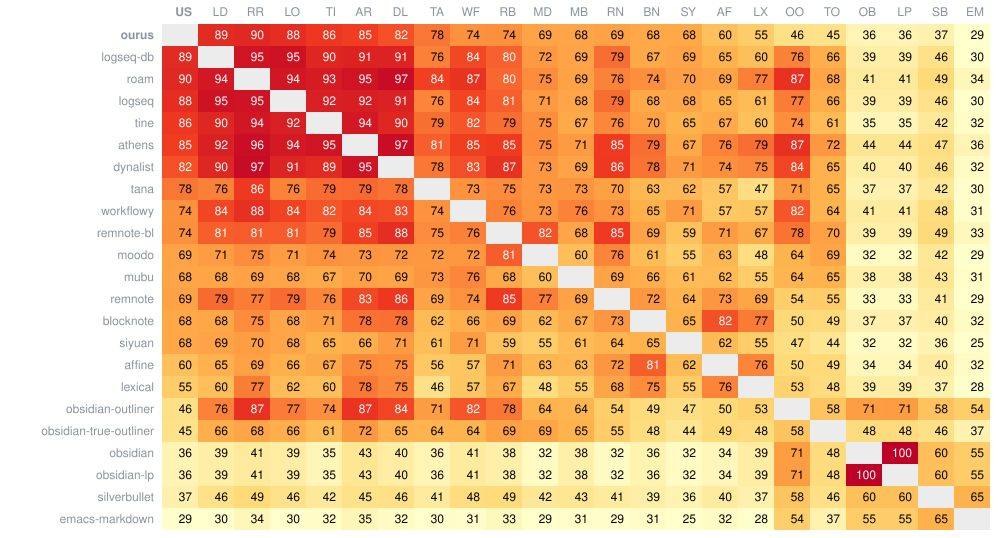

# SxS: the spec side by side

The [behavior spec](../spec/README.md) is written editor-neutral: drawn buffers and the keys between
them. The SxS plays each case in other outliners and Markdown editors, live, with their own keys, and
compares where each app ends up with where ourus does. A difference is evidence of what users expect,
not a failure.

- **Block outliners**: Logseq (file-based and DB), Tine, Roam, Athens, WorkFlowy, Dynalist, Tana,
  RemNote with bullets.
- **Free-form block editors**, with paragraphs and headings outside lists: SiYuan, BlockNote, RemNote
  without bullets.
- **Markdown text editors**: Obsidian (Source mode, Live Preview, Outliner, true-outliner),
  SilverBullet, Emacs with markdown-mode.

A block app has no paragraphs, blank lines or quotes, so it plays a case drawn onto its blocks: a
verdict in brackets, `(✗)`, is such an adapted case, and cases tagged `free-form` don't run in pure
block apps. Each app's report, linked from its column, draws every disagreement side by side, and its
skips with their reasons.

Running it, adding an app, and how it works: [`run.md`](run.md).

## Summary

|  | id | model | agree | caret | whitespace | disagree | error | skipped | total |
| --- | --- | --- | --- | --- | --- | --- | --- | --- | --- |
| [Roam](roam.md) | RR | block | 285 | 50 | 27 | 34 |  | 574 | **970** |
| [Logseq (OG)](logseq.md) | LO | block | 330 | 17 | 29 | 41 |  | 553 | **970** |
| [Logseq (DB)](logseq-db.md) | LD | block | 326 | 13 | 24 | 43 |  | 564 | **970** |
| [Athens](athens.md) | AR | block | 230 | 61 | 29 | 50 |  | 600 | **970** |
| [Tine](tine.md) | TI | block | 319 | 18 | 25 | 58 |  | 550 | **970** |
| [RemNote (bl)](remnote-bl.md) | RB | block | 257 | 27 | 21 | 105 |  | 560 | **970** |
| [Tana](tana.md) | TA | block | 297 | 13 | 3 | 124 |  | 533 | **970** |
| [WorkFlowy](workflowy.md) | WF | block | 302 | 18 | 9 | 140 |  | 501 | **970** |
| [Dynalist](dynalist.md) | DL | block | 331 | 12 | 22 | 158 |  | 447 | **970** |
| [RemNote (nbl)](remnote.md) | RN | block | 288 | 16 | 21 | 169 |  | 476 | **970** |
| [SiYuan](siyuan.md) | SY | block | 306 | 20 | 24 | 204 |  | 416 | **970** |
| [BlockNote](blocknote.md) | BN | block | 296 | 5 | 34 | 214 |  | 421 | **970** |
| [Obsidian (true-outliner)](obsidian-true-outliner.md) | TO | text | 260 | 68 | 29 | 444 |  | 169 | **970** |
| [Obsidian (Outliner)](obsidian-outliner.md) | OO | text | 292 | 28 | 25 | 487 |  | 138 | **970** |
| [SilverBullet](silverbullet.md) | SB | text | 234 | 38 | 34 | 536 |  | 128 | **970** |
| [Obsidian (Live Preview)](obsidian-lp.md) | LP | text | 217 | 25 | 30 | 550 |  | 148 | **970** |
| [Obsidian](obsidian.md) | OB | text | 222 | 26 | 30 | 558 |  | 134 | **970** |
| [Emacs (markdown-mode)](emacs-markdown.md) | EM | text | 159 | 42 | 20 | 611 |  | 138 | **970** |

By spec file:

| spec file | examples | runs | disagree | block apps | [RR](roam.md "Roam") | [LO](logseq.md "Logseq (OG)") | [LD](logseq-db.md "Logseq (DB)") | [AR](athens.md "Athens") | [TI](tine.md "Tine") | [RB](remnote-bl.md "RemNote (bl)") | [TA](tana.md "Tana") | [WF](workflowy.md "WorkFlowy") | [DL](dynalist.md "Dynalist") | [RN](remnote.md "RemNote (nbl)") | [SY](siyuan.md "SiYuan") | [BN](blocknote.md "BlockNote") | [TO](obsidian-true-outliner.md "Obsidian (true-outliner)") | [OO](obsidian-outliner.md "Obsidian (Outliner)") | [SB](silverbullet.md "SilverBullet") | [LP](obsidian-lp.md "Obsidian (Live Preview)") | [OB](obsidian.md "Obsidian") | [EM](emacs-markdown.md "Emacs (markdown-mode)") |
| --- | ---: | ---: | ---: | ---: | ---: | ---: | ---: | ---: | ---: | ---: | ---: | ---: | ---: | ---: | ---: | ---: | ---: | ---: | ---: | ---: | ---: | ---: |
| [quotes.md](../spec/quotes.md) | 97 | 549 | 446 (81%) |  |  |  |  |  |  |  |  |  |  |  |  |  | 71 | 74 | 79 | 67 | 67 | 88 |
| [backspace.md](../spec/backspace.md) | 82 | 936 | 445 (48%) | 104 | 1 | 1 | 1 | 1 | 4 | 2 | 11 | 11 | 7 | 7 | 29 | 29 | 38 | 51 | 59 | 64 | 64 | 65 |
| [enter.md](../spec/enter.md) | 92 | 1073 | 422 (39%) | 103 | 6 | 0 | 0 | 6 | 4 | 4 | 7 | 11 | 6 | 7 | 24 | 28 | 40 | 50 | 65 | 48 | 52 | 64 |
| [fences.md](../spec/fences.md) | 68 | 539 | 346 (64%) | 68 | 1 | 2 | 3 | 6 | 1 | 1 | 5 | 1 | 40 | 0 | 5 | 3 | 46 | 39 | 47 | 49 | 49 | 48 |
| [obsidian-true-outliner.md](../spec/obsidian-true-outliner.md) | 67 | 897 | 309 (34%) | 92 | 5 | 4 | 5 | 3 | 5 | 4 | 14 | 16 | 7 | 6 | 11 | 12 | 26 | 29 | 35 | 42 | 42 | 43 |
| [paste-list.md](../spec/paste-list.md) | 28 | 375 | 234 (62%) | 132 | 2 | 4 | 3 | 7 | 7 | 18 | 11 | 16 | 20 | 22 | 11 | 11 | 13 | 17 | 19 | 17 | 17 | 19 |
| [paste-html.md](../spec/paste-html.md) | 19 | 317 | 231 (73%) | 151 | 8 | 13 | 14 | 14 | 14 | 13 | 12 | 12 | 16 | 18 | 7 | 10 | 13 | 12 | 14 | 12 | 12 | 17 |
| [paste.md](../spec/paste.md) | 27 | 335 | 223 (67%) | 113 | 4 | 9 | 8 | 6 | 7 | 13 | 8 | 10 | 19 | 14 | 7 | 8 | 20 | 18 | 18 | 18 | 18 | 18 |
| [delete.md](../spec/delete.md) | 55 | 527 | 212 (40%) | 55 | 0 | 0 | 0 | 0 | 4 | 3 | 7 | 7 | 2 | 5 | 17 | 10 | 18 | 18 | 30 | 30 | 30 | 31 |
| [move-subtree-down.md](../spec/move-subtree-down.md) | 39 | 481 | 205 (43%) | 44 | 0 | 0 | 0 |  | 0 | 6 | 0 | 2 | 1 | 10 | 12 | 13 | 18 | 26 | 21 | 34 | 34 | 28 |
| [move-subtree-up.md](../spec/move-subtree-up.md) | 41 | 481 | 195 (41%) | 39 | 0 | 0 | 0 |  | 0 | 5 | 0 | 1 | 2 | 9 | 11 | 11 | 18 | 25 | 24 | 30 | 30 | 29 |
| [shift-enter.md](../spec/shift-enter.md) | 36 | 444 | 184 (41%) | 54 | 0 | 0 | 0 | 0 | 0 | 0 | 19 | 16 | 0 | 8 | 3 | 8 | 24 | 18 | 21 | 21 | 22 | 24 |
| [scenarios.md](../spec/scenarios.md) | 26 | 384 | 158 (41%) | 58 | 1 | 1 | 2 | 2 | 2 | 6 | 7 | 5 | 4 | 7 | 9 | 12 | 11 | 12 | 17 | 19 | 19 | 22 |
| [outdent.md](../spec/outdent.md) | 35 | 322 | 137 (43%) | 24 | 0 | 0 | 0 | 0 | 0 | 1 | 0 | 0 | 0 | 8 | 4 | 11 | 15 | 23 | 18 | 18 | 18 | 21 |
| [indent.md](../spec/indent.md) | 36 | 458 | 121 (26%) | 37 | 1 | 1 | 1 | 0 | 1 | 1 | 2 | 2 | 1 | 5 | 11 | 11 | 9 | 12 | 12 | 18 | 18 | 15 |
| [backtick.md](../spec/backtick.md) | 32 | 188 | 112 (60%) | 25 | 0 | 1 | 1 | 0 | 1 | 0 | 2 | 4 | 12 | 0 | 4 | 0 | 18 | 14 | 13 | 14 | 17 | 11 |
| [paste-plain.md](../spec/paste-plain.md) | 34 | 443 | 112 (25%) | 99 | 0 | 0 | 1 | 1 | 0 | 18 | 5 | 13 | 6 | 23 | 18 | 14 | 9 | 0 | 0 | 0 | 0 | 4 |
| [placeholders.md](../spec/placeholders.md) | 20 | 219 | 90 (41%) | 9 | 0 | 0 | 0 | 0 | 0 | 0 | 0 | 1 | 0 | 2 | 3 | 3 | 12 | 13 | 14 | 13 | 13 | 16 |
| [gaps.md](../spec/gaps.md) | 19 | 253 | 79 (31%) | 10 | 0 | 0 | 0 | 0 | 0 | 1 | 0 | 0 | 1 | 3 | 2 | 3 | 6 | 15 | 7 | 15 | 15 | 11 |
| [tasks.md](../spec/tasks.md) | 28 | 192 | 77 (40%) | 35 | 0 | 0 | 0 | 0 | 0 | 0 | 7 | 7 | 4 | 0 | 9 | 8 | 8 | 4 | 11 | 4 | 4 | 11 |
| [paste-list-form.md](../spec/paste-list-form.md) | 6 | 94 | 59 (63%) | 32 | 2 | 3 | 2 | 2 | 2 | 4 | 1 | 2 | 5 | 6 | 0 | 3 | 2 | 5 | 5 | 5 | 5 | 5 |
| [paste-conv.md](../spec/paste-conv.md) | 6 | 107 | 56 (52%) | 30 | 2 | 1 | 1 | 1 | 2 | 4 | 3 | 2 | 4 | 5 | 2 | 3 | 2 | 5 | 4 | 5 | 5 | 5 |
| [copy.md](../spec/copy.md) | 13 | 85 | 30 (35%) | 9 | 0 | 0 | 0 | 0 | 3 | 0 | 3 | 0 | 0 | 0 | 3 | 0 | 4 | 4 | 2 | 4 | 4 | 3 |
| [delete-subtree.md](../spec/delete-subtree.md) | 10 | 79 | 19 (24%) | 10 | 1 | 1 | 1 | 1 | 1 | 1 | 0 | 1 | 1 | 2 |  |  |  |  |  |  |  | 9 |
| [undo.md](../spec/undo.md) | 5 | 69 | 17 (25%) | 1 | 0 | 0 | 0 | 0 | 0 | 0 | 0 | 0 | 0 | 0 | 0 | 1 | 3 | 3 | 1 | 3 | 3 | 3 |
| [typing.md](../spec/typing.md) | 3 | 24 | 5 (21%) | 5 |  |  |  |  |  |  |  |  |  | 2 | 1 | 2 | 0 | 0 | 0 | 0 | 0 | 0 |
| [duplicate-subtree.md](../spec/duplicate-subtree.md) | 9 | 5 | 1 (20%) | 1 |  |  |  |  |  |  | 0 | 0 |  |  | 1 |  |  |  |  |  |  |  |
| [z-open.md](../spec/z-open.md) | 1 | 4 | 1 (25%) | 0 |  | 0 |  | 0 |  |  |  |  | 0 |  |  |  |  |  |  |  |  | 1 |
| [cursor.md](../spec/cursor.md) | 36 | 530 | 0 (0%) | 0 | 0 | 0 | 0 | 0 | 0 | 0 | 0 | 0 | 0 | 0 | 0 | 0 | 0 | 0 | 0 | 0 | 0 | 0 |
| **total** | **970** | **10410** | **4526 (43%)** | **1340** | **34** | **41** | **43** | **50** | **58** | **105** | **124** | **140** | **158** | **169** | **204** | **214** | **444** | **487** | **536** | **550** | **558** | **611** |

By tag:

| tag | examples | runs | disagree | block apps | [RR](roam.md "Roam") | [LO](logseq.md "Logseq (OG)") | [LD](logseq-db.md "Logseq (DB)") | [AR](athens.md "Athens") | [TI](tine.md "Tine") | [RB](remnote-bl.md "RemNote (bl)") | [TA](tana.md "Tana") | [WF](workflowy.md "WorkFlowy") | [DL](dynalist.md "Dynalist") | [RN](remnote.md "RemNote (nbl)") | [SY](siyuan.md "SiYuan") | [BN](blocknote.md "BlockNote") | [TO](obsidian-true-outliner.md "Obsidian (true-outliner)") | [OO](obsidian-outliner.md "Obsidian (Outliner)") | [SB](silverbullet.md "SilverBullet") | [LP](obsidian-lp.md "Obsidian (Live Preview)") | [OB](obsidian.md "Obsidian") | [EM](emacs-markdown.md "Emacs (markdown-mode)") |
| --- | ---: | ---: | ---: | ---: | ---: | ---: | ---: | ---: | ---: | ---: | ---: | ---: | ---: | ---: | ---: | ---: | ---: | ---: | ---: | ---: | ---: | ---: |
| `core` | 61 | 996 | 251 (25%) | 71 | 0 | 0 | 0 | 0 | 2 | 5 | 8 | 6 | 2 | 9 | 17 | 22 | 13 | 19 | 28 | 38 | 38 | 44 |
| `common` | 222 | 2978 | 1103 (37%) | 396 | 12 | 15 | 17 | 23 | 18 | 34 | 34 | 36 | 44 | 55 | 50 | 58 | 94 | 104 | 121 | 119 | 121 | 148 |
| `edge` | 394 | 4008 | 1956 (49%) | 619 | 20 | 24 | 24 | 23 | 33 | 48 | 61 | 63 | 77 | 73 | 86 | 87 | 193 | 209 | 223 | 232 | 235 | 245 |
| `rare` | 293 | 2428 | 1216 (50%) | 254 | 2 | 2 | 2 | 4 | 5 | 18 | 21 | 35 | 35 | 32 | 51 | 47 | 144 | 155 | 164 | 161 | 164 | 174 |
| `free-form` | 164 | 1106 | 721 (65%) | 139 |  |  |  |  |  |  |  |  |  | 40 | 44 | 55 | 86 | 98 | 91 | 101 | 104 | 102 |
| `quote-container` | 95 | 532 | 434 (82%) |  |  |  |  |  |  |  |  |  |  |  |  |  | 69 | 71 | 78 | 65 | 65 | 86 |
| `markup-fence` | 93 | 596 | 427 (72%) | 73 |  |  |  |  |  |  | 6 | 5 | 51 |  | 11 |  | 59 | 54 | 57 | 63 | 65 | 56 |
| `markup-heading` | 40 | 281 | 193 (69%) | 32 |  |  |  |  |  |  | 2 | 11 | 7 |  | 4 | 8 | 31 | 27 | 27 | 24 | 24 | 28 |
| `markup-task` | 38 | 215 | 116 (54%) | 45 |  |  |  |  |  |  | 7 | 8 | 5 |  | 13 | 12 | 9 | 9 | 18 | 8 | 10 | 17 |

## Heatmap

Each cell is how alike two apps did, in percent of the examples both ran alike: both as written, or
both adapted the same way (block apps), an example one ran adapted and the other as written left
out. One where they end the same counts 1, the same but for the caret or for spaces ½, otherwise 0,
their results compared from the same start, or, from different
starts, as each compares with ourus (both apart from ourus, it is left out). ourus is there too, as
its own runs of the examples have it: its cell with an app is how that app compares with it.
The apps are in the table's order, by how many examples they disagree on, the fewest first, ourus first.

## Legend

| cell | the app, compared with ourus |
| --- | --- |
| ✓ | agrees: the same result, caret included |
| ✗ | disagrees: other text, or (a block app) other blocks, nesting or count |
| C | caret: the same result, the caret elsewhere |
| S | spaces: the same but for spaces next to line breaks, or (a text app) spaces that leave the document as ourus reads it the same |
| E | error: the run failed, or the app didn't hold the starting state |
| blank | skipped: the app can't run the example as written (its report says why) |
| (✗) | in brackets, a difference in an example adapted for the app: its buffers projected onto blocks, so it compares those |

An example's **rank** is how often users meet it (`core`, `common`, `edge` or `rare`: [the spec's README](../spec/README.md)); a file's **disagree** column counts the apps that disagree on the example; its **total** row, the examples each app disagrees on, and all of them. An app is its id in the tables, as the [summary](#summary) has it.

By spec file and by tag, under the summary: each one's examples, the apps' runs of them, the disagreements among those runs (and their share), the block apps' disagreements among them, and each app's (blank: it ran none there). A case counts under its rank and under each of its other tags ([the spec's README](../spec/README.md)), so the tags' rows overlap.

## Test cases

<table>
<tr><td><b>backspace.md</b><td><b><a href="roam.md" title="roam">RR</a></b><td><b><a href="logseq.md" title="logseq">LO</a></b><td><b><a href="logseq-db.md" title="logseq-db">LD</a></b><td><b><a href="athens.md" title="athens">AR</a></b><td><b><a href="tine.md" title="tine">TI</a></b><td><b><a href="remnote-bl.md" title="remnote-bl">RB</a></b><td><b><a href="tana.md" title="tana">TA</a></b><td><b><a href="workflowy.md" title="workflowy">WF</a></b><td><b><a href="dynalist.md" title="dynalist">DL</a></b><td><b><a href="remnote.md" title="remnote">RN</a></b><td><b><a href="siyuan.md" title="siyuan">SY</a></b><td><b><a href="blocknote.md" title="blocknote">BN</a></b><td><b><a href="obsidian-true-outliner.md" title="obsidian-true-outliner">TO</a></b><td><b><a href="obsidian-outliner.md" title="obsidian-outliner">OO</a></b><td><b><a href="silverbullet.md" title="silverbullet">SB</a></b><td><b><a href="obsidian-lp.md" title="obsidian-lp">LP</a></b><td><b><a href="obsidian.md" title="obsidian">OB</a></b><td><b><a href="emacs-markdown.md" title="emacs-markdown">EM</a></b><td><b>disagree</b><td><b>rank</b></tr>
<tr><td><a href="../spec/backspace.md#backspace1">Backspace1</a><td>✓<td>✓<td>✓<td>✓<td>✓<td>✓<td>✓<td>✓<td>✓<td>✓<td>✗<td>✗<td>✓<td>✓<td>✗<td>✗<td>✗<td>✗<td align="right">6<td>core</tr>
<tr><td><a href="../spec/backspace.md#backspace2">Backspace2</a><td><td><td><td><td><td><td><td><td><td><td><td><td><td><td>✗<td>✗<td>✗<td>✗<td align="right">4<td>edge</tr>
<tr><td><a href="../spec/backspace.md#backspace3">Backspace3</a><td>✓<td>✓<td>✓<td>✓<td>✓<td>✓<td>✓<td>✗<td>✓<td>✓<td>✗<td>✗<td>✓<td>✓<td>✗<td>✗<td>✗<td>✗<td align="right">7<td>core</tr>
<tr><td><a href="../spec/backspace.md#backspace4">Backspace4</a><td><td><td><td><td><td><td><td><td><td><td><td><td>✗<td>✗<td>✗<td>✗<td>✗<td>✗<td align="right">6<td>rare</tr>
<tr><td><a href="../spec/backspace.md#backspace5">Backspace5</a><td>✓<td>✓<td>✓<td>✓<td>✓<td>✓<td>✓<td>✓<td>✓<td>✓<td>✗<td>✗<td>✓<td>✓<td>✗<td>✗<td>✗<td>✗<td align="right">6<td>common</tr>
<tr><td><a href="../spec/backspace.md#backspace7">Backspace7</a><td>✓<td>✓<td>✓<td>✓<td>✓<td>✓<td>✓<td>✓<td>✓<td>✓<td>✗<td>✗<td>✓<td>✓<td>✗<td>✗<td>✗<td>✗<td align="right">6<td>core</tr>
<tr><td><a href="../spec/backspace.md#backspace8">Backspace8</a><td>✓<td>✓<td>✓<td>✓<td>✓<td>✓<td>✗<td>✓<td>✓<td>✓<td>✗<td>✗<td>✓<td>✓<td>✗<td>✗<td>✗<td>✗<td align="right">7<td>common</tr>
<tr><td><a href="../spec/backspace.md#backspace9">Backspace9</a><td>✓<td>✓<td>✓<td>✓<td>✓<td>✓<td>✗<td>✗<td>✓<td>✓<td>✓<td>✓<td>✗<td>✓<td>✗<td>✗<td>✗<td>✗<td align="right">7<td>common</tr>
<tr><td><a href="../spec/backspace.md#backspace10">Backspace10</a><td>✓<td>✓<td>✓<td>✓<td>✓<td>✓<td>✓<td>✓<td>✓<td>✓<td>✓<td>✓<td>✗<td>✗<td>✗<td>✗<td>✗<td>✗<td align="right">6<td>common</tr>
<tr><td><a href="../spec/backspace.md#backspace11">Backspace11</a><td>✓<td>✓<td>✓<td>✓<td>✓<td>✓<td>✓<td>✓<td>✓<td>✓<td>✓<td>✓<td>✓<td>✗<td>✗<td>✗<td>✗<td>✗<td align="right">5<td>common</tr>
<tr><td><a href="../spec/backspace.md#backspace12">Backspace12</a><td><td><td><td><td><td><td><td><td><td>✓<td>✓<td>✓<td>✓<td>✗<td>✗<td>✗<td>✗<td>✗<td align="right">5<td>common</tr>
<tr><td><a href="../spec/backspace.md#backspace12b">Backspace12b</a><td><td><td><td><td><td><td><td><td><td>✓<td>✓<td>✓<td>✓<td>✗<td>✗<td>✗<td>✗<td>✗<td align="right">5<td>common</tr>
<tr><td><a href="../spec/backspace.md#backspace12c">Backspace12c</a><td><td><td><td><td><td><td><td><td><td><td>✓<td><td>✓<td>✓<td>✓<td>✓<td>✓<td>✗<td align="right">1<td>rare</tr>
<tr><td><a href="../spec/backspace.md#backspace12d">Backspace12d</a><td><td><td><td><td><td><td><td><td><td>✓<td>✓<td>✓<td>✗<td>✗<td>✗<td>✗<td>✗<td>✗<td align="right">6<td>rare</tr>
<tr><td><a href="../spec/backspace.md#backspace12e">Backspace12e</a><td><td><td><td><td><td><td><td><td><td>✗<td><td>✗<td><td>✗<td>✗<td>✗<td>✗<td><td align="right">6<td>rare</tr>
<tr><td><a href="../spec/backspace.md#backspace13">Backspace13</a><td>✓<td>✓<td>✓<td>✓<td>✓<td>✓<td>✓<td>✓<td>✓<td>✓<td>✓<td>✓<td>✓<td>✓<td>✓<td>✓<td>✓<td>✓<td align="right">0<td>core</tr>
<tr><td><a href="../spec/backspace.md#backspace14">Backspace14</a><td><td><td><td><td><td><td><td><td><td>✗<td>✗<td>✗<td>✗<td>✗<td>✗<td>✗<td>✗<td>✗<td align="right">9<td>edge</tr>
<tr><td><a href="../spec/backspace.md#backspace15">Backspace15</a><td>✓<td>✓<td>✓<td>✓<td>✓<td>✓<td>✓<td>(✗)<td>✓<td>✓<td>✗<td>✗<td>✓<td>✗<td>✗<td>✗<td>✗<td>✗<td align="right">8<td>common</tr>
<tr><td><a href="../spec/backspace.md#backspace16">Backspace16</a><td><td><td><td><td><td><td>(✗)<td>✓<td>(✗)<td><td>(✗)<td><td>✓<td>✗<td>✗<td>✗<td>✗<td>✗<td align="right">8<td>rare</tr>
<tr><td><a href="../spec/backspace.md#backspace17">Backspace17</a><td>✗<td>C<td>C<td>C<td>✓<td>C<td>✓<td>C<td>C<td>C<td>✗<td>✗<td>✗<td>✗<td>✗<td>✗<td>✗<td>✗<td align="right">9<td>common</tr>
<tr><td><a href="../spec/backspace.md#backspace17b">Backspace17b</a><td>✓<td>✓<td>✓<td>✓<td>✗<td>C<td>✗<td>✓<td>✓<td>C<td>✗<td>✗<td>✗<td>✓<td>✗<td>✗<td>✗<td>✗<td align="right">9<td>edge</tr>
<tr><td><a href="../spec/backspace.md#backspace17c">Backspace17c</a><td>✓<td>✓<td>✓<td>✓<td>✗<td>✓<td>✗<td>✓<td>✓<td>✓<td>✗<td>✗<td>✓<td>✓<td>✗<td>✗<td>✗<td>✗<td align="right">8<td>edge</tr>
<tr><td><a href="../spec/backspace.md#backspace17d">Backspace17d</a><td>✓<td>✓<td>✓<td>✓<td>✓<td>✗<td>✗<td>✓<td>✓<td>✗<td>✗<td>✗<td>S<td>✓<td>✗<td>✗<td>✗<td>✗<td align="right">9<td>edge</tr>
<tr><td><a href="../spec/backspace.md#backspace17e">Backspace17e</a><td><td><td><td><td><td><td><td><td><td>(✗)<td>✓<td>✓<td>✗<td>✗<td>✓<td>✗<td>✗<td>✗<td align="right">6<td>edge</tr>
<tr><td><a href="../spec/backspace.md#backspace17f">Backspace17f</a><td>✓<td>✓<td>✓<td>✓<td><td><td><td>✓<td>✓<td><td><td><td><td>✓<td><td><td><td><td align="right">0<td>rare</tr>
<tr><td><a href="../spec/backspace.md#backspace17g">Backspace17g</a><td>✓<td>✓<td>✓<td>✓<td><td><td><td>✓<td>✓<td><td><td><td><td>✓<td><td><td><td><td align="right">0<td>rare</tr>
<tr><td><a href="../spec/backspace.md#backspace17h">Backspace17h</a><td>✓<td>✓<td>✓<td>✓<td><td><td><td>✓<td>✓<td><td><td><td><td>✓<td><td><td><td><td align="right">0<td>rare</tr>
<tr><td><a href="../spec/backspace.md#backspace18">Backspace18</a><td><td><td><td><td><td><td><td><td><td><td>✓<td>✓<td>✗<td>✗<td>✗<td>✗<td>✗<td>✗<td align="right">6<td>common</tr>
<tr><td><a href="../spec/backspace.md#backspace18b">Backspace18b</a><td><td><td><td><td><td><td><td><td><td><td><td><td><td><td><td><td><td><td align="right">0<td>rare</tr>
<tr><td><a href="../spec/backspace.md#backspace18c">Backspace18c</a><td><td><td><td><td><td><td><td><td><td><td>✓<td>✓<td>✗<td>✗<td>✗<td>✗<td>✗<td>✗<td align="right">6<td>rare</tr>
<tr><td><a href="../spec/backspace.md#backspace18d">Backspace18d</a><td><td><td><td><td><td><td><td><td><td><td>✓<td>✓<td>✗<td>✗<td>✗<td>✗<td>✗<td>✗<td align="right">6<td>rare</tr>
<tr><td><a href="../spec/backspace.md#backspace18e">Backspace18e</a><td><td><td><td><td><td><td>✓<td>(✗)<td>(✗)<td><td>✓<td><td>✗<td>✗<td>✗<td>✗<td>✗<td>✗<td align="right">8<td>rare</tr>
<tr><td><a href="../spec/backspace.md#backspace18f">Backspace18f</a><td><td><td><td><td><td><td>✓<td><td><td><td><td><td><td><td><td><td><td><td align="right">0<td>rare</tr>
<tr><td><a href="../spec/backspace.md#backspace18g">Backspace18g</a><td><td><td><td><td><td><td>(✗)<td>(✗)<td>(✗)<td><td>✓<td><td>✗<td>✗<td>✗<td>✗<td>✗<td>✗<td align="right">9<td>rare</tr>
<tr><td><a href="../spec/backspace.md#backspace19">Backspace19</a><td><td><td><td><td><td><td><td><td><td><td>✗<td>✗<td>✗<td>✗<td>✗<td>✗<td>✗<td>✗<td align="right">8<td>edge</tr>
<tr><td><a href="../spec/backspace.md#backspace19b">Backspace19b</a><td><td><td><td><td><td><td><td><td><td><td>✓<td>✓<td>✗<td>✗<td>✗<td>✗<td>✗<td>✗<td align="right">6<td>edge</tr>
<tr><td><a href="../spec/backspace.md#backspace20">Backspace20</a><td><td><td><td><td><td><td><td><td><td>✓<td>✓<td>✓<td>✗<td>✗<td>✗<td>✗<td>✗<td>✗<td align="right">6<td>edge</tr>
<tr><td><a href="../spec/backspace.md#backspace21">Backspace21</a><td>✓<td>✓<td>✓<td>✓<td>✓<td>✓<td>✓<td>✓<td>✓<td>✓<td>(✗)<td>(✗)<td>✓<td>✗<td>✗<td>✗<td>✗<td>✗<td align="right">7<td>common</tr>
<tr><td><a href="../spec/backspace.md#backspace22">Backspace22</a><td>✓<td>✓<td>✓<td>✓<td>✓<td>✓<td>✓<td>(✗)<td>✓<td>✓<td>✓<td>✓<td>✓<td>✗<td>✗<td>✗<td>✗<td>✗<td align="right">6<td>common</tr>
<tr><td><a href="../spec/backspace.md#backspace23">Backspace23</a><td><td><td><td><td><td><td><td><td><td>✗<td>✗<td>✗<td>✓<td>✗<td>✗<td>✗<td>✗<td>✗<td align="right">8<td>rare</tr>
<tr><td><a href="../spec/backspace.md#backspace24">Backspace24</a><td><td><td><td><td><td><td>(✗)<td>✓<td>(✗)<td><td>(C)<td><td>✓<td>✗<td>✗<td>✗<td>✗<td>✗<td align="right">7<td>edge</tr>
<tr><td><a href="../spec/backspace.md#backspace25">Backspace25</a><td>✓<td>✓<td>✓<td>✓<td>✓<td>✓<td>✓<td>✓<td>✓<td>✓<td>✓<td>✓<td>✓<td>✗<td>✗<td>✗<td>✗<td>✗<td align="right">5<td>edge</tr>
<tr><td><a href="../spec/backspace.md#backspace26">Backspace26</a><td><td><td><td>(✗)<td><td><td>(✗)<td><td>(✗)<td>✓<td>✓<td>✓<td>✓<td>✓<td>✓<td>✓<td>✓<td>✓<td align="right">3<td>common</tr>
<tr><td><a href="../spec/backspace.md#backspace27">Backspace27</a><td><td><td><td><td><td><td><td><td><td><td><td><td>✗<td>✗<td>✗<td>✗<td>✗<td>✗<td align="right">6<td>edge</tr>
<tr><td><a href="../spec/backspace.md#backspace28">Backspace28</a><td><td><td><td><td><td><td>✓<td>✓<td>(C)<td><td>(✗)<td><td>✗<td>✗<td>✗<td>✗<td>✗<td>✗<td align="right">7<td>edge</tr>
<tr><td><a href="../spec/backspace.md#backspace29">Backspace29</a><td>✓<td>✗<td>✗<td>✓<td>✗<td>✓<td>✓<td>✓<td>✓<td>✗<td><td>✗<td>✓<td>✓<td>✗<td>✗<td>✗<td>✗<td align="right">9<td>common</tr>
<tr><td><a href="../spec/backspace.md#backspace30">Backspace30</a><td>✓<td>✓<td>✓<td>✓<td>✓<td>✓<td>✓<td>✓<td>✓<td>✓<td>✗<td>✗<td>✓<td>✓<td>✗<td>✗<td>✗<td>✗<td align="right">6<td>core</tr>
<tr><td><a href="../spec/backspace.md#backspace31">Backspace31</a><td><td><td><td><td><td><td><td><td><td><td><td><td>✗<td>✓<td>✓<td>✓<td>✓<td>✓<td align="right">1<td>common</tr>
<tr><td><a href="../spec/backspace.md#backspace32">Backspace32</a><td>✓<td>✓<td>✓<td>✓<td>✓<td>✓<td>✓<td>✓<td>✓<td>✓<td>✓<td>✓<td>✓<td>✓<td>✓<td>✓<td>✓<td>✓<td align="right">0<td>common</tr>
<tr><td><a href="../spec/backspace.md#backspace33">Backspace33</a><td><td><td><td><td><td><td><td><td><td>✓<td>✓<td>✓<td>✗<td>✗<td>✓<td>✗<td>✗<td>✗<td align="right">5<td>common</tr>
<tr><td><a href="../spec/backspace.md#backspace34">Backspace34</a><td>✓<td>✓<td>✓<td><td>✓<td>✓<td><td>✓<td><td>✓<td><td><td><td><td><td><td><td><td align="right">0<td>edge</tr>
<tr><td><a href="../spec/backspace.md#backspace35">Backspace35</a><td><td><td><td><td><td><td><td><td><td><td>✓<td>✓<td>✗<td>✗<td>✗<td>✗<td>✗<td>✗<td align="right">6<td>edge</tr>
<tr><td><a href="../spec/backspace.md#backspace36">Backspace36</a><td>✓<td>✓<td>✓<td>✓<td>✓<td>✓<td>✓<td>(✗)<td>✓<td>✓<td>✓<td>✓<td>✓<td>✗<td>✗<td>✗<td>✗<td>✗<td align="right">6<td>edge</tr>
<tr><td><a href="../spec/backspace.md#backspace37">Backspace37</a><td>✓<td>✓<td>✓<td>✓<td>✓<td>✓<td>(✗)<td>(✗)<td>✓<td>✓<td>(✗)<td>✓<td>✗<td>✗<td>✗<td>✗<td>✗<td>✗<td align="right">9<td>rare</tr>
<tr><td><a href="../spec/backspace.md#backspace38">Backspace38</a><td><td><td><td><td><td><td><td><td><td>✓<td>✓<td>✓<td>✗<td>✗<td>✗<td>✗<td>✗<td>✗<td align="right">6<td>rare</tr>
<tr><td><a href="../spec/backspace.md#backspace39">Backspace39</a><td>✓<td>✓<td>✓<td>✓<td>✓<td>✓<td>✓<td>✓<td>✓<td>✓<td>✗<td>✗<td>✓<td>✗<td>S<td>✗<td>✗<td>✗<td align="right">6<td>rare</tr>
<tr><td><a href="../spec/backspace.md#backspace40">Backspace40</a><td><td><td><td>✓<td><td><td><td>(✗)<td><td><td>✗<td>✗<td>✓<td>✗<td>✗<td>✗<td>✗<td>✗<td align="right">8<td>edge</tr>
<tr><td><a href="../spec/backspace.md#backspace41">Backspace41</a><td>✓<td>✓<td>✓<td>✓<td>✓<td>✓<td>(✗)<td>(✗)<td>✓<td>✓<td>(✗)<td>(✗)<td>✗<td>✗<td>✓<td>✗<td>✗<td>✗<td align="right">9<td>edge</tr>
<tr><td><a href="../spec/backspace.md#softbackspace1">SoftBackspace1</a><td><td><td><td><td><td><td>✓<td>(✗)<td>(✗)<td><td>(✗)<td>(✗)<td>✓<td>✗<td>✗<td>✗<td>✗<td>✗<td align="right">9<td>common</tr>
<tr><td><a href="../spec/backspace.md#softbackspace2">SoftBackspace2</a><td>✓<td>✓<td>✓<td>✓<td>✓<td>✓<td>✓<td>✓<td>✓<td>✓<td>✓<td>✓<td>✗<td>✗<td>✗<td>✗<td>✗<td>✗<td align="right">6<td>rare</tr>
<tr><td><a href="../spec/backspace.md#softbackspace3">SoftBackspace3</a><td><td><td><td><td><td><td>✓<td>✓<td>✓<td><td>✓<td>✓<td>✗<td>✗<td>✗<td>✗<td>✗<td>✗<td align="right">6<td>rare</tr>
<tr><td><a href="../spec/backspace.md#softbackspace4">SoftBackspace4</a><td><td><td><td><td><td><td><td><td><td><td><td><td>✗<td>✗<td>✗<td>✗<td>✗<td>✗<td align="right">6<td>rare</tr>
<tr><td><a href="../spec/backspace.md#softbackspace5">SoftBackspace5</a><td>✓<td>✓<td>✓<td>✓<td>✓<td>✓<td>✓<td>✓<td>✓<td>✓<td><td>✓<td>✗<td>✗<td>✗<td>✗<td>✗<td>✗<td align="right">6<td>rare</tr>
<tr><td><a href="../spec/backspace.md#softbackspace6">SoftBackspace6</a><td><td><td><td><td><td><td><td><td><td><td><td><td>✗<td>✗<td>✗<td>✗<td>✗<td>✗<td align="right">6<td>rare</tr>
<tr><td><a href="../spec/backspace.md#softbackspace7">SoftBackspace7</a><td><td><td><td><td><td><td><td><td><td><td><td><td>✗<td>✗<td>✗<td>✗<td>✗<td>✗<td align="right">6<td>rare</tr>
<tr><td><a href="../spec/backspace.md#softbackspace8">SoftBackspace8</a><td><td><td><td><td><td><td><td><td><td><td>(✗)<td>(✗)<td>✗<td>✗<td>✗<td>✗<td>✗<td>✗<td align="right">8<td>rare</tr>
<tr><td><a href="../spec/backspace.md#softbackspace9">SoftBackspace9</a><td><td><td><td><td><td><td><td><td>(✗)<td><td><td><td>✗<td>✗<td>✗<td>✗<td>✗<td>✗<td align="right">7<td>rare</tr>
<tr><td><a href="../spec/backspace.md#softbackspace10">SoftBackspace10</a><td><td><td><td><td><td><td><td><td><td><td><td><td><td>✗<td><td>✗<td>✗<td>✗<td align="right">4<td>rare</tr>
<tr><td><a href="../spec/backspace.md#softbackspace11">SoftBackspace11</a><td><td><td><td><td><td><td><td><td><td>✓<td>✗<td>✗<td>✗<td>✗<td>✗<td>✗<td>✗<td>✗<td align="right">8<td>rare</tr>
<tr><td><a href="../spec/backspace.md#backspace42">Backspace42</a><td><td><td><td><td><td><td><td><td><td><td><td><td><td><td>✓<td>✓<td>✓<td>✓<td align="right">0<td>rare</tr>
<tr><td><a href="../spec/backspace.md#backspace42b">Backspace42b</a><td><td><td><td><td><td><td><td><td><td><td><td><td><td><td><td><td><td><td align="right">0<td>rare</tr>
<tr><td><a href="../spec/backspace.md#backspace43">Backspace43</a><td><td><td><td><td><td><td><td><td><td><td>C<td><td>✗<td>✓<td>✓<td>✓<td>✓<td>✗<td align="right">2<td>edge</tr>
<tr><td><a href="../spec/backspace.md#backspace43b">Backspace43b</a><td><td><td><td><td><td><td><td><td><td>✓<td>✗<td>✗<td>✓<td>✓<td>✓<td>✓<td>✓<td>✓<td align="right">2<td>rare</tr>
<tr><td><a href="../spec/backspace.md#backspace43c">Backspace43c</a><td><td><td><td><td><td><td><td><td><td><td><td><td><td>✓<td>✓<td>✓<td>✓<td><td align="right">0<td>rare</tr>
<tr><td><a href="../spec/backspace.md#backspace44">Backspace44</a><td>✓<td>✓<td>✓<td>✓<td>✓<td>✓<td>✓<td>✓<td>✓<td>✓<td>(✗)<td>(✗)<td>✓<td>✗<td>✗<td>✗<td>✗<td>✗<td align="right">7<td>rare</tr>
<tr><td><a href="../spec/backspace.md#backspace44b">Backspace44b</a><td>✓<td>✓<td>✓<td>✓<td>✓<td>✓<td>✓<td>✓<td>✓<td>✓<td>(✗)<td>(✗)<td>✗<td>✗<td>✗<td>✗<td>✗<td>✗<td align="right">8<td>rare</tr>
<tr><td><a href="../spec/backspace.md#backspace45">Backspace45</a><td>✓<td>✓<td>✓<td>✓<td>✗<td>✗<td>✓<td>✓<td>✓<td>✗<td>✗<td>✗<td>✓<td>✓<td>✗<td>✗<td>✗<td>✗<td align="right">9<td>edge</tr>
<tr><td><a href="../spec/backspace.md#backspace45b">Backspace45b</a><td>✓<td>✓<td>✓<td>✓<td><td><td>✓<td>✓<td>✓<td><td><td><td><td>✓<td><td><td><td><td align="right">0<td>edge</tr>
<tr><td><a href="../spec/backspace.md#backspace46">Backspace46</a><td>✓<td>✓<td>✓<td>✓<td>✓<td>✓<td><td>✓<td>✓<td>✓<td>✓<td>✓<td>✓<td>✓<td>✓<td>✓<td>✓<td><td align="right">0<td>rare</tr>
<tr><td><a href="../spec/backspace.md#backspace47">Backspace47</a><td><td><td><td><td><td><td><td><td><td>✓<td>✗<td>✗<td>✗<td>✗<td>✗<td>✗<td>✗<td>✗<td align="right">8<td>rare</tr>
<tr><td><a href="../spec/backspace.md#backspace48">Backspace48</a><td>✓<td>✓<td>✓<td>✓<td>✓<td>✓<td>✓<td>✓<td>✓<td>✓<td>(C)<td>✓<td>✗<td>✗<td>✗<td>✗<td>✗<td>✗<td align="right">6<td>rare</tr>
<tr><td><a href="../spec/backspace.md#backspace49">Backspace49</a><td><td><td><td><td><td><td><td><td><td>✓<td><td>(✗)<td>✗<td>✗<td>✗<td>✗<td>✗<td>✗<td align="right">7<td>rare</tr>
<tr><td><b>total</b><td><b>1</b><td><b>1</b><td><b>1</b><td><b>1</b><td><b>4</b><td><b>2</b><td><b>11</b><td><b>11</b><td><b>7</b><td><b>7</b><td><b>29</b><td><b>29</b><td><b>38</b><td><b>51</b><td><b>59</b><td><b>64</b><td><b>64</b><td><b>65</b><td align="right"><b>445</b><td></tr>
<tr><td colspan="21"></tr>
<tr><td><b>backtick.md</b><td><b><a href="roam.md" title="roam">RR</a></b><td><b><a href="logseq.md" title="logseq">LO</a></b><td><b><a href="logseq-db.md" title="logseq-db">LD</a></b><td><b><a href="athens.md" title="athens">AR</a></b><td><b><a href="tine.md" title="tine">TI</a></b><td><b><a href="remnote-bl.md" title="remnote-bl">RB</a></b><td><b><a href="tana.md" title="tana">TA</a></b><td><b><a href="workflowy.md" title="workflowy">WF</a></b><td><b><a href="dynalist.md" title="dynalist">DL</a></b><td><b><a href="remnote.md" title="remnote">RN</a></b><td><b><a href="siyuan.md" title="siyuan">SY</a></b><td><b><a href="blocknote.md" title="blocknote">BN</a></b><td><b><a href="obsidian-true-outliner.md" title="obsidian-true-outliner">TO</a></b><td><b><a href="obsidian-outliner.md" title="obsidian-outliner">OO</a></b><td><b><a href="silverbullet.md" title="silverbullet">SB</a></b><td><b><a href="obsidian-lp.md" title="obsidian-lp">LP</a></b><td><b><a href="obsidian.md" title="obsidian">OB</a></b><td><b><a href="emacs-markdown.md" title="emacs-markdown">EM</a></b><td><b>disagree</b><td><b>rank</b></tr>
<tr><td><a href="../spec/backtick.md#backtick1">Backtick1</a><td><td><td><td><td><td><td><td><td><td><td><td><td>✗<td>✓<td>(✗)<td>✓<td>✓<td>✓<td align="right">2<td>common</tr>
<tr><td><a href="../spec/backtick.md#backtick2">Backtick2</a><td><td><td><td><td><td><td>✓<td>(S)<td>✓<td><td>✓<td><td>✗<td>✓<td>✓<td>✓<td>✓<td>✓<td align="right">1<td>common</tr>
<tr><td><a href="../spec/backtick.md#backtick3">Backtick3</a><td><td><td><td><td><td><td><td><td><td><td><td><td>✗<td>✓<td>✓<td>✓<td>✓<td>✓<td align="right">1<td>edge</tr>
<tr><td><a href="../spec/backtick.md#backtick4">Backtick4</a><td><td><td><td><td><td><td>✓<td>(✗)<td>✓<td><td>(✗)<td><td>✗<td>✗<td>✓<td>✗<td>✗<td>✓<td align="right">6<td>common</tr>
<tr><td><a href="../spec/backtick.md#backtick5">Backtick5</a><td><td><td><td><td><td><td><td><td>(✗)<td><td><td><td>✗<td>✗<td>✗<td>✗<td>✗<td>✗<td align="right">7<td>common</tr>
<tr><td><a href="../spec/backtick.md#backtick6">Backtick6</a><td><td><td><td><td><td><td><td><td>(✗)<td><td><td><td>✗<td>✗<td>✗<td>✗<td>✗<td>✗<td align="right">7<td>edge</tr>
<tr><td><a href="../spec/backtick.md#backtick7">Backtick7</a><td><td><td><td><td><td><td><td><td><td><td><td><td><td><td><td><td><td><td align="right">0<td>edge</tr>
<tr><td><a href="../spec/backtick.md#backtick8">Backtick8</a><td><td><td><td><td><td><td><td><td><td><td><td><td><td><td>✓<td><td><td>✓<td align="right">0<td>edge</tr>
<tr><td><a href="../spec/backtick.md#backtick9">Backtick9</a><td><td><td><td><td><td><td>(✗)<td>(✗)<td>(✗)<td><td>(✗)<td><td>✗<td>✗<td>✗<td>✗<td>✗<td>✗<td align="right">10<td>common</tr>
<tr><td><a href="../spec/backtick.md#backtick10">Backtick10</a><td><td><td><td><td><td><td>✓<td><td>(✗)<td><td>(✗)<td><td>✗<td>✗<td>✗<td>✗<td>✗<td>✗<td align="right">8<td>edge</tr>
<tr><td><a href="../spec/backtick.md#backtick11">Backtick11</a><td><td><td><td><td><td><td><td><td>✓<td><td><td><td><td><td>✓<td><td><td>✓<td align="right">0<td>rare</tr>
<tr><td><a href="../spec/backtick.md#backtick12">Backtick12</a><td><td><td><td><td><td><td>(✗)<td>(✗)<td>(✗)<td><td>✓<td><td>✗<td>✗<td>(✗)<td>✗<td>✗<td>✓<td align="right">8<td>edge</tr>
<tr><td><a href="../spec/backtick.md#backtick13">Backtick13</a><td><td><td><td><td><td><td><td><td><td><td><td><td><td><td><td><td><td><td align="right">0<td>edge</tr>
<tr><td><a href="../spec/backtick.md#backtick14">Backtick14</a><td><td><td><td><td><td><td><td><td>(✗)<td><td><td><td>✗<td>✗<td>✗<td>✗<td>✗<td>✗<td align="right">7<td>edge</tr>
<tr><td><a href="../spec/backtick.md#backtick15">Backtick15</a><td><td><td><td><td><td><td>✓<td>(✗)<td>✓<td><td>✓<td><td><td><td>✓<td><td>✗<td>✓<td align="right">2<td>common</tr>
<tr><td><a href="../spec/backtick.md#backtick16">Backtick16</a><td><td><td><td><td><td><td><td><td><td><td><td><td><td><td><td><td><td><td align="right">0<td>edge</tr>
<tr><td><a href="../spec/backtick.md#backtick17">Backtick17</a><td><td><td><td><td><td><td><td><td><td><td>(✗)<td><td><td><td>✓<td><td>✗<td>✓<td align="right">2<td>edge</tr>
<tr><td><a href="../spec/backtick.md#backtick18">Backtick18</a><td>✓<td>(✗)<td>(✗)<td>✓<td>(✗)<td>✓<td>✓<td>✓<td>✓<td>✓<td>✓<td>✓<td>✓<td>✓<td>✓<td>✓<td>✓<td>✓<td align="right">3<td>common</tr>
<tr><td><a href="../spec/backtick.md#backtick19">Backtick19</a><td><td><td><td><td><td><td><td><td><td><td><td><td>✓<td>✓<td><td>✓<td>✓<td><td align="right">0<td>edge</tr>
<tr><td><a href="../spec/backtick.md#backtick20">Backtick20</a><td><td><td><td><td><td><td><td><td><td><td><td><td>✓<td>✓<td><td>✓<td>✓<td><td align="right">0<td>edge</tr>
<tr><td><a href="../spec/backtick.md#backtick21">Backtick21</a><td><td><td><td><td><td><td><td><td><td><td><td><td>✓<td>✓<td><td>✓<td>✓<td><td align="right">0<td>edge</tr>
<tr><td><a href="../spec/backtick.md#backtick22">Backtick22</a><td><td><td><td><td><td><td><td><td><td><td><td><td>✗<td>✓<td><td>✓<td>✓<td><td align="right">1<td>edge</tr>
<tr><td><a href="../spec/backtick.md#backtick23">Backtick23</a><td><td><td><td><td><td><td><td><td>(✗)<td><td><td><td>✗<td>✗<td>✗<td>✗<td>✗<td>✗<td align="right">7<td>edge</tr>
<tr><td><a href="../spec/backtick.md#backtick24">Backtick24</a><td><td><td><td><td><td><td><td><td>(✗)<td><td><td><td>✗<td>✗<td>✗<td>✗<td>✗<td>✗<td align="right">7<td>edge</tr>
<tr><td><a href="../spec/backtick.md#backtick25">Backtick25</a><td><td><td><td><td><td><td><td><td>(✗)<td><td><td><td>✗<td>✗<td>✗<td>✗<td>✗<td>✗<td align="right">7<td>common</tr>
<tr><td><a href="../spec/backtick.md#backtick26">Backtick26</a><td><td><td><td><td><td><td><td><td>(✗)<td><td><td><td>✗<td>✗<td>✗<td>✗<td>✗<td>✗<td align="right">7<td>edge</tr>
<tr><td><a href="../spec/backtick.md#backtick27">Backtick27</a><td><td><td><td><td><td><td><td><td>(✗)<td><td><td><td>✗<td>✗<td>✗<td>✗<td>✗<td>✗<td align="right">7<td>edge</tr>
<tr><td><a href="../spec/backtick.md#backtick28">Backtick28</a><td><td><td><td><td><td><td><td><td>✓<td><td><td><td>✓<td>✓<td>✓<td>✓<td>✓<td>✓<td align="right">0<td>edge</tr>
<tr><td><a href="../spec/backtick.md#backtick29">Backtick29</a><td><td><td><td><td><td><td><td><td>(✗)<td><td><td><td>✗<td>✗<td>✗<td>✗<td>✗<td>✗<td align="right">7<td>rare</tr>
<tr><td><a href="../spec/backtick.md#backtick30">Backtick30</a><td><td><td><td><td><td><td><td><td><td><td><td><td>✗<td>✗<td>✓<td>✗<td>✗<td>✓<td align="right">4<td>rare</tr>
<tr><td><a href="../spec/backtick.md#backtick31">Backtick31</a><td><td><td><td><td><td><td><td><td><td><td><td><td><td><td><td><td><td><td align="right">0<td>rare</tr>
<tr><td><a href="../spec/backtick.md#backtick32">Backtick32</a><td><td><td><td><td><td><td><td><td><td><td><td><td><td><td><td><td>✗<td><td align="right">1<td>rare</tr>
<tr><td><b>total</b><td><b>0</b><td><b>1</b><td><b>1</b><td><b>0</b><td><b>1</b><td><b>0</b><td><b>2</b><td><b>4</b><td><b>12</b><td><b>0</b><td><b>4</b><td><b>0</b><td><b>18</b><td><b>14</b><td><b>13</b><td><b>14</b><td><b>17</b><td><b>11</b><td align="right"><b>112</b><td></tr>
<tr><td colspan="21"></tr>
<tr><td colspan="21"></tr>
<tr><td><b>copy.md</b><td><b><a href="roam.md" title="roam">RR</a></b><td><b><a href="logseq.md" title="logseq">LO</a></b><td><b><a href="logseq-db.md" title="logseq-db">LD</a></b><td><b><a href="athens.md" title="athens">AR</a></b><td><b><a href="tine.md" title="tine">TI</a></b><td><b><a href="remnote-bl.md" title="remnote-bl">RB</a></b><td><b><a href="tana.md" title="tana">TA</a></b><td><b><a href="workflowy.md" title="workflowy">WF</a></b><td><b><a href="dynalist.md" title="dynalist">DL</a></b><td><b><a href="remnote.md" title="remnote">RN</a></b><td><b><a href="siyuan.md" title="siyuan">SY</a></b><td><b><a href="blocknote.md" title="blocknote">BN</a></b><td><b><a href="obsidian-true-outliner.md" title="obsidian-true-outliner">TO</a></b><td><b><a href="obsidian-outliner.md" title="obsidian-outliner">OO</a></b><td><b><a href="silverbullet.md" title="silverbullet">SB</a></b><td><b><a href="obsidian-lp.md" title="obsidian-lp">LP</a></b><td><b><a href="obsidian.md" title="obsidian">OB</a></b><td><b><a href="emacs-markdown.md" title="emacs-markdown">EM</a></b><td><b>disagree</b><td><b>rank</b></tr>
<tr><td><a href="../spec/copy.md#copy1">Copy1</a><td>✓<td>✓<td>✓<td>✓<td>✓<td>✓<td>✓<td>✓<td>✓<td>✓<td><td>(S)<td>✓<td>✓<td>✓<td>✓<td>✓<td>(C)<td align="right">0<td>common</tr>
<tr><td><a href="../spec/copy.md#copy2">Copy2</a><td><td><td><td><td><td><td><td><td><td><td><td><td>✗<td>✗<td>S<td>✗<td>✗<td>✗<td align="right">5<td>common</tr>
<tr><td><a href="../spec/copy.md#copy3">Copy3</a><td><td><td><td><td><td><td><td><td><td><td><td><td>✗<td>✗<td>✗<td>✗<td>✗<td>✗<td align="right">6<td>edge</tr>
<tr><td><a href="../spec/copy.md#copy4">Copy4</a><td>(S)<td>(S)<td>(S)<td>(S)<td>(✗)<td><td>✗<td><td><td><td>✗<td><td><td><td><td><td><td><td align="right">3<td>common</tr>
<tr><td><a href="../spec/copy.md#copy5">Copy5</a><td><td><td><td><td><td><td><td><td><td><td><td><td><td><td><td><td><td><td align="right">0<td>edge</tr>
<tr><td><a href="../spec/copy.md#copy6">Copy6</a><td><td><td><td><td><td><td><td><td><td><td><td><td><td><td><td><td><td><td align="right">0<td>edge</tr>
<tr><td><a href="../spec/copy.md#copy7">Copy7</a><td><td><td><td><td><td><td><td><td><td><td><td><td><td><td><td><td><td><td align="right">0<td>edge</tr>
<tr><td><a href="../spec/copy.md#copy8">Copy8</a><td><td><td><td><td><td><td><td><td><td><td><td><td><td><td><td><td><td><td align="right">0<td>edge</tr>
<tr><td><a href="../spec/copy.md#copy9">Copy9</a><td>(S)<td>(S)<td>(S)<td>(S)<td>(✗)<td><td>✗<td><td><td><td>✗<td><td><td><td><td><td><td><td align="right">3<td>edge</tr>
<tr><td><a href="../spec/copy.md#cut1">Cut1</a><td>✓<td>✓<td>✓<td>✓<td>✓<td>✓<td>✓<td>✓<td>✓<td>✓<td>✓<td>S<td>✓<td>✓<td>✓<td>✓<td>✓<td>✓<td align="right">0<td>common</tr>
<tr><td><a href="../spec/copy.md#cut2">Cut2</a><td><td><td><td><td><td><td><td><td><td><td><td><td>✗<td>✗<td>S<td>✗<td>✗<td>✗<td align="right">5<td>common</tr>
<tr><td><a href="../spec/copy.md#cut3">Cut3</a><td><td><td><td><td><td><td><td><td><td><td><td><td><td><td><td><td><td><td align="right">0<td>edge</tr>
<tr><td><a href="../spec/copy.md#cut4">Cut4</a><td>(S)<td>(S)<td>(S)<td>(S)<td>(✗)<td>✓<td>✗<td>✓<td>✓<td>✓<td>✗<td>✓<td>(✗)<td>(✗)<td>(✗)<td>(✗)<td>(✗)<td>✓<td align="right">8<td>common</tr>
<tr><td><b>total</b><td><b>0</b><td><b>0</b><td><b>0</b><td><b>0</b><td><b>3</b><td><b>0</b><td><b>3</b><td><b>0</b><td><b>0</b><td><b>0</b><td><b>3</b><td><b>0</b><td><b>4</b><td><b>4</b><td><b>2</b><td><b>4</b><td><b>4</b><td><b>3</b><td align="right"><b>30</b><td></tr>
<tr><td colspan="21"></tr>
<tr><td><b>cursor.md</b><td><b><a href="roam.md" title="roam">RR</a></b><td><b><a href="logseq.md" title="logseq">LO</a></b><td><b><a href="logseq-db.md" title="logseq-db">LD</a></b><td><b><a href="athens.md" title="athens">AR</a></b><td><b><a href="tine.md" title="tine">TI</a></b><td><b><a href="remnote-bl.md" title="remnote-bl">RB</a></b><td><b><a href="tana.md" title="tana">TA</a></b><td><b><a href="workflowy.md" title="workflowy">WF</a></b><td><b><a href="dynalist.md" title="dynalist">DL</a></b><td><b><a href="remnote.md" title="remnote">RN</a></b><td><b><a href="siyuan.md" title="siyuan">SY</a></b><td><b><a href="blocknote.md" title="blocknote">BN</a></b><td><b><a href="obsidian-true-outliner.md" title="obsidian-true-outliner">TO</a></b><td><b><a href="obsidian-outliner.md" title="obsidian-outliner">OO</a></b><td><b><a href="silverbullet.md" title="silverbullet">SB</a></b><td><b><a href="obsidian-lp.md" title="obsidian-lp">LP</a></b><td><b><a href="obsidian.md" title="obsidian">OB</a></b><td><b><a href="emacs-markdown.md" title="emacs-markdown">EM</a></b><td><b>disagree</b><td><b>rank</b></tr>
<tr><td><a href="../spec/cursor.md#cursorleft1">CursorLeft1</a><td>✓<td>✓<td>✓<td>✓<td>✓<td>✓<td>✓<td>✓<td>✓<td>✓<td>✓<td>✓<td>✓<td>✓<td>✓<td>✓<td>✓<td>✓<td align="right">0<td>common</tr>
<tr><td><a href="../spec/cursor.md#cursorleft2">CursorLeft2</a><td>✓<td>✓<td>✓<td>✓<td>✓<td>✓<td>✓<td>✓<td>✓<td>✓<td>✓<td>✓<td><td><td><td><td><td><td align="right">0<td>common</tr>
<tr><td><a href="../spec/cursor.md#cursorleft3">CursorLeft3</a><td>✓<td>✓<td>✓<td>✓<td>✓<td>✓<td>✓<td>✓<td>✓<td>✓<td>✓<td>✓<td>✓<td>✓<td>✓<td>✓<td>✓<td>C<td align="right">0<td>common</tr>
<tr><td><a href="../spec/cursor.md#cursorright1">CursorRight1</a><td>✓<td>✓<td>✓<td>✓<td>✓<td>✓<td>✓<td>(C)<td>✓<td>✓<td>✓<td>✓<td>✓<td>✓<td>✓<td>✓<td>✓<td>✓<td align="right">0<td>common</tr>
<tr><td><a href="../spec/cursor.md#cursorright2">CursorRight2</a><td>✓<td>✓<td>✓<td>✓<td>✓<td>✓<td>✓<td>✓<td>✓<td>✓<td>✓<td>✓<td>✓<td>✓<td>✓<td>✓<td>✓<td>C<td align="right">0<td>common</tr>
<tr><td><a href="../spec/cursor.md#cursorup1">CursorUp1</a><td>(C)<td>✓<td>(C)<td>(C)<td>✓<td>(C)<td>(C)<td>(C)<td>(C)<td>C<td>C<td>✓<td>✓<td>C<td>✓<td>C<td>C<td>C<td align="right">0<td>common</tr>
<tr><td><a href="../spec/cursor.md#cursorup2">CursorUp2</a><td>✓<td>(C)<td>✓<td>(C)<td>(C)<td>(C)<td><td>✓<td>✓<td>C<td>C<td>C<td>C<td>C<td>C<td>C<td>C<td>C<td align="right">0<td>common</tr>
<tr><td><a href="../spec/cursor.md#cursorup3">CursorUp3</a><td>C<td>C<td>C<td>C<td>C<td>✓<td>✓<td>✓<td>✓<td>✓<td>✓<td>✓<td>✓<td>✓<td>C<td>C<td>C<td>C<td align="right">0<td>common</tr>
<tr><td><a href="../spec/cursor.md#cursordown1">CursorDown1</a><td>(C)<td>(C)<td>✓<td>(C)<td>✓<td>(C)<td>(C)<td>(C)<td>✓<td>C<td>C<td>C<td>C<td>✓<td>✓<td>✓<td>✓<td>✓<td align="right">0<td>common</tr>
<tr><td><a href="../spec/cursor.md#cursordown2">CursorDown2</a><td><td><td><td><td><td><td><td><td><td><td><td><td>C<td>✓<td>✓<td>✓<td>✓<td>✓<td align="right">0<td>common</tr>
<tr><td><a href="../spec/cursor.md#cursordown3">CursorDown3</a><td>✓<td>✓<td>✓<td>✓<td>✓<td>✓<td>✓<td>✓<td>✓<td>✓<td>✓<td>✓<td>✓<td>✓<td>C<td>C<td>C<td>C<td align="right">0<td>common</tr>
<tr><td><a href="../spec/cursor.md#cursordown4">CursorDown4</a><td>C<td>✓<td>✓<td>C<td>✓<td>✓<td>C<td>C<td>✓<td>✓<td>✓<td>✓<td>✓<td>✓<td>✓<td>✓<td>✓<td>✓<td align="right">0<td>rare</tr>
<tr><td><a href="../spec/cursor.md#cursordown5">CursorDown5</a><td>(C)<td>(C)<td>(C)<td>(C)<td>(C)<td>✓<td>(C)<td>✓<td>✓<td>✓<td>(C)<td>(C)<td>C<td>C<td>C<td>✓<td>C<td>C<td align="right">0<td>common</tr>
<tr><td><a href="../spec/cursor.md#cursorhome1">CursorHome1</a><td>✓<td>✓<td>✓<td>✓<td>✓<td>✓<td>✓<td>✓<td>✓<td>✓<td>✓<td>✓<td>✓<td>✓<td>C<td>✓<td>✓<td>C<td align="right">0<td>core</tr>
<tr><td><a href="../spec/cursor.md#cursorhome2">CursorHome2</a><td>✓<td>✓<td>✓<td>✓<td>✓<td>✓<td>✓<td>✓<td>✓<td>✓<td>✓<td>✓<td>C<td>C<td>✓<td>✓<td>✓<td>✓<td align="right">0<td>common</tr>
<tr><td><a href="../spec/cursor.md#cursorhome3">CursorHome3</a><td><td><td><td><td><td><td><td><td><td><td><td><td><td><td>C<td>C<td>C<td>C<td align="right">0<td>edge</tr>
<tr><td><a href="../spec/cursor.md#cursorhome4">CursorHome4</a><td><td><td><td><td><td><td><td><td><td><td><td><td><td><td>C<td>C<td>C<td>C<td align="right">0<td>edge</tr>
<tr><td><a href="../spec/cursor.md#cursorhome5">CursorHome5</a><td>✓<td>✓<td>✓<td>✓<td>✓<td>✓<td>✓<td>✓<td>✓<td>✓<td>✓<td>✓<td>✓<td>✓<td>C<td>✓<td>✓<td>C<td align="right">0<td>common</tr>
<tr><td><a href="../spec/cursor.md#cursorhome6">CursorHome6</a><td>✓<td>✓<td>✓<td>✓<td>✓<td>✓<td>✓<td>✓<td>✓<td>✓<td>✓<td>✓<td>✓<td>✓<td>C<td>✓<td>✓<td>C<td align="right">0<td>common</tr>
<tr><td><a href="../spec/cursor.md#cursorhome7">CursorHome7</a><td><td><td><td>✓<td><td><td><td>✓<td><td><td>✓<td>✓<td>✓<td>✓<td>C<td>✓<td>✓<td>C<td align="right">0<td>common</tr>
<tr><td><a href="../spec/cursor.md#cursorhome8">CursorHome8</a><td>(C)<td>(C)<td>✓<td>(C)<td>(C)<td>✓<td>✓<td>✓<td>✓<td>✓<td>✓<td>✓<td>✓<td>✓<td>C<td>✓<td>✓<td>C<td align="right">0<td>common</tr>
<tr><td><a href="../spec/cursor.md#cursorhome9">CursorHome9</a><td>(C)<td>(C)<td>✓<td>(C)<td>(C)<td>✓<td>✓<td>✓<td>✓<td>✓<td>✓<td>✓<td>✓<td>✓<td>C<td>✓<td>✓<td>C<td align="right">0<td>common</tr>
<tr><td><a href="../spec/cursor.md#cursorhome10">CursorHome10</a><td>✓<td>(C)<td>✓<td>(C)<td>(C)<td>✓<td><td>✓<td>✓<td>✓<td>✓<td>✓<td>C<td>C<td>C<td>C<td>C<td>C<td align="right">0<td>edge</tr>
<tr><td><a href="../spec/cursor.md#cursorhome11">CursorHome11</a><td><td><td><td><td><td><td><td><td><td><td><td><td>C<td>✓<td>C<td>✓<td>✓<td>C<td align="right">0<td>edge</tr>
<tr><td><a href="../spec/cursor.md#cursorhome12">CursorHome12</a><td>✓<td>✓<td>✓<td>✓<td>✓<td>✓<td>✓<td>✓<td>✓<td>✓<td>✓<td>✓<td>✓<td>✓<td>C<td>✓<td>✓<td>C<td align="right">0<td>edge</tr>
<tr><td><a href="../spec/cursor.md#cursorhome13">CursorHome13</a><td>✓<td>✓<td>✓<td>✓<td>✓<td>✓<td>✓<td>✓<td>✓<td>✓<td>✓<td>✓<td>C<td>C<td>✓<td>✓<td>✓<td>✓<td align="right">0<td>edge</tr>
<tr><td><a href="../spec/cursor.md#cursorhome14">CursorHome14</a><td>✓<td>✓<td>✓<td>✓<td>✓<td>✓<td>✓<td>✓<td>✓<td>✓<td>✓<td>✓<td>✓<td>✓<td>✓<td>✓<td>✓<td>✓<td align="right">0<td>edge</tr>
<tr><td><a href="../spec/cursor.md#cursorhome15">CursorHome15</a><td><td><td><td><td><td><td><td><td><td><td><td><td><td><td>C<td>C<td>C<td>C<td align="right">0<td>edge</tr>
<tr><td><a href="../spec/cursor.md#cursorhome16">CursorHome16</a><td><td><td><td><td><td><td><td><td><td><td><td><td>C<td>✓<td>C<td>✓<td>✓<td>C<td align="right">0<td>edge</tr>
<tr><td><a href="../spec/cursor.md#cursorhome17">CursorHome17</a><td><td><td><td><td><td><td><td><td><td><td><td><td>C<td>C<td>C<td>C<td>C<td>C<td align="right">0<td>edge</tr>
<tr><td><a href="../spec/cursor.md#cursorend1">CursorEnd1</a><td>✓<td>✓<td>✓<td>✓<td>✓<td>✓<td>✓<td>✓<td>✓<td>✓<td>✓<td>✓<td>✓<td>✓<td>✓<td>✓<td>✓<td>✓<td align="right">0<td>common</tr>
<tr><td><a href="../spec/cursor.md#cursordocstart1">CursorDocStart1</a><td>✓<td>✓<td>✓<td>✓<td>✓<td>✓<td>✓<td>✓<td>✓<td>✓<td>✓<td>✓<td>C<td>C<td>✓<td>✓<td>✓<td>✓<td align="right">0<td>common</tr>
<tr><td><a href="../spec/cursor.md#cursordocendleft1">CursorDocEndLeft1</a><td><td><td><td><td><td><td><td><td><td><td><td><td>C<td>✓<td>✓<td>✓<td>✓<td>✓<td align="right">0<td>rare</tr>
<tr><td><a href="../spec/cursor.md#selectleft1">SelectLeft1</a><td>✓<td>✓<td>✓<td>✓<td>✓<td>✓<td>✓<td>✓<td>✓<td>✓<td>✓<td>✓<td>✓<td>✓<td>✓<td>✓<td>✓<td>✓<td align="right">0<td>common</tr>
<tr><td><a href="../spec/cursor.md#selectrightend1">SelectRightEnd1</a><td>✓<td>✓<td>✓<td>✓<td>✓<td>✓<td>✓<td>✓<td>✓<td>✓<td>✓<td>✓<td>✓<td>✓<td>✓<td>✓<td>✓<td>✓<td align="right">0<td>common</tr>
<tr><td><a href="../spec/cursor.md#selecthome1">SelectHome1</a><td>✓<td>✓<td>✓<td>✓<td>✓<td>✓<td>✓<td>✓<td>✓<td>✓<td>✓<td>✓<td>✓<td>✓<td>C<td>✓<td>✓<td>C<td align="right">0<td>common</tr>
<tr><td><b>total</b><td><b>0</b><td><b>0</b><td><b>0</b><td><b>0</b><td><b>0</b><td><b>0</b><td><b>0</b><td><b>0</b><td><b>0</b><td><b>0</b><td><b>0</b><td><b>0</b><td><b>0</b><td><b>0</b><td><b>0</b><td><b>0</b><td><b>0</b><td><b>0</b><td align="right"><b>0</b><td></tr>
<tr><td colspan="21"></tr>
<tr><td colspan="21"></tr>
<tr><td><b>delete-subtree.md</b><td><b><a href="roam.md" title="roam">RR</a></b><td><b><a href="logseq.md" title="logseq">LO</a></b><td><b><a href="logseq-db.md" title="logseq-db">LD</a></b><td><b><a href="athens.md" title="athens">AR</a></b><td><b><a href="tine.md" title="tine">TI</a></b><td><b><a href="remnote-bl.md" title="remnote-bl">RB</a></b><td><b><a href="tana.md" title="tana">TA</a></b><td><b><a href="workflowy.md" title="workflowy">WF</a></b><td><b><a href="dynalist.md" title="dynalist">DL</a></b><td><b><a href="remnote.md" title="remnote">RN</a></b><td><b><a href="siyuan.md" title="siyuan">SY</a></b><td><b><a href="blocknote.md" title="blocknote">BN</a></b><td><b><a href="obsidian-true-outliner.md" title="obsidian-true-outliner">TO</a></b><td><b><a href="obsidian-outliner.md" title="obsidian-outliner">OO</a></b><td><b><a href="silverbullet.md" title="silverbullet">SB</a></b><td><b><a href="obsidian-lp.md" title="obsidian-lp">LP</a></b><td><b><a href="obsidian.md" title="obsidian">OB</a></b><td><b><a href="emacs-markdown.md" title="emacs-markdown">EM</a></b><td><b>disagree</b><td><b>rank</b></tr>
<tr><td><a href="../spec/delete-subtree.md#deletesubtree1">DeleteSubtree1</a><td>✓<td>✓<td>✓<td>C<td>C<td>✓<td>✓<td>✓<td>✓<td>✓<td><td><td><td><td><td><td><td>✗<td align="right">1<td>common</tr>
<tr><td><a href="../spec/delete-subtree.md#deletesubtree2">DeleteSubtree2</a><td>✓<td>✓<td>✓<td>(C)<td>C<td>✓<td>✓<td>✓<td>✓<td>✓<td><td><td><td><td><td><td><td>✗<td align="right">1<td>common</tr>
<tr><td><a href="../spec/delete-subtree.md#deletesubtree3">DeleteSubtree3</a><td>✓<td>(C)<td>(C)<td>(C)<td>(C)<td>(C)<td>✓<td>(C)<td>✓<td>✗<td><td><td><td><td><td><td><td>✗<td align="right">2<td>edge</tr>
<tr><td><a href="../spec/delete-subtree.md#deletesubtree4">DeleteSubtree4</a><td>(C)<td>(C)<td>(C)<td>(C)<td>(C)<td>(C)<td>(C)<td>(C)<td>✓<td>(C)<td><td><td><td><td><td><td><td>✗<td align="right">1<td>common</tr>
<tr><td><a href="../spec/delete-subtree.md#deletesubtree5">DeleteSubtree5</a><td><td><td><td><td><td><td><td><td><td><td><td><td><td><td><td><td><td>✗<td align="right">1<td>common</tr>
<tr><td><a href="../spec/delete-subtree.md#deletesubtree6">DeleteSubtree6</a><td>(✗)<td>(✗)<td>(✗)<td>(✗)<td>(✗)<td>(✗)<td>✓<td>(✗)<td>(✗)<td>✗<td><td><td><td><td><td><td><td>✓<td align="right">9<td>rare</tr>
<tr><td><a href="../spec/delete-subtree.md#deletesubtree7">DeleteSubtree7</a><td><td><td><td><td><td><td><td><td><td><td><td><td><td><td><td><td><td>✗<td align="right">1<td>edge</tr>
<tr><td><a href="../spec/delete-subtree.md#deletesubtree8">DeleteSubtree8</a><td><td>✓<td><td>(C)<td><td><td><td><td>✓<td><td><td><td><td><td><td><td><td>✗<td align="right">1<td>rare</tr>
<tr><td><a href="../spec/delete-subtree.md#deletesubtree9">DeleteSubtree9</a><td>(C)<td>(C)<td>(C)<td>(C)<td>(C)<td>(C)<td><td><td>(C)<td>(C)<td><td><td><td><td><td><td><td>✗<td align="right">1<td>edge</tr>
<tr><td><a href="../spec/delete-subtree.md#deletesubtree10">DeleteSubtree10</a><td>(C)<td>(C)<td>(C)<td>(C)<td>(C)<td>(C)<td><td><td>(C)<td>(C)<td><td><td><td><td><td><td><td>✗<td align="right">1<td>edge</tr>
<tr><td><b>total</b><td><b>1</b><td><b>1</b><td><b>1</b><td><b>1</b><td><b>1</b><td><b>1</b><td><b>0</b><td><b>1</b><td><b>1</b><td><b>2</b><td><td><td><td><td><td><td><td><b>9</b><td align="right"><b>19</b><td></tr>
<tr><td colspan="21"></tr>
<tr><td colspan="21"></tr>
<tr><td><b>delete.md</b><td><b><a href="roam.md" title="roam">RR</a></b><td><b><a href="logseq.md" title="logseq">LO</a></b><td><b><a href="logseq-db.md" title="logseq-db">LD</a></b><td><b><a href="athens.md" title="athens">AR</a></b><td><b><a href="tine.md" title="tine">TI</a></b><td><b><a href="remnote-bl.md" title="remnote-bl">RB</a></b><td><b><a href="tana.md" title="tana">TA</a></b><td><b><a href="workflowy.md" title="workflowy">WF</a></b><td><b><a href="dynalist.md" title="dynalist">DL</a></b><td><b><a href="remnote.md" title="remnote">RN</a></b><td><b><a href="siyuan.md" title="siyuan">SY</a></b><td><b><a href="blocknote.md" title="blocknote">BN</a></b><td><b><a href="obsidian-true-outliner.md" title="obsidian-true-outliner">TO</a></b><td><b><a href="obsidian-outliner.md" title="obsidian-outliner">OO</a></b><td><b><a href="silverbullet.md" title="silverbullet">SB</a></b><td><b><a href="obsidian-lp.md" title="obsidian-lp">LP</a></b><td><b><a href="obsidian.md" title="obsidian">OB</a></b><td><b><a href="emacs-markdown.md" title="emacs-markdown">EM</a></b><td><b>disagree</b><td><b>rank</b></tr>
<tr><td><a href="../spec/delete.md#delete1">Delete1</a><td>✓<td>✓<td>✓<td>✓<td>✓<td>✓<td>✓<td>✗<td>✓<td>✓<td>✗<td>✓<td>✓<td>✓<td>✗<td>✗<td>✗<td>✗<td align="right">6<td>core</tr>
<tr><td><a href="../spec/delete.md#delete2">Delete2</a><td>✓<td>✓<td>✓<td>✓<td>✓<td>✓<td>✓<td>✓<td>✓<td>✓<td>✗<td>✓<td>✓<td>✓<td>✗<td>✗<td>✗<td>✗<td align="right">5<td>core</tr>
<tr><td><a href="../spec/delete.md#delete3">Delete3</a><td>✓<td>✓<td>✓<td>✓<td>✓<td>✓<td>✗<td>✗<td>✓<td>✓<td>✓<td>✓<td>✗<td>✓<td>✗<td>✗<td>✗<td>✗<td align="right">7<td>common</tr>
<tr><td><a href="../spec/delete.md#delete4">Delete4</a><td><td><td><td><td><td><td><td><td><td><td><td><td>✗<td>✗<td>✗<td>✗<td>✗<td>✗<td align="right">6<td>rare</tr>
<tr><td><a href="../spec/delete.md#delete4b">Delete4b</a><td><td><td><td><td><td><td><td><td><td><td><td><td>✗<td>✗<td>✗<td>✗<td>✗<td>✗<td align="right">6<td>rare</tr>
<tr><td><a href="../spec/delete.md#delete5">Delete5</a><td>✓<td>✓<td>✓<td>✓<td>✗<td>✗<td>(✗)<td>✓<td>✓<td>✗<td>✗<td>✓<td>✓<td>✓<td>✗<td>✗<td>✗<td>✗<td align="right">9<td>edge</tr>
<tr><td><a href="../spec/delete.md#delete5b">Delete5b</a><td>✓<td>✓<td>✓<td>✓<td>✗<td>✗<td>(✗)<td>✓<td>✓<td>✗<td>✗<td>✓<td>✓<td>✓<td>✗<td>✗<td>✗<td>✗<td align="right">9<td>edge</tr>
<tr><td><a href="../spec/delete.md#delete5c">Delete5c</a><td>✓<td>✓<td>✓<td>✓<td>✓<td>✓<td>(✗)<td>✓<td>✓<td>✓<td>✗<td>✓<td>✓<td>✓<td>✗<td>✗<td>✗<td>✗<td align="right">6<td>edge</tr>
<tr><td><a href="../spec/delete.md#delete5d">Delete5d</a><td>✓<td>✓<td>✓<td>✓<td>✗<td>C<td>✓<td>✓<td>✓<td>C<td><td>✗<td><td>✓<td>✗<td>✗<td>✗<td>✗<td align="right">6<td>rare</tr>
<tr><td><a href="../spec/delete.md#delete5e">Delete5e</a><td>✓<td>✓<td>✓<td>✓<td><td><td><td>✓<td>✓<td><td><td><td><td>✓<td><td><td><td><td align="right">0<td>rare</tr>
<tr><td><a href="../spec/delete.md#delete6">Delete6</a><td>✓<td>✓<td>✓<td>✓<td>✓<td>✓<td>✓<td>✓<td>✓<td>✓<td>✗<td>✓<td>✓<td>✓<td>✗<td>✗<td>✗<td>✗<td align="right">5<td>common</tr>
<tr><td><a href="../spec/delete.md#delete7">Delete7</a><td>✓<td>✓<td>✓<td>✓<td>✓<td>✓<td>✗<td>✓<td>✓<td>✓<td>✗<td>✗<td>✓<td>✓<td>✗<td>✗<td>✗<td>✗<td align="right">7<td>common</tr>
<tr><td><a href="../spec/delete.md#delete8">Delete8</a><td>✓<td>✓<td>✓<td>✓<td>✓<td>✓<td>✓<td>✓<td>✓<td>✓<td>✓<td>✓<td>✓<td>✓<td>✓<td>✓<td>✓<td>✓<td align="right">0<td>core</tr>
<tr><td><a href="../spec/delete.md#delete9">Delete9</a><td><td><td><td><td><td><td><td><td><td>✗<td>✗<td>✗<td>✗<td>✗<td>✗<td>✗<td>✗<td>✗<td align="right">9<td>edge</tr>
<tr><td><a href="../spec/delete.md#delete10">Delete10</a><td><td><td><td><td><td><td><td><td><td><td><td><td>✓<td>✗<td>✗<td>✗<td>✗<td>✗<td align="right">5<td>rare</tr>
<tr><td><a href="../spec/delete.md#delete11">Delete11</a><td><td><td><td><td><td><td><td><td><td><td><td><td>✗<td>✗<td>✗<td>✗<td>✗<td>✗<td align="right">6<td>rare</tr>
<tr><td><a href="../spec/delete.md#delete12">Delete12</a><td>✓<td>✓<td>✓<td>✓<td>✓<td>✓<td>✗<td>✓<td>✓<td>✓<td>✗<td>✗<td>S<td>✓<td>✗<td>✗<td>✗<td>✗<td align="right">7<td>rare</tr>
<tr><td><a href="../spec/delete.md#delete13">Delete13</a><td><td><td><td><td><td><td>✓<td>(✗)<td>(✗)<td><td>✓<td>✗<td>✗<td>✗<td>✗<td>✗<td>✗<td>✗<td align="right">9<td>edge</tr>
<tr><td><a href="../spec/delete.md#delete13b">Delete13b</a><td><td><td><td><td><td><td>✓<td><td><td><td><td><td><td><td><td><td><td><td align="right">0<td>rare</tr>
<tr><td><a href="../spec/delete.md#delete13c">Delete13c</a><td><td><td><td><td><td><td><td><td><td><td>✓<td>✗<td>✗<td>✗<td>✗<td>✗<td>✗<td>✗<td align="right">7<td>rare</tr>
<tr><td><a href="../spec/delete.md#delete13d">Delete13d</a><td><td><td><td><td><td><td><td><td><td><td><td><td><td><td><td><td><td><td align="right">0<td>rare</tr>
<tr><td><a href="../spec/delete.md#delete13e">Delete13e</a><td><td><td><td><td><td><td><td><td><td><td>✓<td>(✗)<td>✗<td>✗<td>✗<td>✗<td>✗<td>✗<td align="right">7<td>rare</tr>
<tr><td><a href="../spec/delete.md#delete13f">Delete13f</a><td><td><td><td><td><td><td>✓<td><td><td><td><td><td><td><td><td><td><td><td align="right">0<td>rare</tr>
<tr><td><a href="../spec/delete.md#delete13g">Delete13g</a><td><td><td><td><td><td><td>✓<td>(✗)<td>(✗)<td><td>(✗)<td><td>✗<td>✗<td>✗<td>✗<td>✗<td>✗<td align="right">9<td>rare</tr>
<tr><td><a href="../spec/delete.md#delete14">Delete14</a><td><td><td><td><td><td><td><td><td><td><td>✓<td>✗<td>✗<td>✗<td>✗<td>✗<td>✗<td>✗<td align="right">7<td>rare</tr>
<tr><td><a href="../spec/delete.md#delete15">Delete15</a><td><td><td><td><td><td><td><td><td><td><td><td><td>✗<td>✗<td>✗<td>✗<td>✗<td>✗<td align="right">6<td>rare</tr>
<tr><td><a href="../spec/delete.md#delete16">Delete16</a><td><td><td><td><td><td><td><td><td><td><td><td><td><td><td><td><td><td><td align="right">0<td>edge</tr>
<tr><td><a href="../spec/delete.md#delete16b">Delete16b</a><td><td><td><td><td><td><td><td><td><td><td><td><td><td><td><td><td><td><td align="right">0<td>rare</tr>
<tr><td><a href="../spec/delete.md#delete16c">Delete16c</a><td><td><td><td><td><td><td><td><td><td><td><td><td><td><td><td><td><td><td align="right">0<td>rare</tr>
<tr><td><a href="../spec/delete.md#delete16d">Delete16d</a><td><td><td><td><td><td><td><td><td><td><td><td><td><td><td><td><td><td><td align="right">0<td>rare</tr>
<tr><td><a href="../spec/delete.md#delete16e">Delete16e</a><td><td><td><td><td><td><td><td><td><td><td><td><td><td><td><td><td><td><td align="right">0<td>rare</tr>
<tr><td><a href="../spec/delete.md#delete16f">Delete16f</a><td><td><td><td><td><td><td><td><td><td><td><td><td><td><td><td><td><td><td align="right">0<td>rare</tr>
<tr><td><a href="../spec/delete.md#delete16g">Delete16g</a><td><td><td><td><td><td><td><td><td><td><td><td><td><td><td><td><td><td><td align="right">0<td>rare</tr>
<tr><td><a href="../spec/delete.md#delete17">Delete17</a><td>✓<td>✓<td>✓<td>✓<td>✓<td>✓<td>✓<td>(✗)<td>✓<td>✓<td>✗<td>✓<td>✗<td>✗<td>✗<td>✗<td>✗<td>✗<td align="right">8<td>common</tr>
<tr><td><a href="../spec/delete.md#delete18">Delete18</a><td><td><td><td><td><td><td><td><td><td>✓<td>✓<td>✓<td>✓<td>✗<td>✗<td>✗<td>✗<td>✗<td align="right">5<td>common</tr>
<tr><td><a href="../spec/delete.md#delete18b">Delete18b</a><td><td><td><td><td><td><td><td><td><td><td>✗<td>✗<td>✗<td>✓<td>✓<td>✓<td>✓<td>✓<td align="right">3<td>edge</tr>
<tr><td><a href="../spec/delete.md#delete18c">Delete18c</a><td><td><td><td><td><td><td><td><td><td><td>✓<td><td>✓<td>✓<td>✓<td>✓<td>✓<td>✗<td align="right">1<td>rare</tr>
<tr><td><a href="../spec/delete.md#delete18d">Delete18d</a><td><td><td><td><td><td><td><td><td><td><td><td><td><td>✓<td>✓<td>✓<td>✓<td><td align="right">0<td>rare</tr>
<tr><td><a href="../spec/delete.md#delete19">Delete19</a><td><td><td><td><td><td><td><td><td><td><td><td><td><td><td><td><td><td><td align="right">0<td>edge</tr>
<tr><td><a href="../spec/delete.md#delete20">Delete20</a><td>✓<td>✓<td>✓<td>✓<td>✓<td>✓<td>✓<td>✓<td>✓<td>✓<td>✗<td>✓<td>✓<td>✓<td>✗<td>✗<td>✗<td>✗<td align="right">5<td>common</tr>
<tr><td><a href="../spec/delete.md#delete21">Delete21</a><td><td><td><td><td><td><td><td><td><td><td><td><td>✗<td>✓<td>✓<td>✓<td>✓<td>✓<td align="right">1<td>common</tr>
<tr><td><a href="../spec/delete.md#delete22">Delete22</a><td>✓<td>✓<td>✓<td>✓<td>✓<td>✓<td>✓<td>✓<td>✓<td>✓<td>✓<td>✓<td>✓<td>✓<td>✓<td>✓<td>✓<td>✓<td align="right">0<td>common</tr>
<tr><td><a href="../spec/delete.md#delete23">Delete23</a><td><td><td><td><td><td><td><td><td><td><td><td><td><td><td>✓<td>✓<td>✓<td>✓<td align="right">0<td>rare</tr>
<tr><td><a href="../spec/delete.md#delete24">Delete24</a><td><td><td><td><td><td><td><td><td><td><td><td><td><td><td>✓<td>✓<td>✓<td>✓<td align="right">0<td>rare</tr>
<tr><td><a href="../spec/delete.md#delete25">Delete25</a><td><td><td><td><td><td><td><td><td><td><td><td><td><td><td>✓<td>✓<td>✓<td>✓<td align="right">0<td>rare</tr>
<tr><td><a href="../spec/delete.md#delete26">Delete26</a><td>✓<td>✓<td>✓<td>✓<td>✓<td>✓<td>✓<td>(✗)<td>✓<td>✓<td>✓<td>✓<td>✗<td>✗<td>✗<td>✗<td>✗<td>✗<td align="right">7<td>rare</tr>
<tr><td><a href="../spec/delete.md#delete27">Delete27</a><td>✓<td>✓<td>✓<td>✓<td>✓<td>✓<td>✓<td>✓<td>✓<td>✓<td>(✗)<td>✓<td>✗<td>✗<td>✗<td>✗<td>✗<td>✗<td align="right">7<td>rare</tr>
<tr><td><a href="../spec/delete.md#delete28">Delete28</a><td>✓<td>✓<td>✓<td>✓<td>✓<td>✓<td>✓<td>✓<td>✓<td>✗<td>✓<td>✓<td>✓<td>✓<td>✓<td>✓<td>✓<td>✓<td align="right">1<td>rare</tr>
<tr><td><a href="../spec/delete.md#delete29">Delete29</a><td><td><td><td><td><td><td><td><td><td><td><td><td><td><td>✓<td>✓<td>✓<td>✓<td align="right">0<td>rare</tr>
<tr><td><a href="../spec/delete.md#delete30">Delete30</a><td>✓<td>✓<td>✓<td>✓<td>✓<td>✓<td>✓<td>✓<td>✓<td>✓<td>✗<td>✓<td>✓<td>✗<td>✗<td>✗<td>✗<td>✗<td align="right">6<td>rare</tr>
<tr><td><a href="../spec/delete.md#delete31">Delete31</a><td>✓<td>✓<td>✓<td>✓<td>✗<td>✗<td>✓<td>✓<td>✓<td>✗<td>✗<td>✓<td>✓<td>✓<td>✗<td>✗<td>✗<td>✗<td align="right">8<td>edge</tr>
<tr><td><a href="../spec/delete.md#delete31b">Delete31b</a><td>✓<td>✓<td>✓<td>✓<td><td><td>✓<td>✓<td>✓<td><td><td><td><td>✓<td><td><td><td><td align="right">0<td>edge</tr>
<tr><td><a href="../spec/delete.md#delete32">Delete32</a><td>✓<td>✓<td>✓<td>✓<td>✓<td>✓<td>✓<td>✓<td>✓<td>✓<td>(C)<td>✓<td>✗<td>✗<td>✗<td>✗<td>✗<td>✗<td align="right">6<td>rare</tr>
<tr><td><a href="../spec/delete.md#delete33">Delete33</a><td>✓<td>✓<td>✓<td>✓<td>✓<td>✓<td>(✗)<td>(✗)<td>✓<td>✓<td>(✗)<td>(✗)<td>✗<td>✗<td>✗<td>✗<td>✗<td>✗<td align="right">10<td>rare</tr>
<tr><td><a href="../spec/delete.md#delete34">Delete34</a><td><td><td><td><td><td><td><td><td><td><td><td><td><td><td><td><td><td><td align="right">0<td>rare</tr>
<tr><td><b>total</b><td><b>0</b><td><b>0</b><td><b>0</b><td><b>0</b><td><b>4</b><td><b>3</b><td><b>7</b><td><b>7</b><td><b>2</b><td><b>5</b><td><b>17</b><td><b>10</b><td><b>18</b><td><b>18</b><td><b>30</b><td><b>30</b><td><b>30</b><td><b>31</b><td align="right"><b>212</b><td></tr>
<tr><td colspan="21"></tr>
<tr><td><b>duplicate-subtree.md</b><td><b><a href="roam.md" title="roam">RR</a></b><td><b><a href="logseq.md" title="logseq">LO</a></b><td><b><a href="logseq-db.md" title="logseq-db">LD</a></b><td><b><a href="athens.md" title="athens">AR</a></b><td><b><a href="tine.md" title="tine">TI</a></b><td><b><a href="remnote-bl.md" title="remnote-bl">RB</a></b><td><b><a href="tana.md" title="tana">TA</a></b><td><b><a href="workflowy.md" title="workflowy">WF</a></b><td><b><a href="dynalist.md" title="dynalist">DL</a></b><td><b><a href="remnote.md" title="remnote">RN</a></b><td><b><a href="siyuan.md" title="siyuan">SY</a></b><td><b><a href="blocknote.md" title="blocknote">BN</a></b><td><b><a href="obsidian-true-outliner.md" title="obsidian-true-outliner">TO</a></b><td><b><a href="obsidian-outliner.md" title="obsidian-outliner">OO</a></b><td><b><a href="silverbullet.md" title="silverbullet">SB</a></b><td><b><a href="obsidian-lp.md" title="obsidian-lp">LP</a></b><td><b><a href="obsidian.md" title="obsidian">OB</a></b><td><b><a href="emacs-markdown.md" title="emacs-markdown">EM</a></b><td><b>disagree</b><td><b>rank</b></tr>
<tr><td><a href="../spec/duplicate-subtree.md#duplicatesubtree1">DuplicateSubtree1</a><td><td><td><td><td><td><td>✓<td>C<td><td><td>✗<td><td><td><td><td><td><td><td align="right">1<td>common</tr>
<tr><td><a href="../spec/duplicate-subtree.md#duplicatesubtree2">DuplicateSubtree2</a><td><td><td><td><td><td><td>✓<td>C<td><td><td><td><td><td><td><td><td><td><td align="right">0<td>common</tr>
<tr><td><a href="../spec/duplicate-subtree.md#duplicatesubtree3">DuplicateSubtree3</a><td><td><td><td><td><td><td><td><td><td><td><td><td><td><td><td><td><td><td align="right">0<td>common</tr>
<tr><td><a href="../spec/duplicate-subtree.md#duplicatesubtree4">DuplicateSubtree4</a><td><td><td><td><td><td><td><td><td><td><td><td><td><td><td><td><td><td><td align="right">0<td>rare</tr>
<tr><td><a href="../spec/duplicate-subtree.md#duplicatesubtree5">DuplicateSubtree5</a><td><td><td><td><td><td><td><td><td><td><td><td><td><td><td><td><td><td><td align="right">0<td>rare</tr>
<tr><td><a href="../spec/duplicate-subtree.md#duplicatesubtree6">DuplicateSubtree6</a><td><td><td><td><td><td><td><td><td><td><td><td><td><td><td><td><td><td><td align="right">0<td>rare</tr>
<tr><td><a href="../spec/duplicate-subtree.md#duplicatesubtree7">DuplicateSubtree7</a><td><td><td><td><td><td><td><td><td><td><td><td><td><td><td><td><td><td><td align="right">0<td>edge</tr>
<tr><td><a href="../spec/duplicate-subtree.md#duplicatesubtree8">DuplicateSubtree8</a><td><td><td><td><td><td><td><td><td><td><td><td><td><td><td><td><td><td><td align="right">0<td>rare</tr>
<tr><td><a href="../spec/duplicate-subtree.md#duplicatesubtree9">DuplicateSubtree9</a><td><td><td><td><td><td><td><td><td><td><td><td><td><td><td><td><td><td><td align="right">0<td>rare</tr>
<tr><td><b>total</b><td><td><td><td><td><td><td><b>0</b><td><b>0</b><td><td><td><b>1</b><td><td><td><td><td><td><td><td align="right"><b>1</b><td></tr>
<tr><td colspan="21"></tr>
<tr><td><b>enter.md</b><td><b><a href="roam.md" title="roam">RR</a></b><td><b><a href="logseq.md" title="logseq">LO</a></b><td><b><a href="logseq-db.md" title="logseq-db">LD</a></b><td><b><a href="athens.md" title="athens">AR</a></b><td><b><a href="tine.md" title="tine">TI</a></b><td><b><a href="remnote-bl.md" title="remnote-bl">RB</a></b><td><b><a href="tana.md" title="tana">TA</a></b><td><b><a href="workflowy.md" title="workflowy">WF</a></b><td><b><a href="dynalist.md" title="dynalist">DL</a></b><td><b><a href="remnote.md" title="remnote">RN</a></b><td><b><a href="siyuan.md" title="siyuan">SY</a></b><td><b><a href="blocknote.md" title="blocknote">BN</a></b><td><b><a href="obsidian-true-outliner.md" title="obsidian-true-outliner">TO</a></b><td><b><a href="obsidian-outliner.md" title="obsidian-outliner">OO</a></b><td><b><a href="silverbullet.md" title="silverbullet">SB</a></b><td><b><a href="obsidian-lp.md" title="obsidian-lp">LP</a></b><td><b><a href="obsidian.md" title="obsidian">OB</a></b><td><b><a href="emacs-markdown.md" title="emacs-markdown">EM</a></b><td><b>disagree</b><td><b>rank</b></tr>
<tr><td><a href="../spec/enter.md#enter1">Enter1</a><td>✓<td>✓<td>✓<td>✓<td>✓<td>✓<td>✓<td>✓<td>✓<td>✓<td>✓<td>✓<td>✓<td>✓<td>✓<td>✓<td>✓<td>✗<td align="right">1<td>core</tr>
<tr><td><a href="../spec/enter.md#enter2">Enter2</a><td>✓<td>✓<td>✓<td>✓<td>✓<td>✓<td>✓<td>✓<td>✓<td>✓<td>✓<td>✓<td>✓<td>✓<td>✓<td>✓<td>✓<td>✗<td align="right">1<td>core</tr>
<tr><td><a href="../spec/enter.md#enter3">Enter3</a><td>✓<td>✓<td>✓<td>✓<td>✓<td>✓<td>✓<td>✓<td>✓<td>✓<td>✓<td>✓<td>✓<td>(✗)<td>(✗)<td>✓<td>✓<td>✗<td align="right">3<td>common</tr>
<tr><td><a href="../spec/enter.md#enter3b">Enter3b</a><td><td>✓<td>✓<td><td>✓<td>✓<td>✓<td><td><td>✓<td><td><td>✓<td><td><td><td><td><td align="right">0<td>edge</tr>
<tr><td><a href="../spec/enter.md#enter3c">Enter3c</a><td><td><td><td><td><td><td><td>✗<td><td><td>S<td>S<td>✓<td>✗<td>✗<td>✗<td>✗<td>✗<td align="right">6<td>rare</tr>
<tr><td><a href="../spec/enter.md#enter3d">Enter3d</a><td>✓<td>✓<td>✓<td>✓<td>✓<td>✓<td>✓<td>✓<td>✓<td>✓<td>✗<td>✗<td>✓<td>✓<td>✗<td>✗<td>✗<td>✗<td align="right">6<td>common</tr>
<tr><td><a href="../spec/enter.md#enter4">Enter4</a><td>✓<td>✓<td>✓<td>✓<td>✓<td>✓<td>✓<td>✓<td>✓<td>✓<td>✓<td>✗<td>✓<td>✓<td>✗<td>✗<td>✗<td>✗<td align="right">5<td>core</tr>
<tr><td><a href="../spec/enter.md#enter5">Enter5</a><td>✓<td>✓<td>✓<td>✓<td>✗<td>✓<td>✗<td>✓<td>✓<td>✓<td>✓<td>✗<td>✓<td>✓<td>✓<td>✓<td>✓<td>✗<td align="right">4<td>core</tr>
<tr><td><a href="../spec/enter.md#enter6">Enter6</a><td><td><td><td><td><td><td><td><td><td>✓<td>✓<td>✓<td>✗<td>✗<td>✗<td>✗<td>✗<td>✗<td align="right">6<td>core</tr>
<tr><td><a href="../spec/enter.md#enter7">Enter7</a><td>(✗)<td>✓<td>✓<td>(✗)<td>✓<td>✓<td>✓<td>✓<td>✓<td>✓<td>✗<td>✗<td>✗<td>(✗)<td>✗<td>(✗)<td>(✗)<td>✗<td align="right">10<td>common</tr>
<tr><td><a href="../spec/enter.md#enter7b">Enter7b</a><td><td><td><td><td><td><td><td><td><td><td><td><td><td>(✗)<td><td>(✗)<td>(✗)<td><td align="right">3<td>edge</tr>
<tr><td><a href="../spec/enter.md#enter8">Enter8</a><td>✓<td>✓<td>✓<td>✓<td>✓<td>✓<td>✓<td>✓<td>✓<td>✓<td>(S)<td>✓<td>(✗)<td>(✗)<td>(✗)<td>(✗)<td>(✗)<td>(✗)<td align="right">6<td>common</tr>
<tr><td><a href="../spec/enter.md#enter9">Enter9</a><td>✓<td>✓<td>(C)<td>✓<td>✓<td>✓<td>✓<td>✓<td>✓<td>✓<td>(S)<td>✓<td>(✗)<td>(✗)<td>(✗)<td>(✗)<td>(✗)<td>(✗)<td align="right">6<td>edge</tr>
<tr><td><a href="../spec/enter.md#enter10">Enter10</a><td>✓<td>✓<td>✓<td>✓<td>✓<td>✓<td>✓<td>✓<td>✓<td>✓<td>(S)<td>✓<td>(✗)<td>(✗)<td>(✗)<td>(✗)<td>(✗)<td>(✗)<td align="right">6<td>rare</tr>
<tr><td><a href="../spec/enter.md#enter11">Enter11</a><td>✓<td>✓<td>✓<td>✓<td>✓<td>✓<td>✓<td>✓<td>✓<td>✓<td>(S)<td>✓<td>(✗)<td>(✗)<td>(✗)<td>(✗)<td>(✗)<td>(✗)<td align="right">6<td>rare</tr>
<tr><td><a href="../spec/enter.md#enter12">Enter12</a><td>✓<td>✓<td>✓<td>✓<td>✓<td>✓<td>✓<td>✓<td>✓<td>✓<td>✓<td>✓<td>✓<td>(✗)<td>(✗)<td>✗<td>✗<td>✗<td align="right">5<td>core</tr>
<tr><td><a href="../spec/enter.md#enter14">Enter14</a><td><td><td><td><td><td><td><td><td><td>✓<td>✓<td>✓<td>✗<td>✗<td>✗<td>✗<td>✗<td>✗<td align="right">6<td>core</tr>
<tr><td><a href="../spec/enter.md#enter15">Enter15</a><td>(✗)<td>✓<td>✓<td>(✗)<td>✓<td>✓<td>✓<td>✓<td>✓<td>✓<td>✗<td>✗<td>✗<td>✓<td>✗<td>✓<td>✓<td>✗<td align="right">7<td>edge</tr>
<tr><td><a href="../spec/enter.md#enter15b">Enter15b</a><td><td><td><td><td><td><td><td><td><td><td><td><td><td>✓<td><td>✓<td>✓<td><td align="right">0<td>rare</tr>
<tr><td><a href="../spec/enter.md#enter16">Enter16</a><td>S<td>✓<td>✓<td>S<td>✓<td>✓<td>✗<td>✗<td>S<td>✓<td>✓<td>S<td>✗<td>✗<td>✗<td>✗<td>✗<td>✗<td align="right">8<td>edge</tr>
<tr><td><a href="../spec/enter.md#enter17">Enter17</a><td>✓<td>✓<td>✓<td>✓<td>✓<td>✓<td>✓<td>✓<td>✓<td>✓<td>✓<td>✓<td><td><td><td><td><td><td align="right">0<td>rare</tr>
<tr><td><a href="../spec/enter.md#enter18">Enter18</a><td>✓<td>✓<td>✓<td>✓<td>✓<td>✓<td>✓<td>✓<td>✓<td>✓<td>✓<td>✓<td><td><td><td><td><td><td align="right">0<td>rare</tr>
<tr><td><a href="../spec/enter.md#enter21">Enter21</a><td>✓<td>✓<td>✓<td>✓<td>✓<td>✓<td>✓<td>✓<td>✓<td>✓<td>✗<td>✗<td>✗<td>✗<td>✗<td>✗<td>✗<td>✗<td align="right">8<td>common</tr>
<tr><td><a href="../spec/enter.md#enter22">Enter22</a><td>✓<td><td><td>✓<td>(✗)<td>(✗)<td>(✗)<td>✓<td>✓<td>✓<td>(S)<td>✓<td>(✗)<td>(✗)<td>(✗)<td>(✗)<td>(✗)<td>(✗)<td align="right">9<td>edge</tr>
<tr><td><a href="../spec/enter.md#enter23">Enter23</a><td><td><td><td><td><td><td><td><td><td><td><td><td>✗<td>✗<td>✗<td>✗<td>✗<td>✗<td align="right">6<td>rare</tr>
<tr><td><a href="../spec/enter.md#enter25">Enter25</a><td><td><td><td>✓<td><td><td><td>✓<td><td><td>✓<td>✓<td>S<td>✗<td>✗<td>✓<td>✓<td>✗<td align="right">3<td>rare</tr>
<tr><td><a href="../spec/enter.md#enter26">Enter26</a><td>✓<td>✓<td>✓<td>✓<td>✓<td>✓<td>✓<td>✓<td>✓<td>✓<td>✓<td>✓<td>✓<td>(✗)<td>(✗)<td>(✗)<td>(✗)<td>✗<td align="right">5<td>common</tr>
<tr><td><a href="../spec/enter.md#enter26b">Enter26b</a><td><td><td><td><td><td>✓<td><td><td><td>✓<td><td>✓<td><td>(✗)<td>(✗)<td>(✗)<td>(✗)<td><td align="right">4<td>edge</tr>
<tr><td><a href="../spec/enter.md#enter27">Enter27</a><td>✓<td>✓<td>✓<td>✓<td>✓<td>✓<td>✓<td>✓<td>✓<td>✓<td>✗<td>✗<td>✗<td>✓<td>✗<td>✓<td>✓<td>✗<td align="right">5<td>common</tr>
<tr><td><a href="../spec/enter.md#enter28">Enter28</a><td>(✗)<td>✓<td>✓<td>(✗)<td>✓<td>✓<td>✓<td>✓<td>✓<td>✓<td>(✗)<td>(✗)<td>✗<td>(✗)<td>✗<td>(✗)<td>(✗)<td>✗<td align="right">10<td>edge</tr>
<tr><td><a href="../spec/enter.md#enter29">Enter29</a><td>✓<td>✓<td>✓<td>✓<td>✓<td>✓<td>✓<td>✓<td>✓<td>✓<td>✓<td>✓<td>✓<td>✓<td>(S)<td>✓<td>✓<td>✗<td align="right">1<td>core</tr>
<tr><td><a href="../spec/enter.md#enter29b">Enter29b</a><td><td><td><td><td><td>✓<td><td><td><td>✓<td><td>✓<td><td>✓<td>(S)<td>✓<td>✓<td><td align="right">0<td>common</tr>
<tr><td><a href="../spec/enter.md#enter30">Enter30</a><td>✓<td><td><td>✓<td><td><td><td><td><td><td><td><td><td>✓<td><td><td><td><td align="right">0<td>edge</tr>
<tr><td><a href="../spec/enter.md#enter31">Enter31</a><td>✓<td>✓<td>✓<td>✓<td>✓<td>✓<td>✓<td>✓<td>✓<td>✓<td>✓<td>✓<td>✓<td>✓<td>(S)<td>✓<td>✓<td>✗<td align="right">1<td>common</tr>
<tr><td><a href="../spec/enter.md#enter32">Enter32</a><td><td><td><td><td><td><td>✓<td>✓<td>✓<td><td>C<td>(✗)<td>✗<td>✓<td>✓<td>✓<td>✓<td>✗<td align="right">3<td>common</tr>
<tr><td><a href="../spec/enter.md#enter32b">Enter32b</a><td><td><td><td><td><td><td><td><td><td><td><td>✗<td><td>✓<td>✓<td>✓<td>✓<td><td align="right">1<td>edge</tr>
<tr><td><a href="../spec/enter.md#enter33">Enter33</a><td>✓<td>✓<td>✓<td>✓<td>✓<td>(✗)<td>✓<td>✓<td>✓<td>(✗)<td>✗<td>(✗)<td>✓<td>✓<td>✓<td>✓<td>✓<td>✗<td align="right">5<td>common</tr>
<tr><td><a href="../spec/enter.md#enter33b">Enter33b</a><td><td><td><td><td><td><td><td><td><td><td><td><td><td>✓<td>✓<td>✓<td>✓<td><td align="right">0<td>edge</tr>
<tr><td><a href="../spec/enter.md#enter34">Enter34</a><td><td><td><td><td><td><td><td><td><td><td><td><td><td><td>(S)<td>(✗)<td>(✗)<td>✗<td align="right">3<td>edge</tr>
<tr><td><a href="../spec/enter.md#enter35">Enter35</a><td>✓<td>S<td>✓<td>✓<td>✓<td>✓<td>✓<td>✓<td>✓<td>✓<td>(✗)<td>✓<td>(✗)<td>(✗)<td>(✗)<td>(✗)<td>(✗)<td>(✗)<td align="right">7<td>rare</tr>
<tr><td><a href="../spec/enter.md#enter36">Enter36</a><td>✓<td>✓<td>✓<td>✓<td>✓<td>✓<td>✓<td>✓<td>✓<td>✓<td>✓<td>✓<td>✗<td>✗<td>✗<td>✗<td>✗<td>✗<td align="right">6<td>common</tr>
<tr><td><a href="../spec/enter.md#enter36b">Enter36b</a><td><td><td><td><td><td><td><td><td><td><td><td><td>✗<td>✗<td>✗<td>✗<td>✗<td>✗<td align="right">6<td>rare</tr>
<tr><td><a href="../spec/enter.md#enter37">Enter37</a><td><td><td><td><td><td><td><td><td><td><td><td><td>✗<td>✗<td>✗<td>✗<td>✗<td>✗<td align="right">6<td>rare</tr>
<tr><td><a href="../spec/enter.md#enter38">Enter38</a><td>✓<td>✓<td>✓<td>✓<td>✓<td>✓<td>✓<td>✓<td>✓<td>✓<td>✗<td>✗<td>✓<td>✓<td>✗<td>✗<td>✗<td>✗<td align="right">6<td>core</tr>
<tr><td><a href="../spec/enter.md#enter39">Enter39</a><td>✓<td>✓<td>✓<td>✓<td>✓<td>✓<td>✓<td>✓<td>✓<td>✓<td>✗<td>✗<td>✓<td>✓<td>✗<td>✗<td>✗<td>✗<td align="right">6<td>common</tr>
<tr><td><a href="../spec/enter.md#enter40">Enter40</a><td><td><td><td><td><td><td><td><td><td>✗<td>✗<td>✗<td>✗<td>✗<td>✗<td>✗<td>✗<td>✗<td align="right">9<td>edge</tr>
<tr><td><a href="../spec/enter.md#enter41">Enter41</a><td><td><td><td><td><td><td><td><td><td>✓<td>(S)<td>✓<td>(✗)<td>(✗)<td>(✗)<td>(✗)<td>(✗)<td>(✗)<td align="right">6<td>edge</tr>
<tr><td><a href="../spec/enter.md#enter42">Enter42</a><td>(✗)<td>✓<td>✓<td>✓<td>✓<td>✓<td>✓<td>(✗)<td>(✗)<td>✓<td>(S)<td>✓<td>(✗)<td>(✗)<td>(✗)<td>(✗)<td>(✗)<td>(✗)<td align="right">9<td>rare</tr>
<tr><td><a href="../spec/enter.md#enter43">Enter43</a><td>✓<td>✓<td>✓<td>✓<td>✓<td>✓<td>✓<td>✓<td>✓<td>✓<td>(✗)<td>(✗)<td>✗<td>✗<td>✗<td>✗<td>✗<td>✗<td align="right">8<td>rare</tr>
<tr><td><a href="../spec/enter.md#enter44">Enter44</a><td>✓<td>✓<td>✓<td>✓<td>✓<td>✓<td>✓<td>✓<td>✓<td>✓<td>(✗)<td>(✗)<td>✓<td>✓<td>(✗)<td>✗<td>✗<td>✗<td align="right">6<td>edge</tr>
<tr><td><a href="../spec/enter.md#enter64">Enter64</a><td><td><td><td><td><td>✓<td><td><td><td>✓<td><td><td>✓<td><td><td>✗<td>✗<td>✗<td align="right">3<td>edge</tr>
<tr><td><a href="../spec/enter.md#enter65">Enter65</a><td>✓<td><td><td>✓<td>✓<td><td>✓<td>✓<td>✓<td><td>✗<td>✗<td><td>✓<td>✗<td><td><td><td align="right">3<td>edge</tr>
<tr><td><a href="../spec/enter.md#enter65b">Enter65b</a><td>✓<td><td><td>✓<td>✓<td><td>✓<td>✓<td>✓<td><td>✗<td>✗<td><td>✓<td>✗<td><td><td><td align="right">3<td>edge</tr>
<tr><td><a href="../spec/enter.md#enter65c">Enter65c</a><td>✓<td><td><td>✓<td>✓<td><td>✓<td>✓<td>✓<td><td>✓<td>✓<td><td>✓<td>✓<td><td><td><td align="right">0<td>edge</tr>
<tr><td><a href="../spec/enter.md#enter65d">Enter65d</a><td>✓<td><td><td>✓<td>✓<td><td>✓<td>✓<td>✓<td><td>✓<td>✓<td><td>✓<td>✓<td><td><td><td align="right">0<td>edge</tr>
<tr><td><a href="../spec/enter.md#enter65e">Enter65e</a><td>✓<td><td><td>✓<td>✓<td><td>✓<td>✓<td>✓<td><td>✗<td>✗<td><td>✗<td>✗<td><td><td><td align="right">4<td>edge</tr>
<tr><td><a href="../spec/enter.md#enter65f">Enter65f</a><td>✓<td><td><td>✓<td>✓<td><td>✓<td>✓<td>✓<td><td>✓<td>✓<td><td>✗<td>✗<td><td><td><td align="right">2<td>edge</tr>
<tr><td><a href="../spec/enter.md#enter65g">Enter65g</a><td><td><td><td><td><td><td>(✗)<td>✓<td>✓<td><td>(✗)<td>(✗)<td><td>✗<td>✗<td><td><td><td align="right">5<td>edge</tr>
<tr><td><a href="../spec/enter.md#enter65h">Enter65h</a><td>✓<td><td><td>✓<td>✓<td><td>✓<td>✗<td>✓<td><td>✗<td>✗<td><td>✓<td>✗<td><td><td><td align="right">4<td>edge</tr>
<tr><td><a href="../spec/enter.md#enter65i">Enter65i</a><td><td><td><td><td><td><td><td><td><td><td>✓<td>✓<td><td>✗<td>✗<td><td><td><td align="right">2<td>edge</tr>
<tr><td><a href="../spec/enter.md#enter65j">Enter65j</a><td>✓<td><td><td>✓<td>✓<td><td>✓<td>✓<td>✓<td><td><td>✗<td><td>✓<td>✗<td><td><td><td align="right">2<td>edge</tr>
<tr><td><a href="../spec/enter.md#enter65k">Enter65k</a><td>S<td><td><td>S<td>S<td><td>✗<td>S<td>S<td><td>✗<td>S<td><td>✗<td>✗<td><td><td><td align="right">4<td>edge</tr>
<tr><td><a href="../spec/enter.md#enter65l">Enter65l</a><td><td><td><td><td><td><td>✓<td>(✗)<td>(✗)<td><td>✓<td>✓<td><td>✗<td>✗<td><td><td><td align="right">4<td>edge</tr>
<tr><td><a href="../spec/enter.md#enter65m">Enter65m</a><td><td><td><td><td><td><td>✓<td>(✗)<td>(✗)<td><td>✓<td>✓<td><td>✗<td>✗<td><td><td><td align="right">4<td>edge</tr>
<tr><td><a href="../spec/enter.md#enter45">Enter45</a><td><td><td><td><td><td><td>✓<td>✓<td>✓<td><td>C<td>(✗)<td>✗<td>✓<td>✓<td>✓<td>✓<td>✗<td align="right">3<td>edge</tr>
<tr><td><a href="../spec/enter.md#enter46">Enter46</a><td><td><td><td><td><td><td><td><td><td><td><td><td>✗<td>(✗)<td>(✗)<td>(✗)<td>(✗)<td>✗<td align="right">6<td>edge</tr>
<tr><td><a href="../spec/enter.md#enter47">Enter47</a><td><td><td><td><td><td><td><td><td><td>✓<td>(✗)<td>✓<td>(✗)<td>(✗)<td>(✗)<td>(✗)<td>(✗)<td>(✗)<td align="right">7<td>rare</tr>
<tr><td><a href="../spec/enter.md#enter48">Enter48</a><td>✓<td>✓<td>✓<td>✓<td>✓<td>✓<td>✓<td>✓<td>✓<td>✓<td>(✗)<td>(✗)<td>(✗)<td>(✗)<td>(✗)<td>(✗)<td>(✗)<td>(✗)<td align="right">8<td>rare</tr>
<tr><td><a href="../spec/enter.md#enter49">Enter49</a><td>✓<td>✓<td>✓<td>✓<td>✓<td>✓<td><td><td>✓<td>✓<td><td>✓<td><td><td>✗<td><td>✗<td>✗<td align="right">3<td>common</tr>
<tr><td><a href="../spec/enter.md#enter50">Enter50</a><td><td><td><td><td><td><td><td><td><td>(✗)<td><td>(✗)<td><td><td>✗<td><td>✗<td>✗<td align="right">5<td>edge</tr>
<tr><td><a href="../spec/enter.md#enter51">Enter51</a><td>(✗)<td>✓<td>✓<td>(✗)<td>✓<td><td><td>(✗)<td>(✗)<td>(✗)<td><td>(✗)<td>✗<td>✗<td>✗<td>✗<td>✗<td>✗<td align="right">12<td>edge</tr>
<tr><td><a href="../spec/enter.md#enter52">Enter52</a><td>(✗)<td>✓<td>✓<td>(S)<td>✓<td><td><td>(✗)<td>(✗)<td>(S)<td><td>(S)<td>✗<td>✗<td>✗<td>✗<td>✗<td>✗<td align="right">9<td>edge</tr>
<tr><td><a href="../spec/enter.md#enter53">Enter53</a><td><td><td><td><td><td><td><td><td><td>✓<td>(✗)<td>(✗)<td>✗<td>✗<td>✗<td>✗<td>✗<td>✗<td align="right">8<td>edge</tr>
<tr><td><a href="../spec/enter.md#enter54">Enter54</a><td><td><td><td><td><td><td><td><td><td><td><td><td>✓<td><td>(✗)<td><td>(✗)<td>✗<td align="right">3<td>edge</tr>
<tr><td><a href="../spec/enter.md#enter54b">Enter54b</a><td><td><td><td><td><td><td><td><td><td><td><td><td>✓<td><td>(✗)<td><td>(✗)<td>✗<td align="right">3<td>rare</tr>
<tr><td><a href="../spec/enter.md#enter55">Enter55</a><td><td><td><td><td><td><td><td><td><td><td><td><td>✗<td>(S)<td>(S)<td>(S)<td>(S)<td>✗<td align="right">2<td>edge</tr>
<tr><td><a href="../spec/enter.md#enter55b">Enter55b</a><td><td><td><td><td><td><td><td><td><td><td><td><td>✗<td>(C)<td>(C)<td>(C)<td>(C)<td>✗<td align="right">2<td>edge</tr>
<tr><td><a href="../spec/enter.md#enter55c">Enter55c</a><td><td><td><td><td><td><td><td><td><td><td><td><td><td>(C)<td>(C)<td>(C)<td>(C)<td><td align="right">0<td>rare</tr>
<tr><td><a href="../spec/enter.md#enter56">Enter56</a><td><td><td><td><td><td><td><td><td><td><td><td><td>✓<td>✗<td>✗<td>✗<td>✗<td>✗<td align="right">5<td>rare</tr>
<tr><td><a href="../spec/enter.md#enter56b">Enter56b</a><td>✓<td>✓<td>✓<td>(✗)<td>(✗)<td>(✗)<td><td><td>✓<td>✗<td>✓<td>✓<td>✓<td>✗<td>✗<td>✗<td>✗<td>✗<td align="right">9<td>rare</tr>
<tr><td><a href="../spec/enter.md#enter57">Enter57</a><td>✓<td>✓<td>✓<td>✓<td>✓<td>✓<td>(✗)<td>(✗)<td>✓<td>✓<td>(✗)<td>✓<td>✗<td>✗<td>✗<td>✗<td>✗<td>✗<td align="right">9<td>rare</tr>
<tr><td><a href="../spec/enter.md#enter58">Enter58</a><td>✓<td>✓<td>✓<td>✓<td>✓<td>S<td><td>✓<td>✓<td>✗<td><td>✓<td>✗<td>✓<td>✗<td>✗<td>✗<td><td align="right">5<td>rare</tr>
<tr><td><a href="../spec/enter.md#enter59">Enter59</a><td>(C)<td>✓<td>✓<td>(✗)<td>(✗)<td>(✗)<td>(✗)<td>(C)<td>✓<td>(✗)<td>C<td>(✗)<td>✓<td>✓<td>✓<td>✓<td>✓<td>✗<td align="right">7<td>rare</tr>
<tr><td><a href="../spec/enter.md#enter60">Enter60</a><td><td><td><td><td><td><td>✓<td>(✗)<td>(✗)<td><td>✓<td>✓<td>✗<td>(✗)<td>(✗)<td>✗<td>✗<td>✗<td align="right">8<td>rare</tr>
<tr><td><a href="../spec/enter.md#enter60b">Enter60b</a><td><td><td><td><td><td><td>✓<td>(✗)<td>✓<td><td>✓<td>✓<td>✗<td>(✗)<td>(✗)<td>✓<td>✓<td>✓<td align="right">4<td>rare</tr>
<tr><td><a href="../spec/enter.md#enter61">Enter61</a><td><td><td><td><td><td><td><td><td><td><td><td><td>✗<td>✗<td>✗<td>✗<td>✗<td>✗<td align="right">6<td>rare</tr>
<tr><td><a href="../spec/enter.md#enter62">Enter62</a><td>✓<td>✓<td>✓<td>✓<td>✓<td>✓<td>✓<td>✓<td>✓<td>✓<td>✗<td>✓<td>✗<td>✗<td>✗<td>✗<td>✗<td>✗<td align="right">7<td>rare</tr>
<tr><td><a href="../spec/enter.md#enter63">Enter63</a><td><td><td><td><td><td><td><td><td><td>✓<td><td><td><td><td><td><td><td><td align="right">0<td>rare</tr>
<tr><td><a href="../spec/enter.md#enter63b">Enter63b</a><td><td><td><td><td><td><td><td><td><td>✓<td><td><td><td><td><td><td><td><td align="right">0<td>rare</tr>
<tr><td><a href="../spec/enter.md#enter66">Enter66</a><td>✓<td>✓<td>✓<td>✓<td>✓<td>✓<td><td><td>✓<td>✓<td>✓<td>✓<td>✓<td>✗<td>✗<td>✗<td>✗<td>✗<td align="right">5<td>edge</tr>
<tr><td><a href="../spec/enter.md#enter67">Enter67</a><td>✓<td>✓<td>✓<td>✓<td>✓<td>✓<td><td><td>✓<td>✓<td><td>✓<td>✗<td>✗<td>✗<td>✗<td>✗<td>✗<td align="right">6<td>edge</tr>
<tr><td><a href="../spec/enter.md#enter68">Enter68</a><td><td><td><td><td><td><td><td><td><td><td><td><td>(✗)<td>(✗)<td>(✗)<td>(✗)<td>(✗)<td>(✗)<td align="right">6<td>rare</tr>
<tr><td><b>total</b><td><b>6</b><td><b>0</b><td><b>0</b><td><b>6</b><td><b>4</b><td><b>4</b><td><b>7</b><td><b>11</b><td><b>6</b><td><b>7</b><td><b>24</b><td><b>28</b><td><b>40</b><td><b>50</b><td><b>65</b><td><b>48</b><td><b>52</b><td><b>64</b><td align="right"><b>422</b><td></tr>
<tr><td colspan="21"></tr>
<tr><td colspan="21"></tr>
<tr><td><b>fences.md</b><td><b><a href="roam.md" title="roam">RR</a></b><td><b><a href="logseq.md" title="logseq">LO</a></b><td><b><a href="logseq-db.md" title="logseq-db">LD</a></b><td><b><a href="athens.md" title="athens">AR</a></b><td><b><a href="tine.md" title="tine">TI</a></b><td><b><a href="remnote-bl.md" title="remnote-bl">RB</a></b><td><b><a href="tana.md" title="tana">TA</a></b><td><b><a href="workflowy.md" title="workflowy">WF</a></b><td><b><a href="dynalist.md" title="dynalist">DL</a></b><td><b><a href="remnote.md" title="remnote">RN</a></b><td><b><a href="siyuan.md" title="siyuan">SY</a></b><td><b><a href="blocknote.md" title="blocknote">BN</a></b><td><b><a href="obsidian-true-outliner.md" title="obsidian-true-outliner">TO</a></b><td><b><a href="obsidian-outliner.md" title="obsidian-outliner">OO</a></b><td><b><a href="silverbullet.md" title="silverbullet">SB</a></b><td><b><a href="obsidian-lp.md" title="obsidian-lp">LP</a></b><td><b><a href="obsidian.md" title="obsidian">OB</a></b><td><b><a href="emacs-markdown.md" title="emacs-markdown">EM</a></b><td><b>disagree</b><td><b>rank</b></tr>
<tr><td><a href="../spec/fences.md#fence1">Fence1</a><td><td>✓<td>✓<td>(✗)<td>✓<td>(S)<td>(✗)<td>(S)<td>(✗)<td><td>✓<td>✓<td>✓<td>✓<td>✓<td>✓<td>✓<td>✓<td align="right">3<td>common</tr>
<tr><td><a href="../spec/fences.md#fence2">Fence2</a><td><td>✓<td>✓<td>(✗)<td>✓<td>✓<td>✓<td>✓<td>(✗)<td>✓<td>✓<td>✓<td>✓<td>✓<td>✓<td>✓<td>✓<td>✓<td align="right">2<td>common</tr>
<tr><td><a href="../spec/fences.md#fence3">Fence3</a><td><td>(S)<td><td>(✗)<td>(S)<td>✓<td>(✗)<td>(S)<td>(✗)<td><td>(S)<td>(S)<td>✓<td>✓<td>✓<td>✓<td>✓<td>✓<td align="right">3<td>common</tr>
<tr><td><a href="../spec/fences.md#fence4">Fence4</a><td><td><td><td><td><td><td><td><td><td><td><td><td>✓<td>✓<td>✗<td>✓<td>✓<td>✗<td align="right">2<td>edge</tr>
<tr><td><a href="../spec/fences.md#fence5">Fence5</a><td><td>✓<td>✓<td>(✗)<td>✓<td>(S)<td>(✗)<td>(S)<td>(✗)<td>(S)<td>✓<td><td>✗<td>✓<td>✓<td>✓<td>✓<td>✓<td align="right">4<td>edge</tr>
<tr><td><a href="../spec/fences.md#fence6">Fence6</a><td><td><td><td><td><td><td><td><td>(✗)<td><td><td><td>✓<td>✓<td>✓<td>✓<td>✓<td>✓<td align="right">1<td>edge</tr>
<tr><td><a href="../spec/fences.md#fence7">Fence7</a><td><td><td><td><td><td><td><td><td>(✗)<td><td><td><td>✗<td>✓<td>✗<td>✗<td>✗<td>✗<td align="right">6<td>common</tr>
<tr><td><a href="../spec/fences.md#fence7b">Fence7b</a><td><td><td><td><td><td><td><td><td>(✗)<td><td><td><td>✓<td>✓<td>✗<td>✓<td>✓<td>✓<td align="right">2<td>common</tr>
<tr><td><a href="../spec/fences.md#fence7c">Fence7c</a><td><td><td><td><td><td><td><td><td>✓<td><td><td><td>✗<td>✓<td>✗<td>✗<td>✗<td>✗<td align="right">5<td>edge</tr>
<tr><td><a href="../spec/fences.md#fence7d">Fence7d</a><td><td><td><td><td><td><td><td><td>✓<td><td><td><td>✓<td>✗<td>✓<td>✓<td>✓<td>✓<td align="right">1<td>edge</tr>
<tr><td><a href="../spec/fences.md#fence8">Fence8</a><td><td>✓<td>(✗)<td>✓<td>✓<td>(S)<td>(✗)<td>(C)<td>✓<td><td>✓<td>(✗)<td>✓<td>✓<td>S<td>✓<td>✓<td>✓<td align="right">3<td>common</tr>
<tr><td><a href="../spec/fences.md#fence9">Fence9</a><td><td><td><td><td><td><td><td><td>(✗)<td><td><td><td>✗<td>✗<td>✗<td>✗<td>✗<td>✗<td align="right">7<td>rare</tr>
<tr><td><a href="../spec/fences.md#fence10">Fence10</a><td><td><td><td><td><td><td><td><td><td><td><td><td><td><td><td><td><td><td align="right">0<td>rare</tr>
<tr><td><a href="../spec/fences.md#fence11">Fence11</a><td><td><td><td><td><td><td><td><td><td><td><td><td><td><td><td><td><td><td align="right">0<td>rare</tr>
<tr><td><a href="../spec/fences.md#fence12">Fence12</a><td><td><td><td><td><td><td><td><td>(✗)<td><td><td><td>(✗)<td>✗<td>✗<td>✗<td>✗<td>✗<td align="right">7<td>edge</tr>
<tr><td><a href="../spec/fences.md#fence13">Fence13</a><td><td><td><td><td><td><td><td><td>(✗)<td><td><td><td>C<td>C<td>C<td>C<td>C<td>C<td align="right">1<td>edge</tr>
<tr><td><a href="../spec/fences.md#fence14">Fence14</a><td><td><td><td><td><td><td><td><td>(✗)<td><td><td><td>✗<td>✗<td>✗<td>✗<td>✗<td>✗<td align="right">7<td>rare</tr>
<tr><td><a href="../spec/fences.md#fence15">Fence15</a><td><td><td><td><td><td><td><td><td>✓<td><td><td><td>✓<td>C<td>S<td>✗<td>✗<td>✗<td align="right">3<td>edge</tr>
<tr><td><a href="../spec/fences.md#fence16">Fence16</a><td><td>✓<td>✓<td>✓<td>✓<td>✓<td>✓<td>✓<td>✓<td><td>✓<td>✓<td>✗<td>✓<td>✗<td>✗<td>✗<td>✗<td align="right">5<td>common</tr>
<tr><td><a href="../spec/fences.md#fence17">Fence17</a><td><td><td><td><td><td><td>✓<td>✓<td>(✗)<td><td>(C)<td><td>✗<td>✗<td>✗<td>✗<td>✗<td>✗<td align="right">7<td>edge</tr>
<tr><td><a href="../spec/fences.md#fence18">Fence18</a><td><td>✓<td>✓<td>✓<td>✓<td>✓<td>✓<td>✓<td>✓<td><td>✓<td>✓<td>✗<td>✓<td>✗<td>✗<td>✗<td>✗<td align="right">5<td>common</tr>
<tr><td><a href="../spec/fences.md#fence19">Fence19</a><td><td><td><td><td><td><td>✓<td>✓<td>(✗)<td><td>✓<td><td>✗<td>✗<td>✗<td>✗<td>✗<td>✗<td align="right">7<td>edge</tr>
<tr><td><a href="../spec/fences.md#fence20">Fence20</a><td><td><td><td><td><td><td><td><td><td><td><td><td>✗<td>✗<td>✗<td>✗<td>✗<td>✗<td align="right">6<td>edge</tr>
<tr><td><a href="../spec/fences.md#fence21">Fence21</a><td><td><td><td><td><td><td><td><td><td><td><td><td><td><td><td><td><td><td align="right">0<td>common</tr>
<tr><td><a href="../spec/fences.md#fence22">Fence22</a><td><td><td><td><td><td><td><td><td>(✗)<td><td><td><td>✗<td>✗<td>✗<td>✗<td>✗<td>✗<td align="right">7<td>rare</tr>
<tr><td><a href="../spec/fences.md#fence23">Fence23</a><td><td><td><td><td><td><td><td><td>(✗)<td><td><td><td>✗<td>✗<td>✗<td>✗<td>✗<td>✗<td align="right">7<td>edge</tr>
<tr><td><a href="../spec/fences.md#fence24">Fence24</a><td><td><td><td><td><td><td><td><td>(✗)<td><td><td><td>✗<td>✗<td>✗<td>✗<td>✗<td>✗<td align="right">7<td>rare</tr>
<tr><td><a href="../spec/fences.md#fence25">Fence25</a><td><td><td><td><td><td><td><td><td>(✗)<td><td><td><td>✗<td>✗<td>✗<td>✗<td>✗<td>✗<td align="right">7<td>edge</tr>
<tr><td><a href="../spec/fences.md#fence26">Fence26</a><td><td><td><td><td><td><td><td><td>(✗)<td><td><td><td>✗<td>✗<td>C<td>✗<td>✗<td>✗<td align="right">6<td>edge</tr>
<tr><td><a href="../spec/fences.md#fence27">Fence27</a><td><td><td><td><td><td><td><td><td>(✗)<td><td><td><td>✗<td>✓<td>✗<td>✗<td>✗<td>✗<td align="right">6<td>edge</tr>
<tr><td><a href="../spec/fences.md#fence28">Fence28</a><td><td><td><td><td><td><td><td><td>✓<td><td><td><td>✓<td>✓<td>✓<td>✓<td>✓<td>✓<td align="right">0<td>rare</tr>
<tr><td><a href="../spec/fences.md#fence29">Fence29</a><td><td><td><td><td><td><td><td><td>(✗)<td><td><td><td>✗<td>C<td>✗<td>✗<td>✗<td>✗<td align="right">6<td>edge</tr>
<tr><td><a href="../spec/fences.md#fence30">Fence30</a><td><td><td><td><td><td><td>(S)<td>(S)<td>(C)<td><td>(S)<td><td>✗<td>C<td>✗<td>✗<td>✗<td>✗<td align="right">5<td>rare</tr>
<tr><td><a href="../spec/fences.md#fence31">Fence31</a><td><td><td><td><td><td><td><td><td>(✗)<td><td><td><td>(✗)<td>✗<td>✗<td>✗<td>✗<td>✗<td align="right">7<td>edge</tr>
<tr><td><a href="../spec/fences.md#fence31b">Fence31b</a><td><td><td><td><td><td><td><td><td>(✗)<td><td><td><td>(✗)<td>✗<td>✗<td>✗<td>✗<td>✗<td align="right">7<td>rare</tr>
<tr><td><a href="../spec/fences.md#fence32">Fence32</a><td><td><td><td><td><td><td><td><td>(S)<td><td><td><td>✗<td>✓<td>S<td>✗<td>✗<td>✗<td align="right">4<td>edge</tr>
<tr><td><a href="../spec/fences.md#fence32b">Fence32b</a><td><td><td><td><td><td><td><td><td><td><td><td><td><td><td><td><td><td><td align="right">0<td>rare</tr>
<tr><td><a href="../spec/fences.md#fence33">Fence33</a><td><td><td><td><td><td><td><td><td>(✗)<td><td><td><td>✓<td>✗<td>✗<td>✗<td>✗<td>✗<td align="right">6<td>edge</tr>
<tr><td><a href="../spec/fences.md#fence34">Fence34</a><td><td><td><td><td><td><td>(✗)<td>(✗)<td>(✗)<td><td>✓<td><td>✗<td>✗<td>✗<td>✗<td>✗<td>✗<td align="right">9<td>rare</tr>
<tr><td><a href="../spec/fences.md#fence35">Fence35</a><td><td><td><td><td><td><td><td><td>(✗)<td><td><td><td>✓<td>✗<td>✗<td>✗<td>✗<td>✗<td align="right">6<td>rare</tr>
<tr><td><a href="../spec/fences.md#fence36">Fence36</a><td><td><td><td><td><td><td>✓<td>✓<td>(✗)<td><td>(✗)<td><td>✗<td>✗<td>✗<td>✗<td>✗<td>✗<td align="right">8<td>rare</tr>
<tr><td><a href="../spec/fences.md#fence37">Fence37</a><td><td><td><td><td><td><td>✓<td>✓<td>(✗)<td><td>(✗)<td><td>✗<td>✗<td>✗<td>✗<td>✗<td>✗<td align="right">8<td>rare</tr>
<tr><td><a href="../spec/fences.md#fence38">Fence38</a><td><td><td><td><td><td><td><td><td>(✗)<td><td>(✗)<td><td>✗<td>✗<td>✗<td>✗<td>✗<td>✗<td align="right">8<td>rare</tr>
<tr><td><a href="../spec/fences.md#fence39">Fence39</a><td><td><td><td><td><td><td><td><td>(✗)<td><td>(✗)<td><td>✗<td>✗<td>✗<td>✗<td>✗<td>✗<td align="right">8<td>rare</tr>
<tr><td><a href="../spec/fences.md#fence40">Fence40</a><td><td><td><td><td><td><td><td><td><td><td><td><td>✗<td>✗<td>✗<td>✗<td>✗<td>✗<td align="right">6<td>rare</tr>
<tr><td><a href="../spec/fences.md#fence41">Fence41</a><td><td><td><td><td><td><td><td><td>(C)<td><td><td><td>C<td>C<td>✗<td>C<td>C<td>C<td align="right">1<td>rare</tr>
<tr><td><a href="../spec/fences.md#fence48">Fence48</a><td><td>✓<td>✓<td>✓<td>✓<td>✓<td>✓<td>✓<td>✓<td><td>✓<td>✓<td>S<td>S<td>S<td>✗<td>✗<td>✓<td align="right">2<td>rare</tr>
<tr><td><a href="../spec/fences.md#fence49">Fence49</a><td><td><td><td><td><td><td><td><td>(✗)<td><td><td><td>✗<td>✗<td>C<td>✗<td>✗<td>✗<td align="right">6<td>rare</tr>
<tr><td><a href="../spec/fences.md#fence50">Fence50</a><td><td><td><td><td><td><td><td><td>(✗)<td><td><td><td>(✗)<td>✗<td>✗<td>✗<td>✗<td>✗<td align="right">7<td>rare</tr>
<tr><td><a href="../spec/fences.md#fence51">Fence51</a><td><td><td><td><td><td><td><td><td>(C)<td><td><td><td>C<td>C<td>✗<td>✗<td>✗<td>✗<td align="right">4<td>rare</tr>
<tr><td><a href="../spec/fences.md#fence58">Fence58</a><td><td><td><td><td><td><td><td><td>(✗)<td><td><td><td>✗<td>✗<td>✗<td>✗<td>✗<td><td align="right">6<td>rare</tr>
<tr><td><a href="../spec/fences.md#fence59">Fence59</a><td><td><td><td><td><td><td><td><td>(✗)<td><td><td><td>✗<td>✗<td>✗<td>✗<td>✗<td>✗<td align="right">7<td>rare</tr>
<tr><td><a href="../spec/fences.md#fence59b">Fence59b</a><td><td><td><td><td><td><td><td><td>✓<td><td><td><td>✗<td>✗<td>✗<td>✗<td>✗<td>✗<td align="right">6<td>rare</tr>
<tr><td><a href="../spec/fences.md#fence60">Fence60</a><td><td><td><td><td><td><td><td><td>(✗)<td><td><td><td>✓<td>✓<td>✓<td>✓<td>✓<td>✓<td align="right">1<td>rare</tr>
<tr><td><a href="../spec/fences.md#fence42">Fence42</a><td>(✗)<td>(✗)<td>(✗)<td>(✗)<td>✓<td>(✗)<td><td><td>(✗)<td><td><td>(✗)<td>✗<td>✗<td>✗<td>✗<td>✗<td>✗<td align="right">13<td>edge</tr>
<tr><td><a href="../spec/fences.md#fence43">Fence43</a><td><td><td><td><td><td><td><td><td><td><td><td><td>✗<td>✗<td>✗<td>✗<td>✗<td>✗<td align="right">6<td>rare</tr>
<tr><td><a href="../spec/fences.md#fence44">Fence44</a><td><td><td><td><td><td><td><td><td><td><td><td><td>✗<td>✓<td>✗<td>✓<td>✓<td>✓<td align="right">2<td>rare</tr>
<tr><td><a href="../spec/fences.md#fence45">Fence45</a><td><td><td><td><td><td><td><td><td>(✗)<td><td><td><td>✗<td>✗<td>✗<td>✗<td>✗<td>✗<td align="right">7<td>rare</tr>
<tr><td><a href="../spec/fences.md#fence46">Fence46</a><td><td><td><td><td><td><td><td><td><td><td><td><td>✗<td>✗<td>✗<td>✗<td>✗<td>✗<td align="right">6<td>rare</tr>
<tr><td><a href="../spec/fences.md#fence47">Fence47</a><td><td><td><td><td><td><td><td><td>(✗)<td><td><td><td>✗<td>✗<td>✗<td>✗<td>✗<td>✗<td align="right">7<td>rare</tr>
<tr><td><a href="../spec/fences.md#fence52">Fence52</a><td><td><td><td><td><td><td><td><td><td><td><td><td>✗<td>✗<td>✗<td>✗<td>✗<td>✗<td align="right">6<td>rare</tr>
<tr><td><a href="../spec/fences.md#fence53">Fence53</a><td><td><td><td><td><td><td><td><td><td><td><td><td>✗<td>✗<td>✗<td>✗<td>✗<td>✗<td align="right">6<td>rare</tr>
<tr><td><a href="../spec/fences.md#fence54">Fence54</a><td><td><td><td><td><td><td><td><td><td><td><td><td>✗<td>✗<td>✗<td>✗<td>✗<td>✗<td align="right">6<td>rare</tr>
<tr><td><a href="../spec/fences.md#fence55">Fence55</a><td><td><td><td><td><td><td><td><td>(✗)<td><td><td><td>(✗)<td>✗<td>✗<td>✗<td>✗<td>✗<td align="right">7<td>rare</tr>
<tr><td><a href="../spec/fences.md#fence56">Fence56</a><td><td><td><td><td><td><td><td><td>(✗)<td><td><td><td>✗<td>✗<td>C<td>✗<td>✗<td>✗<td align="right">6<td>rare</tr>
<tr><td><a href="../spec/fences.md#fence57">Fence57</a><td><td><td><td><td><td><td><td><td><td><td><td><td>✗<td>✗<td>✗<td>✗<td>✗<td>✗<td align="right">6<td>rare</tr>
<tr><td><a href="../spec/fences.md#fence61">Fence61</a><td><td><td><td><td><td><td><td><td><td><td><td><td><td><td>✓<td>✓<td>✓<td>✓<td align="right">0<td>rare</tr>
<tr><td><a href="../spec/fences.md#fence62">Fence62</a><td><td>(✗)<td>(✗)<td>(✗)<td>(✗)<td><td><td><td>(✗)<td><td>(✗)<td>(✗)<td>✗<td>✗<td>✗<td>✗<td>✗<td>✗<td align="right">13<td>edge</tr>
<tr><td><b>total</b><td><b>1</b><td><b>2</b><td><b>3</b><td><b>6</b><td><b>1</b><td><b>1</b><td><b>5</b><td><b>1</b><td><b>40</b><td><b>0</b><td><b>5</b><td><b>3</b><td><b>46</b><td><b>39</b><td><b>47</b><td><b>49</b><td><b>49</b><td><b>48</b><td align="right"><b>346</b><td></tr>
<tr><td colspan="21"></tr>
<tr><td colspan="21"></tr>
<tr><td><b>gaps.md</b><td><b><a href="roam.md" title="roam">RR</a></b><td><b><a href="logseq.md" title="logseq">LO</a></b><td><b><a href="logseq-db.md" title="logseq-db">LD</a></b><td><b><a href="athens.md" title="athens">AR</a></b><td><b><a href="tine.md" title="tine">TI</a></b><td><b><a href="remnote-bl.md" title="remnote-bl">RB</a></b><td><b><a href="tana.md" title="tana">TA</a></b><td><b><a href="workflowy.md" title="workflowy">WF</a></b><td><b><a href="dynalist.md" title="dynalist">DL</a></b><td><b><a href="remnote.md" title="remnote">RN</a></b><td><b><a href="siyuan.md" title="siyuan">SY</a></b><td><b><a href="blocknote.md" title="blocknote">BN</a></b><td><b><a href="obsidian-true-outliner.md" title="obsidian-true-outliner">TO</a></b><td><b><a href="obsidian-outliner.md" title="obsidian-outliner">OO</a></b><td><b><a href="silverbullet.md" title="silverbullet">SB</a></b><td><b><a href="obsidian-lp.md" title="obsidian-lp">LP</a></b><td><b><a href="obsidian.md" title="obsidian">OB</a></b><td><b><a href="emacs-markdown.md" title="emacs-markdown">EM</a></b><td><b>disagree</b><td><b>rank</b></tr>
<tr><td><a href="../spec/gaps.md#gap1">Gap1</a><td>✓<td>✓<td>✓<td><td>✓<td>✓<td>✓<td>✓<td>✓<td>✓<td>✓<td>✓<td>C<td>✗<td>✓<td>✗<td>✗<td>✗<td align="right">4<td>core</tr>
<tr><td><a href="../spec/gaps.md#gap2">Gap2</a><td>✓<td>✓<td>✓<td><td>✓<td>✓<td>✓<td>✓<td>✓<td>✓<td>✓<td>✓<td>C<td>✗<td>✓<td>✗<td>✗<td>✗<td align="right">4<td>core</tr>
<tr><td><a href="../spec/gaps.md#gap3">Gap3</a><td>✓<td>✓<td>✓<td><td>✓<td>✓<td>✓<td>✓<td>✓<td>✗<td>✗<td>✗<td>C<td>✗<td>✓<td>✗<td>✗<td>C<td align="right">6<td>common</tr>
<tr><td><a href="../spec/gaps.md#gap4">Gap4</a><td>✓<td>✓<td>✓<td><td>✓<td>✓<td>✓<td>✓<td>✓<td>✓<td>✓<td>✓<td>✗<td>✗<td>✗<td>✗<td>✗<td>✗<td align="right">6<td>common</tr>
<tr><td><a href="../spec/gaps.md#gap5">Gap5</a><td>✓<td>✓<td>✓<td><td>✓<td>✓<td>✓<td>✓<td>✓<td>✓<td>✓<td>(✗)<td>✗<td>✗<td>✗<td>✗<td>✗<td>✗<td align="right">7<td>common</tr>
<tr><td><a href="../spec/gaps.md#gap6">Gap6</a><td>✓<td>✓<td>✓<td><td>✓<td>✓<td><td>✓<td>✓<td>✗<td>✗<td>✗<td>✗<td>✗<td>✓<td>✗<td>✗<td>C<td align="right">7<td>edge</tr>
<tr><td><a href="../spec/gaps.md#gap7">Gap7</a><td><td>✓<td>✓<td><td>✓<td>✓<td>✓<td>✓<td>✓<td>✓<td>✓<td>✓<td>C<td>✗<td>✗<td>✗<td>✗<td>✗<td align="right">5<td>edge</tr>
<tr><td><a href="../spec/gaps.md#gap8">Gap8</a><td>✓<td>✓<td>✓<td><td>✓<td>✓<td>✓<td>✓<td>✓<td>✓<td>✓<td>✓<td>C<td>✓<td>✓<td>✓<td>✓<td>✓<td align="right">0<td>common</tr>
<tr><td><a href="../spec/gaps.md#gap9">Gap9</a><td>✓<td>✓<td>✓<td><td>✓<td>✓<td>✓<td>✓<td>✓<td>✓<td>✓<td>✓<td>C<td>✗<td>✓<td>✗<td>✗<td>✓<td align="right">3<td>common</tr>
<tr><td><a href="../spec/gaps.md#gap10">Gap10</a><td>✓<td>✓<td>✓<td><td>✓<td>✓<td>✓<td>✓<td>✓<td>✓<td>✓<td>✓<td>C<td>✗<td>✓<td>✗<td>✗<td>✗<td align="right">4<td>edge</tr>
<tr><td><a href="../spec/gaps.md#gap11">Gap11</a><td>✓<td>✓<td>✓<td><td>✓<td>✓<td>✓<td>✓<td>✓<td>✓<td>✓<td>✓<td>C<td>✗<td>✓<td>✗<td>✗<td>✗<td align="right">4<td>edge</tr>
<tr><td><a href="../spec/gaps.md#gap12">Gap12</a><td>✓<td>✓<td>✓<td>✓<td>✓<td>✓<td><td>✓<td>✓<td>✓<td>✓<td>✓<td>✗<td>✓<td>✓<td>✓<td>✓<td>✓<td align="right">1<td>core</tr>
<tr><td><a href="../spec/gaps.md#gap13">Gap13</a><td>(C)<td>✓<td>✓<td>(C)<td>✓<td>(✗)<td>✓<td>✓<td>(✗)<td>(✗)<td>✓<td>✓<td>✗<td>✗<td>✗<td>✗<td>✗<td>✗<td align="right">9<td>common</tr>
<tr><td><a href="../spec/gaps.md#gap14">Gap14</a><td><td><td><td><td><td><td><td><td><td><td><td><td>✗<td>✗<td>✗<td>✗<td>✗<td>✗<td align="right">6<td>common</tr>
<tr><td><a href="../spec/gaps.md#gap15">Gap15</a><td><td><td><td><td><td><td><td><td><td><td><td><td>C<td>✗<td>✗<td>✗<td>✗<td>✗<td align="right">5<td>common</tr>
<tr><td><a href="../spec/gaps.md#gap16">Gap16</a><td><td><td><td><td><td><td><td><td><td><td><td><td>C<td>✗<td>✗<td>✗<td>✗<td>✗<td align="right">5<td>common</tr>
<tr><td><a href="../spec/gaps.md#gap17">Gap17</a><td><td><td><td><td><td><td><td><td><td><td><td><td>C<td>✗<td>✓<td>✗<td>✗<td>✓<td align="right">3<td>edge</tr>
<tr><td><a href="../spec/gaps.md#gap18">Gap18</a><td><td><td><td><td><td><td><td><td><td><td><td><td>S<td>S<td>C<td>S<td>S<td>✓<td align="right">0<td>edge</tr>
<tr><td><a href="../spec/gaps.md#gap19">Gap19</a><td><td><td><td><td><td><td><td><td><td><td><td><td><td><td>✓<td><td>✓<td>✓<td align="right">0<td>edge</tr>
<tr><td><b>total</b><td><b>0</b><td><b>0</b><td><b>0</b><td><b>0</b><td><b>0</b><td><b>1</b><td><b>0</b><td><b>0</b><td><b>1</b><td><b>3</b><td><b>2</b><td><b>3</b><td><b>6</b><td><b>15</b><td><b>7</b><td><b>15</b><td><b>15</b><td><b>11</b><td align="right"><b>79</b><td></tr>
<tr><td colspan="21"></tr>
<tr><td><b>indent.md</b><td><b><a href="roam.md" title="roam">RR</a></b><td><b><a href="logseq.md" title="logseq">LO</a></b><td><b><a href="logseq-db.md" title="logseq-db">LD</a></b><td><b><a href="athens.md" title="athens">AR</a></b><td><b><a href="tine.md" title="tine">TI</a></b><td><b><a href="remnote-bl.md" title="remnote-bl">RB</a></b><td><b><a href="tana.md" title="tana">TA</a></b><td><b><a href="workflowy.md" title="workflowy">WF</a></b><td><b><a href="dynalist.md" title="dynalist">DL</a></b><td><b><a href="remnote.md" title="remnote">RN</a></b><td><b><a href="siyuan.md" title="siyuan">SY</a></b><td><b><a href="blocknote.md" title="blocknote">BN</a></b><td><b><a href="obsidian-true-outliner.md" title="obsidian-true-outliner">TO</a></b><td><b><a href="obsidian-outliner.md" title="obsidian-outliner">OO</a></b><td><b><a href="silverbullet.md" title="silverbullet">SB</a></b><td><b><a href="obsidian-lp.md" title="obsidian-lp">LP</a></b><td><b><a href="obsidian.md" title="obsidian">OB</a></b><td><b><a href="emacs-markdown.md" title="emacs-markdown">EM</a></b><td><b>disagree</b><td><b>rank</b></tr>
<tr><td><a href="../spec/indent.md#indent1">Indent1</a><td>✓<td>✓<td>✓<td>✓<td>✓<td>✓<td>✓<td>✓<td>✓<td>✓<td>✓<td>✓<td>✓<td>✓<td>✓<td>✓<td>✓<td>✓<td align="right">0<td>core</tr>
<tr><td><a href="../spec/indent.md#indent2">Indent2</a><td>✓<td>✓<td>✓<td>✓<td>✓<td>✓<td>✓<td>✓<td>✓<td>✓<td>✓<td>✓<td>✓<td>✓<td>✓<td>✗<td>✗<td>✓<td align="right">2<td>core</tr>
<tr><td><a href="../spec/indent.md#indent3">Indent3</a><td>✓<td>✓<td>✓<td>✓<td>✓<td>✓<td>✓<td>✓<td>✓<td>✓<td>✓<td>✓<td>✗<td>✗<td>✗<td>✗<td>✗<td>✗<td align="right">6<td>common</tr>
<tr><td><a href="../spec/indent.md#indent4">Indent4</a><td>✗<td>✓<td>✓<td>✓<td>✓<td>✓<td>✗<td>✓<td>✗<td>✓<td>✓<td>✓<td>✓<td>✓<td>✗<td>✓<td>✓<td>✗<td align="right">5<td>common</tr>
<tr><td><a href="../spec/indent.md#indent5">Indent5</a><td>✓<td>✓<td>✓<td>✓<td>✓<td>✓<td>✓<td>✓<td>✓<td>✓<td>✓<td>✓<td>✓<td>✓<td>✓<td>✓<td>✓<td>✗<td align="right">1<td>common</tr>
<tr><td><a href="../spec/indent.md#indent6">Indent6</a><td>✓<td>✓<td>✓<td>✓<td>✓<td>✓<td>✓<td>✓<td>✓<td>✓<td>✓<td>✓<td>✓<td>✓<td>S<td>✓<td>✓<td>S<td align="right">0<td>common</tr>
<tr><td><a href="../spec/indent.md#indent7">Indent7</a><td>✓<td>✓<td>✓<td>✓<td>✓<td>✓<td>✓<td>✓<td>✓<td>✓<td>✓<td>✓<td>✓<td>✓<td>S<td>✓<td>✓<td>S<td align="right">0<td>edge</tr>
<tr><td><a href="../spec/indent.md#indent8">Indent8</a><td>✓<td>✓<td>✓<td>✓<td>✓<td>✓<td>✓<td>✓<td>✓<td>✓<td>✓<td>✓<td>✓<td>✓<td>✓<td>✓<td>✓<td>✓<td align="right">0<td>core</tr>
<tr><td><a href="../spec/indent.md#indent9">Indent9</a><td><td><td><td><td><td><td><td><td><td><td><td><td>C<td>✓<td>✗<td>✓<td>✓<td>✗<td align="right">2<td>common</tr>
<tr><td><a href="../spec/indent.md#indent10">Indent10</a><td>✓<td>✓<td>✓<td>✓<td>✓<td>✓<td>✓<td>✓<td>✓<td>✓<td>✓<td>C<td>✓<td>✓<td>✓<td>S<td>S<td>S<td align="right">0<td>common</tr>
<tr><td><a href="../spec/indent.md#indent11">Indent11</a><td>✓<td>✓<td>✓<td>✓<td>✓<td>✓<td>✓<td>✓<td>✓<td>✓<td>✓<td>✓<td>✓<td>✓<td>✓<td>S<td>S<td>S<td align="right">0<td>edge</tr>
<tr><td><a href="../spec/indent.md#indent12">Indent12</a><td><td><td><td><td><td><td><td><td><td>✗<td>✗<td>✗<td>✓<td>✗<td>✓<td>✗<td>✗<td>✗<td align="right">7<td>common</tr>
<tr><td><a href="../spec/indent.md#indent13">Indent13</a><td><td>✓<td>✓<td>✓<td>✓<td>✓<td>✓<td>✓<td>✓<td><td>✓<td>✓<td>✓<td>✗<td>✓<td>✗<td>✗<td>✓<td align="right">3<td>edge</tr>
<tr><td><a href="../spec/indent.md#indent14">Indent14</a><td>✓<td>✓<td>✓<td>✓<td>✓<td>✓<td>✓<td>✓<td>✓<td>✓<td>✓<td>✓<td>S<td>✓<td>✓<td>✓<td>✓<td>✓<td align="right">0<td>rare</tr>
<tr><td><a href="../spec/indent.md#indent15">Indent15</a><td>✓<td>✓<td>✓<td>✓<td>✓<td>✓<td>✓<td>✓<td>✓<td>✓<td>✓<td>✓<td>✓<td>✗<td>✓<td>✗<td>✗<td>✓<td align="right">3<td>edge</tr>
<tr><td><a href="../spec/indent.md#indent16">Indent16</a><td><td><td><td><td><td><td><td><td><td>(✗)<td>(✗)<td>(✗)<td>✗<td>✗<td>✗<td>✗<td>✗<td>✗<td align="right">9<td>rare</tr>
<tr><td><a href="../spec/indent.md#indent17">Indent17</a><td>✓<td>✓<td>✓<td>✓<td>✓<td>✓<td>✓<td>✓<td>✓<td>✓<td>✓<td>✓<td><td><td><td><td><td><td align="right">0<td>rare</tr>
<tr><td><a href="../spec/indent.md#indent18">Indent18</a><td>✓<td>✓<td>✓<td>✓<td>✓<td>✓<td>✓<td>✓<td>✓<td>✓<td>(✗)<td>(✗)<td><td><td><td><td><td><td align="right">2<td>edge</tr>
<tr><td><a href="../spec/indent.md#indent19">Indent19</a><td>✓<td>✓<td>✓<td>✓<td>✓<td>✓<td>✗<td>✗<td>✓<td>✓<td><td>✓<td>✓<td>✓<td>✓<td>✗<td>✗<td>✓<td align="right">4<td>edge</tr>
<tr><td><a href="../spec/indent.md#indent20">Indent20</a><td><td>✓<td><td>✓<td>✓<td>✓<td>✓<td>✓<td>✓<td><td>✓<td>✓<td>✓<td>✓<td>✓<td>✗<td>✗<td>✓<td align="right">2<td>edge</tr>
<tr><td><a href="../spec/indent.md#indent21">Indent21</a><td>✓<td>✓<td>✓<td>✓<td>✓<td>✓<td>✓<td>✓<td>✓<td>✓<td>✗<td>✗<td>✗<td>✗<td>✗<td>✗<td>✗<td>✗<td align="right">8<td>common</tr>
<tr><td><a href="../spec/indent.md#indent22">Indent22</a><td><td><td><td><td><td><td><td><td><td>✓<td>✗<td>✗<td>✗<td>✗<td>✗<td>✗<td>✗<td>✗<td align="right">8<td>edge</tr>
<tr><td><a href="../spec/indent.md#indent23">Indent23</a><td><td><td><td><td><td><td><td><td><td>✗<td>✗<td>✗<td>✗<td>✗<td>✓<td>✗<td>✗<td>✗<td align="right">8<td>common</tr>
<tr><td><a href="../spec/indent.md#indent24">Indent24</a><td><td><td><td><td><td><td><td><td><td>✓<td>S<td>✓<td>✓<td>S<td>✓<td>S<td>S<td>✓<td align="right">0<td>rare</tr>
<tr><td><a href="../spec/indent.md#indent25">Indent25</a><td><td><td><td><td><td><td><td><td><td>(✗)<td>(✗)<td>(✗)<td>✓<td>✗<td>✗<td>✗<td>✗<td>✗<td align="right">8<td>rare</tr>
<tr><td><a href="../spec/indent.md#indent26">Indent26</a><td>✓<td>✓<td>✓<td>✓<td>✓<td>✓<td>✓<td>✓<td>✓<td>✓<td>✓<td>✓<td>✓<td>✓<td>✓<td>✗<td>✗<td>✓<td align="right">2<td>common</tr>
<tr><td><a href="../spec/indent.md#indent27">Indent27</a><td><td><td><td><td><td><td><td><td><td><td><td><td>✗<td>✓<td>✗<td>✓<td>✓<td>✗<td align="right">3<td>common</tr>
<tr><td><a href="../spec/indent.md#indent28">Indent28</a><td><td><td><td><td><td><td><td><td><td><td><td><td><td><td>C<td>C<td>C<td>C<td align="right">0<td>rare</tr>
<tr><td><a href="../spec/indent.md#indent29">Indent29</a><td><td><td><td><td><td><td><td><td><td>✓<td>✗<td>✗<td>✗<td>✗<td>✗<td>✗<td>✗<td>✗<td align="right">8<td>edge</tr>
<tr><td><a href="../spec/indent.md#indent29b">Indent29b</a><td><td>(✗)<td>(✗)<td><td>(✗)<td>(✗)<td><td>(✗)<td><td>✗<td>✗<td>✗<td>✗<td>✗<td>✗<td>✗<td>✗<td>✗<td align="right">14<td>rare</tr>
<tr><td><a href="../spec/indent.md#indent29c">Indent29c</a><td><td><td><td><td><td><td><td><td><td>✓<td>✗<td>✗<td>✗<td>✗<td>✗<td>✗<td>✗<td>✗<td align="right">8<td>rare</tr>
<tr><td><a href="../spec/indent.md#indent30">Indent30</a><td><td><td><td><td><td><td><td><td><td><td><td><td><td><td>✗<td>✗<td>✗<td>✗<td align="right">4<td>rare</tr>
<tr><td><a href="../spec/indent.md#indent31">Indent31</a><td><td><td><td><td><td><td><td><td>✓<td><td><td><td>✓<td>✓<td>✓<td>✗<td>✗<td>✓<td align="right">2<td>rare</tr>
<tr><td><a href="../spec/indent.md#indent31b">Indent31b</a><td><td><td><td><td><td><td><td><td><td><td><td><td><td><td><td><td><td><td align="right">0<td>rare</tr>
<tr><td><a href="../spec/indent.md#indent32">Indent32</a><td><td><td><td><td><td><td><td><td><td>✓<td>(✗)<td>(✗)<td><td><td><td><td><td><td align="right">2<td>rare</tr>
<tr><td><a href="../spec/indent.md#indent33">Indent33</a><td>✓<td>✓<td>✓<td>✓<td>✓<td>✓<td>✓<td>✓<td>✓<td>✓<td>✓<td>✓<td>✓<td>✓<td>✓<td>S<td>S<td>✓<td align="right">0<td>rare</tr>
<tr><td><b>total</b><td><b>1</b><td><b>1</b><td><b>1</b><td><b>0</b><td><b>1</b><td><b>1</b><td><b>2</b><td><b>2</b><td><b>1</b><td><b>5</b><td><b>11</b><td><b>11</b><td><b>9</b><td><b>12</b><td><b>12</b><td><b>18</b><td><b>18</b><td><b>15</b><td align="right"><b>121</b><td></tr>
<tr><td colspan="21"></tr>
<tr><td colspan="21"></tr>
<tr><td><b>move-subtree-down.md</b><td><b><a href="roam.md" title="roam">RR</a></b><td><b><a href="logseq.md" title="logseq">LO</a></b><td><b><a href="logseq-db.md" title="logseq-db">LD</a></b><td><b><a href="athens.md" title="athens">AR</a></b><td><b><a href="tine.md" title="tine">TI</a></b><td><b><a href="remnote-bl.md" title="remnote-bl">RB</a></b><td><b><a href="tana.md" title="tana">TA</a></b><td><b><a href="workflowy.md" title="workflowy">WF</a></b><td><b><a href="dynalist.md" title="dynalist">DL</a></b><td><b><a href="remnote.md" title="remnote">RN</a></b><td><b><a href="siyuan.md" title="siyuan">SY</a></b><td><b><a href="blocknote.md" title="blocknote">BN</a></b><td><b><a href="obsidian-true-outliner.md" title="obsidian-true-outliner">TO</a></b><td><b><a href="obsidian-outliner.md" title="obsidian-outliner">OO</a></b><td><b><a href="silverbullet.md" title="silverbullet">SB</a></b><td><b><a href="obsidian-lp.md" title="obsidian-lp">LP</a></b><td><b><a href="obsidian.md" title="obsidian">OB</a></b><td><b><a href="emacs-markdown.md" title="emacs-markdown">EM</a></b><td><b>disagree</b><td><b>rank</b></tr>
<tr><td><a href="../spec/move-subtree-down.md#movedown1">MoveDown1</a><td>✓<td>✓<td>✓<td><td>✓<td>✓<td>✓<td>✓<td>✓<td>✓<td>✓<td>✓<td>C<td>✗<td>✓<td>✗<td>✗<td>✓<td align="right">3<td>core</tr>
<tr><td><a href="../spec/move-subtree-down.md#movedown2">MoveDown2</a><td><td><td><td><td><td><td><td><td><td>✓<td>✓<td>✓<td>✗<td>✗<td>✗<td>✗<td>✗<td>✗<td align="right">6<td>edge</tr>
<tr><td><a href="../spec/move-subtree-down.md#movedown3">MoveDown3</a><td>✓<td>✓<td>✓<td><td>✓<td>✓<td>✓<td>✓<td>✓<td>✓<td>✓<td>✓<td>✓<td>✓<td>✓<td>✗<td>✗<td>✓<td align="right">2<td>common</tr>
<tr><td><a href="../spec/move-subtree-down.md#movedown4">MoveDown4</a><td>✓<td>✓<td>✓<td><td>✓<td>✓<td>✓<td>✓<td>✓<td>✗<td>✗<td>✗<td>C<td>✗<td>✓<td>✗<td>✗<td>✗<td align="right">7<td>core</tr>
<tr><td><a href="../spec/move-subtree-down.md#movedown5">MoveDown5</a><td>✓<td>✓<td>✓<td><td>✓<td>✓<td>✓<td>✓<td>✓<td>✓<td>✓<td>✓<td>C<td>✗<td>✓<td>✗<td>✗<td>✗<td align="right">4<td>common</tr>
<tr><td><a href="../spec/move-subtree-down.md#movedown6">MoveDown6</a><td>✓<td>✓<td>✓<td><td>✓<td>✓<td>✓<td>✓<td>✗<td>✓<td>✓<td>✓<td>✓<td>✓<td>✓<td>✗<td>✗<td>✓<td align="right">3<td>edge</tr>
<tr><td><a href="../spec/move-subtree-down.md#movedown7">MoveDown7</a><td>✓<td>✓<td>✓<td><td>✓<td>✗<td>✓<td>✓<td>✓<td>✗<td>✓<td>✗<td>✗<td>✓<td>✗<td>✗<td>✗<td>✗<td align="right">8<td>core</tr>
<tr><td><a href="../spec/move-subtree-down.md#movedown8">MoveDown8</a><td><td><td><td><td><td><td><td><td><td>✓<td>✗<td>✓<td>✗<td>✗<td>✗<td>✗<td>✗<td>✗<td align="right">7<td>common</tr>
<tr><td><a href="../spec/move-subtree-down.md#movedown9">MoveDown9</a><td>✓<td>✓<td>✓<td><td>✓<td>✗<td>✓<td>✓<td>✓<td>✗<td>✓<td>✗<td>✗<td>✓<td>✗<td>✗<td>✗<td>✗<td align="right">8<td>common</tr>
<tr><td><a href="../spec/move-subtree-down.md#movedown10">MoveDown10</a><td>✓<td>✓<td>✓<td><td>✓<td>✗<td>✓<td>✓<td>✓<td>✗<td>✓<td>✗<td>✗<td>✓<td>✗<td>✗<td>✗<td>✗<td align="right">8<td>common</tr>
<tr><td><a href="../spec/move-subtree-down.md#movedown11">MoveDown11</a><td><td><td><td><td><td><td><td><td><td><td><td><td>C<td>✗<td>✗<td>✓<td>✓<td>✗<td align="right">3<td>common</tr>
<tr><td><a href="../spec/move-subtree-down.md#movedown12">MoveDown12</a><td><td><td><td><td><td><td><td><td><td><td><td><td>✗<td>✗<td>✗<td>✓<td>✓<td>✗<td align="right">4<td>edge</tr>
<tr><td><a href="../spec/move-subtree-down.md#movedown13">MoveDown13</a><td><td><td><td><td><td><td><td><td><td>✓<td>✓<td>✓<td>✗<td>✗<td>✗<td>✗<td>✗<td>✗<td align="right">6<td>edge</tr>
<tr><td><a href="../spec/move-subtree-down.md#movedown14">MoveDown14</a><td><td><td><td><td><td><td><td><td><td><td><td><td>C<td>✗<td>C<td>✓<td>✓<td>✗<td align="right">2<td>common</tr>
<tr><td><a href="../spec/move-subtree-down.md#movedown15">MoveDown15</a><td>✓<td>✓<td>✓<td><td>✓<td>✓<td>✓<td>✓<td>✓<td>✓<td>✓<td>✓<td>✓<td>✓<td>✓<td>✓<td>✓<td>✓<td align="right">0<td>edge</tr>
<tr><td><a href="../spec/move-subtree-down.md#movedown16">MoveDown16</a><td>✓<td>✓<td>✓<td><td>✓<td>✓<td>✓<td>✓<td>✓<td>✗<td>✗<td>✗<td>✗<td>✗<td>✓<td>✗<td>✗<td>C<td align="right">7<td>common</tr>
<tr><td><a href="../spec/move-subtree-down.md#movedown17">MoveDown17</a><td><td><td><td><td><td><td><td><td><td>✗<td>✗<td>✗<td>✓<td>✓<td>✓<td>✗<td>✗<td>C<td align="right">5<td>edge</tr>
<tr><td><a href="../spec/move-subtree-down.md#movedown18">MoveDown18</a><td>✓<td>✓<td>✓<td><td>✓<td>(✗)<td>✓<td>✓<td>✓<td>✓<td>✗<td>✓<td>✗<td>✗<td>✗<td>✗<td>✗<td>✗<td align="right">8<td>common</tr>
<tr><td><a href="../spec/move-subtree-down.md#movedown19">MoveDown19</a><td><td><td><td><td><td><td><td><td><td>✗<td>✗<td>✗<td>✓<td>✓<td>✓<td>✗<td>✗<td>C<td align="right">5<td>edge</tr>
<tr><td><a href="../spec/move-subtree-down.md#movedown20">MoveDown20</a><td><td><td><td><td><td><td><td><td><td>✓<td>✗<td>✓<td>✗<td>✗<td>✗<td>✗<td>✗<td>✗<td align="right">7<td>edge</tr>
<tr><td><a href="../spec/move-subtree-down.md#movedown21">MoveDown21</a><td><td>✓<td>✓<td><td>✓<td>✓<td>✓<td>✓<td>✓<td><td>✓<td>✓<td>C<td>✗<td>✓<td>✗<td>✗<td>✓<td align="right">3<td>edge</tr>
<tr><td><a href="../spec/move-subtree-down.md#movedown22">MoveDown22</a><td>✓<td>✓<td>✓<td><td>✓<td>✓<td>✓<td>✓<td>✓<td>✓<td>✓<td>✓<td>C<td>✓<td>✓<td>✗<td>✗<td>✗<td align="right">3<td>core</tr>
<tr><td><a href="../spec/move-subtree-down.md#movedown23">MoveDown23</a><td><td><td><td><td><td><td><td>✗<td><td><td>✓<td>✗<td>S<td>✗<td>✗<td>✗<td>✗<td>✗<td align="right">7<td>rare</tr>
<tr><td><a href="../spec/move-subtree-down.md#movedown24">MoveDown24</a><td>✓<td>✓<td>✓<td><td>✓<td>✓<td>✓<td>✓<td>✓<td>✗<td>✗<td>✗<td>C<td>✗<td>✗<td>✗<td>✗<td>✗<td align="right">8<td>common</tr>
<tr><td><a href="../spec/move-subtree-down.md#movedown25">MoveDown25</a><td><td><td><td><td><td><td><td><td><td>✗<td>✗<td>✗<td>✓<td>✓<td>✗<td>✗<td>✗<td>✗<td align="right">7<td>edge</tr>
<tr><td><a href="../spec/move-subtree-down.md#movedown26">MoveDown26</a><td>✓<td>✓<td>✓<td><td>✓<td>(✗)<td>✓<td>✓<td>✓<td>✓<td>✓<td>✓<td>✗<td>✗<td>✗<td>✗<td>✗<td>✗<td align="right">7<td>edge</tr>
<tr><td><a href="../spec/move-subtree-down.md#movedown27">MoveDown27</a><td>✓<td>✓<td>✓<td><td>✓<td>(✗)<td><td>✓<td>✓<td>✓<td>✓<td>✓<td>✗<td>✗<td>✗<td>✗<td>✗<td>✗<td align="right">7<td>edge</tr>
<tr><td><a href="../spec/move-subtree-down.md#movedown28">MoveDown28</a><td><td><td><td><td><td><td><td><td><td>✓<td>✓<td>✓<td>✗<td>✗<td>✗<td>✗<td>✗<td>✗<td align="right">6<td>edge</tr>
<tr><td><a href="../spec/move-subtree-down.md#movedown29">MoveDown29</a><td><td>✓<td>✓<td><td>✓<td>✓<td><td>✓<td><td>✗<td>✗<td>✗<td>C<td>✗<td>✗<td>✗<td>✗<td>✗<td align="right">8<td>rare</tr>
<tr><td><a href="../spec/move-subtree-down.md#movedown30">MoveDown30</a><td><td><td><td><td><td><td><td>✗<td><td><td>✓<td>✗<td>C<td>✗<td>✗<td>✗<td>✗<td>✗<td align="right">7<td>rare</tr>
<tr><td><a href="../spec/move-subtree-down.md#movedown31">MoveDown31</a><td>✓<td>✓<td>✓<td><td>✓<td>✓<td><td><td>✓<td>✓<td>✓<td>✓<td>C<td>✗<td>✓<td>✗<td>✗<td>✗<td align="right">4<td>rare</tr>
<tr><td><a href="../spec/move-subtree-down.md#movedown32">MoveDown32</a><td><td><td><td><td><td><td><td><td><td><td><td><td><td><td>C<td>C<td>C<td>C<td align="right">0<td>rare</tr>
<tr><td><a href="../spec/move-subtree-down.md#movedown33">MoveDown33</a><td>✓<td>✓<td>✓<td><td>✓<td>✓<td>✓<td>✓<td>✓<td>✓<td>✓<td>✓<td>✗<td>✗<td>✓<td>✗<td>✗<td>✗<td align="right">5<td>edge</tr>
<tr><td><a href="../spec/move-subtree-down.md#movedown34">MoveDown34</a><td><td><td><td><td><td><td><td><td>(C)<td><td><td><td>C<td>✗<td>✗<td>✗<td>✗<td>✗<td align="right">5<td>rare</tr>
<tr><td><a href="../spec/move-subtree-down.md#movedown35">MoveDown35</a><td>✓<td>✓<td>✓<td><td>✓<td>✓<td>✓<td>✓<td>✓<td>✓<td>✓<td>✓<td>✓<td>✓<td>✓<td>✗<td>✗<td>✗<td align="right">3<td>rare</tr>
<tr><td><a href="../spec/move-subtree-down.md#movedown36">MoveDown36</a><td><td><td><td><td><td><td><td><td><td><td>✗<td>✗<td>✗<td>✓<td>✓<td>✗<td>✗<td>✓<td align="right">5<td>edge</tr>
<tr><td><a href="../spec/move-subtree-down.md#movedown37">MoveDown37</a><td><td><td><td><td><td><td><td><td>(C)<td><td><td><td>✗<td>✗<td>C<td>✗<td>✗<td>C<td align="right">4<td>edge</tr>
<tr><td><a href="../spec/move-subtree-down.md#movedown38">MoveDown38</a><td><td><td><td><td><td><td><td><td><td><td><td><td>✗<td>✗<td>✗<td>✗<td>✗<td>✗<td align="right">6<td>rare</tr>
<tr><td><a href="../spec/move-subtree-down.md#movedown39">MoveDown39</a><td><td><td><td><td><td><td><td><td><td>✓<td>✗<td>✓<td>✗<td>✗<td>✗<td>✗<td>✗<td>✗<td align="right">7<td>rare</tr>
<tr><td><b>total</b><td><b>0</b><td><b>0</b><td><b>0</b><td><td><b>0</b><td><b>6</b><td><b>0</b><td><b>2</b><td><b>1</b><td><b>10</b><td><b>12</b><td><b>13</b><td><b>18</b><td><b>26</b><td><b>21</b><td><b>34</b><td><b>34</b><td><b>28</b><td align="right"><b>205</b><td></tr>
<tr><td colspan="21"></tr>
<tr><td><b>move-subtree-up.md</b><td><b><a href="roam.md" title="roam">RR</a></b><td><b><a href="logseq.md" title="logseq">LO</a></b><td><b><a href="logseq-db.md" title="logseq-db">LD</a></b><td><b><a href="athens.md" title="athens">AR</a></b><td><b><a href="tine.md" title="tine">TI</a></b><td><b><a href="remnote-bl.md" title="remnote-bl">RB</a></b><td><b><a href="tana.md" title="tana">TA</a></b><td><b><a href="workflowy.md" title="workflowy">WF</a></b><td><b><a href="dynalist.md" title="dynalist">DL</a></b><td><b><a href="remnote.md" title="remnote">RN</a></b><td><b><a href="siyuan.md" title="siyuan">SY</a></b><td><b><a href="blocknote.md" title="blocknote">BN</a></b><td><b><a href="obsidian-true-outliner.md" title="obsidian-true-outliner">TO</a></b><td><b><a href="obsidian-outliner.md" title="obsidian-outliner">OO</a></b><td><b><a href="silverbullet.md" title="silverbullet">SB</a></b><td><b><a href="obsidian-lp.md" title="obsidian-lp">LP</a></b><td><b><a href="obsidian.md" title="obsidian">OB</a></b><td><b><a href="emacs-markdown.md" title="emacs-markdown">EM</a></b><td><b>disagree</b><td><b>rank</b></tr>
<tr><td><a href="../spec/move-subtree-up.md#moveup1">MoveUp1</a><td>✓<td>✓<td>✓<td><td>✓<td>✓<td>✓<td>✓<td>✓<td>✓<td>✓<td>✓<td>C<td>✓<td>✓<td>✗<td>✗<td>✓<td align="right">2<td>core</tr>
<tr><td><a href="../spec/move-subtree-up.md#moveup2">MoveUp2</a><td>✓<td>✓<td>✓<td><td>✓<td>✓<td>✓<td>✓<td>✓<td>✓<td>✓<td>✓<td>✓<td>✓<td>✓<td>✓<td>✓<td>✓<td align="right">0<td>common</tr>
<tr><td><a href="../spec/move-subtree-up.md#moveup3">MoveUp3</a><td>✓<td>✓<td>✓<td><td>✓<td>✓<td>✓<td>✓<td>✓<td>✗<td>✗<td>✗<td>C<td>✗<td>✓<td>✗<td>✗<td>✗<td align="right">7<td>core</tr>
<tr><td><a href="../spec/move-subtree-up.md#moveup4">MoveUp4</a><td>✓<td>✓<td>✓<td><td>✓<td>✓<td>✓<td>✓<td>✓<td>✓<td>✓<td>✓<td>C<td>✗<td>✓<td>✗<td>✗<td>✗<td align="right">4<td>core</tr>
<tr><td><a href="../spec/move-subtree-up.md#moveup5">MoveUp5</a><td>✓<td>✓<td>✓<td><td>✓<td>✓<td>✓<td>✓<td>✗<td>✓<td>✓<td>✗<td>✓<td>✓<td>✓<td>✗<td>✗<td>✓<td align="right">4<td>edge</tr>
<tr><td><a href="../spec/move-subtree-up.md#moveup6">MoveUp6</a><td>✓<td>✓<td>✓<td><td>✓<td>✗<td>✓<td>✓<td>✓<td>✗<td>✓<td>✗<td>✗<td>✓<td>✗<td>✓<td>✓<td>✗<td align="right">6<td>core</tr>
<tr><td><a href="../spec/move-subtree-up.md#moveup7">MoveUp7</a><td><td><td><td><td><td><td><td><td><td>✓<td>✗<td>✓<td>✗<td>✗<td>✗<td>✗<td>✗<td>✗<td align="right">7<td>common</tr>
<tr><td><a href="../spec/move-subtree-up.md#moveup8">MoveUp8</a><td>✓<td>✓<td>✓<td><td>✓<td>✗<td>✓<td>✓<td>✓<td>✗<td>✓<td>✗<td>✗<td>✓<td>✗<td>✗<td>✗<td>✗<td align="right">8<td>common</tr>
<tr><td><a href="../spec/move-subtree-up.md#moveup9">MoveUp9</a><td>✓<td>✓<td>✓<td><td>✓<td>✗<td>✓<td>✓<td>✓<td>✗<td>✓<td>✗<td>✗<td>✓<td>✗<td>✗<td>✗<td>✗<td align="right">8<td>common</tr>
<tr><td><a href="../spec/move-subtree-up.md#moveup10">MoveUp10</a><td><td><td><td><td><td><td><td><td><td><td><td><td>C<td>✗<td>✗<td>✓<td>✓<td>✗<td align="right">3<td>common</tr>
<tr><td><a href="../spec/move-subtree-up.md#moveup11">MoveUp11</a><td><td><td><td><td><td><td><td><td><td><td><td><td>✗<td>✗<td>✗<td>✓<td>✓<td>✗<td align="right">4<td>edge</tr>
<tr><td><a href="../spec/move-subtree-up.md#moveup12">MoveUp12</a><td><td><td><td><td><td><td><td><td><td>✓<td>✓<td>✓<td>✗<td>✗<td>✗<td>✗<td>✗<td>✗<td align="right">6<td>edge</tr>
<tr><td><a href="../spec/move-subtree-up.md#moveup13">MoveUp13</a><td><td>✓<td>✓<td><td>✓<td>✓<td>✓<td>✓<td>✓<td><td>✓<td>✓<td>C<td>✗<td>✓<td>✗<td>✗<td>✓<td align="right">3<td>edge</tr>
<tr><td><a href="../spec/move-subtree-up.md#moveup14">MoveUp14</a><td>✓<td>✓<td>✓<td><td>✓<td>✓<td>✓<td>✓<td>✓<td>✓<td>✓<td>✓<td>C<td>✓<td>✓<td>✓<td>✓<td>✗<td align="right">1<td>core</tr>
<tr><td><a href="../spec/move-subtree-up.md#moveup15">MoveUp15</a><td><td><td><td><td><td><td><td>✗<td><td><td>✓<td>✗<td>S<td>✗<td>✗<td>✗<td>✗<td>✗<td align="right">7<td>rare</tr>
<tr><td><a href="../spec/move-subtree-up.md#moveup16">MoveUp16</a><td>✓<td>✓<td>✓<td><td>✓<td>✓<td><td>✓<td>✓<td>✗<td>✗<td>✗<td>✗<td>✗<td>✓<td>✗<td>✗<td>C<td align="right">7<td>common</tr>
<tr><td><a href="../spec/move-subtree-up.md#moveup17">MoveUp17</a><td>✓<td>✓<td>✓<td><td>✓<td>✓<td>✓<td>✓<td>✓<td>✗<td>✗<td>✗<td>C<td>✗<td>✗<td>✗<td>✗<td>✗<td align="right">8<td>common</tr>
<tr><td><a href="../spec/move-subtree-up.md#moveup18">MoveUp18</a><td><td><td><td><td><td><td><td><td><td><td><td><td>✗<td>✗<td>✗<td>✗<td>✗<td>✗<td align="right">6<td>rare</tr>
<tr><td><a href="../spec/move-subtree-up.md#moveup19">MoveUp19</a><td>✓<td>✓<td>✓<td><td>✓<td>✓<td><td><td>✓<td>✓<td>✓<td>✓<td>C<td>✗<td>✗<td>✗<td>✗<td>✗<td align="right">5<td>rare</tr>
<tr><td><a href="../spec/move-subtree-up.md#moveup20">MoveUp20</a><td>✓<td>✓<td>✓<td><td>✓<td>✓<td><td><td>✓<td>✓<td>✓<td>✓<td>✗<td>✗<td>✗<td>✗<td>✗<td>✗<td align="right">6<td>rare</tr>
<tr><td><a href="../spec/move-subtree-up.md#moveup21">MoveUp21</a><td><td><td><td><td><td><td><td><td><td>✓<td>✗<td>✓<td>✗<td>✗<td>✗<td>✗<td>✗<td>✗<td align="right">7<td>edge</tr>
<tr><td><a href="../spec/move-subtree-up.md#moveup22">MoveUp22</a><td>✓<td>✓<td>✓<td><td>✓<td>(✗)<td>✓<td>✓<td>✓<td>✓<td>✗<td>✓<td>✗<td>✗<td>✗<td>✗<td>✗<td>✗<td align="right">8<td>common</tr>
<tr><td><a href="../spec/move-subtree-up.md#moveup23">MoveUp23</a><td><td><td><td><td><td><td><td><td><td>✓<td>✓<td>✓<td>✗<td>✗<td>✗<td>✗<td>✗<td>✗<td align="right">6<td>edge</tr>
<tr><td><a href="../spec/move-subtree-up.md#moveup24">MoveUp24</a><td><td><td><td><td><td><td><td><td><td>✓<td>✗<td>✓<td>✗<td>✗<td>✗<td>✗<td>✗<td>✗<td align="right">7<td>edge</tr>
<tr><td><a href="../spec/move-subtree-up.md#moveup25">MoveUp25</a><td>✓<td>✓<td>✓<td><td>✓<td>✓<td>✓<td>✓<td>✓<td>✓<td>✓<td>✓<td>C<td>✗<td>✓<td>✗<td>✗<td>✓<td align="right">3<td>common</tr>
<tr><td><a href="../spec/move-subtree-up.md#moveup26">MoveUp26</a><td>✓<td>✓<td>✓<td><td>✓<td>(✗)<td><td>✓<td>✓<td>✗<td>✗<td>✗<td>✗<td>✗<td>✗<td>✗<td>✗<td>✗<td align="right">10<td>edge</tr>
<tr><td><a href="../spec/move-subtree-up.md#moveup27">MoveUp27</a><td><td><td><td><td><td><td><td><td><td>✓<td>✓<td>✓<td>✗<td>✗<td>✗<td>✗<td>✗<td>✗<td align="right">6<td>edge</tr>
<tr><td><a href="../spec/move-subtree-up.md#moveup28">MoveUp28</a><td><td><td><td><td><td><td><td><td><td>✗<td>✗<td>✗<td>✓<td>✓<td>✓<td>✗<td>✗<td>✗<td align="right">6<td>edge</tr>
<tr><td><a href="../spec/move-subtree-up.md#moveup29">MoveUp29</a><td><td><td><td><td><td><td><td><td><td>✓<td>✗<td>✓<td>✗<td>✗<td>✗<td>✓<td>✓<td>✗<td align="right">5<td>edge</tr>
<tr><td><a href="../spec/move-subtree-up.md#moveup30">MoveUp30</a><td>✓<td>✓<td>✓<td><td>✓<td>✓<td><td><td>✓<td>✓<td>✓<td>✓<td>✗<td>✗<td>✗<td>✗<td>✗<td>✗<td align="right">6<td>rare</tr>
<tr><td><a href="../spec/move-subtree-up.md#moveup31">MoveUp31</a><td><td><td><td><td><td><td><td><td><td><td><td><td>C<td>✗<td>C<td>✓<td>✓<td>✗<td align="right">2<td>common</tr>
<tr><td><a href="../spec/move-subtree-up.md#moveup32">MoveUp32</a><td>✓<td>✓<td>✓<td><td>✓<td>✓<td>✓<td>✓<td>✓<td>✓<td>✓<td>✓<td>✓<td>✓<td>✓<td>✓<td>✓<td>✗<td align="right">1<td>edge</tr>
<tr><td><a href="../spec/move-subtree-up.md#moveup33">MoveUp33</a><td><td><td><td><td><td><td><td><td><td>✗<td>✗<td>✗<td>✓<td>✓<td>✓<td>✗<td>✗<td>C<td align="right">5<td>edge</tr>
<tr><td><a href="../spec/move-subtree-up.md#moveup34">MoveUp34</a><td><td><td><td><td><td><td><td><td><td><td><td><td><td><td>C<td>C<td>C<td>C<td align="right">0<td>rare</tr>
<tr><td><a href="../spec/move-subtree-up.md#moveup35">MoveUp35</a><td><td><td><td><td><td><td><td><td><td><td><td><td>✗<td>✗<td>✗<td>✗<td>✗<td>✗<td align="right">6<td>edge</tr>
<tr><td><a href="../spec/move-subtree-up.md#moveup36">MoveUp36</a><td><td><td><td><td><td><td><td><td><td><td><td><td><td><td>✗<td>✗<td>✗<td>✗<td align="right">4<td>edge</tr>
<tr><td><a href="../spec/move-subtree-up.md#moveup37">MoveUp37</a><td><td><td><td><td><td><td><td><td>(C)<td><td><td><td>C<td>C<td>C<td>C<td>C<td>C<td align="right">0<td>edge</tr>
<tr><td><a href="../spec/move-subtree-up.md#moveup38">MoveUp38</a><td><td><td><td><td><td><td><td><td>(C)<td><td><td><td>C<td>C<td>C<td>✗<td>✗<td>C<td align="right">2<td>edge</tr>
<tr><td><a href="../spec/move-subtree-up.md#moveup39">MoveUp39</a><td><td><td><td><td><td><td><td><td><td><td><td><td>C<td>✗<td>✗<td>✗<td>✗<td>✗<td align="right">5<td>rare</tr>
<tr><td><a href="../spec/move-subtree-up.md#moveup40">MoveUp40</a><td>✓<td>✓<td>✓<td><td>✓<td>✓<td>✓<td>✓<td>✓<td>✓<td>✓<td>✓<td>C<td>✓<td>✓<td>✗<td>✗<td>✓<td align="right">2<td>rare</tr>
<tr><td><a href="../spec/move-subtree-up.md#moveup41">MoveUp41</a><td><td><td><td><td><td><td><td><td>(✗)<td><td><td><td><td><td>✗<td><td><td>C<td align="right">2<td>rare</tr>
<tr><td><b>total</b><td><b>0</b><td><b>0</b><td><b>0</b><td><td><b>0</b><td><b>5</b><td><b>0</b><td><b>1</b><td><b>2</b><td><b>9</b><td><b>11</b><td><b>11</b><td><b>18</b><td><b>25</b><td><b>24</b><td><b>30</b><td><b>30</b><td><b>29</b><td align="right"><b>195</b><td></tr>
<tr><td colspan="21"></tr>
<tr><td><b>obsidian-true-outliner.md</b><td><b><a href="roam.md" title="roam">RR</a></b><td><b><a href="logseq.md" title="logseq">LO</a></b><td><b><a href="logseq-db.md" title="logseq-db">LD</a></b><td><b><a href="athens.md" title="athens">AR</a></b><td><b><a href="tine.md" title="tine">TI</a></b><td><b><a href="remnote-bl.md" title="remnote-bl">RB</a></b><td><b><a href="tana.md" title="tana">TA</a></b><td><b><a href="workflowy.md" title="workflowy">WF</a></b><td><b><a href="dynalist.md" title="dynalist">DL</a></b><td><b><a href="remnote.md" title="remnote">RN</a></b><td><b><a href="siyuan.md" title="siyuan">SY</a></b><td><b><a href="blocknote.md" title="blocknote">BN</a></b><td><b><a href="obsidian-true-outliner.md" title="obsidian-true-outliner">TO</a></b><td><b><a href="obsidian-outliner.md" title="obsidian-outliner">OO</a></b><td><b><a href="silverbullet.md" title="silverbullet">SB</a></b><td><b><a href="obsidian-lp.md" title="obsidian-lp">LP</a></b><td><b><a href="obsidian.md" title="obsidian">OB</a></b><td><b><a href="emacs-markdown.md" title="emacs-markdown">EM</a></b><td><b>disagree</b><td><b>rank</b></tr>
<tr><td><a href="../spec/obsidian-true-outliner.md#to-bug228">TO-Bug228</a><td><td><td><td>✓<td><td><td><td><td><td><td>✓<td><td>✗<td>✗<td>✓<td>✗<td>✗<td>✗<td align="right">5<td>edge</tr>
<tr><td><a href="../spec/obsidian-true-outliner.md#to-e4">TO-E4</a><td>✓<td>✓<td>✓<td>✓<td>✓<td>✓<td>(✗)<td>(✗)<td>✓<td>✓<td>✓<td>✓<td>✓<td>✓<td>(✗)<td>✓<td>✓<td>✗<td align="right">4<td>edge</tr>
<tr><td><a href="../spec/obsidian-true-outliner.md#to-e7-e8">TO-E7-E8</a><td><td>✓<td>✓<td><td>✓<td>✓<td>✓<td><td><td>✓<td><td><td>✓<td><td><td><td><td><td align="right">0<td>edge</tr>
<tr><td><a href="../spec/obsidian-true-outliner.md#to-e7-e8b">TO-E7-E8b</a><td>✓<td>✓<td>✓<td>✓<td>✓<td>✓<td>✓<td>✓<td>✓<td>✓<td>✓<td>✗<td>✓<td>✓<td>✗<td>✗<td>✗<td>✗<td align="right">5<td>edge</tr>
<tr><td><a href="../spec/obsidian-true-outliner.md#to-e9">TO-E9</a><td>✓<td><td><td>✓<td>(✗)<td><td>(✗)<td>✓<td>✓<td>✓<td>✓<td>✓<td>✗<td>(✗)<td>(✗)<td>✗<td>✗<td>✗<td align="right">8<td>edge</tr>
<tr><td><a href="../spec/obsidian-true-outliner.md#to-e10">TO-E10</a><td>✓<td>✓<td>✓<td>✓<td>✓<td>✓<td>✓<td>✓<td>✓<td><td>✗<td>✗<td>✗<td>✗<td>✗<td>✗<td>✗<td>✗<td align="right">8<td>edge</tr>
<tr><td><a href="../spec/obsidian-true-outliner.md#to-e11">TO-E11</a><td><td><td><td><td>✓<td>✓<td>✓<td><td><td><td><td><td>✓<td><td><td><td><td><td align="right">0<td>edge</tr>
<tr><td><a href="../spec/obsidian-true-outliner.md#to-e15">TO-E15</a><td><td><td><td><td><td><td><td><td><td>✓<td>✓<td>✓<td>✗<td>✓<td>✓<td>✓<td>✓<td>✓<td align="right">1<td>edge</tr>
<tr><td><a href="../spec/obsidian-true-outliner.md#to-e17">TO-E17</a><td>(✗)<td>✓<td>✓<td>✓<td>✓<td>✓<td>✓<td>(✗)<td>(✗)<td>✓<td>✓<td>✓<td>✗<td>(✗)<td>(✗)<td>✗<td>✗<td>✗<td align="right">9<td>edge</tr>
<tr><td><a href="../spec/obsidian-true-outliner.md#to-e18">TO-E18</a><td><td><td><td><td><td><td><td><td><td><td><td><td>✗<td>✗<td>✗<td>✗<td>✗<td>✗<td align="right">6<td>edge</tr>
<tr><td><a href="../spec/obsidian-true-outliner.md#to-e19-e21">TO-E19-E21</a><td>✓<td>✓<td>✓<td>✓<td>✓<td>✓<td>✓<td>✓<td>✓<td>✓<td>✓<td>✓<td>✗<td>✓<td>✓<td>✓<td>✓<td>✓<td align="right">1<td>edge</tr>
<tr><td><a href="../spec/obsidian-true-outliner.md#to-e19-e21b">TO-E19-E21b</a><td><td><td><td><td><td><td><td><td><td>✓<td>✓<td>✓<td>✗<td>✓<td>✓<td>✓<td>✓<td>✓<td align="right">1<td>edge</tr>
<tr><td><a href="../spec/obsidian-true-outliner.md#to-e32">TO-E32</a><td>✓<td>✓<td>✓<td>✓<td>✓<td>✓<td>(✗)<td>✓<td>✓<td>✓<td>✓<td>✓<td>✓<td>✓<td>✓<td>✓<td>✓<td>✗<td align="right">2<td>edge</tr>
<tr><td><a href="../spec/obsidian-true-outliner.md#to-e32b">TO-E32b</a><td>✓<td>✓<td>✓<td>✓<td>✓<td>✓<td>✓<td>✓<td>✓<td>✓<td>✓<td>✓<td>✓<td>✓<td>✓<td>✓<td>✓<td>✗<td align="right">1<td>edge</tr>
<tr><td><a href="../spec/obsidian-true-outliner.md#to-e33">TO-E33</a><td>✓<td>✓<td>✓<td>✗<td>✗<td>✗<td>✓<td>✓<td>✓<td>✗<td>✓<td>✓<td>✓<td>✓<td>✗<td>✗<td>✗<td>✗<td align="right">8<td>edge</tr>
<tr><td><a href="../spec/obsidian-true-outliner.md#to-bug267-e5">TO-Bug267-E5</a><td><td><td><td><td><td><td><td><td><td><td><td><td>✗<td>(✗)<td>(✗)<td>✗<td>✗<td>✗<td align="right">6<td>edge</tr>
<tr><td><a href="../spec/obsidian-true-outliner.md#to-e13-e16">TO-E13-E16</a><td>(✗)<td>✓<td>✓<td>✓<td>✓<td>✓<td>✓<td>(✗)<td>(✗)<td>✓<td>✓<td>✓<td>✗<td>(S)<td>(S)<td>✓<td>✓<td>✓<td align="right">4<td>edge</tr>
<tr><td><a href="../spec/obsidian-true-outliner.md#to-e13-e16b">TO-E13-E16b</a><td>(✗)<td>✓<td>✓<td>(✗)<td>✓<td>✓<td><td>(✗)<td>(✗)<td>✓<td>✓<td>✓<td>✗<td>✓<td>✓<td>✓<td>✓<td>✓<td align="right">5<td>edge</tr>
<tr><td><a href="../spec/obsidian-true-outliner.md#to-e14-e20">TO-E14-E20</a><td>(✗)<td>✓<td>✓<td>(✗)<td>✓<td>✓<td>✓<td>(✗)<td>(✗)<td>✓<td>✓<td>✓<td>✗<td>✗<td>✗<td>✗<td>✗<td>✗<td align="right">10<td>edge</tr>
<tr><td><a href="../spec/obsidian-true-outliner.md#to-e14-e20b">TO-E14-E20b</a><td>✓<td>✓<td>✓<td>✓<td>✓<td>✓<td>✓<td>✓<td>✓<td>✓<td>✓<td>✓<td>C<td>✗<td>✗<td>✗<td>✗<td>✗<td align="right">5<td>edge</tr>
<tr><td><a href="../spec/obsidian-true-outliner.md#to-s4">TO-S4</a><td>(S)<td>(S)<td>(S)<td>(S)<td>(S)<td>(S)<td>(✗)<td>(✗)<td>(S)<td>S<td>S<td>S<td>S<td>C<td>C<td>C<td>C<td>S<td align="right">2<td>edge</tr>
<tr><td><a href="../spec/obsidian-true-outliner.md#to-s5">TO-S5</a><td><td><td><td><td><td><td><td><td><td><td><td><td><td><td>✓<td>✓<td>✓<td>S<td align="right">0<td>edge</tr>
<tr><td><a href="../spec/obsidian-true-outliner.md#to-s7-s8">TO-S7-S8</a><td><td><td><td><td><td><td>(✗)<td>(✗)<td>(S)<td><td>(✗)<td>(S)<td>✗<td>C<td>C<td>C<td>C<td>S<td align="right">4<td>edge</tr>
<tr><td><a href="../spec/obsidian-true-outliner.md#to-s7-s8b">TO-S7-S8b</a><td><td><td><td><td><td><td><td><td><td><td><td><td>✗<td>✗<td>✗<td>✗<td>✗<td>✗<td align="right">6<td>edge</tr>
<tr><td><a href="../spec/obsidian-true-outliner.md#to-s9">TO-S9</a><td>(S)<td>(S)<td>(S)<td>(S)<td>(S)<td>(S)<td>(✗)<td>(✗)<td>(S)<td><td>S<td>S<td>S<td>C<td>S<td>C<td>C<td>S<td align="right">2<td>edge</tr>
<tr><td><a href="../spec/obsidian-true-outliner.md#to-s11">TO-S11</a><td>✓<td>✓<td>✓<td>✓<td>✓<td>✓<td>✗<td>✗<td>✓<td>✓<td>✗<td>✓<td>✓<td>✓<td>S<td>✓<td>✓<td>S<td align="right">3<td>edge</tr>
<tr><td><a href="../spec/obsidian-true-outliner.md#to-s11b">TO-S11b</a><td><td><td><td><td><td><td><td><td><td>✗<td>✗<td>✗<td>✓<td>✗<td>✗<td>✗<td>✗<td>✗<td align="right">8<td>edge</tr>
<tr><td><a href="../spec/obsidian-true-outliner.md#to-s13">TO-S13</a><td>S<td>S<td>S<td>S<td>S<td>✗<td>✗<td>✗<td>S<td>✗<td>S<td>✗<td>S<td>S<td>S<td>S<td>S<td>✗<td align="right">6<td>edge</tr>
<tr><td><a href="../spec/obsidian-true-outliner.md#to-bug269">TO-Bug269</a><td>✓<td>✗<td>✗<td>✓<td>✗<td>✓<td>✓<td>✓<td>✓<td>✗<td>✗<td>✗<td>✓<td>✓<td>✗<td>✗<td>✗<td>✗<td align="right">10<td>edge</tr>
<tr><td><a href="../spec/obsidian-true-outliner.md#to-bug153">TO-Bug153</a><td>✓<td>✓<td>✓<td>✓<td>✓<td>✓<td>✗<td>✓<td>✓<td>✓<td>✓<td>✓<td>✓<td>✓<td>S<td>✗<td>✗<td>S<td align="right">3<td>edge</tr>
<tr><td><a href="../spec/obsidian-true-outliner.md#to-delstart">TO-DelStart</a><td>✓<td>✓<td>✓<td>✓<td>✓<td>✓<td>✓<td>✓<td>✓<td>✓<td>✓<td>✓<td>✓<td>✓<td>✗<td>✓<td>✓<td>✗<td align="right">2<td>edge</tr>
<tr><td><a href="../spec/obsidian-true-outliner.md#to1">TO1</a><td><td><td><td><td><td><td><td><td><td><td><td><td><td><td><td><td><td><td align="right">0<td>edge</tr>
<tr><td><a href="../spec/obsidian-true-outliner.md#to2">TO2</a><td>✓<td>✓<td>✓<td>✓<td>✓<td>✓<td>✓<td>✓<td>✓<td>✓<td>✗<td>✗<td>✓<td>✓<td>✗<td>✗<td>✗<td>✗<td align="right">6<td>edge</tr>
<tr><td><a href="../spec/obsidian-true-outliner.md#to3">TO3</a><td>✓<td>✓<td>✓<td>✓<td>✓<td>✓<td>✓<td>✓<td>✓<td>✓<td>✗<td>✓<td>✓<td>✓<td>✗<td>✗<td>✗<td>✗<td align="right">5<td>edge</tr>
<tr><td><a href="../spec/obsidian-true-outliner.md#to4">TO4</a><td><td><td><td>✓<td><td><td><td>✗<td><td><td>✗<td>✗<td>✓<td>✓<td>✗<td>✗<td>✗<td>✗<td align="right">7<td>edge</tr>
<tr><td><a href="../spec/obsidian-true-outliner.md#to5">TO5</a><td>✓<td>✗<td>✗<td>✓<td>✗<td>✓<td>✓<td>✗<td>✓<td>✓<td>✗<td>✗<td>✓<td>✓<td>✗<td>✗<td>✗<td>✗<td align="right">10<td>edge</tr>
<tr><td><a href="../spec/obsidian-true-outliner.md#to6">TO6</a><td><td><td><td>✓<td><td><td><td>✗<td><td><td>✗<td>✗<td>✓<td>✗<td>✗<td>✗<td>✗<td>✗<td align="right">8<td>edge</tr>
<tr><td><a href="../spec/obsidian-true-outliner.md#to-bug255">TO-Bug255</a><td><td><td><td><td><td><td><td><td><td><td><td><td>✗<td>✓<td>✓<td>✓<td>✓<td>✓<td align="right">1<td>edge</tr>
<tr><td><a href="../spec/obsidian-true-outliner.md#to-markercol">TO-MarkerCol</a><td>✓<td>✓<td>✓<td>✓<td>✓<td>✓<td>✓<td>✓<td>✓<td>✓<td>✓<td>✓<td>S<td>✓<td>✗<td>✓<td>✓<td>✗<td align="right">2<td>edge</tr>
<tr><td><a href="../spec/obsidian-true-outliner.md#to-indentunit">TO-IndentUnit</a><td>✓<td>✓<td>✓<td>✓<td>✓<td>✓<td>✓<td>✓<td>✓<td>✓<td>✓<td>✓<td>✓<td>✓<td>S<td>S<td>S<td>S<td align="right">0<td>edge</tr>
<tr><td><a href="../spec/obsidian-true-outliner.md#to-seams">TO-Seams</a><td><td><td><td><td><td><td><td><td><td><td><td><td>✗<td>✓<td>✓<td>✗<td>✗<td>✓<td align="right">3<td>edge</tr>
<tr><td><a href="../spec/obsidian-true-outliner.md#to-seamsb">TO-Seamsb</a><td><td><td><td><td><td><td><td><td><td><td><td><td>✗<td>✓<td>✓<td>S<td>S<td>✓<td align="right">1<td>edge</tr>
<tr><td><a href="../spec/obsidian-true-outliner.md#to-seamsc">TO-Seamsc</a><td>✓<td>✓<td>✓<td>✓<td>✓<td>✓<td><td><td>✓<td><td>✓<td>✓<td>✓<td>✗<td>✓<td>✗<td>✗<td>✓<td align="right">3<td>edge</tr>
<tr><td><a href="../spec/obsidian-true-outliner.md#to-seamsd">TO-Seamsd</a><td><td><td><td><td><td><td><td><td><td><td><td><td>✓<td>✗<td>✓<td>✗<td>✗<td>✓<td align="right">3<td>edge</tr>
<tr><td><a href="../spec/obsidian-true-outliner.md#to-liststyle">TO-ListStyle</a><td>✓<td>✓<td>✓<td>✓<td>✓<td>✓<td>✓<td>✓<td>✓<td>✓<td>✓<td>✓<td>✗<td>✗<td>✗<td>✗<td>✗<td>✗<td align="right">6<td>edge</tr>
<tr><td><a href="../spec/obsidian-true-outliner.md#to-blockid">TO-BlockId</a><td>✓<td>✓<td>✓<td><td>✓<td>✓<td>✓<td>✓<td>✓<td>✓<td>✓<td>✓<td>C<td>✓<td>✓<td>✗<td>✗<td>✓<td align="right">2<td>edge</tr>
<tr><td><a href="../spec/obsidian-true-outliner.md#to-blockidb">TO-BlockIdb</a><td>✓<td>✓<td>✓<td><td>✓<td>✓<td>✓<td>✓<td>✓<td>✓<td>✓<td>✓<td>C<td>✗<td>✓<td>✗<td>✗<td>✗<td align="right">4<td>edge</tr>
<tr><td><a href="../spec/obsidian-true-outliner.md#to-lazy">TO-Lazy</a><td><td><td><td><td><td><td><td><td><td><td><td><td>C<td>✗<td>✗<td>✗<td>✗<td>✗<td align="right">5<td>edge</tr>
<tr><td><a href="../spec/obsidian-true-outliner.md#to-lazyb">TO-Lazyb</a><td><td>✓<td>✓<td><td>✓<td>✓<td>✓<td>✓<td>✓<td>✓<td>✓<td>✓<td>✗<td>✗<td>✓<td>✗<td>✗<td>✗<td align="right">5<td>edge</tr>
<tr><td><a href="../spec/obsidian-true-outliner.md#to-lazyc">TO-Lazyc</a><td><td>✓<td>(✗)<td><td>✓<td>✓<td>✓<td>✓<td>✓<td>✓<td>✓<td>✓<td>✗<td>✗<td>✗<td>✗<td>✗<td>✗<td align="right">7<td>edge</tr>
<tr><td><a href="../spec/obsidian-true-outliner.md#to7">TO7</a><td>✓<td>✓<td><td>✓<td><td>✓<td>✓<td>✓<td>✓<td>✓<td><td><td><td>✓<td><td><td><td><td align="right">0<td>edge</tr>
<tr><td><a href="../spec/obsidian-true-outliner.md#to8">TO8</a><td><td><td><td><td><td><td><td><td><td>S<td>✓<td>S<td>C<td>✗<td>✗<td>✗<td>✗<td>✗<td align="right">5<td>edge</tr>
<tr><td><a href="../spec/obsidian-true-outliner.md#to9">TO9</a><td><td><td><td><td><td><td><td><td><td>S<td>✓<td>S<td>C<td>✗<td>✗<td>✗<td>✗<td>✗<td align="right">5<td>edge</tr>
<tr><td><a href="../spec/obsidian-true-outliner.md#to10">TO10</a><td>✓<td>✗<td>✗<td>✓<td>✓<td>✓<td>✗<td>✗<td>✓<td>✓<td>✓<td>✓<td>✓<td>✓<td>✗<td>✗<td>✗<td>✗<td align="right">8<td>edge</tr>
<tr><td><a href="../spec/obsidian-true-outliner.md#to11">TO11</a><td>✓<td>✗<td>✗<td>✓<td>✓<td>✓<td>✗<td>✗<td>✓<td>✓<td>✓<td>✓<td>✓<td>✓<td>✗<td>✗<td>✗<td>✗<td align="right">8<td>edge</tr>
<tr><td><a href="../spec/obsidian-true-outliner.md#to12">TO12</a><td>S<td>✓<td>✓<td>S<td>✓<td>S<td>✗<td>✗<td>S<td>S<td>✓<td>S<td>✗<td>✗<td>✗<td>✗<td>✗<td>✗<td align="right">8<td>edge</tr>
<tr><td><a href="../spec/obsidian-true-outliner.md#to13">TO13</a><td>✓<td>✓<td>✓<td>✓<td>✓<td>✓<td>✓<td>✓<td>✓<td>✓<td>✗<td>✗<td>✓<td>✓<td>✓<td>✗<td>✗<td>✗<td align="right">5<td>edge</tr>
<tr><td><a href="../spec/obsidian-true-outliner.md#to14">TO14</a><td>(✗)<td>✓<td>✓<td>✓<td>✓<td>✓<td>(✗)<td>✓<td>(✗)<td>✓<td>✓<td>✓<td>✗<td>✗<td>✗<td>✗<td>✗<td>✗<td align="right">9<td>edge</tr>
<tr><td><a href="../spec/obsidian-true-outliner.md#to15">TO15</a><td>✓<td>✓<td>✓<td>✓<td>✓<td>✓<td>✓<td>✓<td>✓<td>✓<td>✓<td>✓<td>✗<td>✗<td>✗<td>✗<td>✗<td>✗<td align="right">6<td>edge</tr>
<tr><td><a href="../spec/obsidian-true-outliner.md#to16">TO16</a><td>✓<td>✓<td>✓<td>✓<td>✓<td>✓<td>✓<td>✓<td>✓<td>✓<td>✓<td>✓<td>✗<td>C<td>✗<td>✓<td>✓<td>✗<td align="right">3<td>edge</tr>
<tr><td><a href="../spec/obsidian-true-outliner.md#to17">TO17</a><td>✓<td>✓<td>✓<td>✓<td>✗<td>✓<td>✗<td>✓<td>✓<td>✓<td>✓<td>✗<td>✗<td>C<td>✓<td>✓<td>✓<td>✗<td align="right">5<td>edge</tr>
<tr><td><a href="../spec/obsidian-true-outliner.md#to18">TO18</a><td><td><td><td><td><td><td><td><td><td><td><td><td><td>✗<td><td>✗<td>✗<td><td align="right">3<td>edge</tr>
<tr><td><a href="../spec/obsidian-true-outliner.md#to19">TO19</a><td><td><td><td><td><td><td><td><td><td><td><td><td><td>✗<td><td>✗<td>✗<td><td align="right">3<td>edge</tr>
<tr><td><a href="../spec/obsidian-true-outliner.md#to-bug216">TO-Bug216</a><td>C<td>✓<td>✓<td>C<td>C<td>(✗)<td>✓<td>(C)<td>✗<td>(✗)<td>✓<td>(✗)<td>✓<td>✗<td>✗<td>✗<td>✗<td>✗<td align="right">9<td>edge</tr>
<tr><td><a href="../spec/obsidian-true-outliner.md#to-bug216b">TO-Bug216b</a><td>C<td>✓<td>✓<td>C<td>C<td>(✗)<td>✓<td>(C)<td>✗<td>(✗)<td>✓<td>✓<td>✓<td>✗<td>✗<td>✗<td>✗<td>✗<td align="right">8<td>edge</tr>
<tr><td><a href="../spec/obsidian-true-outliner.md#to-bug264">TO-Bug264</a><td><td><td><td><td><td><td><td><td><td><td><td><td>✓<td>✗<td>✗<td>✗<td>✗<td>✗<td align="right">5<td>edge</tr>
<tr><td><a href="../spec/obsidian-true-outliner.md#to-bug197">TO-Bug197</a><td><td><td><td><td><td><td><td><td><td><td><td><td>✗<td>✗<td>✗<td>✗<td>✗<td>✗<td align="right">6<td>edge</tr>
<tr><td><b>total</b><td><b>5</b><td><b>4</b><td><b>5</b><td><b>3</b><td><b>5</b><td><b>4</b><td><b>14</b><td><b>16</b><td><b>7</b><td><b>6</b><td><b>11</b><td><b>12</b><td><b>26</b><td><b>29</b><td><b>35</b><td><b>42</b><td><b>42</b><td><b>43</b><td align="right"><b>309</b><td></tr>
<tr><td colspan="21"></tr>
<tr><td><b>outdent.md</b><td><b><a href="roam.md" title="roam">RR</a></b><td><b><a href="logseq.md" title="logseq">LO</a></b><td><b><a href="logseq-db.md" title="logseq-db">LD</a></b><td><b><a href="athens.md" title="athens">AR</a></b><td><b><a href="tine.md" title="tine">TI</a></b><td><b><a href="remnote-bl.md" title="remnote-bl">RB</a></b><td><b><a href="tana.md" title="tana">TA</a></b><td><b><a href="workflowy.md" title="workflowy">WF</a></b><td><b><a href="dynalist.md" title="dynalist">DL</a></b><td><b><a href="remnote.md" title="remnote">RN</a></b><td><b><a href="siyuan.md" title="siyuan">SY</a></b><td><b><a href="blocknote.md" title="blocknote">BN</a></b><td><b><a href="obsidian-true-outliner.md" title="obsidian-true-outliner">TO</a></b><td><b><a href="obsidian-outliner.md" title="obsidian-outliner">OO</a></b><td><b><a href="silverbullet.md" title="silverbullet">SB</a></b><td><b><a href="obsidian-lp.md" title="obsidian-lp">LP</a></b><td><b><a href="obsidian.md" title="obsidian">OB</a></b><td><b><a href="emacs-markdown.md" title="emacs-markdown">EM</a></b><td><b>disagree</b><td><b>rank</b></tr>
<tr><td><a href="../spec/outdent.md#outdent1">Outdent1</a><td>✓<td>✓<td>✓<td>✓<td>✓<td>✓<td>✓<td>✓<td>✓<td>✓<td>✓<td>✓<td>✓<td>✓<td>✓<td>✓<td>✓<td>✓<td align="right">0<td>core</tr>
<tr><td><a href="../spec/outdent.md#outdent2">Outdent2</a><td><td><td><td><td><td><td><td><td><td>✓<td>✗<td>✗<td>✗<td>✗<td>✗<td>✗<td>✗<td>✗<td align="right">8<td>common</tr>
<tr><td><a href="../spec/outdent.md#outdent3">Outdent3</a><td>✓<td>✓<td>✓<td>✓<td>✓<td>✓<td>✓<td>✓<td>✓<td>✓<td>✓<td>✓<td>✓<td>✓<td>✗<td>✓<td>✓<td>✗<td align="right">2<td>common</tr>
<tr><td><a href="../spec/outdent.md#outdent4">Outdent4</a><td><td><td><td><td><td><td><td><td><td>✗<td>✗<td>✗<td>✓<td>✗<td>✓<td>✗<td>✗<td>✗<td align="right">7<td>common</tr>
<tr><td><a href="../spec/outdent.md#outdent5">Outdent5</a><td><td><td><td><td><td><td><td><td><td>✓<td>✓<td>C<td>✓<td>✓<td>✓<td>✓<td>✓<td>✗<td align="right">1<td>edge</tr>
<tr><td><a href="../spec/outdent.md#outdent6">Outdent6</a><td>✓<td>✓<td>✓<td>✓<td>✓<td>✓<td>✓<td>✓<td>✓<td>✓<td>✓<td>✓<td>✓<td>(✗)<td>✓<td>✓<td>✓<td>✓<td align="right">1<td>edge</tr>
<tr><td><a href="../spec/outdent.md#outdent7">Outdent7</a><td>✓<td>✓<td>✓<td>✓<td>✓<td>✓<td>✓<td>✓<td>✓<td>✓<td>✓<td>✓<td>✗<td>(✗)<td>✗<td>✗<td>✗<td>✗<td align="right">6<td>rare</tr>
<tr><td><a href="../spec/outdent.md#outdent8">Outdent8</a><td><td><td><td><td><td><td><td><td><td><td><td><td>✗<td>✗<td>✗<td>✗<td>✗<td>✗<td align="right">6<td>edge</tr>
<tr><td><a href="../spec/outdent.md#outdent9">Outdent9</a><td>✓<td>✓<td>✓<td>✓<td>✓<td>✓<td>✓<td>✓<td>✓<td>✓<td>✓<td>✓<td>✓<td>✓<td>✗<td>✓<td>✓<td>✗<td align="right">2<td>common</tr>
<tr><td><a href="../spec/outdent.md#outdent10">Outdent10</a><td><td><td><td><td><td><td><td><td><td><td><td><td>C<td>✓<td>✗<td>✓<td>✓<td>✗<td align="right">2<td>common</tr>
<tr><td><a href="../spec/outdent.md#outdent11">Outdent11</a><td><td><td><td><td><td><td><td><td><td>✗<td>✗<td>✗<td>✗<td>✗<td>✓<td>✗<td>✗<td>✗<td align="right">8<td>common</tr>
<tr><td><a href="../spec/outdent.md#outdent12">Outdent12</a><td><td><td><td><td><td><td><td><td><td><td><td><td>✗<td>✗<td>✗<td>✗<td>✗<td>✗<td align="right">6<td>edge</tr>
<tr><td><a href="../spec/outdent.md#outdent13">Outdent13</a><td>✓<td>✓<td>✓<td>✓<td>✓<td>(✗)<td>✓<td>✓<td>✓<td>(✗)<td>✓<td>✓<td>✓<td>✓<td>✓<td>✗<td>✗<td>✓<td align="right">4<td>edge</tr>
<tr><td><a href="../spec/outdent.md#outdent14">Outdent14</a><td><td><td><td><td><td><td><td><td><td><td><td><td><td><td>C<td>C<td>C<td>C<td align="right">0<td>rare</tr>
<tr><td><a href="../spec/outdent.md#outdent15">Outdent15</a><td>✓<td>✓<td>✓<td>✓<td>✓<td>✓<td>✓<td>✓<td>✓<td>✓<td>✗<td>✗<td>✗<td>✗<td>✗<td>✗<td>✗<td>✗<td align="right">8<td>edge</tr>
<tr><td><a href="../spec/outdent.md#directoutdent1">DirectOutdent1</a><td>✓<td>✓<td>✓<td>✓<td>✓<td>✓<td>✓<td>✓<td>✓<td>✓<td>✓<td>✓<td>✓<td>✓<td>✓<td>S<td>S<td>✓<td align="right">0<td>core</tr>
<tr><td><a href="../spec/outdent.md#directoutdent2">DirectOutdent2</a><td><td><td><td><td><td><td><td><td><td>✓<td>✓<td>✗<td>✗<td>✗<td>✗<td>✗<td>✗<td>✗<td align="right">7<td>common</tr>
<tr><td><a href="../spec/outdent.md#directoutdent3">DirectOutdent3</a><td><td><td><td><td><td><td><td><td><td>✗<td>✓<td>✗<td>✗<td>✗<td>✗<td>✗<td>✗<td>✗<td align="right">8<td>edge</tr>
<tr><td><a href="../spec/outdent.md#directoutdent4">DirectOutdent4</a><td>✓<td>✓<td>✓<td>✓<td>✓<td>✓<td>✓<td>✓<td>✓<td>(✗)<td>✓<td>✗<td>✗<td>(✗)<td>✗<td>✗<td>✗<td>✗<td align="right">8<td>edge</tr>
<tr><td><a href="../spec/outdent.md#directoutdent5">DirectOutdent5</a><td><td><td><td><td><td><td><td><td><td>✓<td>✓<td>✗<td>✗<td>✗<td>✗<td>✗<td>✗<td>✗<td align="right">7<td>edge</tr>
<tr><td><a href="../spec/outdent.md#directoutdent6">DirectOutdent6</a><td><td><td><td><td><td><td><td><td><td>✓<td>✓<td>✗<td>✗<td>✗<td>✗<td>✗<td>✗<td>✗<td align="right">7<td>rare</tr>
<tr><td><a href="../spec/outdent.md#logicaloutdent1">LogicalOutdent1</a><td>✓<td>✓<td><td>✓<td><td>✓<td>✓<td>✓<td>✓<td>✓<td><td><td><td>✓<td><td><td><td><td align="right">0<td>common</tr>
<tr><td><a href="../spec/outdent.md#logicaloutdent2">LogicalOutdent2</a><td><td><td><td><td><td><td><td><td><td>✓<td><td><td><td>✗<td><td><td><td><td align="right">1<td>edge</tr>
<tr><td><a href="../spec/outdent.md#logicaloutdent3">LogicalOutdent3</a><td><td><td><td><td><td><td><td><td><td>✗<td><td><td><td>✗<td><td><td><td><td align="right">2<td>edge</tr>
<tr><td><a href="../spec/outdent.md#logicaloutdent4">LogicalOutdent4</a><td>✓<td>✓<td><td>✓<td><td>✓<td>✓<td>✓<td>✓<td>(✗)<td><td><td><td>(✗)<td><td><td><td><td align="right">2<td>edge</tr>
<tr><td><a href="../spec/outdent.md#logicaloutdent6">LogicalOutdent6</a><td><td><td><td><td><td><td><td><td><td>✓<td><td><td><td>✗<td><td><td><td><td align="right">1<td>edge</tr>
<tr><td><a href="../spec/outdent.md#logicaloutdent5">LogicalOutdent5</a><td><td><td><td><td><td><td><td><td><td>✗<td><td><td><td>✗<td><td><td><td><td align="right">2<td>edge</tr>
<tr><td><a href="../spec/outdent.md#outdent16">Outdent16</a><td><td><td><td><td><td><td><td><td><td><td><td><td><td><td>✗<td>✗<td>✗<td>✗<td align="right">4<td>rare</tr>
<tr><td><a href="../spec/outdent.md#outdent17">Outdent17</a><td><td><td><td><td><td><td><td><td><td><td><td><td>✗<td>✗<td>✗<td>✗<td>✗<td>✗<td align="right">6<td>rare</tr>
<tr><td><a href="../spec/outdent.md#outdent17b">Outdent17b</a><td><td><td><td><td><td><td><td><td><td><td><td><td><td>✗<td><td><td><td><td align="right">1<td>rare</tr>
<tr><td><a href="../spec/outdent.md#outdent18">Outdent18</a><td><td><td><td><td><td><td><td><td><td><td><td><td>✓<td>✓<td>✓<td>✓<td>✓<td>✓<td align="right">0<td>rare</tr>
<tr><td><a href="../spec/outdent.md#outdent19">Outdent19</a><td><td><td><td><td><td><td><td><td><td><td><td><td>✗<td>✗<td>✗<td>✗<td>✗<td>✗<td align="right">6<td>rare</tr>
<tr><td><a href="../spec/outdent.md#outdent19b">Outdent19b</a><td><td><td><td><td><td><td><td><td><td><td><td><td><td><td><td><td><td><td align="right">0<td>rare</tr>
<tr><td><a href="../spec/outdent.md#outdent20">Outdent20</a><td><td><td><td><td><td><td><td><td><td>✓<td><td>(✗)<td>✗<td>✗<td>✗<td>✗<td>✗<td>✗<td align="right">7<td>rare</tr>
<tr><td><a href="../spec/outdent.md#outdent20b">Outdent20b</a><td><td><td><td><td><td><td><td><td><td>✓<td>✓<td>(✗)<td>✗<td>✗<td>✗<td>✗<td>✗<td>✗<td align="right">7<td>rare</tr>
<tr><td><b>total</b><td><b>0</b><td><b>0</b><td><b>0</b><td><b>0</b><td><b>0</b><td><b>1</b><td><b>0</b><td><b>0</b><td><b>0</b><td><b>8</b><td><b>4</b><td><b>11</b><td><b>15</b><td><b>23</b><td><b>18</b><td><b>18</b><td><b>18</b><td><b>21</b><td align="right"><b>137</b><td></tr>
<tr><td colspan="21"></tr>
<tr><td><b>paste-conv.md</b><td><b><a href="roam.md" title="roam">RR</a></b><td><b><a href="logseq.md" title="logseq">LO</a></b><td><b><a href="logseq-db.md" title="logseq-db">LD</a></b><td><b><a href="athens.md" title="athens">AR</a></b><td><b><a href="tine.md" title="tine">TI</a></b><td><b><a href="remnote-bl.md" title="remnote-bl">RB</a></b><td><b><a href="tana.md" title="tana">TA</a></b><td><b><a href="workflowy.md" title="workflowy">WF</a></b><td><b><a href="dynalist.md" title="dynalist">DL</a></b><td><b><a href="remnote.md" title="remnote">RN</a></b><td><b><a href="siyuan.md" title="siyuan">SY</a></b><td><b><a href="blocknote.md" title="blocknote">BN</a></b><td><b><a href="obsidian-true-outliner.md" title="obsidian-true-outliner">TO</a></b><td><b><a href="obsidian-outliner.md" title="obsidian-outliner">OO</a></b><td><b><a href="silverbullet.md" title="silverbullet">SB</a></b><td><b><a href="obsidian-lp.md" title="obsidian-lp">LP</a></b><td><b><a href="obsidian.md" title="obsidian">OB</a></b><td><b><a href="emacs-markdown.md" title="emacs-markdown">EM</a></b><td><b>disagree</b><td><b>rank</b></tr>
<tr><td><a href="../spec/paste-conv.md#pasteconvmd">PasteConvMD</a><td>C<td>✗<td>✗<td>C<td>✗<td>(✗)<td>✓<td>✓<td>✗<td>(✗)<td>✗<td>✓<td>✓<td>✗<td>✗<td>✗<td>✗<td>✗<td align="right">12<td>edge</tr>
<tr><td><a href="../spec/paste-conv.md#pasteconvhtml">PasteConvHTML</a><td>C<td>✓<td>✓<td>C<td>✓<td>(C)<td>✗<td>✓<td>✓<td>(✗)<td>✓<td>✓<td>✓<td>✗<td>✗<td>✗<td>✗<td>✗<td align="right">7<td>common</tr>
<tr><td><a href="../spec/paste-conv.md#pasteconvvsc">PasteConvVSC</a><td>✗<td>✓<td>✓<td>C<td>✓<td>(✗)<td>✗<td>✓<td>✗<td>(✗)<td>✓<td>(✗)<td>✗<td>✗<td>✗<td>✗<td>✗<td>✗<td align="right">12<td>edge</tr>
<tr><td><a href="../spec/paste-conv.md#pasteconvphrase">PasteConvPhrase</a><td>✓<td>✓<td>✓<td>✗<td>✗<td>✗<td>✓<td>✗<td>✓<td>✗<td>C<td>✗<td>✓<td>✓<td>✓<td>✓<td>✓<td>✗<td align="right">7<td>common</tr>
<tr><td><a href="../spec/paste-conv.md#pasteconvphraseincode">PasteConvPhraseInCod…</a><td><td>✓<td>✓<td>✓<td>✓<td>✓<td>✓<td>✓<td>(✗)<td>✓<td>✓<td>✓<td>✗<td>✗<td>✓<td>✗<td>✗<td>✓<td align="right">5<td>edge</tr>
<tr><td><a href="../spec/paste-conv.md#pasteconvus">PasteConvUS</a><td>✗<td>✓<td>✓<td>C<td>✓<td>(✗)<td>✗<td>(✗)<td>✗<td>(✗)<td>✗<td>(✗)<td>✓<td>✗<td>✗<td>✗<td>✗<td>✗<td align="right">13<td>edge</tr>
<tr><td><b>total</b><td><b>2</b><td><b>1</b><td><b>1</b><td><b>1</b><td><b>2</b><td><b>4</b><td><b>3</b><td><b>2</b><td><b>4</b><td><b>5</b><td><b>2</b><td><b>3</b><td><b>2</b><td><b>5</b><td><b>4</b><td><b>5</b><td><b>5</b><td><b>5</b><td align="right"><b>56</b><td></tr>
<tr><td colspan="21"></tr>
<tr><td colspan="21"></tr>
<tr><td><b>paste-html.md</b><td><b><a href="roam.md" title="roam">RR</a></b><td><b><a href="logseq.md" title="logseq">LO</a></b><td><b><a href="logseq-db.md" title="logseq-db">LD</a></b><td><b><a href="athens.md" title="athens">AR</a></b><td><b><a href="tine.md" title="tine">TI</a></b><td><b><a href="remnote-bl.md" title="remnote-bl">RB</a></b><td><b><a href="tana.md" title="tana">TA</a></b><td><b><a href="workflowy.md" title="workflowy">WF</a></b><td><b><a href="dynalist.md" title="dynalist">DL</a></b><td><b><a href="remnote.md" title="remnote">RN</a></b><td><b><a href="siyuan.md" title="siyuan">SY</a></b><td><b><a href="blocknote.md" title="blocknote">BN</a></b><td><b><a href="obsidian-true-outliner.md" title="obsidian-true-outliner">TO</a></b><td><b><a href="obsidian-outliner.md" title="obsidian-outliner">OO</a></b><td><b><a href="silverbullet.md" title="silverbullet">SB</a></b><td><b><a href="obsidian-lp.md" title="obsidian-lp">LP</a></b><td><b><a href="obsidian.md" title="obsidian">OB</a></b><td><b><a href="emacs-markdown.md" title="emacs-markdown">EM</a></b><td><b>disagree</b><td><b>rank</b></tr>
<tr><td><a href="../spec/paste-html.md#pastehtml1">PasteHtml1</a><td>(C)<td>✓<td>✓<td>(✗)<td>✓<td>(C)<td>✓<td>✓<td>(✗)<td>(✗)<td>✓<td>✓<td>✓<td>S<td>✗<td>S<td>S<td>✗<td align="right">5<td>common</tr>
<tr><td><a href="../spec/paste-html.md#pastehtml2">PasteHtml2</a><td>(C)<td>✓<td>(✗)<td>(✗)<td>✓<td>(C)<td>✓<td>✓<td>(✗)<td>(✗)<td>✓<td>✓<td>✓<td>S<td>✗<td>S<td>S<td>✗<td align="right">6<td>common</tr>
<tr><td><a href="../spec/paste-html.md#pastehtml3">PasteHtml3</a><td>(✗)<td>(✗)<td>(✗)<td>(C)<td>(✗)<td>(✗)<td>(✗)<td>(✗)<td>(✗)<td>(✗)<td>(✗)<td>(✗)<td>✗<td>✗<td>✗<td>✗<td>✗<td>S<td align="right">16<td>edge</tr>
<tr><td><a href="../spec/paste-html.md#pastehtml4">PasteHtml4</a><td>(C)<td>(✗)<td>(✗)<td>(✗)<td>(✗)<td>(✗)<td>(✗)<td>(✗)<td>(✗)<td>(✗)<td>(✗)<td>(✗)<td>✗<td>✗<td>✗<td>✗<td>✗<td>✗<td align="right">17<td>edge</tr>
<tr><td><a href="../spec/paste-html.md#pastehtml5">PasteHtml5</a><td>(C)<td>(S)<td>✓<td>(✗)<td>✓<td>(C)<td>✓<td>✓<td>(✗)<td>(✗)<td>✓<td>✓<td>✗<td>✗<td>✗<td>✗<td>✗<td>✗<td align="right">9<td>edge</tr>
<tr><td><a href="../spec/paste-html.md#pastehtml6">PasteHtml6</a><td><td>(✗)<td>(✗)<td><td>(✗)<td>(C)<td>✓<td>✓<td><td>(✗)<td>(C)<td>✓<td>✗<td>✗<td>✗<td>✗<td>✗<td>✗<td align="right">10<td>edge</tr>
<tr><td><a href="../spec/paste-html.md#pastehtml7">PasteHtml7</a><td>(✗)<td>(✗)<td>(✗)<td>(C)<td>(✗)<td><td>(✗)<td>(✗)<td>(✗)<td>(✗)<td>✓<td>✓<td>✓<td>✓<td>S<td>✓<td>✓<td>✗<td align="right">9<td>edge</tr>
<tr><td><a href="../spec/paste-html.md#pastehtml8">PasteHtml8</a><td>(✗)<td>(✗)<td>(✗)<td>(✗)<td>(✗)<td>(✗)<td>(✗)<td>(✗)<td>(✗)<td>(✗)<td>✓<td>✓<td>✗<td>✗<td>✗<td>✗<td>✗<td>✗<td align="right">16<td>common</tr>
<tr><td><a href="../spec/paste-html.md#pastehtml9">PasteHtml9</a><td><td>(✗)<td>(✗)<td>(✗)<td>(✗)<td>(✗)<td>(C)<td>(✗)<td>(✗)<td>(✗)<td>(✗)<td>(S)<td>C<td>C<td>C<td>C<td>C<td>✗<td align="right">10<td>common</tr>
<tr><td><a href="../spec/paste-html.md#pastehtml10">PasteHtml10</a><td>(C)<td>(✗)<td>(✗)<td>(✗)<td>✓<td>(✗)<td>(✗)<td>(✗)<td>(✗)<td>(✗)<td>(C)<td>(✗)<td>✗<td>✓<td>✓<td>✓<td>✓<td>✗<td align="right">11<td>common</tr>
<tr><td><a href="../spec/paste-html.md#pastehtml11">PasteHtml11</a><td><td>✓<td>✓<td><td>(✗)<td>(✗)<td>(✗)<td><td><td>(✗)<td>(C)<td>✓<td>S<td>S<td>S<td>S<td>S<td>✓<td align="right">4<td>common</tr>
<tr><td><a href="../spec/paste-html.md#pastehtml12">PasteHtml12</a><td><td><td><td><td><td><td><td><td><td><td><td><td>S<td>S<td>S<td>S<td>S<td>✗<td align="right">1<td>edge</tr>
<tr><td><a href="../spec/paste-html.md#pastehtml13">PasteHtml13</a><td>(✗)<td>(✗)<td>(✗)<td>(✗)<td>(✗)<td>(✗)<td><td><td>(✗)<td>(✗)<td>(✗)<td>(✗)<td>✗<td>✗<td>✗<td>✗<td>✗<td>✗<td align="right">16<td>edge</tr>
<tr><td><a href="../spec/paste-html.md#pastehtml14">PasteHtml14</a><td>(✗)<td>✓<td>✓<td>(✗)<td>(✗)<td>(✗)<td>(✗)<td>(✗)<td>(✗)<td>(✗)<td>✓<td>(✗)<td>✗<td>✗<td>✗<td>✗<td>✗<td>✗<td align="right">15<td>common</tr>
<tr><td><a href="../spec/paste-html.md#pastehtml15">PasteHtml15</a><td>(✗)<td>(✗)<td>(✗)<td>(✗)<td>(✗)<td>(✗)<td>(✗)<td>(✗)<td>(✗)<td>(✗)<td>(✗)<td>(✗)<td>✗<td>✗<td>✗<td>✗<td>✗<td>✗<td align="right">18<td>edge</tr>
<tr><td><a href="../spec/paste-html.md#pastehtml16">PasteHtml16</a><td><td>(✗)<td>(✗)<td>(✗)<td>(✗)<td>(✗)<td>(✗)<td>(✗)<td>(✗)<td>(✗)<td>(C)<td>(✗)<td>✗<td>✗<td>✗<td>✗<td>✗<td>✗<td align="right">16<td>edge</tr>
<tr><td><a href="../spec/paste-html.md#pastehtml17">PasteHtml17</a><td>(✗)<td>(✗)<td>(✗)<td>(✗)<td>(✗)<td>(✗)<td>(✗)<td>(✗)<td>(✗)<td>(✗)<td>(✗)<td>(✗)<td>✗<td>✗<td>✗<td>✗<td>✗<td>✗<td align="right">18<td>common</tr>
<tr><td><a href="../spec/paste-html.md#pastehtml18">PasteHtml18</a><td>(✗)<td>(✗)<td>(✗)<td>(✗)<td>(✗)<td>(✗)<td>(✗)<td>(✗)<td>(✗)<td>(✗)<td>✓<td>(✗)<td>✗<td>✗<td>✗<td>✗<td>✗<td>✗<td align="right">17<td>edge</tr>
<tr><td><a href="../spec/paste-html.md#pastehtml19">PasteHtml19</a><td><td>(✗)<td>(✗)<td>(✗)<td>(✗)<td>(✗)<td>(✗)<td>(✗)<td>(✗)<td>(✗)<td>(✗)<td>(✗)<td>✗<td>✗<td>✗<td>✗<td>✗<td>✗<td align="right">17<td>common</tr>
<tr><td><b>total</b><td><b>8</b><td><b>13</b><td><b>14</b><td><b>14</b><td><b>14</b><td><b>13</b><td><b>12</b><td><b>12</b><td><b>16</b><td><b>18</b><td><b>7</b><td><b>10</b><td><b>13</b><td><b>12</b><td><b>14</b><td><b>12</b><td><b>12</b><td><b>17</b><td align="right"><b>231</b><td></tr>
<tr><td colspan="21"></tr>
<tr><td><b>paste-list-form.md</b><td><b><a href="roam.md" title="roam">RR</a></b><td><b><a href="logseq.md" title="logseq">LO</a></b><td><b><a href="logseq-db.md" title="logseq-db">LD</a></b><td><b><a href="athens.md" title="athens">AR</a></b><td><b><a href="tine.md" title="tine">TI</a></b><td><b><a href="remnote-bl.md" title="remnote-bl">RB</a></b><td><b><a href="tana.md" title="tana">TA</a></b><td><b><a href="workflowy.md" title="workflowy">WF</a></b><td><b><a href="dynalist.md" title="dynalist">DL</a></b><td><b><a href="remnote.md" title="remnote">RN</a></b><td><b><a href="siyuan.md" title="siyuan">SY</a></b><td><b><a href="blocknote.md" title="blocknote">BN</a></b><td><b><a href="obsidian-true-outliner.md" title="obsidian-true-outliner">TO</a></b><td><b><a href="obsidian-outliner.md" title="obsidian-outliner">OO</a></b><td><b><a href="silverbullet.md" title="silverbullet">SB</a></b><td><b><a href="obsidian-lp.md" title="obsidian-lp">LP</a></b><td><b><a href="obsidian.md" title="obsidian">OB</a></b><td><b><a href="emacs-markdown.md" title="emacs-markdown">EM</a></b><td><b>disagree</b><td><b>rank</b></tr>
<tr><td><a href="../spec/paste-list-form.md#pastelistform1">PasteListForm1</a><td>✗<td>✗<td>✗<td>✗<td>✗<td>(✗)<td>✓<td>(✗)<td>✗<td>(✗)<td>✓<td>(✗)<td>✓<td>✗<td>✗<td>✗<td>✗<td>✗<td align="right">15<td>common</tr>
<tr><td><a href="../spec/paste-list-form.md#pastelistform2">PasteListForm2</a><td>C<td>✗<td>✓<td>(C)<td>✓<td>(✗)<td>✓<td>(✗)<td>✗<td>(✗)<td>✓<td>(✗)<td>✓<td>✗<td>✗<td>✗<td>✗<td>✗<td align="right">11<td>common</tr>
<tr><td><a href="../spec/paste-list-form.md#pastelistform3">PasteListForm3</a><td>✗<td>✗<td>✗<td>(✗)<td>✗<td>(C)<td>✗<td>✓<td>✗<td>(✗)<td>✓<td>✓<td>✓<td>✗<td>✗<td>✗<td>✗<td>✗<td align="right">13<td>edge</tr>
<tr><td><a href="../spec/paste-list-form.md#pastelistform4">PasteListForm4</a><td>C<td>✓<td>✓<td>C<td>✓<td>(✗)<td>✓<td>✓<td>✗<td>(✗)<td>✓<td>✓<td>✗<td>✗<td>✗<td>✗<td>✗<td>✗<td align="right">9<td>edge</tr>
<tr><td><a href="../spec/paste-list-form.md#pastelistform5">PasteListForm5</a><td>(C)<td>✓<td>✓<td>(C)<td>✓<td>(C)<td>✓<td>✓<td>(✗)<td>(✗)<td>✓<td>✓<td>✗<td>✗<td>✗<td>✗<td>✗<td>✗<td align="right">8<td>edge</tr>
<tr><td><a href="../spec/paste-list-form.md#pastelistform6">PasteListForm6</a><td><td><td><td><td><td>(✗)<td><td><td><td>(✗)<td><td>(✗)<td>✓<td><td><td><td><td><td align="right">3<td>edge</tr>
<tr><td><b>total</b><td><b>2</b><td><b>3</b><td><b>2</b><td><b>2</b><td><b>2</b><td><b>4</b><td><b>1</b><td><b>2</b><td><b>5</b><td><b>6</b><td><b>0</b><td><b>3</b><td><b>2</b><td><b>5</b><td><b>5</b><td><b>5</b><td><b>5</b><td><b>5</b><td align="right"><b>59</b><td></tr>
<tr><td colspan="21"></tr>
<tr><td colspan="21"></tr>
<tr><td><b>paste-list.md</b><td><b><a href="roam.md" title="roam">RR</a></b><td><b><a href="logseq.md" title="logseq">LO</a></b><td><b><a href="logseq-db.md" title="logseq-db">LD</a></b><td><b><a href="athens.md" title="athens">AR</a></b><td><b><a href="tine.md" title="tine">TI</a></b><td><b><a href="remnote-bl.md" title="remnote-bl">RB</a></b><td><b><a href="tana.md" title="tana">TA</a></b><td><b><a href="workflowy.md" title="workflowy">WF</a></b><td><b><a href="dynalist.md" title="dynalist">DL</a></b><td><b><a href="remnote.md" title="remnote">RN</a></b><td><b><a href="siyuan.md" title="siyuan">SY</a></b><td><b><a href="blocknote.md" title="blocknote">BN</a></b><td><b><a href="obsidian-true-outliner.md" title="obsidian-true-outliner">TO</a></b><td><b><a href="obsidian-outliner.md" title="obsidian-outliner">OO</a></b><td><b><a href="silverbullet.md" title="silverbullet">SB</a></b><td><b><a href="obsidian-lp.md" title="obsidian-lp">LP</a></b><td><b><a href="obsidian.md" title="obsidian">OB</a></b><td><b><a href="emacs-markdown.md" title="emacs-markdown">EM</a></b><td><b>disagree</b><td><b>rank</b></tr>
<tr><td><a href="../spec/paste-list.md#pastelist1">PasteList1</a><td>(C)<td>✓<td>✓<td>(C)<td>✓<td>(C)<td>✓<td>✓<td>(✗)<td>(✗)<td>✓<td>✓<td>✓<td>✗<td>✗<td>✗<td>✗<td>✗<td align="right">7<td>common</tr>
<tr><td><a href="../spec/paste-list.md#pastelist2">PasteList2</a><td>C<td>✓<td>✓<td>C<td>✓<td>(✗)<td>✓<td>(✗)<td>✗<td>(✗)<td>✓<td>✓<td>✓<td>✗<td>✗<td>✗<td>✗<td>✗<td align="right">9<td>common</tr>
<tr><td><a href="../spec/paste-list.md#pastelist3">PasteList3</a><td>(C)<td>✓<td>✓<td>C<td>✓<td>(✗)<td>✓<td>(✗)<td>✗<td>(✗)<td>(C)<td>✓<td>✗<td>✗<td>✗<td>✗<td>✗<td>✗<td align="right">10<td>edge</tr>
<tr><td><a href="../spec/paste-list.md#pastelist4">PasteList4</a><td>C<td>✓<td>✓<td>C<td>✓<td>(✗)<td>✓<td>(✗)<td>(✗)<td>(✗)<td>✓<td>✓<td>✓<td>✗<td>✗<td>✗<td>✗<td>✗<td align="right">9<td>common</tr>
<tr><td><a href="../spec/paste-list.md#pastelist5">PasteList5</a><td>C<td>✓<td>✓<td>C<td>✓<td>C<td>✓<td>✓<td>✗<td>✗<td>✓<td>✓<td>✓<td>✓<td>✗<td>✓<td>✓<td>✗<td align="right">4<td>common</tr>
<tr><td><a href="../spec/paste-list.md#pastelist6">PasteList6</a><td>✗<td>✓<td>✓<td>C<td>✓<td>(✗)<td>✓<td>(✗)<td>(✗)<td>(✗)<td>(✗)<td>✓<td>✗<td>✗<td>✗<td>✗<td>✗<td>✗<td align="right">12<td>edge</tr>
<tr><td><a href="../spec/paste-list.md#pastelist7">PasteList7</a><td>(C)<td>✓<td><td>(C)<td>✓<td>(C)<td>(✗)<td>(✗)<td>(✗)<td>(✗)<td>(✗)<td>(✗)<td>✓<td>✓<td>✗<td>✓<td>✓<td>✗<td align="right">8<td>edge</tr>
<tr><td><a href="../spec/paste-list.md#pastelist7b">PasteList7b</a><td>(C)<td>✓<td><td>(C)<td>✓<td><td><td><td><td><td><td><td><td><td><td><td><td><td align="right">0<td>edge</tr>
<tr><td><a href="../spec/paste-list.md#pastelist8">PasteList8</a><td>✗<td>✓<td>✓<td>C<td>✓<td>(✗)<td>✗<td>✓<td>✗<td>(✗)<td>✓<td>✓<td>✗<td>✗<td>✗<td>✗<td>✗<td>✗<td align="right">11<td>common</tr>
<tr><td><a href="../spec/paste-list.md#pastelist9">PasteList9</a><td>✓<td>✓<td>✓<td>✓<td>✓<td>✗<td>✓<td>✗<td>✓<td>✗<td>✗<td>✗<td>✓<td>✓<td>✓<td>✓<td>✓<td>✓<td align="right">5<td>edge</tr>
<tr><td><a href="../spec/paste-list.md#pastelist10">PasteList10</a><td>(C)<td>✓<td>✓<td>(C)<td>✓<td>(C)<td>✓<td>✓<td>(✗)<td>(✗)<td>(✗)<td>✓<td>✓<td>✗<td>✗<td>✗<td>✗<td>✗<td align="right">8<td>common</tr>
<tr><td><a href="../spec/paste-list.md#pastelist11">PasteList11</a><td>(C)<td>✓<td>✓<td>(C)<td>✗<td>(✗)<td>✗<td>✓<td>(✗)<td>(✗)<td>(✗)<td>✓<td>(✗)<td>✗<td>✗<td>✗<td>✗<td>✗<td align="right">12<td>edge</tr>
<tr><td><a href="../spec/paste-list.md#pastelist12">PasteList12</a><td><td>(✗)<td>(✗)<td>(✗)<td>(✗)<td>(✗)<td>(✗)<td>(✗)<td>(✗)<td>(✗)<td>✓<td>(✗)<td>✗<td>✗<td>✗<td>✗<td>✗<td>✗<td align="right">16<td>common</tr>
<tr><td><a href="../spec/paste-list.md#pastelist13">PasteList13</a><td><td>(✗)<td>(✗)<td>(✗)<td>(✗)<td>(✗)<td>(✗)<td>(✗)<td>(✗)<td>(✗)<td>(✗)<td>(✗)<td>✗<td>✗<td>✗<td>✗<td>✗<td>✗<td align="right">17<td>edge</tr>
<tr><td><a href="../spec/paste-list.md#pastelist14">PasteList14</a><td><td>(✗)<td>✓<td>(✗)<td>(✗)<td>(✗)<td>(✗)<td>(✗)<td>(✗)<td>(✗)<td>✓<td>(✗)<td>✗<td>✗<td>✗<td>✗<td>✗<td>✗<td align="right">15<td>edge</tr>
<tr><td><a href="../spec/paste-list.md#pastelist15">PasteList15</a><td><td>(C)<td>✓<td>(✗)<td>(C)<td>(✗)<td>(✗)<td>(C)<td>(✗)<td>(✗)<td>✓<td>(✗)<td>✗<td>✗<td>✗<td>✗<td>✗<td>✗<td align="right">12<td>edge</tr>
<tr><td><a href="../spec/paste-list.md#pastelist16">PasteList16</a><td>(C)<td>(✗)<td>(✗)<td>(✗)<td>(✗)<td>(✗)<td>(✗)<td>(✗)<td>(✗)<td>(✗)<td>(✗)<td>(✗)<td>✗<td>✗<td>✗<td>✗<td>✗<td>✗<td align="right">17<td>edge</tr>
<tr><td><a href="../spec/paste-list.md#pastelist17">PasteList17</a><td><td><td><td><td><td><td><td><td><td><td><td><td>✗<td>✗<td>✗<td>✗<td>✗<td>✗<td align="right">6<td>edge</tr>
<tr><td><a href="../spec/paste-list.md#pastelist18">PasteList18</a><td><td><td><td><td>✓<td><td>✓<td>(✗)<td>✗<td><td>✓<td><td><td><td><td><td><td><td align="right">2<td>edge</tr>
<tr><td><a href="../spec/paste-list.md#pastelist19">PasteList19</a><td><td><td><td><td>(✗)<td><td>(✗)<td>(✗)<td>(✗)<td><td>✗<td><td><td><td><td><td><td><td align="right">5<td>edge</tr>
<tr><td><a href="../spec/paste-list.md#pastelist20">PasteList20</a><td>C<td><td><td><td><td><td><td>(✗)<td><td><td>✗<td><td><td><td><td><td><td><td align="right">2<td>edge</tr>
<tr><td><a href="../spec/paste-list.md#pastelist21">PasteList21</a><td>(C)<td><td><td>(C)<td><td><td><td><td>(✗)<td><td>(✗)<td><td>✓<td><td><td><td><td><td align="right">2<td>edge</tr>
<tr><td><a href="../spec/paste-list.md#pastelist22">PasteList22</a><td><td><td><td><td><td>✗<td><td>✗<td><td>✗<td><td>✓<td><td><td><td><td><td><td align="right">3<td>edge</tr>
<tr><td><a href="../spec/paste-list.md#pastelist23">PasteList23</a><td><td><td><td><td><td>✗<td><td>✓<td><td>✗<td><td>✓<td><td><td><td><td><td><td align="right">2<td>edge</tr>
<tr><td><a href="../spec/paste-list.md#pastelist24">PasteList24</a><td><td><td><td><td><td>(✗)<td><td>(C)<td><td>(✗)<td><td>(✗)<td><td><td><td><td><td><td align="right">3<td>edge</tr>
<tr><td><a href="../spec/paste-list.md#pastelist25">PasteList25</a><td>✓<td>✓<td>✓<td>✓<td>✓<td>✗<td>✓<td>C<td>✓<td>✗<td>✗<td>✗<td>✗<td>✗<td>✗<td>✗<td>✗<td>✗<td align="right">10<td>edge</tr>
<tr><td><a href="../spec/paste-list.md#pastelist26">PasteList26</a><td><td>(C)<td>(C)<td>(✗)<td>(✗)<td>(✗)<td>(✗)<td>(✗)<td>(✗)<td>(✗)<td>(S)<td>(✗)<td>✗<td>✗<td>✗<td>✗<td>✗<td>✗<td align="right">14<td>common</tr>
<tr><td><a href="../spec/paste-list.md#pastelist27">PasteList27</a><td><td>✓<td>✓<td>(✗)<td>(C)<td>(✗)<td>(✗)<td>(✗)<td>(✗)<td>(✗)<td>(S)<td>(✗)<td>✗<td>✗<td>✗<td>✗<td>✗<td>✗<td align="right">13<td>edge</tr>
<tr><td><b>total</b><td><b>2</b><td><b>4</b><td><b>3</b><td><b>7</b><td><b>7</b><td><b>18</b><td><b>11</b><td><b>16</b><td><b>20</b><td><b>22</b><td><b>11</b><td><b>11</b><td><b>13</b><td><b>17</b><td><b>19</b><td><b>17</b><td><b>17</b><td><b>19</b><td align="right"><b>234</b><td></tr>
<tr><td colspan="21"></tr>
<tr><td colspan="21"></tr>
<tr><td><b>paste-plain.md</b><td><b><a href="roam.md" title="roam">RR</a></b><td><b><a href="logseq.md" title="logseq">LO</a></b><td><b><a href="logseq-db.md" title="logseq-db">LD</a></b><td><b><a href="athens.md" title="athens">AR</a></b><td><b><a href="tine.md" title="tine">TI</a></b><td><b><a href="remnote-bl.md" title="remnote-bl">RB</a></b><td><b><a href="tana.md" title="tana">TA</a></b><td><b><a href="workflowy.md" title="workflowy">WF</a></b><td><b><a href="dynalist.md" title="dynalist">DL</a></b><td><b><a href="remnote.md" title="remnote">RN</a></b><td><b><a href="siyuan.md" title="siyuan">SY</a></b><td><b><a href="blocknote.md" title="blocknote">BN</a></b><td><b><a href="obsidian-true-outliner.md" title="obsidian-true-outliner">TO</a></b><td><b><a href="obsidian-outliner.md" title="obsidian-outliner">OO</a></b><td><b><a href="silverbullet.md" title="silverbullet">SB</a></b><td><b><a href="obsidian-lp.md" title="obsidian-lp">LP</a></b><td><b><a href="obsidian.md" title="obsidian">OB</a></b><td><b><a href="emacs-markdown.md" title="emacs-markdown">EM</a></b><td><b>disagree</b><td><b>rank</b></tr>
<tr><td><a href="../spec/paste-plain.md#pasteplain1">PastePlain1</a><td>✓<td>✓<td>✓<td>✓<td>✓<td>✗<td>✓<td>(✗)<td>✓<td>✗<td>✗<td>✗<td>✓<td>✓<td>✓<td>✓<td>✓<td>✓<td align="right">5<td>common</tr>
<tr><td><a href="../spec/paste-plain.md#pasteplain2">PastePlain2</a><td>✓<td>✓<td>✓<td>✓<td>✓<td>✗<td>✓<td>✓<td>✓<td>✗<td>S<td>S<td>✓<td>✓<td>✓<td>✓<td>✓<td>✓<td align="right">2<td>common</tr>
<tr><td><a href="../spec/paste-plain.md#pasteplain3">PastePlain3</a><td><td><td><td><td><td><td><td><td><td>✗<td>✗<td>✗<td>(✗)<td>✓<td>✓<td>✓<td>✓<td>✓<td align="right">4<td>edge</tr>
<tr><td><a href="../spec/paste-plain.md#pasteplain4">PastePlain4</a><td><td><td><td><td><td><td><td><td><td><td><td><td>(✗)<td>✓<td>✓<td>✓<td>✓<td>✓<td align="right">1<td>rare</tr>
<tr><td><a href="../spec/paste-plain.md#pasteplain5">PastePlain5</a><td>✓<td>✓<td>✓<td>✓<td>✓<td>(✗)<td>✓<td>(✗)<td>✓<td>(✗)<td>(✗)<td>(✗)<td>(✗)<td>✓<td>✓<td>✓<td>✓<td>✓<td align="right">6<td>edge</tr>
<tr><td><a href="../spec/paste-plain.md#pasteplain6">PastePlain6</a><td>✓<td>✓<td>✓<td>✓<td>✓<td>(✗)<td>✓<td>(C)<td>✓<td>(✗)<td>✓<td>(✗)<td>(✗)<td>✓<td>✓<td>✓<td>✓<td>✓<td align="right">4<td>rare</tr>
<tr><td><a href="../spec/paste-plain.md#pasteplain7">PastePlain7</a><td>✓<td>✓<td>✓<td>✓<td>✓<td>(✗)<td>✓<td>(✗)<td>✓<td>(✗)<td>(✗)<td>(✗)<td>✓<td>✓<td>✓<td>✓<td>✓<td>✓<td align="right">5<td>rare</tr>
<tr><td><a href="../spec/paste-plain.md#pasteplain8">PastePlain8</a><td>✓<td>✓<td>✓<td>✓<td>✓<td>(✗)<td>(✗)<td>(✗)<td>✓<td>(✗)<td>(✗)<td>(✗)<td>(✗)<td>✓<td>✓<td>✓<td>✓<td>✓<td align="right">7<td>edge</tr>
<tr><td><a href="../spec/paste-plain.md#pasteplain9">PastePlain9</a><td>✓<td>✓<td>✓<td>✓<td>✓<td>(✗)<td>✓<td>✓<td>✓<td>✗<td>✗<td>S<td>✓<td>✓<td>✓<td>✓<td>✓<td>✓<td align="right">3<td>rare</tr>
<tr><td><a href="../spec/paste-plain.md#pasteplain10">PastePlain10</a><td>✓<td>✓<td>✓<td>✓<td>✓<td>(✗)<td>✓<td>(✗)<td>✓<td>(✗)<td>(✗)<td>(✗)<td>(✗)<td>✓<td>✓<td>✓<td>✓<td>✓<td align="right">6<td>rare</tr>
<tr><td><a href="../spec/paste-plain.md#pasteplain11">PastePlain11</a><td>✓<td>✓<td>✓<td>✓<td>✓<td>(✗)<td>✓<td>✓<td>✓<td>(✗)<td>(✗)<td>(✗)<td>✓<td>✓<td>✓<td>✓<td>✓<td>✓<td align="right">4<td>rare</tr>
<tr><td><a href="../spec/paste-plain.md#pasteplain12">PastePlain12</a><td><td><td><td><td><td><td><td><td><td>(✗)<td>(✗)<td>✓<td>(✗)<td>✓<td>✓<td>✓<td>✓<td>✓<td align="right">3<td>rare</tr>
<tr><td><a href="../spec/paste-plain.md#pasteplain13">PastePlain13</a><td>(S)<td>(S)<td>(S)<td>(S)<td>(S)<td>(✗)<td>✓<td>✓<td>✓<td>(✗)<td>(✗)<td>(✗)<td>✓<td>✓<td>✓<td>✓<td>✓<td>✓<td align="right">4<td>rare</tr>
<tr><td><a href="../spec/paste-plain.md#pasteplain14">PastePlain14</a><td>✓<td>✓<td>✓<td>✓<td>✓<td>(✗)<td>(S)<td>(✗)<td>✓<td>✗<td>✗<td>✓<td>✓<td>✓<td>✓<td>✓<td>✓<td>✗<td align="right">5<td>rare</tr>
<tr><td><a href="../spec/paste-plain.md#pasteplain15">PastePlain15</a><td>✓<td>✓<td>✓<td>✓<td>✓<td>(✗)<td>(✗)<td>(✗)<td>✓<td>✗<td>✗<td>✗<td>✗<td>✓<td>✓<td>✓<td>✓<td>✗<td align="right">8<td>rare</tr>
<tr><td><a href="../spec/paste-plain.md#pasteplain16">PastePlain16</a><td>✓<td>✓<td>✓<td>✓<td>✓<td>✗<td>(S)<td>(✗)<td>✗<td>✗<td>✓<td>✓<td>✓<td>✓<td>✓<td>✓<td>✓<td>✓<td align="right">4<td>rare</tr>
<tr><td><a href="../spec/paste-plain.md#pasteplain17">PastePlain17</a><td>✓<td>✓<td>✓<td>(✗)<td>✓<td>(✗)<td><td><td>✓<td>(✗)<td>(✗)<td>(✗)<td>✓<td>✓<td>✓<td>✓<td>✓<td>(✗)<td align="right">6<td>rare</tr>
<tr><td><a href="../spec/paste-plain.md#pasteplain18">PastePlain18</a><td><td><td><td><td><td><td><td><td><td><td><td><td>✓<td>✓<td>✓<td>✓<td>✓<td>(✗)<td align="right">1<td>rare</tr>
<tr><td><a href="../spec/paste-plain.md#pasteplain19">PastePlain19</a><td>S<td>S<td>S<td>S<td>S<td>✗<td>✓<td>(✗)<td><td>✗<td>✗<td>✗<td>✓<td>✓<td>✓<td>✓<td>✓<td>✓<td align="right">5<td>rare</tr>
<tr><td><a href="../spec/paste-plain.md#pasteplain20">PastePlain20</a><td>✓<td>✓<td>✓<td>C<td>✓<td>✗<td>✓<td>✓<td>✗<td>✗<td>S<td>S<td>✓<td>✓<td>✓<td>✓<td>✓<td>✓<td align="right">3<td>rare</tr>
<tr><td><a href="../spec/paste-plain.md#pasteplain21">PastePlain21</a><td><td><td><td><td><td><td><td><td><td>✗<td>✗<td>✗<td>✓<td>✓<td>✓<td>✓<td>✓<td>✓<td align="right">3<td>edge</tr>
<tr><td><a href="../spec/paste-plain.md#pasteplain22">PastePlain22</a><td><td><td><td><td><td><td><td><td><td><td><td><td>✓<td>✓<td>✓<td>✓<td>✓<td>✓<td align="right">0<td>rare</tr>
<tr><td><a href="../spec/paste-plain.md#pasteplain23">PastePlain23</a><td>✓<td>✓<td>✓<td>✓<td>✓<td>(✗)<td><td>(✗)<td>✓<td>(✗)<td>(✗)<td>✓<td>✓<td>✓<td>✓<td>✓<td>✓<td>✓<td align="right">4<td>rare</tr>
<tr><td><a href="../spec/paste-plain.md#pasteplain24">PastePlain24</a><td><td><td><td><td><td><td><td><td><td>✗<td>✗<td>✗<td>✓<td>✓<td>✓<td>✓<td>✓<td>✓<td align="right">3<td>rare</tr>
<tr><td><a href="../spec/paste-plain.md#pasteplain25">PastePlain25</a><td>(S)<td>(S)<td>(S)<td>(S)<td>(S)<td>✓<td>✓<td><td>(✗)<td>✓<td>✓<td>✓<td>✓<td>✓<td>✓<td>✓<td>✓<td>✓<td align="right">1<td>rare</tr>
<tr><td><a href="../spec/paste-plain.md#pasteplain26">PastePlain26</a><td><td><td><td><td><td><td><td><td><td>✗<td>✓<td>✓<td>✓<td>✓<td>✓<td>✓<td>✓<td>✓<td align="right">1<td>rare</tr>
<tr><td><a href="../spec/paste-plain.md#pasteplain27">PastePlain27</a><td>(S)<td>(S)<td>(S)<td>(S)<td>(S)<td>✓<td><td><td><td>✓<td>✓<td>✓<td>✓<td>✓<td>✓<td>✓<td>✓<td>✓<td align="right">0<td>rare</tr>
<tr><td><a href="../spec/paste-plain.md#pasteplain28">PastePlain28</a><td><td>✓<td>(✗)<td>✓<td>✓<td>✓<td>(✗)<td>✓<td>(✗)<td><td>✓<td>✓<td>✓<td>✓<td>✓<td>✓<td>✓<td>✓<td align="right">3<td>edge</tr>
<tr><td><a href="../spec/paste-plain.md#pasteplain29">PastePlain29</a><td><td><td><td><td><td><td>(✗)<td>✓<td>(✗)<td><td>(✗)<td><td>(✗)<td>✓<td>✓<td>✓<td>✓<td>✓<td align="right">4<td>rare</tr>
<tr><td><a href="../spec/paste-plain.md#pasteplain30">PastePlain30</a><td><td>(S)<td><td>(S)<td>(S)<td>(✗)<td>(✗)<td>(✗)<td>(✗)<td>(✗)<td><td>(S)<td>✓<td>✓<td>✓<td>✓<td>✓<td>✓<td align="right">5<td>rare</tr>
<tr><td><a href="../spec/paste-plain.md#pasteplain31">PastePlain31</a><td><td><td><td><td><td><td><td><td>✓<td><td><td><td><td><td><td><td><td><td align="right">0<td>edge</tr>
<tr><td><a href="../spec/paste-plain.md#pasteplain32">PastePlain32</a><td><td><td><td><td><td><td>✓<td>(✗)<td><td><td><td><td><td><td><td><td><td><td align="right">1<td>edge</tr>
<tr><td><a href="../spec/paste-plain.md#pasteplain33">PastePlain33</a><td><td><td><td><td><td><td>✓<td>(✗)<td><td><td><td><td><td><td><td><td><td><td align="right">1<td>edge</tr>
<tr><td><a href="../spec/paste-plain.md#pasteplain34">PastePlain34</a><td><td><td><td><td><td><td><td><td><td><td><td><td><td><td><td><td><td><td align="right">0<td>edge</tr>
<tr><td><b>total</b><td><b>0</b><td><b>0</b><td><b>1</b><td><b>1</b><td><b>0</b><td><b>18</b><td><b>5</b><td><b>13</b><td><b>6</b><td><b>23</b><td><b>18</b><td><b>14</b><td><b>9</b><td><b>0</b><td><b>0</b><td><b>0</b><td><b>0</b><td><b>4</b><td align="right"><b>112</b><td></tr>
<tr><td colspan="21"></tr>
<tr><td colspan="21"></tr>
<tr><td><b>paste.md</b><td><b><a href="roam.md" title="roam">RR</a></b><td><b><a href="logseq.md" title="logseq">LO</a></b><td><b><a href="logseq-db.md" title="logseq-db">LD</a></b><td><b><a href="athens.md" title="athens">AR</a></b><td><b><a href="tine.md" title="tine">TI</a></b><td><b><a href="remnote-bl.md" title="remnote-bl">RB</a></b><td><b><a href="tana.md" title="tana">TA</a></b><td><b><a href="workflowy.md" title="workflowy">WF</a></b><td><b><a href="dynalist.md" title="dynalist">DL</a></b><td><b><a href="remnote.md" title="remnote">RN</a></b><td><b><a href="siyuan.md" title="siyuan">SY</a></b><td><b><a href="blocknote.md" title="blocknote">BN</a></b><td><b><a href="obsidian-true-outliner.md" title="obsidian-true-outliner">TO</a></b><td><b><a href="obsidian-outliner.md" title="obsidian-outliner">OO</a></b><td><b><a href="silverbullet.md" title="silverbullet">SB</a></b><td><b><a href="obsidian-lp.md" title="obsidian-lp">LP</a></b><td><b><a href="obsidian.md" title="obsidian">OB</a></b><td><b><a href="emacs-markdown.md" title="emacs-markdown">EM</a></b><td><b>disagree</b><td><b>rank</b></tr>
<tr><td><a href="../spec/paste.md#paste1">Paste1</a><td>(C)<td>✓<td>✓<td>(C)<td>✓<td>✗<td>✗<td>(✗)<td>(✗)<td>✗<td>✗<td>✗<td>S<td>S<td>S<td>S<td>S<td>S<td align="right">7<td>common</tr>
<tr><td><a href="../spec/paste.md#paste2">Paste2</a><td>(C)<td>(✗)<td>(✗)<td>(C)<td>(✗)<td>(✗)<td>(✗)<td>✓<td>(✗)<td>✗<td>(✗)<td>✗<td>✗<td>✗<td>✗<td>✗<td>✗<td>✗<td align="right">15<td>edge</tr>
<tr><td><a href="../spec/paste.md#paste3">Paste3</a><td>(✗)<td>(✗)<td>(✗)<td>(✗)<td>(✗)<td>(✗)<td>(✗)<td>(✗)<td>(✗)<td>(✗)<td>✓<td>✓<td>✗<td>✗<td>✗<td>✗<td>✗<td>✗<td align="right">16<td>common</tr>
<tr><td><a href="../spec/paste.md#paste4">Paste4</a><td>(C)<td>✓<td>✓<td>(C)<td>(✗)<td>(✗)<td>(✗)<td>(✗)<td>(✗)<td>(✗)<td>✗<td>✓<td>✗<td>✗<td>✗<td>✗<td>✗<td>✗<td align="right">13<td>edge</tr>
<tr><td><a href="../spec/paste.md#paste5">Paste5</a><td>(✗)<td>(✗)<td>(✗)<td>(✗)<td>(✗)<td>(✗)<td>(✗)<td>(✗)<td>(✗)<td>(✗)<td>✓<td>✓<td>✗<td>✗<td>✗<td>✗<td>✗<td>✗<td align="right">16<td>common</tr>
<tr><td><a href="../spec/paste.md#paste6">Paste6</a><td>(C)<td>✓<td>✓<td>(C)<td>✓<td>(✗)<td>✓<td>✓<td>(✗)<td>✗<td>(✗)<td>✗<td>✗<td>✗<td>✗<td>✗<td>✗<td>✗<td align="right">11<td>common</tr>
<tr><td><a href="../spec/paste.md#paste7">Paste7</a><td><td>(✗)<td>✓<td>(✗)<td>(✗)<td>(✗)<td>(✗)<td>(✗)<td>(✗)<td>(✗)<td>✓<td>(✗)<td>✗<td>✗<td>✗<td>✗<td>✗<td>✗<td align="right">15<td>edge</tr>
<tr><td><a href="../spec/paste.md#paste8">Paste8</a><td>(C)<td>✓<td>✓<td>(C)<td>✓<td>(C)<td>✓<td>✓<td>(✗)<td><td>(✗)<td>(✗)<td>✗<td>✗<td>✗<td>✗<td>✗<td>✗<td align="right">9<td>edge</tr>
<tr><td><a href="../spec/paste.md#paste9">Paste9</a><td><td><td><td><td><td><td><td><td><td><td><td><td>✗<td>✗<td>✗<td>✗<td>✗<td>✗<td align="right">6<td>edge</tr>
<tr><td><a href="../spec/paste.md#paste10">Paste10</a><td>(C)<td>(✗)<td>(✗)<td>(C)<td>✓<td>(✗)<td><td>(✗)<td>(✗)<td>(✗)<td>✓<td>✓<td>✗<td>✗<td>✗<td>✗<td>✗<td>✗<td align="right">12<td>common</tr>
<tr><td><a href="../spec/paste.md#paste11">Paste11</a><td>(C)<td>(✗)<td>(✗)<td>(C)<td>✓<td>(✗)<td><td>✓<td>(✗)<td>✗<td>(✗)<td>✗<td>✗<td>✗<td>✗<td>✗<td>✗<td>✗<td align="right">13<td>edge</tr>
<tr><td><a href="../spec/paste.md#paste12">Paste12</a><td>(C)<td>(✗)<td>(✗)<td>(C)<td>✓<td>(✗)<td><td>✓<td>(✗)<td>✗<td>(✗)<td>✗<td>✗<td>✗<td>✗<td>✗<td>✗<td>✗<td align="right">13<td>edge</tr>
<tr><td><a href="../spec/paste.md#paste13">Paste13</a><td><td><td><td><td><td><td><td><td><td><td><td><td>✗<td>✗<td>✗<td>✗<td>✗<td>✗<td align="right">6<td>edge</tr>
<tr><td><a href="../spec/paste.md#paste14">Paste14</a><td><td>✓<td>✓<td>(✗)<td>✓<td>✓<td>(✗)<td>(S)<td>(✗)<td>✓<td>✓<td>✓<td>✗<td>✓<td>✓<td>✓<td>✓<td>✓<td align="right">4<td>common</tr>
<tr><td><a href="../spec/paste.md#paste15">Paste15</a><td><td>✓<td><td>(C)<td><td><td><td><td>(✗)<td><td><td><td>✓<td>✗<td>✗<td>✗<td>✗<td>✗<td align="right">6<td>edge</tr>
<tr><td><a href="../spec/paste.md#paste16">Paste16</a><td><td><td><td><td><td><td><td><td><td><td><td><td><td><td>✓<td>✓<td>✓<td>✓<td align="right">0<td>edge</tr>
<tr><td><a href="../spec/paste.md#paste17">Paste17</a><td>✗<td>✗<td>✗<td>✗<td>✗<td>(✗)<td>✗<td>(✗)<td>✗<td>(✗)<td>✓<td>✓<td>✗<td>✗<td>✗<td>✗<td>✗<td>✗<td align="right">16<td>common</tr>
<tr><td><a href="../spec/paste.md#paste18">Paste18</a><td>C<td><td><td>C<td><td><td><td>✓<td>✗<td><td><td><td><td><td><td><td><td><td align="right">1<td>edge</tr>
<tr><td><a href="../spec/paste.md#paste19">Paste19</a><td>(C)<td><td><td>(C)<td><td><td><td>✓<td>(✗)<td><td><td><td><td><td><td><td><td><td align="right">1<td>edge</tr>
<tr><td><a href="../spec/paste.md#paste20">Paste20</a><td>(C)<td><td><td><td><td><td><td>(✗)<td><td><td>C<td><td><td><td><td><td><td><td align="right">1<td>edge</tr>
<tr><td><a href="../spec/paste.md#paste21">Paste21</a><td><td><td><td><td><td>(✗)<td><td>(✗)<td><td>✗<td><td>✓<td><td><td><td><td><td><td align="right">3<td>edge</tr>
<tr><td><a href="../spec/paste.md#paste22">Paste22</a><td>(C)<td>✓<td>✓<td>(C)<td>✓<td><td><td><td>(✗)<td>✗<td>✓<td>✗<td>✗<td>✗<td>✗<td>✗<td>✗<td>✗<td align="right">9<td>common</tr>
<tr><td><a href="../spec/paste.md#paste23">Paste23</a><td><td><td><td><td><td><td><td><td><td><td><td><td>✗<td>✗<td>✗<td>✗<td>✗<td>✗<td align="right">6<td>edge</tr>
<tr><td><a href="../spec/paste.md#paste24">Paste24</a><td>(C)<td>✓<td>✓<td>(C)<td>(C)<td>(C)<td>✓<td>✓<td>(✗)<td>C<td>✓<td>✓<td>✗<td>✓<td>✓<td>✓<td>✓<td>✓<td align="right">2<td>common</tr>
<tr><td><a href="../spec/paste.md#paste25">Paste25</a><td><td><td><td><td><td><td><td><td><td><td><td><td>✗<td>✗<td>✗<td>✗<td>✗<td>✗<td align="right">6<td>edge</tr>
<tr><td><a href="../spec/paste.md#paste26">Paste26</a><td>(✗)<td>(✗)<td>(✗)<td>(✗)<td>(✗)<td>(✗)<td><td>(✗)<td>(✗)<td>(✗)<td><td>✓<td>✗<td>✓<td>✓<td>✓<td>✓<td>✓<td align="right">10<td>edge</tr>
<tr><td><a href="../spec/paste.md#paste27">Paste27</a><td><td><td><td><td><td><td><td><td><td><td><td><td>✗<td>✗<td>✗<td>✗<td>✗<td>✗<td align="right">6<td>edge</tr>
<tr><td><b>total</b><td><b>4</b><td><b>9</b><td><b>8</b><td><b>6</b><td><b>7</b><td><b>13</b><td><b>8</b><td><b>10</b><td><b>19</b><td><b>14</b><td><b>7</b><td><b>8</b><td><b>20</b><td><b>18</b><td><b>18</b><td><b>18</b><td><b>18</b><td><b>18</b><td align="right"><b>223</b><td></tr>
<tr><td colspan="21"></tr>
<tr><td><b>placeholders.md</b><td><b><a href="roam.md" title="roam">RR</a></b><td><b><a href="logseq.md" title="logseq">LO</a></b><td><b><a href="logseq-db.md" title="logseq-db">LD</a></b><td><b><a href="athens.md" title="athens">AR</a></b><td><b><a href="tine.md" title="tine">TI</a></b><td><b><a href="remnote-bl.md" title="remnote-bl">RB</a></b><td><b><a href="tana.md" title="tana">TA</a></b><td><b><a href="workflowy.md" title="workflowy">WF</a></b><td><b><a href="dynalist.md" title="dynalist">DL</a></b><td><b><a href="remnote.md" title="remnote">RN</a></b><td><b><a href="siyuan.md" title="siyuan">SY</a></b><td><b><a href="blocknote.md" title="blocknote">BN</a></b><td><b><a href="obsidian-true-outliner.md" title="obsidian-true-outliner">TO</a></b><td><b><a href="obsidian-outliner.md" title="obsidian-outliner">OO</a></b><td><b><a href="silverbullet.md" title="silverbullet">SB</a></b><td><b><a href="obsidian-lp.md" title="obsidian-lp">LP</a></b><td><b><a href="obsidian.md" title="obsidian">OB</a></b><td><b><a href="emacs-markdown.md" title="emacs-markdown">EM</a></b><td><b>disagree</b><td><b>rank</b></tr>
<tr><td><a href="../spec/placeholders.md#placeholder1">Placeholder1</a><td>✓<td>✓<td>✓<td>✓<td>✓<td>✓<td>✓<td>✓<td>✓<td>✓<td>✓<td>✓<td>✗<td>✗<td>✗<td>✗<td>✗<td>✗<td align="right">6<td>core</tr>
<tr><td><a href="../spec/placeholders.md#placeholder2">Placeholder2</a><td><td><td><td><td><td><td><td><td><td>✗<td>✗<td>✗<td>✗<td>✗<td>✗<td>✗<td>✗<td>✗<td align="right">9<td>common</tr>
<tr><td><a href="../spec/placeholders.md#placeholder3">Placeholder3</a><td><td><td><td><td><td><td><td><td><td>✗<td>✗<td>✗<td>✓<td>✗<td>✗<td>✗<td>✗<td>✗<td align="right">8<td>core</tr>
<tr><td><a href="../spec/placeholders.md#placeholder4">Placeholder4</a><td><td><td><td><td><td><td><td><td><td>S<td>✓<td>S<td>✓<td>✗<td>✗<td>✗<td>✗<td>✗<td align="right">5<td>common</tr>
<tr><td><a href="../spec/placeholders.md#placeholder5">Placeholder5</a><td>✓<td>✓<td>✓<td>✓<td>✓<td>✓<td>✓<td>✓<td>✓<td>✓<td>✓<td>✓<td>✗<td>✗<td>✗<td>✗<td>✗<td>✗<td align="right">6<td>common</tr>
<tr><td><a href="../spec/placeholders.md#placeholder6">Placeholder6</a><td>✓<td>✓<td>✓<td>✓<td>✓<td>✓<td>✓<td>✓<td>✓<td>✓<td>✓<td>✓<td>✓<td>✓<td>✓<td>✓<td>✓<td>✗<td align="right">1<td>common</tr>
<tr><td><a href="../spec/placeholders.md#placeholder7">Placeholder7</a><td>✓<td>✓<td>✓<td>✓<td>✓<td>✓<td>✓<td>✓<td>✓<td>✓<td>✓<td>✓<td>✗<td>✗<td>✗<td>✗<td>✗<td>✗<td align="right">6<td>common</tr>
<tr><td><a href="../spec/placeholders.md#placeholder8">Placeholder8</a><td>✓<td>✓<td>✓<td>✓<td>✓<td>✓<td>✓<td>✓<td>✓<td>✓<td>✓<td>✓<td>✓<td>✓<td>✓<td>✓<td>✓<td>✓<td align="right">0<td>edge</tr>
<tr><td><a href="../spec/placeholders.md#placeholder9">Placeholder9</a><td><td><td><td><td><td><td><td><td><td><td><td><td>S<td>S<td>✗<td>S<td>S<td>✗<td align="right">2<td>edge</tr>
<tr><td><a href="../spec/placeholders.md#placeholder17">Placeholder17</a><td><td><td><td><td><td><td><td><td><td><td><td><td>✗<td>✗<td>✗<td>✗<td>✗<td>✗<td align="right">6<td>rare</tr>
<tr><td><a href="../spec/placeholders.md#placeholder10">Placeholder10</a><td><td><td><td><td><td><td><td><td><td><td><td><td>✓<td>✓<td>✓<td>✓<td>✓<td>✓<td align="right">0<td>edge</tr>
<tr><td><a href="../spec/placeholders.md#placeholder11">Placeholder11</a><td><td><td><td><td><td><td><td><td><td><td><td><td>✗<td>✓<td>✓<td>✓<td>✓<td>✗<td align="right">2<td>common</tr>
<tr><td><a href="../spec/placeholders.md#placeholder12">Placeholder12</a><td><td><td><td><td><td><td><td><td><td><td><td><td>✓<td>✓<td>✓<td>✓<td>✓<td>✓<td align="right">0<td>edge</tr>
<tr><td><a href="../spec/placeholders.md#placeholder13">Placeholder13</a><td><td><td><td><td><td><td><td>(✗)<td>✓<td><td>✗<td>✗<td>✗<td>✗<td>✗<td>✗<td>✗<td>✗<td align="right">9<td>edge</tr>
<tr><td><a href="../spec/placeholders.md#placeholder14">Placeholder14</a><td>✓<td>✓<td>✓<td>✓<td>✓<td>✓<td>✓<td>✓<td>✓<td>✓<td>✓<td>✓<td>✗<td>✗<td>✗<td>✗<td>✗<td>✗<td align="right">6<td>edge</tr>
<tr><td><a href="../spec/placeholders.md#placeholder15">Placeholder15</a><td><td><td><td><td><td><td><td><td><td><td><td><td>✗<td>(✗)<td>(✗)<td>(✗)<td>(✗)<td>✗<td align="right">6<td>common</tr>
<tr><td><a href="../spec/placeholders.md#placeholder16">Placeholder16</a><td>✓<td>✓<td>✓<td>✓<td>✓<td>✓<td>(C)<td><td><td>✓<td>✓<td>✓<td>✗<td>✗<td>✗<td>✗<td>✗<td>✗<td align="right">6<td>rare</tr>
<tr><td><a href="../spec/placeholders.md#placeholder18">Placeholder18</a><td><td><td><td><td><td><td><td><td><td><td><td><td>✗<td>✗<td>✗<td>✗<td>✗<td>✗<td align="right">6<td>rare</tr>
<tr><td><a href="../spec/placeholders.md#placeholder19">Placeholder19</a><td><td><td><td><td><td><td><td><td><td><td><td><td>✗<td>✗<td>✗<td>✗<td>✗<td>✗<td align="right">6<td>rare</tr>
<tr><td><a href="../spec/placeholders.md#placeholder20">Placeholder20</a><td>✓<td><td><td>✓<td>✓<td><td>✓<td>✓<td>✓<td><td>✓<td>✓<td><td>C<td>✓<td><td><td><td align="right">0<td>rare</tr>
<tr><td><b>total</b><td><b>0</b><td><b>0</b><td><b>0</b><td><b>0</b><td><b>0</b><td><b>0</b><td><b>0</b><td><b>1</b><td><b>0</b><td><b>2</b><td><b>3</b><td><b>3</b><td><b>12</b><td><b>13</b><td><b>14</b><td><b>13</b><td><b>13</b><td><b>16</b><td align="right"><b>90</b><td></tr>
<tr><td colspan="21"></tr>
<tr><td colspan="21"></tr>
<tr><td><b>quotes.md</b><td><b><a href="roam.md" title="roam">RR</a></b><td><b><a href="logseq.md" title="logseq">LO</a></b><td><b><a href="logseq-db.md" title="logseq-db">LD</a></b><td><b><a href="athens.md" title="athens">AR</a></b><td><b><a href="tine.md" title="tine">TI</a></b><td><b><a href="remnote-bl.md" title="remnote-bl">RB</a></b><td><b><a href="tana.md" title="tana">TA</a></b><td><b><a href="workflowy.md" title="workflowy">WF</a></b><td><b><a href="dynalist.md" title="dynalist">DL</a></b><td><b><a href="remnote.md" title="remnote">RN</a></b><td><b><a href="siyuan.md" title="siyuan">SY</a></b><td><b><a href="blocknote.md" title="blocknote">BN</a></b><td><b><a href="obsidian-true-outliner.md" title="obsidian-true-outliner">TO</a></b><td><b><a href="obsidian-outliner.md" title="obsidian-outliner">OO</a></b><td><b><a href="silverbullet.md" title="silverbullet">SB</a></b><td><b><a href="obsidian-lp.md" title="obsidian-lp">LP</a></b><td><b><a href="obsidian.md" title="obsidian">OB</a></b><td><b><a href="emacs-markdown.md" title="emacs-markdown">EM</a></b><td><b>disagree</b><td><b>rank</b></tr>
<tr><td><a href="../spec/quotes.md#quote1">Quote1</a><td><td><td><td><td><td><td><td><td><td><td><td><td>✗<td>✗<td>✗<td>S<td>S<td>✗<td align="right">4<td>rare</tr>
<tr><td><a href="../spec/quotes.md#quote2">Quote2</a><td><td><td><td><td><td><td><td><td><td><td><td><td>S<td>S<td>✗<td>S<td>S<td>✗<td align="right">2<td>common</tr>
<tr><td><a href="../spec/quotes.md#quote3">Quote3</a><td><td><td><td><td><td><td><td><td><td><td><td><td>S<td>S<td>✗<td>S<td>S<td>✗<td align="right">2<td>rare</tr>
<tr><td><a href="../spec/quotes.md#quote4">Quote4</a><td><td><td><td><td><td><td><td><td><td><td><td><td>✓<td>✓<td>✗<td>✓<td>✓<td>✗<td align="right">2<td>rare</tr>
<tr><td><a href="../spec/quotes.md#quote5">Quote5</a><td><td><td><td><td><td><td><td><td><td><td><td><td>S<td>✗<td>✗<td>S<td>S<td>✗<td align="right">3<td>edge</tr>
<tr><td><a href="../spec/quotes.md#quote6">Quote6</a><td><td><td><td><td><td><td><td><td><td><td><td><td>S<td>S<td>✗<td>S<td>S<td>✗<td align="right">2<td>rare</tr>
<tr><td><a href="../spec/quotes.md#quote7">Quote7</a><td><td><td><td><td><td><td><td><td><td><td><td><td>S<td>S<td>✗<td>S<td>S<td>✗<td align="right">2<td>edge</tr>
<tr><td><a href="../spec/quotes.md#quote8">Quote8</a><td><td><td><td><td><td><td><td><td><td><td><td><td>S<td>S<td>✗<td>S<td>S<td>✗<td align="right">2<td>edge</tr>
<tr><td><a href="../spec/quotes.md#quote9">Quote9</a><td><td><td><td><td><td><td><td><td><td><td><td><td>✗<td>✗<td>✗<td>✗<td>✗<td>✗<td align="right">6<td>edge</tr>
<tr><td><a href="../spec/quotes.md#quote10">Quote10</a><td><td><td><td><td><td><td><td><td><td><td><td><td>✓<td>✓<td>✗<td>✓<td>✓<td>✗<td align="right">2<td>common</tr>
<tr><td><a href="../spec/quotes.md#quote11">Quote11</a><td><td><td><td><td><td><td><td><td><td><td><td><td>✗<td>✗<td>✗<td>✗<td>✗<td>✗<td align="right">6<td>common</tr>
<tr><td><a href="../spec/quotes.md#quote12">Quote12</a><td><td><td><td><td><td><td><td><td><td><td><td><td>✗<td>(✗)<td>✗<td>✗<td>✗<td>✗<td align="right">6<td>edge</tr>
<tr><td><a href="../spec/quotes.md#quote12b">Quote12b</a><td><td><td><td><td><td><td><td><td><td><td><td><td><td>(✗)<td><td><td><td><td align="right">1<td>edge</tr>
<tr><td><a href="../spec/quotes.md#quote13">Quote13</a><td><td><td><td><td><td><td><td><td><td><td><td><td>✗<td>✗<td>✗<td>✗<td>✗<td>✗<td align="right">6<td>edge</tr>
<tr><td><a href="../spec/quotes.md#quote14">Quote14</a><td><td><td><td><td><td><td><td><td><td><td><td><td>✗<td>✗<td>✗<td>✗<td>✗<td>✗<td align="right">6<td>edge</tr>
<tr><td><a href="../spec/quotes.md#quote15">Quote15</a><td><td><td><td><td><td><td><td><td><td><td><td><td>✗<td>✗<td>✗<td>✗<td>✗<td>✗<td align="right">6<td>rare</tr>
<tr><td><a href="../spec/quotes.md#quote16">Quote16</a><td><td><td><td><td><td><td><td><td><td><td><td><td>✗<td>✗<td>✗<td>✗<td>✗<td>✗<td align="right">6<td>edge</tr>
<tr><td><a href="../spec/quotes.md#quote17">Quote17</a><td><td><td><td><td><td><td><td><td><td><td><td><td>✗<td>✗<td>✗<td>✗<td>✗<td>✗<td align="right">6<td>edge</tr>
<tr><td><a href="../spec/quotes.md#quote18">Quote18</a><td><td><td><td><td><td><td><td><td><td><td><td><td>✗<td>✗<td>✗<td>✗<td>✗<td>✗<td align="right">6<td>edge</tr>
<tr><td><a href="../spec/quotes.md#quote19">Quote19</a><td><td><td><td><td><td><td><td><td><td><td><td><td>✗<td>✗<td>✗<td>✗<td>✗<td>✗<td align="right">6<td>edge</tr>
<tr><td><a href="../spec/quotes.md#quote20">Quote20</a><td><td><td><td><td><td><td><td><td><td><td><td><td><td>✗<td><td><td><td><td align="right">1<td>edge</tr>
<tr><td><a href="../spec/quotes.md#quote21">Quote21</a><td><td><td><td><td><td><td><td><td><td><td><td><td>C<td>✗<td>✗<td>✗<td>✗<td>✗<td align="right">5<td>edge</tr>
<tr><td><a href="../spec/quotes.md#quote22">Quote22</a><td><td><td><td><td><td><td><td><td><td><td><td><td>✗<td>✗<td>✗<td>✗<td>✗<td>✗<td align="right">6<td>edge</tr>
<tr><td><a href="../spec/quotes.md#quote23">Quote23</a><td><td><td><td><td><td><td><td><td><td><td><td><td>✗<td>✗<td>✗<td>✗<td>✗<td>✗<td align="right">6<td>edge</tr>
<tr><td><a href="../spec/quotes.md#quote24">Quote24</a><td><td><td><td><td><td><td><td><td><td><td><td><td>✗<td>✗<td>✓<td>✓<td>✓<td>✗<td align="right">3<td>common</tr>
<tr><td><a href="../spec/quotes.md#quote25">Quote25</a><td><td><td><td><td><td><td><td><td><td><td><td><td>✗<td>✗<td>✗<td>✗<td>✗<td>✗<td align="right">6<td>edge</tr>
<tr><td><a href="../spec/quotes.md#quote26">Quote26</a><td><td><td><td><td><td><td><td><td><td><td><td><td>✗<td>✗<td>✓<td>✓<td>✓<td>✗<td align="right">3<td>edge</tr>
<tr><td><a href="../spec/quotes.md#quote27">Quote27</a><td><td><td><td><td><td><td><td><td><td><td><td><td>✓<td>✓<td>✓<td>✗<td>✗<td>C<td align="right">2<td>edge</tr>
<tr><td><a href="../spec/quotes.md#quote28">Quote28</a><td><td><td><td><td><td><td><td><td><td><td><td><td>✗<td>✗<td>✓<td>✓<td>✓<td>✗<td align="right">3<td>edge</tr>
<tr><td><a href="../spec/quotes.md#quote29">Quote29</a><td><td><td><td><td><td><td><td><td><td><td><td><td>✓<td>✓<td>✓<td>✓<td>✓<td>✗<td align="right">1<td>common</tr>
<tr><td><a href="../spec/quotes.md#quote30">Quote30</a><td><td><td><td><td><td><td><td><td><td><td><td><td>✓<td>✗<td>✓<td>✓<td>✓<td>✗<td align="right">2<td>rare</tr>
<tr><td><a href="../spec/quotes.md#quote31">Quote31</a><td><td><td><td><td><td><td><td><td><td><td><td><td>✗<td>✗<td>✗<td>✗<td>✗<td>✗<td align="right">6<td>edge</tr>
<tr><td><a href="../spec/quotes.md#quote32">Quote32</a><td><td><td><td><td><td><td><td><td><td><td><td><td>✗<td>✗<td>✗<td>✗<td>✗<td>✗<td align="right">6<td>common</tr>
<tr><td><a href="../spec/quotes.md#quote33">Quote33</a><td><td><td><td><td><td><td><td><td><td><td><td><td>✗<td>✗<td>✗<td>✗<td>✗<td>✗<td align="right">6<td>rare</tr>
<tr><td><a href="../spec/quotes.md#quote34">Quote34</a><td><td><td><td><td><td><td><td><td><td><td><td><td>✗<td>✗<td>✗<td>✗<td>✗<td>✗<td align="right">6<td>edge</tr>
<tr><td><a href="../spec/quotes.md#quote35">Quote35</a><td><td><td><td><td><td><td><td><td><td><td><td><td>✗<td>✗<td>✗<td>✗<td>✗<td>✗<td align="right">6<td>common</tr>
<tr><td><a href="../spec/quotes.md#quote36">Quote36</a><td><td><td><td><td><td><td><td><td><td><td><td><td>✗<td>✗<td>✗<td>✗<td>✗<td>✗<td align="right">6<td>common</tr>
<tr><td><a href="../spec/quotes.md#quote37">Quote37</a><td><td><td><td><td><td><td><td><td><td><td><td><td>✗<td>(S)<td>✓<td>(S)<td>(S)<td>✗<td align="right">2<td>edge</tr>
<tr><td><a href="../spec/quotes.md#quote38">Quote38</a><td><td><td><td><td><td><td><td><td><td><td><td><td>✗<td>✗<td>✗<td>✗<td>✗<td>✗<td align="right">6<td>common</tr>
<tr><td><a href="../spec/quotes.md#quote39">Quote39</a><td><td><td><td><td><td><td><td><td><td><td><td><td>✓<td>✓<td>✓<td>✓<td>✓<td>✗<td align="right">1<td>common</tr>
<tr><td><a href="../spec/quotes.md#quote40">Quote40</a><td><td><td><td><td><td><td><td><td><td><td><td><td>✗<td>✗<td>✗<td>✗<td>✗<td>✗<td align="right">6<td>common</tr>
<tr><td><a href="../spec/quotes.md#quote41">Quote41</a><td><td><td><td><td><td><td><td><td><td><td><td><td>✗<td>✗<td>✗<td>✗<td>✗<td>✗<td align="right">6<td>edge</tr>
<tr><td><a href="../spec/quotes.md#quote42">Quote42</a><td><td><td><td><td><td><td><td><td><td><td><td><td>(✗)<td>(✗)<td>(✗)<td>(✗)<td>(✗)<td>(✗)<td align="right">6<td>edge</tr>
<tr><td><a href="../spec/quotes.md#quote43">Quote43</a><td><td><td><td><td><td><td><td><td><td><td><td><td>✗<td>✗<td>✗<td>✗<td>✗<td>✓<td align="right">5<td>rare</tr>
<tr><td><a href="../spec/quotes.md#quote43b">Quote43b</a><td><td><td><td><td><td><td><td><td><td><td><td><td><td><td><td><td><td><td align="right">0<td>rare</tr>
<tr><td><a href="../spec/quotes.md#quote44">Quote44</a><td><td><td><td><td><td><td><td><td><td><td><td><td>✓<td>✓<td>✗<td>✓<td>✓<td>✗<td align="right">2<td>common</tr>
<tr><td><a href="../spec/quotes.md#quote45">Quote45</a><td><td><td><td><td><td><td><td><td><td><td><td><td>✓<td>✓<td>✗<td>✓<td>✓<td>✗<td align="right">2<td>edge</tr>
<tr><td><a href="../spec/quotes.md#quote46">Quote46</a><td><td><td><td><td><td><td><td><td><td><td><td><td>✓<td>✓<td>✗<td>✓<td>✓<td>✗<td align="right">2<td>edge</tr>
<tr><td><a href="../spec/quotes.md#quote47">Quote47</a><td><td><td><td><td><td><td><td><td><td><td><td><td>✗<td>✗<td>✗<td>✗<td>✗<td>✗<td align="right">6<td>edge</tr>
<tr><td><a href="../spec/quotes.md#quote48">Quote48</a><td><td><td><td><td><td><td><td><td><td><td><td><td>✗<td>✗<td>✗<td>✗<td>✗<td>✗<td align="right">6<td>common</tr>
<tr><td><a href="../spec/quotes.md#quote49">Quote49</a><td><td><td><td><td><td><td><td><td><td><td><td><td>✗<td>✗<td>✗<td>✗<td>✗<td>✗<td align="right">6<td>edge</tr>
<tr><td><a href="../spec/quotes.md#quote50">Quote50</a><td><td><td><td><td><td><td><td><td><td><td><td><td>✗<td>✗<td>✗<td>✗<td>✗<td>✗<td align="right">6<td>edge</tr>
<tr><td><a href="../spec/quotes.md#quote51">Quote51</a><td><td><td><td><td><td><td><td><td><td><td><td><td>✗<td>✗<td>✗<td>✗<td>✗<td>✗<td align="right">6<td>edge</tr>
<tr><td><a href="../spec/quotes.md#quote52">Quote52</a><td><td><td><td><td><td><td><td><td><td><td><td><td>✗<td>✗<td>✗<td>✗<td>✗<td>✗<td align="right">6<td>edge</tr>
<tr><td><a href="../spec/quotes.md#quote53">Quote53</a><td><td><td><td><td><td><td><td><td><td><td><td><td>✗<td>✗<td>✓<td>✗<td>✗<td>✗<td align="right">5<td>common</tr>
<tr><td><a href="../spec/quotes.md#quote54">Quote54</a><td><td><td><td><td><td><td><td><td><td><td><td><td>✗<td>✗<td>✗<td>✗<td>✗<td>✗<td align="right">6<td>common</tr>
<tr><td><a href="../spec/quotes.md#quote55">Quote55</a><td><td><td><td><td><td><td><td><td><td><td><td><td><td><td><td><td><td><td align="right">0<td>edge</tr>
<tr><td><a href="../spec/quotes.md#quote56">Quote56</a><td><td><td><td><td><td><td><td><td><td><td><td><td>✗<td>✗<td>✗<td>✗<td>✗<td>✗<td align="right">6<td>edge</tr>
<tr><td><a href="../spec/quotes.md#quote57">Quote57</a><td><td><td><td><td><td><td><td><td><td><td><td><td>✗<td>✗<td>✗<td>✗<td>✗<td>✗<td align="right">6<td>edge</tr>
<tr><td><a href="../spec/quotes.md#quote58">Quote58</a><td><td><td><td><td><td><td><td><td><td><td><td><td>✗<td>✗<td>✗<td>✗<td>✗<td>✗<td align="right">6<td>rare</tr>
<tr><td><a href="../spec/quotes.md#quote59">Quote59</a><td><td><td><td><td><td><td><td><td><td><td><td><td>✗<td>✗<td>✗<td>✗<td>✗<td>✗<td align="right">6<td>rare</tr>
<tr><td><a href="../spec/quotes.md#quote89">Quote89</a><td><td><td><td><td><td><td><td><td><td><td><td><td>✗<td>(✗)<td>(✗)<td>(✗)<td>(✗)<td>✗<td align="right">6<td>rare</tr>
<tr><td><a href="../spec/quotes.md#quote90">Quote90</a><td><td><td><td><td><td><td><td><td><td><td><td><td>✗<td>✗<td>✗<td>✗<td>✗<td>✗<td align="right">6<td>rare</tr>
<tr><td><a href="../spec/quotes.md#quote60">Quote60</a><td><td><td><td><td><td><td><td><td><td><td><td><td>✗<td>✗<td>✗<td>✗<td>✗<td>✗<td align="right">6<td>common</tr>
<tr><td><a href="../spec/quotes.md#quote61">Quote61</a><td><td><td><td><td><td><td><td><td><td><td><td><td>✗<td>✗<td>✗<td>✗<td>✗<td>✗<td align="right">6<td>edge</tr>
<tr><td><a href="../spec/quotes.md#quote62">Quote62</a><td><td><td><td><td><td><td><td><td><td><td><td><td>✗<td>✗<td>✗<td>✗<td>✗<td>✗<td align="right">6<td>edge</tr>
<tr><td><a href="../spec/quotes.md#quote63">Quote63</a><td><td><td><td><td><td><td><td><td><td><td><td><td>✗<td>✗<td>✗<td>✗<td>✗<td>✗<td align="right">6<td>common</tr>
<tr><td><a href="../spec/quotes.md#quote64">Quote64</a><td><td><td><td><td><td><td><td><td><td><td><td><td>S<td>S<td>✗<td>S<td>S<td>✗<td align="right">2<td>edge</tr>
<tr><td><a href="../spec/quotes.md#quote65">Quote65</a><td><td><td><td><td><td><td><td><td><td><td><td><td>✗<td>✗<td>✗<td>✗<td>✗<td>✗<td align="right">6<td>edge</tr>
<tr><td><a href="../spec/quotes.md#quote66">Quote66</a><td><td><td><td><td><td><td><td><td><td><td><td><td>✗<td>✗<td>✗<td>✗<td>✗<td>✗<td align="right">6<td>edge</tr>
<tr><td><a href="../spec/quotes.md#quote67">Quote67</a><td><td><td><td><td><td><td><td><td><td><td><td><td>✗<td>✗<td>✓<td>✓<td>✓<td>✗<td align="right">3<td>rare</tr>
<tr><td><a href="../spec/quotes.md#quote68">Quote68</a><td><td><td><td><td><td><td><td><td><td><td><td><td>C<td>✗<td>✗<td>✗<td>✗<td>✗<td align="right">5<td>edge</tr>
<tr><td><a href="../spec/quotes.md#quote71">Quote71</a><td><td><td><td><td><td><td><td><td><td><td><td><td>✗<td>✗<td>✗<td>✗<td>✗<td>✗<td align="right">6<td>rare</tr>
<tr><td><a href="../spec/quotes.md#quote72">Quote72</a><td><td><td><td><td><td><td><td><td><td><td><td><td>✗<td>(✗)<td>✗<td>✗<td>✗<td>✗<td align="right">6<td>rare</tr>
<tr><td><a href="../spec/quotes.md#quote73">Quote73</a><td><td><td><td><td><td><td><td><td><td><td><td><td>✗<td>✗<td>✗<td>✗<td>✗<td>✗<td align="right">6<td>edge</tr>
<tr><td><a href="../spec/quotes.md#quote74">Quote74</a><td><td><td><td><td><td><td><td><td><td><td><td><td>✗<td>✗<td>✗<td>✗<td>✗<td>✗<td align="right">6<td>edge</tr>
<tr><td><a href="../spec/quotes.md#quote75">Quote75</a><td><td><td><td><td><td><td><td><td><td><td><td><td>✗<td>✗<td>✗<td>✗<td>✗<td>✗<td align="right">6<td>edge</tr>
<tr><td><a href="../spec/quotes.md#quote76">Quote76</a><td><td><td><td><td><td><td><td><td><td><td><td><td>✓<td>✓<td>✓<td>✓<td>✓<td>✓<td align="right">0<td>rare</tr>
<tr><td><a href="../spec/quotes.md#quote77">Quote77</a><td><td><td><td><td><td><td><td><td><td><td><td><td>✗<td>✗<td>✗<td>✗<td>✗<td>✗<td align="right">6<td>rare</tr>
<tr><td><a href="../spec/quotes.md#quote78">Quote78</a><td><td><td><td><td><td><td><td><td><td><td><td><td>✗<td>✗<td>✗<td>✗<td>✗<td>✗<td align="right">6<td>rare</tr>
<tr><td><a href="../spec/quotes.md#quote79">Quote79</a><td><td><td><td><td><td><td><td><td><td><td><td><td>✗<td>✗<td>✗<td>✗<td>✗<td>✗<td align="right">6<td>rare</tr>
<tr><td><a href="../spec/quotes.md#quote80">Quote80</a><td><td><td><td><td><td><td><td><td><td><td><td><td>✗<td>(✗)<td>(✗)<td>(✗)<td>(✗)<td>✗<td align="right">6<td>rare</tr>
<tr><td><a href="../spec/quotes.md#quote81">Quote81</a><td><td><td><td><td><td><td><td><td><td><td><td><td>✗<td>✗<td>✗<td>✗<td>✗<td>✗<td align="right">6<td>rare</tr>
<tr><td><a href="../spec/quotes.md#quote82">Quote82</a><td><td><td><td><td><td><td><td><td><td><td><td><td><td><td><td><td><td>✗<td align="right">1<td>rare</tr>
<tr><td><a href="../spec/quotes.md#quote88">Quote88</a><td><td><td><td><td><td><td><td><td><td><td><td><td>✗<td>✗<td>✗<td>✗<td>✗<td>✗<td align="right">6<td>rare</tr>
<tr><td><a href="../spec/quotes.md#quote83">Quote83</a><td><td><td><td><td><td><td><td><td><td><td><td><td>✗<td>✗<td>✗<td>✗<td>✗<td>✗<td align="right">6<td>edge</tr>
<tr><td><a href="../spec/quotes.md#quote84">Quote84</a><td><td><td><td><td><td><td><td><td><td><td><td><td>(✗)<td>✓<td>✗<td>✓<td>✓<td>✗<td align="right">3<td>edge</tr>
<tr><td><a href="../spec/quotes.md#quote85">Quote85</a><td><td><td><td><td><td><td><td><td><td><td><td><td>✗<td>(✗)<td>✗<td>✗<td>✗<td>✗<td align="right">6<td>edge</tr>
<tr><td><a href="../spec/quotes.md#quote86">Quote86</a><td><td><td><td><td><td><td><td><td><td><td><td><td><td><td><td><td><td><td align="right">0<td>edge</tr>
<tr><td><a href="../spec/quotes.md#quote87">Quote87</a><td><td><td><td><td><td><td><td><td><td><td><td><td>✗<td>✗<td>✗<td>✗<td>✗<td>✗<td align="right">6<td>edge</tr>
<tr><td><a href="../spec/quotes.md#quote91">Quote91</a><td><td><td><td><td><td><td><td><td><td><td><td><td>S<td>S<td>✗<td>S<td>S<td>✗<td align="right">2<td>rare</tr>
<tr><td><a href="../spec/quotes.md#quote91b">Quote91b</a><td><td><td><td><td><td><td><td><td><td><td><td><td>✗<td>✗<td>✗<td>✗<td>✗<td>✗<td align="right">6<td>rare</tr>
<tr><td><a href="../spec/quotes.md#quote92">Quote92</a><td><td><td><td><td><td><td><td><td><td><td><td><td>✗<td>✓<td>✓<td>✗<td>✗<td>✓<td align="right">3<td>rare</tr>
<tr><td><a href="../spec/quotes.md#quote93">Quote93</a><td><td><td><td><td><td><td><td><td><td><td><td><td>✗<td>✗<td>✗<td>✗<td>✗<td>✗<td align="right">6<td>rare</tr>
<tr><td><a href="../spec/quotes.md#quote69">Quote69</a><td><td><td><td><td><td><td><td><td><td><td><td><td>✗<td>✗<td>✗<td>✗<td>✗<td>✗<td align="right">6<td>rare</tr>
<tr><td><a href="../spec/quotes.md#quote70">Quote70</a><td><td><td><td><td><td><td><td><td><td><td><td><td>✗<td>✗<td>✗<td>✗<td>✗<td>✗<td align="right">6<td>rare</tr>
<tr><td><a href="../spec/quotes.md#quote94">Quote94</a><td><td><td><td><td><td><td><td><td><td><td><td><td>✗<td>✗<td>✗<td>✗<td>✗<td>✗<td align="right">6<td>rare</tr>
<tr><td><b>total</b><td><td><td><td><td><td><td><td><td><td><td><td><td><b>71</b><td><b>74</b><td><b>79</b><td><b>67</b><td><b>67</b><td><b>88</b><td align="right"><b>446</b><td></tr>
<tr><td colspan="21"></tr>
<tr><td><b>scenarios.md</b><td><b><a href="roam.md" title="roam">RR</a></b><td><b><a href="logseq.md" title="logseq">LO</a></b><td><b><a href="logseq-db.md" title="logseq-db">LD</a></b><td><b><a href="athens.md" title="athens">AR</a></b><td><b><a href="tine.md" title="tine">TI</a></b><td><b><a href="remnote-bl.md" title="remnote-bl">RB</a></b><td><b><a href="tana.md" title="tana">TA</a></b><td><b><a href="workflowy.md" title="workflowy">WF</a></b><td><b><a href="dynalist.md" title="dynalist">DL</a></b><td><b><a href="remnote.md" title="remnote">RN</a></b><td><b><a href="siyuan.md" title="siyuan">SY</a></b><td><b><a href="blocknote.md" title="blocknote">BN</a></b><td><b><a href="obsidian-true-outliner.md" title="obsidian-true-outliner">TO</a></b><td><b><a href="obsidian-outliner.md" title="obsidian-outliner">OO</a></b><td><b><a href="silverbullet.md" title="silverbullet">SB</a></b><td><b><a href="obsidian-lp.md" title="obsidian-lp">LP</a></b><td><b><a href="obsidian.md" title="obsidian">OB</a></b><td><b><a href="emacs-markdown.md" title="emacs-markdown">EM</a></b><td><b>disagree</b><td><b>rank</b></tr>
<tr><td><a href="../spec/scenarios.md#scenario1">Scenario1</a><td>✓<td>✓<td>✓<td>✓<td>✓<td>✓<td>✓<td>✓<td>✓<td>✓<td>✓<td>✓<td>✓<td>✓<td>✓<td>✓<td>✓<td>✗<td align="right">1<td>core</tr>
<tr><td><a href="../spec/scenarios.md#scenario2">Scenario2</a><td>✓<td>✓<td>✓<td>✓<td>✗<td>✓<td>✗<td>✓<td>✓<td>✓<td>✓<td>✗<td>✓<td>✓<td>✓<td>✓<td>✓<td>✗<td align="right">4<td>core</tr>
<tr><td><a href="../spec/scenarios.md#scenario3">Scenario3</a><td>✓<td>✓<td>✓<td>✓<td>✓<td>✓<td>✓<td>✓<td>✓<td>✓<td>✗<td>✗<td>✓<td>✓<td>✗<td>✗<td>✗<td>✓<td align="right">5<td>core</tr>
<tr><td><a href="../spec/scenarios.md#scenario4">Scenario4</a><td>✓<td>✓<td>✓<td>✓<td>✓<td>✓<td>(✗)<td>✓<td>✓<td>✓<td>✓<td>✓<td>✗<td>✗<td>✗<td>✗<td>✗<td>✗<td align="right">7<td>core</tr>
<tr><td><a href="../spec/scenarios.md#scenario5">Scenario5</a><td>✓<td>✓<td>✓<td><td>✓<td>C<td>✓<td>✓<td>✓<td>C<td>✓<td>✓<td>C<td>✓<td>✓<td>✗<td>✗<td>✗<td align="right">3<td>core</tr>
<tr><td><a href="../spec/scenarios.md#scenario6">Scenario6</a><td><td><td><td><td><td><td><td><td><td>✓<td>✓<td>✗<td>✗<td>✗<td>✗<td>✗<td>✗<td>✗<td align="right">7<td>core</tr>
<tr><td><a href="../spec/scenarios.md#scenario7">Scenario7</a><td>✓<td>✓<td>✓<td>✓<td>✓<td>(✗)<td>✓<td>✓<td>✓<td>(✗)<td>(✗)<td>(✗)<td>✓<td>✓<td>(✗)<td>(✗)<td>(✗)<td>✗<td align="right">8<td>core</tr>
<tr><td><a href="../spec/scenarios.md#scenario8">Scenario8</a><td>✓<td>✓<td>✓<td><td>✓<td>✓<td>✓<td>✓<td>✓<td>✓<td>✓<td>✗<td>C<td>✓<td>✓<td>✗<td>✗<td>✓<td align="right">3<td>core</tr>
<tr><td><a href="../spec/scenarios.md#scenario9">Scenario9</a><td>✓<td>✓<td>✓<td><td>✓<td>✗<td>✓<td>✓<td>✓<td>✗<td>✓<td>✗<td>✗<td>✓<td>✗<td>✗<td>✗<td>✗<td align="right">8<td>core</tr>
<tr><td><a href="../spec/scenarios.md#scenario10">Scenario10</a><td>✓<td>C<td>C<td><td>C<td>(C)<td>(C)<td>(C)<td>✓<td>(C)<td><td><td><td><td><td><td><td>✗<td align="right">1<td>common</tr>
<tr><td><a href="../spec/scenarios.md#scenario11">Scenario11</a><td>✓<td>C<td>C<td>C<td>✓<td>C<td>✗<td>✗<td>✓<td>C<td>✗<td>✓<td>✗<td>✗<td>✗<td>✗<td>✗<td>✗<td align="right">9<td>core</tr>
<tr><td><a href="../spec/scenarios.md#scenario12">Scenario12</a><td>✓<td>✓<td>✓<td>✓<td>✓<td>✓<td>✓<td>✗<td>✓<td>✓<td>✗<td>✗<td>✓<td>✓<td>✗<td>✗<td>✗<td>✗<td align="right">7<td>core</tr>
<tr><td><a href="../spec/scenarios.md#scenario13">Scenario13</a><td>✓<td>✓<td>✓<td><td>✓<td>✓<td>✓<td>✓<td>✓<td>✓<td>✓<td>✓<td>C<td>✓<td>✓<td>✗<td>✗<td>✗<td align="right">3<td>core</tr>
<tr><td><a href="../spec/scenarios.md#scenario14">Scenario14</a><td>✓<td>✓<td>✓<td><td>✓<td>✗<td>✓<td>✓<td>✓<td>✗<td>✓<td>✗<td>✗<td>✓<td>✗<td>✓<td>✓<td>✗<td align="right">6<td>core</tr>
<tr><td><a href="../spec/scenarios.md#scenario15">Scenario15</a><td><td><td><td><td><td><td>(✗)<td>(✗)<td>(✗)<td><td>(✗)<td>(✗)<td>✓<td>✓<td>✗<td>✓<td>✓<td>(✗)<td align="right">7<td>core</tr>
<tr><td><a href="../spec/scenarios.md#scenario16">Scenario16</a><td>✓<td>✓<td>✓<td><td>✓<td>(✗)<td>(C)<td>✓<td>✓<td>(C)<td>✓<td>✓<td>✗<td>✗<td>✗<td>✗<td>✗<td>✗<td align="right">7<td>common</tr>
<tr><td><a href="../spec/scenarios.md#scenario17">Scenario17</a><td>C<td><td><td>C<td><td><td><td>✓<td>✗<td><td><td><td><td><td><td><td><td><td align="right">1<td>core</tr>
<tr><td><a href="../spec/scenarios.md#scenario18">Scenario18</a><td><td>(✗)<td>(✗)<td>(✗)<td>(✗)<td>(✗)<td>(✗)<td>(✗)<td>(✗)<td>(✗)<td>✓<td>(✗)<td>✗<td>✗<td>✗<td>✗<td>✗<td>✗<td align="right">16<td>common</tr>
<tr><td><a href="../spec/scenarios.md#scenario19">Scenario19</a><td>✓<td>✓<td>✓<td><td>✓<td>✓<td>✓<td>✓<td>✓<td>✓<td>✓<td>✓<td>✗<td>✗<td>✗<td>✗<td>✗<td>✗<td align="right">6<td>core</tr>
<tr><td><a href="../spec/scenarios.md#scenario20">Scenario20</a><td>✓<td>✓<td>✓<td><td>✓<td>✓<td>(✗)<td>✓<td>✓<td>✓<td>✓<td>✓<td>✗<td>✗<td>✗<td>✗<td>✗<td>✗<td align="right">7<td>core</tr>
<tr><td><a href="../spec/scenarios.md#scenario21">Scenario21</a><td><td><td><td><td><td><td><td><td><td>✓<td>✗<td>✓<td>✓<td>✗<td>✗<td>✗<td>✗<td>✗<td align="right">6<td>core</tr>
<tr><td><a href="../spec/scenarios.md#scenario21b">Scenario21b</a><td><td><td><td><td><td><td><td><td><td>✓<td>✓<td>✓<td>✓<td>(✗)<td>(✗)<td>✗<td>✗<td>✗<td align="right">5<td>core</tr>
<tr><td><a href="../spec/scenarios.md#scenario22">Scenario22</a><td>✓<td>✓<td>✓<td><td>✓<td>✓<td>✓<td>✓<td>✓<td>✗<td>✗<td>✗<td>C<td>✗<td>✓<td>✗<td>✗<td>✗<td align="right">7<td>core</tr>
<tr><td><a href="../spec/scenarios.md#scenario23">Scenario23</a><td>(✗)<td>(S)<td>(✗)<td>(✗)<td>(S)<td>(✗)<td>(✗)<td>(✗)<td>(✗)<td>(✗)<td>(✗)<td>(S)<td>✗<td>✗<td>✗<td>✗<td>✗<td>✗<td align="right">15<td>common</tr>
<tr><td><a href="../spec/scenarios.md#scenario24">Scenario24</a><td><td><td><td><td><td><td><td><td><td>✗<td>✗<td>✗<td>✓<td>✓<td>✓<td>✓<td>✓<td>✓<td align="right">3<td>common</tr>
<tr><td><a href="../spec/scenarios.md#scenario25">Scenario25</a><td><td><td><td><td><td><td><td><td><td>✓<td>✓<td>✓<td>✗<td>✗<td>✗<td>✗<td>✗<td>✗<td align="right">6<td>common</tr>
<tr><td><b>total</b><td><b>1</b><td><b>1</b><td><b>2</b><td><b>2</b><td><b>2</b><td><b>6</b><td><b>7</b><td><b>5</b><td><b>4</b><td><b>7</b><td><b>9</b><td><b>12</b><td><b>11</b><td><b>12</b><td><b>17</b><td><b>19</b><td><b>19</b><td><b>22</b><td align="right"><b>158</b><td></tr>
<tr><td colspan="21"></tr>
<tr><td colspan="21"></tr>
<tr><td><b>shift-enter.md</b><td><b><a href="roam.md" title="roam">RR</a></b><td><b><a href="logseq.md" title="logseq">LO</a></b><td><b><a href="logseq-db.md" title="logseq-db">LD</a></b><td><b><a href="athens.md" title="athens">AR</a></b><td><b><a href="tine.md" title="tine">TI</a></b><td><b><a href="remnote-bl.md" title="remnote-bl">RB</a></b><td><b><a href="tana.md" title="tana">TA</a></b><td><b><a href="workflowy.md" title="workflowy">WF</a></b><td><b><a href="dynalist.md" title="dynalist">DL</a></b><td><b><a href="remnote.md" title="remnote">RN</a></b><td><b><a href="siyuan.md" title="siyuan">SY</a></b><td><b><a href="blocknote.md" title="blocknote">BN</a></b><td><b><a href="obsidian-true-outliner.md" title="obsidian-true-outliner">TO</a></b><td><b><a href="obsidian-outliner.md" title="obsidian-outliner">OO</a></b><td><b><a href="silverbullet.md" title="silverbullet">SB</a></b><td><b><a href="obsidian-lp.md" title="obsidian-lp">LP</a></b><td><b><a href="obsidian.md" title="obsidian">OB</a></b><td><b><a href="emacs-markdown.md" title="emacs-markdown">EM</a></b><td><b>disagree</b><td><b>rank</b></tr>
<tr><td><a href="../spec/shift-enter.md#shiftenter1">ShiftEnter1</a><td>S<td>S<td>S<td>S<td>S<td>S<td>✗<td>✗<td>S<td>S<td>S<td>S<td>S<td>C<td>S<td>C<td>C<td>S<td align="right">2<td>core</tr>
<tr><td><a href="../spec/shift-enter.md#shiftenter2">ShiftEnter2</a><td>S<td>S<td>S<td>(S)<td>S<td>S<td>✗<td>✗<td>S<td>S<td>S<td>S<td>S<td>C<td>S<td>C<td>C<td>S<td align="right">2<td>common</tr>
<tr><td><a href="../spec/shift-enter.md#shiftenter3">ShiftEnter3</a><td>S<td>S<td>S<td>S<td>S<td>S<td>✗<td>✗<td>S<td>S<td>S<td>S<td>S<td>C<td>S<td>C<td>C<td>S<td align="right">2<td>edge</tr>
<tr><td><a href="../spec/shift-enter.md#shiftenter4">ShiftEnter4</a><td>✓<td>✓<td>✓<td>✓<td>✓<td>✓<td>✗<td>✓<td>✓<td>✓<td>✓<td>✓<td>✓<td>✓<td>S<td>✓<td>✓<td>S<td align="right">1<td>core</tr>
<tr><td><a href="../spec/shift-enter.md#shiftenter5">ShiftEnter5</a><td>(S)<td>(S)<td>(S)<td>(S)<td>(S)<td>(S)<td>(✗)<td>(✗)<td>(S)<td>(S)<td>✓<td>(S)<td>✗<td>✗<td>✗<td>✗<td>✗<td>✗<td align="right">8<td>common</tr>
<tr><td><a href="../spec/shift-enter.md#shiftenter6">ShiftEnter6</a><td>(S)<td>(S)<td>(S)<td>(S)<td>(S)<td>(S)<td>(✗)<td>(✗)<td>(S)<td>(S)<td>(✗)<td>(S)<td>✗<td>✗<td>✗<td>✗<td>✗<td>✗<td align="right">9<td>edge</tr>
<tr><td><a href="../spec/shift-enter.md#shiftenter7">ShiftEnter7</a><td>(S)<td>(S)<td>(S)<td>(S)<td>(S)<td>(S)<td>(✗)<td>(✗)<td>(S)<td>(S)<td>✓<td>(S)<td>✗<td>✗<td>✗<td>✗<td>✗<td>✗<td align="right">8<td>edge</tr>
<tr><td><a href="../spec/shift-enter.md#shiftenter8">ShiftEnter8</a><td>(S)<td>(S)<td>(S)<td>(S)<td>(S)<td>(S)<td>(✗)<td>(✗)<td>(S)<td>(S)<td>✓<td>(S)<td>✗<td>✗<td>✗<td>✗<td>✗<td>✗<td align="right">8<td>edge</tr>
<tr><td><a href="../spec/shift-enter.md#shiftenter9">ShiftEnter9</a><td>(S)<td>(S)<td>(S)<td>(S)<td>(S)<td>(S)<td>(✗)<td>(✗)<td>(S)<td>(S)<td>✓<td>(S)<td>✗<td>✗<td>✗<td>✗<td>✗<td>✗<td align="right">8<td>rare</tr>
<tr><td><a href="../spec/shift-enter.md#shiftenter10">ShiftEnter10</a><td><td><td><td><td><td><td><td><td><td>✗<td>✓<td>✗<td>✗<td>S<td>✗<td>S<td>S<td>S<td align="right">4<td>edge</tr>
<tr><td><a href="../spec/shift-enter.md#shiftenter11">ShiftEnter11</a><td><td><td><td><td><td><td><td><td><td>✗<td><td>✗<td>✗<td>S<td>S<td>✗<td>✗<td>✗<td align="right">6<td>common</tr>
<tr><td><a href="../spec/shift-enter.md#shiftenter12">ShiftEnter12</a><td><td><td><td><td><td><td><td><td><td>✗<td><td>✗<td>✗<td>✗<td>✗<td>✗<td>✗<td>✗<td align="right">8<td>common</tr>
<tr><td><a href="../spec/shift-enter.md#shiftenter13">ShiftEnter13</a><td><td><td><td><td><td><td><td><td><td><td><td><td>✗<td>S<td>✗<td>✗<td>✗<td>✗<td align="right">5<td>edge</tr>
<tr><td><a href="../spec/shift-enter.md#shiftenter13b">ShiftEnter13b</a><td><td><td><td><td><td><td><td><td><td><td><td><td>✗<td>✗<td>✗<td>✗<td>✗<td>✗<td align="right">6<td>rare</tr>
<tr><td><a href="../spec/shift-enter.md#shiftenter30">ShiftEnter30</a><td>(S)<td>(S)<td>(S)<td>(S)<td>(S)<td>(S)<td>(✗)<td>(S)<td>(S)<td>(S)<td>✓<td>(S)<td>✗<td>✗<td>✗<td>✗<td>✗<td>✗<td align="right">7<td>rare</tr>
<tr><td><a href="../spec/shift-enter.md#shiftenter14">ShiftEnter14</a><td><td><td><td><td><td><td><td><td><td>✗<td>✓<td>(✗)<td>✗<td>✓<td>✓<td>S<td>S<td>✓<td align="right">3<td>common</tr>
<tr><td><a href="../spec/shift-enter.md#shiftenter15">ShiftEnter15</a><td><td><td><td><td><td><td><td><td><td>✗<td>✓<td>✗<td>S<td>S<td>✗<td>S<td>S<td>✗<td align="right">4<td>common</tr>
<tr><td><a href="../spec/shift-enter.md#shiftenter16">ShiftEnter16</a><td><td><td><td><td><td><td><td><td><td>(✗)<td>✓<td>(✗)<td><td><td><td><td><td><td align="right">2<td>rare</tr>
<tr><td><a href="../spec/shift-enter.md#shiftenter17">ShiftEnter17</a><td>✓<td>✓<td>✓<td>✓<td>✓<td>✓<td>✗<td>✗<td>✓<td>✓<td>✓<td>✓<td>✗<td>✓<td>S<td>✗<td>✗<td>S<td align="right">5<td>common</tr>
<tr><td><a href="../spec/shift-enter.md#shiftenter18">ShiftEnter18</a><td>(S)<td>(S)<td>(S)<td>(S)<td>(S)<td>(S)<td>(✗)<td>(✗)<td>(S)<td>(S)<td>(C)<td>(S)<td>✗<td>✗<td>✗<td>✗<td>✗<td>✗<td align="right">8<td>rare</tr>
<tr><td><a href="../spec/shift-enter.md#shiftenter19">ShiftEnter19</a><td>(S)<td>(S)<td>(S)<td>(S)<td>(S)<td>(S)<td>(✗)<td>(✗)<td>(S)<td>(S)<td>✓<td>(S)<td>✗<td>✗<td>✗<td>✗<td>✗<td>✗<td align="right">8<td>rare</tr>
<tr><td><a href="../spec/shift-enter.md#shiftenter20">ShiftEnter20</a><td>✓<td>✓<td>✓<td>✓<td>✓<td>✓<td>(✗)<td>(✗)<td>✓<td>✓<td>✓<td>✓<td>✗<td>✗<td>✗<td>✗<td>✗<td>✗<td align="right">8<td>rare</tr>
<tr><td><a href="../spec/shift-enter.md#shiftenter21">ShiftEnter21</a><td>S<td>S<td>S<td>S<td>S<td>S<td>✗<td>✗<td>S<td>S<td>S<td>S<td>✗<td>✗<td>S<td>✗<td>✗<td>✗<td align="right">7<td>edge</tr>
<tr><td><a href="../spec/shift-enter.md#shiftenter22">ShiftEnter22</a><td><td><td><td><td><td><td><td><td><td><td><td><td><td><td>✓<td>✓<td>✓<td>S<td align="right">0<td>rare</tr>
<tr><td><a href="../spec/shift-enter.md#shiftenter22b">ShiftEnter22b</a><td><td><td><td><td><td><td><td><td><td><td><td><td><td><td><td><td><td><td align="right">0<td>rare</tr>
<tr><td><a href="../spec/shift-enter.md#shiftenter23">ShiftEnter23</a><td>(S)<td>(S)<td>(S)<td>(S)<td>(S)<td>(S)<td>(✗)<td>(✗)<td>(S)<td>(S)<td>✓<td>(S)<td>✗<td>✗<td>✗<td>✗<td>✗<td>✗<td align="right">8<td>rare</tr>
<tr><td><a href="../spec/shift-enter.md#shiftenter24">ShiftEnter24</a><td><td><td><td><td><td><td><td><td><td>(✗)<td><td>(✗)<td><td><td>✗<td><td>✗<td>✗<td align="right">5<td>rare</tr>
<tr><td><a href="../spec/shift-enter.md#shiftenter25">ShiftEnter25</a><td><td><td><td><td><td><td><td><td><td>(✗)<td>✓<td>(✗)<td>✗<td>✗<td>✗<td>✗<td>✗<td>✗<td align="right">8<td>rare</tr>
<tr><td><a href="../spec/shift-enter.md#shiftenter26">ShiftEnter26</a><td><td><td><td><td><td><td><td><td><td><td><td><td>S<td><td>✓<td><td>✓<td>✗<td align="right">1<td>rare</tr>
<tr><td><a href="../spec/shift-enter.md#shiftenter26b">ShiftEnter26b</a><td><td><td><td><td><td><td><td><td><td><td><td><td><td><td><td><td><td><td align="right">0<td>rare</tr>
<tr><td><a href="../spec/shift-enter.md#shiftenter27">ShiftEnter27</a><td><td><td><td><td><td><td><td><td><td><td><td><td>✓<td>S<td>S<td>S<td>S<td>✗<td align="right">1<td>rare</tr>
<tr><td><a href="../spec/shift-enter.md#shiftenter28">ShiftEnter28</a><td>✓<td>✓<td>✓<td>✓<td>✓<td>✓<td>(✗)<td>(✗)<td>✓<td>✓<td>✓<td>✓<td>✗<td>✗<td>✗<td>✗<td>✗<td>✗<td align="right">8<td>rare</tr>
<tr><td><a href="../spec/shift-enter.md#shiftenter29">ShiftEnter29</a><td><td><td><td><td><td><td><td>(✗)<td>✓<td><td>(✗)<td>✓<td>✗<td>✓<td>✓<td>✓<td>✓<td>✓<td align="right">3<td>rare</tr>
<tr><td><a href="../spec/shift-enter.md#shiftenter31">ShiftEnter31</a><td>✓<td>✓<td>✓<td>✓<td>✓<td>✓<td>(✗)<td>✓<td>✓<td>✓<td>(✗)<td>✓<td>✗<td>✗<td>✗<td>✗<td>✗<td>✗<td align="right">8<td>rare</tr>
<tr><td><a href="../spec/shift-enter.md#shiftenter32">ShiftEnter32</a><td>(S)<td>(S)<td>(S)<td>(S)<td>(S)<td>(S)<td>(✗)<td>(S)<td>(S)<td>(S)<td>(S)<td>(S)<td>✗<td>✗<td>✗<td>✗<td>✗<td>✗<td align="right">7<td>rare</tr>
<tr><td><a href="../spec/shift-enter.md#shiftenter33">ShiftEnter33</a><td><td><td><td><td><td><td><td><td><td><td><td><td>✗<td>✗<td>✗<td>✗<td>✗<td>✗<td align="right">6<td>rare</tr>
<tr><td><b>total</b><td><b>0</b><td><b>0</b><td><b>0</b><td><b>0</b><td><b>0</b><td><b>0</b><td><b>19</b><td><b>16</b><td><b>0</b><td><b>8</b><td><b>3</b><td><b>8</b><td><b>24</b><td><b>18</b><td><b>21</b><td><b>21</b><td><b>22</b><td><b>24</b><td align="right"><b>184</b><td></tr>
<tr><td colspan="21"></tr>
<tr><td colspan="21"></tr>
<tr><td><b>tasks.md</b><td><b><a href="roam.md" title="roam">RR</a></b><td><b><a href="logseq.md" title="logseq">LO</a></b><td><b><a href="logseq-db.md" title="logseq-db">LD</a></b><td><b><a href="athens.md" title="athens">AR</a></b><td><b><a href="tine.md" title="tine">TI</a></b><td><b><a href="remnote-bl.md" title="remnote-bl">RB</a></b><td><b><a href="tana.md" title="tana">TA</a></b><td><b><a href="workflowy.md" title="workflowy">WF</a></b><td><b><a href="dynalist.md" title="dynalist">DL</a></b><td><b><a href="remnote.md" title="remnote">RN</a></b><td><b><a href="siyuan.md" title="siyuan">SY</a></b><td><b><a href="blocknote.md" title="blocknote">BN</a></b><td><b><a href="obsidian-true-outliner.md" title="obsidian-true-outliner">TO</a></b><td><b><a href="obsidian-outliner.md" title="obsidian-outliner">OO</a></b><td><b><a href="silverbullet.md" title="silverbullet">SB</a></b><td><b><a href="obsidian-lp.md" title="obsidian-lp">LP</a></b><td><b><a href="obsidian.md" title="obsidian">OB</a></b><td><b><a href="emacs-markdown.md" title="emacs-markdown">EM</a></b><td><b>disagree</b><td><b>rank</b></tr>
<tr><td><a href="../spec/tasks.md#taskenter1">TaskEnter1</a><td><td><td><td><td><td><td><td><td><td><td>✓<td>✓<td>✗<td>✗<td>✗<td>✗<td>✗<td>✗<td align="right">6<td>common</tr>
<tr><td><a href="../spec/tasks.md#taskenter2">TaskEnter2</a><td><td><td><td><td><td><td>(✗)<td>✓<td>✓<td><td>(✗)<td>(✗)<td>✓<td>✓<td>✗<td>✓<td>✓<td>✗<td align="right">5<td>common</tr>
<tr><td><a href="../spec/tasks.md#taskenter3">TaskEnter3</a><td>✓<td>✓<td>(C)<td>✓<td>✓<td>✓<td>(✗)<td>✓<td>✓<td>✓<td>(S)<td>✓<td>✓<td>✓<td>(S)<td>✓<td>✓<td>(✗)<td align="right">2<td>edge</tr>
<tr><td><a href="../spec/tasks.md#taskenter4">TaskEnter4</a><td><td><td><td><td><td><td>(✗)<td>✓<td>✓<td><td>✓<td>✓<td>✓<td>✓<td>(S)<td>✓<td>✓<td>✗<td align="right">2<td>common</tr>
<tr><td><a href="../spec/tasks.md#taskenter5">TaskEnter5</a><td><td><td><td><td><td><td>(✗)<td>✓<td>✓<td><td>(✗)<td>(✗)<td>✗<td>✓<td>✗<td>✓<td>✓<td>✗<td align="right">6<td>edge</tr>
<tr><td><a href="../spec/tasks.md#taskenter6">TaskEnter6</a><td><td><td><td><td><td><td>(✗)<td>✓<td>✓<td><td>(✗)<td>(✗)<td>✗<td>✓<td>✗<td>✓<td>✓<td>✗<td align="right">6<td>edge</tr>
<tr><td><a href="../spec/tasks.md#taskenter7">TaskEnter7</a><td>✓<td>✓<td>✓<td>✓<td>✓<td>✓<td>(✗)<td>(✗)<td>(✗)<td>✓<td>✓<td>✓<td>(✗)<td>✓<td>✓<td>✓<td>✓<td>✗<td align="right">5<td>edge</tr>
<tr><td><a href="../spec/tasks.md#taskenter8">TaskEnter8</a><td><td><td><td><td><td><td>✓<td>✓<td>✓<td><td>✓<td>✓<td>✓<td>✓<td>✓<td>✓<td>✓<td>✗<td align="right">1<td>core</tr>
<tr><td><a href="../spec/tasks.md#taskenter9">TaskEnter9</a><td><td><td><td><td><td><td><td><td><td><td><td><td><td><td><td><td><td><td align="right">0<td>common</tr>
<tr><td><a href="../spec/tasks.md#taskenter9b">TaskEnter9b</a><td><td><td><td><td><td><td><td><td><td><td><td><td><td><td><td><td><td><td align="right">0<td>rare</tr>
<tr><td><a href="../spec/tasks.md#taskenter9c">TaskEnter9c</a><td><td><td><td><td><td><td><td><td><td><td><td><td><td><td><td><td><td><td align="right">0<td>rare</tr>
<tr><td><a href="../spec/tasks.md#taskenter10">TaskEnter10</a><td><td><td><td><td><td><td>(✗)<td>✓<td>✓<td><td>(✗)<td>(✗)<td><td>✗<td>✗<td><td><td><td align="right">5<td>rare</tr>
<tr><td><a href="../spec/tasks.md#taskbackspace1">TaskBackspace1</a><td><td><td><td><td><td><td><td><td><td><td><td><td><td><td><td><td><td><td align="right">0<td>rare</tr>
<tr><td><a href="../spec/tasks.md#taskbackspace2">TaskBackspace2</a><td><td><td><td><td><td><td>✓<td>(✗)<td>(✗)<td><td>(✗)<td>(✗)<td>✓<td>✓<td>✗<td>✓<td>✓<td>✓<td align="right">5<td>common</tr>
<tr><td><a href="../spec/tasks.md#taskbackspace3">TaskBackspace3</a><td><td><td><td><td><td><td>✓<td>(✗)<td>(✗)<td><td>(✗)<td>(✗)<td>✓<td>✓<td>✗<td>✓<td>✓<td>✓<td align="right">5<td>common</tr>
<tr><td><a href="../spec/tasks.md#taskbackspace4">TaskBackspace4</a><td><td><td><td><td><td><td><td><td><td><td><td><td>✓<td><td><td><td><td><td align="right">0<td>rare</tr>
<tr><td><a href="../spec/tasks.md#taskbackspace5">TaskBackspace5</a><td><td><td><td><td><td><td><td><td><td><td><td><td><td>✓<td><td>✓<td>✓<td>✓<td align="right">0<td>rare</tr>
<tr><td><a href="../spec/tasks.md#taskbackspace6">TaskBackspace6</a><td><td><td><td><td><td><td><td><td><td><td><td><td><td><td><td><td><td><td align="right">0<td>rare</tr>
<tr><td><a href="../spec/tasks.md#taskbackspace7">TaskBackspace7</a><td><td><td><td><td><td><td><td><td><td><td><td><td>✗<td><td><td><td><td><td align="right">1<td>rare</tr>
<tr><td><a href="../spec/tasks.md#taskdelete1">TaskDelete1</a><td><td><td><td><td><td><td>✓<td>(✗)<td>(✗)<td><td>(✗)<td>✓<td>✓<td>✗<td>✗<td>✗<td>✗<td>✗<td align="right">8<td>common</tr>
<tr><td><a href="../spec/tasks.md#taskdelete2">TaskDelete2</a><td><td><td><td><td><td><td>(C)<td>(✗)<td>✓<td><td>(✗)<td>(✗)<td>✗<td>✓<td>✗<td>✗<td>✗<td>✗<td align="right">8<td>rare</tr>
<tr><td><a href="../spec/tasks.md#taskdelete3">TaskDelete3</a><td><td><td><td><td><td><td>✓<td>(✗)<td>✓<td><td>(✗)<td>✓<td>✓<td>✗<td>✗<td>✗<td>✗<td>✗<td align="right">7<td>rare</tr>
<tr><td><a href="../spec/tasks.md#taskbackspace8">TaskBackspace8</a><td><td><td><td><td><td><td><td><td><td><td><td><td>✓<td><td>✓<td><td>✓<td>✓<td align="right">0<td>rare</tr>
<tr><td><a href="../spec/tasks.md#taskbackspace8b">TaskBackspace8b</a><td><td><td><td><td><td><td><td><td><td><td><td><td>✓<td><td>✓<td><td>✓<td>✓<td align="right">0<td>rare</tr>
<tr><td><a href="../spec/tasks.md#taskbackspace9">TaskBackspace9</a><td><td><td><td><td><td><td><td><td><td><td><td><td>✓<td><td>✓<td><td>✓<td>✓<td align="right">0<td>rare</tr>
<tr><td><a href="../spec/tasks.md#taskbackspace10">TaskBackspace10</a><td><td><td><td><td><td><td><td>(✗)<td><td><td><td>(✗)<td>(✗)<td>✓<td>✗<td>✓<td>✓<td>✓<td align="right">4<td>rare</tr>
<tr><td><a href="../spec/tasks.md#taskbackspace11">TaskBackspace11</a><td><td><td><td><td><td><td><td><td><td><td><td><td>✗<td><td><td><td><td><td align="right">1<td>rare</tr>
<tr><td><a href="../spec/tasks.md#taskdelete4">TaskDelete4</a><td><td><td><td><td><td><td><td><td><td><td><td><td>✓<td><td>✓<td><td>✓<td>✓<td align="right">0<td>rare</tr>
<tr><td><b>total</b><td><b>0</b><td><b>0</b><td><b>0</b><td><b>0</b><td><b>0</b><td><b>0</b><td><b>7</b><td><b>7</b><td><b>4</b><td><b>0</b><td><b>9</b><td><b>8</b><td><b>8</b><td><b>4</b><td><b>11</b><td><b>4</b><td><b>4</b><td><b>11</b><td align="right"><b>77</b><td></tr>
<tr><td colspan="21"></tr>
<tr><td colspan="21"></tr>
<tr><td><b>typing.md</b><td><b><a href="roam.md" title="roam">RR</a></b><td><b><a href="logseq.md" title="logseq">LO</a></b><td><b><a href="logseq-db.md" title="logseq-db">LD</a></b><td><b><a href="athens.md" title="athens">AR</a></b><td><b><a href="tine.md" title="tine">TI</a></b><td><b><a href="remnote-bl.md" title="remnote-bl">RB</a></b><td><b><a href="tana.md" title="tana">TA</a></b><td><b><a href="workflowy.md" title="workflowy">WF</a></b><td><b><a href="dynalist.md" title="dynalist">DL</a></b><td><b><a href="remnote.md" title="remnote">RN</a></b><td><b><a href="siyuan.md" title="siyuan">SY</a></b><td><b><a href="blocknote.md" title="blocknote">BN</a></b><td><b><a href="obsidian-true-outliner.md" title="obsidian-true-outliner">TO</a></b><td><b><a href="obsidian-outliner.md" title="obsidian-outliner">OO</a></b><td><b><a href="silverbullet.md" title="silverbullet">SB</a></b><td><b><a href="obsidian-lp.md" title="obsidian-lp">LP</a></b><td><b><a href="obsidian.md" title="obsidian">OB</a></b><td><b><a href="emacs-markdown.md" title="emacs-markdown">EM</a></b><td><b>disagree</b><td><b>rank</b></tr>
<tr><td><a href="../spec/typing.md#typing1">Typing1</a><td><td><td><td><td><td><td><td><td><td><td><td><td>✓<td>✓<td>✓<td>✓<td>✓<td>✓<td align="right">0<td>rare</tr>
<tr><td><a href="../spec/typing.md#typing2">Typing2</a><td><td><td><td><td><td><td><td><td><td>(✗)<td>(✗)<td>(✗)<td>✓<td>✓<td>✓<td>✓<td>✓<td>✓<td align="right">3<td>rare</tr>
<tr><td><a href="../spec/typing.md#typing3">Typing3</a><td><td><td><td><td><td><td><td><td><td>✗<td>✓<td>✗<td>✓<td>✓<td>✓<td>✓<td>✓<td>✓<td align="right">2<td>common</tr>
<tr><td><b>total</b><td><td><td><td><td><td><td><td><td><td><b>2</b><td><b>1</b><td><b>2</b><td><b>0</b><td><b>0</b><td><b>0</b><td><b>0</b><td><b>0</b><td><b>0</b><td align="right"><b>5</b><td></tr>
<tr><td colspan="21"></tr>
<tr><td><b>undo.md</b><td><b><a href="roam.md" title="roam">RR</a></b><td><b><a href="logseq.md" title="logseq">LO</a></b><td><b><a href="logseq-db.md" title="logseq-db">LD</a></b><td><b><a href="athens.md" title="athens">AR</a></b><td><b><a href="tine.md" title="tine">TI</a></b><td><b><a href="remnote-bl.md" title="remnote-bl">RB</a></b><td><b><a href="tana.md" title="tana">TA</a></b><td><b><a href="workflowy.md" title="workflowy">WF</a></b><td><b><a href="dynalist.md" title="dynalist">DL</a></b><td><b><a href="remnote.md" title="remnote">RN</a></b><td><b><a href="siyuan.md" title="siyuan">SY</a></b><td><b><a href="blocknote.md" title="blocknote">BN</a></b><td><b><a href="obsidian-true-outliner.md" title="obsidian-true-outliner">TO</a></b><td><b><a href="obsidian-outliner.md" title="obsidian-outliner">OO</a></b><td><b><a href="silverbullet.md" title="silverbullet">SB</a></b><td><b><a href="obsidian-lp.md" title="obsidian-lp">LP</a></b><td><b><a href="obsidian.md" title="obsidian">OB</a></b><td><b><a href="emacs-markdown.md" title="emacs-markdown">EM</a></b><td><b>disagree</b><td><b>rank</b></tr>
<tr><td><a href="../spec/undo.md#undo1">Undo1</a><td>✓<td>✓<td>✓<td>C<td>✓<td>C<td>C<td>✓<td>✓<td>C<td>✓<td>✓<td>✓<td>✓<td>✓<td>✓<td>✓<td>C<td align="right">0<td>core</tr>
<tr><td><a href="../spec/undo.md#undo2">Undo2</a><td><td><td><td><td><td><td><td><td><td><td><td><td>C<td>✓<td>✓<td>✓<td>✓<td>✓<td align="right">0<td>common</tr>
<tr><td><a href="../spec/undo.md#undo3">Undo3</a><td><td><td><td><td><td><td><td><td><td>(C)<td>✓<td>✓<td>✗<td>✗<td>✗<td>✗<td>✗<td>✗<td align="right">6<td>common</tr>
<tr><td><a href="../spec/undo.md#undo4">Undo4</a><td>✓<td>✓<td>✓<td>C<td>✓<td>✓<td>C<td>✓<td>✓<td>✓<td>✓<td>✓<td>✗<td>✗<td>✓<td>✗<td>✗<td>✗<td align="right">5<td>common</tr>
<tr><td><a href="../spec/undo.md#undo5">Undo5</a><td>✓<td>✓<td>✓<td>C<td>✓<td>✓<td>C<td>✓<td>✓<td>✓<td>✓<td>✗<td>✗<td>✗<td>✓<td>✗<td>✗<td>✗<td align="right">6<td>common</tr>
<tr><td><b>total</b><td><b>0</b><td><b>0</b><td><b>0</b><td><b>0</b><td><b>0</b><td><b>0</b><td><b>0</b><td><b>0</b><td><b>0</b><td><b>0</b><td><b>0</b><td><b>1</b><td><b>3</b><td><b>3</b><td><b>1</b><td><b>3</b><td><b>3</b><td><b>3</b><td align="right"><b>17</b><td></tr>
<tr><td colspan="21"></tr>
<tr><td><b>z-open.md</b><td><b><a href="roam.md" title="roam">RR</a></b><td><b><a href="logseq.md" title="logseq">LO</a></b><td><b><a href="logseq-db.md" title="logseq-db">LD</a></b><td><b><a href="athens.md" title="athens">AR</a></b><td><b><a href="tine.md" title="tine">TI</a></b><td><b><a href="remnote-bl.md" title="remnote-bl">RB</a></b><td><b><a href="tana.md" title="tana">TA</a></b><td><b><a href="workflowy.md" title="workflowy">WF</a></b><td><b><a href="dynalist.md" title="dynalist">DL</a></b><td><b><a href="remnote.md" title="remnote">RN</a></b><td><b><a href="siyuan.md" title="siyuan">SY</a></b><td><b><a href="blocknote.md" title="blocknote">BN</a></b><td><b><a href="obsidian-true-outliner.md" title="obsidian-true-outliner">TO</a></b><td><b><a href="obsidian-outliner.md" title="obsidian-outliner">OO</a></b><td><b><a href="silverbullet.md" title="silverbullet">SB</a></b><td><b><a href="obsidian-lp.md" title="obsidian-lp">LP</a></b><td><b><a href="obsidian.md" title="obsidian">OB</a></b><td><b><a href="emacs-markdown.md" title="emacs-markdown">EM</a></b><td><b>disagree</b><td><b>rank</b></tr>
<tr><td><a href="../spec/z-open.md#open2">Open2</a><td><td>(C)<td><td>(C)<td><td><td><td><td>✓<td><td><td><td><td><td><td><td><td>✗<td align="right">1<td>rare</tr>
<tr><td><b>total</b><td><td><b>0</b><td><td><b>0</b><td><td><td><td><td><b>0</b><td><td><td><td><td><td><td><td><td><b>1</b><td align="right"><b>1</b><td></tr>
</table>
