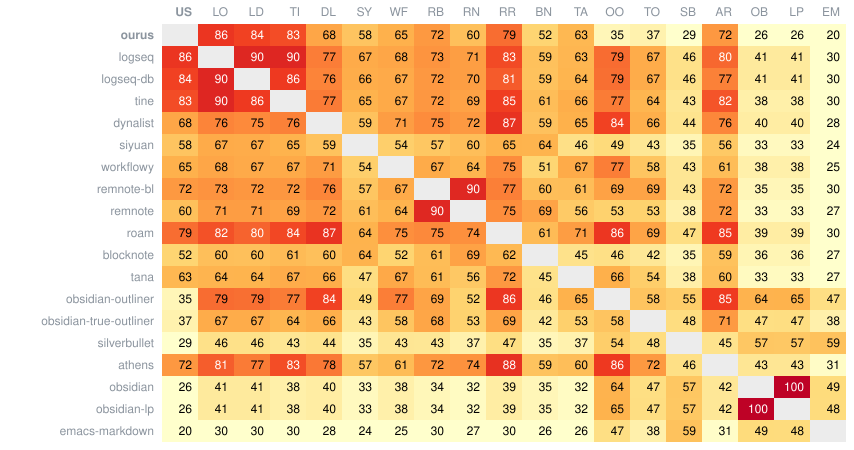

# Every app side by side

Each test case of the spec, run in each app and compared with ourus: ✓ agrees, ✗ disagrees, `caret` the
same text with the caret elsewhere, `space` a difference in spaces only, `error` didn't run, – skipped;
in brackets, `(✗)`, a difference in an example adapted for the app: its buffers projected onto blocks, so it compares those.
An app's report (its name above its column) has the outcomes and the reasons for its skips.

## Summary

|  | model | agree | caret | whitespace | disagree | error | skipped | total |
| --- | --- | --- | --- | --- | --- | --- | --- | --- |
| [logseq](logseq/sxs.md) | block | 197 | 12 | 19 | 84 |  | 146 | **458** |
| [tine](tine/sxs.md) | block | 178 | 14 | 32 | 81 |  | 153 | **458** |
| [dynalist](dynalist/sxs.md) | block | 175 | 7 | 30 | 104 |  | 142 | **458** |
| [siyuan](siyuan/sxs.md) | block | 163 | 9 | 27 | 87 |  | 172 | **458** |
| [roam](roam/sxs.md) | block | 151 | 18 | 29 | 86 |  | 174 | **458** |
| [obsidian-true-outliner](obsidian-true-outliner/sxs.md) | text | 143 | 41 | 6 | 200 |  | 68 | **458** |
| [workflowy](workflowy/sxs.md) | block | 141 | 11 | 11 | 120 |  | 175 | **458** |
| [blocknote](blocknote/sxs.md) | block | 131 | 9 | 31 | 128 |  | 159 | **458** |
| [obsidian-outliner](obsidian-outliner/sxs.md) | text | 130 | 13 | 5 | 241 |  | 69 | **458** |
| [silverbullet](silverbullet/sxs.md) | text | 111 | 17 | 8 | 265 |  | 57 | **458** |
| [obsidian](obsidian/sxs.md) | text | 108 | 11 | 6 | 275 |  | 58 | **458** |
| [obsidian-lp](obsidian-lp/sxs.md) | text | 107 | 11 | 6 | 273 |  | 61 | **458** |
| [emacs-markdown](emacs-markdown/sxs.md) | text | 75 | 23 | 5 | 302 |  | 53 | **458** |

## Heatmap

Each cell is how often two apps got the same verdict (both agree with ourus, both disagree, ...),
in percent of the examples both ran.
Apps most like logseq come first, apps most like obsidian last.

## Test cases

<table>
<tr><td><b>backspace.md</b><td><b>agree</b><td><b><a href="logseq/sxs.md">logseq</a></b><td><b><a href="tine/sxs.md">tine</a></b><td><b><a href="dynalist/sxs.md">dynalist</a></b><td><b><a href="siyuan/sxs.md">siyuan</a></b><td><b><a href="roam/sxs.md">roam</a></b><td><b><a href="obsidian-true-outliner/sxs.md">obsidian-true-outliner</a></b><td><b><a href="workflowy/sxs.md">workflowy</a></b><td><b><a href="blocknote/sxs.md">blocknote</a></b><td><b><a href="obsidian-outliner/sxs.md">obsidian-outliner</a></b><td><b><a href="silverbullet/sxs.md">silverbullet</a></b><td><b><a href="obsidian/sxs.md">obsidian</a></b><td><b><a href="obsidian-lp/sxs.md">obsidian-lp</a></b><td><b><a href="emacs-markdown/sxs.md">emacs-markdown</a></b></tr>
<tr><td><a href="../spec/backspace.md#backspace1">Backspace1</a><td align="right">7<td>✓<td>✓<td>✓<td>✗<td>✓<td>✓<td>✓<td>✗<td>✓<td>✗<td>✗<td>✗<td>✗</tr>
<tr><td><a href="../spec/backspace.md#backspace2">Backspace2</a><td align="right">0<td>–<td>–<td>–<td>–<td>–<td>–<td>–<td>–<td>–<td>✗<td>✗<td>✗<td>✗</tr>
<tr><td><a href="../spec/backspace.md#backspace3">Backspace3</a><td align="right">6<td>✓<td>✓<td>✓<td>✗<td>✓<td>✓<td>✗<td>✗<td>✓<td>✗<td>✗<td>✗<td>✗</tr>
<tr><td><a href="../spec/backspace.md#backspace4">Backspace4</a><td align="right">0<td>(✗)<td>(✗)<td>(✗)<td>–<td>(✗)<td>✗<td>(✗)<td>(✗)<td>✗<td>✗<td>✗<td>✗<td>✗</tr>
<tr><td><a href="../spec/backspace.md#backspace5">Backspace5</a><td align="right">7<td>✓<td>✓<td>✓<td>space<td>✓<td>✓<td>✓<td>✗<td>✓<td>✗<td>✗<td>✗<td>✗</tr>
<tr><td><a href="../spec/backspace.md#backspace7">Backspace7</a><td align="right">7<td>✓<td>✓<td>✓<td>space<td>✓<td>✓<td>✓<td>✗<td>✓<td>✗<td>✗<td>✗<td>✗</tr>
<tr><td><a href="../spec/backspace.md#backspace8">Backspace8</a><td align="right">7<td>✓<td>✓<td>✓<td>✗<td>✓<td>✓<td>✓<td>✗<td>✓<td>✗<td>✗<td>✗<td>✗</tr>
<tr><td><a href="../spec/backspace.md#backspace9">Backspace9</a><td align="right">7<td>✓<td>✓<td>✓<td>✓<td>✓<td>✗<td>✗<td>✓<td>✓<td>✗<td>✗<td>✗<td>✗</tr>
<tr><td><a href="../spec/backspace.md#backspace10">Backspace10</a><td align="right">5<td>✓<td>✓<td>✓<td>(space)<td>✓<td>✗<td>✓<td>(✗)<td>✗<td>✗<td>✗<td>✗<td>✗</tr>
<tr><td><a href="../spec/backspace.md#backspace11">Backspace11</a><td align="right">6<td>✓<td>✓<td>✓<td>(✗)<td>✓<td>✓<td>✓<td>(✗)<td>✗<td>✗<td>✗<td>✗<td>✗</tr>
<tr><td><a href="../spec/backspace.md#backspace12">Backspace12</a><td align="right">6<td>(✗)<td>(✗)<td>(✗)<td>✓<td>(✗)<td>✗<td>(✗)<td>(✗)<td>✓<td>✓<td>✓<td>✓<td>✓</tr>
<tr><td><a href="../spec/backspace.md#backspace13">Backspace13</a><td align="right">13<td>✓<td>✓<td>✓<td>✓<td>✓<td>✓<td>✓<td>✓<td>✓<td>✓<td>✓<td>✓<td>✓</tr>
<tr><td><a href="../spec/backspace.md#backspace14">Backspace14</a><td align="right">0<td>(✗)<td>(✗)<td>(✗)<td>(✗)<td>(✗)<td>✗<td>(✗)<td>(✗)<td>✗<td>✗<td>✗<td>✗<td>✗</tr>
<tr><td><a href="../spec/backspace.md#backspace15">Backspace15</a><td align="right">5<td>✓<td>✓<td>✓<td>(✗)<td>✓<td>✓<td>(✗)<td>(✗)<td>✗<td>✗<td>✗<td>✗<td>✗</tr>
<tr><td><a href="../spec/backspace.md#backspace16">Backspace16</a><td align="right">0<td>–<td>–<td>–<td>–<td>–<td>–<td>–<td>–<td>–<td>–<td>–<td>–<td>–</tr>
<tr><td><a href="../spec/backspace.md#backspace17">Backspace17</a><td align="right">1<td>caret<td>✓<td>caret<td>✗<td>✗<td>✗<td>caret<td>✗<td>✗<td>✗<td>✗<td>✗<td>✗</tr>
<tr><td><a href="../spec/backspace.md#backspace17b">Backspace17b</a><td align="right">0<td>✗<td>✗<td>✗<td>✗<td>✗<td>✗<td>✗<td>✗<td>✗<td>✗<td>✗<td>✗<td>✗</tr>
<tr><td><a href="../spec/backspace.md#backspace17c">Backspace17c</a><td align="right">1<td>✗<td>✗<td>✗<td>space<td>✗<td>✓<td>✗<td>✗<td>✗<td>✗<td>✗<td>✗<td>✗</tr>
<tr><td><a href="../spec/backspace.md#backspace17d">Backspace17d</a><td align="right">7<td>✓<td>✓<td>✓<td>space<td>✓<td>✓<td>✓<td>✗<td>✓<td>✗<td>✗<td>✗<td>✗</tr>
<tr><td><a href="../spec/backspace.md#backspace17e">Backspace17e</a><td align="right">1<td>–<td>–<td>–<td>–<td>–<td>✗<td>–<td>–<td>✗<td>✓<td>✗<td>✗<td>✗</tr>
<tr><td><a href="../spec/backspace.md#backspace18">Backspace18</a><td align="right">0<td>(✗)<td>(✗)<td>(✗)<td>(✗)<td>(✗)<td>✗<td>(✗)<td>(✗)<td>✗<td>✗<td>✗<td>✗<td>✗</tr>
<tr><td><a href="../spec/backspace.md#backspace18b">Backspace18b</a><td align="right">0<td>–<td>–<td>–<td>–<td>–<td>–<td>–<td>–<td>–<td>–<td>–<td>–<td>–</tr>
<tr><td><a href="../spec/backspace.md#backspace18c">Backspace18c</a><td align="right">0<td>(✗)<td>(✗)<td>(✗)<td>(✗)<td>(✗)<td>✗<td>(✗)<td>(✗)<td>✗<td>✗<td>✗<td>✗<td>✗</tr>
<tr><td><a href="../spec/backspace.md#backspace18d">Backspace18d</a><td align="right">0<td>(✗)<td>(✗)<td>(✗)<td>(✗)<td>(✗)<td>✗<td>(✗)<td>(✗)<td>✗<td>✗<td>✗<td>✗<td>✗</tr>
<tr><td><a href="../spec/backspace.md#backspace19">Backspace19</a><td align="right">0<td>(✗)<td>(✗)<td>(✗)<td>(✗)<td>(✗)<td>✗<td>(✗)<td>(✗)<td>✗<td>✗<td>✗<td>✗<td>✗</tr>
<tr><td><a href="../spec/backspace.md#backspace20">Backspace20</a><td align="right">0<td>(✗)<td>(✗)<td>(✗)<td>(✗)<td>(✗)<td>✗<td>(✗)<td>(✗)<td>✗<td>✗<td>✗<td>✗<td>✗</tr>
<tr><td><a href="../spec/backspace.md#backspace21">Backspace21</a><td align="right">6<td>✓<td>✓<td>✓<td>(✗)<td>✓<td>✓<td>✓<td>(✗)<td>✗<td>✗<td>✗<td>✗<td>✗</tr>
<tr><td><a href="../spec/backspace.md#backspace21b">Backspace21b</a><td align="right">0<td>–<td>–<td>–<td>–<td>–<td>–<td>–<td>–<td>–<td>–<td>–<td>–<td>–</tr>
<tr><td><b>total</b><td><td><b>12</b><td><b>13</b><td><b>12</b><td><b>3</b><td><b>12</b><td><b>11</b><td><b>9</b><td><b>2</b><td><b>9</b><td><b>3</b><td><b>2</b><td><b>2</b><td><b>2</b></tr>
<tr><td colspan="15"></tr>
<tr><td><b>block-down.md</b><td><b>agree</b><td><b><a href="logseq/sxs.md">logseq</a></b><td><b><a href="tine/sxs.md">tine</a></b><td><b><a href="dynalist/sxs.md">dynalist</a></b><td><b><a href="siyuan/sxs.md">siyuan</a></b><td><b><a href="roam/sxs.md">roam</a></b><td><b><a href="obsidian-true-outliner/sxs.md">obsidian-true-outliner</a></b><td><b><a href="workflowy/sxs.md">workflowy</a></b><td><b><a href="blocknote/sxs.md">blocknote</a></b><td><b><a href="obsidian-outliner/sxs.md">obsidian-outliner</a></b><td><b><a href="silverbullet/sxs.md">silverbullet</a></b><td><b><a href="obsidian/sxs.md">obsidian</a></b><td><b><a href="obsidian-lp/sxs.md">obsidian-lp</a></b><td><b><a href="emacs-markdown/sxs.md">emacs-markdown</a></b></tr>
<tr><td><a href="../spec/block-down.md#blockdown1">BlockDown1</a><td align="right">9<td>✓<td>✓<td>✓<td>✓<td>✓<td>caret<td>✓<td>✓<td>✗<td>✓<td>✗<td>✗<td>✓</tr>
<tr><td><a href="../spec/block-down.md#blockdown2">BlockDown2</a><td align="right">0<td>(✗)<td>(✗)<td>(✗)<td>(✗)<td>(✗)<td>✗<td>(✗)<td>(✗)<td>✗<td>✗<td>✗<td>✗<td>✗</tr>
<tr><td><a href="../spec/block-down.md#blockdown3">BlockDown3</a><td align="right">0<td>–<td>–<td>–<td>–<td>–<td>–<td>–<td>–<td>–<td>–<td>–<td>–<td>–</tr>
<tr><td><a href="../spec/block-down.md#blockdown4">BlockDown4</a><td align="right">7<td>✓<td>✓<td>✓<td>✓<td>✓<td>caret<td>✓<td>(✗)<td>✗<td>✓<td>✗<td>✗<td>✗</tr>
<tr><td><a href="../spec/block-down.md#blockdown5">BlockDown5</a><td align="right">8<td>✓<td>✓<td>✓<td>✓<td>✓<td>caret<td>✓<td>✓<td>✗<td>✓<td>✗<td>✗<td>✗</tr>
<tr><td><a href="../spec/block-down.md#blockdown6">BlockDown6</a><td align="right">0<td>–<td>–<td>–<td>–<td>–<td>–<td>–<td>–<td>–<td>–<td>–<td>–<td>–</tr>
<tr><td><a href="../spec/block-down.md#blockdown7">BlockDown7</a><td align="right">7<td>✓<td>✓<td>✓<td>✓<td>✓<td>✗<td>✓<td>✗<td>✓<td>✗<td>✗<td>✗<td>✗</tr>
<tr><td><a href="../spec/block-down.md#blockdown8">BlockDown8</a><td align="right">1<td>(✗)<td>(✗)<td>(✗)<td>(✗)<td>(✗)<td>✗<td>(✗)<td>✓<td>✗<td>✗<td>✗<td>✗<td>✗</tr>
<tr><td><a href="../spec/block-down.md#blockdown9">BlockDown9</a><td align="right">7<td>✓<td>✓<td>✓<td>✓<td>✓<td>✗<td>✓<td>✗<td>✓<td>✗<td>✗<td>✗<td>✗</tr>
<tr><td><a href="../spec/block-down.md#blockdown10">BlockDown10</a><td align="right">7<td>✓<td>✓<td>✓<td>✓<td>✓<td>✗<td>✓<td>✗<td>✓<td>✗<td>✗<td>✗<td>✗</tr>
<tr><td><a href="../spec/block-down.md#blockdown11">BlockDown11</a><td align="right">2<td>–<td>–<td>–<td>–<td>–<td>caret<td>–<td>–<td>✗<td>✗<td>✓<td>✓<td>✗</tr>
<tr><td><a href="../spec/block-down.md#blockdown12">BlockDown12</a><td align="right">2<td>–<td>–<td>–<td>–<td>–<td>✗<td>–<td>–<td>✗<td>✗<td>✓<td>✓<td>✗</tr>
<tr><td><a href="../spec/block-down.md#blockdown13">BlockDown13</a><td align="right">0<td>(✗)<td>(✗)<td>(✗)<td>(✗)<td>(✗)<td>✗<td>(✗)<td>(✗)<td>✗<td>✗<td>✗<td>✗<td>✗</tr>
<tr><td><a href="../spec/block-down.md#blockdown14">BlockDown14</a><td align="right">2<td>–<td>–<td>–<td>–<td>–<td>caret<td>–<td>–<td>✗<td>caret<td>✓<td>✓<td>✗</tr>
<tr><td><a href="../spec/block-down.md#blockdown15">BlockDown15</a><td align="right">13<td>✓<td>✓<td>✓<td>✓<td>✓<td>✓<td>✓<td>✓<td>✓<td>✓<td>✓<td>✓<td>✓</tr>
<tr><td><a href="../spec/block-down.md#blockdown16">BlockDown16</a><td align="right">7<td>✓<td>✓<td>✓<td>✓<td>✓<td>✗<td>✓<td>(✗)<td>✗<td>✓<td>✗<td>✗<td>caret</tr>
<tr><td><a href="../spec/block-down.md#blockdown17">BlockDown17</a><td align="right">0<td>–<td>–<td>–<td>–<td>–<td>–<td>–<td>–<td>–<td>–<td>–<td>–<td>–</tr>
<tr><td><a href="../spec/block-down.md#blockdown18">BlockDown18</a><td align="right">6<td>✓<td>✓<td>✓<td>✓<td>✓<td>✗<td>✓<td>(✗)<td>✗<td>✗<td>✗<td>✗<td>✗</tr>
<tr><td><a href="../spec/block-down.md#blockdown19">BlockDown19</a><td align="right">0<td>–<td>–<td>–<td>–<td>–<td>–<td>–<td>–<td>–<td>–<td>–<td>–<td>–</tr>
<tr><td><a href="../spec/block-down.md#blockdown20">BlockDown20</a><td align="right">1<td>(✗)<td>(✗)<td>(✗)<td>(✗)<td>(✗)<td>✗<td>(✗)<td>✓<td>✗<td>✗<td>✗<td>✗<td>✗</tr>
<tr><td><b>total</b><td><td><b>9</b><td><b>9</b><td><b>9</b><td><b>9</b><td><b>9</b><td><b>1</b><td><b>9</b><td><b>5</b><td><b>4</b><td><b>5</b><td><b>4</b><td><b>4</b><td><b>2</b></tr>
<tr><td colspan="15"></tr>
<tr><td><b>block-up.md</b><td><b>agree</b><td><b><a href="logseq/sxs.md">logseq</a></b><td><b><a href="tine/sxs.md">tine</a></b><td><b><a href="dynalist/sxs.md">dynalist</a></b><td><b><a href="siyuan/sxs.md">siyuan</a></b><td><b><a href="roam/sxs.md">roam</a></b><td><b><a href="obsidian-true-outliner/sxs.md">obsidian-true-outliner</a></b><td><b><a href="workflowy/sxs.md">workflowy</a></b><td><b><a href="blocknote/sxs.md">blocknote</a></b><td><b><a href="obsidian-outliner/sxs.md">obsidian-outliner</a></b><td><b><a href="silverbullet/sxs.md">silverbullet</a></b><td><b><a href="obsidian/sxs.md">obsidian</a></b><td><b><a href="obsidian-lp/sxs.md">obsidian-lp</a></b><td><b><a href="emacs-markdown/sxs.md">emacs-markdown</a></b></tr>
<tr><td><a href="../spec/block-up.md#blockup1">BlockUp1</a><td align="right">10<td>✓<td>✓<td>✓<td>✓<td>✓<td>caret<td>✓<td>✓<td>✓<td>✓<td>✗<td>✗<td>✓</tr>
<tr><td><a href="../spec/block-up.md#blockup2">BlockUp2</a><td align="right">0<td>–<td>–<td>–<td>–<td>–<td>–<td>–<td>–<td>–<td>–<td>–<td>–<td>–</tr>
<tr><td><a href="../spec/block-up.md#blockup3">BlockUp3</a><td align="right">7<td>✓<td>✓<td>✓<td>✓<td>✓<td>caret<td>✓<td>(✗)<td>✗<td>✓<td>✗<td>✗<td>✗</tr>
<tr><td><a href="../spec/block-up.md#blockup4">BlockUp4</a><td align="right">8<td>✓<td>✓<td>✓<td>✓<td>✓<td>caret<td>✓<td>✓<td>✗<td>✓<td>✗<td>✗<td>✗</tr>
<tr><td><a href="../spec/block-up.md#blockup5">BlockUp5</a><td align="right">0<td>–<td>–<td>–<td>–<td>–<td>–<td>–<td>–<td>–<td>–<td>–<td>–<td>–</tr>
<tr><td><a href="../spec/block-up.md#blockup6">BlockUp6</a><td align="right">9<td>✓<td>✓<td>✓<td>✓<td>✓<td>✗<td>✓<td>✗<td>✓<td>✗<td>✓<td>✓<td>✗</tr>
<tr><td><a href="../spec/block-up.md#blockup7">BlockUp7</a><td align="right">1<td>(✗)<td>(✗)<td>(✗)<td>(✗)<td>(✗)<td>✗<td>(✗)<td>✓<td>✗<td>✗<td>✗<td>✗<td>✗</tr>
<tr><td><a href="../spec/block-up.md#blockup8">BlockUp8</a><td align="right">7<td>✓<td>✓<td>✓<td>✓<td>✓<td>✗<td>✓<td>✗<td>✓<td>✗<td>✗<td>✗<td>✗</tr>
<tr><td><a href="../spec/block-up.md#blockup9">BlockUp9</a><td align="right">7<td>✓<td>✓<td>✓<td>✓<td>✓<td>✗<td>✓<td>✗<td>✓<td>✗<td>✗<td>✗<td>✗</tr>
<tr><td><a href="../spec/block-up.md#blockup10">BlockUp10</a><td align="right">2<td>–<td>–<td>–<td>–<td>–<td>caret<td>–<td>–<td>✗<td>✗<td>✓<td>✓<td>✗</tr>
<tr><td><a href="../spec/block-up.md#blockup11">BlockUp11</a><td align="right">2<td>–<td>–<td>–<td>–<td>–<td>✗<td>–<td>–<td>✗<td>✗<td>✓<td>✓<td>✗</tr>
<tr><td><a href="../spec/block-up.md#blockup12">BlockUp12</a><td align="right">2<td>(✗)<td>(✗)<td>✓<td>(✗)<td>(✗)<td>✗<td>(✗)<td>✓<td>✗<td>✗<td>✗<td>✗<td>✗</tr>
<tr><td><a href="../spec/block-up.md#blockup13">BlockUp13</a><td align="right">7<td>✓<td>✓<td>✓<td>✓<td>–<td>caret<td>–<td>✓<td>✗<td>✓<td>✗<td>✗<td>✓</tr>
<tr><td><a href="../spec/block-up.md#blockup14">BlockUp14</a><td align="right">11<td>✓<td>✓<td>✓<td>✓<td>✓<td>caret<td>✓<td>✓<td>✓<td>✓<td>✓<td>✓<td>✗</tr>
<tr><td><a href="../spec/block-up.md#blockup15">BlockUp15</a><td align="right">6<td>✓<td>✓<td>✓<td>✓<td>✓<td>caret<td>✓<td>(✗)<td>✗<td>✗<td>✗<td>✗<td>✗</tr>
<tr><td><a href="../spec/block-up.md#blockup16">BlockUp16</a><td align="right">7<td>✓<td>✓<td>✓<td>✓<td>✓<td>✗<td>✓<td>(✗)<td>✗<td>✓<td>✗<td>✗<td>caret</tr>
<tr><td><a href="../spec/block-up.md#blockup17">BlockUp17</a><td align="right">7<td>✓<td>✓<td>✓<td>✓<td>✓<td>caret<td>✓<td>✓<td>✗<td>✗<td>✗<td>✗<td>✗</tr>
<tr><td><a href="../spec/block-up.md#blockup18">BlockUp18</a><td align="right">3<td>–<td>✓<td>✓<td>–<td>–<td>✗<td>–<td>✓<td>✗<td>✗<td>✗<td>✗<td>✗</tr>
<tr><td><a href="../spec/block-up.md#blockup19">BlockUp19</a><td align="right">5<td>✓<td>✓<td>✓<td>–<td>✓<td>caret<td>–<td>✓<td>✗<td>✗<td>✗<td>✗<td>✗</tr>
<tr><td><a href="../spec/block-up.md#blockup20">BlockUp20</a><td align="right">6<td>✓<td>✓<td>✓<td>✓<td>✓<td>✗<td>–<td>✓<td>✗<td>✗<td>✗<td>✗<td>✗</tr>
<tr><td><a href="../spec/block-up.md#blockup21">BlockUp21</a><td align="right">2<td>(✗)<td>(✗)<td>✓<td>(✗)<td>(✗)<td>✗<td>(✗)<td>✓<td>✗<td>✗<td>✗<td>✗<td>✗</tr>
<tr><td><a href="../spec/block-up.md#blockup22">BlockUp22</a><td align="right">6<td>✓<td>✓<td>✓<td>✓<td>✓<td>✗<td>✓<td>(✗)<td>✗<td>✗<td>✗<td>✗<td>✗</tr>
<tr><td><a href="../spec/block-up.md#blockup23">BlockUp23</a><td align="right">0<td>(✗)<td>(✗)<td>(✗)<td>(✗)<td>(✗)<td>✗<td>(✗)<td>(✗)<td>✗<td>✗<td>✗<td>✗<td>✗</tr>
<tr><td><a href="../spec/block-up.md#blockup24">BlockUp24</a><td align="right">1<td>(✗)<td>(✗)<td>(✗)<td>(✗)<td>(✗)<td>✗<td>(✗)<td>✓<td>✗<td>✗<td>✗<td>✗<td>✗</tr>
<tr><td><b>total</b><td><td><b>14</b><td><b>15</b><td><b>17</b><td><b>13</b><td><b>13</b><td><b>0</b><td><b>11</b><td><b>12</b><td><b>5</b><td><b>6</b><td><b>4</b><td><b>4</b><td><b>2</b></tr>
<tr><td colspan="15"></tr>
<tr><td><b>cursor.md</b><td><b>agree</b><td><b><a href="logseq/sxs.md">logseq</a></b><td><b><a href="tine/sxs.md">tine</a></b><td><b><a href="dynalist/sxs.md">dynalist</a></b><td><b><a href="siyuan/sxs.md">siyuan</a></b><td><b><a href="roam/sxs.md">roam</a></b><td><b><a href="obsidian-true-outliner/sxs.md">obsidian-true-outliner</a></b><td><b><a href="workflowy/sxs.md">workflowy</a></b><td><b><a href="blocknote/sxs.md">blocknote</a></b><td><b><a href="obsidian-outliner/sxs.md">obsidian-outliner</a></b><td><b><a href="silverbullet/sxs.md">silverbullet</a></b><td><b><a href="obsidian/sxs.md">obsidian</a></b><td><b><a href="obsidian-lp/sxs.md">obsidian-lp</a></b><td><b><a href="emacs-markdown/sxs.md">emacs-markdown</a></b></tr>
<tr><td><a href="../spec/cursor.md#cursorleft1">CursorLeft1</a><td align="right">13<td>✓<td>✓<td>✓<td>✓<td>✓<td>✓<td>✓<td>✓<td>✓<td>✓<td>✓<td>✓<td>✓</tr>
<tr><td><a href="../spec/cursor.md#cursorleft2">CursorLeft2</a><td align="right">7<td>✓<td>✓<td>✓<td>✓<td>✓<td>–<td>✓<td>✓<td>–<td>–<td>–<td>–<td>–</tr>
<tr><td><a href="../spec/cursor.md#cursorleft3">CursorLeft3</a><td align="right">12<td>✓<td>✓<td>✓<td>✓<td>✓<td>✓<td>✓<td>✓<td>✓<td>✓<td>✓<td>✓<td>caret</tr>
<tr><td><a href="../spec/cursor.md#cursorright1">CursorRight1</a><td align="right">12<td>✓<td>✓<td>✓<td>✓<td>✓<td>✓<td>(caret)<td>✓<td>✓<td>✓<td>✓<td>✓<td>✓</tr>
<tr><td><a href="../spec/cursor.md#cursorright2">CursorRight2</a><td align="right">12<td>✓<td>✓<td>✓<td>✓<td>✓<td>✓<td>✓<td>✓<td>✓<td>✓<td>✓<td>✓<td>caret</tr>
<tr><td><a href="../spec/cursor.md#cursorup1">CursorUp1</a><td align="right">5<td>✓<td>✓<td>(caret)<td>(caret)<td>(caret)<td>✓<td>(caret)<td>✓<td>caret<td>✓<td>caret<td>caret<td>caret</tr>
<tr><td><a href="../spec/cursor.md#cursorup2">CursorUp2</a><td align="right">3<td>(caret)<td>(caret)<td>✓<td>(caret)<td>✓<td>caret<td>✓<td>(caret)<td>caret<td>caret<td>caret<td>caret<td>caret</tr>
<tr><td><a href="../spec/cursor.md#cursorup3">CursorUp3</a><td align="right">6<td>caret<td>caret<td>✓<td>✓<td>caret<td>✓<td>✓<td>✓<td>✓<td>caret<td>caret<td>caret<td>caret</tr>
<tr><td><a href="../spec/cursor.md#cursordown1">CursorDown1</a><td align="right">7<td>(caret)<td>✓<td>✓<td>(caret)<td>(caret)<td>caret<td>(caret)<td>(caret)<td>✓<td>✓<td>✓<td>✓<td>✓</tr>
<tr><td><a href="../spec/cursor.md#cursordown2">CursorDown2</a><td align="right">5<td>(caret)<td>(caret)<td>(caret)<td>–<td>–<td>caret<td>–<td>(caret)<td>✓<td>✓<td>✓<td>✓<td>✓</tr>
<tr><td><a href="../spec/cursor.md#cursordown3">CursorDown3</a><td align="right">9<td>✓<td>✓<td>✓<td>✓<td>✓<td>✓<td>✓<td>✓<td>✓<td>caret<td>caret<td>caret<td>caret</tr>
<tr><td><a href="../spec/cursor.md#cursordown4">CursorDown4</a><td align="right">2<td>caret<td>caret<td>caret<td>caret<td>caret<td>caret<td>caret<td>caret<td>caret<td>✓<td>caret<td>caret<td>✓</tr>
<tr><td><a href="../spec/cursor.md#cursorhome1">CursorHome1</a><td align="right">11<td>✓<td>✓<td>✓<td>✓<td>✓<td>✓<td>✓<td>✓<td>✓<td>caret<td>✓<td>✓<td>caret</tr>
<tr><td><a href="../spec/cursor.md#cursorhome2">CursorHome2</a><td align="right">11<td>✓<td>✓<td>✓<td>✓<td>✓<td>caret<td>✓<td>✓<td>caret<td>✓<td>✓<td>✓<td>✓</tr>
<tr><td><a href="../spec/cursor.md#cursorhome3">CursorHome3</a><td align="right">0<td>–<td>–<td>–<td>–<td>–<td>–<td>–<td>–<td>–<td>caret<td>caret<td>caret<td>caret</tr>
<tr><td><a href="../spec/cursor.md#cursorhome4">CursorHome4</a><td align="right">0<td>–<td>–<td>–<td>–<td>–<td>–<td>–<td>–<td>–<td>caret<td>caret<td>caret<td>caret</tr>
<tr><td><a href="../spec/cursor.md#cursorhome5">CursorHome5</a><td align="right">11<td>✓<td>✓<td>✓<td>✓<td>✓<td>✓<td>✓<td>✓<td>✓<td>caret<td>✓<td>✓<td>caret</tr>
<tr><td><a href="../spec/cursor.md#cursorhome6">CursorHome6</a><td align="right">11<td>✓<td>✓<td>✓<td>✓<td>✓<td>✓<td>✓<td>✓<td>✓<td>caret<td>✓<td>✓<td>caret</tr>
<tr><td><a href="../spec/cursor.md#cursorhome7">CursorHome7</a><td align="right">11<td>✓<td>✓<td>✓<td>✓<td>✓<td>✓<td>✓<td>✓<td>✓<td>caret<td>✓<td>✓<td>caret</tr>
<tr><td><a href="../spec/cursor.md#cursorhome8">CursorHome8</a><td align="right">8<td>(caret)<td>(caret)<td>✓<td>✓<td>(caret)<td>✓<td>✓<td>✓<td>✓<td>caret<td>✓<td>✓<td>caret</tr>
<tr><td><a href="../spec/cursor.md#cursorhome9">CursorHome9</a><td align="right">8<td>(caret)<td>(caret)<td>✓<td>✓<td>(caret)<td>✓<td>✓<td>✓<td>✓<td>caret<td>✓<td>✓<td>caret</tr>
<tr><td><a href="../spec/cursor.md#cursorhome10">CursorHome10</a><td align="right">5<td>(caret)<td>(caret)<td>✓<td>✓<td>✓<td>caret<td>✓<td>✓<td>caret<td>caret<td>caret<td>caret<td>caret</tr>
<tr><td><a href="../spec/cursor.md#cursorhome11">CursorHome11</a><td align="right">3<td>–<td>–<td>–<td>–<td>–<td>caret<td>–<td>–<td>✓<td>caret<td>✓<td>✓<td>caret</tr>
<tr><td><a href="../spec/cursor.md#cursorhome12">CursorHome12</a><td align="right">11<td>✓<td>✓<td>✓<td>✓<td>✓<td>✓<td>✓<td>✓<td>✓<td>caret<td>✓<td>✓<td>caret</tr>
<tr><td><a href="../spec/cursor.md#cursorhome13">CursorHome13</a><td align="right">11<td>✓<td>✓<td>✓<td>✓<td>✓<td>caret<td>✓<td>✓<td>caret<td>✓<td>✓<td>✓<td>✓</tr>
<tr><td><a href="../spec/cursor.md#cursorhome14">CursorHome14</a><td align="right">13<td>✓<td>✓<td>✓<td>✓<td>✓<td>✓<td>✓<td>✓<td>✓<td>✓<td>✓<td>✓<td>✓</tr>
<tr><td><a href="../spec/cursor.md#cursorend1">CursorEnd1</a><td align="right">13<td>✓<td>✓<td>✓<td>✓<td>✓<td>✓<td>✓<td>✓<td>✓<td>✓<td>✓<td>✓<td>✓</tr>
<tr><td><a href="../spec/cursor.md#cursordocstart1">CursorDocStart1</a><td align="right">11<td>✓<td>✓<td>✓<td>✓<td>✓<td>caret<td>✓<td>✓<td>caret<td>✓<td>✓<td>✓<td>✓</tr>
<tr><td><a href="../spec/cursor.md#cursordocendleft1">CursorDocEndLeft1</a><td align="right">5<td>–<td>–<td>–<td>–<td>–<td>caret<td>–<td>–<td>✓<td>✓<td>✓<td>✓<td>✓</tr>
<tr><td><a href="../spec/cursor.md#selectleft1">SelectLeft1</a><td align="right">13<td>✓<td>✓<td>✓<td>✓<td>✓<td>✓<td>✓<td>✓<td>✓<td>✓<td>✓<td>✓<td>✓</tr>
<tr><td><a href="../spec/cursor.md#selectrightend1">SelectRightEnd1</a><td align="right">13<td>✓<td>✓<td>✓<td>✓<td>✓<td>✓<td>✓<td>✓<td>✓<td>✓<td>✓<td>✓<td>✓</tr>
<tr><td><a href="../spec/cursor.md#selecthome1">SelectHome1</a><td align="right">11<td>✓<td>✓<td>✓<td>✓<td>✓<td>✓<td>✓<td>✓<td>✓<td>caret<td>✓<td>✓<td>caret</tr>
<tr><td><b>total</b><td><td><b>20</b><td><b>21</b><td><b>25</b><td><b>23</b><td><b>21</b><td><b>19</b><td><b>23</b><td><b>24</b><td><b>22</b><td><b>16</b><td><b>23</b><td><b>23</b><td><b>13</b></tr>
<tr><td colspan="15"></tr>
<tr><td><b>del.md</b><td><b>agree</b><td><b><a href="logseq/sxs.md">logseq</a></b><td><b><a href="tine/sxs.md">tine</a></b><td><b><a href="dynalist/sxs.md">dynalist</a></b><td><b><a href="siyuan/sxs.md">siyuan</a></b><td><b><a href="roam/sxs.md">roam</a></b><td><b><a href="obsidian-true-outliner/sxs.md">obsidian-true-outliner</a></b><td><b><a href="workflowy/sxs.md">workflowy</a></b><td><b><a href="blocknote/sxs.md">blocknote</a></b><td><b><a href="obsidian-outliner/sxs.md">obsidian-outliner</a></b><td><b><a href="silverbullet/sxs.md">silverbullet</a></b><td><b><a href="obsidian/sxs.md">obsidian</a></b><td><b><a href="obsidian-lp/sxs.md">obsidian-lp</a></b><td><b><a href="emacs-markdown/sxs.md">emacs-markdown</a></b></tr>
<tr><td><a href="../spec/del.md#delete1">Delete1</a><td align="right">7<td>✓<td>✓<td>✓<td>✗<td>✓<td>✓<td>✗<td>✓<td>✓<td>✗<td>✗<td>✗<td>✗</tr>
<tr><td><a href="../spec/del.md#delete2">Delete2</a><td align="right">8<td>✓<td>✓<td>✓<td>✗<td>✓<td>✓<td>✓<td>✓<td>✓<td>✗<td>✗<td>✗<td>✗</tr>
<tr><td><a href="../spec/del.md#delete3">Delete3</a><td align="right">7<td>✓<td>✓<td>✓<td>✓<td>✓<td>✗<td>✗<td>✓<td>✓<td>✗<td>✗<td>✗<td>✗</tr>
<tr><td><a href="../spec/del.md#delete4">Delete4</a><td align="right">0<td>(✗)<td>(✗)<td>(✗)<td>–<td>(✗)<td>✗<td>(✗)<td>(✗)<td>✗<td>✗<td>✗<td>✗<td>✗</tr>
<tr><td><a href="../spec/del.md#delete5">Delete5</a><td align="right">2<td>✗<td>✗<td>✗<td>space<td>✗<td>✓<td>✗<td>✓<td>✗<td>✗<td>✗<td>✗<td>✗</tr>
<tr><td><a href="../spec/del.md#delete5b">Delete5b</a><td align="right">2<td>✗<td>✗<td>✗<td>space<td>✗<td>✓<td>✗<td>✓<td>✗<td>✗<td>✗<td>✗<td>✗</tr>
<tr><td><a href="../spec/del.md#delete5c">Delete5c</a><td align="right">3<td>✗<td>✓<td>✗<td>✗<td>✗<td>✓<td>✗<td>✓<td>✗<td>✗<td>✗<td>✗<td>✗</tr>
<tr><td><a href="../spec/del.md#delete5d">Delete5d</a><td align="right">0<td>✗<td>✗<td>✗<td>–<td>✗<td>–<td>✗<td>✗<td>✗<td>✗<td>✗<td>✗<td>✗</tr>
<tr><td><a href="../spec/del.md#delete6">Delete6</a><td align="right">8<td>✓<td>✓<td>✓<td>space<td>✓<td>✓<td>✓<td>✓<td>✓<td>✗<td>✗<td>✗<td>✗</tr>
<tr><td><a href="../spec/del.md#delete7">Delete7</a><td align="right">7<td>✓<td>✓<td>✓<td>✗<td>✓<td>✓<td>✓<td>✗<td>✓<td>✗<td>✗<td>✗<td>✗</tr>
<tr><td><a href="../spec/del.md#delete8">Delete8</a><td align="right">13<td>✓<td>✓<td>✓<td>✓<td>✓<td>✓<td>✓<td>✓<td>✓<td>✓<td>✓<td>✓<td>✓</tr>
<tr><td><a href="../spec/del.md#delete9">Delete9</a><td align="right">0<td>(✗)<td>(✗)<td>(✗)<td>(✗)<td>(✗)<td>✗<td>(✗)<td>(✗)<td>✗<td>✗<td>✗<td>✗<td>✗</tr>
<tr><td><a href="../spec/del.md#delete10">Delete10</a><td align="right">1<td>–<td>–<td>–<td>–<td>–<td>✓<td>–<td>–<td>✗<td>✗<td>✗<td>✗<td>✗</tr>
<tr><td><a href="../spec/del.md#delete11">Delete11</a><td align="right">0<td>–<td>(✗)<td>(✗)<td>–<td>–<td>✗<td>–<td>(✗)<td>✗<td>✗<td>✗<td>✗<td>✗</tr>
<tr><td><a href="../spec/del.md#delete12">Delete12</a><td align="right">6<td>✓<td>✓<td>✓<td>✗<td>✓<td>✗<td>✓<td>✗<td>✓<td>✗<td>✗<td>✗<td>✗</tr>
<tr><td><a href="../spec/del.md#delete13">Delete13</a><td align="right">2<td>✓<td>✓<td>(✗)<td>(✗)<td>(✗)<td>✗<td>(✗)<td>(✗)<td>✗<td>✗<td>✗<td>✗<td>✗</tr>
<tr><td><a href="../spec/del.md#delete13b">Delete13b</a><td align="right">0<td>–<td>–<td>–<td>–<td>–<td>–<td>–<td>–<td>–<td>–<td>–<td>–<td>–</tr>
<tr><td><a href="../spec/del.md#delete13c">Delete13c</a><td align="right">0<td>(✗)<td>(✗)<td>(✗)<td>(✗)<td>(✗)<td>✗<td>(✗)<td>(✗)<td>✗<td>✗<td>✗<td>✗<td>✗</tr>
<tr><td><a href="../spec/del.md#delete13d">Delete13d</a><td align="right">0<td>–<td>–<td>–<td>–<td>–<td>–<td>–<td>–<td>–<td>–<td>–<td>–<td>–</tr>
<tr><td><a href="../spec/del.md#delete14">Delete14</a><td align="right">0<td>(✗)<td>(✗)<td>(✗)<td>(✗)<td>(✗)<td>✗<td>(✗)<td>(✗)<td>✗<td>✗<td>✗<td>✗<td>✗</tr>
<tr><td><a href="../spec/del.md#delete15">Delete15</a><td align="right">7<td>✓<td>✓<td>(✗)<td>–<td>(✗)<td>✗<td>(✗)<td>(✗)<td>✓<td>✓<td>✓<td>✓<td>✓</tr>
<tr><td><a href="../spec/del.md#delete16">Delete16</a><td align="right">4<td>–<td>–<td>–<td>–<td>–<td>–<td>–<td>–<td>–<td>✓<td>✓<td>✓<td>✓</tr>
<tr><td><a href="../spec/del.md#delete17">Delete17</a><td align="right">5<td>✓<td>✓<td>✓<td>(✗)<td>✓<td>✗<td>(✗)<td>✓<td>✗<td>✗<td>✗<td>✗<td>✗</tr>
<tr><td><a href="../spec/del.md#delete17b">Delete17b</a><td align="right">0<td>–<td>–<td>–<td>–<td>–<td>–<td>–<td>–<td>–<td>–<td>–<td>–<td>–</tr>
<tr><td><b>total</b><td><td><b>10</b><td><b>11</b><td><b>8</b><td><b>2</b><td><b>8</b><td><b>9</b><td><b>5</b><td><b>9</b><td><b>8</b><td><b>3</b><td><b>3</b><td><b>3</b><td><b>3</b></tr>
<tr><td colspan="15"></tr>
<tr><td><b>delete-subtree.md</b><td><b>agree</b><td><b><a href="logseq/sxs.md">logseq</a></b><td><b><a href="tine/sxs.md">tine</a></b><td><b><a href="dynalist/sxs.md">dynalist</a></b><td><b><a href="siyuan/sxs.md">siyuan</a></b><td><b><a href="roam/sxs.md">roam</a></b><td><b><a href="obsidian-true-outliner/sxs.md">obsidian-true-outliner</a></b><td><b><a href="workflowy/sxs.md">workflowy</a></b><td><b><a href="blocknote/sxs.md">blocknote</a></b><td><b><a href="obsidian-outliner/sxs.md">obsidian-outliner</a></b><td><b><a href="silverbullet/sxs.md">silverbullet</a></b><td><b><a href="obsidian/sxs.md">obsidian</a></b><td><b><a href="obsidian-lp/sxs.md">obsidian-lp</a></b><td><b><a href="emacs-markdown/sxs.md">emacs-markdown</a></b></tr>
<tr><td><a href="../spec/delete-subtree.md#blockdelete1">BlockDelete1</a><td align="right">3<td>✓<td>caret<td>✓<td>–<td>–<td>–<td>✓<td>–<td>–<td>–<td>–<td>–<td>✗</tr>
<tr><td><a href="../spec/delete-subtree.md#blockdelete2">BlockDelete2</a><td align="right">3<td>✓<td>(caret)<td>✓<td>–<td>–<td>–<td>✓<td>–<td>–<td>–<td>–<td>–<td>✗</tr>
<tr><td><a href="../spec/delete-subtree.md#blockdelete3">BlockDelete3</a><td align="right">1<td>(caret)<td>(caret)<td>✓<td>–<td>–<td>–<td>(caret)<td>–<td>–<td>–<td>–<td>–<td>✗</tr>
<tr><td><a href="../spec/delete-subtree.md#blockdelete4">BlockDelete4</a><td align="right">1<td>(caret)<td>(caret)<td>✓<td>–<td>–<td>–<td>(caret)<td>–<td>–<td>–<td>–<td>–<td>✗</tr>
<tr><td><b>total</b><td><td><b>2</b><td><b>0</b><td><b>4</b><td><td><td><td><b>2</b><td><td><td><td><td><td><b>0</b></tr>
<tr><td colspan="15"></tr>
<tr><td><b>duplicate-block.md</b><td><b>agree</b><td><b><a href="logseq/sxs.md">logseq</a></b><td><b><a href="tine/sxs.md">tine</a></b><td><b><a href="dynalist/sxs.md">dynalist</a></b><td><b><a href="siyuan/sxs.md">siyuan</a></b><td><b><a href="roam/sxs.md">roam</a></b><td><b><a href="obsidian-true-outliner/sxs.md">obsidian-true-outliner</a></b><td><b><a href="workflowy/sxs.md">workflowy</a></b><td><b><a href="blocknote/sxs.md">blocknote</a></b><td><b><a href="obsidian-outliner/sxs.md">obsidian-outliner</a></b><td><b><a href="silverbullet/sxs.md">silverbullet</a></b><td><b><a href="obsidian/sxs.md">obsidian</a></b><td><b><a href="obsidian-lp/sxs.md">obsidian-lp</a></b><td><b><a href="emacs-markdown/sxs.md">emacs-markdown</a></b></tr>
<tr><td><a href="../spec/duplicate-block.md#blockduplicate1">BlockDuplicate1</a><td align="right">0<td>–<td>–<td>–<td>✗<td>–<td>–<td>caret<td>–<td>–<td>–<td>–<td>–<td>–</tr>
<tr><td><a href="../spec/duplicate-block.md#blockduplicate2">BlockDuplicate2</a><td align="right">0<td>–<td>–<td>–<td>(✗)<td>–<td>–<td>(caret)<td>–<td>–<td>–<td>–<td>–<td>–</tr>
<tr><td><b>total</b><td><td><td><td><td><b>0</b><td><td><td><b>0</b><td><td><td><td><td><td></tr>
<tr><td colspan="15"></tr>
<tr><td><b>enter.md</b><td><b>agree</b><td><b><a href="logseq/sxs.md">logseq</a></b><td><b><a href="tine/sxs.md">tine</a></b><td><b><a href="dynalist/sxs.md">dynalist</a></b><td><b><a href="siyuan/sxs.md">siyuan</a></b><td><b><a href="roam/sxs.md">roam</a></b><td><b><a href="obsidian-true-outliner/sxs.md">obsidian-true-outliner</a></b><td><b><a href="workflowy/sxs.md">workflowy</a></b><td><b><a href="blocknote/sxs.md">blocknote</a></b><td><b><a href="obsidian-outliner/sxs.md">obsidian-outliner</a></b><td><b><a href="silverbullet/sxs.md">silverbullet</a></b><td><b><a href="obsidian/sxs.md">obsidian</a></b><td><b><a href="obsidian-lp/sxs.md">obsidian-lp</a></b><td><b><a href="emacs-markdown/sxs.md">emacs-markdown</a></b></tr>
<tr><td><a href="../spec/enter.md#enter1">Enter1</a><td align="right">4<td>✓<td>space<td>space<td>space<td>space<td>✓<td>space<td>space<td>✗<td>✗<td>✓<td>✓<td>✗</tr>
<tr><td><a href="../spec/enter.md#enter2">Enter2</a><td align="right">12<td>✓<td>✓<td>✓<td>✓<td>✓<td>✓<td>✓<td>✓<td>✓<td>✓<td>✓<td>✓<td>✗</tr>
<tr><td><a href="../spec/enter.md#enter3">Enter3</a><td align="right">2<td>✓<td>space<td>✗<td>✗<td>✗<td>✓<td>✗<td>✗<td>✗<td>✗<td>✗<td>✗<td>✗</tr>
<tr><td><a href="../spec/enter.md#enter4">Enter4</a><td align="right">8<td>✓<td>✓<td>✓<td>✓<td>✓<td>✓<td>✓<td>✗<td>✓<td>✗<td>✗<td>✗<td>✗</tr>
<tr><td><a href="../spec/enter.md#enter5">Enter5</a><td align="right">10<td>✓<td>✗<td>✓<td>✓<td>✓<td>✓<td>✓<td>✗<td>✓<td>✓<td>✓<td>✓<td>✗</tr>
<tr><td><a href="../spec/enter.md#enter6">Enter6</a><td align="right">0<td>–<td>–<td>–<td>–<td>–<td>✗<td>–<td>–<td>✗<td>✗<td>✗<td>✗<td>✗</tr>
<tr><td><a href="../spec/enter.md#enter7">Enter7</a><td align="right">1<td>(✗)<td>(✗)<td>(✗)<td>✓<td>(✗)<td>✗<td>(✗)<td>(✗)<td>✗<td>✗<td>✗<td>✗<td>✗</tr>
<tr><td><a href="../spec/enter.md#enter8">Enter8</a><td align="right">2<td>✓<td>(space)<td>(space)<td>✓<td>(space)<td>✗<td>(space)<td>(space)<td>✗<td>✗<td>✗<td>✗<td>✗</tr>
<tr><td><a href="../spec/enter.md#enter9">Enter9</a><td align="right">1<td>✓<td>(space)<td>(space)<td>(caret)<td>(space)<td>✗<td>(space)<td>(space)<td>✗<td>✗<td>✗<td>✗<td>✗</tr>
<tr><td><a href="../spec/enter.md#enter10">Enter10</a><td align="right">2<td>✓<td>(space)<td>(space)<td>✓<td>(space)<td>✗<td>(space)<td>(space)<td>✗<td>✗<td>✗<td>✗<td>✗</tr>
<tr><td><a href="../spec/enter.md#enter11">Enter11</a><td align="right">2<td>✓<td>(space)<td>(space)<td>✓<td>(space)<td>✗<td>(space)<td>(space)<td>✗<td>✗<td>✗<td>✗<td>✗</tr>
<tr><td><a href="../spec/enter.md#enter12">Enter12</a><td align="right">2<td>✓<td>(space)<td>(space)<td>(space)<td>(space)<td>✓<td>(space)<td>(space)<td>✗<td>✗<td>✗<td>✗<td>✗</tr>
<tr><td><a href="../spec/enter.md#enter14">Enter14</a><td align="right">2<td>(✗)<td>(✗)<td>(✗)<td>✓<td>(✗)<td>✗<td>(✗)<td>✓<td>✗<td>✗<td>✗<td>✗<td>✗</tr>
<tr><td><a href="../spec/enter.md#enter15">Enter15</a><td align="right">6<td>(✗)<td>(✗)<td>(✗)<td>✓<td>(✗)<td>✓<td>(✗)<td>(✗)<td>✓<td>✓<td>✓<td>✓<td>✗</tr>
<tr><td><a href="../spec/enter.md#enter16">Enter16</a><td align="right">3<td>✓<td>✓<td>space<td>✓<td>space<td>✗<td>✗<td>space<td>✗<td>✗<td>✗<td>✗<td>✗</tr>
<tr><td><a href="../spec/enter.md#enter17">Enter17</a><td align="right">7<td>✓<td>✓<td>✓<td>✓<td>✓<td>–<td>✓<td>✓<td>–<td>–<td>–<td>–<td>–</tr>
<tr><td><a href="../spec/enter.md#enter18">Enter18</a><td align="right">7<td>✓<td>✓<td>✓<td>✓<td>✓<td>–<td>✓<td>✓<td>–<td>–<td>–<td>–<td>–</tr>
<tr><td><a href="../spec/enter.md#enter21">Enter21</a><td align="right">5<td>✓<td>✓<td>✓<td>✗<td>✓<td>✗<td>✓<td>✗<td>✗<td>✗<td>✗<td>✗<td>✗</tr>
<tr><td><a href="../spec/enter.md#enter22">Enter22</a><td align="right">0<td>(✗)<td>(✗)<td>(✗)<td>(✗)<td>(✗)<td>✗<td>(✗)<td>(✗)<td>✗<td>✗<td>✗<td>✗<td>✗</tr>
<tr><td><a href="../spec/enter.md#enter23">Enter23</a><td align="right">1<td>–<td>✓<td>(✗)<td>–<td>–<td>✗<td>–<td>(✗)<td>✗<td>✗<td>✗<td>✗<td>✗</tr>
<tr><td><a href="../spec/enter.md#enter25">Enter25</a><td align="right">8<td>✓<td>✓<td>✓<td>✓<td>✓<td>✓<td>✓<td>✓<td>✗<td>✗<td>✗<td>✗<td>✗</tr>
<tr><td><a href="../spec/enter.md#enter26">Enter26</a><td align="right">7<td>✓<td>✓<td>✓<td>✓<td>✓<td>✓<td>✓<td>caret<td>caret<td>space<td>caret<td>caret<td>✗</tr>
<tr><td><a href="../spec/enter.md#enter27">Enter27</a><td align="right">4<td>✓<td>✓<td>✓<td>✗<td>✗<td>✗<td>✓<td>✗<td>✗<td>✗<td>✗<td>✗<td>✗</tr>
<tr><td><a href="../spec/enter.md#enter28">Enter28</a><td align="right">0<td>caret<td>caret<td>caret<td>✗<td>✗<td>✗<td>caret<td>✗<td>✗<td>✗<td>✗<td>✗<td>✗</tr>
<tr><td><a href="../spec/enter.md#enter29">Enter29</a><td align="right">7<td>✓<td>✓<td>✓<td>✓<td>✓<td>✓<td>✓<td>caret<td>caret<td>space<td>caret<td>caret<td>✗</tr>
<tr><td><a href="../spec/enter.md#enter30">Enter30</a><td align="right">1<td>–<td>–<td>–<td>–<td>✓<td>–<td>–<td>–<td>–<td>–<td>–<td>–<td>–</tr>
<tr><td><a href="../spec/enter.md#enter31">Enter31</a><td align="right">7<td>✓<td>✓<td>✓<td>✓<td>✓<td>✓<td>✓<td>caret<td>caret<td>space<td>caret<td>caret<td>✗</tr>
<tr><td><a href="../spec/enter.md#enter32">Enter32</a><td align="right">5<td>(✗)<td>(✗)<td>(✗)<td>(✗)<td>(✗)<td>✗<td>(✗)<td>(✗)<td>✓<td>✓<td>✓<td>✓<td>✓</tr>
<tr><td><a href="../spec/enter.md#enter33">Enter33</a><td align="right">5<td>–<td>–<td>–<td>–<td>–<td>✗<td>–<td>–<td>✓<td>✓<td>✓<td>✓<td>✓</tr>
<tr><td><a href="../spec/enter.md#enter34">Enter34</a><td align="right">0<td>–<td>–<td>–<td>–<td>–<td>–<td>–<td>–<td>–<td>✗<td>✗<td>✗<td>✗</tr>
<tr><td><a href="../spec/enter.md#enter35">Enter35</a><td align="right">1<td>✓<td>(space)<td>(space)<td>(✗)<td>(space)<td>✗<td>(space)<td>(space)<td>✗<td>✗<td>✗<td>✗<td>✗</tr>
<tr><td><a href="../spec/enter.md#enter36">Enter36</a><td align="right">7<td>✓<td>✓<td>✓<td>✓<td>✓<td>✗<td>✓<td>✓<td>✗<td>✗<td>✗<td>✗<td>✗</tr>
<tr><td><a href="../spec/enter.md#enter37">Enter37</a><td align="right">0<td>–<td>–<td>–<td>–<td>–<td>✗<td>–<td>–<td>✗<td>✗<td>✗<td>✗<td>✗</tr>
<tr><td><b>total</b><td><td><b>21</b><td><b>13</b><td><b>12</b><td><b>17</b><td><b>12</b><td><b>11</b><td><b>12</b><td><b>6</b><td><b>6</b><td><b>5</b><td><b>6</b><td><b>6</b><td><b>2</b></tr>
<tr><td colspan="15"></tr>
<tr><td><b>fences.md</b><td><b>agree</b><td><b><a href="logseq/sxs.md">logseq</a></b><td><b><a href="tine/sxs.md">tine</a></b><td><b><a href="dynalist/sxs.md">dynalist</a></b><td><b><a href="siyuan/sxs.md">siyuan</a></b><td><b><a href="roam/sxs.md">roam</a></b><td><b><a href="obsidian-true-outliner/sxs.md">obsidian-true-outliner</a></b><td><b><a href="workflowy/sxs.md">workflowy</a></b><td><b><a href="blocknote/sxs.md">blocknote</a></b><td><b><a href="obsidian-outliner/sxs.md">obsidian-outliner</a></b><td><b><a href="silverbullet/sxs.md">silverbullet</a></b><td><b><a href="obsidian/sxs.md">obsidian</a></b><td><b><a href="obsidian-lp/sxs.md">obsidian-lp</a></b><td><b><a href="emacs-markdown/sxs.md">emacs-markdown</a></b></tr>
<tr><td><a href="../spec/fences.md#fence1">Fence1</a><td align="right">10<td>✓<td>✓<td>(✗)<td>✓<td>–<td>✓<td>–<td>✓<td>✓<td>✓<td>✓<td>✓<td>✓</tr>
<tr><td><a href="../spec/fences.md#fence2">Fence2</a><td align="right">10<td>✓<td>✓<td>(✗)<td>✓<td>–<td>✓<td>–<td>✓<td>✓<td>✓<td>✓<td>✓<td>✓</tr>
<tr><td><a href="../spec/fences.md#fence3">Fence3</a><td align="right">6<td>(space)<td>(space)<td>(✗)<td>(space)<td>–<td>✓<td>–<td>(space)<td>✓<td>✓<td>✓<td>✓<td>✓</tr>
<tr><td><a href="../spec/fences.md#fence4">Fence4</a><td align="right">4<td>–<td>–<td>–<td>–<td>–<td>✓<td>–<td>–<td>✓<td>✗<td>✓<td>✓<td>✗</tr>
<tr><td><a href="../spec/fences.md#fence5">Fence5</a><td align="right">9<td>✓<td>✓<td>(✗)<td>✓<td>–<td>✗<td>–<td>✓<td>✓<td>✓<td>✓<td>✓<td>✓</tr>
<tr><td><a href="../spec/fences.md#fence6">Fence6</a><td align="right">7<td>✓<td>–<td>(✗)<td>–<td>–<td>✓<td>–<td>–<td>✓<td>✓<td>✓<td>✓<td>✓</tr>
<tr><td><a href="../spec/fences.md#fence7">Fence7</a><td align="right">1<td>(✗)<td>–<td>(✗)<td>–<td>–<td>✗<td>–<td>–<td>✓<td>✗<td>✗<td>✗<td>✗</tr>
<tr><td><a href="../spec/fences.md#fence7b">Fence7b</a><td align="right">5<td>(✗)<td>–<td>(✗)<td>–<td>–<td>✓<td>–<td>–<td>✓<td>✗<td>✓<td>✓<td>✓</tr>
<tr><td><a href="../spec/fences.md#fence7c">Fence7c</a><td align="right">3<td>✓<td>–<td>✓<td>–<td>–<td>✗<td>–<td>–<td>✓<td>✗<td>✗<td>✗<td>✗</tr>
<tr><td><a href="../spec/fences.md#fence7d">Fence7d</a><td align="right">5<td>(✗)<td>–<td>(✗)<td>–<td>–<td>✓<td>–<td>–<td>✗<td>✓<td>✓<td>✓<td>✓</tr>
<tr><td><a href="../spec/fences.md#fence8">Fence8</a><td align="right">9<td>✓<td>✓<td>✓<td>✓<td>–<td>✓<td>–<td>(✗)<td>✓<td>space<td>✓<td>✓<td>✓</tr>
<tr><td><a href="../spec/fences.md#fence9">Fence9</a><td align="right">0<td>–<td>–<td>–<td>–<td>–<td>–<td>–<td>–<td>–<td>–<td>–<td>–<td>–</tr>
<tr><td><a href="../spec/fences.md#fence10">Fence10</a><td align="right">0<td>–<td>–<td>–<td>–<td>–<td>–<td>–<td>–<td>–<td>–<td>–<td>–<td>–</tr>
<tr><td><a href="../spec/fences.md#fence11">Fence11</a><td align="right">0<td>–<td>–<td>–<td>–<td>–<td>–<td>–<td>–<td>–<td>–<td>–<td>–<td>–</tr>
<tr><td><a href="../spec/fences.md#fence12">Fence12</a><td align="right">1<td>–<td>–<td>–<td>–<td>–<td>space<td>–<td>–<td>✗<td>✓<td>space<td>space<td>space</tr>
<tr><td><a href="../spec/fences.md#fence13">Fence13</a><td align="right">1<td>✓<td>–<td>(✗)<td>–<td>–<td>space<td>–<td>–<td>space<td>space<td>space<td>space<td>space</tr>
<tr><td><a href="../spec/fences.md#fence14">Fence14</a><td align="right">0<td>–<td>–<td>–<td>–<td>–<td>–<td>–<td>–<td>–<td>–<td>–<td>–<td>–</tr>
<tr><td><a href="../spec/fences.md#fence15">Fence15</a><td align="right">3<td>✓<td>–<td>✓<td>–<td>–<td>✓<td>–<td>–<td>caret<td>space<td>✗<td>✗<td>✗</tr>
<tr><td><a href="../spec/fences.md#fence16">Fence16</a><td align="right">6<td>✓<td>✓<td>✓<td>✓<td>–<td>✗<td>–<td>✓<td>✓<td>✗<td>✗<td>✗<td>✗</tr>
<tr><td><a href="../spec/fences.md#fence17">Fence17</a><td align="right">0<td>–<td>–<td>–<td>–<td>–<td>–<td>–<td>–<td>–<td>–<td>–<td>–<td>–</tr>
<tr><td><a href="../spec/fences.md#fence18">Fence18</a><td align="right">6<td>✓<td>✓<td>✓<td>✓<td>–<td>✗<td>–<td>✓<td>✓<td>✗<td>✗<td>✗<td>✗</tr>
<tr><td><a href="../spec/fences.md#fence19">Fence19</a><td align="right">0<td>–<td>–<td>–<td>–<td>–<td>–<td>–<td>–<td>–<td>–<td>–<td>–<td>–</tr>
<tr><td><a href="../spec/fences.md#fence20">Fence20</a><td align="right">0<td>–<td>–<td>–<td>–<td>–<td>✗<td>–<td>–<td>✗<td>✗<td>✗<td>✗<td>✗</tr>
<tr><td><a href="../spec/fences.md#fence21">Fence21</a><td align="right">0<td>–<td>–<td>–<td>–<td>–<td>–<td>–<td>–<td>–<td>–<td>–<td>–<td>–</tr>
<tr><td><a href="../spec/fences.md#fence22">Fence22</a><td align="right">0<td>(✗)<td>–<td>(✗)<td>–<td>–<td>✗<td>–<td>–<td>✗<td>✗<td>✗<td>✗<td>✗</tr>
<tr><td><b>total</b><td><td><b>10</b><td><b>6</b><td><b>5</b><td><b>6</b><td><td><b>9</b><td><td><b>5</b><td><b>12</b><td><b>7</b><td><b>9</b><td><b>9</b><td><b>8</b></tr>
<tr><td colspan="15"></tr>
<tr><td><b>gaps.md</b><td><b>agree</b><td><b><a href="logseq/sxs.md">logseq</a></b><td><b><a href="tine/sxs.md">tine</a></b><td><b><a href="dynalist/sxs.md">dynalist</a></b><td><b><a href="siyuan/sxs.md">siyuan</a></b><td><b><a href="roam/sxs.md">roam</a></b><td><b><a href="obsidian-true-outliner/sxs.md">obsidian-true-outliner</a></b><td><b><a href="workflowy/sxs.md">workflowy</a></b><td><b><a href="blocknote/sxs.md">blocknote</a></b><td><b><a href="obsidian-outliner/sxs.md">obsidian-outliner</a></b><td><b><a href="silverbullet/sxs.md">silverbullet</a></b><td><b><a href="obsidian/sxs.md">obsidian</a></b><td><b><a href="obsidian-lp/sxs.md">obsidian-lp</a></b><td><b><a href="emacs-markdown/sxs.md">emacs-markdown</a></b></tr>
<tr><td><a href="../spec/gaps.md#gaps-travel-with-their-nodes">Gaps travel with the…</a><td align="right">7<td>✓<td>✓<td>✓<td>✓<td>✓<td>✗<td>✓<td>✓<td>✗<td>✗<td>✗<td>✗<td>✗</tr>
<tr><td><a href="../spec/gaps.md#moving-down-carries-the-gap-too">Moving down carries…</a><td align="right">7<td>✓<td>✓<td>✓<td>✓<td>✓<td>✗<td>✓<td>✓<td>✗<td>✗<td>✗<td>✗<td>✗</tr>
<tr><td><a href="../spec/gaps.md#a-section-carries-its-last-lines-gap">A section carries it…</a><td align="right">6<td>✓<td>✓<td>✓<td>✓<td>✓<td>✗<td>✓<td>(✗)<td>✗<td>✗<td>✗<td>✗<td>caret</tr>
<tr><td><a href="../spec/gaps.md#an-item-carries-its-gap-inside-a-loose-list">An item carries its…</a><td align="right">7<td>✓<td>✓<td>✓<td>✓<td>✓<td>✗<td>✓<td>✓<td>✗<td>✗<td>✗<td>✗<td>✗</tr>
<tr><td><a href="../spec/gaps.md#a-subtrees-gap-is-its-last-descendants">A subtree's gap is i…</a><td align="right">6<td>✓<td>✓<td>✓<td>✓<td>✓<td>✗<td>✓<td>(✗)<td>✗<td>✗<td>✗<td>✗<td>✗</tr>
<tr><td><a href="../spec/gaps.md#sections-written-without-blank-lines-stay-without">Sections written wit…</a><td align="right">7<td>✓<td>✓<td>✓<td>✓<td>✓<td>✗<td>✓<td>(✗)<td>✗<td>✓<td>✗<td>✗<td>caret</tr>
<tr><td><a href="../spec/gaps.md#a-paragraph-landing-above-another-one-is-set-off-by-a-blank-line">A paragraph landing…</a><td align="right">5<td>✓<td>✓<td>✓<td>✓<td>–<td>caret<td>–<td>✓<td>✗<td>✗<td>✗<td>✗<td>✗</tr>
<tr><td><a href="../spec/gaps.md#the-gap-ending-a-list-stays-at-the-lists-end">The gap ending a lis…</a><td align="right">12<td>✓<td>✓<td>✓<td>✓<td>✓<td>caret<td>✓<td>✓<td>✓<td>✓<td>✓<td>✓<td>✓</tr>
<tr><td><a href="../spec/gaps.md#the-gap-ending-a-parents-children-stays-at-their-end">The gap ending a par…</a><td align="right">9<td>✓<td>✓<td>✓<td>✓<td>✓<td>caret<td>✓<td>✓<td>✗<td>✓<td>✗<td>✗<td>✓</tr>
<tr><td><a href="../spec/gaps.md#the-documents-trailing-blank-lines-stay-at-its-end">The document's trail…</a><td align="right">8<td>✓<td>✓<td>✓<td>✓<td>✓<td>caret<td>✓<td>✓<td>✗<td>✓<td>✗<td>✗<td>✗</tr>
<tr><td><a href="../spec/gaps.md#the-preamble-stays-at-the-top">The preamble stays a…</a><td align="right">7<td>✓<td>✓<td>✓<td>✓<td>✓<td>✗<td>✓<td>✓<td>✗<td>✗<td>✗<td>✗<td>✗</tr>
<tr><td><a href="../spec/gaps.md#enter-at-the-end-of-a-heading-keeps-its-gap-below-the-new-paragraph">Enter at the end of…</a><td align="right">11<td>✓<td>✓<td>✓<td>✓<td>✓<td>✗<td>✓<td>(✗)<td>✓<td>✓<td>✓<td>✓<td>✓</tr>
<tr><td><a href="../spec/gaps.md#items-pasted-at-the-end-of-a-tight-list-keep-it-tight">Items pasted at the…</a><td align="right">3<td>✓<td>✓<td>(✗)<td>✓<td>(caret)<td>✗<td>(✗)<td>(✗)<td>✗<td>✗<td>✗<td>✗<td>✗</tr>
<tr><td><a href="../spec/gaps.md#items-pasted-as-first-children-land-at-the-existing-childrens-column">Items pasted as firs…</a><td align="right">2<td>✓<td>(✗)<td>(✗)<td>(✗)<td>(caret)<td>✓<td>(✗)<td>(✗)<td>✗<td>✗<td>✗<td>✗<td>✗</tr>
<tr><td><a href="../spec/gaps.md#moving-from-a-blank-line-moves-the-node-above">Moving from a blank…</a><td align="right">0<td>–<td>–<td>–<td>–<td>–<td>✗<td>–<td>–<td>✗<td>✗<td>✗<td>✗<td>✗</tr>
<tr><td><a href="../spec/gaps.md#tab-on-a-blank-line-indents-the-node-above">Tab on a blank line…</a><td align="right">0<td>–<td>–<td>–<td>–<td>–<td>caret<td>–<td>–<td>✗<td>✗<td>✗<td>✗<td>✗</tr>
<tr><td><a href="../spec/gaps.md#shift-tab-on-a-blank-line-outdents-the-node-above">Shift-Tab on a blank…</a><td align="right">0<td>–<td>–<td>–<td>–<td>–<td>caret<td>–<td>–<td>✗<td>✗<td>✗<td>✗<td>✗</tr>
<tr><td><a href="../spec/gaps.md#a-blank-line-between-a-nodes-text-and-its-first-child-is-the-nodes">A blank line between…</a><td align="right">2<td>–<td>–<td>–<td>–<td>–<td>caret<td>–<td>–<td>✗<td>✓<td>✗<td>✗<td>✓</tr>
<tr><td><a href="../spec/gaps.md#keys-in-the-preamble-do-nothing">Keys in the preamble…</a><td align="right">1<td>–<td>–<td>–<td>–<td>–<td>–<td>–<td>–<td>–<td>caret<td>–<td>–<td>✓</tr>
<tr><td><b>total</b><td><td><b>14</b><td><b>13</b><td><b>12</b><td><b>13</b><td><b>11</b><td><b>1</b><td><b>11</b><td><b>8</b><td><b>2</b><td><b>6</b><td><b>2</b><td><b>2</b><td><b>5</b></tr>
<tr><td colspan="15"></tr>
<tr><td><b>indent.md</b><td><b>agree</b><td><b><a href="logseq/sxs.md">logseq</a></b><td><b><a href="tine/sxs.md">tine</a></b><td><b><a href="dynalist/sxs.md">dynalist</a></b><td><b><a href="siyuan/sxs.md">siyuan</a></b><td><b><a href="roam/sxs.md">roam</a></b><td><b><a href="obsidian-true-outliner/sxs.md">obsidian-true-outliner</a></b><td><b><a href="workflowy/sxs.md">workflowy</a></b><td><b><a href="blocknote/sxs.md">blocknote</a></b><td><b><a href="obsidian-outliner/sxs.md">obsidian-outliner</a></b><td><b><a href="silverbullet/sxs.md">silverbullet</a></b><td><b><a href="obsidian/sxs.md">obsidian</a></b><td><b><a href="obsidian-lp/sxs.md">obsidian-lp</a></b><td><b><a href="emacs-markdown/sxs.md">emacs-markdown</a></b></tr>
<tr><td><a href="../spec/indent.md#indent1">Indent1</a><td align="right">13<td>✓<td>✓<td>✓<td>✓<td>✓<td>✓<td>✓<td>✓<td>✓<td>✓<td>✓<td>✓<td>✓</tr>
<tr><td><a href="../spec/indent.md#indent2">Indent2</a><td align="right">11<td>✓<td>✓<td>✓<td>✓<td>✓<td>✓<td>✓<td>✓<td>✓<td>✓<td>✗<td>✗<td>✓</tr>
<tr><td><a href="../spec/indent.md#indent3">Indent3</a><td align="right">7<td>✓<td>✓<td>✓<td>✓<td>✓<td>✗<td>✓<td>✓<td>✗<td>✗<td>✗<td>✗<td>✗</tr>
<tr><td><a href="../spec/indent.md#indent4">Indent4</a><td align="right">7<td>✓<td>✓<td>✓<td>✓<td>✓<td>✗<td>✓<td>✓<td>✗<td>✗<td>✗<td>✗<td>✗</tr>
<tr><td><a href="../spec/indent.md#indent5">Indent5</a><td align="right">10<td>✓<td>✓<td>✓<td>✓<td>✓<td>✓<td>✓<td>✓<td>✓<td>✓<td>✗<td>✗<td>✗</tr>
<tr><td><a href="../spec/indent.md#indent6">Indent6</a><td align="right">11<td>✓<td>✓<td>✓<td>✓<td>✓<td>✓<td>✓<td>✓<td>✓<td>✗<td>✓<td>✓<td>✗</tr>
<tr><td><a href="../spec/indent.md#indent7">Indent7</a><td align="right">11<td>✓<td>✓<td>✓<td>✓<td>✓<td>✓<td>✓<td>✓<td>✓<td>✗<td>✓<td>✓<td>✗</tr>
<tr><td><a href="../spec/indent.md#indent8">Indent8</a><td align="right">13<td>✓<td>✓<td>✓<td>✓<td>✓<td>✓<td>✓<td>✓<td>✓<td>✓<td>✓<td>✓<td>✓</tr>
<tr><td><a href="../spec/indent.md#indent9">Indent9</a><td align="right">3<td>–<td>–<td>–<td>–<td>–<td>caret<td>–<td>–<td>✓<td>✗<td>✓<td>✓<td>✗</tr>
<tr><td><a href="../spec/indent.md#indent10">Indent10</a><td align="right">0<td>–<td>–<td>–<td>–<td>–<td>–<td>–<td>–<td>–<td>–<td>–<td>–<td>–</tr>
<tr><td><a href="../spec/indent.md#indent11">Indent11</a><td align="right">0<td>–<td>–<td>–<td>–<td>–<td>–<td>–<td>–<td>–<td>–<td>–<td>–<td>–</tr>
<tr><td><a href="../spec/indent.md#indent12">Indent12</a><td align="right">2<td>(✗)<td>(✗)<td>(✗)<td>(✗)<td>(✗)<td>✓<td>(✗)<td>(✗)<td>✗<td>✓<td>✗<td>✗<td>✗</tr>
<tr><td><a href="../spec/indent.md#indent13">Indent13</a><td align="right">8<td>✓<td>✓<td>✓<td>✓<td>–<td>✓<td>–<td>✓<td>✗<td>✓<td>✗<td>✗<td>✓</tr>
<tr><td><a href="../spec/indent.md#indent14">Indent14</a><td align="right">12<td>✓<td>✓<td>✓<td>✓<td>✓<td>✗<td>✓<td>✓<td>✓<td>✓<td>✓<td>✓<td>✓</tr>
<tr><td><a href="../spec/indent.md#indent15">Indent15</a><td align="right">10<td>✓<td>✓<td>✓<td>✓<td>✓<td>✓<td>✓<td>✓<td>✗<td>✓<td>✗<td>✗<td>✓</tr>
<tr><td><a href="../spec/indent.md#indent16">Indent16</a><td align="right">0<td>(✗)<td>(✗)<td>(✗)<td>(✗)<td>(✗)<td>✗<td>(✗)<td>(✗)<td>✗<td>✗<td>✗<td>✗<td>✗</tr>
<tr><td><a href="../spec/indent.md#indent17">Indent17</a><td align="right">7<td>✓<td>✓<td>✓<td>✓<td>✓<td>–<td>✓<td>✓<td>–<td>–<td>–<td>–<td>–</tr>
<tr><td><a href="../spec/indent.md#indent18">Indent18</a><td align="right">0<td>–<td>–<td>–<td>–<td>–<td>–<td>–<td>–<td>–<td>–<td>–<td>–<td>–</tr>
<tr><td><a href="../spec/indent.md#indent19">Indent19</a><td align="right">9<td>✓<td>✓<td>✓<td>–<td>✓<td>✓<td>✗<td>✓<td>✓<td>✓<td>✗<td>✗<td>✓</tr>
<tr><td><a href="../spec/indent.md#indent20">Indent20</a><td align="right">9<td>✓<td>✓<td>✓<td>✓<td>–<td>✓<td>–<td>✓<td>✓<td>✓<td>✗<td>✗<td>✓</tr>
<tr><td><a href="../spec/indent.md#indent21">Indent21</a><td align="right">8<td>✓<td>✓<td>✓<td>✓<td>✓<td>✓<td>✓<td>✓<td>✗<td>✗<td>✗<td>✗<td>✗</tr>
<tr><td><a href="../spec/indent.md#indent22">Indent22</a><td align="right">0<td>–<td>–<td>–<td>–<td>–<td>✗<td>–<td>–<td>✗<td>✗<td>✗<td>✗<td>✗</tr>
<tr><td><b>total</b><td><td><b>15</b><td><b>15</b><td><b>15</b><td><b>14</b><td><b>13</b><td><b>12</b><td><b>12</b><td><b>15</b><td><b>10</b><td><b>10</b><td><b>6</b><td><b>6</b><td><b>8</b></tr>
<tr><td colspan="15"></tr>
<tr><td><b>obsidian-true-outliner.md</b><td><b>agree</b><td><b><a href="logseq/sxs.md">logseq</a></b><td><b><a href="tine/sxs.md">tine</a></b><td><b><a href="dynalist/sxs.md">dynalist</a></b><td><b><a href="siyuan/sxs.md">siyuan</a></b><td><b><a href="roam/sxs.md">roam</a></b><td><b><a href="obsidian-true-outliner/sxs.md">obsidian-true-outliner</a></b><td><b><a href="workflowy/sxs.md">workflowy</a></b><td><b><a href="blocknote/sxs.md">blocknote</a></b><td><b><a href="obsidian-outliner/sxs.md">obsidian-outliner</a></b><td><b><a href="silverbullet/sxs.md">silverbullet</a></b><td><b><a href="obsidian/sxs.md">obsidian</a></b><td><b><a href="obsidian-lp/sxs.md">obsidian-lp</a></b><td><b><a href="emacs-markdown/sxs.md">emacs-markdown</a></b></tr>
<tr><td><a href="../spec/obsidian-true-outliner.md#e1">E1</a><td align="right">4<td>✓<td>space<td>space<td>space<td>space<td>✓<td>space<td>space<td>✗<td>✗<td>✓<td>✓<td>✗</tr>
<tr><td><a href="../spec/obsidian-true-outliner.md#e3">E3</a><td align="right">12<td>✓<td>✓<td>✓<td>✓<td>✓<td>✓<td>✓<td>✓<td>✓<td>✓<td>✓<td>✓<td>✗</tr>
<tr><td><a href="../spec/obsidian-true-outliner.md#renumbering-stops-at-a-delimiter-change">Renumbering stops at…</a><td align="right">8<td>✓<td>✓<td>✓<td>✓<td>✓<td>✗<td>✓<td>✓<td>✗<td>✓<td>✗<td>✗<td>✗</tr>
<tr><td><a href="../spec/obsidian-true-outliner.md#e4">E4</a><td align="right">2<td>✓<td>space<td>space<td>space<td>space<td>✓<td>✗<td>space<td>✗<td>✗<td>✗<td>✗<td>✗</tr>
<tr><td><a href="../spec/obsidian-true-outliner.md#split-item-becomes-first-tab-indented-child">Split item becomes f…</a><td align="right">2<td>✓<td>space<td>✗<td>✗<td>✗<td>✓<td>✗<td>✗<td>✗<td>✗<td>✗<td>✗<td>✗</tr>
<tr><td><a href="../spec/obsidian-true-outliner.md#end-of-parent-opens-empty-first-child">End of parent opens…</a><td align="right">8<td>✓<td>✓<td>✓<td>✓<td>✓<td>✓<td>✓<td>✗<td>✓<td>✗<td>✗<td>✗<td>✗</tr>
<tr><td><a href="../spec/obsidian-true-outliner.md#e9">E9</a><td align="right">0<td>(✗)<td>(✗)<td>(space)<td>(space)<td>(space)<td>✗<td>(space)<td>(space)<td>✗<td>✗<td>✗<td>✗<td>✗</tr>
<tr><td><a href="../spec/obsidian-true-outliner.md#e10">E10</a><td align="right">6<td>✓<td>✓<td>✓<td>✓<td>✓<td>✗<td>✓<td>(✗)<td>✗<td>✗<td>✗<td>✗<td>✗</tr>
<tr><td><a href="../spec/obsidian-true-outliner.md#e11">E11</a><td align="right">1<td>–<td>(space)<td>(✗)<td>–<td>–<td>✓<td>–<td>(✗)<td>✗<td>✗<td>✗<td>✗<td>✗</tr>
<tr><td><a href="../spec/obsidian-true-outliner.md#e15">E15</a><td align="right">0<td>(✗)<td>(✗)<td>(✗)<td>(✗)<td>(✗)<td>✗<td>(✗)<td>(✗)<td>✗<td>✗<td>✗<td>✗<td>✗</tr>
<tr><td><a href="../spec/obsidian-true-outliner.md#e17">E17</a><td align="right">0<td>(✗)<td>(✗)<td>(✗)<td>(✗)<td>(✗)<td>✗<td>(✗)<td>(✗)<td>✗<td>✗<td>✗<td>✗<td>✗</tr>
<tr><td><a href="../spec/obsidian-true-outliner.md#e18">E18</a><td align="right">0<td>–<td>–<td>–<td>–<td>–<td>✗<td>–<td>–<td>✗<td>✗<td>✗<td>✗<td>✗</tr>
<tr><td><a href="../spec/obsidian-true-outliner.md#end-of-lone-heading-starts-a-paragraph">End of lone heading…</a><td align="right">5<td>(✗)<td>(✗)<td>(✗)<td>(✗)<td>(✗)<td>✗<td>(✗)<td>(✗)<td>✓<td>✓<td>✓<td>✓<td>✓</tr>
<tr><td><a href="../spec/obsidian-true-outliner.md#empty-paragraph-before-a-section-list">Empty paragraph befo…</a><td align="right">0<td>(✗)<td>(✗)<td>(✗)<td>(✗)<td>(✗)<td>✗<td>(✗)<td>(✗)<td>✗<td>✗<td>✗<td>✗<td>✗</tr>
<tr><td><a href="../spec/obsidian-true-outliner.md#task-checkbox-carries-over-unchecked">Task checkbox carrie…</a><td align="right">3<td>(✗)<td>(✗)<td>(✗)<td>(✗)<td>(✗)<td>✓<td>(✗)<td>(✗)<td>✗<td>✗<td>✓<td>✓<td>✗</tr>
<tr><td><a href="../spec/obsidian-true-outliner.md#checked-task-gives-unchecked-new-item">Checked task gives u…</a><td align="right">9<td>(✗)<td>(✗)<td>✓<td>✓<td>(✗)<td>✓<td>✓<td>✓<td>✓<td>✓<td>✓<td>✓<td>✗</tr>
<tr><td><a href="../spec/obsidian-true-outliner.md#e33">E33</a><td align="right">8<td>✓<td>✗<td>✓<td>✓<td>✓<td>✓<td>✓<td>✓<td>✓<td>✗<td>✗<td>✗<td>✗</tr>
<tr><td><a href="../spec/obsidian-true-outliner.md#267-e5">#267, E5</a><td align="right">0<td>–<td>–<td>–<td>–<td>–<td>✗<td>–<td>–<td>✗<td>✗<td>✗<td>✗<td>✗</tr>
<tr><td><a href="../spec/obsidian-true-outliner.md#rest-of-title-becomes-first-paragraph">Rest of title become…</a><td align="right">5<td>(✗)<td>(✗)<td>(✗)<td>(✗)<td>(✗)<td>✗<td>(✗)<td>(✗)<td>✓<td>✓<td>✓<td>✓<td>✓</tr>
<tr><td><a href="../spec/obsidian-true-outliner.md#split-title-above-a-subheading">Split title above a…</a><td align="right">7<td>✓<td>✓<td>(✗)<td>(✗)<td>(✗)<td>✗<td>(✗)<td>(✗)<td>✓<td>✓<td>✓<td>✓<td>✓</tr>
<tr><td><a href="../spec/obsidian-true-outliner.md#split-title-above-an-existing-paragraph">Split title above an…</a><td align="right">2<td>✓<td>✓<td>(✗)<td>(✗)<td>(✗)<td>✗<td>(✗)<td>(✗)<td>✗<td>✗<td>✗<td>✗<td>✗</tr>
<tr><td><a href="../spec/obsidian-true-outliner.md#end-of-heading-above-a-paragraph">End of heading above…</a><td align="right">6<td>✓<td>✓<td>✓<td>✓<td>✓<td>caret<td>✓<td>(✗)<td>✗<td>✗<td>✗<td>✗<td>✗</tr>
<tr><td><a href="../spec/obsidian-true-outliner.md#start-of-paragraph-opens-line-above">Start of paragraph o…</a><td align="right">5<td>–<td>–<td>–<td>–<td>–<td>✗<td>–<td>–<td>✓<td>✓<td>✓<td>✓<td>✓</tr>
<tr><td><a href="../spec/obsidian-true-outliner.md#s4">S4</a><td align="right">2<td>(space)<td>(space)<td>(space)<td>(space)<td>(space)<td>✓<td>(✗)<td>(space)<td>✗<td>✗<td>✗<td>✗<td>✓</tr>
<tr><td><a href="../spec/obsidian-true-outliner.md#s5">S5</a><td align="right">0<td>–<td>–<td>–<td>–<td>–<td>–<td>–<td>–<td>–<td>–<td>–<td>–<td>–</tr>
<tr><td><a href="../spec/obsidian-true-outliner.md#line-break-in-setext-title-refused">Line break in setext…</a><td align="right">0<td>–<td>–<td>–<td>–<td>–<td>–<td>–<td>–<td>–<td>–<td>–<td>–<td>–</tr>
<tr><td><a href="../spec/obsidian-true-outliner.md#line-break-in-setext-underline-refused">Line break in setext…</a><td align="right">0<td>–<td>–<td>–<td>–<td>–<td>–<td>–<td>–<td>–<td>–<td>–<td>–<td>–</tr>
<tr><td><a href="../spec/obsidian-true-outliner.md#s9">S9</a><td align="right">2<td>(space)<td>(space)<td>(space)<td>(space)<td>(space)<td>✓<td>(✗)<td>(space)<td>✗<td>✗<td>✗<td>✗<td>✓</tr>
<tr><td><a href="../spec/obsidian-true-outliner.md#place-inside-a-multi-line-item">Place inside a multi…</a><td align="right">9<td>✓<td>✓<td>✓<td>✗<td>✓<td>✓<td>✗<td>✓<td>✓<td>✗<td>✓<td>✓<td>✗</tr>
<tr><td><a href="../spec/obsidian-true-outliner.md#leaving-the-place-removes-it">Leaving the place re…</a><td align="right">3<td>(✗)<td>(✗)<td>(✗)<td>✓<td>(✗)<td>✓<td>✓<td>(✗)<td>✗<td>✗<td>✗<td>✗<td>✗</tr>
<tr><td><a href="../spec/obsidian-true-outliner.md#s13">S13</a><td align="right">1<td>space<td>space<td>space<td>space<td>space<td>✓<td>✗<td>✗<td>✗<td>✗<td>✗<td>✗<td>✗</tr>
<tr><td><a href="../spec/obsidian-true-outliner.md#emptied-middle-item-removed-and-renumbered">Emptied middle item…</a><td align="right">7<td>✓<td>✓<td>✓<td>(space)<td>✓<td>✓<td>✓<td>(✗)<td>✓<td>✗<td>✗<td>✗<td>✗</tr>
<tr><td><a href="../spec/obsidian-true-outliner.md#undoing-a-fresh-line-break">Undoing a fresh line…</a><td align="right">11<td>✓<td>✓<td>✓<td>✓<td>✓<td>✓<td>✓<td>✓<td>✓<td>✓<td>✗<td>✗<td>✓</tr>
<tr><td><a href="../spec/obsidian-true-outliner.md#delete-to-content-start">delete-to-content-st…</a><td align="right">11<td>✓<td>✓<td>✓<td>✓<td>✓<td>✓<td>✓<td>✓<td>✓<td>✗<td>✓<td>✓<td>✗</tr>
<tr><td><a href="../spec/obsidian-true-outliner.md#backspace-before-the-checkbox">Backspace before the…</a><td align="right">1<td>(✗)<td>(✗)<td>–<td>–<td>(✗)<td>✓<td>–<td>–<td>–<td>✗<td>✗<td>–<td>✗</tr>
<tr><td><a href="../spec/obsidian-true-outliner.md#children-move-to-the-joined-node">Children move to the…</a><td align="right">2<td>✗<td>✓<td>✗<td>✗<td>✗<td>✓<td>✗<td>✗<td>✗<td>✗<td>✗<td>✗<td>✗</tr>
<tr><td><a href="../spec/obsidian-true-outliner.md#delete-forward-absorbs-child-with-grandchildren">Delete forward absor…</a><td align="right">3<td>✗<td>✓<td>✗<td>✗<td>✗<td>✓<td>✗<td>✓<td>✗<td>✗<td>✗<td>✗<td>✗</tr>
<tr><td><a href="../spec/obsidian-true-outliner.md#joining-across-ordered-runs">Joining across order…</a><td align="right">7<td>✓<td>✓<td>✓<td>(✗)<td>✓<td>✓<td>✓<td>(✗)<td>✓<td>✗<td>✗<td>✗<td>✗</tr>
<tr><td><a href="../spec/obsidian-true-outliner.md#next-item-becomes-the-new-1">Next item becomes th…</a><td align="right">6<td>✓<td>✓<td>✓<td>(✗)<td>✓<td>✓<td>(✗)<td>(✗)<td>✓<td>✗<td>✗<td>✗<td>✗</tr>
<tr><td><a href="../spec/obsidian-true-outliner.md#list-starting-at-3-keeps-its-start">List starting at 3 k…</a><td align="right">6<td>✓<td>✓<td>✓<td>(✗)<td>✓<td>✓<td>✓<td>(✗)<td>✗<td>✗<td>✗<td>✗<td>✗</tr>
<tr><td><a href="../spec/obsidian-true-outliner.md#outdented-child-leaves-quote-above-alone">Outdented child leav…</a><td align="right">5<td>–<td>–<td>–<td>–<td>–<td>✗<td>–<td>–<td>✓<td>✓<td>✓<td>✓<td>✓</tr>
<tr><td><a href="../spec/obsidian-true-outliner.md#list-marker-content-column">list-marker-content-…</a><td align="right">7<td>✓<td>✓<td>✓<td>✓<td>✓<td>✗<td>✓<td>✓<td>✗<td>✗<td>✗<td>✗<td>✗</tr>
<tr><td><a href="../spec/obsidian-true-outliner.md#indent-unit-on-every-line">indent-unit-on-every…</a><td align="right">9<td>✓<td>✓<td>✓<td>✓<td>✓<td>✓<td>✓<td>✓<td>✓<td>✗<td>✗<td>✗<td>✗</tr>
<tr><td><a href="../spec/obsidian-true-outliner.md#indented-item-keeps-its-quote">Indented item keeps…</a><td align="right">3<td>–<td>–<td>–<td>–<td>–<td>✗<td>–<td>–<td>✓<td>✓<td>✗<td>✗<td>✓</tr>
<tr><td><a href="../spec/obsidian-true-outliner.md#outdented-item-keeps-its-quote">Outdented item keeps…</a><td align="right">3<td>–<td>–<td>–<td>–<td>–<td>✗<td>–<td>–<td>✓<td>✓<td>✗<td>✗<td>✓</tr>
<tr><td><a href="../spec/obsidian-true-outliner.md#indented-item-keeps-its-thematic-break">Indented item keeps…</a><td align="right">8<td>✓<td>✓<td>✓<td>–<td>✓<td>✓<td>–<td>✓<td>✗<td>✓<td>✗<td>✗<td>✓</tr>
<tr><td><a href="../spec/obsidian-true-outliner.md#outdented-item-keeps-its-code-block">Outdented item keeps…</a><td align="right">6<td>–<td>✓<td>✓<td>–<td>–<td>✓<td>–<td>✓<td>✗<td>✓<td>✗<td>✗<td>✓</tr>
<tr><td><a href="../spec/obsidian-true-outliner.md#destination-list-style">destination-list-sty…</a><td align="right">7<td>✓<td>✓<td>✓<td>✓<td>✓<td>✗<td>✓<td>✓<td>✗<td>✗<td>✗<td>✗<td>✗</tr>
<tr><td><a href="../spec/obsidian-true-outliner.md#block-id-moves-with-its-item">Block id moves with…</a><td align="right">10<td>✓<td>✓<td>✓<td>✓<td>✓<td>caret<td>✓<td>✓<td>✓<td>✓<td>✗<td>✗<td>✓</tr>
<tr><td><a href="../spec/obsidian-true-outliner.md#block-id-moves-with-its-paragraph">Block id moves with…</a><td align="right">8<td>✓<td>✓<td>✓<td>✓<td>✓<td>caret<td>✓<td>✓<td>✗<td>✓<td>✗<td>✗<td>✗</tr>
<tr><td><a href="../spec/obsidian-true-outliner.md#blank-line-added-below-a-quote">Blank line added bel…</a><td align="right">0<td>–<td>–<td>–<td>–<td>–<td>caret<td>–<td>–<td>✗<td>✗<td>✗<td>✗<td>✗</tr>
<tr><td><a href="../spec/obsidian-true-outliner.md#no-blank-line-needed-after-a-fence">No blank line needed…</a><td align="right">6<td>✓<td>✓<td>✓<td>✓<td>–<td>✗<td>–<td>✓<td>✗<td>✓<td>✗<td>✗<td>✗</tr>
<tr><td><a href="../spec/obsidian-true-outliner.md#no-blank-line-needed-before-a-fence">No blank line needed…</a><td align="right">5<td>✓<td>✓<td>✓<td>✓<td>–<td>✗<td>–<td>✓<td>✗<td>✗<td>✗<td>✗<td>✗</tr>
<tr><td><a href="../spec/obsidian-true-outliner.md#renumbering-only-the-touched-part">Renumbering only the…</a><td align="right">11<td>✓<td>✓<td>✓<td>✓<td>✓<td>✓<td>✓<td>✓<td>✗<td>✓<td>✓<td>✓<td>✗</tr>
<tr><td><a href="../spec/obsidian-true-outliner.md#outdenting-the-head-of-a-nested-list">Outdenting the head…</a><td align="right">4<td>✓<td>–<td>✓<td>–<td>✓<td>–<td>✓<td>–<td>–<td>–<td>–<td>–<td>–</tr>
<tr><td><a href="../spec/obsidian-true-outliner.md#carried-place-removed-on-leaving">Carried place remove…</a><td align="right">1<td>space<td>space<td>space<td>✓<td>space<td>space<td>✗<td>space<td>✗<td>✗<td>✗<td>✗<td>✗</tr>
<tr><td><a href="../spec/obsidian-true-outliner.md#doubly-indented-place-removed-on-leaving">Doubly indented plac…</a><td align="right">2<td>✓<td>space<td>space<td>✓<td>space<td>caret<td>✗<td>space<td>✗<td>✗<td>✗<td>✗<td>✗</tr>
<tr><td><a href="../spec/obsidian-true-outliner.md#backspace-returns-to-the-start">Backspace returns to…</a><td align="right">7<td>✗<td>✓<td>✓<td>✓<td>✓<td>✓<td>✗<td>✓<td>✓<td>✗<td>✗<td>✗<td>✗</tr>
<tr><td><a href="../spec/obsidian-true-outliner.md#shift-tab-then-backspace-returns-to-start">Shift-Tab then Backs…</a><td align="right">7<td>✗<td>✓<td>✓<td>✓<td>✓<td>✓<td>✗<td>✓<td>✓<td>✗<td>✗<td>✗<td>✗</tr>
<tr><td><a href="../spec/obsidian-true-outliner.md#shift-enter-tab-then-enter">Shift-Enter, Tab, th…</a><td align="right">3<td>✓<td>✓<td>space<td>✓<td>space<td>✗<td>✗<td>space<td>✗<td>✗<td>✗<td>✗<td>✗</tr>
<tr><td><a href="../spec/obsidian-true-outliner.md#enter-then-shift-enter-and-backspace">Enter, then Shift-En…</a><td align="right">8<td>✓<td>✓<td>✓<td>✗<td>✓<td>✓<td>✓<td>✗<td>✓<td>✓<td>✗<td>✗<td>✗</tr>
<tr><td><a href="../spec/obsidian-true-outliner.md#empty-child-under-parent-text-kept-with-a-blank-line">Empty child under pa…</a><td align="right">7<td>✓<td>✓<td>✓<td>✓<td>✓<td>✗<td>✓<td>✓<td>✗<td>✗<td>✗<td>✗<td>✗</tr>
<tr><td><a href="../spec/obsidian-true-outliner.md#an-empty-ordered-child-kept-with-a-blank-line">An empty ordered chi…</a><td align="right">7<td>✓<td>✓<td>✓<td>✓<td>✓<td>✗<td>✓<td>✓<td>✗<td>✗<td>✗<td>✗<td>✗</tr>
<tr><td><a href="../spec/obsidian-true-outliner.md#blank-line-after-the-list-stays">Blank line after the…</a><td align="right">7<td>✓<td>✓<td>✓<td>✓<td>✓<td>✗<td>✓<td>✓<td>✗<td>✗<td>✗<td>✗<td>✗</tr>
<tr><td><a href="../spec/obsidian-true-outliner.md#outdented-empty-ordered-item-stays">Outdented empty orde…</a><td align="right">7<td>✓<td>✓<td>✓<td>✓<td>✓<td>✗<td>✓<td>✓<td>caret<td>✗<td>✗<td>✗<td>✗</tr>
<tr><td><a href="../spec/obsidian-true-outliner.md#second-enter-outdents-to-a-kept-item">Second Enter outdent…</a><td align="right">8<td>✓<td>✗<td>✓<td>✓<td>✓<td>✗<td>✓<td>✗<td>caret<td>✓<td>✓<td>✓<td>✗</tr>
<tr><td><a href="../spec/obsidian-true-outliner.md#empty-paragraph-and-blank-lines-removed">Empty paragraph and…</a><td align="right">0<td>✗<td>✗<td>✗<td>✗<td>✗<td>caret<td>✗<td>✗<td>✗<td>✗<td>✗<td>✗<td>✗</tr>
<tr><td><a href="../spec/obsidian-true-outliner.md#indented-list-under-paragraph-restored">Indented list under…</a><td align="right">1<td>(✗)<td>(✗)<td>(✗)<td>(space)<td>(✗)<td>✓<td>(✗)<td>(✗)<td>✗<td>✗<td>✗<td>✗<td>✗</tr>
<tr><td><a href="../spec/obsidian-true-outliner.md#pasted-list-takes-space-indent-unit">Pasted list takes sp…</a><td align="right">3<td>✓<td>caret<td>✗<td>✓<td>caret<td>✓<td>✗<td>✗<td>✗<td>✗<td>✗<td>✗<td>✗</tr>
<tr><td><a href="../spec/obsidian-true-outliner.md#pasted-list-takes-tab-indent-unit">Pasted list takes ta…</a><td align="right">3<td>✓<td>caret<td>✗<td>✓<td>caret<td>✓<td>✗<td>✗<td>✗<td>✗<td>✗<td>✗<td>✗</tr>
<tr><td><a href="../spec/obsidian-true-outliner.md#pasted-quote-set-off-from-paragraph">Pasted quote set off…</a><td align="right">1<td>–<td>–<td>–<td>–<td>–<td>✓<td>–<td>–<td>✗<td>✗<td>✗<td>✗<td>✗</tr>
<tr><td><a href="../spec/obsidian-true-outliner.md#pasted-list-and-block-become-children">Pasted list and bloc…</a><td align="right">0<td>–<td>–<td>–<td>–<td>–<td>✗<td>–<td>–<td>✗<td>✗<td>✗<td>✗<td>✗</tr>
<tr><td><b>total</b><td><td><b>38</b><td><b>34</b><td><b>33</b><td><b>30</b><td><b>29</b><td><b>34</b><td><b>26</b><td><b>24</b><td><b>22</b><td><b>19</b><td><b>13</b><td><b>13</b><td><b>13</b></tr>
<tr><td colspan="15"></tr>
<tr><td><b>outdent.md</b><td><b>agree</b><td><b><a href="logseq/sxs.md">logseq</a></b><td><b><a href="tine/sxs.md">tine</a></b><td><b><a href="dynalist/sxs.md">dynalist</a></b><td><b><a href="siyuan/sxs.md">siyuan</a></b><td><b><a href="roam/sxs.md">roam</a></b><td><b><a href="obsidian-true-outliner/sxs.md">obsidian-true-outliner</a></b><td><b><a href="workflowy/sxs.md">workflowy</a></b><td><b><a href="blocknote/sxs.md">blocknote</a></b><td><b><a href="obsidian-outliner/sxs.md">obsidian-outliner</a></b><td><b><a href="silverbullet/sxs.md">silverbullet</a></b><td><b><a href="obsidian/sxs.md">obsidian</a></b><td><b><a href="obsidian-lp/sxs.md">obsidian-lp</a></b><td><b><a href="emacs-markdown/sxs.md">emacs-markdown</a></b></tr>
<tr><td><a href="../spec/outdent.md#outdent1">Outdent1</a><td align="right">13<td>✓<td>✓<td>✓<td>✓<td>✓<td>✓<td>✓<td>✓<td>✓<td>✓<td>✓<td>✓<td>✓</tr>
<tr><td><a href="../spec/outdent.md#outdent2">Outdent2</a><td align="right">0<td>–<td>–<td>–<td>–<td>–<td>–<td>–<td>–<td>–<td>–<td>–<td>–<td>–</tr>
<tr><td><a href="../spec/outdent.md#outdent3">Outdent3</a><td align="right">11<td>✓<td>✓<td>✓<td>✓<td>✓<td>✓<td>✓<td>✓<td>✓<td>✗<td>✓<td>✓<td>✗</tr>
<tr><td><a href="../spec/outdent.md#outdent4">Outdent4</a><td align="right">2<td>(✗)<td>(✗)<td>(✗)<td>(✗)<td>(✗)<td>✓<td>(✗)<td>(✗)<td>✗<td>✓<td>✗<td>✗<td>✗</tr>
<tr><td><a href="../spec/outdent.md#outdent5">Outdent5</a><td align="right">0<td>–<td>–<td>–<td>–<td>–<td>–<td>–<td>–<td>–<td>–<td>–<td>–<td>–</tr>
<tr><td><a href="../spec/outdent.md#outdent6">Outdent6</a><td align="right">11<td>✓<td>✓<td>✓<td>✓<td>(✗)<td>✓<td>(✗)<td>✓<td>✓<td>✓<td>✓<td>✓<td>✓</tr>
<tr><td><a href="../spec/outdent.md#outdent7">Outdent7</a><td align="right">0<td>–<td>–<td>–<td>–<td>–<td>–<td>–<td>–<td>–<td>–<td>–<td>–<td>–</tr>
<tr><td><a href="../spec/outdent.md#outdent8">Outdent8</a><td align="right">0<td>–<td>–<td>–<td>–<td>–<td>✗<td>–<td>–<td>✗<td>✗<td>✗<td>✗<td>✗</tr>
<tr><td><a href="../spec/outdent.md#directoutdent1">DirectOutdent1</a><td align="right">8<td>✓<td>✓<td>✓<td>✓<td>✗<td>✓<td>✗<td>✓<td>✗<td>✓<td>✗<td>✗<td>✓</tr>
<tr><td><a href="../spec/outdent.md#directoutdent2">DirectOutdent2</a><td align="right">1<td>(✗)<td>(✗)<td>(✗)<td>✓<td>(✗)<td>✗<td>(✗)<td>(✗)<td>✗<td>✗<td>✗<td>✗<td>✗</tr>
<tr><td><a href="../spec/outdent.md#directoutdent3">DirectOutdent3</a><td align="right">1<td>(✗)<td>(✗)<td>(✗)<td>✓<td>(✗)<td>✗<td>(✗)<td>(✗)<td>✗<td>✗<td>✗<td>✗<td>✗</tr>
<tr><td><a href="../spec/outdent.md#directoutdent4">DirectOutdent4</a><td align="right">5<td>✓<td>✓<td>✓<td>✓<td>(✗)<td>✗<td>(✗)<td>✓<td>✗<td>✗<td>✗<td>✗<td>✗</tr>
<tr><td><a href="../spec/outdent.md#logicaloutdent1">LogicalOutdent1</a><td align="right">4<td>✓<td>–<td>✓<td>–<td>✓<td>–<td>✓<td>–<td>–<td>–<td>–<td>–<td>–</tr>
<tr><td><a href="../spec/outdent.md#logicaloutdent2">LogicalOutdent2</a><td align="right">0<td>(✗)<td>–<td>(✗)<td>–<td>(✗)<td>–<td>(✗)<td>–<td>–<td>–<td>–<td>–<td>–</tr>
<tr><td><a href="../spec/outdent.md#logicaloutdent3">LogicalOutdent3</a><td align="right">0<td>(✗)<td>–<td>(✗)<td>–<td>(✗)<td>–<td>(✗)<td>–<td>–<td>–<td>–<td>–<td>–</tr>
<tr><td><a href="../spec/outdent.md#logicaloutdent4">LogicalOutdent4</a><td align="right">4<td>✓<td>–<td>✓<td>–<td>✓<td>–<td>✓<td>–<td>–<td>–<td>–<td>–<td>–</tr>
<tr><td><b>total</b><td><td><b>7</b><td><b>5</b><td><b>7</b><td><b>7</b><td><b>4</b><td><b>5</b><td><b>4</b><td><b>5</b><td><b>3</b><td><b>4</b><td><b>3</b><td><b>3</b><td><b>3</b></tr>
<tr><td colspan="15"></tr>
<tr><td><b>paste.md</b><td><b>agree</b><td><b><a href="logseq/sxs.md">logseq</a></b><td><b><a href="tine/sxs.md">tine</a></b><td><b><a href="dynalist/sxs.md">dynalist</a></b><td><b><a href="siyuan/sxs.md">siyuan</a></b><td><b><a href="roam/sxs.md">roam</a></b><td><b><a href="obsidian-true-outliner/sxs.md">obsidian-true-outliner</a></b><td><b><a href="workflowy/sxs.md">workflowy</a></b><td><b><a href="blocknote/sxs.md">blocknote</a></b><td><b><a href="obsidian-outliner/sxs.md">obsidian-outliner</a></b><td><b><a href="silverbullet/sxs.md">silverbullet</a></b><td><b><a href="obsidian/sxs.md">obsidian</a></b><td><b><a href="obsidian-lp/sxs.md">obsidian-lp</a></b><td><b><a href="emacs-markdown/sxs.md">emacs-markdown</a></b></tr>
<tr><td><a href="../spec/paste.md#paste1">Paste1</a><td align="right">0<td>(✗)<td>(✗)<td>(✗)<td>(✗)<td>–<td>✗<td>–<td>(✗)<td>✗<td>✗<td>✗<td>✗<td>✗</tr>
<tr><td><a href="../spec/paste.md#paste2">Paste2</a><td align="right">3<td>✓<td>✓<td>(✗)<td>✓<td>(caret)<td>✗<td>(✗)<td>(✗)<td>✗<td>✗<td>✗<td>✗<td>✗</tr>
<tr><td><a href="../spec/paste.md#paste3">Paste3</a><td align="right">3<td>✓<td>✓<td>✗<td>✗<td>✓<td>✗<td>✗<td>✗<td>✗<td>✗<td>✗<td>✗<td>✗</tr>
<tr><td><a href="../spec/paste.md#paste4">Paste4</a><td align="right">3<td>✓<td>✓<td>(✗)<td>(✗)<td>✓<td>✗<td>(✗)<td>(✗)<td>✗<td>✗<td>✗<td>✗<td>✗</tr>
<tr><td><a href="../spec/paste.md#paste5">Paste5</a><td align="right">3<td>✓<td>✓<td>✗<td>space<td>✓<td>✗<td>✗<td>space<td>✗<td>✗<td>✗<td>✗<td>✗</tr>
<tr><td><a href="../spec/paste.md#paste6">Paste6</a><td align="right">0<td>–<td>–<td>–<td>–<td>–<td>–<td>–<td>–<td>–<td>–<td>–<td>–<td>–</tr>
<tr><td><a href="../spec/paste.md#paste7">Paste7</a><td align="right">0<td>✗<td>✗<td>✗<td>✗<td>caret<td>✗<td>✗<td>✗<td>✗<td>✗<td>✗<td>✗<td>✗</tr>
<tr><td><a href="../spec/paste.md#paste8">Paste8</a><td align="right">0<td>–<td>–<td>–<td>–<td>–<td>–<td>–<td>–<td>–<td>–<td>–<td>–<td>–</tr>
<tr><td><a href="../spec/paste.md#paste9">Paste9</a><td align="right">0<td>(space)<td>(space)<td>(✗)<td>(caret)<td>–<td>✗<td>–<td>(caret)<td>✗<td>✗<td>✗<td>✗<td>✗</tr>
<tr><td><a href="../spec/paste.md#paste10">Paste10</a><td align="right">1<td>✗<td>✗<td>✗<td>✗<td>caret<td>✗<td>✓<td>✗<td>✗<td>✗<td>✗<td>✗<td>✗</tr>
<tr><td><a href="../spec/paste.md#paste11">Paste11</a><td align="right">0<td>(space)<td>(space)<td>(✗)<td>(caret)<td>–<td>✗<td>–<td>(caret)<td>✗<td>✗<td>✗<td>✗<td>✗</tr>
<tr><td><a href="../spec/paste.md#paste12">Paste12</a><td align="right">3<td>✓<td>✓<td>(✗)<td>(space)<td>✓<td>✗<td>(✗)<td>(✗)<td>✗<td>✗<td>✗<td>✗<td>✗</tr>
<tr><td><a href="../spec/paste.md#paste13">Paste13</a><td align="right">0<td>(✗)<td>(✗)<td>(✗)<td>(✗)<td>(caret)<td>✗<td>(✗)<td>(✗)<td>✗<td>✗<td>✗<td>✗<td>✗</tr>
<tr><td><a href="../spec/paste.md#paste14">Paste14</a><td align="right">0<td>(✗)<td>(✗)<td>(✗)<td>(✗)<td>(caret)<td>✗<td>(✗)<td>(✗)<td>✗<td>✗<td>✗<td>✗<td>✗</tr>
<tr><td><a href="../spec/paste.md#paste15">Paste15</a><td align="right">2<td>(✗)<td>(✗)<td>(✗)<td>✓<td>(✗)<td>✗<td>(✗)<td>✓<td>✗<td>✗<td>✗<td>✗<td>✗</tr>
<tr><td><a href="../spec/paste.md#paste16">Paste16</a><td align="right">5<td>✓<td>✓<td>(✗)<td>✓<td>(caret)<td>✗<td>✓<td>✓<td>✗<td>✗<td>✗<td>✗<td>✗</tr>
<tr><td><a href="../spec/paste.md#paste17">Paste17</a><td align="right">0<td>(✗)<td>(✗)<td>(✗)<td>(✗)<td>(✗)<td>✗<td>(✗)<td>(✗)<td>✗<td>✗<td>✗<td>✗<td>✗</tr>
<tr><td><a href="../spec/paste.md#paste18">Paste18</a><td align="right">1<td>(✗)<td>(✗)<td>(✗)<td>✓<td>(✗)<td>✗<td>(✗)<td>(✗)<td>✗<td>✗<td>✗<td>✗<td>✗</tr>
<tr><td><a href="../spec/paste.md#paste19">Paste19</a><td align="right">0<td>✗<td>✗<td>✗<td>✗<td>✗<td>✗<td>✗<td>✗<td>✗<td>✗<td>✗<td>✗<td>✗</tr>
<tr><td><a href="../spec/paste.md#paste20">Paste20</a><td align="right">2<td>✓<td>(✗)<td>(✗)<td>(✗)<td>(caret)<td>✓<td>(✗)<td>(✗)<td>✗<td>✗<td>✗<td>✗<td>✗</tr>
<tr><td><a href="../spec/paste.md#paste21">Paste21</a><td align="right">1<td>✓<td>(✗)<td>(✗)<td>(✗)<td>(caret)<td>✗<td>(✗)<td>(✗)<td>✗<td>✗<td>✗<td>✗<td>✗</tr>
<tr><td><a href="../spec/paste.md#paste22">Paste22</a><td align="right">4<td>✓<td>✓<td>(✗)<td>✓<td>–<td>✗<td>–<td>✓<td>✗<td>✗<td>✗<td>✗<td>✗</tr>
<tr><td><a href="../spec/paste.md#paste23">Paste23</a><td align="right">0<td>–<td>–<td>–<td>–<td>–<td>✗<td>–<td>–<td>✗<td>✗<td>✗<td>✗<td>✗</tr>
<tr><td><b>total</b><td><td><b>9</b><td><b>7</b><td><b>0</b><td><b>5</b><td><b>4</b><td><b>1</b><td><b>2</b><td><b>3</b><td><b>0</b><td><b>0</b><td><b>0</b><td><b>0</b><td><b>0</b></tr>
<tr><td colspan="15"></tr>
<tr><td><b>placeholders.md</b><td><b>agree</b><td><b><a href="logseq/sxs.md">logseq</a></b><td><b><a href="tine/sxs.md">tine</a></b><td><b><a href="dynalist/sxs.md">dynalist</a></b><td><b><a href="siyuan/sxs.md">siyuan</a></b><td><b><a href="roam/sxs.md">roam</a></b><td><b><a href="obsidian-true-outliner/sxs.md">obsidian-true-outliner</a></b><td><b><a href="workflowy/sxs.md">workflowy</a></b><td><b><a href="blocknote/sxs.md">blocknote</a></b><td><b><a href="obsidian-outliner/sxs.md">obsidian-outliner</a></b><td><b><a href="silverbullet/sxs.md">silverbullet</a></b><td><b><a href="obsidian/sxs.md">obsidian</a></b><td><b><a href="obsidian-lp/sxs.md">obsidian-lp</a></b><td><b><a href="emacs-markdown/sxs.md">emacs-markdown</a></b></tr>
<tr><td><a href="../spec/placeholders.md#placeholder1">Placeholder1</a><td align="right">7<td>✓<td>✓<td>✓<td>✓<td>✓<td>✗<td>✓<td>✓<td>✗<td>✗<td>✗<td>✗<td>✗</tr>
<tr><td><a href="../spec/placeholders.md#placeholder2">Placeholder2</a><td align="right">0<td>(✗)<td>(✗)<td>(✗)<td>(✗)<td>(✗)<td>✗<td>(✗)<td>(✗)<td>✗<td>✗<td>✗<td>✗<td>✗</tr>
<tr><td><a href="../spec/placeholders.md#placeholder3">Placeholder3</a><td align="right">1<td>(✗)<td>(✗)<td>(✗)<td>(✗)<td>(✗)<td>✓<td>(✗)<td>(✗)<td>✗<td>✗<td>✗<td>✗<td>✗</tr>
<tr><td><a href="../spec/placeholders.md#placeholder4">Placeholder4</a><td align="right">3<td>(space)<td>(space)<td>(space)<td>✓<td>(space)<td>✓<td>✓<td>(space)<td>✗<td>✗<td>✗<td>✗<td>✗</tr>
<tr><td><a href="../spec/placeholders.md#placeholder5">Placeholder5</a><td align="right">7<td>✓<td>✓<td>✓<td>✓<td>✓<td>✗<td>✓<td>✓<td>✗<td>✗<td>✗<td>✗<td>✗</tr>
<tr><td><a href="../spec/placeholders.md#placeholder6">Placeholder6</a><td align="right">12<td>✓<td>✓<td>✓<td>✓<td>✓<td>✓<td>✓<td>✓<td>✓<td>✓<td>✓<td>✓<td>✗</tr>
<tr><td><a href="../spec/placeholders.md#placeholder7">Placeholder7</a><td align="right">7<td>✓<td>✓<td>✓<td>✓<td>✓<td>✗<td>✓<td>✓<td>✗<td>✗<td>✗<td>✗<td>✗</tr>
<tr><td><a href="../spec/placeholders.md#placeholder8">Placeholder8</a><td align="right">6<td>space<td>space<td>space<td>space<td>space<td>✓<td>space<td>space<td>✓<td>✓<td>✓<td>✓<td>✓</tr>
<tr><td><a href="../spec/placeholders.md#placeholder9">Placeholder9</a><td align="right">0<td>–<td>–<td>–<td>–<td>–<td>✗<td>–<td>–<td>✗<td>✗<td>✗<td>✗<td>✗</tr>
<tr><td><a href="../spec/placeholders.md#placeholder10">Placeholder10</a><td align="right">6<td>–<td>–<td>–<td>–<td>–<td>✓<td>–<td>–<td>✓<td>✓<td>✓<td>✓<td>✓</tr>
<tr><td><a href="../spec/placeholders.md#placeholder11">Placeholder11</a><td align="right">4<td>–<td>–<td>–<td>–<td>–<td>✗<td>–<td>–<td>✓<td>✓<td>✓<td>✓<td>✗</tr>
<tr><td><a href="../spec/placeholders.md#placeholder12">Placeholder12</a><td align="right">6<td>–<td>–<td>–<td>–<td>–<td>✓<td>–<td>–<td>✓<td>✓<td>✓<td>✓<td>✓</tr>
<tr><td><a href="../spec/placeholders.md#placeholder13">Placeholder13</a><td align="right">2<td>✓<td>✓<td>(caret)<td>(space)<td>(✗)<td>✗<td>(✗)<td>(✗)<td>✗<td>✗<td>✗<td>✗<td>✗</tr>
<tr><td><a href="../spec/placeholders.md#placeholder14">Placeholder14</a><td align="right">6<td>✓<td>✓<td>✓<td>(space)<td>✓<td>✗<td>✓<td>✓<td>✗<td>✗<td>✗<td>✗<td>✗</tr>
<tr><td><a href="../spec/placeholders.md#placeholder15">Placeholder15</a><td align="right">0<td>–<td>–<td>–<td>–<td>–<td>✗<td>–<td>–<td>✗<td>✗<td>✗<td>✗<td>✗</tr>
<tr><td><b>total</b><td><td><b>6</b><td><b>6</b><td><b>5</b><td><b>5</b><td><b>5</b><td><b>6</b><td><b>6</b><td><b>5</b><td><b>5</b><td><b>5</b><td><b>5</b><td><b>5</b><td><b>3</b></tr>
<tr><td colspan="15"></tr>
<tr><td><b>quotes.md</b><td><b>agree</b><td><b><a href="logseq/sxs.md">logseq</a></b><td><b><a href="tine/sxs.md">tine</a></b><td><b><a href="dynalist/sxs.md">dynalist</a></b><td><b><a href="siyuan/sxs.md">siyuan</a></b><td><b><a href="roam/sxs.md">roam</a></b><td><b><a href="obsidian-true-outliner/sxs.md">obsidian-true-outliner</a></b><td><b><a href="workflowy/sxs.md">workflowy</a></b><td><b><a href="blocknote/sxs.md">blocknote</a></b><td><b><a href="obsidian-outliner/sxs.md">obsidian-outliner</a></b><td><b><a href="silverbullet/sxs.md">silverbullet</a></b><td><b><a href="obsidian/sxs.md">obsidian</a></b><td><b><a href="obsidian-lp/sxs.md">obsidian-lp</a></b><td><b><a href="emacs-markdown/sxs.md">emacs-markdown</a></b></tr>
<tr><td><a href="../spec/quotes.md#a-quote-as-an-items-first-block">A quote as an item's…</a><td align="right">0<td>–<td>–<td>–<td>–<td>–<td>✗<td>–<td>–<td>✗<td>✗<td>✗<td>✗<td>✗</tr>
<tr><td><a href="../spec/quotes.md#item-nests-after-the-quote-marker">Item nests after the…</a><td align="right">0<td>–<td>–<td>–<td>–<td>–<td>✗<td>–<td>–<td>✗<td>✗<td>✗<td>✗<td>✗</tr>
<tr><td><a href="../spec/quotes.md#no-space-after-the-quote-marker">No space after the q…</a><td align="right">0<td>–<td>–<td>–<td>–<td>–<td>✗<td>–<td>–<td>✗<td>✗<td>✗<td>✗<td>✗</tr>
<tr><td><a href="../spec/quotes.md#tab-indented-items-in-a-quote">Tab-indented items i…</a><td align="right">4<td>–<td>–<td>–<td>–<td>–<td>✓<td>–<td>–<td>✓<td>✗<td>✓<td>✓<td>✗</tr>
<tr><td><a href="../spec/quotes.md#quote-inside-an-item">Quote inside an item</a><td align="right">0<td>–<td>–<td>–<td>–<td>–<td>✗<td>–<td>–<td>✗<td>✗<td>✗<td>✗<td>✗</tr>
<tr><td><a href="../spec/quotes.md#item-in-nested-quotes">Item in nested quote…</a><td align="right">0<td>–<td>–<td>–<td>–<td>–<td>✗<td>–<td>–<td>✗<td>✗<td>✗<td>✗<td>✗</tr>
<tr><td><a href="../spec/quotes.md#item-in-a-callout">Item in a callout</a><td align="right">0<td>–<td>–<td>–<td>–<td>–<td>✗<td>–<td>–<td>✗<td>✗<td>✗<td>✗<td>✗</tr>
<tr><td><a href="../spec/quotes.md#lazy-continuation-line-stays-put">Lazy continuation li…</a><td align="right">0<td>–<td>–<td>–<td>–<td>–<td>✗<td>–<td>–<td>✗<td>✗<td>✗<td>✗<td>✗</tr>
<tr><td><a href="../spec/quotes.md#outdent-inside-a-quote">Outdent inside a quo…</a><td align="right">4<td>–<td>–<td>–<td>–<td>–<td>✓<td>–<td>–<td>✓<td>✗<td>✓<td>✓<td>✗</tr>
<tr><td><a href="../spec/quotes.md#item-becomes-the-quotes-next-sibling">Item becomes the quo…</a><td align="right">0<td>–<td>–<td>–<td>–<td>–<td>✗<td>–<td>–<td>✗<td>✗<td>✗<td>✗<td>✗</tr>
<tr><td><a href="../spec/quotes.md#item-with-a-child-leaves-below-its-siblings">Item with a child le…</a><td align="right">0<td>–<td>–<td>–<td>–<td>–<td>✗<td>–<td>–<td>✗<td>✗<td>✗<td>✗<td>✗</tr>
<tr><td><a href="../spec/quotes.md#lazy-continuation-line-goes-along">Lazy continuation li…</a><td align="right">0<td>–<td>–<td>–<td>–<td>–<td>✗<td>–<td>–<td>✗<td>✗<td>✗<td>✗<td>✗</tr>
<tr><td><a href="../spec/quotes.md#from-a-quote-inside-an-item">From a quote inside…</a><td align="right">0<td>–<td>–<td>–<td>–<td>–<td>✗<td>–<td>–<td>✗<td>✗<td>✗<td>✗<td>✗</tr>
<tr><td><a href="../spec/quotes.md#quoted-blank-lines-lose-their-marker">Quoted blank lines l…</a><td align="right">0<td>–<td>–<td>–<td>–<td>–<td>✗<td>–<td>–<td>✗<td>✗<td>✗<td>✗<td>✗</tr>
<tr><td><a href="../spec/quotes.md#item-joins-the-quote-above">Item joins the quote…</a><td align="right">0<td>–<td>–<td>–<td>–<td>–<td>✗<td>–<td>–<td>✗<td>✗<td>✗<td>✗<td>✗</tr>
<tr><td><a href="../spec/quotes.md#children-and-blank-lines-enter-the-quote">Children and blank l…</a><td align="right">0<td>–<td>–<td>–<td>–<td>–<td>✗<td>–<td>–<td>✗<td>✗<td>✗<td>✗<td>✗</tr>
<tr><td><a href="../spec/quotes.md#outdent-undoes-indent-into-a-quote">Outdent undoes inden…</a><td align="right">6<td>–<td>–<td>–<td>–<td>–<td>✓<td>–<td>–<td>✓<td>✓<td>✓<td>✓<td>✓</tr>
<tr><td><a href="../spec/quotes.md#out-of-one-quote-and-into-the-next">Out of one quote and…</a><td align="right">0<td>–<td>–<td>–<td>–<td>–<td>✗<td>–<td>–<td>✗<td>✗<td>✗<td>✗<td>✗</tr>
<tr><td><a href="../spec/quotes.md#adjacent-quotes-kept-apart-by-a-blank-line">Adjacent quotes kept…</a><td align="right">0<td>–<td>–<td>–<td>–<td>–<td>caret<td>–<td>–<td>✗<td>✗<td>✗<td>✗<td>✗</tr>
<tr><td><a href="../spec/quotes.md#swapping-two-quoted-items">Swapping two quoted…</a><td align="right">3<td>–<td>–<td>–<td>–<td>–<td>✗<td>–<td>–<td>✗<td>✓<td>✓<td>✓<td>✗</tr>
<tr><td><a href="../spec/quotes.md#loose-list-keeps-its-quoted-blank-line">Loose list keeps its…</a><td align="right">0<td>–<td>–<td>–<td>–<td>–<td>✗<td>–<td>–<td>✗<td>✗<td>✗<td>✗<td>✗</tr>
<tr><td><a href="../spec/quotes.md#quote-moves-past-an-item">Quote moves past an…</a><td align="right">3<td>–<td>–<td>–<td>–<td>–<td>✗<td>–<td>–<td>✗<td>✓<td>✓<td>✓<td>✗</tr>
<tr><td><a href="../spec/quotes.md#a-heading-doesnt-move-above-a-quote">A heading doesn't mo…</a><td align="right">0<td>–<td>–<td>–<td>–<td>–<td>–<td>–<td>–<td>–<td>–<td>–<td>–<td>–</tr>
<tr><td><a href="../spec/quotes.md#a-quote-moved-down-past-a-heading-joins-its-section">A quote moved down p…</a><td align="right">3<td>–<td>–<td>–<td>–<td>–<td>✗<td>–<td>–<td>✗<td>✓<td>✓<td>✓<td>✗</tr>
<tr><td><a href="../spec/quotes.md#new-item-gets-the-quote-marker">New item gets the qu…</a><td align="right">5<td>–<td>–<td>–<td>–<td>–<td>✓<td>–<td>–<td>✓<td>✓<td>✓<td>✓<td>✗</tr>
<tr><td><a href="../spec/quotes.md#new-item-in-a-quote-inside-an-item">New item in a quote…</a><td align="right">4<td>–<td>–<td>–<td>–<td>–<td>✓<td>–<td>–<td>✗<td>✓<td>✓<td>✓<td>✗</tr>
<tr><td><a href="../spec/quotes.md#at-the-end-of-a-lazy-line">At the end of a lazy…</a><td align="right">0<td>–<td>–<td>–<td>–<td>–<td>✗<td>–<td>–<td>✗<td>✗<td>✗<td>✗<td>✗</tr>
<tr><td><a href="../spec/quotes.md#empty-item-leaves-the-list-then-the-quote">Empty item leaves th…</a><td align="right">0<td>–<td>–<td>–<td>–<td>–<td>✗<td>–<td>–<td>✗<td>✗<td>✗<td>✗<td>✗</tr>
<tr><td><a href="../spec/quotes.md#empty-item-leaves-a-quote-inside-an-item">Empty item leaves a…</a><td align="right">0<td>–<td>–<td>–<td>–<td>–<td>✗<td>–<td>–<td>✗<td>✗<td>✗<td>✗<td>✗</tr>
<tr><td><a href="../spec/quotes.md#empty-paragraph-that-is-all-of-its-quote">Empty paragraph that…</a><td align="right">0<td>–<td>–<td>–<td>–<td>–<td>✗<td>–<td>–<td>✗<td>✗<td>✗<td>✗<td>✗</tr>
<tr><td><a href="../spec/quotes.md#splitting-a-quoted-paragraph">Splitting a quoted p…</a><td align="right">0<td>–<td>–<td>–<td>–<td>–<td>✗<td>–<td>–<td>✗<td>✗<td>✗<td>✗<td>✗</tr>
<tr><td><a href="../spec/quotes.md#splitting-a-callout-title">Splitting a callout…</a><td align="right">5<td>–<td>–<td>–<td>–<td>–<td>✓<td>–<td>–<td>✓<td>✓<td>✓<td>✓<td>✗</tr>
<tr><td><a href="../spec/quotes.md#empty-body-line-after-a-lone-title">Empty body line afte…</a><td align="right">5<td>–<td>–<td>–<td>–<td>–<td>✓<td>–<td>–<td>✓<td>✓<td>✓<td>✓<td>✗</tr>
<tr><td><a href="../spec/quotes.md#splitting-a-callout-title-before-a-list-marker">Splitting a callout…</a><td align="right">0<td>–<td>–<td>–<td>–<td>–<td>✗<td>–<td>–<td>✗<td>✗<td>✗<td>✗<td>✗</tr>
<tr><td><a href="../spec/quotes.md#enter-in-a-callouts-type">Enter in a callout's…</a><td align="right">0<td>–<td>–<td>–<td>–<td>–<td>–<td>–<td>–<td>–<td>–<td>–<td>–<td>–</tr>
<tr><td><a href="../spec/quotes.md#line-break-in-a-quoted-paragraph">Line break in a quot…</a><td align="right">4<td>–<td>–<td>–<td>–<td>–<td>✓<td>–<td>–<td>✓<td>✗<td>✓<td>✓<td>✗</tr>
<tr><td><a href="../spec/quotes.md#held-open-empty-line-at-the-end">Held-open empty line…</a><td align="right">4<td>–<td>–<td>–<td>–<td>–<td>✓<td>–<td>–<td>✓<td>✗<td>✓<td>✓<td>✗</tr>
<tr><td><a href="../spec/quotes.md#line-break-in-a-quoted-item">Line break in a quot…</a><td align="right">4<td>–<td>–<td>–<td>–<td>–<td>✓<td>–<td>–<td>✓<td>✗<td>✓<td>✓<td>✗</tr>
<tr><td><a href="../spec/quotes.md#no-line-break-in-an-obsidian-callout-title">No line break in an…</a><td align="right">0<td>–<td>–<td>–<td>–<td>–<td>–<td>–<td>–<td>–<td>–<td>–<td>–<td>–</tr>
<tr><td><a href="../spec/quotes.md#backspace-joins-two-quoted-items">Backspace joins two…</a><td align="right">0<td>–<td>–<td>–<td>–<td>–<td>✗<td>–<td>–<td>✗<td>✗<td>✗<td>✗<td>✗</tr>
<tr><td><a href="../spec/quotes.md#item-joins-a-quoted-paragraph-above">Item joins a quoted…</a><td align="right">0<td>–<td>–<td>–<td>–<td>–<td>✗<td>–<td>–<td>✗<td>✗<td>✗<td>✗<td>✗</tr>
<tr><td><a href="../spec/quotes.md#delete-joins-the-item-below">Delete joins the ite…</a><td align="right">0<td>–<td>–<td>–<td>–<td>–<td>✗<td>–<td>–<td>✗<td>✗<td>✗<td>✗<td>✗</tr>
<tr><td><a href="../spec/quotes.md#item-below-joins-the-quoted-node">Item below joins the…</a><td align="right">0<td>–<td>–<td>–<td>–<td>–<td>✗<td>–<td>–<td>✗<td>✗<td>✗<td>✗<td>✗</tr>
<tr><td><a href="../spec/quotes.md#quotes-first-paragraph-left-to-the-host">Quote's first paragr…</a><td align="right">0<td>–<td>–<td>–<td>–<td>–<td>–<td>–<td>–<td>–<td>–<td>–<td>–<td>–</tr>
<tr><td><a href="../spec/quotes.md#quotes-first-item-cannot-leave">Quote's first item c…</a><td align="right">0<td>–<td>–<td>–<td>–<td>–<td>–<td>–<td>–<td>–<td>–<td>–<td>–<td>–</tr>
<tr><td><a href="../spec/quotes.md#pasting-in-a-quote">Pasting in a quote</a><td align="right">0<td>–<td>–<td>–<td>–<td>–<td>✗<td>–<td>–<td>✗<td>✗<td>✗<td>✗<td>✗</tr>
<tr><td><a href="../spec/quotes.md#headings-in-a-quote">Headings in a quote</a><td align="right">0<td>–<td>–<td>–<td>–<td>–<td>✗<td>–<td>–<td>✗<td>✗<td>✗<td>✗<td>✗</tr>
<tr><td><a href="../spec/quotes.md#paragraph-becomes-the-quotes-last-child">Paragraph becomes th…</a><td align="right">0<td>–<td>–<td>–<td>–<td>–<td>✗<td>–<td>–<td>✗<td>✗<td>✗<td>✗<td>✗</tr>
<tr><td><a href="../spec/quotes.md#paragraph-back-out-with-a-blank-line">Paragraph back out w…</a><td align="right">0<td>–<td>–<td>–<td>–<td>–<td>✗<td>–<td>–<td>✗<td>✗<td>✗<td>✗<td>✗</tr>
<tr><td><a href="../spec/quotes.md#a-paragraph-moves-inside-a-quote-without-becoming-its-text">A paragraph moves in…</a><td align="right">3<td>–<td>–<td>–<td>–<td>–<td>✗<td>–<td>–<td>✗<td>✓<td>✓<td>✓<td>✗</tr>
<tr><td><a href="../spec/quotes.md#a-whole-quote-moves">A whole quote moves</a><td align="right">0<td>–<td>–<td>–<td>–<td>–<td>caret<td>–<td>–<td>✗<td>✗<td>✗<td>✗<td>✗</tr>
<tr><td><a href="../spec/quotes.md#inner-quote-emptied-and-removed">Inner quote emptied…</a><td align="right">0<td>–<td>–<td>–<td>–<td>–<td>✗<td>–<td>–<td>✗<td>✗<td>✗<td>✗<td>✗</tr>
<tr><td><a href="../spec/quotes.md#paragraph-above-a-quoted-item">Paragraph above a qu…</a><td align="right">0<td>–<td>–<td>–<td>–<td>–<td>✗<td>–<td>–<td>✗<td>✗<td>✗<td>✗<td>✗</tr>
<tr><td><b>total</b><td><td><td><td><td><td><td><b>10</b><td><td><td><b>9</b><td><b>9</b><td><b>14</b><td><b>14</b><td><b>1</b></tr>
<tr><td colspan="15"></tr>
<tr><td><b>scenarios.md</b><td><b>agree</b><td><b><a href="logseq/sxs.md">logseq</a></b><td><b><a href="tine/sxs.md">tine</a></b><td><b><a href="dynalist/sxs.md">dynalist</a></b><td><b><a href="siyuan/sxs.md">siyuan</a></b><td><b><a href="roam/sxs.md">roam</a></b><td><b><a href="obsidian-true-outliner/sxs.md">obsidian-true-outliner</a></b><td><b><a href="workflowy/sxs.md">workflowy</a></b><td><b><a href="blocknote/sxs.md">blocknote</a></b><td><b><a href="obsidian-outliner/sxs.md">obsidian-outliner</a></b><td><b><a href="silverbullet/sxs.md">silverbullet</a></b><td><b><a href="obsidian/sxs.md">obsidian</a></b><td><b><a href="obsidian-lp/sxs.md">obsidian-lp</a></b><td><b><a href="emacs-markdown/sxs.md">emacs-markdown</a></b></tr>
<tr><td><a href="../spec/scenarios.md#typing-a-new-child">Typing a new child</a><td align="right">12<td>✓<td>✓<td>✓<td>✓<td>✓<td>✓<td>✓<td>✓<td>✓<td>✓<td>✓<td>✓<td>✗</tr>
<tr><td><a href="../spec/scenarios.md#enter-outdents-the-empty-child">Enter outdents the e…</a><td align="right">10<td>✓<td>✗<td>✓<td>✓<td>✓<td>✓<td>✓<td>✗<td>✓<td>✓<td>✓<td>✓<td>✗</tr>
<tr><td><a href="../spec/scenarios.md#backspace-removes-the-empty-child">Backspace removes th…</a><td align="right">8<td>✓<td>✓<td>✓<td>✗<td>✓<td>✓<td>✓<td>✗<td>✓<td>✗<td>✗<td>✗<td>✓</tr>
<tr><td><a href="../spec/scenarios.md#walking-away-keeps-the-empty-child-set-off-by-a-blank-line">Walking away keeps t…</a><td align="right">7<td>✓<td>✓<td>✓<td>✓<td>✓<td>✗<td>✓<td>✓<td>✗<td>✗<td>✗<td>✗<td>✗</tr>
<tr><td><b>total</b><td><td><b>4</b><td><b>3</b><td><b>4</b><td><b>3</b><td><b>4</b><td><b>3</b><td><b>4</b><td><b>2</b><td><b>3</b><td><b>2</b><td><b>2</b><td><b>2</b><td><b>1</b></tr>
<tr><td colspan="15"></tr>
<tr><td><b>shift-enter.md</b><td><b>agree</b><td><b><a href="logseq/sxs.md">logseq</a></b><td><b><a href="tine/sxs.md">tine</a></b><td><b><a href="dynalist/sxs.md">dynalist</a></b><td><b><a href="siyuan/sxs.md">siyuan</a></b><td><b><a href="roam/sxs.md">roam</a></b><td><b><a href="obsidian-true-outliner/sxs.md">obsidian-true-outliner</a></b><td><b><a href="workflowy/sxs.md">workflowy</a></b><td><b><a href="blocknote/sxs.md">blocknote</a></b><td><b><a href="obsidian-outliner/sxs.md">obsidian-outliner</a></b><td><b><a href="silverbullet/sxs.md">silverbullet</a></b><td><b><a href="obsidian/sxs.md">obsidian</a></b><td><b><a href="obsidian-lp/sxs.md">obsidian-lp</a></b><td><b><a href="emacs-markdown/sxs.md">emacs-markdown</a></b></tr>
<tr><td><a href="../spec/shift-enter.md#shiftenter1">ShiftEnter1</a><td align="right">1<td>space<td>space<td>space<td>space<td>space<td>✓<td>✗<td>space<td>✗<td>✗<td>✗<td>✗<td>✗</tr>
<tr><td><a href="../spec/shift-enter.md#shiftenter2">ShiftEnter2</a><td align="right">1<td>(space)<td>(space)<td>(space)<td>(space)<td>(space)<td>✓<td>(✗)<td>(space)<td>✗<td>✗<td>✗<td>✗<td>✗</tr>
<tr><td><a href="../spec/shift-enter.md#shiftenter3">ShiftEnter3</a><td align="right">1<td>space<td>space<td>space<td>space<td>space<td>✓<td>✗<td>space<td>✗<td>✗<td>✗<td>✗<td>✗</tr>
<tr><td><a href="../spec/shift-enter.md#shiftenter4">ShiftEnter4</a><td align="right">11<td>✓<td>✓<td>✓<td>✓<td>✓<td>✓<td>✓<td>✓<td>✓<td>space<td>✓<td>✓<td>space</tr>
<tr><td><a href="../spec/shift-enter.md#shiftenter5">ShiftEnter5</a><td align="right">1<td>(space)<td>(space)<td>(space)<td>✓<td>(space)<td>✗<td>(✗)<td>(space)<td>✗<td>✗<td>✗<td>✗<td>✗</tr>
<tr><td><a href="../spec/shift-enter.md#shiftenter6">ShiftEnter6</a><td align="right">0<td>(space)<td>(space)<td>(space)<td>(✗)<td>(space)<td>✗<td>(✗)<td>(space)<td>✗<td>✗<td>✗<td>✗<td>✗</tr>
<tr><td><a href="../spec/shift-enter.md#shiftenter7">ShiftEnter7</a><td align="right">1<td>(space)<td>(space)<td>(space)<td>✓<td>(space)<td>✗<td>(✗)<td>(space)<td>✗<td>✗<td>✗<td>✗<td>✗</tr>
<tr><td><a href="../spec/shift-enter.md#shiftenter8">ShiftEnter8</a><td align="right">1<td>(space)<td>(space)<td>(space)<td>✓<td>(space)<td>✗<td>(✗)<td>(space)<td>✗<td>✗<td>✗<td>✗<td>✗</tr>
<tr><td><a href="../spec/shift-enter.md#shiftenter9">ShiftEnter9</a><td align="right">1<td>(space)<td>(space)<td>(space)<td>✓<td>(space)<td>✗<td>(✗)<td>(space)<td>✗<td>✗<td>✗<td>✗<td>✗</tr>
<tr><td><a href="../spec/shift-enter.md#shiftenter10">ShiftEnter10</a><td align="right">0<td>(✗)<td>(✗)<td>(✗)<td>(✗)<td>(✗)<td>✗<td>(✗)<td>(✗)<td>space<td>✗<td>space<td>space<td>space</tr>
<tr><td><a href="../spec/shift-enter.md#shiftenter11">ShiftEnter11</a><td align="right">0<td>(✗)<td>(✗)<td>(✗)<td>–<td>(✗)<td>space<td>(✗)<td>(✗)<td>space<td>space<td>space<td>space<td>space</tr>
<tr><td><a href="../spec/shift-enter.md#shiftenter12">ShiftEnter12</a><td align="right">6<td>(✗)<td>(✗)<td>(✗)<td>–<td>(✗)<td>✓<td>(✗)<td>(✗)<td>✓<td>✓<td>✓<td>✓<td>✓</tr>
<tr><td><a href="../spec/shift-enter.md#shiftenter13">ShiftEnter13</a><td align="right">0<td>–<td>–<td>–<td>–<td>–<td>–<td>–<td>–<td>–<td>–<td>–<td>–<td>–</tr>
<tr><td><a href="../spec/shift-enter.md#shiftenter14">ShiftEnter14</a><td align="right">0<td>–<td>–<td>–<td>–<td>–<td>–<td>–<td>–<td>–<td>–<td>–<td>–<td>–</tr>
<tr><td><a href="../spec/shift-enter.md#shiftenter15">ShiftEnter15</a><td align="right">0<td>(✗)<td>(✗)<td>(✗)<td>(✗)<td>(✗)<td>space<td>(✗)<td>(✗)<td>space<td>✗<td>space<td>space<td>✗</tr>
<tr><td><a href="../spec/shift-enter.md#shiftenter16">ShiftEnter16</a><td align="right">0<td>(✗)<td>(✗)<td>(✗)<td>(✗)<td>(✗)<td>–<td>(✗)<td>(✗)<td>–<td>–<td>–<td>–<td>–</tr>
<tr><td><b>total</b><td><td><b>1</b><td><b>1</b><td><b>1</b><td><b>5</b><td><b>1</b><td><b>5</b><td><b>1</b><td><b>1</b><td><b>2</b><td><b>1</b><td><b>2</b><td><b>2</b><td><b>1</b></tr>
<tr><td colspan="15"></tr>
<tr><td><b>tasks.md</b><td><b>agree</b><td><b><a href="logseq/sxs.md">logseq</a></b><td><b><a href="tine/sxs.md">tine</a></b><td><b><a href="dynalist/sxs.md">dynalist</a></b><td><b><a href="siyuan/sxs.md">siyuan</a></b><td><b><a href="roam/sxs.md">roam</a></b><td><b><a href="obsidian-true-outliner/sxs.md">obsidian-true-outliner</a></b><td><b><a href="workflowy/sxs.md">workflowy</a></b><td><b><a href="blocknote/sxs.md">blocknote</a></b><td><b><a href="obsidian-outliner/sxs.md">obsidian-outliner</a></b><td><b><a href="silverbullet/sxs.md">silverbullet</a></b><td><b><a href="obsidian/sxs.md">obsidian</a></b><td><b><a href="obsidian-lp/sxs.md">obsidian-lp</a></b><td><b><a href="emacs-markdown/sxs.md">emacs-markdown</a></b></tr>
<tr><td><a href="../spec/tasks.md#taskenter1">TaskEnter1</a><td align="right">2<td>(✗)<td>(✗)<td>(✗)<td>✓<td>(✗)<td>✗<td>(✗)<td>✓<td>✗<td>✗<td>✗<td>✗<td>✗</tr>
<tr><td><a href="../spec/tasks.md#taskenter2">TaskEnter2</a><td align="right">6<td>(✗)<td>(✗)<td>✓<td>(✗)<td>(✗)<td>✓<td>✓<td>(✗)<td>✓<td>✗<td>✓<td>✓<td>✗</tr>
<tr><td><a href="../spec/tasks.md#taskenter3">TaskEnter3</a><td align="right">1<td>(✗)<td>(✗)<td>(space)<td>(caret)<td>(✗)<td>space<td>(space)<td>(space)<td>space<td>✓<td>space<td>space<td>✗</tr>
<tr><td><a href="../spec/tasks.md#taskbackspace1">TaskBackspace1</a><td align="right">1<td>(✗)<td>✓<td>–<td>–<td>(✗)<td>✗<td>–<td>–<td>–<td>✗<td>✗<td>–<td>✗</tr>
<tr><td><a href="../spec/tasks.md#taskbackspace2">TaskBackspace2</a><td align="right">0<td>–<td>–<td>–<td>–<td>–<td>–<td>–<td>–<td>–<td>–<td>–<td>–<td>–</tr>
<tr><td><a href="../spec/tasks.md#taskbackspace3">TaskBackspace3</a><td align="right">0<td>–<td>–<td>–<td>–<td>–<td>–<td>–<td>–<td>–<td>–<td>–<td>–<td>–</tr>
<tr><td><a href="../spec/tasks.md#taskbackspace4">TaskBackspace4</a><td align="right">0<td>–<td>–<td>–<td>–<td>–<td>–<td>–<td>–<td>–<td>–<td>–<td>–<td>–</tr>
<tr><td><a href="../spec/tasks.md#taskbackspace5">TaskBackspace5</a><td align="right">4<td>(✗)<td>(✗)<td>(✗)<td>(✗)<td>(✗)<td>✗<td>(✗)<td>(✗)<td>✓<td>✗<td>✓<td>✓<td>✓</tr>
<tr><td><b>total</b><td><td><b>0</b><td><b>1</b><td><b>1</b><td><b>1</b><td><b>0</b><td><b>1</b><td><b>1</b><td><b>1</b><td><b>2</b><td><b>1</b><td><b>2</b><td><b>2</b><td><b>1</b></tr>
<tr><td colspan="15"></tr>
<tr><td><b>undo.md</b><td><b>agree</b><td><b><a href="logseq/sxs.md">logseq</a></b><td><b><a href="tine/sxs.md">tine</a></b><td><b><a href="dynalist/sxs.md">dynalist</a></b><td><b><a href="siyuan/sxs.md">siyuan</a></b><td><b><a href="roam/sxs.md">roam</a></b><td><b><a href="obsidian-true-outliner/sxs.md">obsidian-true-outliner</a></b><td><b><a href="workflowy/sxs.md">workflowy</a></b><td><b><a href="blocknote/sxs.md">blocknote</a></b><td><b><a href="obsidian-outliner/sxs.md">obsidian-outliner</a></b><td><b><a href="silverbullet/sxs.md">silverbullet</a></b><td><b><a href="obsidian/sxs.md">obsidian</a></b><td><b><a href="obsidian-lp/sxs.md">obsidian-lp</a></b><td><b><a href="emacs-markdown/sxs.md">emacs-markdown</a></b></tr>
<tr><td><a href="../spec/undo.md#undo1">Undo1</a><td align="right">12<td>✓<td>✓<td>✓<td>✓<td>✓<td>✓<td>✓<td>✓<td>✓<td>✓<td>✓<td>✓<td>caret</tr>
<tr><td><a href="../spec/undo.md#undo2">Undo2</a><td align="right">5<td>–<td>–<td>–<td>–<td>–<td>caret<td>–<td>–<td>✓<td>✓<td>✓<td>✓<td>✓</tr>
<tr><td><a href="../spec/undo.md#undo3">Undo3</a><td align="right">0<td>(✗)<td>(✗)<td>(✗)<td>(✗)<td>(✗)<td>✗<td>(✗)<td>(✗)<td>✗<td>✗<td>✗<td>✗<td>✗</tr>
<tr><td><a href="../spec/undo.md#undo4">Undo4</a><td align="right">7<td>✓<td>✓<td>✓<td>✓<td>✓<td>✗<td>✓<td>✗<td>✗<td>✓<td>✗<td>✗<td>✗</tr>
<tr><td><b>total</b><td><td><b>2</b><td><b>2</b><td><b>2</b><td><b>2</b><td><b>2</b><td><b>1</b><td><b>2</b><td><b>1</b><td><b>2</b><td><b>3</b><td><b>2</b><td><b>2</b><td><b>1</b></tr>
<tr><td colspan="15"></tr>
<tr><td><b>zzz-redesign.md</b><td><b>agree</b><td><b><a href="logseq/sxs.md">logseq</a></b><td><b><a href="tine/sxs.md">tine</a></b><td><b><a href="dynalist/sxs.md">dynalist</a></b><td><b><a href="siyuan/sxs.md">siyuan</a></b><td><b><a href="roam/sxs.md">roam</a></b><td><b><a href="obsidian-true-outliner/sxs.md">obsidian-true-outliner</a></b><td><b><a href="workflowy/sxs.md">workflowy</a></b><td><b><a href="blocknote/sxs.md">blocknote</a></b><td><b><a href="obsidian-outliner/sxs.md">obsidian-outliner</a></b><td><b><a href="silverbullet/sxs.md">silverbullet</a></b><td><b><a href="obsidian/sxs.md">obsidian</a></b><td><b><a href="obsidian-lp/sxs.md">obsidian-lp</a></b><td><b><a href="emacs-markdown/sxs.md">emacs-markdown</a></b></tr>
<tr><td><a href="../spec/zzz-redesign.md#childless-item-becomes-text">Childless item becom…</a><td align="right">4<td>–<td>–<td>–<td>–<td>–<td>–<td>–<td>–<td>–<td>✓<td>✓<td>✓<td>✓</tr>
<tr><td><a href="../spec/zzz-redesign.md#nested-item-with-children-is-refused">Nested item with chi…</a><td align="right">0<td>–<td>–<td>–<td>–<td>–<td>–<td>–<td>–<td>–<td>✗<td>✗<td>✗<td>✗</tr>
<tr><td><a href="../spec/zzz-redesign.md#typing-an-underline-makes-a-heading">Typing an underline…</a><td align="right">6<td>–<td>–<td>–<td>–<td>–<td>✓<td>–<td>–<td>✓<td>✓<td>✓<td>✓<td>✓</tr>
<tr><td><a href="../spec/zzz-redesign.md#deleting-to-finish-the-underline">Deleting to finish t…</a><td align="right">6<td>(✗)<td>(✗)<td>(✗)<td>(✗)<td>(✗)<td>✓<td>(✗)<td>(✗)<td>✓<td>✓<td>✓<td>✓<td>✓</tr>
<tr><td><a href="../spec/zzz-redesign.md#a-list-marker-typed-on-a-continuation-line">A list marker typed…</a><td align="right">7<td>(✗)<td>(✗)<td>(✗)<td>✓<td>(✗)<td>✓<td>(✗)<td>(✗)<td>✓<td>✓<td>✓<td>✓<td>✓</tr>
<tr><td><a href="../spec/zzz-redesign.md#typing-in-a-list-marker">Typing in a list mar…</a><td align="right">0<td>–<td>–<td>–<td>–<td>–<td>–<td>–<td>–<td>–<td>✗<td>✗<td>✗<td>✗</tr>
<tr><td><a href="../spec/zzz-redesign.md#obsidian-frontmatter-is-a-preamble">Obsidian: frontmatte…</a><td align="right">3<td>–<td>–<td>–<td>–<td>–<td>–<td>–<td>–<td>–<td>✓<td>✓<td>–<td>✓</tr>
<tr><td><a href="../spec/zzz-redesign.md#a-paragraph-owns-consecutive-lists">A paragraph owns con…</a><td align="right">12<td>✓<td>✓<td>✓<td>✓<td>✓<td>✓<td>(✗)<td>✓<td>✓<td>✓<td>✓<td>✓<td>✓</tr>
<tr><td><a href="../spec/zzz-redesign.md#b8-joining-into-an-empty-task">B8: joining into an…</a><td align="right">0<td>–<td>(✗)<td>(caret)<td>(✗)<td>(✗)<td>✗<td>(caret)<td>(✗)<td>✗<td>✗<td>✗<td>✗<td>✗</tr>
<tr><td><a href="../spec/zzz-redesign.md#leftover-paragraph-loses-its-four-spaces">Leftover paragraph l…</a><td align="right">6<td>✓<td>✓<td>✓<td>✓<td>✓<td>✗<td>–<td>✓<td>✗<td>✗<td>✗<td>✗<td>✗</tr>
<tr><td><a href="../spec/zzz-redesign.md#cmd-backspace-leaving-a-link-reference-definition">Cmd-Backspace leavin…</a><td align="right">7<td>✓<td>✓<td>✓<td>✓<td>✓<td>✗<td>✓<td>✓<td>✗<td>✗<td>✗<td>✗<td>✗</tr>
<tr><td><a href="../spec/zzz-redesign.md#cmd-backspace-in-a-setext-title">Cmd-Backspace in a s…</a><td align="right">0<td>(✗)<td>(✗)<td>(✗)<td>(✗)<td>(✗)<td>✗<td>(✗)<td>(✗)<td>✗<td>✗<td>✗<td>✗<td>✗</tr>
<tr><td><a href="../spec/zzz-redesign.md#ordered-marker-split-onto-a-new-line">Ordered marker split…</a><td align="right">0<td>(space)<td>(space)<td>(space)<td>(caret)<td>(space)<td>✗<td>(✗)<td>(space)<td>✗<td>✗<td>✗<td>✗<td>✗</tr>
<tr><td><a href="../spec/zzz-redesign.md#table-delimiter-row-split-onto-a-new-line">Table delimiter row…</a><td align="right">1<td>(space)<td>(space)<td>(space)<td>✓<td>(space)<td>✗<td>(✗)<td>(space)<td>✗<td>✗<td>✗<td>✗<td>✗</tr>
<tr><td><b>total</b><td><td><b>3</b><td><b>3</b><td><b>3</b><td><b>5</b><td><b>3</b><td><b>4</b><td><b>1</b><td><b>3</b><td><b>4</b><td><b>6</b><td><b>6</b><td><b>5</b><td><b>6</b></tr>
</table>
